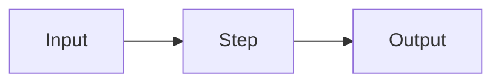

# Chapter title

## Why this matters

Two or three sentences: what problem this solves, and where it shows up in real work.

## Explanation

Structured, in depth, written for an experienced engineer. Use sub-sections, diagrams and worked examples.

### First sub-topic

Set up the resource: say what to look for in it. The text after the callout builds on it.

::: info 📖 Read now
[Resource title](https://example.com) · article · ~15 min · **essential**

Look for: the one idea you need from it before continuing.
:::

### Second sub-topic

::: tip ▶️ Watch
[Video title](https://example.com) · video · ~40 min · optional

Covers the same idea visually; watch if the diagram above didn't click.
:::

Books name the specific chapters, e.g. *Build an LLM From Scratch*, ch. 3.

## Practice

**Brief:** what to build or try, and why.

**Where:** `experiments/NN-name/`, or a step in `project/`.

**Steps:**

1. …
2. …

**Done when:** an observable acceptance check.

## Check questions

1. A question that tests understanding, not recall.

   

Answer

   The answer, with the reasoning.

   

## My understanding

<!-- Written by the learner, in their own words. Agents never fill this in. -->
