# AI Engineering: a study book

A personal, non-linear course on how LLMs work, how to program with them, agents and harnesses, Claude Code, AI-native software development, and choosing models cost-effectively. Each chapter combines a structured explanation, curated articles and videos at the point of use, and hands-on practice.

New here? Start with [How to use this book](/part-00-catch-up/0.0-how-to-use-this-book).

## How it works

- **Read in any order.** Each chapter lists what it **needs**, but those are hints, not gates. See [Suggested paths](/paths) for some ready-made routes.
- **Core vs Deeper.** *Core* chapters give the first pass through every concept. *Deeper* chapters (◇ in the sidebar) are optional follow-ups.
- **Status.** Every chapter is `not-started` → `reading` → `practiced` → `understood`. Update it in the chapter's frontmatter, then run `npm run progress`.
- **Resources.** Everything referenced is collected in the [Resources](/resources) catalog. Facts that go stale fast (models, prices, tools) live on the dated [Landscape](/landscape) page.

## Map

How the parts build on each other:

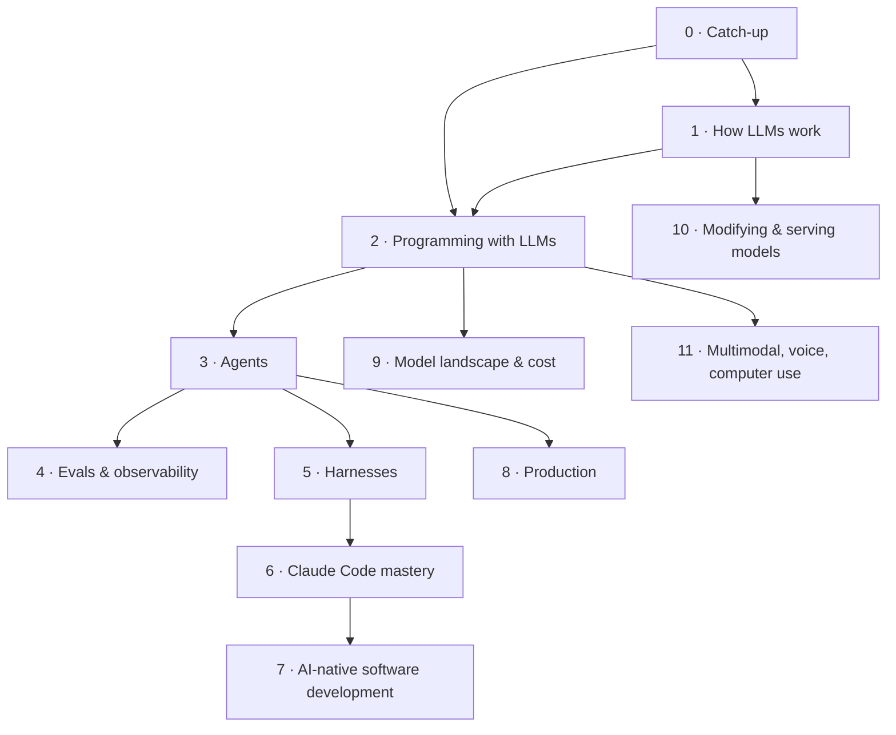

## Chapter maps

<!-- map:start -->
<!-- Generated by `npm run map` from chapter frontmatter. Don't edit by hand. -->

Arrows point from a chapter to the chapters that need it. Dashed boxes are Deeper chapters; grey boxes are prerequisites from other parts.

### Part 0 · Catch-up

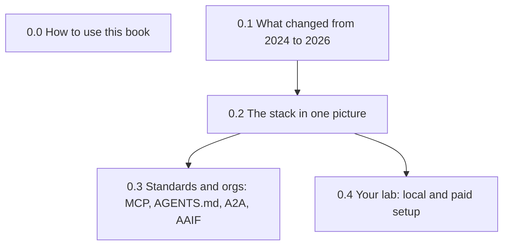

### Part 1 · How LLMs work

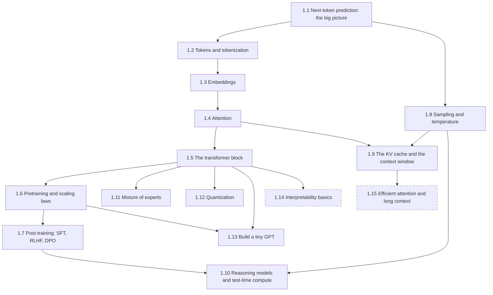

### Part 2 · Programming with LLMs

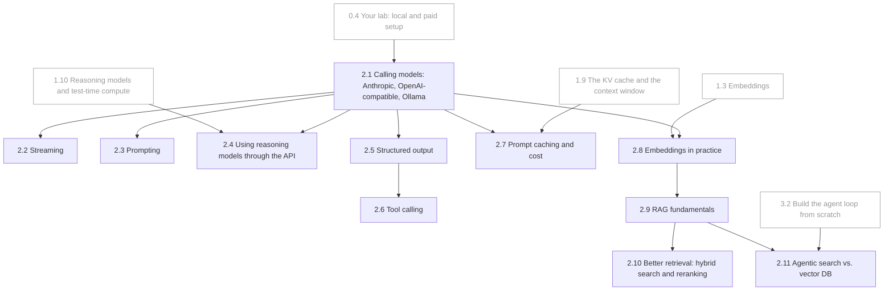

### Part 3 · Agents

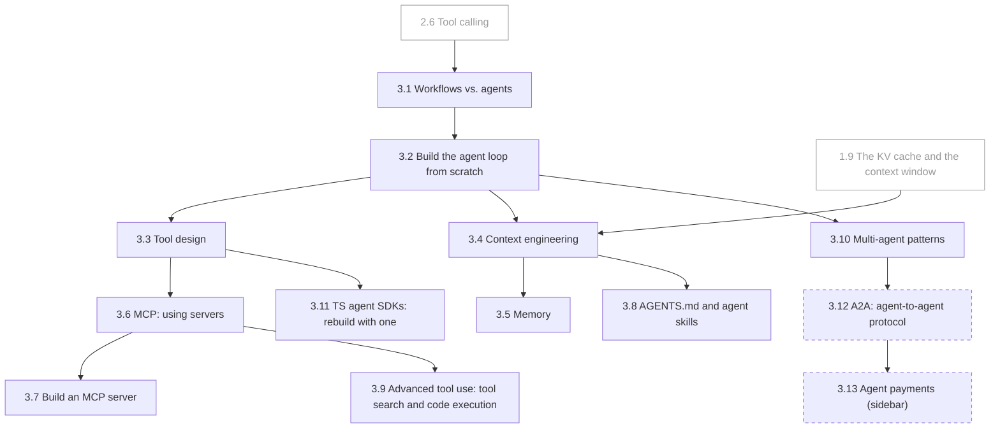

### Part 4 · Evals & observability

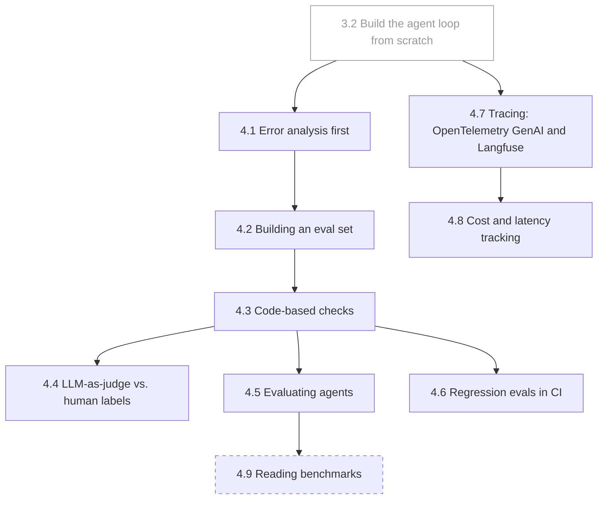

### Part 5 · Harnesses

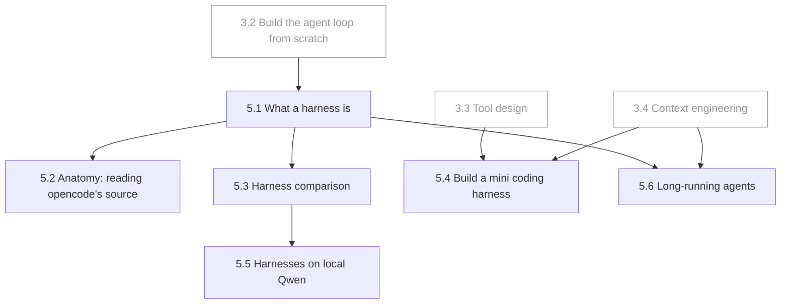

### Part 6 · Claude Code mastery

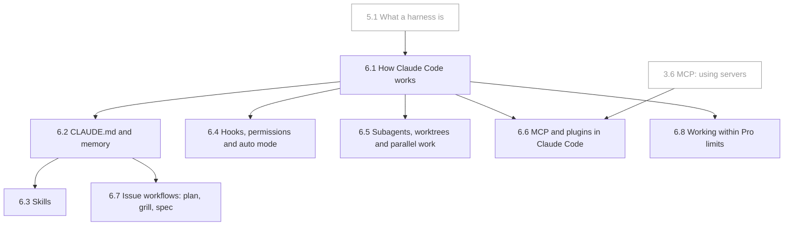

### Part 7 · AI-native software development

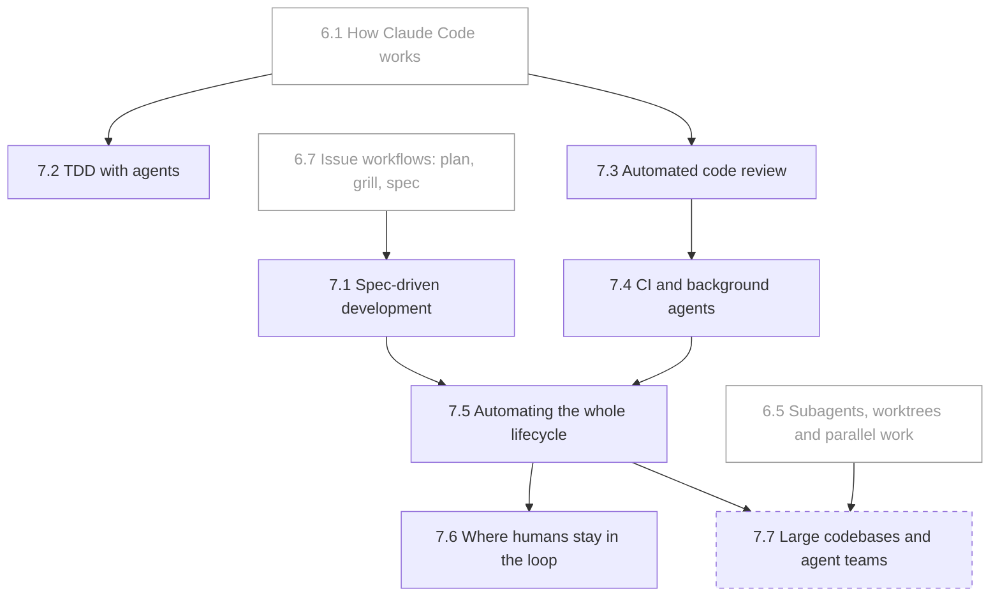

### Part 8 · Production

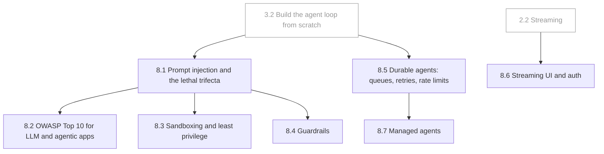

### Part 9 · Model landscape & cost

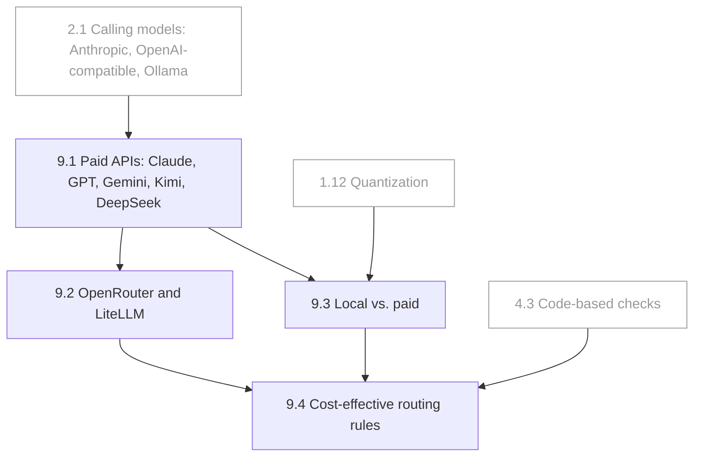

### Part 10 · Modifying & serving models

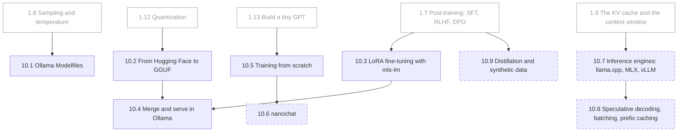

### Part 11 · Multimodal, voice, computer use

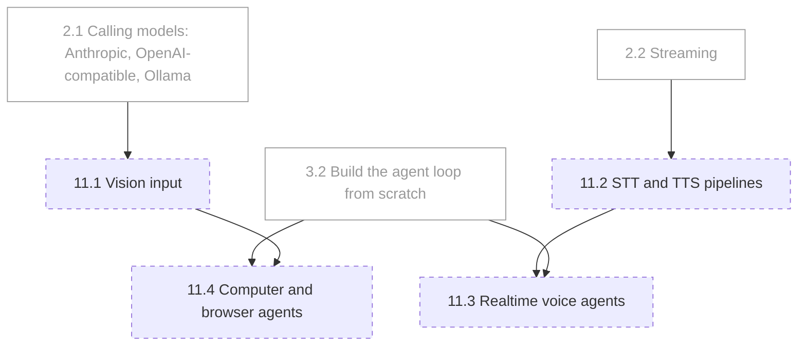
<!-- map:end -->
