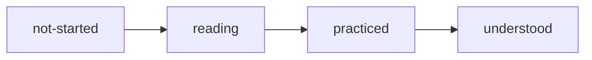

# How to use this book

## Why this matters

This book isn't meant to be read front to back. Knowing how chapters are built and tracked lets you jump straight to whatever you're curious about without losing your place.

## Explanation

### Chapters

Each chapter covers one sub-topic: roughly 20–60 minutes of reading plus a practical exercise. The badge at the top shows:

- **Tier:** *Core* is the first pass through the concepts. *Deeper* is an optional follow-up, marked ◇ in the sidebar.
- **Status:** where you are with it. Edit `status:` in the chapter's frontmatter as you go.
- **Needs:** chapters that make this one easier to read. These are suggestions, not gates.

### Resources are part of the path

Articles and videos appear at the point where they're needed, not in a list at the end. The text around each one tells you what to look for, and the text after it assumes you've read or watched it.

::: info 📖 Read now
[VitePress: Markdown extensions](https://vitepress.dev/guide/markdown) · docs · ~10 min · optional

Look for: custom containers (`::: info`), which is how these callouts are written.
:::

Every resource is also listed in the [Resources](/resources) catalog, where you can tick it off.

### Tracking

- Update `status:` in a chapter's frontmatter, then run `npm run progress` to refresh the table in `PROGRESS.md`.
- Write the **My understanding** section yourself, in your own words. It's the best test of whether a chapter stuck.

## Practice

**Brief:** run the book locally and make it yours.

**Steps:**

1. `npm run dev`, then open the printed URL.
2. Set this chapter's `status:` to `reading`, save, and watch the badge change.
3. Run `npm run progress` and check the table in `PROGRESS.md`.

**Done when:** the badge and the `PROGRESS.md` table both show your status.

## Check questions

1. What should you do if a chapter "needs" one you haven't read?

   

Answer

   Nothing has to happen. `needs` is a hint, not a gate. Read on, and follow the link back if something doesn't make sense.

   

## My understanding

<!-- Written by the learner, in their own words. Agents never fill this in. -->
