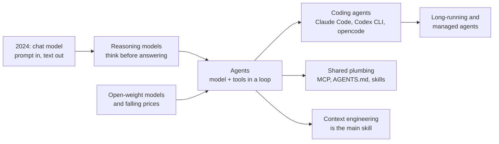

# What changed from 2024 to 2026

## Why this matters

You last looked closely around mid-2025, and the field has moved again: reasoning models are the default, coding agents do real multi-hour work, and open-weight models run well on a Mac. This chapter rebuilds your mental map before you dive into any one part.

Every later chapter assumes this map. When Part 3 talks about "context engineering" or Part 5 about "harnesses", it helps to know these are answers to specific problems that showed up between 2024 and now, not fashionable renames.

**Learning goals**

- Name the major shifts since 2024 and why each happened
- Place each shift in the part of the book that covers it
- Separate durable ideas from this year's product names

## Explanation

### The short version

Two years ago the mental model was "a model answers a prompt". Now it is "a model runs in a loop, with tools, inside a harness, and what you control is the context it sees". Almost every shift below follows from that one move.

Read this chapter as a timeline you can pull on. Each section gives the shift, why it happened, and where the book picks it up.

### 1. Reasoning models and test-time compute

**Then (2024):** you got better answers by using a bigger model or a cleverer prompt ("think step by step"). Compute was spent in training.

**Now:** the model is *trained* to produce a long chain of thought before answering, and you can buy better answers by letting it think longer. This is **test-time compute**: spending more tokens at inference. Simon Willison dates the start to OpenAI's o1 in September 2024, doubled down on by o3 and o4-mini in early 2025, and notes that reasoning "has since become a signature feature of models from nearly every other major AI lab".

**Why it happened:** a training recipe that works. Instead of imitating human-written reasoning, you train against automatically checkable rewards (a math answer is right, the tests pass). This is **RLVR**, reinforcement learning with verifiable rewards. The DeepSeek-R1 paper showed that reasoning abilities "can be incentivized through pure reinforcement learning", with self-reflection and verification emerging without human-labelled reasoning traces.

You've already felt this trade in your own lab: in `experiments/00-speed-check`, `qwen3:14b` with thinking on made simple answers about 20× slower. That is the trade, felt directly: more thinking tokens, better hard answers, worse latency and cost on easy ones.

::: info 📖 Read now
[DeepSeek-R1: Incentivizing Reasoning Capability in LLMs via Reinforcement Learning](https://arxiv.org/abs/2501.12948) · paper · ~15 min for the abstract and introduction · optional

Look for: the claim that no human-labelled reasoning trajectories were needed, and the last abstract sentence about passing reasoning down to smaller models. Skip the benchmark tables on a first pass.
:::

The R1 abstract is the *why*: it shows RL on verifiable tasks is enough to get reasoning behaviour. The book returns to it in [1.10 Reasoning models](/part-01-how-llms-work/1.10-reasoning-models), where you'll see how a reasoning model differs mechanically, and in Part 2 where you call models from code and see what the thinking tokens cost.

**Durable idea:** capability can be bought at inference time, not only at training time. **Product name that will age:** "o1", "thinking mode", any specific budget flag.

### 2. From chat to agents

**Then:** "agent" was a talking point. Willison's summary of 2024 is that "everyone was talking about agents but there were few to no examples of them working", partly because everyone used the word differently.

**Now:** a usable working definition has settled: an agent is an LLM that runs tools in a loop to achieve a goal. Anthropic's earlier framing draws the useful line: **workflows** are "systems where LLMs and tools are orchestrated through predefined code paths", while **agents** are "systems where LLMs dynamically direct their own processes and tool usage".

::: info 📖 Read now
[Building effective agents](https://www.anthropic.com/engineering/building-effective-agents) · article (Anthropic, 19 Dec 2024) · ~25 min · essential

Look for: the workflow vs. agent distinction, and the advice to prefer the simplest thing that works. It was written before most of the shifts in this chapter and still holds, which makes it a good example of a durable idea.
:::

**Why it happened:** reasoning models are far better at planning and recovering from errors, and tool calling became reliable enough to chain dozens of steps. METR's time-horizon chart, cited by Willison, shows the length of software tasks models can complete half the time went from under 30 minutes for 2024's best models to multiple hours by late 2025.

Where it lives in the book: [3.1 Workflows vs. agents](/part-03-agents/3.1-workflows-vs-agents) and [3.2 The agent loop](/part-03-agents/3.2-agent-loop). You'll build the loop yourself in TypeScript.

### 3. Coding agents became the flagship product

Willison calls the quiet release of Claude Code in February 2025 (bundled into the Claude 3.7 Sonnet announcement) "the most impactful event of 2025". He defines **coding agents** as "LLM systems that can write code, execute that code, inspect the results and then iterate further", and notes that every major lab shipped a CLI version: Claude Code, Codex CLI, Gemini CLI, Qwen Code and others.

Why code first? It has the cheapest verifier there is: run the tests. That is the same property that made RLVR work, so coding is where agents got reliable first.

Two things to separate:

- The **model** (Claude, GPT, Qwen) is the engine.
- The **harness** is everything around it: tools, context management, permissions, the loop. Claude Code, Codex CLI and opencode are harnesses. The current list with licences is in [Landscape](/landscape#coding-agents-and-harnesses).

You will use one daily (Part 6), read how they work (Part 5), and build a small one yourself.

### 4. MCP, AGENTS.md, skills and the Agentic AI Foundation

Once agents exist, every tool needs to plug into every agent. Three small open formats emerged to stop that being an N×M problem:

| Piece | What it standardizes | Introduced |
|---|---|---|
| **MCP** (Model Context Protocol) | How an AI application connects to tools and data through servers | Open-sourced by Anthropic, 25 Nov 2024 |
| **AGENTS.md** | A "README for agents": project instructions any coding agent reads | Released by OpenAI, August 2025 |
| **Agent Skills** | A folder with a `SKILL.md` plus resources, loaded on demand | Described by Anthropic, 16 Oct 2025, later published as an open standard |

On 9 December 2025 the Linux Foundation announced the **Agentic AI Foundation (AAIF)**, with MCP, goose and AGENTS.md as founding contributions from Anthropic, Block and OpenAI. The point is governance: the plumbing no longer belongs to one vendor. Current spec versions and which projects have joined since (A2A, for example) are tracked in [Landscape](/landscape#key-standards-and-orgs) and covered properly in [0.3 Standards and orgs](/part-00-catch-up/0.3-standards-and-orgs).

::: info 📖 Read now
[Introducing the Model Context Protocol](https://www.anthropic.com/news/model-context-protocol) · article (Anthropic, 25 Nov 2024) · ~8 min · essential

Look for: the problem statement ("every new data source requires its own custom implementation"). That is the whole reason MCP exists, and it is useful to hold on to when you meet 40 MCP servers in Part 3.
:::

**Durable idea:** agents need a small, vendor-neutral interface for tools and instructions. **Will age:** the exact spec revision and which logo is on which working group.

Covered in [3.6 Using MCP](/part-03-agents/3.6-mcp-using), [3.7 Building MCP servers](/part-03-agents/3.7-mcp-building) and [3.8 AGENTS.md and skills](/part-03-agents/3.8-agents-md-and-skills).

### 5. Open-weight models and the price collapse

**Then:** the best models were closed and the open ones (Llama) trailed. **Now:** Willison notes that in 2024 Chinese labs showed "early signs of life" with Qwen 2.5 and early DeepSeek, but in 2025 this "changed dramatically". As of his 30 December 2025 snapshot of the Artificial Analysis open-weight ranking, the top five were all Chinese models (GLM-4.7, Kimi K2 Thinking, MiMo-V2-Flash, DeepSeek V3.2, MiniMax-M2.1), with the highest non-Chinese model, gpt-oss-120B, sixth. He dates the shift to DeepSeek V3 on Christmas Day 2024, "supposedly trained for around $5.5m", followed by R1 in January 2025.

Two practical consequences for you:

1. **Price spread.** The gap between frontier and capable-and-cheap models is wide. Don't memorize numbers; open the tables in [Landscape](/landscape#frontier-models) and compare an Anthropic row with a DeepSeek or Kimi row yourself. That's the cost-effective-mix question of Part 9.
2. **Local is real.** A Mixture-of-Experts model like `qwen3:30b-a3b` runs on your 24 GB Mac (see [what fits](/landscape#what-fits-in-24-gb-of-unified-memory)). MoE is why: only ~3B parameters are active per token ([1.11](/part-01-how-llms-work/1.11-mixture-of-experts)).

::: warning Check dates on rankings
A leaderboard snapshot is a product name problem in disguise. The durable fact is "open-weight models closed most of the gap and drove prices down", not who was first in December 2025.
:::

### 6. Context engineering replaces prompt engineering

As agents ran longer, the bottleneck stopped being the wording of one prompt. Anthropic's September 2025 post says it plainly: "Building with language models is becoming less about finding the right words and phrases for your prompts, and more about answering the broader question of 'what configuration of context is most likely to generate our model's desired behavior?'"

The distinction they draw:

- **Prompt engineering**: methods for writing and organizing LLM instructions.
- **Context engineering**: strategies for curating and maintaining the optimal set of tokens during inference, including everything else that lands in the window: tools, message history, retrieved data, memory.

::: info 📖 Read now
[Effective context engineering for AI agents](https://www.anthropic.com/engineering/effective-context-engineering-for-ai-agents) · article (Anthropic, 29 Sep 2025) · ~25 min · essential

Look for: context as "a finite resource with diminishing marginal returns" (the "attention budget"), and the "just in time" strategy where agents keep lightweight references such as file paths and fetch content when needed, rather than loading everything upfront. Everything in Part 3 chapter 3.4 elaborates on this.
:::

This is the single most useful idea for working with agents day to day. It is also why your `CLAUDE.md`, skills and sub-agents exist: they are all ways of controlling what is in the window. Covered in [3.4 Context engineering](/part-03-agents/3.4-context-engineering) and used constantly in Part 6.

**Durable idea:** the context window is a scarce resource you curate. **Will age:** the phrase itself; it may be renamed again.

### 7. Long-running, background and managed agents

The newest shift is agents that work for hours, across many context windows, without you watching. Two Anthropic engineering posts mark the path:

- *Effective harnesses for long-running agents* (26 Nov 2025): the core problem is that long-running agents work in discrete sessions and "each new session begins with no memory of what came before", so progress has to be carried across context windows deliberately.
- *Scaling Managed Agents with stable interfaces* (8 Apr 2026): a hosted service where the provider runs the loop and sandbox. Its key argument is that harnesses "encode assumptions about what Claude can't do on its own", and those assumptions go stale as models improve. The example: a context-reset workaround needed for one Sonnet model became "dead weight" on a newer Opus model.

That last point is worth keeping in your head all through the book: **harness code is a bet on today's model weaknesses**, so expect it to need pruning.

::: info 📖 Read now
[Scaling Managed Agents with stable interfaces](https://www.anthropic.com/engineering/managed-agents) · article (Anthropic, 8 Apr 2026) · ~20 min · optional for now

Look for: the opening on stale harness assumptions. The operating-system analogy later in the post is the design idea; come back for it in Part 5.
:::

Covered in [5.6 Long-running agents](/part-05-harnesses/5.6-long-running-agents) and [8.7 Managed agents](/part-08-production/8.7-managed-agents).

### A timeline to pin to the wall

| Date | Event | Source |
|---|---|---|
| Sep 2024 | OpenAI o1 starts the reasoning-model wave | [Willison](https://simonwillison.net/2025/Dec/31/the-year-in-llms/) |
| 25 Nov 2024 | MCP open-sourced | [Anthropic](https://www.anthropic.com/news/model-context-protocol) |
| 19 Dec 2024 | *Building effective agents* | [Anthropic](https://www.anthropic.com/engineering/building-effective-agents) |
| 25 Dec 2024 / Jan 2025 | DeepSeek V3, then R1 | [Willison](https://simonwillison.net/2025/Dec/31/the-year-in-llms/), [R1 paper](https://arxiv.org/abs/2501.12948) |
| Feb 2025 | Claude Code released | [Willison](https://simonwillison.net/2025/Dec/31/the-year-in-llms/) |
| 29 Sep 2025 | *Effective context engineering* | [Anthropic](https://www.anthropic.com/engineering/effective-context-engineering-for-ai-agents) |
| 16 Oct 2025 | Agent Skills article | [Anthropic](https://www.anthropic.com/engineering/equipping-agents-for-the-real-world-with-agent-skills) |
| 9 Dec 2025 | Agentic AI Foundation formed | [Linux Foundation](https://www.linuxfoundation.org/press/linux-foundation-announces-the-formation-of-the-agentic-ai-foundation) |
| 8 Apr 2026 | Managed Agents engineering post | [Anthropic](https://www.anthropic.com/engineering/managed-agents) |

### Durable ideas vs. this year's names

| Durable (learn this) | Product-of-the-moment (look it up when needed) |
|---|---|
| Capability can be bought at inference time (test-time compute) | o1, "thinking mode", specific budget flags |
| An agent is a model plus tools in a loop; a harness wraps it | Claude Code vs. Codex CLI vs. opencode |
| Tools and instructions need small vendor-neutral formats | The current MCP spec revision, AAIF membership |
| Open-weight models set a price and capability floor | Which model tops a leaderboard this month |
| Context is a scarce resource you curate | The phrase "context engineering" |
| Harnesses encode bets on model weaknesses and need pruning | The specific workaround of the week |

### Two sources to keep open

::: info 📖 Read now
[2025: The year in LLMs](https://simonwillison.net/2025/Dec/31/the-year-in-llms/) · article (Simon Willison, 31 Dec 2025) · ~45 min · essential

Look for: the section headings. They are a table of contents for 2025 ("The year of reasoning", "of agents", "of coding agents and Claude Code", "of top-ranked Chinese open weight models", "of long tasks"). Read those sections in full and skim the rest. He is a practitioner with a stated bias towards what he has actually used, so treat it as a well-informed field report, not a neutral survey.
:::

::: info 📖 Read now
[Chip Huyen, *AI Engineering* (O'Reilly, 2025)](https://github.com/chiphuyen/aie-book) · book · chapter 1, ~30 min · optional

Look for: how Chapter 1 traces language models to large language models (via self-supervision), then to foundation models, and how that gave rise to AI engineering as a discipline. The chapter summary is at [chapter-summaries.md](https://github.com/chiphuyen/aie-book/blob/main/chapter-summaries.md). The repo is a companion with summaries and resources rather than the book text, and the author says it is "NOT a tutorial book", which makes it a good map for understanding and a poor one for code. Its chapter list (evaluation, prompt engineering, RAG and agents, finetuning, inference optimization) is a useful cross-check against this book's parts.
:::

For a running list of what exists right now, Anthropic's [engineering index](https://www.anthropic.com/engineering) is the cheapest way to scan titles and dates.

## Practice

**Brief:** Write a one-page "then vs now" table in `notes/what-changed.md`: for each shift, what you believed in 2024, what is true now, and which chapter covers it.

**Where:** Notes only, no code (`notes/`).

**Steps**

1. Create `notes/what-changed.md` with the columns **Shift**, **What I believed in 2024**, **What is true now**, **Chapter**.
2. Use the seven sections of this chapter as your rows. Fill the "believed" column **before** you re-read anything, from your own memory. Being wrong is the point: it shows where your model needs updating.
3. Fill "true now" in your own words, without copying phrases from this chapter.
4. For "Chapter", use the links in this chapter, or pick the part of the book you plan to read first.
5. Add an eighth row for one shift you think is missing from this chapter, with a source for it.
6. Add a short last section: "Product names I should not memorize".

**Done when**

- The table has at least seven rows plus your own eighth.
- Every "true now" cell is a sentence you could explain to a colleague, not a keyword.
- At least two "believed" cells record something you were actually wrong about.

## Check questions

1. What training signal makes a *reasoning model* different from a chat model trained mainly on human demonstrations, and why does coding benefit from it first?

   

Answer

   Reinforcement learning against automatically verifiable rewards (RLVR): math answers that are correct, tests that pass. The model discovers its own reasoning strategies instead of copying human ones. Code has an easy verifier (run the tests), so it was an early beneficiary and also a natural place for agents to be reliable.
   

2. Explain the difference between a *workflow* and an *agent*. Give one task where you would pick each.

   

Answer

   A workflow orchestrates LLM calls through predefined code paths; an agent lets the model decide its own steps and tool use. Pick a workflow for a fixed, known pipeline (classify a ticket, then draft a reply); pick an agent when the steps can't be known in advance (fix a failing test in an unfamiliar codebase).
   

3. What problem do MCP, AGENTS.md and skills each solve, and why does it matter that they sit under the AAIF rather than one company?

   

Answer

   MCP: connect an agent to tools and data without custom integration for each pair. AGENTS.md: give any coding agent the same project instructions. Skills: package know-how loaded on demand. Neutral governance reduces the risk that the plumbing is tied to a single vendor's roadmap, which is what lets you mix models and harnesses.
   

4. Your teammate says "prompt engineering is dead". What is the more precise claim, and what is the constraint context engineering works against?

   

Answer

   Writing good instructions still matters, but it is now one part of a larger task: choosing which tokens (instructions, tools, history, retrieved data, memory) are in the window on each turn. The constraint is that the window is finite and more tokens has diminishing returns, so you curate rather than dump.
   

5. A harness has a workaround for a model weakness. A new model is released. What should you do, and what does the Managed Agents post offer as evidence?

   

Answer

   Re-test whether the workaround is still needed and remove it if not, since harness code encodes assumptions about what the model can't do. The post's example: context resets added for a Sonnet model that wrapped up work early became dead weight on a newer Opus model.
   

## My understanding

<!-- Written by the learner, in their own words. Agents never fill this in. -->
