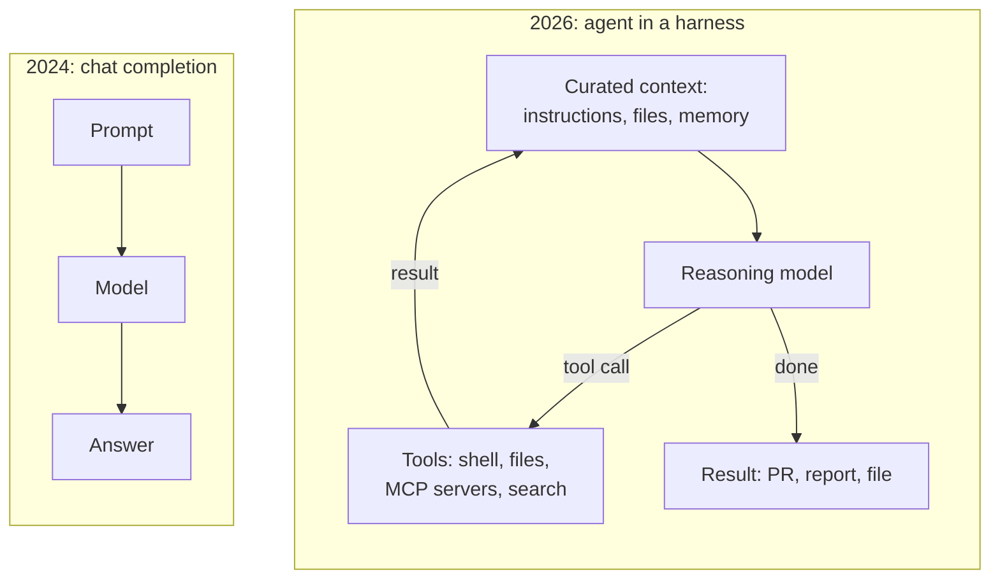

# What changed from 2024 to 2026

## Why this matters

You last looked closely around mid-2025, and the field has moved again: reasoning models are the default, coding agents do real multi-hour work, and open-weight models run well on a Mac. This chapter rebuilds your mental map before you dive into any one part. It's an orientation, not a deep dive. Every shift below gets its own chapters later, and this one tells you where.

**Learning goals**

- Name the major shifts since 2024 and why each happened
- Place each shift in the part of the book that covers it
- Separate durable ideas from this year's product names

## Explanation

### The shape of the change

In 2024 the mental model was **a chat model behind an API**. You wrote a prompt, got a completion, maybe called a tool once, and judged progress by benchmark scores on bigger and bigger models.

By late 2026 the mental model is **a model running in a loop inside a harness**. The model thinks before answering, calls tools many times, reads files, runs tests, and works for minutes or hours. The interesting engineering has moved out of the model and into everything around it: which tokens go into the context, which tools exist, how work survives across sessions, and where the agent is allowed to run.

Six shifts got us from the left picture to the right one. They are connected: reasoning made tool use reliable, tool use made agents work, agents made context the bottleneck, and open standards made agents portable.

Two year-in-review posts by Simon Willison are the best primary-ish snapshot of this period, written at the time by someone who tried everything. Read the 2024 one first: it's the world you remember.

::: info 📖 Read now
[Things we learned about LLMs in 2024](https://simonwillison.net/2024/Dec/31/llms-in-2024/) · article · ~20 min · **essential**

Look for: "LLM prices crashed", "The rise of inference-scaling 'reasoning' models" and "'Agents' still haven't really happened yet". Hold on to that last heading; the next post reverses it.
:::

::: info 📖 Read now
[2025: The year in LLMs](https://simonwillison.net/2025/Dec/31/the-year-in-llms/) · article · ~25 min · **essential**

Look for: "The year of 'reasoning'", "The year of agents", "The year of coding agents and Claude Code" and "The year of top-ranked Chinese open weight models". Skim the rest. Notice his working definition of an agent: "an LLM that runs tools in a loop to achieve a goal."
:::

The rest of this chapter takes those threads one at a time, adds what happened after December 2025, and points to where the book goes deep.

### 1. Reasoning models and test-time compute became the default

**What changed.** Until 2024, the way to get a better model was to train a bigger one (more parameters, more data, more training compute). OpenAI's o1 (September 2024) showed a second axis: let the model generate a long hidden chain of thought before answering, and spend more compute **at inference time**. Willison's 2024 post puts it as "instead of improving model performance purely through additional compute at training time, models can now take on harder problems by spending more compute on inference."

In January 2025 DeepSeek published how to train this openly. Their R1 paper shows reasoning can be "incentivized through pure reinforcement learning", with rewards that a program can check (the math answer is right, the tests pass) instead of human-written reasoning examples. That is **RLVR**, reinforcement learning with verifiable rewards.

::: tip 📄 Skim
[DeepSeek-R1: Incentivizing Reasoning Capability in LLMs via Reinforcement Learning](https://arxiv.org/abs/2501.12948) · paper · ~10 min for the abstract and intro · optional

Look for: the R1-Zero vs. R1 distinction (pure RL vs. RL after a small "cold start" of examples), and the distilled small models. You'll read it properly in 1.10.
:::

**Why it happened.** Pretraining gains were getting expensive, and RL on verifiable tasks turned out to be cheap and very effective for math and code. Through 2025 every major lab shipped a reasoning model, and today "how much to think" is usually a request parameter rather than a separate product line (you'll use it in 2.4). You've already seen the local cost of it: `qwen3:14b` in thinking mode was ~20× slower on simple answers in your speed check.

**Why it matters for you.** Reasoning tokens cost money and latency, so "how much should the model think?" is now an API parameter you tune. And as Willison notes, "the real unlock of reasoning was in driving tools": a model that can plan, call a tool, read the result and re-plan is what makes agents work.

**Where in the book:** [1.7 Post-training](/part-01-how-llms-work/1.7-post-training), [1.10 Reasoning models](/part-01-how-llms-work/1.10-reasoning-models), [2.4 Reasoning via the API](/part-02-programming-with-llms/2.4-reasoning-via-api).

### 2. From chat to agents

**What changed.** In December 2024 Anthropic's [Building effective agents](https://www.anthropic.com/engineering/building-effective-agents) drew the line that the field adopted: **workflows** are "systems where LLMs and tools are orchestrated through predefined code paths", while **agents** are "systems where LLMs dynamically direct their own processes and tool usage". At the time agents were mostly demos. Willison's 2024 heading was "'Agents' still haven't really happened yet."

2025 changed that, and the breakout category was coding. Anthropic shipped Claude Code as a "limited research preview" alongside Claude 3.7 Sonnet in [February 2025](https://www.anthropic.com/news/claude-3-7-sonnet). Willison calls it "the most impactful event of 2025". OpenAI's [Codex CLI](https://github.com/openai/codex) and the open-source [opencode](https://opencode.ai/) followed the same pattern: a terminal program that gives a model a shell, a file editor and your repo, then runs the loop.

**Why it happened.** Three things lined up: reasoning models that recover from their own mistakes, models post-trained specifically on tool use, and a domain (code) where results are verifiable by running them. Tests passing is a reward signal and a stopping condition at the same time.

**Long-running agents.** The next limit was the context window. A task that takes hours doesn't fit in one. Anthropic's [Effective harnesses for long-running agents](https://www.anthropic.com/engineering/effective-harnesses-for-long-running-agents) (November 2025) describes the pattern now common across harnesses: each session "begins with no memory of what came before", so the harness has an initializer session write a feature list, a progress file and a git commit, and each later session makes incremental progress and leaves structured notes for the next. You're looking at a version of that pattern right now: this repo's `.scratch/` issues and `PROGRESS.md` log exist for the same reason.

**Durable idea vs. product name.** "Claude Code", "Codex CLI" and "opencode" will change. The durable idea is the **harness**: the program around the model that owns the loop, the tools, permissions and context. Part 5 builds one.

**Where in the book:** [3.1 Workflows vs. agents](/part-03-agents/3.1-workflows-vs-agents), [3.2 The agent loop](/part-03-agents/3.2-agent-loop), [5.1 What a harness is](/part-05-harnesses/5.1-what-is-a-harness), [5.3 Harness comparison](/part-05-harnesses/5.3-harness-comparison), [5.6 Long-running agents](/part-05-harnesses/5.6-long-running-agents), and all of Part 6.

### 3. Open standards: MCP, AGENTS.md, skills and the AAIF

**What changed.** Once every product had agents, every product needed the same three things, and each got an open format:

| Need | Standard | Origin |
|---|---|---|
| Connect an agent to tools and data | **MCP**, Model Context Protocol | Anthropic, [November 2024](https://www.anthropic.com/news/model-context-protocol) |
| Tell a coding agent how this repo works | **AGENTS.md**, "a README for agents" | OpenAI, August 2025 ([agents.md](https://agents.md)) |
| Package reusable know-how the agent loads on demand | **Agent Skills**, a folder with a `SKILL.md` | Anthropic, [October 2025](https://www.anthropic.com/engineering/equipping-agents-for-the-real-world-with-agent-skills), open standard since December 2025 |

**Why it happened.** Before MCP, in Anthropic's words, "every new data source requires its own custom implementation". With N agent products and M tools that's N×M integrations; a shared protocol makes it N+M. AGENTS.md solved the same problem for instructions: one file every harness reads instead of a `.cursorrules`, a `CLAUDE.md` and a `GEMINI.md`. Skills solved a context problem: you can't put every instruction in the prompt, so only a skill's name and description load at startup, and the body loads when relevant ("progressive disclosure").

**Governance.** On 2025-12-09 the Linux Foundation formed the **Agentic AI Foundation (AAIF)** with three founding projects: MCP (from Anthropic), goose (from Block) and AGENTS.md (from OpenAI) ([announcement](https://www.linuxfoundation.org/press/linux-foundation-announces-the-formation-of-the-agentic-ai-foundation)). A2A, Google's agent-to-agent protocol, joined in August 2026. Vendor-neutral governance is why these are now safe to build on. The current status of each is on the [Landscape](/landscape#key-standards-and-orgs) page.

**A note of caution.** Not everyone thinks MCP is the end state. Willison's 2025 post has a section titled "The (only?) year of MCP", because coding agents that can run shell commands often don't need a protocol at all. Read that section and keep the question open until Part 3.

**Where in the book:** [0.3 Standards and orgs](/part-00-catch-up/0.3-standards-and-orgs) for the full picture, then [3.6 Using MCP](/part-03-agents/3.6-mcp-using), [3.7 Build an MCP server](/part-03-agents/3.7-mcp-building), [3.8 AGENTS.md and skills](/part-03-agents/3.8-agents-md-and-skills), [3.12 A2A](/part-03-agents/3.12-a2a), [6.3 Skills](/part-06-claude-code/6.3-skills).

### 4. Open-weight models and the price collapse

**What changed.** At the end of 2023, GPT-4 cost $30 per million input tokens and no open model came close to it. Willison's 2024 post lists the drop over one year: GPT-4o at $2.50, GPT-4o mini at $0.15, Gemini 1.5 Flash 8B at $0.0375 per million input tokens. Then the gap between open and closed models narrowed sharply. DeepSeek's V3 (Willison's 2024 post asks whether it was the best available LLM, "trained in China for less than $6m") and R1 were near the frontier with open weights, and through 2025 Chinese labs (Qwen from Alibaba, DeepSeek, Kimi from Moonshot) took the top open-weight spots. Willison's 2025 heading says it directly: "The year of top-ranked Chinese open weight models."

**Why it happened.** Competition, better efficiency (mixture-of-experts architectures that only run a fraction of their parameters per token, cheaper attention, quantization), distillation from bigger models, and the RL recipe from shift 1 being public.

**Why it matters for you.** Two things you'll use directly:

- **Local is real.** `qwen3:30b-a3b` on your Mac is a mixture-of-experts model: 30B parameters total, about 3B active per token. That's why it's fast despite its size. Models of this class would have been frontier-level two years ago.
- **Price spreads are huge.** The cheapest and most expensive frontier-lab models differ by about 100× per token. Picking the right model per task is now an engineering decision with real money on it, and it's what Part 9 is about.

Prices change monthly, so this book never hard-codes them. Look at the current numbers on the [Landscape](/landscape) page now, and compare them with the 2024 numbers above.

**Where in the book:** [1.11 Mixture of experts](/part-01-how-llms-work/1.11-mixture-of-experts), [1.12 Quantization](/part-01-how-llms-work/1.12-quantization), [9.1 Paid APIs](/part-09-model-landscape-cost/9.1-paid-apis), [9.3 Local vs. paid](/part-09-model-landscape-cost/9.3-local-vs-paid), [9.4 Routing rules](/part-09-model-landscape-cost/9.4-routing-rules), and Part 10.

### 5. Context engineering replaced "prompt engineering"

**What changed.** In mid-2025 the term **context engineering** caught on as "a better alternative to prompt engineering". Willison traces it to Shopify's Tobi Lütke, "recently amplified by Andrej Karpathy", and defines it as "the art of providing all the context for the task to be plausibly solvable by the LLM".

::: info 📖 Read now
[Effective context engineering for AI agents](https://www.anthropic.com/engineering/effective-context-engineering-for-ai-agents) · article · ~15 min · **essential**

Look for: the definition (curating "the optimal set of tokens" during inference) and why it's "iterative" while writing a prompt is a one-off. Note the techniques it lists for long tasks: compaction, structured note-taking and sub-agents.
:::

**Why it happened.** An agent's context isn't a prompt you write once. It accumulates on every turn: tool definitions, file contents, tool results, earlier reasoning. Context windows grew to around 1M tokens, but quality degrades as context fills (**context rot**), and every token costs money on every turn. So the skill moved from "phrase the instruction well" to "decide what the model sees at each step": which files, which tools, what to summarize, what to drop, what to hand to a sub-agent.

**Durable idea.** The context window is the model's whole world for one call. Everything in Parts 2, 3 and 6 (RAG, tool design, memory, CLAUDE.md, skills, sub-agents) is a way of managing it.

**Where in the book:** [2.3 Prompting](/part-02-programming-with-llms/2.3-prompting) (still matters, now a subset), [3.4 Context engineering](/part-03-agents/3.4-context-engineering), [3.5 Memory](/part-03-agents/3.5-memory), [6.2 CLAUDE.md and memory](/part-06-claude-code/6.2-claude-md-and-memory).

### 6. Managed and background agents

**What changed.** Once agents could work for hours, running them in your terminal became the bottleneck. Two related moves followed:

- **Background agents:** an agent runs in a cloud sandbox instead of on your laptop. It's started from an issue, a chat message or a CI event, works unattended, and comes back with a pull request or a report. You review its output instead of watching it work.
- **Managed agents:** the provider hosts the whole thing (loop, sandbox, session storage) behind an API. Anthropic's [Scaling Managed Agents](https://www.anthropic.com/engineering/managed-agents) (April 2026) describes the design: a **session** ("the append-only log of everything that happened"), a **harness** (the loop) and a **sandbox** (where code runs), deliberately decoupled, "the brain from the hands".

**Why it happened.** Long-running work needs durable state, isolation, and the ability to run many agents in parallel. Those are infrastructure problems, and most teams don't want to solve them for every agent.

**Durable idea.** Session log + harness + sandbox is a good decomposition even if you build your own. You'll see it again when you harden the growing project in Part 8.

**Where in the book:** [7.4 CI and background agents](/part-07-ai-native-development/7.4-ci-background-agents), [8.5 Durable agents](/part-08-production/8.5-durable-agents), [8.7 Managed agents](/part-08-production/8.7-managed-agents), [8.3 Sandboxing](/part-08-production/8.3-sandboxing).

### Durable ideas vs. this year's names

Product names here will look dated within a year. The ideas underneath have held up since 2024 and are what the book teaches:

| Durable idea | This year's names (will change) |
|---|---|
| Spend compute at inference to think | o-series, "extended thinking", R1, Qwen3 thinking mode |
| An agent is a model running tools in a loop | Claude Code, Codex CLI, opencode, goose |
| The harness matters as much as the model | Each product's permission modes, hooks, sub-agents |
| What the model sees decides what it can do | CLAUDE.md, AGENTS.md, skills, compaction |
| Shared protocols beat N×M integrations | MCP, A2A, the AAIF |
| Pick the cheapest model that passes your evals | Today's price table on [Landscape](/landscape) |
| Long work needs durable state outside the context | Progress files, managed-agent sessions |

### For a timeline

If you want to see the order in which these ideas reached practice, skim the titles on Anthropic's engineering blog. Titles and dates alone tell the story: best practices for agentic coding (April 2025), multi-agent research (June 2025), tools and context engineering (September 2025), skills (October 2025), long-running harnesses (November 2025), evals for agents (January 2026), auto mode and managed agents (spring 2026), agent memory (November 2026).

::: tip 📖 Skim
[Anthropic Engineering](https://www.anthropic.com/engineering) · docs/blog index · ~10 min · optional

Look for: which titles you recognize and which are new to you. Anything new is a shift you missed.
:::

For a slower, textbook framing of the same field, from just before agents took off:

::: tip 📕 Book
Chip Huyen, *AI Engineering* (O'Reilly, 2025), ch. 1 "Introduction to Building AI Applications with Foundation Models" ([companion repo](https://github.com/chiphuyen/aie-book)) · book · ~1.5 h · optional

Look for: "The AI Engineering Stack" and "AI Engineering Versus ML Engineering". It's a good map of the application layer. It was written before coding agents took off, which makes it a useful "then" for your practice table.
:::

## Practice

**Brief:** Write a one-page "then vs now" table in `notes/what-changed.md`. For each shift, write what *you* believed in 2024 (or mid-2025), what is true now, and which chapter covers it. The point is to find your own stale beliefs, so be honest in the "then" column.

**Where:** Notes only, no code (`notes/`).

**Steps:**

1. Before rereading anything, write down from memory 3–5 things you believed about LLMs when you last looked closely (e.g. "agents are demos", "local models are toys", "prompting is the main skill").
2. Create `notes/what-changed.md` with a table: *Shift · What I believed then · What's true now · Evidence (link) · Chapter*.
3. Fill in one row per shift from this chapter (six rows), plus a row for each belief from step 1 that doesn't fit one of the six.
4. For each "now" cell, link the resource that convinced you. Use primary sources, and the [Landscape](/landscape) page for prices or model names.
5. Under the table, list the two or three chapters you want to read next and why. This is your first route through the non-linear book.

**Done when:** `notes/what-changed.md` has at least six rows, every "now" cell links a source, every row names a chapter that exists in the sidebar, and you have a short "read next" list.

## Check questions

1. In one sentence each, how does a reasoning model differ from a 2024 chat model, and what does that cost you?

   

Answer

   It generates a chain of thought before its answer, trained with reinforcement learning on verifiable rewards, so it spends extra compute at inference to solve harder problems. The cost is more output tokens (money) and more latency, which is why the amount of thinking is a setting you tune per task.

   

2. Why did coding become the first domain where agents clearly worked, before, say, travel booking?

   

Answer

   Code gives the agent cheap, reliable feedback: it can run tests, type-check and execute the program to see if it worked. That verification acts as both a reward signal during training (RLVR) and a stopping condition during the loop. Travel booking has irreversible actions, ambiguous success criteria and untrusted web content.

   

3. A colleague says "context windows are 1M tokens now, so context engineering is obsolete: just put everything in." What's wrong with that?

   

Answer

   Quality degrades as context fills (context rot), so the model attends less well to what matters. Every token is also paid for on every turn of the loop, and adds latency. The window size is a limit, not a target: the skill is choosing the smallest set of tokens that makes the task solvable.

   

4. What problem does MCP solve that function calling alone doesn't?

   

Answer

   Function calling defines how one model asks your code to run one tool. It says nothing about how tools are packaged and discovered. MCP standardizes the connection between any AI application and any tool or data server, so a tool written once works in every MCP-capable client: N + M integrations instead of N × M.

   

5. Classify these as durable idea or product name, and say why it matters which is which: "AGENTS.md", "project instructions loaded at session start", "Claude Code auto mode", "a harness decides what the agent may do without asking".

   

Answer

   Durable: "project instructions loaded at session start" and "a harness decides what the agent may do without asking". Product names: "AGENTS.md" (a current format for the first idea, though as an AAIF standard it may last) and "Claude Code auto mode" (one product's take on the second). It matters because flags and names change monthly. If you learn the idea, you can find its equivalent in any harness.

   

## My understanding

<!-- Written by the learner, in their own words. Agents never fill this in. -->
