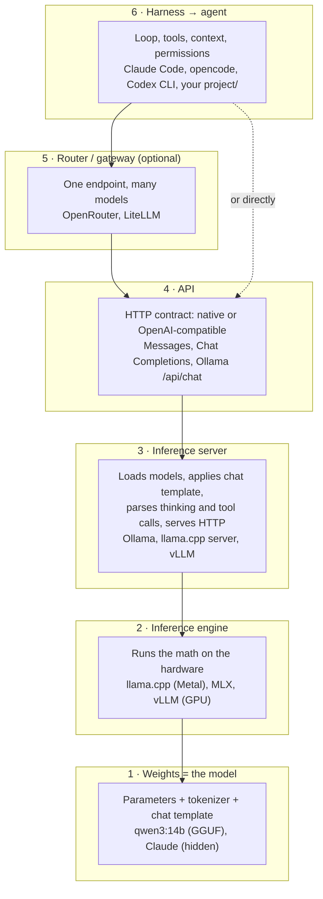

# The stack in one picture

## Why this matters

Model, inference server, API, harness, agent, router: these words get used loosely, and confusion between layers is behind most "why doesn't this work" moments. One clear picture of the stack makes every later chapter easier to place.

You already have a concrete case. In your speed check, `qwen3:30b-a3b` was asked not to think, thought anyway, and the raw reasoning ended up in the answer. Is that the model's fault, Ollama's, or your script's? By the end of this chapter you can answer that kind of question by asking which layer owns the behavior.

**Learning goals**

- Draw the layers from weights to agent and say what each one owns
- Place every tool you use (Ollama, Claude Code, OpenRouter...) on the diagram
- Explain where a given behavior (e.g. thinking leaking into output) comes from

## Explanation

### The picture

Chapter 0.1 ended with "a model running in a loop inside a harness". Here is what's under that sentence, from the bottom up:

Each layer has one job and one owner, and each one's input is the output of the layer below it. Read the rest of this section as a tour of that diagram. For each layer, ask two questions: **what does it own**, and **what can go wrong there**.

A hosted provider like Anthropic, OpenAI or DeepSeek runs layers 1–3 for you and only shows you layer 4. You never see Claude's weights or engine. Ollama on your Mac shows you all of them, which is why local models are the best place to learn the stack.

### 1. Weights and the model

A **model** is a file (or a set of files) of learned numbers, plus two small things that are easy to forget:

- **The tokenizer**, which maps text to the token IDs the weights were trained on (Chapter [1.2](/part-01-how-llms-work/1.2-tokenization)).
- **The chat template**, which turns a list of messages (`system`, `user`, `assistant`, tool results) into one flat token sequence with the special control tokens the model was post-trained on.

The weights alone are just a function from tokens to next-token probabilities. They don't know what a "message" or a "tool call" is. Those concepts exist because post-training taught the model to produce and respect certain token patterns, and the chat template is the contract for those patterns.

::: info 📖 Read now
[Chat templates](https://huggingface.co/docs/transformers/main/chat_templating) (Hugging Face Transformers docs) · docs · ~10 min (first section) · **essential**

Look for: how a list of messages "get[s] converted to a token sequence, often with control tokens like `<|user|>` or `<|assistant|>`", and the warning that "with the wrong control tokens, these models would have drastically worse performance." Stop after the first worked example. The point to keep: the format of a conversation belongs to the model, not to the API.
:::

So when people say "the model", they mean three things that ship together. Who owns what:

| Owned by the weights | Not owned by the weights |
|---|---|
| Knowledge, reasoning ability, code quality | How fast it runs (engine + hardware) |
| Whether it follows "code only" or a "don't think" instruction | Whether thinking is shown, hidden or stripped (server) |
| The token patterns for thinking and tool calls | Which tools exist and what they do (harness) |
| Its maximum trained context length | How much context you actually give it (server settings, harness) |

**Thinking is a token pattern.** A reasoning model like Qwen3 writes its reasoning as ordinary output tokens between `<think>` and `</think>`. The Qwen3 model card shows this directly. Its chat template takes an `enable_thinking` flag (a "hard switch"), the model also responds to `/think` and `/no_think` in messages (a "soft switch"), and its example code separates reasoning from answer by searching the output for the last `</think>` token.

::: info 📖 Read now
[Qwen/Qwen3-14B model card](https://huggingface.co/Qwen/Qwen3-14B) · docs · ~15 min · **essential**

Read the sections on switching between thinking and non-thinking modes, and the quickstart code. Look for: (1) `enable_thinking` is an argument to `apply_chat_template`, so the switch lives in the chat template; (2) the parsing snippet, which splits on `</think>` (token ID 151668) and treats everything before it as thinking; (3) the deployment notes, where vLLM and SGLang need a `--reasoning-parser` flag. That flag is a server feature. Hold on to all three: they explain the leak in your speed check.
:::

**What can go wrong here:** wrong answers, bugs, ignored instructions, confident nonsense. No setting in the layers above can make a small model smarter. They can only stop getting in its way.

Where to go deeper: Part 1 explains what's inside the weights ([1.1](/part-01-how-llms-work/1.1-next-token-prediction) to [1.12](/part-01-how-llms-work/1.12-quantization)), and [1.7 Post-training](/part-01-how-llms-work/1.7-post-training) explains where the chat and thinking behavior comes from.

### 2. Inference engines

An **inference engine** runs the forward pass: matrix multiplications on your hardware, the KV cache, sampling. It decides how fast tokens come out and how much memory they need. It doesn't care about messages, tools or HTTP.

| Engine | What it is | Where you meet it |
|---|---|---|
| [llama.cpp](https://github.com/ggml-org/llama.cpp) | "LLM inference in C/C++"; runs GGUF files; "Apple silicon is a first-class citizen - optimized via ARM NEON, Accelerate and Metal frameworks" | LM Studio's runtime ([Landscape](/landscape#access-routes)). Part 10 uses it directly for conversion and quantization. |
| [MLX LM](https://github.com/ml-explore/mlx-lm) | A Python package "for generating text and fine-tuning large language models on Apple silicon with MLX" | Part 10 (LoRA fine-tuning), and LM Studio's MLX runtime |
| [vLLM](https://docs.vllm.ai/en/latest/) | "a fast and easy-to-use library for LLM inference and serving", built around PagedAttention for KV-cache memory | Data-center GPUs, serving many users at once. Not your Mac. |

Engines care about a model's **size and format**, not its behavior. The same Qwen weights can be a GGUF file for llama.cpp, an MLX checkpoint or a safetensors checkpoint for vLLM. They give the same answers (up to quantization) at different speeds.

**What can go wrong here:** slow output, out-of-memory, the model spilling from GPU to CPU, long prompt processing. These are engine and hardware problems, and changing the prompt won't fix them.

Where to go deeper: [1.9 KV cache](/part-01-how-llms-work/1.9-kv-cache-context-window), [1.12 Quantization](/part-01-how-llms-work/1.12-quantization), [10.7 Inference engines](/part-10-modifying-serving-models/10.7-inference-engines).

### 3. Inference servers

An **inference server** wraps an engine in a long-running process with an HTTP API. This is where most of the "glue" behavior lives, and it's the layer people forget exists. A server like Ollama owns:

- **Model lifecycle:** pulling, storing, loading into memory, unloading after idle time.
- **Runtime settings:** context size (`num_ctx`), and how long a model stays loaded after a request.
- **The chat template:** it takes your JSON messages and renders them with the model's template into tokens for the engine.
- **Output parsing:** it splits the raw token stream back into structured fields: the answer, the thinking, tool calls.

The last two are the important ones. Ollama's `think` parameter isn't a model feature. It's a server option that the server translates into whatever the model's template needs, and then it parses the output into separate fields:

::: info 📖 Read now
[Thinking](https://docs.ollama.com/capabilities/thinking) (Ollama docs) · docs · ~5 min · **essential**

Look for: "Thinking-capable models emit a `thinking` field that separates their reasoning trace from the final answer", and that chat responses carry `message.thinking` and `message.content`. That separation is done by the server. If the server's parser doesn't find the pattern it expects, the reasoning stays in `content`.
:::

Some projects are engine and server at once. llama.cpp ships its own OpenAI-compatible server, and vLLM is both an engine and an "OpenAI-compatible API server". Ollama is a server built on top of an engine. Keep the two roles apart in your head even when one binary plays both.

**What can go wrong here:** thinking leaking into the answer, tool calls arriving as plain text instead of structured calls, a context size smaller than you assumed, slow first requests because the model was unloaded.

### 4. APIs: native vs. OpenAI-compatible

The **API** is the HTTP contract between your code and a server or provider: URL, request shape, response shape, streaming format. Two kinds matter:

- **Native APIs** expose everything the provider supports, in the provider's own shape. Anthropic's Messages API, Ollama's `/api/chat`.
- **OpenAI-compatible APIs** accept the Chat Completions request shape (`messages`, `model`, `tools`...), which became the de-facto common format. Almost every server and router speaks it.

Ollama offers both, side by side, plus a third:

::: tip 📖 Skim
[Ollama API introduction](https://docs.ollama.com/api) and [OpenAI compatibility](https://docs.ollama.com/openai) · docs · ~10 min · optional

Look for: the base-URL table on the first page. Native at `http://localhost:11434/api`, OpenAI-compatible at `http://localhost:11434/v1`, and an Anthropic-compatible client base URL at `http://localhost:11434`. On the second page, note "Ollama supports a subset of the OpenAI API" and "The client requires an API key value, but Ollama ignores it."
:::

The trade-off is always the same: **compatibility costs features.** A common format can only carry what every provider has in common. Anthropic's own compatibility page is unusually blunt about this:

::: info 📖 Read now
[OpenAI SDK compatibility](https://platform.claude.com/docs/en/api/openai-sdk) (Claude docs) · docs · ~10 min · **essential**

Look for: it "is primarily intended to test and compare model capabilities" and "is not considered a long-term or production-ready solution for most use cases." Then read the list of unsupported features: prompt caching isn't supported, and the response doesn't include Claude's thinking. Most important: "Most unsupported fields are silently ignored rather than producing errors."
:::

That last sentence is a whole class of bugs. You send a parameter, nothing fails, and nothing happens. When a feature "doesn't work" through an OpenAI-compatible endpoint, first check whether that endpoint supports it at all.

The rule this book follows: use the **native API** when you need a provider's distinctive features (Anthropic prompt caching, thinking blocks, Ollama's `think` field), and the **OpenAI-compatible** one when you want to swap models freely. Your smoke test in [experiment 01](/experiments/01-keys-smoke-test) already uses both: Ollama native, OpenRouter OpenAI-compatible, Anthropic native.

Where to go deeper: [2.1 Calling models](/part-02-programming-with-llms/2.1-calling-models), [2.2 Streaming](/part-02-programming-with-llms/2.2-streaming).

### 5. Routers and gateways

A **router** (or **gateway**) is an extra layer between your code and many APIs: one endpoint, one key, one request format, many models behind it. It owns model selection, fallbacks, billing and usage tracking. It doesn't run any model itself.

- [**OpenRouter**](https://openrouter.ai/docs/quickstart) is hosted: "access to hundreds of AI models through a single API endpoint", and "you can also use the OpenAI SDK pointed at OpenRouter as a drop-in replacement." The same open-weight model is often served by several hosting companies, and OpenRouter picks one per request: it "routes requests to the best available providers for your model", and "if a request fails, the retry is picked the same way from the providers that are left" ([provider routing](https://openrouter.ai/docs/features/provider-routing)).
- [**LiteLLM**](https://docs.litellm.ai/docs/) is self-hosted: a Python SDK, or a proxy that "is a self-hosted OpenAI-compatible gateway" giving "a single, unified interface to call 100+ LLMs ... using the OpenAI format." You can put local Ollama models and paid APIs behind it. That's the plan for the growing project in Part 9.

**What can go wrong here:** a router adds a translation step and a choice you didn't make. The same model name can be served by different providers, each running its own server stack, with different quantization, context limits or tool-call parsing. If a model behaves differently through OpenRouter than you expect, check which provider served the request. Routers also inherit the compatibility trade-off from layer 4.

Fees and the current list of access routes are on [Landscape → Access routes](/landscape#access-routes). Where to go deeper: [9.2 OpenRouter and LiteLLM](/part-09-model-landscape-cost/9.2-openrouter-litellm), [9.4 Routing rules](/part-09-model-landscape-cost/9.4-routing-rules).

### 6. Harnesses and agents

A **harness** is the program that calls the API in a loop: it sends the context, receives a tool call, runs the tool, appends the result and calls the model again. It owns the loop, the tools, the context (what goes in, what gets compacted), permissions and sandboxing, and session state. Claude Code's own docs give a definition you can reuse:

::: info 📖 Read now
[How Claude Code works](https://code.claude.com/docs/en/how-claude-code-works) · docs · ~15 min · **essential**

Look for: "Claude Code is the layer around the model that provides the tools and manages the context the model sees", and "This surrounding layer is what the term agentic harness refers to." Notice how much of the page is about things that aren't the model: tools, context, permissions, sessions. That's the harness's share of the stack.
:::

An **agent** isn't a separate layer. It's what you get when you run the whole stack on a task: a model plus a harness, looping. The same model in a different harness is a different agent, because it sees different tools and a different context. And the same harness can drive different models. Ollama documents running Claude Code against local or Ollama-hosted models "through its Anthropic-compatible API", with the caveat that "Hosted WebSearch and advanced tool controls are not fully supported" ([Ollama: Claude Code](https://docs.ollama.com/integrations/claude-code)). The harness doesn't care what's below layer 4, as long as the API contract holds. When it doesn't hold fully, features quietly degrade. That's the same lesson as layer 4, one level up.

**What can go wrong here:** the agent loops forever, uses the wrong tool, runs out of context, can't see a file, or does something it shouldn't. These are harness problems first: tool design, context management, permissions. Swapping in a smarter model only sometimes hides them.

**Products aren't layers.** Some names you use are subscriptions or bundles, not layers. Claude Pro is a plan: it's how you pay for Claude Code's access to Anthropic's hosted models (layers 1–4). Claude Code itself is layer 6. When you place a product on the diagram, ask which layers it *runs* and which it *pays for*.

The full list of current harnesses is on [Landscape → Coding agents and harnesses](/landscape#coding-agents-and-harnesses). Where to go deeper: [3.2 The agent loop](/part-03-agents/3.2-agent-loop), [5.1 What a harness is](/part-05-harnesses/5.1-what-is-a-harness), and all of Part 6.

### Placing your own tools

Here is your current setup on the stack:

| Your tool | Layers it runs | Notes |
|---|---|---|
| `qwen3:14b`, `qwen3:30b-a3b`... | 1 | GGUF weights + tokenizer + chat template, in `~/.ollama/models` |
| Ollama | 2 + 3, and serves 4 | Engine and server in one install, three API flavors |
| `bench.py` (experiment 00) | client of 4 | Calls Ollama's native API directly. No harness, no loop. |
| `smoke.ts` (experiment 01) | client of 4 and 5 | Three APIs, one of them through a router |
| OpenRouter | 5 | Routes to providers that run 1–4 |
| Anthropic API | 1–4, hidden | You only see the Messages API |
| Claude Code | 6 | Talks to Anthropic's API, or to anything that speaks it |
| `project/` (from Part 3) | 6 | The harness you'll build yourself |

### Where does a behavior come from?

When something surprises you, walk the stack from the top or the bottom and ask "does this layer own that behavior?" A few common symptoms:

| Symptom | First suspect | Why |
|---|---|---|
| Wrong or buggy answer | 1 · weights | Capability lives in the weights |
| Ignores "code only" or "be brief" | 1 · weights | Instruction following is post-training |
| Slow tokens, memory pressure | 2 · engine + hardware | Speed is the forward pass |
| Reasoning text appears in the answer | 3 · server parsing, with 1 | The server splits thinking from content by a token pattern the model must produce |
| A parameter "does nothing" | 4 · API | Compatibility layers silently ignore unsupported fields |
| Different behavior via a router | 5 · router | Possibly a different provider, with its own server stack |
| Agent forgets, loops, picks the wrong tool | 6 · harness | Context, tools and the loop are harness concerns |

These are first suspects, not verdicts. Layers interact, and the next section shows that a single symptom can involve two of them.

### Worked example: experiment 00

Your [speed check](/experiments/00-speed-check) is a small stack: `bench.py` → Ollama native API → Ollama server → Ollama's engine → Qwen weights. No router, no harness. Let's place two of its findings. The rest are your practice.

**Finding: "qwen3:8b wrote buggy code."** It compared the original string to the cleaned reversed one. Nothing in layers 2–4 changes which tokens a model considers likely. The same weights would write the same bug through any engine or API (sampling randomness aside). **Layer 1.** The fix is a bigger model or a test, not a setting.

**Finding: "`think: false` isn't always honored. qwen3:30b-a3b still reasoned and the raw text (ending in `</think>`) leaked into the answer."** Walk the stack:

1. `bench.py` sent `think: false` to the native API (layer 4). That's a request, not a guarantee.
2. Ollama (layer 3) turned it into the model's template-level switch. The model card shows that for Qwen3 this switch lives in the chat template.
3. The weights (layer 1) produced reasoning anyway, ending in `</think>`. A model following its training imperfectly is a layer-1 behavior.
4. Ollama's parser (layer 3) didn't split that text into the `thinking` field, so it stayed in `content`. The model card's own parsing code shows how a split normally works: search for the last `</think>`.
5. `bench.py` printed `content` as-is.

So the leak needs **two** layers to misbehave: the model reasoning when asked not to, and the server not separating the result. And the README's fix, "strip everything up to `</think>`", moves the parser into **your client**. That works, and it's what harnesses do when the server lets them down. You'll test the server-side part of this hypothesis in the practice.

## Practice

**Brief:** Draw the stack (Mermaid in `notes/the-stack.md`) with your actual setup on it: Ollama models, Claude Code, Claude Pro, OpenRouter. Mark which layer caused each finding in experiment 00.

**Where:** Notes only, no code (`notes/`).

**Steps:**

1. Without looking at this chapter's diagram, draw the six layers from memory in `notes/the-stack.md` as a Mermaid `flowchart`. For each layer, write one line: what it owns.
2. Put your real tools on it: the four Qwen models, Ollama, `bench.py`, `smoke.ts`, OpenRouter, the Anthropic API, Claude Code, Claude Pro. Use dotted edges or a note for things that are plans or subscriptions rather than running software (Claude Pro).
3. Draw the **paths** your requests actually take: `bench.py` to Qwen, `smoke.ts` to each of its three providers, and Claude Code to Claude. Mark the API kind on each edge (native or OpenAI-compatible).
4. Under the diagram, make a table: *Finding from experiment 00 · Layer(s) · Why*. Include every bullet in the README's "Why (what I learned)" section and the prompt vs. output tok/s gap from the first table. You may copy the two worked findings above, but write your own reasoning for the rest.
5. Check one hypothesis against the server. Read the response of a `qwen3:30b-a3b` call with `think: false` through Ollama's native API: is the reasoning in `message.content`, in `message.thinking`, or both? Write down which layer that points to. (This is one `curl` call or a one-line change to `bench.py`. Don't fix anything yet.)

**Done when:** `notes/the-stack.md` renders a Mermaid diagram with all six layers and every tool from step 2. It shows the three request paths with API kinds, and the findings table covers every experiment 00 finding with a layer and a one-line reason. Step 5's answer is written down.

## Check questions

1. You switch a script from Ollama's native `/api/chat` to its OpenAI-compatible `/v1/chat/completions`, same model. Which layers changed, and which didn't?

   

Answer

   Only layer 4, the API contract, changed: request and response shapes, and which features are expressible. The server, engine and weights are the same process and files. Answers shouldn't change in quality, but features the compatible API can't carry (or carries differently, like the thinking field) may disappear or arrive in a different place.

   

2. A colleague says "Claude Code is a model." Correct them in two sentences, using the stack.

   

Answer

   Claude Code is a harness (layer 6): it owns the loop, the tools, permissions and the context it sends to a model through an API. The model (layer 1) is Claude, hosted behind Anthropic's API, and Claude Code can even drive other models through an Anthropic-compatible API such as Ollama's.

   

3. You enable a provider-specific feature through an OpenAI-compatible endpoint. The request succeeds, but nothing changes. What's the most likely explanation, and how do you confirm it?

   

Answer

   The compatibility layer doesn't support the field and silently ignores it. Anthropic's compatibility docs say most unsupported fields are ignored rather than rejected. Confirm by checking the endpoint's compatibility docs, then try the same request against the native API and compare.

   

4. `qwen3:30b-a3b` ran at about the same output speed as `qwen3:8b` and much faster than `qwen3:14b`. Which layers explain that, and which layer would *not* change it?

   

Answer

   Layer 1 (the architecture: mixture of experts with ~3B active parameters per token, so less compute per token) together with layer 2 (the engine running that compute on your hardware). Changing the API or putting a router in front (layers 4–5) wouldn't change decode speed. They only add network or translation overhead.

   

5. The same open-weight model gives well-formed tool calls through one route and plain-text tool calls through another. Name two layers that could be responsible and why.

   

Answer

   Layer 3 (the server): tool calls are emitted as a token pattern, and the server's chat template and parser have to render tools in and parse calls out correctly for that model. Layer 5 (the router): it may have sent each request to a different provider, each with its own server stack (and possibly a different quantization or template). The weights are probably the same in both routes.

   

## My understanding

<!-- Written by the learner, in their own words. Agents never fill this in. -->
