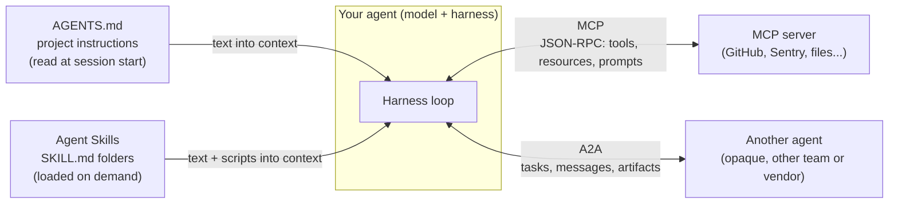
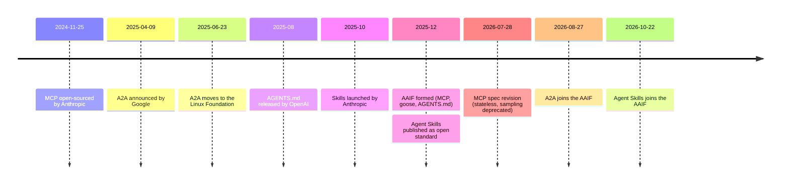

# Standards and orgs: MCP, AGENTS.md, A2A, AAIF

## Why this matters

A handful of open standards now decide how agents connect to tools, read project instructions, load know-how and talk to each other. When you last looked closely, most of this was either brand new or didn't exist. MCP was a few months old, and AGENTS.md, Agent Skills and A2A came after. Today they're the plumbing that every harness in the [stack](/part-00-catch-up/0.2-the-stack) plugs into.

Two questions decide whether you can build on a standard: *what exactly does it standardize* (so you know what it won't do for you), and *who controls it* (so you know whether one vendor can change it under you). This chapter answers both for the four standards you'll meet most, and points to where the book goes deep on each.

**Learning goals**

- Say what MCP, AGENTS.md, A2A and agent skills each standardize
- Know who governs each (Agentic AI Foundation, Linux Foundation) and since when
- Know which chapters go deep on each

## Explanation

### One picture: four standards, four seams

Each standard sits on a different seam of an agent. In the language of [0.2](/part-00-catch-up/0.2-the-stack), all four live at layer 6, the harness. None of them touches the model or the API underneath.

Two of them are **file formats** (AGENTS.md, Agent Skills): they put text into the model's context. Two are **wire protocols** (MCP, A2A): they define messages between running programs. That difference matters. A file format is trivially easy to adopt, because any harness can read a markdown file. A protocol needs both sides to implement the same messages and versions.

| Standard | Kind | What it standardizes | Originated by | Governed by |
|---|---|---|---|---|
| MCP | Protocol | How an AI application connects to tools and data | Anthropic | AAIF (Linux Foundation) |
| AGENTS.md | File format | Where a coding agent finds project instructions | OpenAI | AAIF |
| Agent Skills | File format | How reusable know-how is packaged and loaded on demand | Anthropic | AAIF |
| A2A | Protocol | How one agent discovers and delegates work to another | Google | AAIF |

Dates and sources for every row are in the sections below. The current version of each is on [Landscape → Key standards and orgs](/landscape#key-standards-and-orgs), because versions change faster than this chapter.

### MCP: the tool connector

**Origin.** Anthropic open-sourced the Model Context Protocol on [2024-11-25](https://www.anthropic.com/news/model-context-protocol), calling it "a new standard for connecting AI assistants to the systems where data lives". The motivation was the integration problem from [0.1](/part-00-catch-up/0.1-what-changed): "Every new data source requires its own custom implementation." With N AI applications and M tools you need N×M connectors. A shared protocol makes it N+M: each app implements the client side once, each tool implements the server side once. The launch shipped a specification, SDKs, local server support in Claude Desktop and a repository of reference servers.

**What it standardizes.** The current specification says MCP "uses JSON-RPC 2.0 messages to establish communication between" three roles ([spec](https://modelcontextprotocol.io/specification/latest)):

- **Host**: the AI application, such as Claude Code or VS Code.
- **Client**: a connector inside the host, one per server.
- **Server**: a program that provides context and capabilities. It can run locally over stdio, or remotely over Streamable HTTP.

The spec says it "takes some inspiration from the Language Server Protocol", and that's the best mental model for an engineer. LSP let any editor talk to any language's tooling. MCP lets any AI app talk to any tool server.

What a server can offer is fixed by three **primitives** ([architecture overview](https://modelcontextprotocol.io/docs/learn/architecture)):

| Primitive | Who decides to use it | Example |
|---|---|---|
| **Tools** | The model, via a tool call | `tools/call` → run a query, create an issue |
| **Resources** | The application or user | A database schema, a file's contents |
| **Prompts** | The user | A reusable template, such as few-shot examples |

Clients discover primitives with `*/list` calls (`tools/list`, then `tools/call`), so a server's capabilities can change at runtime. Clients can also offer things back to servers, chiefly **elicitation**: a server asks the user for input or confirmation.

Notice what MCP does *not* standardize. The overview is explicit: "MCP focuses solely on the protocol for context exchange—it does not dictate how AI applications use LLMs or manage the provided context." Which tools reach the model, how many, and what happens to their output are still the harness's job. You'll see in [3.3 Tool design](/part-03-agents/3.3-tool-design) and [3.4 Context engineering](/part-03-agents/3.4-context-engineering) that this is most of the hard part.

**It's still moving.** The spec revision current at the time of writing is dated 2026-07-28 ([spec](https://modelcontextprotocol.io/specification/latest)). The [architecture overview](https://modelcontextprotocol.io/docs/learn/architecture) describes MCP as "a stateless protocol", where every request carries its protocol version and capabilities in `_meta`. It also says sampling, which let servers ask the client's model for completions, is "deprecated as of protocol version `2026-07-28`". If you read MCP material written before this revision, expect differences. Treat any tutorial older than the current revision as possibly stale, and check its date.

::: info 📖 Read now
[MCP architecture overview](https://modelcontextprotocol.io/docs/learn/architecture) · docs · ~25 min · **essential**

Read "Participants", "Layers" and "Primitives" closely, then skim the JSON examples. Look for: why there's one client *per server* inside the host, the difference between the data layer and the transport layer, and the `tools/list` → `tools/call` sequence. Compare that sequence with the tool-calling loop from [0.2](/part-00-catch-up/0.2-the-stack). The model never talks MCP. The harness translates between the model's tool calls and MCP requests.
:::

**Governance.** On 2025-12-09 Anthropic donated MCP to the new Agentic AI Foundation, "a directed fund under the Linux Foundation" ([Anthropic](https://www.anthropic.com/news/donating-the-model-context-protocol-and-establishing-of-the-agentic-ai-foundation)). The MCP project's own post says the technical side didn't change: "MCP's maintainer structure stays the same", and the Linux Foundation "will not dictate the technical direction of MCP" ([MCP blog](https://blog.modelcontextprotocol.io/posts/2025-12-09-mcp-joins-agentic-ai-foundation/)). Day to day, MCP is run by its maintainers: Lead Maintainers with final authority, Core Maintainers who steer the spec, and Maintainers for SDKs and working groups. Spec changes go through **Specification Enhancement Proposals (SEPs)**. Seats belong to people, not companies: "there are no seats reserved for specific companies" ([governance](https://modelcontextprotocol.io/community/governance)).

**Where in the book:** [2.6 Tool calling](/part-02-programming-with-llms/2.6-tool-calling) (the model-side mechanism MCP builds on), [3.6 Using MCP](/part-03-agents/3.6-mcp-using), [3.7 Build an MCP server](/part-03-agents/3.7-mcp-building) (in TypeScript), [6.6 MCP and plugins in Claude Code](/part-06-claude-code/6.6-mcp-plugins), and [8.1 Prompt injection](/part-08-production/8.1-prompt-injection). The spec itself warns that "Tools represent arbitrary code execution and must be treated with appropriate caution" ([spec](https://modelcontextprotocol.io/specification/latest)).

### AGENTS.md: the project's instructions

**What it standardizes.** Almost nothing, on purpose. AGENTS.md is "a simple, open format for guiding coding agents" ([agents.md](https://agents.md)). It's a markdown file at the root of a repo, a "README for agents", holding what a human README leaves out: build and test commands, code style, conventions, security gotchas. The site's FAQ: "AGENTS.md is just standard Markdown. Use any headings you like." There's no schema, and the only real rules are about *where* the file lives and which one wins:

- Nested files: "Agents automatically read the nearest file in the directory tree, so the closest one takes precedence". A monorepo can have one per package.
- Conflicts: "The closest AGENTS.md to the edited file wins; explicit user chat prompts override everything."

So the standard is really a **naming convention plus a precedence rule**. Its value is that you write one file instead of one per tool. That's the same N×M argument as MCP, applied to instructions.

**Origin and adoption.** OpenAI released AGENTS.md in August 2025, and by the AAIF's launch on 2025-12-09 it had been "adopted by more than 60,000 open source projects and agent frameworks", including Codex, Cursor, Devin, Gemini CLI, GitHub Copilot and VS Code ([LF announcement](https://www.linuxfoundation.org/press/linux-foundation-announces-the-formation-of-the-agentic-ai-foundation)). The site says it is "now stewarded by the Agentic AI Foundation" ([agents.md](https://agents.md)).

**Your Claude Code case.** Claude Code has its own file, `CLAUDE.md`, and now reads AGENTS.md too, with a rule you should know: "By default, Claude reads `AGENTS.md` only when you have no `CLAUDE.md` in your working directory or above it" ([Claude Code memory docs](https://code.claude.com/docs/en/memory#agents-md)). This study repo has a `CLAUDE.md`, so an `AGENTS.md` added here would be ignored unless you import it from `CLAUDE.md` or change the setting. This is a common surprise: the standard says *where* instructions live, but each harness still decides *whether and when* to load them.

::: info 📖 Read now
[agents.md](https://agents.md) · docs · ~5 min · **essential**

It's one page. Look for: the suggested sections (what kind of content belongs here vs. in a README), the monorepo advice, and the FAQ on conflicts. Then ask yourself what would go wrong if two harnesses applied the precedence rule differently.
:::

**Where in the book:** [3.8 AGENTS.md and skills](/part-03-agents/3.8-agents-md-and-skills) and [6.2 CLAUDE.md and memory](/part-06-claude-code/6.2-claude-md-and-memory).

### Agent Skills: know-how loaded on demand

**What it standardizes.** "At its core, a skill is a folder containing a `SKILL.md` file. This file includes metadata (`name` and `description`, at minimum) and instructions that tell an agent how to perform a specific task" ([agentskills.io](https://agentskills.io)). The folder can also hold scripts, references and templates.

The interesting part is the loading rule, **progressive disclosure**, which the overview describes in three stages:

1. **Discovery**: at startup, the agent loads only each skill's name and description.
2. **Activation**: when a task matches a description, the agent reads the full `SKILL.md`.
3. **Execution**: the agent follows it, running bundled scripts or reading referenced files as needed.

Compare it with AGENTS.md. AGENTS.md is *always on*: it's loaded at session start and costs context on every turn. A skill costs only its description until it's needed. That's why the two coexist: put what's always true in AGENTS.md, and put procedures you need sometimes in skills. It's a [context engineering](/part-03-agents/3.4-context-engineering) decision written down as a file format.

Skills and MCP also overlap less than they seem. An MCP server gives an agent new *capabilities* (a live connection to GitHub). A skill gives it *know-how* (how your team triages issues), and the agent may carry it out using MCP tools.

**Origin and governance.** Anthropic developed skills while working on Claude Code, launched them in October 2025, published Agent Skills as an open standard in December 2025, and donated it to the AAIF on 2026-10-22, including the name, logo, GitHub organization and the agentskills.io domain ([Anthropic](https://www.anthropic.com/news/donating-agent-skills-to-the-agentic-ai-foundation)). The same post reports more than 70 agent platforms integrating it, among them ChatGPT, Cursor, GitHub Copilot and VS Code. It joined the AAIF alongside three other new projects ([LF press release](https://www.linuxfoundation.org/press/agentic-ai-foundation-announces-four-new-projects-agent-skills-open-responses-openenv-and-opensandbox)).

::: info 📖 Read now
[Agent Skills overview](https://agentskills.io) · docs · ~5 min · **essential**

Look for: the folder layout, the three loading stages, and the phrase "small context footprint". If you want the exact frontmatter rules, the [specification](https://agentskills.io/specification) is the next page (optional, ~10 min). You've already used skills: the `mattpocock-skills` workflows you run in Claude Code are skills.
:::

**Where in the book:** [3.8 AGENTS.md and skills](/part-03-agents/3.8-agents-md-and-skills), [6.3 Skills](/part-06-claude-code/6.3-skills).

### A2A: agent to agent

**What it standardizes.** MCP connects an agent to *tools*: stateless functions with a schema. A2A connects an agent to *another agent*: something autonomous and stateful that may take minutes, ask questions back, and whose internals you can't see. The project describes itself as "an open protocol enabling communication and interoperability between opaque agentic applications" ([a2a-protocol.org](https://a2a-protocol.org/latest/)). The A2A specification defines a few core objects ([spec](https://a2a-protocol.org/latest/specification/)):

- **Agent Card**: a JSON document an A2A server publishes describing its identity, skills, endpoint and auth requirements. It's served at `/.well-known/agent-card.json`, which is how agents discover each other.
- **Task**: the unit of work, with an ID and a lifecycle. It's stateful, unlike a tool call.
- **Message** and **Part**: turns of conversation between client and remote agent, made of text, file or data parts.
- **Artifact**: an output the agent produces for a task.

The spec defines three bindings for the same model: JSON-RPC, gRPC and HTTP+JSON/REST. Versions change, so check [Landscape](/landscape#key-standards-and-orgs) for the current one.

**Relation to MCP.** The A2A docs put it in two lines: "MCP is vertical. It deepens a single agent." "A2A is horizontal. It connects agents across that boundary." ([A2A and MCP](https://a2a-protocol.org/latest/topics/a2a-and-mcp/)). Their worked example is a car repair shop. A customer talks to a shop-manager agent over A2A. A mechanic agent uses MCP to drive its diagnostic tools, then uses A2A again to order a part from a supplier's agent. They're complementary, not competing. Whether you'll need A2A at all is a fair question, though. Most agents you build in this study are one harness with tools and sub-agents inside it, and that needs no protocol. A2A earns its place when the other agent belongs to another team or vendor and you can't see inside it.

::: info 📖 Read now
[A2A and MCP](https://a2a-protocol.org/latest/topics/a2a-and-mcp/) · docs · ~10 min · **essential**

Read the repair-shop example and the "vertical vs. horizontal" section. Look for the reason tools and agents are treated differently: statelessness vs. multi-turn, stateful collaboration. That distinction, not the transport, is what justifies a second protocol.
:::

**Origin and governance.** Google announced A2A on [2025-04-09](https://developers.googleblog.com/en/a2a-a-new-era-of-agent-interoperability/), saying it "complements Anthropic's Model Context Protocol (MCP)", with support from more than 50 technology partners. On [2025-06-23](https://developers.googleblog.com/google-cloud-donates-a2a-to-linux-foundation/) Google transferred the specification, SDKs and tooling to a new Linux Foundation project, with AWS, Cisco, Google, Microsoft, Salesforce, SAP and ServiceNow as founding members. On 2026-08-27 A2A "has officially been accepted as a Growth Stage project at the Agentic AI Foundation" ([A2A blog](https://a2a-protocol.org/latest/blog/2026/08/27/a-new-chapter-for-a2a-joining-the-agentic-ai-foundation/)). So A2A had Linux Foundation governance for over a year *before* it joined the AAIF. Joining put it under the same roof as MCP.

**Where in the book:** [3.12 A2A](/part-03-agents/3.12-a2a) (deeper tier), with [3.10 Multi-agent patterns](/part-03-agents/3.10-multi-agent) for multi-agent setups inside one harness.

### The Agentic AI Foundation (AAIF)

**What it is.** The Linux Foundation announced the AAIF on 2025-12-09 as a "neutral, open foundation" for agentic AI ([LF announcement](https://www.linuxfoundation.org/press/linux-foundation-announces-the-formation-of-the-agentic-ai-foundation)). Anthropic's post describes it as "a directed fund under the Linux Foundation", co-founded by Anthropic, Block and OpenAI ([Anthropic](https://www.anthropic.com/news/donating-the-model-context-protocol-and-establishing-of-the-agentic-ai-foundation)).

**Founding projects** (2025-12-09, [LF announcement](https://www.linuxfoundation.org/press/linux-foundation-announces-the-formation-of-the-agentic-ai-foundation)):

| Project | Contributed by | What it is |
|---|---|---|
| MCP | Anthropic | The tool-and-data protocol above |
| goose | Block | An open-source, local-first agent framework ([Landscape](/landscape#coding-agents-and-harnesses)) |
| AGENTS.md | OpenAI | The project-instructions format above |

**Founding members.** The same announcement lists the Platinum members as AWS, Anthropic, Block, Bloomberg, Cloudflare, Google, Microsoft and OpenAI, plus long Gold and Silver lists that include Docker, IBM, JetBrains, Salesforce, SAP, Hugging Face, Pydantic and Zapier. The point to take away: the three labs whose agent formats compete (Anthropic, OpenAI, Google) all pay into the same foundation.

**Growth.** By 2026-10-22 the foundation had "10 hosted projects in its first year". That date added Agent Skills (Anthropic), Open Responses (OpenAI), OpenEnv (Hugging Face) and OpenSandbox (Alibaba) ([LF press release](https://www.linuxfoundation.org/press/agentic-ai-foundation-announces-four-new-projects-agent-skills-open-responses-openenv-and-opensandbox)). The current project list is on [aaif.io/projects](https://aaif.io/projects/).

**What governance does and doesn't mean.** The AAIF's board handles budget, membership and which projects to accept. Technical decisions stay with each project's maintainers: projects keep "full autonomy over their technical direction and day-to-day operations" ([MCP blog](https://blog.modelcontextprotocol.io/posts/2025-12-09-mcp-joins-agentic-ai-foundation/)). So foundation membership tells you the trademark, domain and repos no longer belong to one company, and that no single vendor can quietly close the standard. It doesn't tell you the spec is stable. MCP's 2026-07-28 revision, described above, changed how requests work and deprecated sampling.

::: info 📖 Read now
[Linux Foundation: formation of the Agentic AI Foundation](https://www.linuxfoundation.org/press/linux-foundation-announces-the-formation-of-the-agentic-ai-foundation) · article · ~8 min · **essential**

A press release, so skip the quotes. Look for: the three founding projects and who gave each, the adoption claims for MCP and AGENTS.md, and the member list. Notice who's on it and who isn't. Then read the [MCP project's own post](https://blog.modelcontextprotocol.io/posts/2025-12-09-mcp-joins-agentic-ai-foundation/) (article, ~5 min, optional) for what changed and what didn't for MCP's maintainers.
:::

### Timeline

Every date below is sourced in the sections above.

### How to judge a new standard

New "standards" for agents appear constantly, and the AAIF itself grew to ten projects in under a year. When you meet one, ask:

1. **Which seam?** Tools, instructions, know-how, other agents, or something else (payments, tracing, sandboxing)? If it overlaps a seam above, what does it do that the existing one doesn't?
2. **File format or protocol?** File formats are cheap to try and cheap to drop. Protocols lock both sides into versions.
3. **Who controls the spec, trademark and repo?** One vendor, a foundation, or both (vendor-originated, foundation-governed, like everything in this chapter)?
4. **How fast is it changing?** Look at the date of the latest revision and its changelog before trusting a tutorial.

## Practice

**Brief:** Find one real `AGENTS.md` and one real MCP server in open-source repos you use. Note what each one gives an agent that it wouldn't otherwise have.

**Where:** Notes only, no code (`notes/`).

**Steps:**

1. Create `notes/standards-in-the-wild.md`.
2. **AGENTS.md.** Find a real `AGENTS.md` in an open-source repo you use or depend on (a dependency in one of your projects, a tool you run, or a GitHub code search for files named `AGENTS.md`). Prefer a repo with more than one, such as a monorepo. Record the repo, the file's path, and:
   - three instructions in it that an agent could not have inferred from the code or README;
   - one instruction you think is noise, and why;
   - whether there are nested files, and which one would win for a file deep in the tree.
3. **MCP server.** Find a real MCP server for a tool you use: an official one from a vendor, or one in the [reference servers repo](https://github.com/modelcontextprotocol/servers). From its README or source, list its tools (and resources or prompts, if any). For each tool, write one line on what the agent could do with it that it couldn't do with only a shell and the files in your repo.
4. **Place them.** For each of the two, write one sentence: which seam from this chapter's first diagram it sits on, and whether it puts text into context or adds a capability.
5. **Your own repo.** Look at this study's `CLAUDE.md`. If you renamed it to `AGENTS.md`, which harnesses from [Landscape](/landscape#coding-agents-and-harnesses) would gain access to it, and what would Claude Code do differently? Use the [Claude Code docs](https://code.claude.com/docs/en/memory#agents-md) to answer. Don't actually rename it.

**Done when:** `notes/standards-in-the-wild.md` names one real `AGENTS.md` (repo + path) and one real MCP server (repo or vendor page), each with the analysis from steps 2–4, and has a written answer to step 5.

## Check questions

1. In one sentence each, what do MCP, AGENTS.md, Agent Skills and A2A standardize? Which two are file formats and which two are protocols?

   

Answer

   MCP: how an AI application (host) connects to tool and data servers, over JSON-RPC, with tools, resources and prompts as primitives. AGENTS.md: where a coding agent finds project instructions, plus a "closest file wins" precedence rule. Agent Skills: how know-how is packaged (a folder with `SKILL.md`) and loaded progressively. A2A: how an agent discovers another agent (Agent Card) and delegates stateful tasks to it. AGENTS.md and Skills are file formats. MCP and A2A are protocols.

   

2. A colleague says "MCP is how the model calls tools." What's wrong with that, using the stack from 0.2?

   

Answer

   The model only emits tool calls through its API (tool calling, Part 2). It never speaks MCP. The harness (layer 6) is the MCP host: it lists tools from MCP servers, passes their definitions to the model, receives the model's tool call, and turns it into a `tools/call` request to the right server. MCP standardizes the harness ↔ tool-server connection, not the model ↔ harness one.

   

3. Why do AGENTS.md and Agent Skills both exist, if both just put markdown into the context?

   

Answer

   They have different loading costs. AGENTS.md is loaded at session start and occupies context on every turn, so it should hold what's always relevant (build commands, conventions). Skills use progressive disclosure: only the name and description load at startup, and the full body loads when a task matches. That lets an agent carry many procedures cheaply. It's a context-engineering trade-off.

   

4. When would you reach for A2A instead of just giving your agent another MCP tool or a sub-agent?

   

Answer

   When the other party is an autonomous, stateful agent you don't control or can't see inside, typically owned by another team or vendor. The work is a multi-turn task with a lifecycle (it may ask questions, take a long time, produce artifacts), not a stateless function call. If you own both sides and they run in one harness, a sub-agent or a tool is simpler and needs no protocol.

   

5. Since 2025-12-09, MCP has been "governed by the AAIF". What does that guarantee, and what doesn't it?

   

Answer

   It guarantees vendor neutrality of ownership: the project sits in a Linux Foundation directed fund, not in Anthropic's hands alone, and the foundation's board decides budget and which projects to accept. It doesn't guarantee stability or set technical direction. The MCP maintainers (Lead and Core Maintainers, via SEPs) still decide the spec, and the 2026-07-28 revision changed the protocol substantially (stateless requests, sampling deprecated). Always check the current revision.

   

## My understanding

<!-- Written by the learner, in their own words. Agents never fill this in. -->
