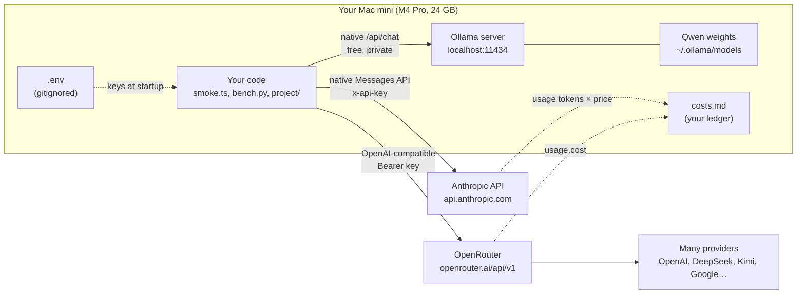

# Your lab: local and paid setup

## Why this matters

Every practice section in this book assumes a working lab: local models in Ollama, paid models through OpenRouter and the Anthropic API, and a ledger that keeps spend inside your €30 budget (`costs.md`). Most of that is already installed. What this chapter adds is the **mental model** of the lab: which requests run on your Mac and which leave it, what each one holds (memory, money, secrets), and how to turn the numbers every API returns into a cost you can check.

That last skill matters well beyond this budget. Token usage is the unit of everything in LLM engineering: price, latency, context limits. If you can read a usage object and price it by hand, you can sanity-check any bill, any routing rule and any "this agent is too expensive" claim later in the book.

**Learning goals**

- Know what runs where in your lab and why
- Read token usage and turn it into cost
- Log spend in `costs.md` from day one

## Explanation

### The lab on one page

Chapter [0.2](/part-00-catch-up/0.2-the-stack) gave you the stack as six layers. Here is the same idea drawn as **places**: what lives on your Mac, and what's on the other end of the network.



Three routes, three different trade-offs:

| Route | What it costs | What it holds | Use it for |
|---|---|---|---|
| **Ollama (local)** | Nothing per token. It costs memory and time. | Your RAM while a model is loaded | Anything iterative: loops, experiments you rerun 50 times, harness tests, private data |
| **OpenRouter** | Per token, from prepaid credits | Your credit balance | Trying many paid models (GPT, Gemini, Kimi, DeepSeek) behind one key and one API shape |
| **Anthropic API (direct)** | Per token, from prepaid credits | Your credit balance | Claude-specific features through the native API |

Claude Pro and Claude Code aren't on this diagram on purpose. Your Pro plan pays for Claude Code's usage under a subscription. It doesn't give you API credit, and API calls from your own code don't touch it: Anthropic bills API usage separately from paid Claude plans ([Claude Help Center](https://support.claude.com/en/articles/9876003-why-is-claude-api-usage-billed-separately-from-my-paid-claude-plan)). Keep the two budgets apart in your head: Pro limits are covered in [6.8](/part-06-claude-code/6.8-pro-limits), API spend is this chapter.

Your own setup notes are the starting point for the local half. Open `notes/setup.md` in the repo now: it records the Ollama install, the four models you pulled with their disk sizes and measured speeds, and the handy commands. The rest of this section explains the parts of it that matter for running experiments well.

### Ollama on a 24 GB M4 Pro

#### What fits

On Apple silicon the CPU and GPU share one pool of **unified memory**. There's no separate VRAM: a model that runs on the GPU takes memory the rest of your Mac also wants. So "does it fit" means "does it fit next to your browser, editor and Claude Code".

You measured this yourself in experiment 00, and the results are on [Landscape → What fits in 24 GB of unified memory](/landscape#what-fits-in-24-gb-of-unified-memory). The short version: `qwen3:8b` and `qwen3:14b` are comfortable, and `qwen3:30b-a3b` is tight enough that part of it spilled onto the CPU. Two things set the size, and both are covered in Part 1:

- **Weights:** roughly parameters × bits per weight ÷ 8. Quantization is the knob ([1.12](/part-01-how-llms-work/1.12-quantization)).
- **KV cache:** grows with the context length you allocate, not the length you use ([1.9](/part-01-how-llms-work/1.9-kv-cache-context-window)).

The second point is the trap. A bigger context setting reserves more memory before you send a single token, and can push a model that "fits" into a partial CPU spill. A spill shows up as a slower model, not as an error.

#### `ollama ps`: what's loaded right now

`ollama list` shows models on disk. `ollama ps` shows models **in memory**, and it's the command to run whenever something feels slow. On your install (0.40.14) its columns are `NAME`, `ID`, `SIZE`, `PROCESSOR`, `CONTEXT`, `RUNNER` and `UNTIL`. Two of them answer the questions you'll ask most:

- **PROCESSOR:** `100% GPU` means the whole model is in GPU-addressable memory. Anything with a CPU share means part of it spilled and runs slower.
- **CONTEXT:** the context length the server actually allocated for this loaded model. Read this instead of assuming.

::: info 📖 Read now
[Ollama FAQ](https://docs.ollama.com/faq) · docs · ~10 min (three sections) · **essential**

Read only "How can I specify the context window size?", "How can I tell if my model was loaded onto the GPU?" and "How do I keep a model loaded in memory or make it unload immediately?". Look for: how `num_ctx` (per request) and `OLLAMA_CONTEXT_LENGTH` (server-wide) relate, the meaning of the `Processor` column, and the `keep_alive` values (a duration, `0`, or a negative number).
:::

Then compare it with the dedicated page:

::: info 📖 Read now
[Ollama: Context length](https://docs.ollama.com/context-length) · docs · ~3 min · **essential**

Look for: the default context length here depends on VRAM tier, and the page tells you to check the `CONTEXT` column of `ollama ps`. Notice that the FAQ and this page describe the default differently, and neither says which tier unified memory on a Mac counts as.
:::

That disagreement is the lesson. Defaults in a fast-moving server change between releases, and docs lag behind. **Don't trust a default you haven't observed.** Set `num_ctx` explicitly in experiments (experiment 00 used 8192), and confirm it with `ollama ps`. A context window that's silently smaller than you think shows up later as a model that "forgets" the start of a long prompt. That's a server setting, not a model weakness (layer 3 in [0.2](/part-00-catch-up/0.2-the-stack)).

#### Keep-alive: why memory stays taken after a call

After a request, Ollama keeps the model loaded so the next request skips the load. The [FAQ](https://docs.ollama.com/faq) says models stay in memory for 5 minutes by default. You can change this per request with the `keep_alive` parameter of [`/api/chat`](https://docs.ollama.com/api/chat) (`"5m"`, or `0` to unload right after the response), for all models with the `OLLAMA_KEEP_ALIVE` environment variable, or at once with `ollama stop <model>`.

Keep-alive matters in two directions:

- **Speed.** A cold start includes the load. In experiment 00 the load took several seconds per model ([experiment 00](/experiments/00-speed-check)), which dominates any short request. When you benchmark, either warm the model first or report the load separately. The chat response gives it to you as `load_duration`.
- **Memory.** A model you used four minutes ago still holds its memory. Switch from `qwen3:14b` to `qwen3:30b-a3b` and both can be resident for a while, which is how you get a CPU spill or a sluggish Mac without running anything big. `ollama ps` shows it, and the `UNTIL` column tells you when it will be released.

A habit that works: before any timing or memory experiment, run `ollama ps`, stop what you don't need, and write the `PROCESSOR` and `CONTEXT` values into the experiment README next to the results.

### OpenRouter vs. the direct Anthropic API

Both are paid, both are prepaid credit, and both can serve Claude. So why keep two?

[OpenRouter](https://openrouter.ai/docs/quickstart) is a router (layer 5 in [0.2](/part-00-catch-up/0.2-the-stack)): one key, one OpenAI-compatible API at `https://openrouter.ai/api/v1`, and models from many labs behind it. That's what makes it the cheap way to *try* Kimi, DeepSeek, GPT and Gemini without opening five accounts and topping up five balances. Its fee structure is on [Landscape → Access routes](/landscape#access-routes). Note where the fee is charged: when you buy credits, not per request, so it never shows up in a response's cost field.

::: tip 📖 Skim
[OpenRouter Quickstart](https://openrouter.ai/docs/quickstart) · docs · ~5 min · optional

You already have a working call in `smoke.ts`, so skim for two things: "You can also use the OpenAI SDK pointed at OpenRouter as a drop-in replacement", and the optional attribution headers (`HTTP-Referer`, `X-OpenRouter-Title`). You don't need the headers for this study.
:::

The **direct Anthropic API** is the native route to Claude. You use it when you need what a compatible API can't carry. Chapter 0.2 quoted Anthropic's own compatibility page on this: prompt caching and thinking output don't come through the OpenAI-compatible shape. Part 2 uses those features ([2.4](/part-02-programming-with-llms/2.4-reasoning-via-api), [2.7](/part-02-programming-with-llms/2.7-prompt-caching)), so the native route earns its place even though OpenRouter also lists Claude models ([OpenRouter: Anthropic](https://openrouter.ai/anthropic)).

::: tip 📖 Skim
[Get started with Claude](https://platform.claude.com/docs/en/get-started) · docs · ~10 min · optional

Look for: the API key path ("The SDKs and CLI read your key from `ANTHROPIC_API_KEY`"), the three headers on the raw request (`x-api-key`, `anthropic-version`, `content-type`), and the `usage` object at the bottom of the example response. Compare the request with the `anthropic()` function in `smoke.ts`: same shape, written with plain `fetch` instead of the SDK.
:::

The working rule for this book:

- **Local first** for anything you'll rerun many times or anything private.
- **OpenRouter** when the question is "how does model X compare?"
- **Direct Anthropic** when the chapter needs a Claude-native feature.

Part 9 turns this rule into actual routing code ([9.3](/part-09-model-landscape-cost/9.3-local-vs-paid), [9.4](/part-09-model-landscape-cost/9.4-routing-rules)).

### Keys in `.env`, never in code

An API key is a bearer credential: whoever has the string can spend your credit. Your repo handles this the standard way:

1. `.env` holds the real keys (`ANTHROPIC_API_KEY`, `OPENROUTER_API_KEY`) and is listed in `.gitignore`. Only `.env.example`, with empty values, is committed.
2. Code reads keys from `process.env` and never from a literal. `npm run smoke` runs `node --env-file-if-exists=.env …`. That Node flag loads the file into `process.env` and, per the [Node.js CLI docs](https://nodejs.org/api/cli.html), "If the same variable is defined in the environment and in the file, the value from the environment takes precedence." That's handy when you want to override one key for a single run.
3. Code fails loudly when a key is missing (`smoke.ts` throws "`OPENROUTER_API_KEY is not set in .env`"), so a missing key never turns into a confusing 401 later.

::: info 📖 Read now
[API key best practices: keep your keys safe and secure](https://support.claude.com/en/articles/9767949-api-key-best-practices-keeping-your-keys-safe-and-secure) (Claude Help Center) · article · ~5 min · **essential**

Look for: the advice against putting keys "directly in your code or configuration files", and what happens when a key leaks to a public GitHub repo: GitHub's secret scanning reports it and "Anthropic automatically deactivates the exposed API key." Also note the advice to rotate keys on a schedule.
:::

Three lab-specific habits on top of that:

- **Agents read files too.** Claude Code and any harness you build can open `.env` like any other file, and whatever they read can end up in a transcript or a log. Don't ask an agent to "check my keys". Ask it to check that the variable is *set* (`test -n "$OPENROUTER_API_KEY"`).
- **Never print a key while debugging.** Log `key.slice(0, 6)` if you must confirm which key is loaded.
- **Cap the blast radius.** OpenRouter lets you set a credit limit per key ([Keys](https://openrouter.ai/settings/keys)), and you can query a key's limit and usage from code with `GET https://openrouter.ai/api/v1/key` ([Limits](https://openrouter.ai/docs/api-reference/limits)). On Anthropic, the key best-practices article above points to the [Billing](https://platform.claude.com/settings/billing) page: spend limits for orgs on custom rate limits, and a capped auto-reload for orgs on standard ones. A leaked key with a small limit is an annoyance, not a disaster.

### Token usage: reading the meter

Every response tells you how many tokens it consumed, but each API spells it differently. Here are the three shapes `smoke.ts` already reads:

| Route | Input tokens | Output tokens | Cost in the response? | Source |
|---|---|---|---|---|
| Ollama `/api/chat` | `prompt_eval_count` | `eval_count` | No (local, $0) | [Ollama chat API](https://docs.ollama.com/api/chat) |
| OpenRouter (Chat Completions) | `usage.prompt_tokens` | `usage.completion_tokens` | **Yes**: `usage.cost` | [Usage accounting](https://openrouter.ai/docs/use-cases/usage-accounting) |
| Anthropic Messages | `usage.input_tokens` | `usage.output_tokens` | No: you compute it | [Get started](https://platform.claude.com/docs/en/get-started) |

::: info 📖 Read now
[OpenRouter: Usage accounting](https://openrouter.ai/docs/use-cases/usage-accounting) · docs · ~5 min · **essential**

Look for three things. First, usage is always returned and "No additional parameters are required". Second, `cost` is "The total amount charged to your account". Third, "Token counts are calculated using the model's native tokenizer." Also note the `reasoning_tokens` and `cached_tokens` breakdowns, and that you can look a request up later by its `id` through the `/generation` endpoint.
:::

That "native tokenizer" sentence explains something you've already seen. The **same prompt** in your smoke test counted as 30 input tokens on `qwen3:8b`, 20 on `gpt-6-luna` and 24 on `claude-haiku-5-5` ([experiment 01](/experiments/01-keys-smoke-test)). Token counts aren't a property of the text. They're a property of the text *and* the tokenizer ([1.2](/part-01-how-llms-work/1.2-tokenization)), plus whatever the chat template wraps around your message. So a model with a lower per-token price isn't automatically cheaper for the same text if its tokenizer splits that text into more tokens.

#### Tokens you didn't see

Two kinds of tokens are billed but not visible in the reply text:

- **Thinking tokens.** On Anthropic they're "billed as output tokens", and you pay for the full reasoning even when the response shows only a summary: "The billed output token count does **not** match the visible token count in the response" ([Steering thinking → Pricing](https://platform.claude.com/docs/en/build-with-claude/thinking-steering-and-cost#pricing)). `usage.output_tokens` is the billed total, and `usage.output_tokens_details.thinking_tokens` tells you how much of it was reasoning. OpenRouter reports the same thing as `reasoning_tokens` ([Usage accounting](https://openrouter.ai/docs/use-cases/usage-accounting)). Your own experiment 00 showed how big this gets: thinking turned a 36-token answer into 875 output tokens ([experiment 00](/experiments/00-speed-check)).
- **Template and system tokens.** The chat template's control tokens, and any system prompt the provider adds, count as input. That's why a one-sentence prompt never costs exactly its word count.

The practical consequence is that `max_tokens` is your hard cost ceiling per request. Anthropic documents it as "a hard cap on total output for the request, thinking and response text combined" ([Steering thinking → Cost control](https://platform.claude.com/docs/en/build-with-claude/thinking-steering-and-cost#cost-control)). `smoke.ts` sets 200 on both paid calls for exactly this reason.

### From tokens to cost

Prices are quoted in USD per million tokens (MTok), separately for input and output. The cost of one plain request is:

```
cost (USD) = input_tokens  × input_price_per_MTok  / 1,000,000
           + output_tokens × output_price_per_MTok / 1,000,000
```

A worked example with **made-up round prices** (real prices are on [Landscape](/landscape), and change): a request with 1,200 input tokens and 300 output tokens, on a model priced at $1 input and $5 output per MTok.

```
input:  1,200 × 1 / 1e6 = $0.0012
output:   300 × 5 / 1e6 = $0.0015
total:                    $0.0027
```

Notice two things. Output is usually priced several times higher than input (compare the two price columns on [Landscape](/landscape)), so a short prompt with a long answer can cost more than a long prompt with a short answer. And small numbers add up fast in a loop: an agent that resends a growing conversation on every turn pays for the input again each time. That's what prompt caching ([2.7](/part-02-programming-with-llms/2.7-prompt-caching)) attacks.

Real bills add terms to this formula. Cache reads and writes are priced differently from plain input. Some models switch to a higher price above a prompt-length threshold, and some providers have off-peak or batch discounts. Landscape lists these next to each model's prices. For your smoke test none of them apply, so the two-term formula is exact up to rounding.

Which number is the truth?

- **OpenRouter:** `usage.cost` is the actual charge, in credits. Your formula should match it closely. If it doesn't, check which provider served the request, because the same model can have different prices per provider.
- **Anthropic:** the response has no cost field, so `smoke.ts` computes an **estimate** with prices copied from Landscape. The truth is the [Usage](https://platform.claude.com/usage) page in the Console. An estimate drifts silently when a price changes and nobody updates the constant in the code.

### The cost ledger

`costs.md` is the habit that keeps the €30 honest. It's deliberately boring:

- **One row per paid run:** date, experiment, provider and model, tokens in and out, cost in USD, and whether the cost is *actual* (`usage.cost`) or an *estimate*.
- **Running total at the top**, updated with every row.
- **Credits added** in their own table. Credit purchases are where OpenRouter's fee and the currency conversion happen, so this is where USD turns back into euros. Use the rate on your card statement.
- **Reconcile now and then.** Compare the ledger with [OpenRouter Activity](https://openrouter.ai/activity) and [Anthropic Usage](https://platform.claude.com/usage). If they disagree, the dashboards win and the ledger gets a correction row.

Why bother when the dashboards exist? Because the dashboards don't know *which experiment* spent the money. The ledger does. When you reach Part 9 and ask "what's the cheapest mix of local and paid for my kind of work?", this file is your data. Part 4 automates the same idea as cost tracking inside traces ([4.8](/part-04-evals-observability/4.8-cost-latency)).

### The smoke test as the reference experiment

[Experiment 01](/experiments/01-keys-smoke-test) is small on purpose: one fixed prompt, three routes, and token usage and cost printed for each. Treat it as the lab's **health check and calibration run**:

- **Health check.** After changing keys, upgrading Ollama, or coming back after a break, `npm run smoke` tells you in seconds which route is broken. A failure names the layer: a missing key (your `.env`), an HTTP 401 or 402 (the provider: bad key or no credit), or a connection refused on `localhost:11434` (Ollama isn't running).
- **Calibration.** Because the prompt never changes, its token counts are a fixed reference. If the counts for the same model change, something between you and the weights changed, such as the template, the provider or the model version. That's worth knowing before you trust a comparison.
- **Template.** It shows the minimum every later experiment that spends money should do: print tokens in and out, print or estimate the cost, and log it.

## Practice

**Brief:** Run the smoke test from issue 04 (`experiments/01-keys-smoke-test/`) if it isn't done yet, compute the cost of each call by hand from the token counts, and check it against the provider dashboards.

**Where:** `experiments/01-keys-smoke-test/`. The folder already exists from issue 04, so reuse it and add to its README. Standalone experiment, not a `project/` step. No new code is needed.

**Steps:**

1. **Run it (or rerun it).** The README's "What happened" table already has one run with keys. Run `npm run smoke` once more anyway, so you have fresh results you can find on the dashboards today. Add the new numbers as a second dated row.
2. **Look at Ollama while it's warm.** Within a minute of the run, run `ollama ps`. Write down `SIZE`, `PROCESSOR`, `CONTEXT` and `UNTIL` for `qwen3:8b` in the README. Is the context what you expected? Then `ollama stop qwen3:8b` and check that it's gone.
3. **Price each paid call by hand.** Look up the input and output price per MTok for `openai/gpt-6-luna` and `claude-haiku-5-5` on [Landscape](/landscape). For each call, write the full arithmetic in the README (tokens × price ÷ 1e6, input and output separately, then the sum). Don't round until the end.
4. **Compare with the reported numbers.** For OpenRouter, compare your result with `usage.cost`. For Anthropic, compare it with the estimate `smoke.ts` printed. Note any difference and explain it in one sentence.
5. **Check the dashboards.** Find the OpenRouter request in [Activity](https://openrouter.ai/activity) and compare its token counts and cost with yours. Find the Anthropic call in [Usage](https://platform.claude.com/usage): does the page show the request, how granular is it, and how long did it take to appear? Write down what each dashboard can and can't tell you.
6. **Check the key from code (optional).** Call `GET https://openrouter.ai/api/v1/key` with your key from `.env`, without printing the key, and note `usage` and `limit_remaining` ([Limits](https://openrouter.ai/docs/api-reference/limits)). If your key has no limit (`null`), decide whether to set one in [Keys](https://openrouter.ai/settings/keys).
7. **Update the ledger.** Add the new paid calls to `costs.md`, update the running total, and change the Anthropic note from "estimate" to "checked on Usage page" if the dashboard confirmed it. If you've bought credits, fill in the "Credit added" table and work out what the €30 budget is in USD at your card's rate.
8. **Write "Why (what I learned)".** At least three bullets: how the three response shapes report usage, why the same prompt has different input token counts, and which number you'd trust for cost on each route.

**Done when:** the experiment 01 README has a second dated run, the `ollama ps` observation, a hand calculation for each paid call that matches the reported cost (or an explained difference), and a filled "Why" section. `costs.md` includes the new rows and an updated running total, and every Anthropic row says whether it was checked against the Usage page.

## Check questions

1. You run `qwen3:14b`, then immediately switch to `qwen3:30b-a3b` and it's noticeably slower than in experiment 00. Nothing else is open. What's the most likely cause, how do you confirm it, and how do you fix it?

   <details><summary>Answer</summary>

   `qwen3:14b` is still loaded because of keep-alive, so both models compete for unified memory and the 30B model spills more of itself onto the CPU. Confirm with `ollama ps`: two models listed, and a larger CPU share in `PROCESSOR` for the 30B. Fix it with `ollama stop qwen3:14b` (or `keep_alive: 0` on the earlier requests), then rerun.

   </details>

2. A long document you send to a local model seems to be "forgotten": the answer ignores its first half. The model's trained context is far larger than the document. Which layer do you suspect, and what do you check?

   <details><summary>Answer</summary>

   The server (layer 3), not the weights. Ollama allocates a context length that may be much smaller than the model's maximum, and the docs even disagree about the default. Check the `CONTEXT` column in `ollama ps` while the model is loaded, then set `num_ctx` explicitly on the request (or `OLLAMA_CONTEXT_LENGTH` for the server). Watch `PROCESSOR` afterwards, because a bigger context costs memory.

   </details>

3. Model A costs less per token than model B. On your workload model A's bill is higher. Give two reasons from this chapter why that can happen.

   <details><summary>Answer</summary>

   (1) Tokenizers differ: the same text can be more tokens on A, so the cheaper rate is applied to a bigger count. (2) Hidden output: if A is a reasoning model, its thinking tokens are billed as output (often the expensive side), even when you only see a short answer or a summary. Longer, more verbose answers have the same effect. Compare the `usage` objects, not the price list.

   </details>

4. Your ledger says an Anthropic call cost $0.000026, but you never checked it. Why is that number less trustworthy than an OpenRouter row, and what would make it stale without anyone noticing?

   <details><summary>Answer</summary>

   It's an estimate: `smoke.ts` multiplies the reported token counts by prices hard-coded from Landscape, while OpenRouter's `usage.cost` is the actual charge. The estimate goes stale silently when Anthropic changes the price, when a pricing rule applies that the formula ignores (a long-prompt tier, caching), or when the model ID changes. The Console's Usage page is the source of truth.

   </details>

5. You want to compare Kimi, DeepSeek and Gemini on one task this week, and next month you'll need Claude's prompt caching. Which route do you use for each, and why not one route for both?

   <details><summary>Answer</summary>

   OpenRouter for the comparison: one key, one OpenAI-compatible request shape and one credit balance for all three, with the actual cost in every response. The direct Anthropic API for prompt caching: it's a Claude-native feature, and Anthropic's OpenAI-compatible layer doesn't support it, so a compatible route may silently drop it. Compatibility costs features (Chapter 0.2), so you pick the route by the feature you need.

   </details>

## My understanding

<!-- Written by the learner, in their own words. Agents never fill this in. -->
