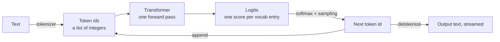
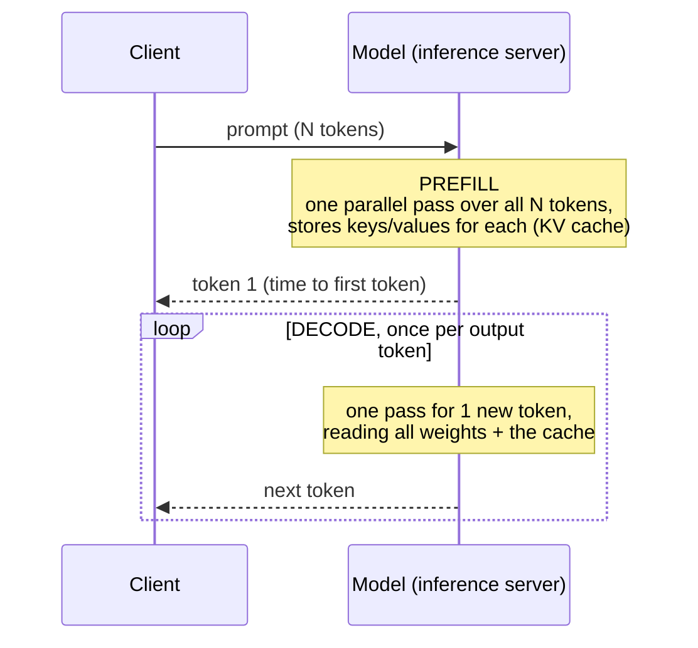
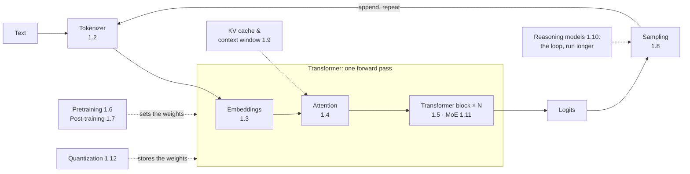

# Next-token prediction: the big picture

## Why this matters

Everything an LLM does, from chat to tool calls to reasoning, is repeated next-token prediction. Holding that one loop in mind makes the rest of Part 1 a series of zoom-ins instead of a pile of facts. It also explains everyday engineering facts: why long prompts are cheap to read but long answers are slow to write, why thinking mode costs so much, and why the same prompt can give different answers.

**Learning goals**

- Describe the generation loop end to end: text → tokens → logits → sample → append
- Name the parts that later chapters zoom into
- Connect the loop to what you observed in experiment 00 (tok/s, thinking tokens)

## Explanation

### The whole loop on one page

An LLM is a function with one job: given a sequence of tokens, return a score for every token in its vocabulary saying how likely it is to come next. That's all the network computes. Everything else, including chat, answers, code and reasoning, comes from a small loop **around** that function:



1. **Tokenize.** The text is split into tokens, and each one maps to an integer id in the model's fixed vocabulary (tens of thousands of entries or more).
2. **Forward pass.** The transformer reads the whole sequence of ids and produces, for the **last** position, a vector of **logits**: one raw real-valued score per vocabulary entry.
3. **Sample.** The logits become a probability distribution (softmax), and one token is picked from it, either the most likely one or a random draw.
4. **Append.** The chosen token is appended to the sequence, and the loop runs again.
5. **Stop** when the model emits an end-of-sequence token, or you hit a length limit.

This is **autoregressive generation**: each output depends on all previous outputs, because they've been fed back in as input. The model never "plans the sentence" in any explicit data structure. Whatever planning there is lives inside the forward pass, recomputed at every step from the tokens so far.

This idea is easiest to absorb visually first. 3Blue1Brown's chapter is the best short overview of the whole pipeline, and you'll come back to its later sections when you reach 1.3 and 1.4.

::: info ▶️ Watch
[Transformers, the tech behind LLMs (Deep Learning, ch. 5)](https://www.youtube.com/watch?v=wjZofJX0v4M) · video · ~27 min · **essential** ([text version](https://www.3blue1brown.com/lessons/gpt))

Formerly titled "But what is a GPT?". Look for: the framing of generation as "predict, sample, append, repeat", the **unembedding** step at the end that turns the last vector into one score per token, and the **softmax** with temperature. Don't worry about the attention and MLP details yet. That's 1.4 and 1.5.
:::

### Logits, softmax and probabilities

Suppose the vocabulary has *V* entries. The final layer of the network produces a vector *z* of length *V*: the **logits**. They're unbounded real numbers, and only their differences matter. Adding the same constant to every logit changes nothing.

**Softmax** turns them into probabilities:

```
p_i = exp(z_i) / Σ_j exp(z_j)        (sum over all V vocabulary entries)
```

Every *p<sub>i</sub>* is positive and they sum to 1. Exponentiation makes softmax "peaky": a logit that's 2 higher than another gets about e² ≈ 7.4× the probability.

APIs usually don't expose logits. They expose **logprobs**: the natural log of the probabilities, log *p<sub>i</sub>*. Logprobs are always ≤ 0. To read them, exponentiate: a logprob of −0.1 is p ≈ 0.90, −0.7 is ≈ 0.50, −2.3 is ≈ 0.10, −4.6 is ≈ 0.01. Log space is also handy because the probability of a whole sequence is the product of the per-token probabilities, so its log is just the **sum** of the logprobs.

**Worked example.** Here is a real response from `qwen3:8b` on your Mac (Ollama, 2026-11-08, `logprobs: true`, `top_logprobs: 3`), continuing the raw text `The capital of France is`:

| Rank | Token | Logprob | Probability |
|---|---|---|---|
| 1 | `" Paris"` | −0.39 | 0.68 |
| 2 | `" a"` | −2.48 | 0.08 |
| 3 | `" in"` | −3.98 | 0.02 |

Three things to notice:

- Even an "obvious" fact gets only 68%. The model is modeling **text**, not facts. Plenty of real sentences continue "The capital of France is a city that…" or "…is in the north". This is the base-model view of the world. Post-training (1.7) reshapes these distributions so that answering becomes the likely continuation.
- The tokens carry their leading space: `" Paris"` is one token, distinct from `"Paris"`. A chat request in the same session (`Name one color.`) put `"Blue"` at p ≈ 0.86, `"Red"` at ≈ 0.14, and `" Blue"` (with a space) and `"blue"` at around 10⁻⁷. To the model those are unrelated ids. That's tokenization, chapter 1.2.
- The distribution is the model's actual output. "The answer" only appears once you **decide** how to pick from it.

### From distribution to token: sampling

The simplest choice is **greedy decoding**: always take the argmax. It's deterministic, but it tends to loop and produce bland text. So in practice you **sample**: draw a token at random, weighted by *p*. Then you shape the distribution before drawing:

- **Temperature** *T* divides the logits before softmax (*z<sub>i</sub> / T*). *T* < 1 sharpens the distribution toward the top token, and *T* → 0 is greedy. *T* > 1 flattens it.
- **Top-k / top-p / min-p** cut off the long tail of unlikely tokens before drawing.

That's all chapter 1.8 covers. For now the key point is architectural: **the network is deterministic, and the randomness is added by the loop.** The same prompt yields the same logits every time (up to floating-point noise on the hardware), and different answers come from the sampler. That's also why a sampling setting like `temperature` is a request parameter, not a property of the model.

Play with this before moving on. Transformer Explainer runs a real GPT-2 small in your browser and shows the logits → probabilities step live.

::: tip 🧪 Try
[Transformer Explainer](https://poloclub.github.io/transformer-explainer/) · docs (interactive) · ~15 min · optional

Look for: the "Output Probabilities" panel at the end. Type a prompt, then move the **Temperature** slider and switch between top-k and top-p, and watch the bars change. Ignore the attention internals for now.
:::

### Training is the same loop, with the answer known

How does the network learn to produce good logits? It's trained on exactly this task at every position of huge amounts of text: given tokens 1…*t*, predict token *t*+1. The loss is the **cross-entropy**: −log *p*(the token that actually came next). In other words, training pushes up the logprob of the real next token. That one objective, at scale, is where the knowledge, grammar and reasoning ability come from (1.6). Every later stage (instruction tuning, RLHF, RL for reasoning) still trains the same next-token machine. It only changes which continuations get rewarded (1.7, 1.10).

One detail matters for inference: during training, the transformer computes predictions for **all** positions of a sequence in one parallel forward pass, because the whole text is known up front. Keep that in mind for the next section.

Karpathy's Deep Dive walks through exactly this: what goes into the network, what comes out, and what inference looks like on a real base model. Watch the segment below. The rest of the video is a good companion to later chapters.

::: info ▶️ Watch
[Deep Dive into LLMs like ChatGPT](https://www.youtube.com/watch?v=7xTGNNLPyMI) (Karpathy, 2025), from **14:27 "neural network I/O"** to **42:52** ("inference", "GPT-2: training and inference") · video · ~30 min of a 3.5 h video · **essential**

Look for: the input as a window of token ids and the output as one probability for every token in the vocabulary, generation as "sample a token, append it, repeat", and how the training loss falls as predictions get better. Optional extension: 42:52–59:23, inference on the Llama 3.1 **base** model, which shows the "it's just continuing text" point from the worked example above.
:::

If you prefer a shorter, older and less technical version, Karpathy's 2023 talk covers the same ground in its first section.

::: tip ▶️ Watch
[[1hr Talk] Intro to Large Language Models](https://www.youtube.com/watch?v=zjkBMFhNj_g) (Karpathy, 2023), 0:00–17:52 · video · ~18 min · optional

Look for: "LLM dreams" (sampling from a base model) and "Finetuning into an Assistant". Skip the rest: tools, the "LLM OS" and security are covered in Parts 3 and 8 with more current material.
:::

### Prefill vs. decode: why prompt tok/s ≠ output tok/s

Now put the parallel forward pass next to the generation loop. An inference request has two phases:



- **Prefill.** All prompt tokens are known, so the model processes them in one big parallel pass, just like training. It saves the intermediate keys and values of every token (the **KV cache**, 1.9) so it never has to recompute them. This is matrix-matrix work that keeps the GPU busy, so it gets through hundreds or thousands of tokens per second.
- **Decode.** Each output token depends on the previous one, so they must be generated **one at a time**. Each step is a full forward pass for a single token. The arithmetic per step is small, but the hardware still has to stream **every weight** from memory for each token. Decode is limited by memory bandwidth, not compute.

The NVIDIA article below describes the two phases precisely. Read its first section, then come back for the back-of-envelope estimate.

::: info 📖 Read now
[Mastering LLM Techniques: Inference Optimization](https://developer.nvidia.com/blog/mastering-llm-techniques-inference-optimization/) (Verma & Vaidya, NVIDIA, 2023), section "Understanding LLM inference" only · article · ~10 min · **essential**

Look for: prefill as "a matrix-matrix operation that's highly parallelized", decode as generating tokens "autoregressively one at a time" and being "a memory-bound operation". The later sections (batching, quantization, parallelism) are useful when you reach 1.9, 1.12 and 10.8.
:::

**Back-of-envelope check on your own hardware.** If decode is memory-bound, then

> max decode tok/s ≈ memory bandwidth ÷ bytes read per token ≈ bandwidth ÷ model size

Your M4 Pro has [273 GB/s of memory bandwidth](https://support.apple.com/en-us/121555). `qwen3:14b` at Q4 is 9.3 GB ([experiment 00](/experiments/00-speed-check)). 273 ÷ 9.3 ≈ **29 tok/s** as a ceiling, and you measured **24–25 tok/s**. That's close to the limit, as the theory predicts. The same reasoning explains two other results from experiment 00:

- **Why `qwen3:30b-a3b` decodes as fast as the 8b**, despite being twice as large on disk: a mixture-of-experts model only reads its ~3B active parameters per token, so far fewer bytes move per step (1.11).
- **Why quantization speeds things up**: fewer bits per weight means fewer bytes per token (1.12).

And it explains why **prompt tok/s ≠ output tok/s**: prefill is bounded by compute and parallelism, and decode by bandwidth. Prefill is usually much faster per token. Experiment 00 used a one-line prompt, so its "prompt tok/s" mostly measured fixed overhead. In the practice below you'll measure prefill on a long prompt and see the real gap.

Three practical consequences you'll meet again:

- **Latency ≈ TTFT + output tokens × time per token.** Time to first token grows with prompt length (prefill). The rest grows with output length (decode). Long answers are slow and long prompts mostly aren't.
- **Thinking tokens are decode tokens.** Your speed check: thinking on, the same answer took 875 output tokens instead of 36, and 45 s instead of 2 s. A reasoning model runs this exact loop for a long time before the visible answer starts (1.10). APIs bill those tokens as output tokens, which cost more than input tokens because they are more expensive to produce (prices on [Landscape](/landscape)).
- **Prefill work can be reused.** If the next request starts with the same prefix, the server can keep its KV cache instead of redoing prefill. That's prompt caching (2.7). You may have spotted `prompt_eval_cached_count` in Ollama's responses.

### A map of Part 1

Every chapter in Part 1 zooms into one box of the loop, or into how the box got its weights:



| Chapter | Zooms into |
|---|---|
| [1.2 Tokens and tokenization](/part-01-how-llms-work/1.2-tokenization) | Text → ids, and why `" Paris"` ≠ `"Paris"` |
| [1.3 Embeddings](/part-01-how-llms-work/1.3-embeddings) | Ids → vectors the network can compute with |
| [1.4 Attention](/part-01-how-llms-work/1.4-attention) | How each position reads from earlier positions |
| [1.5 The transformer block](/part-01-how-llms-work/1.5-transformer-block) | The repeated unit, and the unembedding to logits |
| [1.6 Pretraining](/part-01-how-llms-work/1.6-pretraining) | Learning the weights by predicting the next token at scale |
| [1.7 Post-training](/part-01-how-llms-work/1.7-post-training) | Turning a text continuer into an assistant |
| [1.8 Sampling](/part-01-how-llms-work/1.8-sampling) | Logits → one token: temperature, top-p, min-p |
| [1.9 KV cache and context window](/part-01-how-llms-work/1.9-kv-cache-context-window) | What prefill stores, and why context has a limit |
| [1.10 Reasoning models](/part-01-how-llms-work/1.10-reasoning-models) | Running the loop longer before answering |
| [1.11 Mixture of experts](/part-01-how-llms-work/1.11-mixture-of-experts) | Reading fewer weights per token |
| [1.12 Quantization](/part-01-how-llms-work/1.12-quantization) | Storing weights in fewer bits |
| [1.13 Build a tiny GPT](/part-01-how-llms-work/1.13-tiny-gpt) | All of the above, in code you write |

You don't need to read them in order: 1.8 needs only this chapter, and the architecture path is 1.2 → 1.3 → 1.4 → 1.5.

## Practice

**Brief:** Watch the loop happen. In TypeScript, call your local Ollama with logprobs enabled and print the top-5 candidate tokens, with probabilities, at every step of a short completion. Then use the same response's timing fields to measure prefill vs. decode speed. Ollama supports this natively (checked on 0.40.14), so it's free: no OpenRouter needed.

**Where:** `experiments/03-logprobs/`: a standalone experiment. The README there has the "What I tried / What happened / Why" skeleton for your results.

::: tip 📖 Reference
[Ollama API: Generate a response](https://docs.ollama.com/api/generate) and [Generate a chat message](https://docs.ollama.com/api/chat) · docs · ~10 min · **essential** for the practice

Look for: the `logprobs` and `top_logprobs` request fields, the `logprobs` array in the response (`token`, `logprob`, `bytes`, `top_logprobs`), and the timing fields `prompt_eval_count`, `prompt_eval_duration`, `eval_count`, `eval_duration` (durations are in nanoseconds).
:::

**Steps:**

1. Create `experiments/03-logprobs/logprobs.ts`. Use plain `fetch` against `http://localhost:11434/api/generate` (the same style as `experiments/01-keys-smoke-test/smoke.ts`; Node 26 runs `.ts` directly). Request `qwen3:8b` with `stream: false`, `logprobs: true`, `top_logprobs: 5` and a small `num_predict` (around 20) in `options`. Take the prompt from the command line.
2. For each generated token, print one line: the chosen token, then the five candidates with their probability (`Math.exp(logprob)`) as a percentage. Use `JSON.stringify` on token strings so leading spaces and newlines are visible.
3. Run it in **raw** mode (`raw: true`, which skips the chat template) on a factual prefix like `The capital of France is` and an open one like `My favorite programming language is`. Then run the same open prompt through `/api/chat` with `think: false`. Note where the distribution is sharp (one token > 90%) and where it's spread out.
4. Run the open prompt three times with `temperature: 0` and three times with `temperature: 1`. Do the **logprobs** change between runs? Does the **chosen token** change? Explain that with "the network is deterministic, the sampler isn't".
5. Sum the logprobs of the chosen tokens to get the log probability of the whole completion. Compare a temperature 0 run to a temperature 1 run.
6. Prefill vs. decode: print `prompt_eval_count / prompt_eval_duration` and `eval_count / eval_duration` as tok/s. Run once with a one-line prompt and once with a long one (paste ~2,000 words of any text and ask for a one-sentence summary). Repeat the long one immediately and look at `prompt_eval_cached_count`.
7. Fill in the experiment README: a table of prefill tok/s vs. decode tok/s for both prompt lengths, and a few notes on what surprised you.

**Done when:** `node experiments/03-logprobs/logprobs.ts "The capital of France is"` prints one line per generated token with the top 5 candidates and their probabilities, and the README has your prefill/decode table plus a sentence on whether decode tok/s stays near the ~29 tok/s ceiling estimated above (adjusted for the 8b's smaller size).

## Check questions

1. Your chat app streams a 500-token answer after a 20,000-token prompt (a long document). Which phase dominates the time before the first word appears, and which dominates the total time? Why are they so different per token?

   <details><summary>Answer</summary>

   Time to first token is dominated by **prefill** over the 20,000 prompt tokens. The total is usually dominated by **decode** of the 500 output tokens. Prefill processes all prompt tokens in parallel (matrix-matrix work, compute-bound), so per token it's very fast. Decode must produce tokens one at a time, and each step streams all the weights from memory (memory-bound), so per token it's much slower.

   </details>

2. You call a model twice with the same prompt and get different answers. A colleague says "the model is non-deterministic". Is that the right explanation? Where does the randomness actually come from?

   <details><summary>Answer</summary>

   Mostly no. The forward pass is a deterministic function: the same tokens give the same logits (apart from tiny floating-point differences from batching or hardware). The randomness comes from the **sampling** step in the loop, which draws from the distribution when temperature > 0. With greedy decoding (temperature 0) you'd get the same answer, except where those tiny numeric differences flip a near-tie between two tokens.

   </details>

3. The model returns a logprob of −0.05 for its chosen token at one step and −3.0 at another. What are the probabilities, and what might the second case tell you?

   <details><summary>Answer</summary>

   e^−0.05 ≈ 0.95 and e^−3.0 ≈ 0.05. In the second case the model put only about 5% on the token that was picked, so the sampler chose from a spread-out distribution. That's a point of uncertainty or a genuine fork in the text, and those are the places where hallucinations and divergent answers start. (Logprobs as a confidence signal comes back in evals, Part 4.)

   </details>

4. Using the memory-bandwidth argument, estimate the maximum decode speed of `qwen3:8b` (5.2 GB at Q4) on your 273 GB/s Mac, and explain why `qwen3:30b-a3b` (18 GB) decodes at about the same speed you measured for the 8b.

   <details><summary>Answer</summary>

   273 ÷ 5.2 ≈ 52 tok/s as a ceiling. You measured ~41, so the 8b is in the right range. A mixture-of-experts model only uses ~3B of its 30B parameters per token, so each decode step reads a few GB, not all 18 GB, and it lands in the same speed class as a dense small model. It still needs all 18 GB **resident** in memory, because different tokens use different experts.

   </details>

5. Why does a reasoning model with thinking on cost more and take longer, even when the visible answer is the same length? Use the loop to explain.

   <details><summary>Answer</summary>

   Thinking tokens are generated by the same autoregressive loop: each one is a decode step that's sampled and appended before the visible answer starts. 800 thinking tokens means 800 more sequential forward passes (latency), and APIs bill them as output tokens (cost). In experiment 00 that turned a 36-token, 2-second reply into 875 tokens and 45 seconds.

   </details>

## My understanding

<!-- Written by the learner, in their own words. Agents never fill this in. -->
