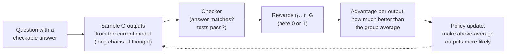
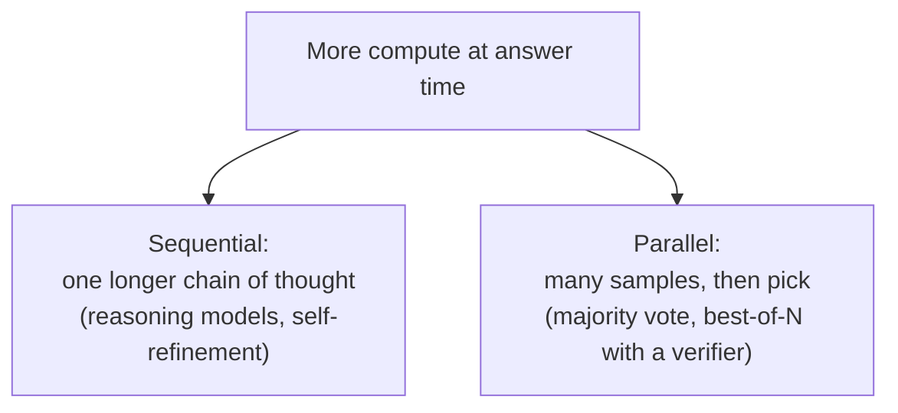

# Reasoning models and test-time compute

## Why this matters

In your speed check ([experiment 00](/experiments/00-speed-check)) thinking mode made a simple answer about 20× slower. The same mechanism is why models now solve competition-level math and multi-step coding tasks that stumped chat models in 2024. Those two facts are one fact: a reasoning model buys accuracy with output tokens, and output tokens cost time and money.

So the question to be able to answer is not "is a reasoning model better?" but "is this task worth the tokens?" For that you need to know where the thinking comes from (it is *trained*, with a surprisingly simple recipe), what it buys (a second axis to scale compute on, next to model size), and where it wastes money or misleads you.

**Learning goals**

- Explain RL with verifiable rewards and how it produces reasoning
- Explain test-time compute as a scaling axis
- Decide when to turn thinking on or off

## Explanation

### Thinking is just more tokens

Go back to [1.1](/part-01-how-llms-work/1.1-next-token-prediction): a transformer does a fixed amount of computation per generated token, one forward pass. Whatever the model "works out" must be computed inside that single pass, or written into the text so that later passes can read it. A model that answers "17 × 23 = " directly has one forward pass to produce the digits. A model that first writes "17 × 20 = 340, 17 × 3 = 51, 340 + 51 = 391" has used dozens of passes, and each intermediate result is now in context where attention (1.4) can reach it.

That is **chain of thought (CoT)**: intermediate tokens as scratch space. A **reasoning model** is one trained to produce a long chain of thought, usually between `<think>` and `</think>`, before it answers. Everything in this chapter is a consequence of that one design.

### Chain of thought: prompted, then trained

CoT was first a prompting trick. Wei et al. showed that [giving a model a few worked examples with their reasoning steps](https://arxiv.org/abs/2201.11903) (their abstract: eight exemplars on a 540B-parameter model) reached state-of-the-art accuracy on the GSM8K math word-problem benchmark, ahead of a fine-tuned GPT-3 with a verifier. Kojima et al. then found you [don't even need examples](https://arxiv.org/abs/2205.11916): adding "Let's think step by step" took `text-davinci-002` from 17.7% to 78.7% on MultiArith and from 10.4% to 40.7% on GSM8K.

Two things limited prompted CoT. The reasoning style was whatever the base or instruct model happened to produce, and it was typically short. And training it meant human-written reasoning examples, which are expensive. The fix is the subject of the next section: don't *show* the model how to reason, *reward* it for getting verifiable answers right, and let it discover reasoning that works.

The distinction to hold on to:

| | Prompted CoT | Trained reasoning model |
|---|---|---|
| Where it comes from | An instruction or examples in your prompt | Post-training (RL) changed the weights |
| Length | A few sentences | Hundreds to tens of thousands of tokens |
| Behavior | Linear walk to the answer | Tries approaches, checks, backs up ("wait…") |
| You control it with | Prompt wording | A request parameter (`think`, effort), plus the prompt |

### How reasoning is trained: RL with verifiable rewards

[1.7](/part-01-how-llms-work/1.7-post-training) introduced RLHF, where a *learned* reward model scores answers and the policy is trained to please it. Its weakness is that the policy can find answers the reward model likes but that are not actually good (reward hacking). **RL with verifiable rewards (RLVR)** removes the learned judge wherever the answer can be checked by a program. The name comes from [Tulu 3](https://arxiv.org/abs/2411.15124); the best-known demonstration is DeepSeek-R1.

The loop, for one training step:

**What is rewarded.** DeepSeek's [R1 paper](https://arxiv.org/abs/2501.12948) uses a "rule-based reward system" of two parts, combined with the same weight. An *accuracy reward*: for math, the final answer must be in a specified format (for example in a box) so it can be compared to the known answer; for code, a compiler runs the output against predefined test cases. A *format reward*: the reasoning must be inside `<think>` tags. They deliberately avoided neural reward models for reasoning because they "are susceptible to reward hacking during large-scale reinforcement learning" and retraining them adds cost and complexity. Note what is *not* rewarded: nothing in the reward looks at the reasoning itself, only at the final answer.

**What the algorithm does: GRPO.** Standard PPO (the algorithm in the RLHF pipeline of 1.7) needs a second network, a value model, to estimate how good each position is, which per the R1 paper is "usually of similar size as the policy model" and so doubles the memory. **GRPO** (group relative policy optimization, introduced in [DeepSeekMath](https://arxiv.org/abs/2402.03300)) drops it. For each question it samples a *group* of G outputs (R1-Zero uses 16 per question, sampled at temperature 1), scores them all, and uses the group itself as the baseline. The advantage of output *i* is its reward minus the group mean, divided by the group's standard deviation (equation 3 of the R1 paper). Outputs better than their siblings get pushed up, worse ones pushed down, with a KL penalty toward a reference model as in RLHF.

A worked example, with G = 4 outputs per question and rewards of 1 (correct) or 0 (wrong). The standard deviation here is the population one; implementations differ in the small print.

| Rewards of the 4 outputs | Mean | Std | Advantage of a correct output | Advantage of a wrong output |
|---|---|---|---|---|
| 1, 0, 0, 0 | 0.25 | 0.433 | **+1.73** | −0.58 |
| 1, 1, 0, 0 | 0.50 | 0.500 | +1.00 | −1.00 |
| 1, 1, 1, 0 | 0.75 | 0.433 | +0.58 | **−1.73** |
| 0, 0, 0, 0 or 1, 1, 1, 1 | – | 0 | – | – (all advantages are 0) |

Three consequences follow straight from the arithmetic. A rare success gets a big push, so hard questions where the model is only sometimes right teach it the most. A question the model always gets right, or always gets wrong, produces no signal at all, so useful training data sits at the edge of the model's ability. And because the reward is binary and checked by code, there is nothing to flatter: the model can only win by producing reasoning that ends in the right answer.

**What came out.** R1-Zero started from the pretrained DeepSeek-V3 base with no SFT at all. According to [the paper](https://arxiv.org/abs/2501.12948), its pass@1 on the AIME 2024 math competition rose from 15.6% to 77.9% over RL training, and to 86.7% with self-consistency decoding (sample many answers, take the majority). Average response length grew steadily during training: the model "naturally learns to solve reasoning tasks with more thinking time". The paper also reports behaviors nobody programmed, like re-checking and trying alternatives, and shows an "aha moment" where use of the word "wait" suddenly rises. Nobody told it to; longer, self-checking reasoning simply earned more reward.

Hold that story loosely. A follow-up, [Understanding R1-Zero-Like Training](https://arxiv.org/abs/2503.20783) (Liu et al., 2025), found that the DeepSeek-V3 base model *already* showed the "aha moment" before RL, and that some Qwen2.5 base models reasoned well without special prompt templates, "suggesting potential pretraining biases". They also identified a bias in GRPO's length normalization that "artificially increases response length (especially for incorrect outputs)" and proposed a fix, Dr. GRPO. The practical reading: RL sharpens and lengthens behavior the base model could already sample, and the details of the objective matter for how long the thinking gets.

**The full recipe is more than RL.** Pure RL gave R1-Zero its reasoning but not a pleasant assistant. The final R1 added stages around it: a small amount of "cold-start" long-CoT SFT data, reasoning RL, then SFT mixing reasoning and general data, then RL on a mix of reasoning and general tasks ([R1 paper](https://arxiv.org/abs/2501.12948), Figure 2 and Table 3). Qwen3 has the same shape with four stages (1.7 has the summary) and then, for the small models, **distillation**: training a small model on a large one's outputs instead of running RL on it. That is why the `qwen3:14b` on your Mac reasons well without having been through an RL stage of its own. [10.9](/part-10-modifying-serving-models/10.9-distillation-synthetic-data) covers distillation.

::: info 📖 Read now
[DeepSeek-R1: Incentivizing Reasoning Capability in LLMs via Reinforcement Learning](https://arxiv.org/abs/2501.12948) (DeepSeek-AI, 2025) · paper · ~45 min · essential

Read the abstract, section 2.1 (GRPO), 2.2 (rewards) and 2.3 (what R1-Zero learned), then the two-stage-RL recipe that follows. This is the revised arXiv version, so section numbers differ from the January 2025 v1. Look for: the one-line reason they refuse neural reward models, the response-length figure, and what the "aha moment" table actually shows. Skip the benchmark tables on first pass.
:::

::: tip 📖 Read (optional)
[DeepSeekMath: Pushing the Limits of Mathematical Reasoning in Open Language Models](https://arxiv.org/abs/2402.03300) (Shao et al., 2024) · paper · ~30 min (the GRPO section) · optional

The paper where GRPO was introduced. Look for the side-by-side with PPO and where the value model disappears; skip the data-collection sections unless you're curious about math pretraining.
:::

::: tip 📖 Read (optional)
[Understanding R1-Zero-Like Training: A Critical Perspective](https://arxiv.org/abs/2503.20783) (Liu et al., 2025) · paper · ~20 min · optional

Look for: the evidence that the "aha moment" already exists in the base model, the length bias in GRPO, and why they say the base model matters so much. It is the best antidote to the tidy R1-Zero story above.
:::

::: tip 📕 Book (optional)
Sebastian Raschka, [*Build a Reasoning Model (From Scratch)*](https://github.com/rasbt/reasoning-from-scratch) (Manning; code repo) · book · ~3 h (chapters 4 and 6) · optional

Chapter 4, "Improving Reasoning with Inference-Time Scaling", and chapter 6, "Training Reasoning Models with Reinforcement Learning", are the hands-on versions of this section and the next (Python notebooks, starting from a pre-trained base LLM). Python is allowed here only because you want the training loop in your hands: read the chapters and run the notebooks, and don't feel obliged to port them to TypeScript.
:::

### Test-time compute: a second scaling axis

[1.6](/part-01-how-llms-work/1.6-pretraining) showed loss falling predictably as you spend more training compute. **Test-time compute** (also called **inference scaling**) is the other knob: spend more compute *per question* when answering. There are two ways to spend it:

Parallel scaling predates reasoning models. Wang et al.'s [self-consistency](https://arxiv.org/abs/2203.11171) samples diverse reasoning paths and takes the most consistent answer, improving GSM8K by 17.9 points over greedy decoding with ordinary CoT. Sequential scaling is what a reasoning model does by default, and the two combine: the 86.7% R1-Zero number above is a parallel vote on top of long sequential reasoning.

Does it scale cleanly? Two sources to anchor on. Qwen3's report shows that giving the model a larger thinking budget produces "scalable and smooth performance improvements" on math, coding and STEM benchmarks ([Qwen3 report](https://arxiv.org/abs/2505.09388), section 4.7, Figure 2). And Snell et al. studied how to *allocate* a fixed compute budget: [their finding](https://arxiv.org/abs/2408.03314) is that the best strategy depends on how hard the prompt is. Spending test-time compute adaptively per prompt improved efficiency "by more than 4x compared to a best-of-N baseline", and on problems where a smaller model has non-trivial success, test-time compute "can be used to outperform a 14x larger model" in a FLOPs-matched comparison. The qualifier matters: that second result does not hold for the hardest problems, where the small model has no foothold.

What this means in practice:

- **Quality can be bought per request**, not only per model. A cheaper model that thinks may beat a bigger one that doesn't, on the right tasks.
- **The returns depend on the problem.** Easy questions gain nothing; some hard ones gain a lot; some are out of reach however long it thinks. That is what your experiment measures.
- **The bill is linear in tokens.** A thinking run is output tokens at output prices and at your machine's decode speed. Your measured speed from [0.4](/part-00-catch-up/0.4-your-lab) (about 24 tokens/s for `qwen3:14b`) turns any token count into seconds.

::: info 📖 Read now
[Scaling LLM Test-Time Compute Optimally can be More Effective than Scaling Model Parameters](https://arxiv.org/abs/2408.03314) (Snell, Lee, Xu, Kumar, 2024) · paper · ~25 min · essential

Read the abstract, the introduction and Figure 1, and skim section 3 for how difficulty is defined. Look for: the two mechanisms they compare (searching against a verifier vs. revising the answer), why the winner changes with difficulty, and the exact conditions of the "14× larger model" claim. This is the paper that made "which problems benefit?" the right question.
:::

::: tip 📖 Read (optional)
[Chain-of-Thought Prompting Elicits Reasoning in Large Language Models](https://arxiv.org/abs/2201.11903) (Wei et al., 2022) · paper · ~15 min (abstract, intro, figures) · optional

The origin of prompted CoT. Look for the result that the gain appears only in sufficiently large models.
:::

::: tip 📖 Read (optional)
[Large Language Models are Zero-Shot Reasoners](https://arxiv.org/abs/2205.11916) (Kojima et al., 2022) · paper · ~15 min (abstract, intro, table 1) · optional

"Let's think step by step": the cheapest possible reasoning intervention, and the baseline that trained reasoning has to beat.
:::

### Hybrid thinking models, and the knobs you actually get

Early reasoning models were separate products (a "reasoning" model next to a "chat" model). Qwen3 puts both behaviors in one set of weights. Its **thinking mode fusion** stage fine-tunes on a mix of thinking and non-thinking data, and the chat template ([0.2](/part-00-catch-up/0.2-the-stack)) carries the switch: per the [Qwen3 report](https://arxiv.org/abs/2505.09388) (section 4.3), the user message or system prompt can include `/think` or `/no_think`, the tokenizer's template takes `enable_thinking=False`, and the model defaults to thinking. The report also describes the **thinking budget**: when the thinking length reaches a user-set threshold, the runtime cuts the thinking off, inserts a fixed sentence ("Considering the limited time by the user, I have to give the solution based on the thinking directly now.") and `</think>`, and lets the model answer from what it has. The report says this ability "is not explicitly trained but emerges naturally" from the fusion stage. In other words, a budget is a truncation, not a plan.

Provider interfaces differ, but they expose the same idea:

| Where | Switch | What you get back |
|---|---|---|
| Ollama (your Qwen3 models) | `think: true` or `false` on `/api/chat`; some models take levels such as low/medium/high instead, and `/api/show` lists the supported values | The reasoning in `message.thinking`, the answer in `message.content` ([docs](https://docs.ollama.com/capabilities/thinking)) |
| Claude API | Adaptive thinking: the model decides per request whether and how much to think, steered by an `effort` level (`low` to `max`); the older fixed `budget_tokens` mode is deprecated and rejected by the newest models ([docs](https://platform.claude.com/docs/en/build-with-claude/thinking-steering-and-cost)) | Thinking blocks, summarized; billed for the full thinking ([docs](https://platform.claude.com/docs/en/build-with-claude/thinking-steering-and-cost)) |

Provider parameters change often, so [2.4](/part-02-programming-with-llms/2.4-reasoning-via-api) covers the API details and [Landscape](/landscape#frontier-models) lists which current models reason. The durable ideas: *whether* to think, *how much*, and *what you see of it*.

Sampling still applies. The Qwen3 report evaluates thinking mode with temperature 0.6, top-p 0.95 and top-k 20, and non-thinking mode with temperature 0.7, top-p 0.8 and top-k 20 (its evaluation settings), which are the 1.8 knobs set to values the authors tuned. A long chain of thought is many sampled steps, so the same chance of a slip compounds over its length and the sampler affects it more than it does a one-line answer.

::: info 📖 Read now
[Qwen3 Technical Report](https://arxiv.org/abs/2505.09388) (Qwen Team, 2025), section 4.3 "Thinking Mode Fusion" and the thinking-budget results in section 4.7 · paper · ~20 min · essential

Look for: the chat-template examples with `/think` and `/no_think`, the sentence inserted when the budget runs out, and Figure 2 (accuracy against thinking budget). You met the four-stage recipe in 1.7; here, focus on how one model serves both modes.
:::

::: info 📖 Read now
[Ollama: Thinking](https://docs.ollama.com/capabilities/thinking) (docs) · docs · ~10 min · essential

Look for: how to discover a model's supported thinking values, the separate `thinking` and `content` fields, and what the streaming interface does with them. This is what your experiment script calls.
:::

### What thinking costs, and how it fails

**Latency and money.** Thinking tokens are output tokens. On Claude, for example, you are [billed for the full thinking process](https://platform.claude.com/docs/en/build-with-claude/thinking-steering-and-cost), even though the response shows only a summary of it, and the number of reasoning tokens is reported in `usage.output_tokens_details.thinking_tokens`. Locally the price is time. A quick measurement on this machine (2026-11-10, Ollama 0.40.14, `qwen3:14b`, one run per cell, default sampling, so anecdotal; your experiment does this properly):

| Task | Thinking off | Thinking on |
|---|---|---|
| "Capital of Australia?" | 4 tokens, correct | 139 tokens, correct |
| `17 × 23` | 4 tokens (0.3 s), correct | **1,450 tokens (62 s)**, correct |
| Four-person height ordering (who is second tallest) | 3 tokens, **wrong** | 495 tokens (25 s), correct |

Two things to read off. For multiplication a 14B model can do in its head, 1,450 tokens (about 360× more) bought nothing: that is the cost side. And on the ordering puzzle, the instant answer was wrong and the thinking answer was right: that is the benefit side. Where the two lie on the difficulty scale is the whole decision. (The 5 s for the first lookup row includes loading the model.)

**Overthinking.** This has been studied on its own. Chen et al., in [Do NOT Think That Much for 2+3=?](https://arxiv.org/abs/2412.21187), found that o1-like models "consumed 1,953% more tokens than conventional models to reach the same answer" on trivial questions, and that in more than 92% of cases where the final answer was correct, the *first* solution round already had it. One example is 13 separate solutions to "2 plus 3". Their per-question efficiency score (tokens needed to first reach the correct answer divided by total tokens) is 4.3% in the worked example. The authors also report that overthinking was more frequent on easy problems than on hard ones. Connect this to GRPO's length bias above: if training rewards or even just tolerates long outputs, models learn that long is safe.

**Thinking is not an audit log.** Two separate things get called "leaked reasoning", and both are worth guarding against.

- *Format leak:* the `<think>…</think>` block ends up inside the answer text because a client or server doesn't split it out (a reason to use APIs that return `thinking` separately, as Ollama does when `think` is set). It confuses parsers, evals and users, and spends tokens in your context window on the next turn.
- *Unfaithful reasoning:* you might assume that what the chain of thought says is what drove the answer. Anthropic's [Reasoning Models Don't Always Say What They Think](https://arxiv.org/abs/2505.05410) tested this with hints planted in prompts: models often used a hint without mentioning it, with reveal rates "often below 20%". They also found that outcome-based RL improved faithfulness at first but plateaued, and that when RL increased reward hacking, the verbalizing of it did not increase. A reasoning trace is useful evidence, and a bad guarantee. Don't build a safety argument on "we read the thinking and it looked fine", and be careful about showing raw reasoning to end users or logging it with sensitive inputs: the provider summarizing it, as Claude does, is partly for this reason.

**Budget accidents.** Thinking tokens count toward your output limit. Anthropic's docs state that thinking tokens "count toward the `max_tokens` limit for the turn". If you set a small limit and the model spends it all thinking, you get a truncated trace and no answer. Always check the finish/done reason when you adopt a reasoning model.

::: info 📖 Read now
[Do NOT Think That Much for 2+3=? On the Overthinking of o1-Like LLMs](https://arxiv.org/abs/2412.21187) (Chen et al., 2024) · paper · ~20 min · essential

Read the abstract, the introduction, and Figures 1 and 2. Look for: where in the response the first correct answer appears, the two efficiency metrics, and what their mitigation costs in accuracy (the abstract claims none; check whether the tables agree).
:::

::: tip 📖 Read (optional)
[Reasoning Models Don't Always Say What They Think](https://arxiv.org/abs/2505.05410) (Chen et al., Anthropic, 2025) · paper · ~20 min · optional

Look for: the design of the hint experiments, which hint types had the lowest reveal rates, and the authors' own limits on what the results say about real-world monitoring.
:::

::: tip 📖 Read (optional)
[Claude docs: Steering and cost control](https://platform.claude.com/docs/en/build-with-claude/thinking-steering-and-cost) (Anthropic) · docs · ~15 min · optional

How adaptive thinking decides when to think, what each effort level does, and how thinking is billed. We return to it in 2.4.
:::

### When to turn thinking on

A rule of thumb, which you will test in the practice section rather than take from me. Ask two questions: *does the answer need a chain of dependent steps?* and *can a wrong answer be caught cheaply afterwards?*

| Situation | Thinking | Why |
|---|---|---|
| Lookup, classification, extraction, formatting, short rewriting | Off | No chain of steps to scratch-pad; thinking adds pure latency and cost |
| Multi-step math, logic, planning, scheduling, constraint puzzles | On | Intermediate results must be held somewhere; this is what RLVR trained for |
| Code that has tests (or will be run) | On for non-trivial logic | The checker catches mistakes; the same signal RL used |
| Agent step that only formats a tool call | Off or low effort | Repeated every turn, so the cost multiplies; adaptive and low-effort modes exist for this |
| High-volume, latency-sensitive, or cheap-to-retry calls | Off | The cost multiplier matters most here |
| Rare, expensive, hard-to-verify decisions | On, and verify the output independently | The reasoning can be unfaithful, so don't treat it as proof |

Two more levers sit between "on" and "off": a smaller budget (or a lower effort level), and the parallel alternative, which is sampling a few non-thinking answers and voting. Which is cheaper per correct answer depends on the task and the model, so measure it.

### Summary

- A reasoning model produces a long chain of thought before answering. Thinking is extra output tokens used as scratch space.
- RLVR trains it: sample a group of attempts, check each with code, push up the better-than-average ones (GRPO). No learned judge, no human reasoning examples required.
- Test-time compute is a second scaling axis, sequential (longer thinking) or parallel (vote). How much it helps depends on the problem.
- Hybrid models (Qwen3) switch thinking on and off in one set of weights, and a budget is a truncation.
- The costs are tokens, time and money; the failure modes are overthinking, format leaks and unfaithful traces.

## Practice

**Brief:** Make 5 tasks of rising difficulty (lookup → multi-step logic). Run `qwen3:14b` with thinking on and off, record correctness, tokens and time, and plot where thinking starts paying off. All local, free.

**Where:** `experiments/11-thinking-tradeoff/`: a standalone experiment. The README has the "What I tried / What happened / Why" skeleton and the tables to fill in.

**Steps:**

1. **Write five tasks in `tasks.json`**, each `{ id, difficulty, prompt, expected }` with a single unambiguous answer you can check with code (exact match after trimming, or a regex). Rising difficulty: (1) a lookup, (2) one-step arithmetic or string manipulation, (3) a multi-step word problem, (4) a constraint puzzle with four or five entities, (5) a harder multi-step logic or scheduling puzzle where an intuitive first answer is wrong. Invent your own: don't reuse the prompts in this chapter, and don't pick tasks that the model might have memorized as famous puzzles. **Verify every expected answer yourself first**, by hand or with a few lines of brute force. That is the same job a verifiable reward does, and a wrong key will look like a model failure.
2. **Predict before you measure.** In the README, for each task write down whether you expect thinking to change correctness, and your guess for the token multiple. Where do you expect the crossover?
3. **Write `tradeoff.ts`** (TypeScript, plain `fetch`, no dependencies, as in experiments 05 and 10). For each task × `think` ∈ {false, true} × 3 runs, POST to `/api/chat` with `stream: false`, a single user message, and `options` that leave sampling at the model's shipped defaults, `num_ctx` of 8192 and a generous `num_predict` (several thousand). Do one throwaway warm-up call first so model loading isn't counted. Record: correct (your checker, on `message.content`), `eval_count` (output tokens including thinking), wall-clock seconds, `done_reason`, and the character count of `message.thinking`. Write every run to `results.json`.
4. **Watch for truncation.** A thinking run that hits `num_predict` has no answer. Count those as wrong *and* report them separately: "wrong" and "ran out of budget" are different failures.
5. **Summarize per task:** accuracy out of 3, median tokens, median seconds, for both modes. Compute the cost of thinking as median seconds on ÷ median seconds off, and the benefit as the change in accuracy.
6. **Plot where it pays off.** Put one chart in the README (a Mermaid `xychart` renders in the book) of accuracy against task difficulty, thinking off vs. on, and a second of median tokens against difficulty on the same axis. Mark the first task where thinking's accuracy is clearly higher than non-thinking.
7. **Explain.** In the README, answer: where is the crossover, how many times more tokens or seconds did it cost, and was there a task where thinking was *worse* or where it spent more than 20× the tokens for no gain? Compare with your step 2 prediction and with the overthinking paper.
8. **Optional stretch, parallel vs. sequential:** for your crossover task, compare one thinking run against majority vote over 5 non-thinking runs at temperature 0.7 (the Qwen3 non-thinking setting from the chapter). Which is more accurate, and which costs fewer total tokens?
9. **Optional stretch, other models:** repeat on `qwen3:8b` and `qwen3:30b-a3b`. Does the crossover move down in task difficulty with the smaller model? (Check the speeds in [Landscape](/landscape#what-fits-in-24-gb-of-unified-memory): the 30B is tight in memory.)
10. **Optional stretch, a manual budget:** re-run the crossover task with `num_predict` set to roughly 25%, 50% and 100% of the median thinking length you measured. When does the answer disappear?

Budget some time: a 14B thinking run of 1,500 tokens takes about a minute at ~24 tokens/s, so 15 thinking runs can take 15–30 minutes. Close memory-hungry apps first.

**Done when:** `node experiments/11-thinking-tradeoff/tradeoff.ts` prints a table of per-task accuracy, median tokens and median seconds for both modes, `results.json` has every run, and the README has your prediction, the table, the chart, a note on any truncated runs, and a short explanation of where thinking started to pay off and why.

## Check questions

1. In R1-Zero's training, a group of 4 sampled answers to one question gets rewards 0, 0, 0, 0. What is the advantage of each, and what does the model learn from this question at this step? What if the rewards are 1, 0, 0, 0?

   

Answer

   All advantages are 0 for 0, 0, 0, 0: the group has no differences to learn from (mean 0, std 0), so this question produces no update; the same holds for 1, 1, 1, 1. For 1, 0, 0, 0 the mean is 0.25 and the standard deviation about 0.433, so the correct answer gets advantage ≈ +1.73 and each wrong one ≈ −0.58. The model is pushed hard toward the rare success. The takeaway is that useful RLVR questions are those the model solves *sometimes*.
   

2. What is "verifiable" about RLVR, and why does DeepSeek say it avoided neural reward models for reasoning? What does that choice buy and cost?

   

Answer

   The reward is computed by a program from a known answer or tests (math answer matches, code passes tests, plus a format check), not predicted by a learned model. They avoided neural reward models because those are "susceptible to reward hacking" at scale and add retraining cost and complexity. It buys a reward that cannot be flattered and is cheap to compute. The cost is scope: it only works on tasks with checkable answers (math, code, some logic and tool-use tasks), so open-ended quality (tone, helpfulness) still needs preference training, which is why R1 and Qwen3 add further stages.
   

3. Your teammate says "reasoning models can reason because RL taught them to think". Name one piece of evidence from this chapter that complicates that.

   

Answer

   Liu et al. found that the DeepSeek-V3 base model already displayed the "aha moment" behavior before RL, and that some Qwen2.5 base models reasoned well without special templates. RL appears to sharpen, lengthen and reward behavior that the base model can already produce, with the base model's pretraining being a major factor. Chain-of-thought prompting results (Wei et al., Kojima et al.) pointing the same way: reasoning-like behavior can be elicited from non-RL models. Distillation (Qwen3's small models) is another: a model can acquire reasoning without running RL itself.
   

4. For each of these, say thinking on or off and why: (a) classify 10,000 support tickets into five labels; (b) find the bug in a failing unit test and fix the code; (c) a chatbot turn that says "Thanks!" back to the user; (d) a scheduling problem with 8 constraints.

   

Answer

   (a) Off: no chain of dependent steps, huge volume, so the token multiple dominates cost; measure accuracy to confirm. (b) On (or medium effort): multi-step logic, and the failing tests give a cheap check on the result. (c) Off: nothing to work out, and latency matters. (d) On: a constraint-satisfaction problem is the kind of task that benefits, but verify the answer against the constraints with code, since the reasoning can still contain slips. The pattern is dependent steps plus a cheap check favor thinking; lookup, high volume and latency sensitivity favor leaving it off.
   

5. A coworker plans to show the model's raw chain of thought to users as "the explanation" and to log it for audits. Give two reasons to hesitate.

   

Answer

   (a) It is not necessarily faithful: in Anthropic's hint experiments the models often used a hint without mentioning it (reveal rates often below 20%), so the trace may omit what really drove the answer, and RL did not fix that. It's evidence, not proof. (b) It may contain sensitive inputs or half-formed and wrong reasoning, which can confuse or mislead users, and providers such as Claude return summaries by default. Also, the reasoning tokens are billed and fill context if kept in later turns. A better explanation for users is a separately generated answer or rationale you can check.
   

6. A request to a reasoning model with `max_tokens` (or `num_predict`) = 1000 comes back with an empty answer and `done_reason: "length"`. What happened, and what are two fixes?

   

Answer

   The model spent the whole output budget on thinking: thinking tokens count toward the output limit, so the cut-off came before the answer started. Fixes: raise the limit enough for thinking plus answer; lower the thinking amount (a lower effort level, a thinking budget, or thinking off for a task that doesn't need it); or use a task-appropriate non-reasoning model. And always check the finish reason, not just the content field.
   

## My understanding

<!-- Written by the learner, in their own words. Agents never fill this in. -->
