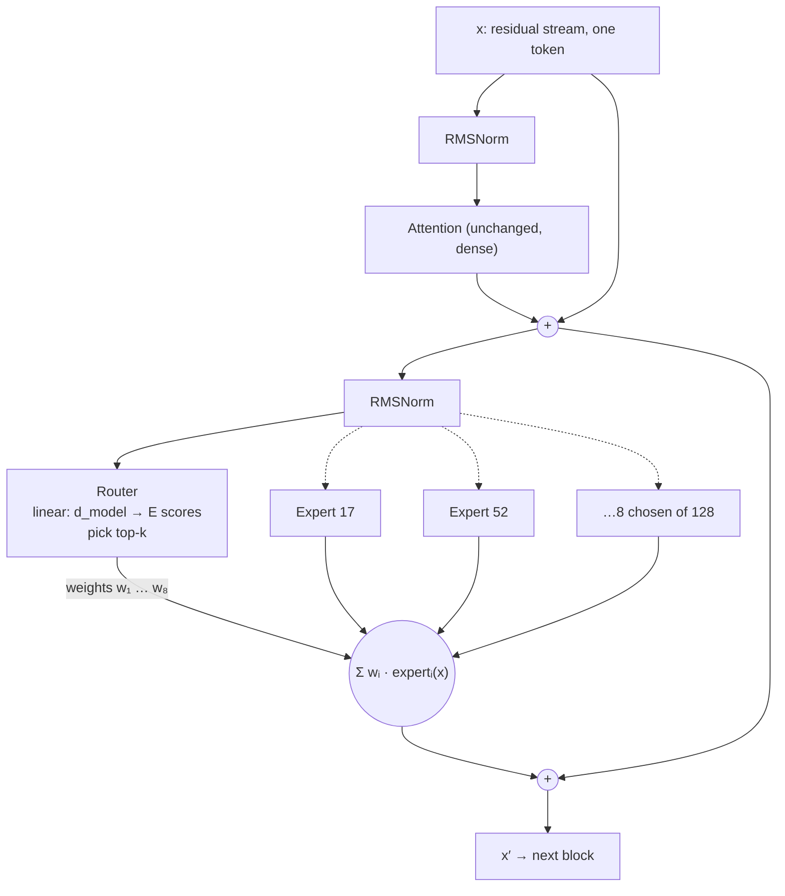

# Mixture of experts

## Why this matters

In [experiment 00](https://github.com/hsavovski/ai-engineering/tree/main/experiments/00-speed-check), `qwen3:30b-a3b` generated at the same speed as `qwen3:8b` while being the smarter model, and it was also the only one that didn't fit your GPU: 19 GB in memory, 6% spilled to the CPU. Both results come from one design choice, and this chapter explains it.

Mixture of experts (MoE) is now a mainstream design for large open-weight models. Qwen3's flagship is MoE ([Qwen3 Technical Report](https://arxiv.org/abs/2505.09388)), and so are DeepSeek-V3 ([paper](https://arxiv.org/abs/2412.19437)), Mixtral ([paper](https://arxiv.org/abs/2401.04088)) and the Mistral and Llama entries on [Landscape](/landscape). Closed labs mostly don't publish architectures, so what they use is unknown. Without MoE you can't read a model card ("30.5B total, 3.3B activated"), predict whether a model will fit in memory, or know why a bigger model can be faster than a smaller one.

[1.5](/part-01-how-llms-work/1.5-transformer-block) ended with the MLP holding about two-thirds of a dense model's parameters. MoE keeps that block's job and changes how it's built: instead of one MLP that every token passes through, there are many, and each token uses only a few.

**Learning goals**

- Explain routing, experts and active vs total parameters
- Explain why MoE is fast but memory-hungry
- Read MoE model names (e.g. 30b-a3b)

## Explanation

### From one MLP to many

In a **dense** model, every token goes through every parameter: the same attention, the same MLP, in every block. Compute per token grows with the parameter count, so a bigger model is a slower model.

A **sparse** MoE model replaces the MLP in each block with a bank of **experts**. Each expert is an ordinary MLP, the SwiGLU shape from 1.5 (`gate_proj`, `up_proj`, `down_proj`). A small **router** looks at the token and picks a few experts. Only those run, and their outputs are added together. Everything else in the block (attention, norms, the residual stream, the embeddings) is unchanged and shared by all tokens.



Shazeer and colleagues introduced the sparsely-gated layer in 2017 to get "greater than 1000x improvements in model capacity with only minor losses in computational efficiency" ([Outrageously Large Neural Networks](https://arxiv.org/abs/1701.06538)), and Fedus et al. simplified it for Transformers in the Switch Transformer ([paper](https://arxiv.org/abs/2101.03961)). The idea is **conditional computation**: the model has a large parameter count to store knowledge, but each token pays only for the few parameters it uses.

### The router and top-k

The router is a single linear layer: `E` rows (one per expert) of `d_model` numbers. For one token vector `x`:

```ts
// One MoE layer, one token. x has d_model entries; router is E × d_model; k experts are chosen.
function moeLayer(x: Vec, router: Mat, experts: Expert[], k: number): Vec {
  const scores = router.map((row) => dot(row, x))            // E scores, one per expert
  const chosen = argTopK(scores, k)                          // indices of the k best-scoring experts
  const w = softmax(chosen.map((i) => scores[i]))            // k weights that sum to 1
  return sum(chosen.map((i, j) => scale(experts[i](x), w[j])))  // weighted sum of k expert outputs
}
```

That's the whole mechanism. Mixtral's paper writes it as the softmax over the top-K logits of a linear layer, and uses K = 2 of 8 experts ([Mixtral of Experts](https://arxiv.org/abs/2401.04088), section 2.1). Qwen3 computes the softmax over all experts, takes the top 8, then renormalizes those 8 weights to sum to 1 (`norm_topk_prob: true` in the [config](https://huggingface.co/Qwen/Qwen3-30B-A3B/blob/main/config.json); see `Qwen3MoeTopKRouter` in [`modeling_qwen3_moe.py`](https://github.com/huggingface/transformers/blob/main/src/transformers/models/qwen3_moe/modeling_qwen3_moe.py), read 2026-11-10). Those two are the same function: the softmax's normalizer cancels when you renormalize over the chosen few.

Three things follow from this:

- **Routing is per token and per layer.** Token 5 might use experts 17 and 52 in block 3 and experts 4 and 99 in block 4. Nothing carries over between layers, so a token can follow any of `E^L` paths through the model.
- **The router is trained with everything else.** Its weights are ordinary parameters. The gradient reaches it through the `w` weights: it learns to give a high score to experts whose output helped. (The hard `top-k` choice itself has no gradient. Only the weights of the chosen experts do.)
- **The router is tiny.** For Qwen3-30B-A3B it's 128 × 2,048 = 262,144 parameters per block, 0.04% of the block.

### Worked example: Qwen3-30B-A3B

Here's the 30B-A3B model's `config.json` turned into a parameter table, the way 1.5 did it for Qwen3-8B. The config values are `hidden_size` 2,048, `num_hidden_layers` 48, `num_attention_heads` 32, `num_key_value_heads` 4, `head_dim` 128, `num_experts` 128, `num_experts_per_tok` 8, `moe_intermediate_size` 768 and `vocab_size` 151,936 ([config.json](https://huggingface.co/Qwen/Qwen3-30B-A3B/blob/main/config.json)). Your local copy reports the same shapes: run `ollama show -v qwen3:30b-a3b` and read `qwen3moe.expert_count`, `expert_used_count` and `expert_feed_forward_length`.

| Per block | Formula | Parameters |
|---|---|---|
| Attention (`q`, `k`, `v`, `o`) + `q_norm`, `k_norm` | `d·hd·(2h + 2kv) + 2·hd` | 18,874,624 |
| Two RMSNorms | `2·d` | 4,096 |
| **Router** (`gate`) | `E · d` = 128 × 2,048 | 262,144 |
| **One expert** (gate, up, down) | `3 · d · 768` | 4,718,592 |
| All 128 experts | `128 × 4,718,592` | 603,979,776 |
| **One block, total** | attention + norms + router + all experts | **623,120,640** |
| **One block, active** | attention + norms + router + 8 experts | **56,889,600** |

Across the model:

| | Parameters | Check |
|---|---|---|
| 48 blocks, total | 29,909,790,720 | the model card's "Non-Embedding: 29.9B" |
| Embedding + `lm_head` + final norm | 622,331,904 | |
| **Total** | **30,532,122,624** | the card's "30.5B in total"; `general.parameter_count` in your local `ollama show -v`; exactly half of the `total_size` (61,064,245,248 bytes at 2 bytes each) in the [safetensors index](https://huggingface.co/Qwen/Qwen3-30B-A3B/blob/main/model.safetensors.index.json) |
| **Active per token** | 48 × 56,889,600 + 622,331,904 = **3,353,032,704** | the card's "3.3B activated" ([model card](https://huggingface.co/Qwen/Qwen3-30B-A3B)) |

What the table shows:

- **The experts are 95% of the model.** 48 × 128 experts hold 28.99B of 30.53B parameters. Attention is 0.9B, and the embeddings 0.6B.
- **8 of 128 is 6.25% of the expert weights**, so a token touches about 1/16 of the model's MLP parameters. Attention is not sparse: every token uses all of it.
- **"Active" counts both embedding tables.** The card's 3.3B includes the input embedding and the `lm_head`. A token only reads one row of the input table, so the weights a token actually multiplies are closer to 3.04B (48 blocks plus `lm_head`).
- **Every block is MoE.** `mlp_only_layers` is empty, and the local GGUF has expert tensors in both block 0 and block 47. (`intermediate_size: 6144` in the config belongs to a dense MLP that this model doesn't have.)
- **Compare with the dense 8B from 1.5.** Its MLP is 151M parameters per block, all used for every token. Here, eight 4.7M experts add up to 37.7M active MLP parameters per block, but the 128 of them store 604M. That is the trade: four times the MLP storage of a dense 8B, a quarter of its MLP compute.

### What experts learn (and don't)

"Expert" suggests a specialist: one for code, one for French, one for math. Mixtral's authors looked for that and reported: "Surprisingly, we do not observe obvious patterns in the assignment of experts based on the topic" ([Mixtral of Experts](https://arxiv.org/abs/2401.04088), section 5). What they found instead was that "the selection of experts appears to be more aligned with the syntax rather than the domain", and that consecutive tokens often go to the same expert. Treat experts as a way to split up parameters, not as named skills. Even so, a model can't run fewer than `k` of them per token, so every token's answer is built from a mix.

#### Many small experts, and shared experts

Two design variations show up in model names and configs:

- **Fine-grained experts.** DeepSeekMoE splits each expert into smaller ones and activates more of them: "finely segmenting the experts into `mN` ones and activating `mK` from them, allowing for a more flexible combination of activated experts" ([DeepSeekMoE](https://arxiv.org/abs/2401.06066)). Qwen3 follows this, with "128 total experts with 8 activated experts per token" ([Qwen3 Technical Report](https://arxiv.org/abs/2505.09388), section 2.1). Mixtral instead has 8 large experts and picks 2.
- **Shared experts.** DeepSeekMoE also isolates some experts "as shared ones, aiming at capturing common knowledge and mitigating redundancy in routed experts", meaning they run for every token. DeepSeek-V3 has 256 routed experts plus one shared, so 9 run per token, according to [Raschka's comparison](https://magazine.sebastianraschka.com/p/the-big-llm-architecture-comparison) (section 1.2). Qwen3 "excludes shared experts" (same report), although Qwen2.5-MoE had them. A Qwen3 developer told Raschka they "did not find significant enough improvement on shared expert" and worried about the inference cost (section 6.2).

::: info 📖 Read now
[Mixture of Experts Explained](https://huggingface.co/blog/moe) (Sanseviero et al., Hugging Face, December 2023) · article · ~30 min · **essential**

This is the standard introduction, and it's written for people who haven't seen MoE before. Look for: the sparsity and router sections, the Switch Transformer and "expert capacity" parts (what happens when too many tokens want the same expert), "What does an expert learn?", and "When to use sparse MoEs vs dense models?". It dates from before Qwen3 and DeepSeek-V3, so treat the "Open Source MoEs" list as history. Its memory warning is the one you'll feel on your Mac: "all parameters need to be loaded in RAM, so memory requirements are high".
:::

### Load balancing

If you train the router with nothing else, it collapses. An expert that gets a few more tokens early becomes slightly better, so the router sends it still more tokens, while the other experts starve and never improve. You end up paying for 128 experts and using five. There's a hardware reason too: in big deployments the experts are spread over many GPUs, and the busiest expert sets the speed of the step. So training adds a pressure towards even use. Three ways to apply it:

**1. An auxiliary loss.** The standard form is `N · Σᵢ fᵢ · pᵢ`, where `N` is the number of experts, `fᵢ` the fraction of tokens routed to expert `i`, and `pᵢ` the average router probability for expert `i` ([Qiu et al., 2025](https://arxiv.org/abs/2501.11873), which uses the same formula as the Switch Transformer). It's added to the language-modeling loss with a small coefficient. A worked case with 4 experts and top-1 routing:

| Routing | `f` | `p` | `N · Σ f·p` |
|---|---|---|---|
| Perfectly even | 0.25, 0.25, 0.25, 0.25 | 0.25, 0.25, 0.25, 0.25 | 4 × (4 × 0.0625) = **1.0** (the minimum) |
| Somewhat skewed | 0.5, 0.25, 0.25, 0 | 0.4, 0.3, 0.2, 0.1 | 4 × (0.2 + 0.075 + 0.05) = **1.3** |
| Collapsed | 1, 0, 0, 0 | 0.7, 0.1, 0.1, 0.1 | 4 × 0.7 = **2.8** |

The loss is smallest when use is even, and grows as one expert takes over. Qwen3-30B-A3B's config has `router_aux_loss_coef: 0.001`, so it's a gentle nudge next to the main loss.

**2. Balance across a bigger batch.** Computing that loss inside each small micro-batch (almost one sequence) pushes the router to spread even a code-only sequence over all experts, which fights specialization. Qiu et al. compute it over a global batch instead, and report that this "greatly improves the domain specialization of MoE experts". The Qwen3 report says Qwen3 adopted it "to encourage expert specialization".

**3. No loss at all.** An auxiliary loss adds gradients that compete with the language-modeling objective. DeepSeek instead adds an expert-wise bias to the routing scores *before* the top-k choice and updates the bias according to each expert's recent load, so "it does not produce any interference gradients" ([Auxiliary-Loss-Free Load Balancing](https://arxiv.org/abs/2408.15664)). DeepSeek-V3 "pioneers an auxiliary-loss-free strategy for load balancing" ([paper](https://arxiv.org/abs/2412.19437)).

There's also the **expert capacity** limit from the HF article: during training each expert accepts a fixed number of tokens per batch, and any overflow skips the layer through the residual connection. That's the reason the residual stream matters again.

::: tip 📖 Read
[Mixtral of Experts](https://arxiv.org/abs/2401.04088) (Jiang et al., 2024), section 2 "Architectural details" and section 5 "Routing analysis" · paper · ~20 min · **essential**

Short and concrete. Look for: the formula in section 2.1, the claim that each token "has access to 47B parameters, but only uses 13B active parameters during inference" (so "8x7B" is not 56B: attention is shared), the sentence about memory ("proportional to its sparse parameter count, 47B"), and in section 5 the figures showing experts do not split by topic.
:::

::: tip 📖 Read
[The Big LLM Architecture Comparison](https://magazine.sebastianraschka.com/p/the-big-llm-architecture-comparison) (Raschka), sections "1.2 Mixture-of-Experts (MoE)", "6.2 Qwen3 (MoE)" and "9.2 Few Large Versus Many Small Experts" · article · ~15 min · optional

Look for: the diagram of a dense feed-forward block next to an MoE block, the DeepSeek-V3 versus Qwen3-235B-A22B comparison (almost the same architecture), and the Qwen developer's answer on shared experts. You met this article in 1.5, and these are the sections you deferred.
:::

::: tip 📖 Read
[DeepSeekMoE](https://arxiv.org/abs/2401.06066) (fine-grained and shared experts) and [Auxiliary-Loss-Free Load Balancing](https://arxiv.org/abs/2408.15664) · paper · ~20 min each (abstract and introduction) · optional

For when you want the reasons behind the two design choices in Qwen3 and DeepSeek-V3. Look for: the experiment that compares the same total parameters split into more, smaller experts, and the plot of load balance against model quality in the second one.
:::

### Active parameters, speed and memory

Now the two sides of the trade. For each token:

- **Compute** depends on the **active** parameters: attention, the router and the `k` chosen experts. About 3B for 30B-A3B.
- **Memory** depends on the **total** parameters: every expert must be loaded, because which ones a token needs isn't known until the router has run, and the next token may need others. About 30.5B for 30B-A3B.

HF's article puts it directly: a MoE like Mixtral 8x7B needs "enough VRAM to hold a dense 47B parameter model", yet runs much faster than that dense model ([Mixture of Experts Explained](https://huggingface.co/blog/moe)).

#### Speed

Generating one token (decode) has to read the active weights from memory once. [1.9](/part-01-how-llms-work/1.9-kv-cache-context-window) explained that decode is memory-bandwidth bound, so there's a simple ceiling: `tokens/s ≤ memory bandwidth ÷ bytes read per token`. The Mac mini with an M4 Pro (12-core CPU, 16-core GPU) has 273 GB/s ([Apple tech specs](https://support.apple.com/en-us/121555), read 2026-11-10). Check it against a dense model from your experiment 00: `qwen3:14b` is a 9.3 GB file and every token reads all of it, so the ceiling is 273 ÷ 9.3 ≈ 29 tokens/s. You measured 25.0, 86% of it. Dense models land close to the ceiling.

For a MoE, bytes read per token are roughly the active share of the file, not the whole file. That's why the `30b-a3b` could be expected to outrun an 8B. Then you measured 41.1 tok/s for the `30b-a3b` and 41.3 tok/s for the 8B, and that equality is the practice's puzzle. The ceiling is an upper bound: anything that isn't a plain read of the weights (running the router, gathering 8 scattered experts per block, 48 blocks of small matrix multiplications, layers that ended up on the CPU) pushes you below it.

Throughput changes with batch size too. When a server decodes many requests together, each token picks its own experts, and the batch soon touches most of them. If 8 of 128 experts were picked independently and uniformly (they aren't: the routing is uneven and correlated, as the Mixtral paper shows), the share of experts touched per step would be:

| Tokens decoded together | 1 | 4 | 8 | 16 | 32 | 64 |
|---|---|---|---|---|---|---|
| Experts touched (of 128) | 6% | 23% | 40% | 64% | 87% | 98% |

(`1 − (1 − 8/128)^B`.) At batch 1, which is you chatting with a local model, you read about 1/16 of the expert weights per token. In a busy server at batch 64, almost all the experts are read every step, and the saving is spread over many users instead. That's why the HF article says sparse models suit "high throughput scenarios with many machines", whereas "for low throughput scenarios with little VRAM, a dense model will be better".

#### Memory

The weights file is the total, whatever the active share. `ollama list` shows 18 GB for `qwen3:30b-a3b`: 30.53B parameters at about 4.7 bits each (18 GB × 8 ÷ 30.53B). The model came with its 18 GB, and `ollama ps` showed 19 GB loaded at `num_ctx` 8192 in experiment 00, 94% on the GPU and 6% on the CPU. Three separate things use your 24 GB:

- **The weights**: the total parameter count, times bits per weight. MoE makes this bigger than the speed suggests.
- **The KV cache**: attention is dense in a MoE model, so the cache follows the attention shape, not the experts. For 30B-A3B it's 48 layers × 2 × 4 KV heads × 128 × 2 bytes = 96 KiB per token, *smaller* than the 14B's 160 KiB (1.9's table). The expert count doesn't enter the formula.
- **Everything else**: macOS, your other apps and Ollama itself. That's why 14% of memory was free in the run and why "close other apps" is advice for this model in particular.

The GPU on Apple silicon can't use all of unified memory. When the model plus cache is bigger than what the GPU is allowed to use, the runtime keeps part of it on the CPU. That's the 6%. A CPU-resident part is slower and drags the whole step down with it, because a token's work needs every layer. You can see the split in `ollama ps` (the `PROCESSOR` column) and the GPU limit setting in `sysctl iogpu.wired_limit_mb` (0 on this Mac, meaning the macOS default).

### Reading MoE names

| Name | Reading | Source |
|---|---|---|
| `Qwen3-30B-A3B` | 30B total, A = active, 3B active per token | [model card](https://huggingface.co/Qwen/Qwen3-30B-A3B): 30.5B total, 3.3B activated |
| `Qwen3-235B-A22B` | 235B total, 22B active | [Qwen3 Technical Report](https://arxiv.org/abs/2505.09388) |
| `Mixtral 8x7B` | 8 experts of the 7B model's MLP shape. Not 56B: shared attention makes it 47B total, 13B active | [Mixtral paper](https://arxiv.org/abs/2401.04088) |
| `DeepSeek-V3` | no active count in the name: 671B total, 37B active, 256 routed experts plus one shared | [paper](https://arxiv.org/abs/2412.19437); [Raschka](https://magazine.sebastianraschka.com/p/the-big-llm-architecture-comparison) |

So `NNb-aMb` is total and active, and the number to size your hardware against is `NN`, while `M` tells you roughly how fast it will run. Two cautions:

- **Active count isn't quality.** Mixtral 13B-active "outperforms or matches Llama 2 70B" on all evaluated benchmarks (paper abstract). A MoE's quality sits somewhere between a dense model of its active size and one of its total size, and where depends on training.
- **MoE models are harder to fine-tune.** The HF article reports that sparse models historically overfit and generalized poorly when fine-tuned. You'll meet it again if you try LoRA on a MoE in Part 10.

For current MoE models, their sizes and what they cost to call, see [Landscape](/landscape): the Mistral and Meta sections list MoE models, and the "What fits in 24 GB" table has your measured numbers.

## Practice

**Brief:** Go back to experiment 00's comparison table and explain every number for qwen3:30b-a3b using this chapter (speed, memory, CPU spill). Add the explanation to the experiment README.

**Where:** Notes only, no code: `notes/1.11-qwen3-30b-a3b.md`, then a short section at the bottom of `experiments/00-speed-check/README.md` that points to it.

**Steps:**

1. Run `ollama show -v qwen3:30b-a3b` and write down `block_count`, `attention.head_count`, `head_count_kv`, `embedding_length`, `expert_count`, `expert_used_count` and `expert_feed_forward_length`. Do they match the HF config? Which fields don't (look at `context_length` and `rope.freq_base`)?
2. Compute the parameters per block (attention, norms, router, one expert, all experts) and the total and active counts from those numbers, without copying the chapter's table. Compare with `general.parameter_count` and with the model card's 30.5B and 3.3B.
3. Memory: from `ollama list`, work out the average bits per weight. Add the KV cache at `num_ctx` 8192 (formula from 1.9). Compare the sum with the 19 GB in the README table. What's left to explain, and what in 24 GB could account for it?
4. Speed: look up your Mac's memory bandwidth, then compute the ceiling `bandwidth ÷ bytes read per token` for `qwen3:8b`, `qwen3:14b` and `qwen3:30b-a3b` (for the last one, estimate the bytes from the active share of the file). Put the ceilings next to the measured 41.3, 25.0 and 41.1 tok/s. Which model is closest to its ceiling and which is furthest? Write down at least two hypotheses for the gap, and say which one you could test with the tools you have.
5. CPU spill: with the model loaded, run `ollama ps` and `sysctl iogpu.wired_limit_mb`. Explain the 94% / 6% split in your own words. Optional: re-measure with `num_ctx` 4096 and see whether the split and the speed change.
6. Write the explanation. Include the sentence in the README that says "Speed scales with active parameters: 8b and 30b-a3b ≈ 41 tok/s" and say whether the chapter supports it, fixes it or contradicts it.

**Done when:** the note has the config values, a per-block table, total and active counts that match the model card, a memory budget that adds up to the 19 GB (or says what doesn't), a speed table with ceilings and measurements, an explanation of the 6% CPU spill, and a verdict on the README's active-parameters sentence. The experiment README links to the note.

## Check questions

1. `Qwen3-30B-A3B`, `Mixtral 8x7B`: what does each name tell you, and which number do you use to decide whether it fits in memory?

   <details><summary>Answer</summary>

   `30B-A3B` means about 30B parameters in total and about 3B active per token (the card says 30.5B and 3.3B). `8x7B` means 8 experts with the 7B model's MLP shape; because attention and embeddings are shared it's 47B total, not 56B, with 13B active (Mixtral paper). Memory depends on the total, because every expert has to be loaded: about 30.5B × bits per weight ÷ 8. The active count tells you roughly how fast it will run.

   </details>

2. Why is a MoE model fast per token but memory-hungry? Use your experiment 00 numbers.

   <details><summary>Answer</summary>

   A token only passes through the router's chosen experts (8 of 128 per block) plus the dense attention, so per-token compute and bytes read follow the active parameters (about 3B). The router can pick any expert, and the next token may pick different ones, so all experts must be loaded: the weights file is 18 GB for the total 30.5B parameters. In the experiment, `qwen3:30b-a3b` ran at about the 8B's speed (41 tok/s) but took 19 GB in memory against the 8B's 5.2 GB, with 6% on the CPU and only 14% of memory free.

   </details>

3. Describe what happens to one token in one MoE block. What stays the same for every token, and what differs? Do experts specialize by topic?

   <details><summary>Answer</summary>

   After attention and a norm, the router (a linear layer) scores all experts for that token, the top k are chosen (8 for Qwen3), the scores of those k become weights (softmax, renormalized), and the output is the weighted sum of the k experts' outputs, added to the residual stream. Attention, norms, router weights and embeddings are the same for all tokens. The choice of experts differs by token and by layer. In Mixtral, experts did not follow topics, and the assignment looked more tied to syntax; consecutive tokens often shared experts.

   </details>

4. What goes wrong if you train a MoE router without any balancing, and what are two ways to prevent it?

   <details><summary>Answer</summary>

   Routing collapses: experts that get more tokens train faster, so they get chosen even more, while the rest never learn. Capacity is wasted, and on many GPUs the busiest expert slows each step. Fixes: an auxiliary loss `N·Σ fᵢ·pᵢ` that is smallest when usage is even (Qwen3 uses a global-batch version, so experts can still specialize across domains), or a bias on the routing scores that is updated from recent load and needs no loss (DeepSeek's auxiliary-loss-free method).

   </details>

5. A made-up config has `d_model` 1,024, 64 experts of the same SwiGLU shape with an expert hidden size of 512, and top-2 routing. How many MLP parameters does one block store, and how many are active per token? What does a batch of 64 tokens do to the share of experts being read, if routing were uniform and independent?

   <details><summary>Answer</summary>

   One expert has 3 × 1,024 × 512 = 1,572,864 parameters. All 64 experts: 100,663,296, plus a router of 64 × 1,024 = 65,536. Active per token: 2 × 1,572,864 = 3,145,728 plus the router. So the block stores about 32× the active MLP parameters. For a batch of 64 tokens, each picks 2 of 64 experts, so the chance that a given expert goes unused is (1 − 2/64)^64 ≈ 0.13 and about 87% of experts are read in a step. Batching is why MoE saves compute but not memory traffic at serving scale.

   </details>

## My understanding

<!-- Written by the learner, in their own words. Agents never fill this in. -->
