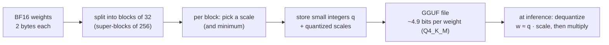

# Quantization

## Why this matters

Quantization is why a 14B model fits in 9 GB on your Mac. Knowing what Q4 and Q8 actually do lets you trade memory, speed and quality on purpose.

[1.5](/part-01-how-llms-work/1.5-transformer-block) ended with a counting exercise: 8.19 billion parameters at 2 bytes each are 16.4 GB, too much to run comfortably in 24 GB next to a browser and an editor. Yet `qwen3:8b` in Ollama is 5.2 GB. The difference is quantization, and it is nothing more mysterious than rounding: every weight is stored as a small integer plus a shared scale factor. This chapter shows the rounding, the names you meet in model tags (`q4_K_M`, `q8_0`), how loss is measured, and the arithmetic to decide whether a model fits.

**Learning goals**

- Explain how weights are quantized and dequantized
- Compare Q4/Q5/Q8 and K-quants in memory and quality
- Estimate whether a model fits in 24 GB

## Explanation

### Number formats: what "16-bit" means

A weight is a number, and a number needs a format. The floating-point formats split their bits into a sign, an exponent (the range) and a mantissa (the precision):

| Format | Bits | Layout (sign / exponent / mantissa) | Where you meet it |
|---|---|---|---|
| FP32 | 32 | 1 / 8 / 23 | Classic training; optimizer state |
| FP16 | 16 | 1 / 5 / 10 | Older inference |
| BF16 | 16 | 1 / 8 / 7 | The usual released checkpoint format (the Qwen3-8B headers you read in 1.5) |
| FP8 (E4M3, E5M2) | 8 | 1 / 4 / 3 and 1 / 5 / 2 | Training and serving on recent GPUs |

BF16 is FP32 with the bottom 16 mantissa bits chopped off: the same range, a coarser grid. That trade suits neural networks, which tolerate imprecise weights far better than they tolerate numbers overflowing. FP8 pushes it further and comes in two flavours because range and precision compete for the same 8 bits: the paper that proposed the formats defines E4M3 (4-bit exponent, 3-bit mantissa) and E5M2 (5-bit exponent, 2-bit mantissa), and reports that FP8 matched 16-bit result quality across the models it tested, including language models up to 175B parameters ([FP8 Formats for Deep Learning](https://arxiv.org/abs/2209.05433), Micikevicius et al., September 2022). The [Hugging Face GGUF docs](https://huggingface.co/docs/hub/gguf#quantization-types) link each of the 16- and 32-bit formats to its definition.

"Quantization" in the everyday sense goes below that, to **integers**: 8, 6, 5, 4 or fewer bits per weight, plus a small amount of metadata.

### Integer quantization by hand

Take a block of eight weights from some matrix:

```
w = [ 0.12, -0.53, 0.07, 1.90, -0.21, 0.33, -0.04, 0.60 ]
```

**Absmax quantization** picks a **scale** so that the largest magnitude lands on the largest integer, then rounds. For 4-bit signed integers in −7…7 the scale is `s = 1.90 / 7 = 0.2714`:

```
q = round(w / s)    = [ 0, -2, 0, 7, -1, 1, 0, 2 ]       # stored: 4 bits each, plus s
ŵ = q · s           = [ 0.00, -0.54, 0.00, 1.90, -0.27, 0.27, 0.00, 0.54 ]   # dequantized
error w − ŵ         = [ 0.12,  0.01, 0.07, 0.00,  0.06, 0.06, -0.04, 0.06 ]
```

Dequantizing is just multiplying back by the scale, and the difference from the original is the **quantization error**. Maarten Grootendorst's visual guide describes this scale-and-round scheme and its asymmetric variant, which also shifts by a zero point so the range need not be centered on zero ([A Visual Guide to Quantization](https://newsletter.maartengrootendorst.com/p/a-visual-guide-to-quantization), July 2024). The same weights with 8 bits (range −127…127, `s = 0.01496`) give `q = [8, -35, 5, 127, -14, 22, -3, 40]` and a worst-case error of 0.006 instead of 0.12. More bits, finer grid, smaller error.

Notice what damaged the 4-bit result: the single large weight, 1.90. It fixed the scale, so the small weights (0.12, 0.07, −0.04) fell between grid points and one became 0 outright. This is the **outlier problem**. If that weight were 0.21 instead, the scale would be `0.6 / 7 = 0.086` and every weight would keep far more detail. Real transformers do have outliers: the LLM.int8() paper reports emergent outlier feature dimensions that dominate attention and predictive performance, and handles them by isolating those dimensions into a 16-bit matrix multiplication while more than 99.9% of values are multiplied in 8-bit ([LLM.int8()](https://arxiv.org/abs/2208.07339), Dettmers et al.).

### Blocks: keep the scale local

The standard defence against outliers is not to use one scale for a whole matrix, but one per small **block**. If a block holds 32 weights, an outlier only coarsens its own 32 neighbours. The price is metadata: each block stores its scale (and sometimes a minimum). Q8_0, the simplest GGUF type, is exactly this: blocks of 32 weights, `w = q × block_scale`, 8-bit `q` ([Hugging Face GGUF docs, quantization types](https://huggingface.co/docs/hub/gguf#quantization-types)). With a 16-bit scale per block (my assumption of the layout), the true cost is `(32 × 8 + 16) / 32 = 8.5` bits per weight, which matches the 8.5008 bits per weight in llama.cpp's own table for Q8_0 ([quantize README](https://github.com/ggml-org/llama.cpp/blob/master/tools/quantize/README.md)). So "8-bit" is really 8.5, and every name below understates its true size by a similar overhead.

At 4 bits the scale overhead matters more, which is what motivated the K-quants.

### K-quants and the names in model tags

The names in `ollama` tags and GGUF file names follow a pattern: `Q` + bits, then optionally `_K` and a size letter. In the K-quants (introduced in [llama.cpp PR 1684](https://github.com/ggml-org/llama.cpp/pull/1684)), weights are grouped into **super-blocks** of 256, split into blocks, and the per-block scales and minimums are themselves quantized (to 6 bits for Q4_K and Q5_K). Grootendorst's guide draws the same super-block/sub-block idea. For Q4_K that is 8 blocks of 32 weights with `w = q × block_scale + block_min`, and the arithmetic lands on the documented number: `256 × 4` bits for the weights, `8 × (6 + 6)` for the scales and minimums, and `2 × 16` for a super-block's two fp16 values, all divided by 256 weights, is exactly **4.5 bits per weight** (the [GGUF docs table](https://huggingface.co/docs/hub/gguf#quantization-types) lists the same layout and the same 4.5; the fp16 pair is from the PR).

The trailing letter in names like `Q4_K_M` is the *mix*: S, M and L (small, medium, large) mean how many of the sensitive tensors are stored with more bits. A `Q4_K_M` file is therefore not 4.5 bits everywhere: llama.cpp's table for Llama 3.1 8B lists it at 4.8944 bits per weight. The exact per-tensor recipe is in the llama.cpp source and not something this chapter claims. The names to know:

| Type | True bits per weight (Llama 3.1 8B) | File size (GiB) | In practice |
|---|---|---|---|
| Q8_0 | 8.5008 | 7.95 | Near-lossless; about twice the size of Q4 |
| Q6_K | 6.5633 | 6.14 | Nearly indistinguishable from F16 |
| Q5_K_M | 5.7036 | 5.33 | A safe step up from Q4 |
| Q4_K_M | 4.8944 | 4.58 | The default for local models |
| Q4_K_S | 4.6672 | 4.36 | Slightly smaller, slightly worse |
| Q3_K_M | 3.9960 | 3.74 | Noticeable loss begins |
| Q2_K | 3.1593 | 2.95 | Only if nothing else fits |
| F16 | 16.0005 | 14.96 | The unquantized reference |

Bits and sizes are quoted from the [quantize README](https://github.com/ggml-org/llama.cpp/blob/master/tools/quantize/README.md). The last column is my reading of the perplexity data below, not a claim from that table. Names starting `IQ` (IQ4_XS, IQ3_S…) are importance-matrix types that aim for more quality at low bit counts; the README says accuracy loss "can be minimized by using a suitable imatrix file", an input to the quantizer that tells it which weights matter most.



Two details worth holding on to. First, weight quantization changes only the stored matrices; the KV cache has its own setting, covered in [1.9](/part-01-how-llms-work/1.9-kv-cache-context-window). Second, Ollama does not quantize for you when you import a GGUF: its import docs say "Ollama does not quantize GGUF models during import" and point to llama.cpp's `llama-quantize` ([Ollama import docs](https://docs.ollama.com/import)). Part 10 ([10.2](/part-10-modifying-serving-models/10.2-hf-to-gguf)) does that conversion yourself.

::: info 📖 Read now
[A Visual Guide to Quantization](https://newsletter.maartengrootendorst.com/p/a-visual-guide-to-quantization) (Maarten Grootendorst, July 2024) · article · ~30 min · essential

Read the float-format and symmetric/asymmetric sections first, then the outlier and calibration sections, then the block-wise (GGUF) section. Look for: how the scale factor is chosen, why one outlier forces a trade-off between clipping and resolution, and the difference between post-training quantization (quantize a finished model) and quantization-aware training. The guide also covers GPTQ, a 4-bit method that uses the inverse Hessian to spread each weight's rounding error over the rest of its row; it is a different family from GGUF, so skim it for the idea only.
:::

### Quality loss and how to measure it

Quantization is lossy, and "feels fine" is not a measurement. The standard instrument is **perplexity**: how surprised the model is by held-out text. llama.cpp's perplexity tool defines it as measuring "how well the model can predict the next token with lower values being better", and warns that it is "**not** directly comparable between models, especially if they use different tokenizers". So you use it to compare a model against its own quantizations, on the same text. The convention there is the Wikitext-2 test set ([perplexity tool README](https://github.com/ggml-org/llama.cpp/tree/master/tools/perplexity)).

The README also describes a finer tool: **KL divergence** between the unquantized model's output distribution and the quantized one, "a measure of how similar the FP16 and the quantized logit distributions are", zero meaning identical. It needs the F16 logits saved first, which the README says is large (11 GiB for LLaMA 2 on Wikitext-2).

Here is what the loss looks like. The K-quants PR reports perplexity on Wikitext for a 7B LLaMA, a model from 2023 and not Qwen3, so read the table for its *shape*, not its values:

| Type | Perplexity | Increase over F16 |
|---|---|---|
| F16 | 5.9066 | 0 |
| Q6_K | 5.9110 | +0.004 |
| Q5_K_M | 5.9208 | +0.014 |
| Q4_K_M | 5.9601 | +0.054 |
| Q3_K_M | 6.1503 | +0.244 |
| Q2_K | 6.7764 | +0.870 |

(Source: [llama.cpp PR 1684](https://github.com/ggml-org/llama.cpp/pull/1684); the last column is subtraction.) The curve is nearly flat from 16 bits down to about 4, then bends sharply. That shape, not the exact numbers, is why Q4_K_M is the usual default: it sits near the knee, where each further bit saved costs much more quality than the one before. The PR itself notes the 6-bit variant is within 0.1% of F16.

One caution that matters for you. Perplexity measures prediction of ordinary text; it can understate damage to the things you care about more, such as exact tool-call formatting, rare knowledge or long reasoning chains. That is why the practice below compares answers directly as well.

### Memory math: will it fit in 24 GB?

The estimate has three terms:

```
memory ≈ parameters × bits per weight ÷ 8      # the weights
       + KV cache                               # grows with context, formula in 1.9
       + runtime overhead                       # buffers, the OS, your other apps
```

Worked for Qwen3-8B, which `ollama show qwen3:8b` reports as 8.2B parameters at Q4_K_M, using the Q4_K_M figure of 4.89 bits from the Llama 3.1 8B table (tensor mixes differ per model, so this is an approximation):

```
weights:   8.2e9 × 4.89 / 8 = 5.0 GB        # Ollama lists qwen3:8b-q4_K_M at 5.2 GB
Q8_0:      8.2e9 × 8.50 / 8 = 8.7 GB        # listed at 8.9 GB
FP16:      8.2e9 × 16   / 8 = 16.4 GB       # listed at 16 GB
KV cache:  144 KiB per token (from 1.9) × 8,192 tokens = 1.1 GiB
```

The estimates land within a few percent of the sizes on [Ollama's qwen3 tag page](https://ollama.com/library/qwen3/tags), which lists `qwen3:8b-q4_K_M` at 5.2 GB, `qwen3:8b-q8_0` at 8.9 GB and `qwen3:8b-fp16` at 16 GB. The 8B at Q4 plus an 8k context is therefore about 6.3 GB; at Q8, about 10 GB. Both leave room in 24 GB. FP16 plus cache would technically fit but leave very little. As a planning rule of my own (not a documented limit), keep the total under about three quarters of 24 GB, and confirm with `ollama ps`, as the 1.9 experiment did for the cache. Your own measurements are on [Landscape](/landscape#what-fits-in-24-gb-of-unified-memory): `qwen3:14b` at 9.7 GB, and `qwen3:30b-a3b` at 19 GB with 6% spilling to CPU. The 30B case is the rule at its limit: for a mixture-of-experts model ([1.11](/part-01-how-llms-work/1.11-mixture-of-experts)) the whole file must be resident even though few experts run per token, so an 18 GB file at Q4 leaves almost nothing.

The second benefit of fewer bits may be speed. Generating a token reads the weights from memory once, and on this class of machine that is often limited by memory bandwidth, so fewer bytes per weight can mean more tokens per second. Treat that as a hypothesis, since dequantizing costs something too: you test it in the practice rather than take it on trust.

::: info 📖 Read now
[Ollama: qwen3 tags](https://ollama.com/library/qwen3/tags) (Ollama library) · docs · ~5 min · essential

Find the 8b row and its `q4_K_M`, `q8_0` and `fp16` tags and sizes. Look for: which tags exist for the sizes you care about (not every size has every quantization), and how your arithmetic above compares with the listed sizes. You need these exact tag names for the practice.
:::

::: info 📖 Read now
[llama.cpp: quantize tool README](https://github.com/ggml-org/llama.cpp/blob/master/tools/quantize/README.md) (llama.cpp) · docs · ~15 min · essential

Study the table of quant types for Llama 3.1 8B. Look for: the gap between the nominal bits in the name and the real bits per weight, how size shrinks as bits fall, and the `--imatrix` option. The speed columns in that table come from the project's own hardware, so don't expect them on an M4.
:::

::: tip 📖 Read (optional)
[llama.cpp: perplexity tool README](https://github.com/ggml-org/llama.cpp/tree/master/tools/perplexity) (llama.cpp) · docs · ~10 min · optional

Look for: how perplexity and KL divergence are defined, and why perplexity numbers aren't comparable across models.
:::

::: tip 📖 Read (optional)
[k-quants pull request (llama.cpp #1684)](https://github.com/ggml-org/llama.cpp/pull/1684) (llama.cpp, 2023) · repo · ~15 min (the description and the perplexity table, not the whole thread) · optional

Look for: the super-block layouts for each type and the perplexity table. The thread also shows a disagreement about Q2_K's bits-per-weight figure, a small reminder that "bits per weight" depends on what you count.
:::

::: tip 📖 Read (optional)
[Hugging Face: GGUF](https://huggingface.co/docs/hub/gguf) (Hugging Face Hub docs) · docs · ~10 min · optional

Look for: what GGUF stores beyond tensors (a standard set of metadata), and the quantization-types table with block sizes and weight formulas.
:::

::: tip 📖 Read (optional)
[LLM.int8(): 8-bit Matrix Multiplication for Transformers at Scale](https://arxiv.org/abs/2208.07339) (Dettmers et al.) · paper · ~20 min (abstract and introduction) · optional

Look for: what an outlier feature is and why isolating it, rather than clipping it, keeps the rest of the model accurate.
:::

::: tip 📖 Read (optional)
[FP8 Formats for Deep Learning](https://arxiv.org/abs/2209.05433) (Micikevicius et al., 2022) · paper · ~15 min (abstract and the format definitions) · optional

Look for: why two FP8 encodings exist and which of range or precision each one favours.
:::

## Practice

**Brief:** Pull the same model at two quantizations (`qwen3:8b` Q4 and Q8 tags) and compare memory, speed and answers on 5 prompts. Write the findings to `notes/quantization.md` (old roadmap item). All local, free.

**Where:** `experiments/12-quantization/`: a standalone experiment. The README has the "What I tried / What happened / Why" skeleton and the tables to fill in. This is not a `project/` step.

**Steps:**

1. **Pull the two tags.** `ollama pull qwen3:8b-q4_K_M` and `ollama pull qwen3:8b-q8_0` (names from the Ollama tag page above; `qwen3:8b` is the same as the Q4 one). Run `ollama show` on each and write down the reported quantization and parameter count, plus the size from `ollama list`. The Q8 file needs about 8.9 GB of disk.
2. **Predict before you measure.** In the README, use the formula above and the bits-per-weight table to predict memory for each tag at `num_ctx` 8192 (weights plus 144 KiB per token of cache). Also predict whether Q8 will generate tokens faster or slower than Q4, and by roughly what ratio. One sentence of reasoning each.
3. **Write `quant.ts`** (TypeScript, plain `fetch` against Ollama's `/api/generate`). For each tag: unload it, load it with `options.num_ctx: 8192`, then read `GET /api/ps` for `size` and `size_vram`. Run the same five prompts with `stream: false`, `think: false`, `options.temperature: 0` and `options.seed: 1`, so differences come from the weights and not from sampling. From each response record `eval_count / eval_duration` (tok/s; durations are in nanoseconds) and the answer text.
4. **Choose prompts that can tell the quants apart.** Suggested mix: one exact arithmetic question, one short code task with a test you can run, one factual question with a checkable answer, one instruction with a strict output format (for example "reply with only valid JSON with keys a and b"), and one longer open question. Save the answers side by side.
5. **Judge the answers.** For each prompt mark which answer is correct or better, or "same". Don't count different wording as a difference. Differences that matter are wrong facts, broken formatting or failing code.
6. **Write `notes/quantization.md`**: a table of memory (predicted vs. measured), tok/s and your verdict per prompt, then a paragraph answering whether Q8's extra 3.7 GB is worth it for you, and on which tasks you would check again.
7. **Optional stretch, a third point:** repeat with `qwen3:8b-fp16` (16 GB; close other apps and watch `size_vram` against `size`). Does the speed ordering still match your prediction?
8. **Optional stretch, perplexity:** if you've built llama.cpp, run its perplexity tool on the Q4 and Q8 GGUF files (Ollama keeps them under `~/.ollama/models/blobs`) over a few thousand tokens of text, and compare the gap to the table in this chapter.

**Done when:** `node experiments/12-quantization/quant.ts` prints a table with memory and tok/s for both tags and the five answers side by side, the README holds your predictions from before the measurements, and `notes/quantization.md` ends with a Q4-vs-Q8 verdict that cites your numbers.

## Check questions

1. A block is `[0.5, -0.25, 0.1, 3.0]`. Quantize it to 4-bit signed integers (−7…7) with absmax, and say what happens to the small weights.

   <details><summary>Answer</summary>

   `s = 3.0 / 7 = 0.4286`. `q = round(w / s) = [1, -1, 0, 7]` (0.5/0.4286 = 1.17 rounds to 1; −0.25/0.4286 = −0.58 rounds to −1; 0.1/0.4286 = 0.23 rounds to 0). Dequantized: `[0.43, -0.43, 0, 3.0]`. The outlier, 3.0, fixed the scale, so the small weights carry large relative error and 0.1 vanished. Smaller blocks, which confine the outlier to a few neighbours, are the standard remedy.
   </details>

2. Why does `Q4_K_M` cost about 4.9 bits per weight rather than 4?

   <details><summary>Answer</summary>

   Two reasons. Block scales and minimums must be stored (Q4_K: 8 blocks of 32 weights, a 6-bit scale and 6-bit minimum per block, plus two fp16 values per 256-weight super-block, which is exactly 4.5 bits per weight). And the `_M` mix stores some sensitive tensors with more bits, which lifts the average further (4.89 in llama.cpp's table for Llama 3.1 8B).
   </details>

3. Estimate the weights of a 14B-parameter model at Q4_K_M and at Q8_0, and say which fits in 24 GB with a 16k context for the cache.

   <details><summary>Answer</summary>

   Q4_K_M: `14e9 × 4.89 / 8 ≈ 8.6 GB` (Ollama lists `qwen3:14b` at 9.3 GB; the rest is the richer mix and embeddings). Q8_0: `14e9 × 8.5 / 8 ≈ 14.9 GB`. The KV cache for Qwen3-14B at 16-bit is 160 KiB per token (1.9), so 16k tokens is 2.5 GiB. Totals: about 12 GB for Q4 and about 17.5 GB for Q8. Both fit in 24 GB, but Q8 leaves little room for anything else, and a bigger context pushes it over.
   </details>

4. Perplexity of a quantized model goes from 5.91 to 5.96. Is that a problem? What would you check besides perplexity?

   <details><summary>Answer</summary>

   By itself it is a small increase, in line with the Q4-class rows of the K-quants table. But perplexity is an average over ordinary text and can hide failures in exact output formats, tool calls, arithmetic or rare facts. Check the task you care about: run a fixed prompt set side by side, or measure KL divergence against the F16 logits, and count the failures that matter to you.
   </details>

5. Why might a smaller file generate tokens faster?

   <details><summary>Answer</summary>

   Generating each token requires reading essentially all the weights from memory once, and on a machine like yours that is often limited by memory bandwidth rather than arithmetic, so fewer bytes per weight means less to read per token. It is not guaranteed: dequantization costs work too, and prefill, which processes many tokens at once, is more compute-bound. That is why the practice measures it.
   </details>

## My understanding

<!-- Written by the learner, in their own words. Agents never fill this in. -->
