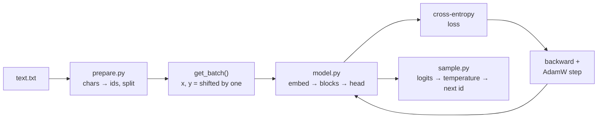
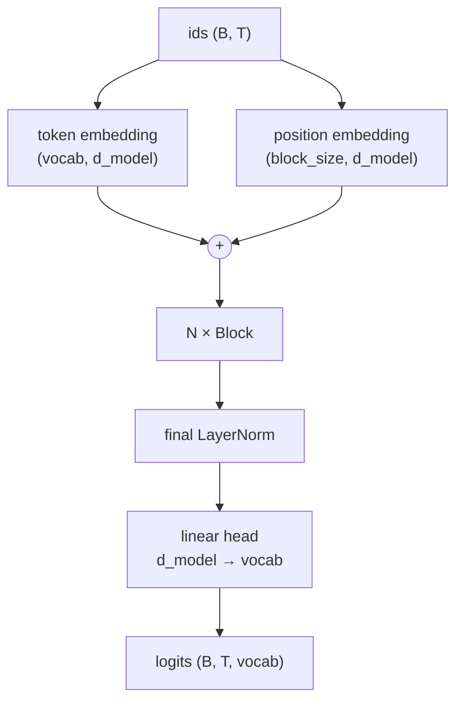

# Build a tiny GPT

## Why this matters

Chapters 1.1 to 1.9 gave you the parts: tokens, embeddings, attention, the block, the loss, sampling, the KV cache. Reading about them is one thing. Writing 80 lines of PyTorch that learns to spell Shakespeare from nothing, and watching the loss fall from "random" to "plausible", is what makes the architecture stick. Nothing here is a toy in structure: the model you build has the same shape as GPT-2, only smaller, and [10.5](/part-10-modifying-serving-models/10.5-training-from-scratch) builds on it.

It also gives you a calibrated feel for what a loss number means. When a model card says "validation loss 1.47", you'll know what text that sounds like.

**Learning goals**

- Implement a tiny decoder-only transformer in PyTorch
- Train it on a small text corpus on the M4 (MPS)
- Sample from it and relate loss to output quality

## Explanation

The whole project is four small files and one idea, the one from [1.1](/part-01-how-llms-work/1.1-next-token-prediction) and [1.6](/part-01-how-llms-work/1.6-pretraining): **given the tokens so far, predict the next one, and minimize the cross-entropy of the right answer.**



The data and loop are the same for a 10M-parameter toy and a frontier model. What differs is scale, and the details the later chapters cover.

### Data: tokens, batches, and the shifted target

A decoder-only model is trained on one long stream of token ids. You never feed it "documents" and "labels". You cut random windows out of the stream:

```
text:     F i r s t   C i t i z e n :
x (ids):  F i r s t _ C i t i z e n
y (ids):  i r s t _ C i t i z e n :     ← the same window, shifted one to the right
```

`x[t]` is the context token at position `t`, and `y[t]` is the token that actually came next. A window of `block_size = 256` tokens therefore gives **256 training examples at once**: "after `F`, predict `i`", "after `Fi`, predict `r`", and so on up to "after the whole window, predict the next token". This works because the causal mask from [1.4](/part-01-how-llms-work/1.4-attention) stops position `t` from seeing anything to its right, so none of those 256 predictions can peek at its own answer. A batch stacks 64 such windows into a `(64, 256)` tensor.

The tokenizer is deliberately trivial: **one token per distinct character**, 65 in total for Shakespeare. That is a different trade from the BPE of [1.2](/part-01-how-llms-work/1.2-tokenization) (a 65-entry vocabulary but a long sequence for the same text: 1.1 million characters are 1.1 million tokens). A character model has to learn spelling before it can learn anything else, which is part of why it needs a few thousand steps to produce readable words. A real tokenizer hands the model words and word pieces for free.

The corpus is Karpathy's concatenation of Shakespeare's plays, about 1.1 MB, from his [ng-video-lecture repo](https://github.com/karpathy/ng-video-lecture) (the repo's `input.txt`). It's small enough to train in minutes and structured enough (speaker names, line breaks, archaic spelling) that you can *see* what the model has and hasn't learned.

The split matters. The last 10% of the text becomes the **validation set**, which the model never trains on. Training loss tells you how well it fits what it has seen. Validation loss tells you how well it generalizes. Expect a gap between them from early on.

### The model, piece by piece

You write this part. This section is the map; [1.4](/part-01-how-llms-work/1.4-attention) and [1.5](/part-01-how-llms-work/1.5-transformer-block) have the reasoning behind each piece.



```
Block:  x = x + Attention(Norm(x))
        x = x + MLP(Norm(x))
```

Compared with the Qwen3 block in 1.5, this is the **GPT-2-style** version, which is the easier one to build first:

| Piece | This tiny GPT | A 2025 model (1.5) |
|---|---|---|
| Positions | a learned embedding table, one row per position | RoPE, applied inside attention |
| Norm | LayerNorm (pre-norm) | RMSNorm (pre-norm) |
| MLP | Linear → GELU → Linear, `d_ff = 4 · d_model` | SwiGLU, three matrices |
| Attention | multi-head, one K/V per head | GQA |
| Output head | its own `Linear` | often tied to the embedding or separate |

The structure (residual stream, pre-norm, attention then MLP, repeat, project to the vocabulary) is the same in both. Once your GPT works, swapping each row to the right-hand column is a good series of experiments, and exactly what Raschka's Qwen3 notebook (resource below) shows.

Three things that trip people up:

- **Shapes.** Tokens arrive as `(B, T)`. After embeddings it's `(B, T, d_model)`. Attention splits `d_model` into `n_head` heads of `d_model / n_head` each and moves the head axis next to the batch: `(B, n_head, T, head_dim)`. The score matrix is `(B, n_head, T, T)`. Print the shape after every line the first time.
- **The mask.** Scores for future positions go to `-inf` *before* the softmax, so they get weight exactly 0. A mask applied after the softmax leaves rows that don't sum to 1.
- **The scale.** Dividing scores by `√head_dim` keeps the softmax from saturating (1.4). Forget it and the model still trains, just worse. That is the unnerving thing about transformer bugs: most of them don't crash.

**How many parameters?** With the default settings (65 tokens, 6 layers, `d_model = 384`, 6 heads, context 256), you can compute it with the method from 1.5. One block has attention (`4 · 384² + 4 · 384` with biases), an MLP (`2 · 384 · 1536 + 1536 + 384`) and two LayerNorms (`2 · 2 · 384`), which is 1,774,464. Six of them are 10,646,784. Add the token table (24,960), the position table (98,304), the final norm (768) and the head (25,025): **10,795,841** parameters. Print `model.count_parameters()` and check yours against this. Note where they live: the blocks hold almost everything, because the vocabulary is tiny. In a real model with a 150,000-entry vocabulary, the embedding tables are a much bigger share (1.5).

Memory is no concern. Eleven million parameters in float32 are about 43 MB, and AdamW keeps two more copies of the weights' worth of state. The part that grows is **activations**: attention scores are `B · n_head · T²` numbers per layer, which is the n² cost of 1.4 appearing in your own memory use. Double `block_size` and that part quadruples.

### The training loop

The loop in `train.py` is the standard one, and you've now seen all of it:

```python
for step in range(max_steps):
    x, y = get_batch("train")
    loss = F.cross_entropy(model(x).view(-1, vocab), y.view(-1))
    optimizer.zero_grad(set_to_none=True)
    loss.backward()
    torch.nn.utils.clip_grad_norm_(model.parameters(), 1.0)
    optimizer.step()
```

Every line of it appears, at far larger scale, in a frontier training run. The loss is the cross-entropy of 1.6: the average of `−log p(correct next token)` over every position in the batch. `loss.backward()` is the backprop you learned in your ML course. `AdamW` is the usual optimizer. Gradient clipping caps the size of one update so a freak batch can't wreck the run.

**Reading the loss.** Before training, the model knows nothing and spreads probability roughly uniformly over the 65 characters. The loss is then `ln(65) ≈ 4.17` nats. This is your sanity check: if step 0 shows 4.2 or so, the loss and shapes are plausible. If it shows 40 or 0.0, something is wrong before you've trained anything. (Your own run will start slightly above 4.17 because of random initialization.) From there:

| Loss (nats per character) | What the samples look like |
|---|---|
| ≈ 4.2 | random characters |
| ≈ 2.3–2.5 | the right letter frequencies; word-shaped noise |
| ≈ 1.8–2.0 | real short words, line breaks in the right places, speaker names |
| ≈ 1.5 and below | whole plausible lines, grammar that nearly works, meaning that doesn't |

These bands are rough guides, not thresholds. They are anchored on two things: the nanoGPT README's character-level Shakespeare numbers (a best validation loss of 1.4697 for a 6-layer, 6-head, 384-wide model, and about 1.88 for a much smaller CPU config; see the resource below), and a reference run of this chapter's code on a Mac mini M4 Pro (validation loss 1.94 at step 500, 1.69 at step 1,000, 1.51 at the end). Check them against your own samples in step 7. The point is to connect a number to a feeling: **each fall of 0.1 in loss is visible in the text.** A loss of 1.5 nats means the model is, on average, as unsure as if it were picking among `e^1.5 ≈ 4.5` equally likely characters at each step.

**Training vs. validation.** Shakespeare is only about a million characters, and your model has about eleven million parameters, so it can start to *memorize*. In the reference run (dropout 0.2) training loss reached 1.13 after 3,000 steps while validation loss bottomed out at 1.51 around step 2,750 and stopped improving (1.5095 at step 2,750, 1.5121 at step 3,000); with dropout 0 expect the turn to come much earlier. That's **overfitting**, the regime that frontier pretraining is built to avoid, by seeing far more data than the model has capacity to memorize (1.6). Dropout (randomly zeroing activations during training) is the cheap defense here, and it is one of the settings you will experiment with. In `train.py`, `model.eval()` switches dropout off for the evaluation, and `model.train()` switches it back on. Forgetting that pair is a classic way to get a validation loss that looks worse than the training one for the wrong reason.

### Sampling

Training only needed one forward pass per window. **Generation** needs a loop (1.8):

1. Take the tokens so far (cropped to the last `block_size`), run the model, and keep only the logits at the **last** position.
2. Divide by the temperature. Optionally keep only the top-k logits.
3. Softmax to probabilities, draw one id with `torch.multinomial`, append it.
4. Repeat.

Your loop will recompute the whole window for each new token. That is wasteful: nearly all the keys and values are the same as in the previous step. Caching them is the KV cache of [1.9](/part-01-how-llms-work/1.9-kv-cache-context-window). Timing your plain loop and then thinking about what it recomputes is the best motivation for that chapter.

Try the same prompt at temperature 0.3, 1.0 and 1.5, and from a checkpoint trained for 250 steps against one trained for 3,000. This is the clearest picture of loss against quality you can get: the same architecture, producing nonsense, then word-soup, then convincing nonsense.

### Running on Apple Silicon (MPS)

PyTorch's `mps` device runs tensors on the M4's GPU through Metal. The [PyTorch MPS notes](https://docs.pytorch.org/docs/stable/notes/mps.html) describe it as enabling "high-performance training on GPU for macOS devices with Metal programming framework". Because the Mac's memory is unified, there is no separate GPU memory to fill.

```python
device = "mps" if torch.backends.mps.is_available() else "cpu"
model = GPT(cfg).to(device)
x, y = x.to(device), y.to(device)
```

Things worth knowing:

- **Everything must be on the same device.** Model and every tensor you feed it. A device-mismatch error usually means one tensor is still on the CPU.
- **float64 does not exist on MPS.** The PyTorch notes say double-precision tensors can't be allocated there, and `PYTORCH_ENABLE_MPS_FALLBACK=1` doesn't change that. Stay in float32 (the default), and avoid `np.float64` arrays leaking into your tensors: convert with `.astype(np.float32)` or build `torch.tensor(..., dtype=torch.float32)`.
- **Not every operator is as fast as on CUDA**, and a few aren't implemented. If you hit "operator not implemented for MPS", set `PYTORCH_ENABLE_MPS_FALLBACK=1` for that run: those ops will run on the CPU. If it works but is slow, that's the cause.
- **Don't time an MPS run naively.** GPU work is asynchronous, so a timer around `loss.backward()` may stop before the work does. `.item()`, which `train.py` calls when it logs the loss, forces a wait. Use `torch.mps.synchronize()` if you time individual pieces.
- **Compare with the CPU.** Run 50 steps on each (`device = "cpu"`) and note the ratio. The nanoGPT README reports that `--device=mps` makes training "roughly 2-3X faster" on Apple Silicon, but yours depends on model size: tiny models don't fill the GPU.

A reference implementation of this chapter's model (10.8M parameters, batch 64 × 256 tokens) ran 3,000 steps on the M4 Pro's GPU in about 20 minutes, 0.4 s per step. Your numbers will differ with your implementation and settings.

### Where this sits next to the real thing

Your tiny GPT is about 11 million parameters trained on about a million characters. The point of 1.6's scaling laws is that loss falls *predictably* with parameters, data and compute: if you doubled the corpus and the model, you'd see it fall, as the [Chinchilla](/part-01-how-llms-work/1.6-pretraining) argument says. What a frontier model adds is mostly scale, a better tokenizer, a cleaner and larger dataset, RoPE/GQA/SwiGLU and a few stability tricks, plus the post-training of [1.7](/part-01-how-llms-work/1.7-post-training). What it doesn't add is a different idea. The base model you'll build is a pure "continue the text" model, with no chat format and no instructions. That's the base-vs-instruct distinction of 1.7, in your own terminal.

::: info 📖 Read now
[Let's build GPT: from scratch, in code, spelled out](https://www.youtube.com/watch?v=kCc8FmEb1nY) (Karpathy, lecture 7 of [*Neural Networks: Zero to Hero*](https://karpathy.ai/zero-to-hero.html)) · video · ~1 h 56 min · **essential**

This is the lecture the experiment follows, using the same data. Watch it *after* you've had one honest try at `model.py` and got stuck, or watch the first half before and code along. Look for: how the bigram baseline gives the loss floor to beat, the trick of the shifted `x` and `y`, the "mathematical trick in self-attention" (the lower-triangular matrix multiply that becomes the causal mask), and how the final model is assembled step by step from a bare head of attention to blocks with residuals and LayerNorm. His commentary on why the scale and the mask matter is worth more than the code.
:::

::: tip 📖 Read now
[karpathy/ng-video-lecture](https://github.com/karpathy/ng-video-lecture) · repo · ~20 min · **optional**

The code that goes with the lecture: `bigram.py` (the baseline) and `gpt.py` (the finished model), plus `input.txt`, the corpus the experiment downloads. Don't open `gpt.py` until your own model works or you are stuck for more than half an hour. Then diff it against yours: where do the shapes differ, where does it place dropout, how does it initialize?
:::

::: info 📖 Read now
[nanoGPT](https://github.com/karpathy/nanoGPT) (Karpathy; `model.py`, `train.py`, and the Shakespeare character-level example in the README) · repo · ~30 min · **optional**

A leaner, more efficient version of the same model, about 300 lines each for `model.py` and `train.py`. The README says it is now "very old and deprecated" and points to [nanochat](https://github.com/karpathy/nanochat) (a deeper topic for Part 10), but it is still the clearest short reference and the source of the loss numbers quoted above. Look for: the learning-rate schedule (warmup then cosine decay), how `configure_optimizers` in `model.py` splits parameters for weight decay, and the MPS note in the README.
:::

::: tip 📕 Book
Sebastian Raschka, *Build a Large Language Model (From Scratch)*, ch. 4 "Implementing a GPT Model from Scratch" and ch. 5 "Pretraining on Unlabeled Data" ([code: ch04](https://github.com/rasbt/LLMs-from-scratch/tree/main/ch04), [ch05](https://github.com/rasbt/LLMs-from-scratch/tree/main/ch05)) · book · ~3 h · **optional**

Same model, different pace: a notebook-style walkthrough with the GPT-2 block, the training loop, evaluation, and loading real GPT-2 weights. Read ch. 4 if your `model.py` fought you, and ch. 5 for the loss-evaluation and decoding-strategy sections, which line up with this chapter's loss and sampling sections.
:::

::: tip 📖 Read now
[PyTorch notes: MPS backend](https://docs.pytorch.org/docs/stable/notes/mps.html) · docs · ~10 min · **optional**

Short. Look for: the device check, and the section on what is and isn't supported (float64). Keep it open when a run fails on MPS only.
:::

## Practice

**Brief:** Write the model, train it on Shakespeare on the M4's GPU, plot the loss curves, and sample text from checkpoints at different loss levels. You write `model.py` and the generation loop in `sample.py`. The data pipeline, the training loop and the plot script are given and heavily commented: read them, they are part of the lesson. Part 10.5 builds on this.

**Where:** `experiments/13-tiny-gpt/`: a standalone experiment. The folder has `pyproject.toml`, `prepare.py`, `model.py` (a skeleton with TODOs), `train.py`, `sample.py` (skeleton) and `plot.py`, and a README with the "What I tried / What happened / Why" skeleton. Issue 95 (10.5) adds more to the same folder later.

**Steps:**

1. **Set up** (uv manages the Python environment): `cd experiments/13-tiny-gpt`, then `uv run prepare.py`. The first run creates the environment and installs PyTorch, which takes a minute. Check that it prints a vocabulary of 65 and about 1.1 million characters.
2. **Read `train.py` completely**, then predict in the README: the loss at step 0, and roughly what the text looks like at loss 2.3, 1.8 and 1.5.
3. **Write `model.py`** bottom-up, testing each piece with a small random input and printing shapes: causal self-attention (explicit version with an explicit mask first: scores, `-inf`, softmax, weighted sum), the MLP, the block, the GPT. Prove the mask works: change a *later* token in the input and check that the logits at earlier positions don't change.
4. **Compute the parameter count by hand**, like 1.5, and match it with `model.count_parameters()`.
5. **Overfit one batch first.** Temporarily train on a single fixed batch: the loss should plummet toward 0 within a couple of hundred steps. If it doesn't, you have a bug (wrong shift, missing mask direction, wrong `view`), and fixing that is far cheaper than debugging a ten-minute run.
6. **Run `uv run train.py`** with the defaults. Check that step 0 is close to `ln(65)`, and that the device printed is `mps`. Record the time per step. Then run a few dozen steps with `device = "cpu"` for the speed ratio.
7. **Write `generate` in `sample.py`** and sample from the final checkpoint. Then save an early checkpoint too (e.g. change `train.py` to also save one at step 250) and sample from that.
8. **Plot** with `uv run plot.py` and put `out/loss.png` in the README (or the numbers in a table). Note where validation loss stops improving, and the gap between training and validation.
9. **Change one thing at a time** and record the effect on validation loss: dropout 0 vs. 0.2, `n_layer` 2 vs. 6, learning rate 1e-3 vs. 3e-4, `block_size` 64 vs. 256 (the effect on speed as well). Predict first.
10. **Explain.** In the README, answer: what loss gave you the first readable words? Did the model overfit, and at what step? What did temperature change at the same loss?
11. **Optional stretch:** swap LayerNorm for RMSNorm, add a SwiGLU MLP, or replace the learned positions with RoPE (see 1.5); or implement the KV cache from 1.9 and measure the speedup of generation; or train on your own text (your notes, a book from Project Gutenberg) and look at what changes with a corpus you know.

**Done when:**

- `model.count_parameters()` matches your hand count, and the causal-mask test passes.
- You overfit a single batch before the full run.
- `train.py` ran on `mps` and you have a loss plot with training and validation curves, the step-0 loss compared with `ln(65)`, and the time per step on MPS vs. CPU.
- The README has samples from at least two checkpoints with their losses, and at least three temperatures for the same checkpoint.
- At least two one-variable experiments are recorded with predictions and results, and the "Why" section answers step 10.

Everything runs locally and costs nothing; log it in `costs.md` as €0 if you keep a line per experiment.

## Check questions

1. At step 0 your tiny GPT with a 65-character vocabulary reports a loss of about 4.2. Why that number, and what would a loss of 0.0 at step 0 tell you?

   <details><summary>Answer</summary>

   An untrained model puts roughly equal probability, 1/65, on every character, so the cross-entropy is `−log(1/65) = ln 65 ≈ 4.17` nats. A loss of 0.0 at step 0 would mean the model is already predicting every target perfectly, which is impossible for random weights: the target is leaking into the input (for example, `x` and `y` are not shifted, or the mask lets position `t` see token `t + 1`).
   </details>

2. `get_batch` returns `y` as `x` shifted one position to the right. How many training examples does one row of `(x, y)` with `block_size = 256` provide, and what stops the model from cheating?

   <details><summary>Answer</summary>

   256: every position predicts its own next token, with context of length 1, 2, … 256. The causal mask stops the cheating: scores for later positions are set to `-inf` before the softmax, so position `t` can only attend to positions up to `t` and never sees the token it has to predict.
   </details>

3. Training loss keeps dropping, but validation loss flattens and then rises. What is happening, why is it likely in this experiment but not in a frontier pretraining run, and name two things you can change to delay it.

   <details><summary>Answer</summary>

   Overfitting: the model memorizes the training text rather than learning patterns that transfer to unseen text. Here there are about a million characters and about eleven million parameters, so memorization is cheap. Frontier runs see trillions of tokens, mostly once, far more than the model can memorize (1.6). To delay it: more dropout, a smaller model (fewer layers or narrower), more data, a lower learning rate or fewer steps, or stopping at the best validation checkpoint, which `train.py` does.
   </details>

4. Why does generating 500 characters with your sampling loop get slower per token as the text grows (until the window is full), and what from 1.9 fixes it?

   <details><summary>Answer</summary>

   Each step reruns the full forward pass over the whole window, so the work per new token grows with the context length (and attention's cost with its square), even though every earlier token's keys and values are identical to the previous step. The KV cache stores them so each new token only computes its own query, key and value. Once the window reaches `block_size`, the cost stops growing, because the loop crops to the last `block_size` tokens.
   </details>

5. Your teammate wants to run the training in float64 "for accuracy" on the M4. What happens, and is it worth working around?

   <details><summary>Answer</summary>

   It fails on `mps`: double-precision tensors can't be allocated on the MPS backend, and the CPU-fallback variable doesn't apply. You could run on the CPU, but it is not worth it: networks train fine in float32 (and LLMs routinely use bf16 or lower), because SGD noise is far larger than the rounding error.
   </details>

## My understanding

<!-- Written by the learner, in their own words. Agents never fill this in. -->
