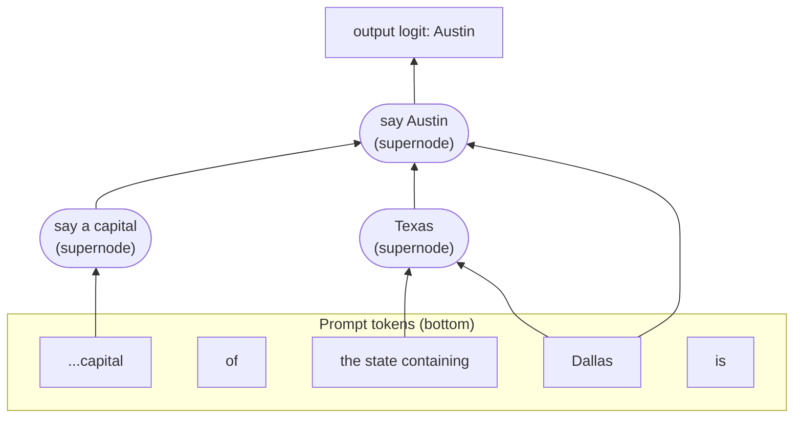

# Interpretability basics

## Why this matters

Everything so far treated the model as a function you call. Interpretability opens the box and asks what the 36 blocks of [1.5](/part-01-how-llms-work/1.5-transformer-block) are computing. It matters to you for three practical reasons. It explains behavior that prompting can't (why a model hallucinates a confident answer, why a chain of thought may not describe what the model did). It gives you a vocabulary, "feature", "steering", "circuit", that increasingly shows up in model cards and safety write-ups. And it is one of the few fields where reading one chapter is enough to follow the frontier papers, because the core ideas are small.

This is a **deeper** chapter: nothing later depends on it. You need the residual stream and the MLP from 1.5, nothing else.

**Learning goals**

- Explain superposition and features
- Explain what a sparse autoencoder does
- Read an attribution graph from circuit tracing

## Explanation

### Neurons are the wrong unit

The obvious first idea is to look at individual neurons: the entries of the residual stream, or the hidden units inside an MLP. If neuron 1,234 fires on dog snouts, you have found a "dog snout" detector.

That works sometimes and mostly fails in language models. The Anthropic toy-models paper says it directly: in the models they studied, "some of the neurons do cleanly map to features. But it isn't always the case that features correspond so cleanly to neurons, especially in large language models where it actually seems rare for neurons to correspond to clean features" ([Toy Models of Superposition](https://transformer-circuits.pub/2022/toy_model/index.html), Elhage et al., 2022). A neuron that responds to several unrelated things is called **polysemantic**.

The way out is to separate two ideas that look identical in a small network:

- A **feature** is a property of the input that the model represents internally, such as "this token is part of a base64 string", "this text is about the Golden Gate Bridge" or "the previous word was a preposition". The working hypothesis (the **linear representation hypothesis**) is that a feature is a **direction** in activation space: a vector in the `d_model`-dimensional residual stream whose strength is how much of that feature is present. Anthropic's Claude 3 Sonnet paper states the hypothesis as: neural networks "represent meaningful concepts – referred to as features – as directions in their activation spaces" ([Scaling Monosemanticity](https://transformer-circuits.pub/2024/scaling-monosemanticity/index.html), Templeton et al., 2024).
- A **neuron** is one coordinate axis of that space. Nothing forces features to line up with axes.

### Superposition: more features than dimensions

Why wouldn't features line up with axes? Because the model wants to represent far more features than it has dimensions, and the world's features are **sparse**: any given token involves only a tiny fraction of them. The toy-models paper calls representing more features than dimensions **superposition** and describes the trade as: "When features are sparse, superposition allows compression beyond what a linear model would do, at the cost of 'interference' that requires nonlinear filtering" (same paper).

Here is a tiny worked example of my own (not from the paper). Take three features and only two dimensions. Place their directions at 120° from each other:

```
w1 = (  0.00,  1.00 )
w2 = (  0.87, -0.50 )
w3 = ( -0.87, -0.50 )          every pair has dot product -0.5
```

To store feature `i` at strength `x_i`, write `x_i · w_i` into the 2D space (the sum over active features). To read feature `j` back, take the dot product with `w_j` and pass it through a ReLU (keep only positive values):

| Active features | Hidden vector | Read-out of (f1, f2, f3) | Verdict |
|---|---|---|---|
| f1 only | `w1` | (1, 0, 0) after ReLU (the others read −0.5, cut to 0) | exact |
| none | `0` | (0, 0, 0) | exact |
| f1 and f2 | `w1 + w2 = −w3` | (0.5, 0.5, 0) after ReLU (f3 reads −1, cut to 0) | **interference**: right features, half the strength |
| all three | `0` (they cancel) | (0, 0, 0) | all three lost |

Three features fit in two dimensions as long as *rarely more than one is active at once*. The ReLU removes the negative cross-talk. When two fire together, you pay in accuracy. A dense model (features usually co-active) would just keep the two most important directions and drop the third, which is what the paper reports for dense features: the model "learns to represent an orthogonal basis of the most important two features", while sparse features get squeezed in as extra non-orthogonal directions. In high dimensions the effect is huge, because you can fit vastly more nearly-orthogonal directions than axes. That is why a model can know about millions of concepts with a few thousand dimensions, and why individual neurons end up as mixtures: each neuron is a coordinate, and every coordinate carries a bit of many feature directions.

The consequence for interpretability: **you can't read features off neurons. You have to find the directions.**

::: info 📖 Read now
[Toy Models of Superposition](https://transformer-circuits.pub/2022/toy_model/index.html) (Elhage et al., Anthropic, 2022) · paper · ~40 min · essential

Read the introduction and the "Background & Motivation" and "Demonstrating Superposition" sections; skim the rest. The page is long and heavy: you don't need the geometry sections in detail. Look for: the five-features-in-two-dimensions figure, what changes as sparsity rises, and why a ReLU after the projection is what makes the trick work. Compare it with my 3-in-2 example above.
:::

::: info ▶️ Watch
[How might LLMs store facts](https://www.youtube.com/watch?v=9-Jl0dxWQs8) (3Blue1Brown, Deep Learning ch. 7, 2024), the superposition section from **17:04** to the end · video · ~6 min · optional

You met the first half in 1.5. Look for: why the number of nearly perpendicular directions grows so fast with dimension, and why that makes individual neurons look unprincipled. The [text version](https://www.3blue1brown.com/lessons/mlp) has the same content.
:::

### Sparse autoencoders: finding the directions

If features are sparse directions mixed into dense activations, the natural tool is **dictionary learning**: learn a big list of directions (a *dictionary*) such that every activation vector is a combination of just a few of them. A **sparse autoencoder (SAE)** does this with a small network trained on activations collected from the model:

```
f  = ReLU(W_enc · x + b_enc)        # x: a residual-stream vector (d_model numbers)
                                    # f: feature activations, size >> d_model, mostly zeros
x̂  = W_dec · f + b_dec              # rebuild x as a sum of a few dictionary directions
loss = ‖x − x̂‖²  +  λ · ‖f‖₁       # reconstruct well, but keep few features active
```

The columns of `W_dec` are the dictionary: one direction per feature. The `λ‖f‖₁` term is the sparsity penalty: it pushes most entries of `f` to exactly zero, so each activation is explained by a handful of features. The hidden layer is *wider* than the input (an overcomplete basis), the opposite of a classic autoencoder, which compresses. Anthropic first showed this on a one-layer transformer ([Towards Monosemanticity](https://transformer-circuits.pub/2023/monosemantic-features/index.html), Oct 2023), then scaled it up.

The scale-up is the paper to know. For Claude 3 Sonnet, trained on the residual stream of a middle layer, the authors trained three SAEs with 1,048,576 (about 1M), 4,194,304 (about 4M) and 33,554,432 (about 34M) features. In all three, fewer than 300 features were active on an average token, and the reconstruction explained at least 65% of the variance of the model's activations. Dead features (never active over 10^7 tokens) were roughly 2%, 35% and 65% of the 1M, 4M and 34M dictionaries ([Scaling Monosemanticity](https://transformer-circuits.pub/2024/scaling-monosemanticity/index.html)). Two cautions follow from those numbers. A 65% variance explained means a third of the activation is *not* captured. And a feature is a statistical object found by a training run: change the SAE size or seed and the dictionary changes.

What came out were features that were surprisingly abstract: the paper reports features that are multilingual (same concept across languages), multimodal (text and images, even though the SAE only trained on text) and that cover both concrete and abstract versions of an idea, such as code with security vulnerabilities and discussions of security vulnerabilities. They also found features it flags as potentially safety-relevant: deception, sycophancy, bias, dangerous content. The paper cautions "not to read too much into the mere existence of such features": knowing about lies is not the same as lying.

**Features are causal, not just correlational.** You can test a feature by writing to the residual stream along its direction, which is called **steering**. Anthropic's demo clamped a Golden Gate Bridge feature to a high value (the paper uses 10× its maximum activation) and released "Golden Gate Claude" in May 2024. It brought up the bridge in replies to most queries, even when irrelevant ([Golden Gate Claude](https://www.anthropic.com/news/golden-gate-claude), May 23, 2024). That is what makes features more than a visualization: turning the knob changes behavior.

::: info 📖 Read now
[Scaling Monosemanticity: Extracting Interpretable Features from Claude 3 Sonnet](https://transformer-circuits.pub/2024/scaling-monosemanticity/index.html) (Templeton et al., Anthropic, May 2024) · paper · ~45 min · essential

Read the opening summary and "Key Results", the "Scaling Dictionary Learning" section, and the Golden Gate Bridge feature example; skim the safety-features sections. The page is very large and slow to load. Look for: how the 1M/4M/34M dictionaries differ, what "dead features" are, and the paper's own list of what the method can't do. Pay attention to the limitations section: it is honest about what's missing.
:::

::: info 📖 Read now
[Golden Gate Claude](https://www.anthropic.com/news/golden-gate-claude) (Anthropic, 2024) · article · ~5 min · optional

A short, concrete look at steering. Look for the examples where a single feature changes how the model answers unrelated questions.
:::

### From features to circuits: attribution graphs

Features tell you *what* is represented. They don't tell you how one feature leads to the next, and the second question is the interesting one: the model "knows" Dallas is in Texas, but how does that become "Austin"? A **circuit** is a set of features (and the connections among them) that together carry out a computation. An **attribution graph** is a picture of one specific circuit for one specific prompt.

Building one runs into two obstacles: SAEs read a layer's activations but say nothing about how layers connect, and the real model's MLPs and attention are tangled and nonlinear. The Anthropic circuit-tracing method gets around both by swapping the model for a more interpretable copy, as described in the methods paper ([Circuit Tracing: Revealing Computational Graphs in Language Models](https://transformer-circuits.pub/2025/attribution-graphs/methods.html), Ameisen et al., March 2025):

1. **Transcoders instead of SAEs.** A transcoder is like an SAE, but instead of rebuilding its own input it learns to predict the *MLP's output* from the MLP's input through a sparse feature layer. The paper uses **cross-layer transcoders (CLTs)**: features that read the residual stream at one layer and help rebuild the MLP outputs at that layer *and all later layers*, trained jointly. Swap all the MLPs for CLT features and you get a **replacement model**. The largest 18-layer CLT in the paper matches the original model's next-token prediction on about 50% of test prompts, so it's an approximation, not a copy.
2. **A local replacement model for one prompt.** For a fixed prompt, freeze the attention patterns and the normalization denominators, and add error terms so that activations and logits match the original model exactly. With those frozen, interactions between features become **linear**, so the effect of one feature on another is a weight you can read off.
3. **The attribution graph.** Nodes are the active features, the prompt-token embeddings, the leftover **error nodes** (what the transcoders failed to explain) and the output logits. Edges are those linear effects: each feature's input is the sum of its incoming edges.
4. **Pruning and supernodes.** The raw graph has far too many nodes. Pruning keeps the ones that most affect the output (by default, about 10× fewer nodes while losing roughly 20% of the explained behavior). Then a person groups features that play the same role for that prompt, for example all the features that respond to the word "Texas", into labeled **supernodes**.
5. **Interventions to validate.** Reading a graph is a hypothesis. You test it by changing feature activations in the real model and checking the output moves as the graph predicts.

Two things to remember when you look at the result. First, **attention is not explained**: because attention patterns are frozen, the graphs show what happens *after* attention has moved information, and can miss how the model decided where to look. Second, the error nodes are real: unexplained "dark matter" can hide critical computation (both points from the methods paper's limitations).

#### How to read one



This is a simplified redraw of the Dallas example described in the biology paper, not the paper's figure. The real graphs have the same layout: **input tokens at the bottom, one column per token position, layers rising upward, the output logit at the top**. Each node is one active feature in one layer at one position; each edge is a direct linear contribution from a lower node to a higher one. To read one:

1. Start at the output node (top) and look at which supernodes feed it most strongly.
2. Follow those down: which earlier supernodes feed *them*, and which token positions are they in?
3. Look for an **intermediate** step (here "Texas" is a concept that never appears in the prompt). An intermediate node is the evidence of multi-step computation, as opposed to a direct token-to-answer shortcut.
4. Note the shortcuts: the paper reports that a direct path from "Dallas" to "Austin" exists alongside the two-step one.
5. Check the intervention panel if there is one: does swapping or suppressing a supernode change the answer the way the graph says it should?

::: info 📖 Read now
[Circuit Tracing: Revealing Computational Graphs in Language Models](https://transformer-circuits.pub/2025/attribution-graphs/methods.html) (Ameisen et al., Anthropic, March 2025) · paper · ~45 min · optional

Read the introduction and the overview of cross-layer transcoders, the local replacement model and graph pruning, then the limitations section. Skip the training details on first pass. Look for: how freezing attention turns interactions linear, what an error node represents, and what the authors say the graphs can't show.
:::

### What has been found

The companion paper applies the method to Claude 3.5 Haiku and walks through case studies ([On the Biology of a Large Language Model](https://transformer-circuits.pub/2025/attribution-graphs/biology.html), Lindsey et al., March 27, 2025; the [blog summary](https://www.anthropic.com/research/tracing-thoughts-language-model) is shorter). Among the findings:

- **Multi-step reasoning.** For "the capital of the state containing Dallas is", the model activates a Texas representation and then the Austin fact. Replacing the Texas features with California, Georgia or British Columbia features changes the answer to Sacramento, Atlanta or Victoria. The blog's reading is that the model is "combining independent facts to reach its answer rather than regurgitating a memorized response".
- **Planning in poems.** When writing a rhyming couplet, the model picks candidate end-of-line words before it writes the line. In the blog's example it "began 'thinking' of potential on-topic words that would rhyme" before starting the second line, with "rabbit" as the planned word. Removing that concept led to "habit", and injecting "green" led to a line ending in "green". That counters the intuition that a next-token predictor only ever looks one word ahead: the plan lives in the residual stream before the words appear.
- **A shared multilingual space.** For "the opposite of small" in several languages, the same features for smallness and oppositeness activate whatever the language; the blog says the shared circuitry grows with model scale.
- **Parallel paths in arithmetic.** For addition, one pathway estimates the rough magnitude while another pins down the last digit. Asked how it did it, the model describes the schoolbook carrying algorithm, which is not what the graph shows. That is a concrete case where the explanation a model gives does not match its internals, which connects to the faithfulness concern in [1.10](/part-01-how-llms-work/1.10-reasoning-models).
- **Hallucination.** Refusing to answer is the default; a "known entity" feature suppresses that default. Hallucination can happen when that feature misfires, for example on a name the model recognizes but knows nothing about.

#### What these results don't say

The authors are explicit about limits, and you should hold the same line. The biology paper reports that the graphs give "satisfying insight for about a quarter of the prompts" they tried, and its analysis uses a replacement model with 30 million features that only approximates the real model. Findings come from one model (Claude 3.5 Haiku) and hand-picked prompts. "The model plans" is an interpretation of a graph, supported by interventions, not a proof about all prompts.

::: info 📖 Read now
[On the Biology of a Large Language Model](https://transformer-circuits.pub/2025/attribution-graphs/biology.html) (Lindsey et al., Anthropic, March 2025) · paper · ~60 min · essential

You don't need all of it. Read the introduction, then the Dallas/Austin multi-step reasoning section and the poem planning section, with the interactive graphs open. Look for: the supernode labels, the intervention results that back each claim, and the "limitations" discussion. Then skim the addition and hallucination sections. The shorter [Tracing the thoughts of a large language model](https://www.anthropic.com/research/tracing-thoughts-language-model) (article, ~10 min, optional) covers the same examples if you want the overview first.
:::

#### Trying it yourself

Anthropic released the tooling as open source, with Neuronpedia hosting an interface for generating and viewing your own attribution graphs ([Open-sourcing circuit-tracing tools](https://www.anthropic.com/research/open-source-circuit-tracing), May 29, 2025). The open-source [circuit-tracer](https://github.com/safety-research/circuit-tracer) README says you can create a graph on Neuronpedia with no installation by clicking `+ New Graph`, and that interventions ("Steer") on Neuronpedia are available for Gemma-2 (2B), after pinning at least one node. The models you can explore this way are small open models such as Gemma-2 (2B), not Claude, so expect simpler circuits and more failures than in the papers. Neuronpedia's [Circuit Tracer](https://www.neuronpedia.org/gemma-2-2b/graph) is the entry point. The README also links a Colab notebook that reproduces two of the biology paper's findings on Gemma-2 2B.

::: info 📖 Read now
[Neuronpedia: Circuit Tracer for Gemma-2 2B](https://www.neuronpedia.org/gemma-2-2b/graph?slug=gemma-fact-dallas-austin) (the pre-built Dallas/Austin graph) · docs · ~20 min · essential

Open this one first, before you make your own. Look for: the supernodes already grouped and labeled ("Texas", "capital / capital cities"), the pinned nodes and the pruning threshold, and what happens when you click a node and read its top-activating examples. Compare it with the Mermaid sketch above. Use [circuit-tracer](https://github.com/safety-research/circuit-tracer) (repo, ~10 min for the README, optional) if you want to run graphs on your own machine.
:::

::: tip The shape of the argument
Superposition says features are directions, not neurons. SAEs find the directions. Transcoders plus a frozen-attention local model make the connections between features linear, so you can draw them. Each step adds an approximation. The honest summary is "useful hypotheses you can test by intervention", not "we read the model's mind".
:::

#### Where this connects

- [1.5](/part-01-how-llms-work/1.5-transformer-block): the residual stream is the space the SAEs read, and the MLPs are what transcoders replace.
- [1.10](/part-01-how-llms-work/1.10-reasoning-models): the arithmetic finding is a reminder that a model's own account of its reasoning can differ from what it computes.
- [8.1](/part-08-production/8.1-prompt-injection): safety features such as deception and sycophancy are research results, not defenses. Don't put "we monitor features" into a threat model.

## Practice

**Brief:** Use a public attribution-graph explorer (Neuronpedia's Circuit Tracer) on a prompt of your own and write up one circuit you can follow.

**Where:** Notes only, no code: `notes/1.14-attribution-graph.md`. Free, runs in the browser.

**Steps:**

1. **Warm up on the Dallas/Austin graph.** Open the [pre-built graph](https://www.neuronpedia.org/gemma-2-2b/graph?slug=gemma-fact-dallas-austin). Find the output node, then trace backward through the supernodes. Write down in two sentences what each supernode seems to do and whether the graph has an intermediate step.
2. **Write a prompt of your own.** Pick a short factual prompt that needs two facts chained together, in the style of the Dallas example but different (for example, "the language spoken in the country where X is located is"). Short prompts give small graphs. Before you run it, write your prediction: which intermediate concept would you expect to see?
3. **Generate the graph.** Use `+ New Graph` on the Gemma-2 2B page, enter your prompt, and wait for it to finish. You may need an account. If the tool changes or isn't available, use the [circuit-tracer tutorial notebook](https://github.com/safety-research/circuit-tracer/blob/main/demos/circuit_tracing_tutorial.ipynb) on Colab instead and note that in your notes.
4. **Follow one circuit.** Starting from the output logit, pick the strongest incoming features, then walk down two or three levels. For each node you rely on, open its feature page and read the top-activating examples. Note the token position and layer. Group at least two features into a supernode and give it a name.
5. **Test the circuit.** Pin your nodes and use "Steer" to suppress or change one supernode. Record the output before and after. Does the change match your reading?
6. **Write it up** in `notes/1.14-attribution-graph.md`: the prompt, your prediction, a sketch of the circuit (a Mermaid flowchart is fine) with token positions and layers, what the intervention did, and one thing the graph couldn't explain (check for error nodes, and remember attention is frozen). If the graph shows nothing clean, that is also a result: write down what you tried.
7. **Optional stretch:** repeat with a rhyme or a two-digit addition and compare with what the biology paper reports. Does the small model show the same structure, or something simpler?

**Done when:** `notes/1.14-attribution-graph.md` names your prompt, shows one traced circuit with at least one intermediate supernode and the evidence for each node, records the result of one intervention, and states one limitation of what you saw.

## Check questions

1. Why can't you generally read features off individual neurons? What are the two ideas people conflate?

   <details><summary>Answer</summary>

   A **neuron** is one coordinate axis of the activation space, while a **feature** is a direction that can point anywhere in it. Because real data has many sparse features and the model has few dimensions, features are packed in superposition as non-orthogonal directions, so each neuron carries pieces of many features (it is polysemantic). You have to find the directions, not read the axes.
   </details>

2. In the three-features-in-two-dimensions example, what happens when features 1 and 2 are active together, and why does the ReLU matter?

   <details><summary>Answer</summary>

   The hidden vector is `w1 + w2 = −w3`. Reading back gives f1 and f2 at 0.5 each (half strength), f3 at −1, which the ReLU cuts to 0. So you get the right features at the wrong strength: that's interference. Without the ReLU the negative cross-talk (−0.5 between each pair) would not be filtered, and single-feature reads would be polluted. Superposition works because features are sparse, so two co-active ones are rare.
   </details>

3. What does a sparse autoencoder take as input and output, what are its two loss terms, and why is its hidden layer wider than its input?

   <details><summary>Answer</summary>

   It takes a residual-stream (or other activation) vector and reconstructs it as a sum of a few learned dictionary directions. The loss has a reconstruction term (`‖x − x̂‖²`) and a sparsity penalty (`λ‖f‖₁`, L1 on the feature activations). The hidden layer is wider because the aim isn't compression: the dictionary needs more directions than dimensions to hold features in superposition, and sparsity keeps only a few active at a time.
   </details>

4. An attribution graph shows an intermediate "Texas" supernode between "Dallas" and "Austin". What does that suggest, what would a stronger test be, and what can the graph not tell you?

   <details><summary>Answer</summary>

   It suggests a two-step computation (Dallas → Texas → Austin) rather than only a direct association. A stronger test is an **intervention**: suppress or swap the Texas features in the real model and check that the answer changes (to Sacramento for California, for example). Limits: the graph is built on a replacement model that only approximates the real one, it holds attention patterns fixed so it doesn't explain where the model chose to look, error nodes can hide computation, and it covers a single prompt, so it isn't evidence about all prompts.
   </details>

5. A friend says "interpretability showed that Claude plans its rhymes, so we can monitor its features to catch deception". What's right and what's overreaching?

   <details><summary>Answer</summary>

   The first claim is supported for the studied cases: graphs plus interventions showed candidate rhyme words represented before the line was written, in a particular model on particular prompts. The second overreaches: the authors report useful insight for only about a quarter of the prompts they tried, the features are approximations, and the Scaling Monosemanticity paper itself cautions that the existence of a deception feature is different from the model deceiving. It's a research direction, not a reliable monitor.
   </details>

## My understanding

<!-- Written by the learner, in their own words. Agents never fill this in. -->
