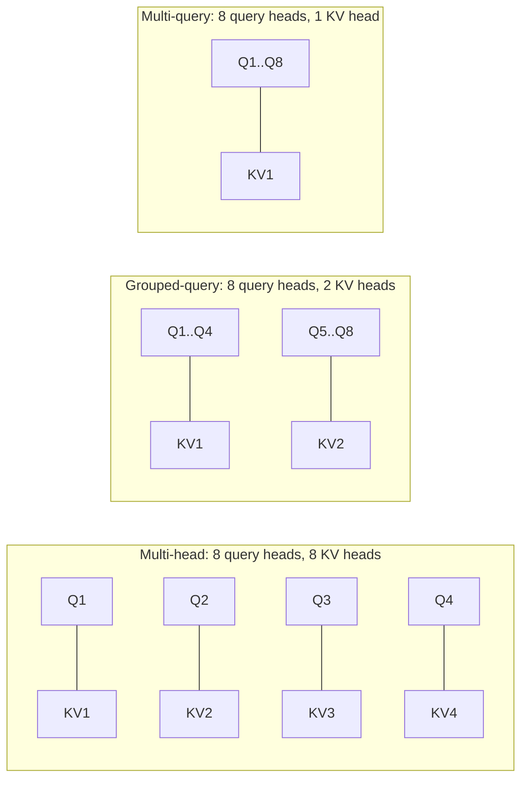
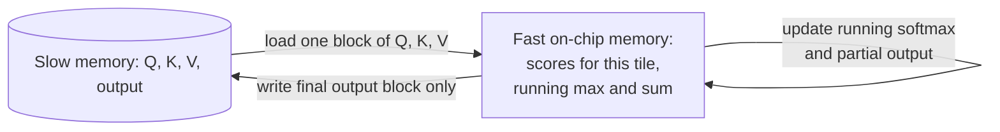
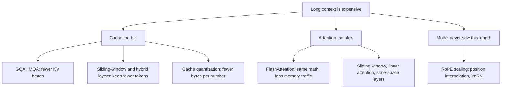

# Efficient attention and long context

## Why this matters

[1.9](/part-01-how-llms-work/1.9-kv-cache-context-window) left you with two bills that grow with context length: the **memory** of the KV cache and the **time** of attention, which compares every token with every earlier one. A 128k-token window is only usable because a stack of tricks, each aimed at one of those bills, has been built into the models you run. When you read a model's `config.json` and see `num_key_value_heads` much smaller than `num_attention_heads`, or a model card mentioning "sliding window" or "YaRN", this chapter is what those words mean.

This is a **deeper** chapter: nothing later depends on it. It pays off in two places: you can predict how much memory a model will use at a given context before you load it, and you can read the architecture sections of new model releases without being lost.

**Learning goals**

- Explain MQA/GQA and their effect on KV-cache size
- Explain FlashAttention at a high level
- Explain sliding-window and hybrid attention, and context extension (RoPE scaling)

## Explanation

### Which bill does each trick pay?

Attention has two separate costs, and the tricks in this chapter target different ones. Keep this table in mind; it is the map for everything below.

| Technique | Shrinks the KV cache? | Cuts attention compute? | Changes the model's outputs? |
|---|---|---|---|
| MQA / GQA | Yes, by the ratio of query heads to KV heads | No | Yes: it is an architecture choice made at training time |
| FlashAttention | No | No (still O(n²) arithmetic), but far less memory traffic | No: exact same result |
| Sliding window | Yes, for the layers that use it | Yes, for those layers | Yes: those layers can't see far back |
| RoPE scaling (YaRN) | No | No | Yes: it lets the model work at positions it wasn't trained on |
| Linear attention / state-space layers | Replaces the cache with a fixed-size state | Yes: linear in n | Yes: a different kind of layer |

The one that changes nothing about the answer is FlashAttention. All the others are trades, made at training time, between quality and cost.

### Multi-query and grouped-query attention

In [1.4](/part-01-how-llms-work/1.4-attention) every attention head had its own queries, keys and values. The KV cache therefore stores keys and values for every head. Noam Shazeer's 2019 paper, [Fast Transformer Decoding: One Write-Head is All You Need](https://arxiv.org/abs/1911.02150), pointed out that during incremental decoding the bottleneck is repeatedly loading those large key and value tensors from memory. His fix, **multi-query attention (MQA)**, lets all query heads share a single set of keys and values. That shrinks the tensors and the memory bandwidth needed to decode, at the cost of some quality.

**Grouped-query attention (GQA)** is the middle point. The [GQA paper](https://arxiv.org/abs/2305.13245) (Ainslie et al., 2023) describes it as a generalization with "an intermediate number of key-value heads": more than one, fewer than the number of query heads. They report that GQA reaches quality close to multi-head attention at a speed comparable to MQA, and that an existing multi-head checkpoint can be converted ("uptrained") with about 5% of the original pretraining compute.



(The MHA box is drawn with 4 heads to save space; the point is the ratio.) Each query still has its own vector and its own attention pattern. The queries in a group just look up the same keys and values. The cache formula from 1.9 has `KV heads` in it, so the saving is exact:

```
cache shrink factor = query heads ÷ KV heads
```

For Qwen3-14B the [config](https://huggingface.co/Qwen/Qwen3-14B/blob/main/config.json) has 40 query heads and 8 KV heads (40 layers, head dim 128), so the factor is 5. Using the formula from 1.9, at 16-bit:

| Variant (same model dimensions) | KV heads | Per token | At 32,768 tokens |
|---|---|---|---|
| Multi-head | 40 | 800 KiB | 25 GiB |
| **GQA (what Qwen3-14B has)** | 8 | 160 KiB | 5 GiB |
| Multi-query | 1 | 20 KiB | 0.625 GiB |

The first and last rows are hypothetical: Qwen3-14B isn't built that way, and a model trained with a different head count would be a different model. They show the lever. On a 24 GB machine, a 25 GiB cache for one 32k conversation would be impossible, while 5 GiB is fine. This is why nearly every current open model, Qwen3 and Mistral 7B ([its paper](https://arxiv.org/abs/2310.06825) says it "leverages grouped-query attention (GQA) for faster inference") among them, uses GQA rather than full multi-head. MQA's single head is rare in newer models, because the quality cost is what GQA was invented to avoid.

Note what GQA does not do. Each query head still scores every earlier token, so the n² number of comparisons per layer is unchanged. It makes the cache smaller and decode faster (less to read per step), not prefill cheaper.

A different route to a smaller cache, used by DeepSeek, is multi-head latent attention (MLA), which stores a compressed latent instead of full keys and values. Raschka's [architecture comparison](https://magazine.sebastianraschka.com/p/the-big-llm-architecture-comparison) covers it with diagrams; it is worth knowing it exists, but it is not needed for the rest of this chapter.

### FlashAttention: the same answer, less memory traffic

Recall from 1.4 that attention builds an `n × n` matrix of scores. Written naively, that is three steps, each a separate pass over memory: compute `QKᵀ` and write the `n × n` result out, read it back and apply softmax and write that out, read it back again and multiply by `V`. At n = 32,768 one head's matrix in 16-bit is 32,768² × 2 bytes = 2 GiB, per head, per layer. Even where that fits, writing and rereading it dominates the time.

The [FlashAttention paper](https://arxiv.org/abs/2205.14135) (Dao et al., 2022) starts from the observation in its title: attention should be **IO-aware**. A GPU has a large, slow memory (HBM) and a small, very fast on-chip memory (SRAM). The abstract says they use tiling to reduce the reads and writes between the two. The idea, in outline:

1. Split `Q`, `K` and `V` into blocks small enough to fit in the fast memory.
2. For one block of queries, loop over the blocks of keys and values. For each pair, compute the scores, and update a running softmax: keep a running maximum and a running sum of exponentials, and rescale the partial output when a larger maximum appears. This **online softmax** gives exactly the same result as the usual softmax without ever needing a whole row of scores at once.
3. Write only the final output block back to the slow memory. The `n × n` matrix is never stored.



Three consequences, all of which you can check against what you know:

- **It is exact.** It computes the same numbers as standard attention (up to floating-point rounding), so a model needs no retraining to use it. That is why the table above lists it as "no change to outputs".
- **Memory is linear in n.** The `n × n` matrix never exists, so the memory needed for attention scratch space grows with n, not n². The arithmetic is still quadratic: it is the same number of multiplications, done in a more cache-friendly order. The paper reports speedups such as about 3× on GPT-2 at sequence length 1K, growing with length in their long-range benchmarks.
- **It is what long context needs in practice.** It is the reason that the Ollama FAQ you read in 1.9 ties the cache-quantization setting to Flash Attention being enabled: it is a kernel the runtime has to implement, for each hardware backend.

You will not write this kernel. The takeaway is a way of thinking: on modern hardware, how many times you move data often matters more than how many times you multiply. The same idea comes back in decode ([1.9](/part-01-how-llms-work/1.9-kv-cache-context-window)) and in quantization ([1.12](/part-01-how-llms-work/1.12-quantization)).

### Sliding-window and hybrid layers

Do all layers need to see all tokens? **Sliding-window attention** says no: each token attends only to the previous `W` tokens (the window). Compute per layer drops from O(n²) to O(n·W), and the cache for that layer only ever needs the last `W` entries: older keys and values can be dropped. [Mistral 7B](https://arxiv.org/abs/2310.06825) used it from the start, with the stated aim of handling long sequences at lower inference cost.

A window doesn't mean information stops at `W` tokens back. Layers are stacked: a token in layer 2 can read a layer-1 representation of a token `W` positions earlier, which itself has read `W` further back. So information can travel roughly `W × layers` positions, though in diluted form. In practice, though, exact recall of a specific detail far outside the window gets harder, which is why modern models mix layer types rather than using windows everywhere.

**Hybrid** (local plus global) layers do this mix. Raschka's [comparison](https://magazine.sebastianraschka.com/p/the-big-llm-architecture-comparison) reports that Gemma 2 alternated sliding-window and full-attention layers 1:1 with a 4,096-token window, and that Gemma 3 moved to a 5:1 ratio ("only 1 full attention layer for every 5 sliding windows") with the window cut to 1,024. The [Gemma 3 report](https://arxiv.org/abs/2503.19786) states the motive in its abstract: to "reduce the KV-cache memory that tends to explode with long context", by "increasing the ratio of local to global attention layers, and keeping the span on local attention short."

Here is what that does to the memory arithmetic. Take Qwen3-14B's shape (40 layers, 8 KV heads, head dim 128) and pretend, purely as an illustration, that it used a Gemma-3-like pattern: about 1 layer in 6 global (say 7 global and 33 local layers) and a 1,024-token window. Each layer stores `2 × 8 × 128 × 2 = 4 KiB` per token:

| Layers | Tokens kept per layer at a 32,768-token context | Cache |
|---|---|---|
| 7 global | 32,768 | 7 × 32,768 × 4 KiB = 896 MiB |
| 33 local | 1,024 | 33 × 1,024 × 4 KiB = 132 MiB |
| **Total** | | **about 1.0 GiB**, against 5 GiB for all-global |

The global layers dominate the total, and the local ones barely register. The saving grows with context: the local layers' share stays fixed while the global layers' share grows. Qwen3-14B itself doesn't do this: its config shows `sliding_window: null` and `use_sliding_window: false`. This is a pattern you'll meet in other model families, not one your local models have.

### Extending context with RoPE scaling and YaRN

Everything so far makes a long context *cheaper*. A separate problem is making a model *work at* lengths it never saw in training. As [1.3](/part-01-how-llms-work/1.3-embeddings) described, RoPE encodes position by rotating query and key vectors by angles that depend on position. A model trained on positions up to 32k has only seen rotation angles up to that point, and quality can break down beyond it.

The first fix was **position interpolation** ([Chen et al., 2023](https://arxiv.org/abs/2306.15595)): "linearly down-scale the input position indices to match the original context window size". Instead of asking the model to deal with position 100,000, you squeeze all positions so that 100,000 maps to something inside the trained range, then fine-tune briefly. The paper reports extending LLaMA models to 32,768 tokens with fewer than 1,000 fine-tuning steps.

**YaRN** ([Peng et al., 2023](https://arxiv.org/abs/2309.00071), "Yet another RoPE extensioN method") refines this, with less training data and compute than earlier methods. Without going into its formulas: RoPE rotates different pairs of dimensions at different frequencies, and squeezing them all equally harms the fast-rotating ones that encode fine local order. YaRN treats frequencies differently instead of scaling them uniformly, and adjusts the attention scores for the longer span. Read the paper's method section for the details if you want them.

You have already met this in practice. The [Qwen3-14B model card](https://huggingface.co/Qwen/Qwen3-14B) says the model handles 32,768 tokens natively and 131,072 with YaRN, enabled by adding a `rope_scaling` block to the config with `rope_type: yarn`, `factor: 4.0` and `original_max_position_embeddings: 32768`: 32,768 × 4 = 131,072. The card also warns that the frameworks implement *static* YaRN, where the factor stays constant regardless of input length, which "may impact performance on shorter texts", and advises adding it only when you need long contexts. This is the trade in one line: scaling is a switch you turn on for long inputs, not a free upgrade.

Two cautions. First, scaling positions says nothing about the KV cache: a 131k context with YaRN costs 131k tokens of cache (about 20 GiB for Qwen3-14B at 16-bit, 131,072 × 160 KiB), which is more than fits comfortably on your Mac next to the weights. Second, as [1.9](/part-01-how-llms-work/1.9-kv-cache-context-window) showed, accepting a long input is different from using it well.

### Beyond softmax attention: linear attention and state-space hybrids

Everything above keeps softmax attention and makes it cheaper. A different family replaces it. In **linear attention** and **state-space models**, the model keeps a fixed-size state (a matrix or vector per layer) that is updated as each token arrives, instead of a cache that grows with n. Decoding a token then costs the same at position 10 and at position 100,000, and there is no cache to outgrow memory. The price is that the whole past must be squeezed into that fixed state, so exact recall of arbitrary earlier details is harder than with an attention layer that can look at every stored key.

[Mamba](https://arxiv.org/abs/2312.00752) (Gu and Dao, 2023) is the best-known example. Its abstract claims linear scaling in sequence length and higher throughput than Transformers at inference (the paper says 5×; treat that as the authors' benchmark, not a general law). Because pure state-space models have this recall weakness, many recent designs are **hybrids** that interleave a few attention layers with many cheaper layers. [Jamba](https://arxiv.org/abs/2403.19887) (AI21, 2024) interleaves Transformer and Mamba layers, and its abstract reports high throughput, a small memory footprint compared with vanilla Transformers, and strong results up to 256K tokens of context. The idea is the same as local and global layers: a few expensive layers for exact lookup, many cheap ones for everything else.

How these compare in current models changes quickly, and benchmarks for them are mostly the authors' own. Treat this section as vocabulary for reading model cards, not as a recommendation.

### Putting it together



::: info 📖 Read now
[The Big LLM Architecture Comparison](https://magazine.sebastianraschka.com/p/the-big-llm-architecture-comparison) (Sebastian Raschka, 2025, updated 2026) · article · ~40 min (read the GQA, sliding-window attention and Gemma 3 sections; skim the rest) · essential

Look for: the diagrams that show which keys each token can see in global versus sliding-window layers, and the Gemma 2 to Gemma 3 change in local-to-global ratio and window size. Then skim the entries for models you have run: how many query and KV heads each one uses. You'll be able to read those numbers as cache sizes now.
:::

::: tip 📖 Read (optional)
[FlashAttention: Fast and Memory-Efficient Exact Attention with IO-Awareness](https://arxiv.org/abs/2205.14135) (Dao et al., 2022) · paper · ~20 min (abstract, introduction, and the tiling figure) · optional

Look for: the two kinds of memory in the figure and why moving data, not arithmetic, is what they optimize.
:::

::: tip 📖 Read (optional)
[GQA: Training Generalized Multi-Query Transformer Models from Multi-Head Checkpoints](https://arxiv.org/abs/2305.13245) (Ainslie et al., 2023) · paper · ~15 min (abstract, introduction, and the quality-versus-speed figure) · optional

Look for: where GQA sits between multi-head and multi-query on the quality and speed axes.
:::

::: tip 📖 Read (optional)
[Gemma 3 Technical Report](https://arxiv.org/abs/2503.19786) (Google, 2025) · paper · ~15 min (abstract and the long-context architecture section) · optional

Look for: how they measured the KV-cache saving from the local-to-global ratio, rather than only asserting it.
:::

::: tip 📖 Read (optional)
[YaRN: Efficient Context Window Extension of Large Language Models](https://arxiv.org/abs/2309.00071) (Peng et al., 2023) · paper · ~25 min (abstract, background on RoPE, and the method section) · optional

Look for: why uniform interpolation of all frequencies hurts, and what YaRN does differently.
:::

::: tip 📖 Read (optional)
[Mamba: Linear-Time Sequence Modeling with Selective State Spaces](https://arxiv.org/abs/2312.00752) (Gu and Dao, 2023) · paper · ~20 min (abstract and introduction) · optional

Look for: what "selective" means, and what the fixed-size state can and can't remember.
:::

## Practice

**Brief:** Redo the KV-cache memory estimate from 1.9 with GQA using qwen3:14b's real config, and compare it with the naive multi-head estimate.

**Where:** Notes only, no code. Write it in `notes/1.15-gqa-kv-estimate.md`.

**Steps:**

1. **Get the real config from your own machine.** Run `ollama show qwen3:14b` (or call `/api/show` and read `model_info`) and write down the layer count (`block_count`), the number of query heads (`attention.head_count`), the number of KV heads (`attention.head_count_kv`) and the key and value lengths. Check them against the [Hugging Face config](https://huggingface.co/Qwen/Qwen3-14B/blob/main/config.json). If any number differs, note which one and guess why.
2. **Estimate with GQA.** Using the formula from 1.9, compute bytes per token with the real KV head count, and the total at 4,096, 16,384 and 32,768 tokens, at 16-bit precision. Show the arithmetic.
3. **Estimate the naive multi-head version.** Redo it as if the model kept one KV head per query head. Put both side by side in a table, with the ratio.
4. **Compare with your measurement.** If you did experiment 10 (`experiments/10-num-ctx/`), add a row with the memory growth per token that you measured there. Which estimate does it match? If you haven't run it, say which of the two you'd bet on and why.
5. **Turn it into a decision.** On your 24 GB Mac, with `qwen3:14b` weights at 9.3 GB (see the 1.9 table), what is the largest context at which the multi-head estimate would leave room, and what is it with GQA? State your assumption about how much memory the rest of the system needs.
6. **Optional stretch, the hypothetical hybrid:** redo the 5:1 local/global calculation from this chapter for a window of 4,096 tokens instead of 1,024, and say how much of the saving remains at 32k.

**Done when:** the note has the real config values, both estimates in one table for the three context sizes, the ratio between them, and a short written answer to step 5.

## Check questions

1. Qwen3-14B has 40 query heads and 8 KV heads. How much smaller is its KV cache than a multi-head version with the same layers and head dimension, and does GQA also reduce the number of attention scores computed per layer?

   <details><summary>Answer</summary>

   Five times smaller (40 ÷ 8), because the cache stores keys and values per KV head. The number of scores per layer is unchanged: each of the 40 query heads still scores every earlier token. GQA reduces memory and the data read per decode step, not the n² comparisons.
   </details>

2. FlashAttention is described as "exact" and "IO-aware". What does each word mean, and does it reduce the number of multiplications?

   <details><summary>Answer</summary>

   Exact: it produces the same output as standard attention (up to rounding), so no retraining is needed. IO-aware: it is designed around the cost of moving data between slow and fast memory. It processes tiles in fast memory with a running softmax and never writes the n × n score matrix out. It does not reduce multiplications: compute stays quadratic. It reduces memory traffic, and makes attention memory linear in n.
   </details>

3. A model uses sliding-window attention with a 1,024-token window in most layers and full attention in one layer of six. Roughly how does its KV cache at 100,000 tokens compare with an all-global model of the same shape, and which layers dominate?

   <details><summary>Answer</summary>

   The cache is roughly one sixth of the all-global cache, plus a small amount for the local layers (a fixed 1,024 tokens each). The global layers dominate: their share grows with the context, while the local layers' share stays constant. The ratio approaches 1/6 as the context grows.
   </details>

4. The Qwen3-14B card says the model has 32,768 native tokens and 131,072 with YaRN. If you enable YaRN, does the KV cache for a 100,000-token prompt shrink, and what else should you weigh before turning it on?

   <details><summary>Answer</summary>

   No. YaRN changes how positions are encoded so the model works beyond its trained length; the cache still holds one entry per token (160 KiB per token for this model at 16-bit, so about 15 GiB at 100,000 tokens). Weigh the memory, the card's warning that static YaRN can affect shorter texts, and whether the model actually uses that much context well (1.9).
   </details>

5. Why do many state-space and linear-attention designs end up as hybrids with a few attention layers?

   <details><summary>Answer</summary>

   Their fixed-size state compresses the whole past, which makes exact recall of arbitrary earlier details harder than in softmax attention, which can look at every stored key. A few attention layers restore precise lookup, while the many cheaper layers keep memory and per-token cost low. It is the same split as local and global layers.
   </details>

## My understanding

<!-- Written by the learner, in their own words. Agents never fill this in. -->
