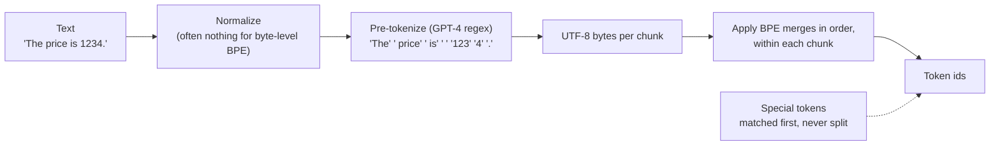

# Tokens and tokenization

## Why this matters

Prices, context limits, speed and many odd model failures (counting letters, arithmetic, non-English text costing more) all come down to tokens. Knowing how a tokenizer works lets you predict them.

In [1.1](/part-01-how-llms-work/1.1-next-token-prediction) the tokenizer was one box at the start of the loop: text in, a list of integer ids out. This chapter opens that box. It's the only part of an LLM that isn't a neural network. It's a separately trained, mostly deterministic piece of string processing, and its quirks leak into everything the network does.

**Learning goals**

- Explain BPE and train a tiny one by hand
- Predict why some strings cost more tokens
- Count tokens for real prompts across two tokenizers

## Explanation

### Why not characters or words

The network needs a **fixed vocabulary**: a finite list of symbols, each with an id, because its first layer is a lookup table with one row per id (the embedding matrix, 1.3) and its last layer scores every id (the logits, 1.1). So the question is what the symbols should be. There are two obvious answers, and both are bad.

**Words.** A word-level vocabulary is short in tokens per sentence, but:

- It's **open-ended.** New names, typos, URLs, code identifiers, inflected forms (Bulgarian and German have many) and every language you didn't plan for are all out of vocabulary. Older NLP systems mapped them to a single `<unk>` token, which throws the information away.
- It's **huge and sparse.** You'd need millions of entries, most seen only a handful of times in training, so their embeddings would be poorly learned. Both the embedding matrix and the output layer grow linearly with vocabulary size.
- It **hides structure.** `run`, `runs`, `running` and `rerun` become unrelated ids, so the model has to learn their relationship from scratch.

**Characters (or bytes).** A character vocabulary is tiny and nothing is ever out of vocabulary, especially if you go one level lower to the 256 possible **bytes** of UTF-8. But sequences get several times longer. Every token costs a forward pass at generation time (1.1), attention cost grows with sequence length (1.4), and the context window (1.9) is measured in tokens, so a model reading bytes sees much less text per window and pays much more per word. Each position also carries very little meaning, so the network has to spend capacity assembling letters into words before it can do anything useful.

**Subwords** are the compromise every current LLM uses: frequent strings (` the`, ` Paris`, `ing`) become single tokens, rare strings are spelled out from smaller pieces, and nothing is ever unknown because the pieces bottom out in single bytes. Sennrich et al. introduced this idea for neural machine translation, using byte-pair encoding to choose the pieces.

::: tip 📖 Optional
[Neural Machine Translation of Rare Words with Subword Units](https://arxiv.org/abs/1508.07909) (Sennrich, Haddow & Birch, ACL 2016) · paper · ~15 min (abstract, section 3) · optional

Look for: the "open-vocabulary" problem stated in the abstract, and section 3.2, where BPE, originally a compression algorithm, is adapted to learn a subword vocabulary. The paper's Algorithm 1 (a few lines of Python, run on the same toy corpus as the worked example below) is almost exactly what you'll write in the practice.
:::

#### A detour through UTF-8

Modern tokenizers are **byte-level**: they operate on the UTF-8 bytes of the text, not on Unicode characters. That matters for cost, because UTF-8 is variable-length ([RFC 3629](https://www.rfc-editor.org/rfc/rfc3629), section 3). ASCII characters are 1 byte. Code points up to U+07FF, which include Cyrillic, Greek and accented Latin letters, are 2 bytes. The rest of the Basic Multilingual Plane, including most CJK characters, is 3 bytes. Emoji live above U+FFFF, so they're 4 bytes, and an emoji with a skin-tone modifier is two code points, so 8 bytes.

You can see this with `new TextEncoder().encode("ъ")` in Node: two bytes. The Bulgarian sentence used later in this chapter has 48 characters but 90 bytes (measured on 2026-11-08 with Node's `TextEncoder`). A byte-level tokenizer starts from those 90 bytes, so unless its training data contained a lot of Bulgarian, it has learned fewer merges to compress them.

### Byte-pair encoding, step by step

BPE has two phases. **Training** learns an ordered list of merge rules from a corpus. **Encoding** applies those rules to new text. Training happens once, before the model is trained, and the result is frozen: the model can only ever see ids that the tokenizer produces.

#### Training

1. Start with a base vocabulary of all single symbols. In byte-level BPE that's exactly 256 entries, one per byte value.
2. Split the training text into symbols.
3. Count every **adjacent pair** of symbols.
4. Take the most frequent pair, say `e` + `s`, add a new token `es` to the vocabulary, and record the merge rule `(e, s) → es`.
5. Replace every occurrence of that pair in the text with the new token.
6. Repeat from step 3 until the vocabulary reaches the size you want.

The vocabulary size is a hyperparameter you choose. For example, OpenAI's GPT-2 tokenizer has 50,257 entries: 256 byte tokens, 50,000 learned merges and one special `<|endoftext|>` token (see `gpt2()` in [tiktoken's encoding definitions](https://github.com/openai/tiktoken/blob/main/tiktoken_ext/openai_public.py)).

**Worked example.** Take Sennrich's toy corpus: the word `low` 5 times, `lower` 2 times, `newest` 6 times and `widest` 3 times. To keep it readable, use characters instead of bytes and don't merge across word boundaries. The first six merges (computed for this chapter on 2026-11-08 with a 20-line script, the same thing you'll write in the practice):

| Step | Most frequent pair (count) | New token | Corpus after the merge |
|---|---|---|---|
| 0 | | | `l o w` ×5 · `l o w e r` ×2 · `n e w e s t` ×6 · `w i d e s t` ×3 |
| 1 | `e` + `s` (9) | `es` | `l o w` · `l o w e r` · `n e w es t` · `w i d es t` |
| 2 | `es` + `t` (9) | `est` | `l o w` · `l o w e r` · `n e w est` · `w i d est` |
| 3 | `l` + `o` (7) | `lo` | `lo w` · `lo w e r` · `n e w est` · `w i d est` |
| 4 | `lo` + `w` (7) | `low` | `low` · `low e r` · `n e w est` · `w i d est` |
| 5 | `n` + `e` (6) | `ne` | `low` · `low e r` · `ne w est` · `w i d est` |
| 6 | `ne` + `w` (6) | `new` | `low` · `low e r` · `new est` · `w i d est` |

Check step 1 yourself: `e s` appears in `newest` (6) and `widest` (3), so 9. `s t` is also 9, a tie. Real implementations break ties by some fixed rule (here: the pair seen first), and different rules give slightly different vocabularies. Notice how merges **build on earlier merges**: `est` exists only because `es` was created first. After enough merges, frequent whole words like `low` and `new` are single tokens, and suffixes like `est` are shared.

#### Encoding

To encode new text, split it into bytes and apply the merge rules **in the order they were learned**, as long as any of them applies. Encode `lowest`, a word that never appeared in the corpus:

```
l o w e s t     → (e,s)  → l o w es t → (es,t) → l o w est
                → (l,o)  → lo w est   → (lo,w) → low est
```

Two tokens, `low` + `est`, both learned from other words. That's the point of subwords: an unseen word is built from familiar pieces, and nothing is ever `<unk>`. **Decoding** is trivial: look up each id's bytes and concatenate them. One gotcha: a single token doesn't have to end on a character boundary. A token can hold half of a 2-byte Cyrillic letter, so decoding tokens one at a time while streaming can produce invalid UTF-8 until the next token arrives. That's why Ollama's logprobs response includes a `bytes` field next to each token (see the [Ollama API docs](https://docs.ollama.com/api/generate) you used in 1.1).

#### Pre-tokenization: the regex before BPE

Run plain BPE on raw web text and it happily learns tokens like `dog.` and `dog!` and `dog?` as separate entries, wasting vocabulary. So production tokenizers first split the text into chunks with a **regex**, and BPE merges only within a chunk. The regexes separate letters, numbers, punctuation and whitespace, and keep a leading space attached to the following word. That's why tokens look like `" Paris"`, with the space in front: the `" Paris"` vs. `"Paris"` puzzle from 1.1 comes from this regex.

The regex is also where model families make deliberate, visible choices about **numbers**. OpenAI's `cl100k_base` (the GPT-4 tokenizer) has `\p{N}{1,3}` in its pattern, which splits digit runs into chunks of up to three ([tiktoken source](https://github.com/openai/tiktoken/blob/main/tiktoken_ext/openai_public.py)). Qwen3's tokenizer has a bare `\p{N}`, which makes **every digit its own token** (the `pre_tokenizer` section of [Qwen3-8B's tokenizer.json](https://huggingface.co/Qwen/Qwen3-8B/blob/main/tokenizer.json)). Keep that in mind for the failure modes below.



Now watch someone build exactly this. Karpathy's lecture is the canonical treatment: he builds the GPT-2/GPT-4 tokenizer from scratch in Python, then spends the last part showing which LLM weirdness traces back to tokenization.

::: info ▶️ Watch
[Let's build the GPT Tokenizer](https://www.youtube.com/watch?v=zduSFxRajkE) (Karpathy, 2024) · video · ~2 h 14 min · **essential**

You don't need all of it in one sitting. Suggested cut:
- **0:00–42:47** (~43 min): the tokenization issues, the [Tiktokenizer](https://tiktokenizer.vercel.app/) web UI, Unicode and UTF-8, and the BPE algorithm with training. This is the part the practice depends on.
- **42:47–1:25:28** (~43 min): decode, encode, the regex pre-tokenization patterns, GPT-2 vs. GPT-4 differences, and special tokens.
- **1:51:41–2:10:20** (~19 min): "revisiting and explaining the quirks of LLM tokenization", which matches the failure-mode section below.

Skip SentencePiece (1:28:42) on a first pass unless you're curious about Llama-style tokenizers. Look for: the moment the compression ratio appears in the training loop, and how "merges build on merges" falls out of the code. His exercise file in [minbpe](https://github.com/karpathy/minbpe) is a good reference if you get stuck in the practice, but write yours before you look.
:::

If you prefer reading to watching, the Hugging Face course covers the same algorithm with a small worked corpus and a full implementation, and its next sections cover the two other common algorithms, [WordPiece](https://huggingface.co/learn/llm-course/chapter6/6) and [Unigram](https://huggingface.co/learn/llm-course/chapter6/7).

::: tip 📖 Read
[Hugging Face LLM Course, ch. 6: Byte-Pair Encoding tokenization](https://huggingface.co/learn/llm-course/chapter6/5) · docs · ~20 min · optional

Look for: the "Training algorithm" walkthrough on `hug`, `pug`, `pun`, `bun`, `hugs` (the same procedure as the table above), and the paragraph on **byte-level BPE** and why it removes the unknown token. The [chapter introduction](https://huggingface.co/learn/llm-course/chapter6/1) and the normalization and pre-tokenization section are useful context.
:::

::: tip 📖 Read (book)
Raschka, *Build a Large Language Model (From Scratch)*, ch. 2 "Working with Text Data", the sections on byte pair encoding · book · ~1 h · optional ([code repo](https://github.com/rasbt/LLMs-from-scratch/tree/main/ch02))

The repo's [bonus BPE notebook](https://github.com/rasbt/LLMs-from-scratch/tree/main/ch02/05_bpe-from-scratch) implements a GPT-2-compatible BPE from scratch; `bpe-from-scratch-simple.ipynb` is the readable version. Useful if you're heading for the tiny GPT in 1.13, which uses the same data pipeline.
:::

### Special tokens and chat templates

Besides the learned merges, every vocabulary has a handful of **special tokens** added by hand. They're never produced by BPE from normal text: they're matched as whole strings (or inserted by code), and each maps to one reserved id. They mark structure the model must be able to see unambiguously:

- **End of text / end of turn.** `<|endoftext|>` in GPT-2. Generation stops when the model samples the end token (step 5 of the loop in 1.1).
- **Conversation structure.** Qwen3 uses `<|im_start|>` and `<|im_end|>` around each message.
- **Capabilities.** Qwen3's vocabulary also reserves `<think>`/`</think>`, `<tool_call>`/`</tool_call>`, `<tool_response>`, fill-in-the-middle tokens for code completion, and vision placeholders (the `added_tokens_decoder` in [Qwen3-8B's tokenizer_config.json](https://huggingface.co/Qwen/Qwen3-8B/blob/main/tokenizer_config.json) lists 26 of them).

The **chat template** (you met it in [0.2](/part-00-catch-up/0.2-the-stack)) is the code that turns a list of `{role, content}` messages into one string with these tokens in place. With Qwen3's template, the single user message `Hi` with thinking disabled becomes:

```
<|im_start|>user
Hi<|im_end|>
<|im_start|>assistant
<think>

</think>

```

That's 13 tokens for a 2-character message (rendered and counted with `@huggingface/transformers` 4.3.2 on 2026-11-08, using [the template from tokenizer_config.json](https://huggingface.co/Qwen/Qwen3-8B/blob/main/tokenizer_config.json)). The empty `<think></think>` block is how `enable_thinking: false` works: the template pre-fills an empty thought, so the model continues straight into the answer. Every API request you make carries this kind of overhead per message, plus tool definitions rendered as text. It's why a "Hi" request reports more input tokens than you typed.

The model only learned the meaning of these tokens during post-training (1.7). That's why the chat template **ships with the model** and why using the wrong one degrades a model badly even though the tokenizer is the same.

### Tokenizer differences between model families

Every model family trains its own tokenizer, on its own data mix, with its own vocabulary size and regex. The same text gives different counts, and the **ids are not interchangeable**: id 1234 means something different in every vocabulary. Here are the same samples through four tokenizers (measured on 2026-11-08 with [`js-tiktoken`](https://github.com/dqbd/tiktoken) 1.0.21 for the three OpenAI encodings and [`@huggingface/transformers`](https://github.com/huggingface/transformers.js) 4.3.2 for Qwen3-8B; you'll reproduce these in the practice):

| Sample | Chars | Bytes | GPT-2 (`gpt2`) | GPT-4 (`cl100k_base`) | GPT-4o and later (`o200k_base`) | Qwen3 |
|---|---|---|---|---|---|---|
| English: `The quick brown fox jumps over the lazy dog.` | 44 | 44 | 10 | 10 | 10 | 10 |
| German: `Der schnelle braune Fuchs springt über den faulen Hund.` | 55 | 56 | 20 | 15 | 14 | 15 |
| Bulgarian: `Бързата кафява лисица прескача мързеливото куче.` | 48 | 90 | 57 | 31 | 20 | 29 |
| Code: a 3-line JS `for` loop | 71 | 71 | 30 | 25 | 25 | 25 |
| Numbers: `1234567 + 89 = 1234656` | 22 | 22 | 9 | 11 | 11 | 20 |

What the table shows:

- **English is cheap everywhere.** Every tokenizer was trained mostly on English, so common English words are single tokens.
- **Bulgarian costs 2–6× more than the English sentence with the same meaning**, and the spread between tokenizers is large: GPT-2 needs 57 tokens, more than one per character, while `o200k_base` needs 20. Qwen3 splits it into fragments like `Б` `ъ` `р` `з` `ата`. Petrov et al. measured this systematically across languages and found the same text can take **up to 15× more tokens** depending on the language ([Language Model Tokenizers Introduce Unfairness Between Languages](https://arxiv.org/abs/2305.15425), NeurIPS 2023). That's a direct multiplier on cost, latency and how much fits in the context window.
- **Code got cheaper over time** because later tokenizers merge runs of spaces (indentation) and common code fragments.
- **Numbers depend on the regex.** GPT-2 chunks digits by whatever merges it learned (`123` `45` `67`), `cl100k`/`o200k` chunk them left to right in threes (`123` `456` `7`), and Qwen3 uses one token per digit, so the number line costs nearly twice as much there.

Tokenizers also change **within** a family. Anthropic's token counting docs state that Claude Opus 4.7 and later models use a newer tokenizer, on which "the same input text produces approximately 30 percent more tokens than on earlier models" ([Token counting](https://platform.claude.com/docs/en/build-with-claude/token-counting)). So the per-token price (on [Landscape](/landscape)) doesn't tell you the cost of a prompt on its own. You also need the token count, measured with the tokenizer of the model you'll actually use.

How do you count tokens for a given model?

- **Open-weight models** (Qwen, Llama, DeepSeek, Mistral) publish their tokenizer with the weights, as `tokenizer.json` on Hugging Face. You can load it locally with `@huggingface/transformers` in Node.
- **OpenAI** publishes its encodings in [tiktoken](https://github.com/openai/tiktoken), with JS ports such as `js-tiktoken`.
- **Anthropic** doesn't publish the tokenizer, but offers a `count_tokens` endpoint that accepts a full Messages request (system prompt, tools, images) and, per [the docs](https://platform.claude.com/docs/en/build-with-claude/token-counting), is free to use, with its own rate limit.
- **Any provider:** the `usage` field of a real response is ground truth after the fact. Ollama reports it as `prompt_eval_count` and `eval_count`.

::: tip 🧪 Try
[Tiktokenizer](https://tiktokenizer.vercel.app/) · docs (interactive) · ~10 min · **essential**

The web UI Karpathy uses in the lecture. Paste a paragraph of English, then the same paragraph in Bulgarian or German, then some indented TypeScript, then a long number. Switch between encodings in the dropdown and watch the colored pieces and the count. Look for: leading spaces attached to words, how indentation is chunked, and where a single Cyrillic character is split across tokens.
:::

### Token-level failure modes

Once you know the model sees ids and not letters, a whole class of "LLMs are dumb" observations stops being mysterious. Karpathy's lecture section on quirks (linked above, 1:51:41) walks through most of these.

**Spelling and counting letters.** Ask "how many r's in strawberry?" The model sees `str` `aw` `berry` (in `cl100k_base` and Qwen3) or `st` `raw` `berry` (in GPT-2 and `o200k_base`), measured with the same setup as the table above. That's three ids. The letters inside each one are not part of the input. The model can only answer from what it learned about which letters those ids contain, and that knowledge is indirect. The usual workaround is to have the model spell the word out letter by letter first, turning the letters into separate tokens it can count. Reasoning models (1.10) often do this on their own.

**Arithmetic.** With `cl100k`, `1234567` is `123` `456` `7`: the digit groups don't line up with place value, so column-wise addition is awkward to learn. One-digit-per-token tokenizers like Qwen3's make the positions regular, at the cost of more tokens. For anything that matters, give the model a calculator tool (Part 3) instead of trusting token-level arithmetic.

**Leading spaces and case.** `" Paris"`, `"Paris"`, `" paris"` and `"PARIS"` are four different token sequences (`PARIS` is even two tokens, `PAR` `IS`, in all four tokenizers above). The model has learned that they're related, but only statistically. A prompt that ends with a trailing space is a classic problem, which Karpathy demonstrates in the quirks section of the lecture: in normal text the space is attached to the *next* word's token, so a prompt ending in `"is "` puts the model in a rare, unnatural state where it has to produce a token with no leading space.

**Non-English and unusual text costs more.** As the table showed, the same content in Bulgarian costs several times more tokens. Combined with per-token pricing, that's a real cost multiplier, and it also means less fits in the context window. Emoji, rare scripts and base64 blobs are similar: few merges were learned for them, so they fall back to near-byte-level pieces.

**Glitch tokens.** A token can exist in the vocabulary but barely appear in the model's training data, for example because the tokenizer was trained on a different corpus. Its embedding then gets almost no training. `" SolidGoldMagikarp"` is a single token in GPT-2's vocabulary (one id, measured as above; `cl100k` splits it into five pieces), and GPT-2 and GPT-3 models behaved bizarrely when asked to repeat it ([Rumbelow & Watkins, 2023](https://www.lesswrong.com/posts/aPeJE8bSo6rAFoLqg/solidgoldmagikarp-plus-prompt-generation)).

::: tip 📖 Read
[SolidGoldMagikarp (plus, prompt generation)](https://www.lesswrong.com/posts/aPeJE8bSo6rAFoLqg/solidgoldmagikarp-plus-prompt-generation) (Rumbelow & Watkins, LessWrong, 2023) · article · ~15 min · optional

Look for: the list of anomalous tokens and the hypothesis that they were frequent in the tokenizer's training data (Reddit usernames, for example) but rare in the model's. It's the clearest demonstration that the tokenizer and the model are trained separately.
:::

**Special-token injection.** If user text containing the literal string `<|im_end|>` were tokenized as the special token, a user could close their own turn and forge an assistant or system message. Libraries guard against this: tiktoken's `encode()` defaults to `disallowed_special="all"` and raises an error if special-token text appears in the input ([`core.py`](https://github.com/openai/tiktoken/blob/main/tiktoken/core.py)), and serving stacks should encode user content without special-token matching. It's one of the low-level roots of prompt injection (8.1).

### Rules of thumb for predicting cost

Pulling it together, you can predict a string's token count before you measure it:

- Common English prose is the cheapest case: in the table above, 44 characters became 10 tokens in every tokenizer.
- Code is close to prose on modern tokenizers and worse on older ones (the code row: 30 tokens on GPT-2, 25 on the rest).
- Other languages and scripts cost more for the same content, sometimes far more (the German and Bulgarian rows, and [Petrov et al.](https://arxiv.org/abs/2305.15425) for many other languages).
- Long numbers cost one token per 1–3 digits depending on the regex (`\p{N}` vs. `\p{N}{1,3}`, sources above). IDs, hashes and base64 are similarly expensive, because few merges were learned for them.
- Every chat message carries template overhead, and tool definitions are rendered as text into the prompt.

And always measure with the tokenizer of the model you'll use. Moving between families, or even between versions in the same family, can change your counts by tens of percent.

## Practice

**Brief:** Write a tiny byte-level BPE trainer in TypeScript, train it on a small text, then compare its tokens with two real tokenizers (OpenAI's `o200k_base` and Qwen3's) on English, Bulgarian, German, code and numbers. Everything runs locally and is free.

**Where:** `experiments/04-tokenizer/`: a standalone experiment. The README there has the "What I tried / What happened / Why" skeleton and a results table to fill in.

::: tip 📖 Reference
[`js-tiktoken`](https://github.com/dqbd/tiktoken) (`getEncoding('o200k_base')`, then `.encode()` and `.decode()`) and [Transformers.js](https://github.com/huggingface/transformers.js) (`AutoTokenizer.from_pretrained('Qwen/Qwen3-8B')`, then `.encode()`, `.decode()` and `.apply_chat_template()`) · docs · ~10 min · **essential** for the practice

Checked on 2026-11-08 with `js-tiktoken` 1.0.21 and `@huggingface/transformers` 4.3.2 in Node. The Qwen tokenizer downloads from the Hugging Face Hub on first use (no account needed) and is cached after that.
:::

**Steps:**

1. In `experiments/04-tokenizer/`, run `npm init -y` and `npm i js-tiktoken @huggingface/transformers` so the experiment has its own dependencies (`node_modules/` is already ignored at the repo root).
2. Write `bpe.ts` with three functions:
   - `train(text: string, vocabSize: number)`: start from the UTF-8 bytes (`new TextEncoder().encode(text)`), base vocabulary 0–255, and loop: count adjacent pairs, merge the most frequent into a new id (256, 257, …), record the merge. Return the ordered merges and a `vocab: Map<number, Uint8Array>` from id to bytes.
   - `encode(text, merges)`: bytes, then apply merges in learned order.
   - `decode(ids, vocab)`: concatenate bytes, then `new TextDecoder().decode(...)`.
3. Sanity-check on the toy corpus from this chapter (`low` ×5, `lower` ×2, `newest` ×6, `widest` ×3, separated by spaces). Your first merges won't match the table exactly, because you're merging bytes across spaces and your tie-breaking rule may differ. Explain each difference in one line in the README.
4. Train on a real but small text: one of this book's chapters (a few thousand words) with `vocabSize` around 512. Print the first 20 merges, decoded so you can read them (use `JSON.stringify` to show spaces), and the **compression ratio**: bytes ÷ tokens. Assert that `decode(encode(x)) === x` for every sample text, including the Bulgarian one.
5. Write `compare.ts`. For each sample (an English sentence, the same sentence in Bulgarian and in German, ~10 lines of TypeScript from this repo, and a line with long numbers), print characters, UTF-8 bytes and the token count for your BPE, `o200k_base` and Qwen3, plus the pieces for one tokenizer (`JSON.stringify` each decoded token). Fill in the README table.
6. Render one chat message through `qwen.apply_chat_template(messages, { tokenize: false, add_generation_prompt: true, enable_thinking: false })` and count the tokens. Then add a system prompt and count again. How much overhead is the template?
7. Optional: count the same samples with Claude using the [token counting endpoint](https://platform.claude.com/docs/en/build-with-claude/token-counting) (`POST /v1/messages/count_tokens`, your key from `.env`, free per the docs). It counts a whole message, so subtract the count for a minimal message to estimate the template overhead.
8. Optional: add a regex pre-tokenization step (copy the GPT-4 pattern from [tiktoken's source](https://github.com/openai/tiktoken/blob/main/tiktoken_ext/openai_public.py), JavaScript supports `\p{L}` with the `u` flag) and retrain. Which merges disappear? Even more optional: a small Vue component in `book/.vitepress/theme/` that shows your tokenizer's pieces as colored spans, embedded in this chapter.

**Done when:** `node experiments/04-tokenizer/bpe.ts` trains on a chapter of this book, prints readable merges and a compression ratio, and passes the round-trip check on all samples. `node experiments/04-tokenizer/compare.ts` prints counts for all three tokenizers, and the README has the filled-in table plus a paragraph explaining why your BPE does well on its own training text and badly on Bulgarian.

## Check questions

1. Why do LLMs use subword tokens instead of words or single bytes? Give one cost of each extreme.

   <details><summary>Answer</summary>

   Words give an open-ended, enormous vocabulary: unseen words, names, typos and code identifiers end up out of vocabulary, rare words have poorly trained embeddings, and the embedding and output layers grow with vocabulary size. Bytes or characters never go out of vocabulary but make sequences several times longer, so every text costs more forward passes, more attention compute and more context window, and each position carries little meaning. Subwords make frequent strings single tokens and spell rare ones out from smaller pieces, down to single bytes, so nothing is unknown.

   </details>

2. A BPE tokenizer was trained on a corpus where `t h` was the most frequent pair, then `th e`. Walk through how it encodes `the` and `they`, and explain why the order of merges matters.

   <details><summary>Answer</summary>

   Encoding starts from single symbols and applies the merges in learned order: `t h e` → `(t,h)` → `th e` → `(th,e)` → `the`. For `they`: `t h e y` → `th e y` → `the y`, then any later merge that applies (if `(the, y)` was learned it becomes `they`, otherwise it stays two tokens). Order matters because merges build on earlier merges: the rule `(th, e)` can only fire after `th` exists. Applying rules in a different order could produce a different segmentation than the one the model was trained on, and the model only ever saw segmentations produced in training order.

   </details>

3. You send the same 1,000-word document to a model in English and in Bulgarian. Predict which costs more, roughly by how much, and why. What else besides price is affected?

   <details><summary>Answer</summary>

   Bulgarian costs more: in this chapter's measurements, between 2× (`o200k_base`) and almost 6× (GPT-2) the tokens of the equivalent English sentence. Cyrillic is 2 bytes per character in UTF-8, and the tokenizer's training data was mostly English, so fewer merges were learned for Bulgarian and words break into small fragments. Besides price, more tokens means more latency (more prefill and longer outputs to decode) and less content fitting in the context window.

   </details>

4. A model often gets "how many r's are in strawberry?" wrong but writes perfectly spelled text. How can both be true?

   <details><summary>Answer</summary>

   The model reads and writes token ids, such as `str` `aw` `berry`, not letters. Producing correct spelling only requires choosing the right ids in sequence, and decoding them to text is done by the tokenizer, not the model. Counting letters requires knowing what's *inside* each id, which the model only knows indirectly, from statistical patterns in its training data. Spelling the word out letter by letter first turns the letters into separate tokens it can count.

   </details>

5. Your agent sends a one-word user message, but the API reports 15+ input tokens. Where do they come from? And why would counting your prompt with OpenAI's tokenizer give the wrong answer for a Claude or Qwen bill?

   <details><summary>Answer</summary>

   The chat template wraps every message in special tokens and role markers (`<|im_start|>user\n…<|im_end|>\n<|im_start|>assistant\n`, plus an empty `<think></think>` block for Qwen3 with thinking off), and any system prompt or tool definitions are rendered into the prompt as text too. Token counts are specific to each tokenizer: different families have different vocabularies and pre-tokenization rules, so the same text gives different counts. Even within one family, Anthropic documents about 30% more tokens on its newer tokenizer. Count with the tokenizer of the model you'll actually call, or with the provider's counting endpoint.

   </details>

## My understanding

<!-- Written by the learner, in their own words. Agents never fill this in. -->
