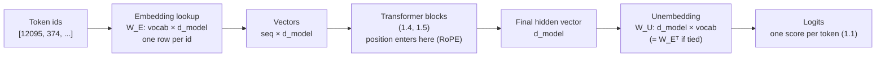
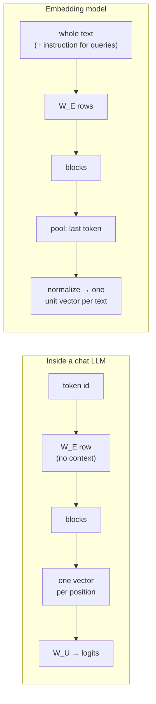

# Embeddings

## Why this matters

Tokens become vectors before anything else happens, and that vector space is where meaning lives. The same idea powers search and RAG in Part 2.

[1.2](/part-01-how-llms-work/1.2-tokenization) ended with a list of integer ids. An id is just a name: id 12095 isn't "closer" to id 12096 than to id 3. The network can't do arithmetic on names, so its very first step turns each id into a vector of a few thousand real numbers. Everything the model later does, from attention (1.4) to the final logits (1.1), is arithmetic on those vectors. This chapter covers where they come from, what the geometry of the space means, where that intuition breaks, and how the "embeddings" an LLM uses internally differ from the ones you get out of an embedding API for search.

**Learning goals**

- Explain the embedding table and what training does to it
- Reason about similarity with dot products and cosine
- Tell token embeddings from sentence-embedding models

## Explanation

### From ids to vectors: one-hot vs. dense

The naive way to feed an id into a neural network is a **one-hot vector**: a vector as long as the vocabulary, all zeros except a 1 at the token's id. For Qwen3 that's 151,936 numbers per token (`vocab_size` in [Qwen3-8B's config.json](https://huggingface.co/Qwen/Qwen3-8B/blob/main/config.json)). One-hot vectors have two problems:

- **They're huge and almost empty.** 151,935 of the 151,936 entries are zero.
- **They encode no similarity.** Any two different one-hot vectors are orthogonal: the dot product of `" cat"` and `" kitten"` is 0, the same as `" cat"` and `" carburetor"`. Nothing about one token tells the network anything about another.

A **dense embedding** fixes both. Each token gets a short vector of real numbers (4,096 of them for Qwen3-8B, `hidden_size` in the same config), and the values are *learned*, so tokens that behave similarly can end up with similar vectors. The model can then generalize: what it learns about `" cat"` partly transfers to `" kitten"` because their vectors overlap.

### The embedding matrix is a lookup table

All the token vectors live in one matrix, the **embedding matrix** (often written `W_E`), with one row per vocabulary entry: shape `vocab_size × d_model`. Turning ids into vectors is just indexing: row 12095 is the vector for id 12095.

It's worth seeing why that's the same thing as a neural-network layer. Take a toy vocabulary of 4 tokens and `d_model = 3`:

```
W_E = [ 0.2  -1.0   0.5 ]   ← id 0
      [ 0.9   0.1  -0.3 ]   ← id 1
      [-0.4   0.8   0.0 ]   ← id 2
      [ 0.7   0.7   0.2 ]   ← id 3

one_hot(2) = [0 0 1 0]

one_hot(2) · W_E = [-0.4  0.8  0.0]   = row 2
```

Multiplying a one-hot vector by the matrix selects one row. So an embedding layer *is* a linear layer with no bias applied to one-hot inputs. Frameworks implement it as an index instead (`nn.Embedding` in PyTorch) because multiplying by 151,935 zeros is a waste. Raschka's repo has a short notebook that proves the equivalence in code ([`03_bonus_embedding-vs-matmul`](https://github.com/rasbt/LLMs-from-scratch/tree/main/ch02/03_bonus_embedding-vs-matmul)).

The matrix is not small. For Qwen3-8B it's 151,936 × 4,096 = 622 million parameters. Qwen3-8B has a separate matrix of the same shape at the output (more on that below), so about **1.24B of its 8.2B parameters are embeddings**. The model card agrees: it lists 8.2B parameters in total and 6.95B "non-embedding", a difference of 1.25B ([Qwen3-8B model card](https://huggingface.co/Qwen/Qwen3-8B)). Small models feel this more. Qwen3-0.6B's table is 151,936 × 1,024 = 156M parameters ([config.json](https://huggingface.co/Qwen/Qwen3-0.6B/blob/main/config.json)), roughly a quarter of the whole model. That's why vocabulary size is a real design trade-off (1.2): a bigger vocabulary means shorter sequences but a bigger table.

### What training does to the table

The table starts as random numbers. During pretraining (1.6), each step computes the loss on the next-token predictions, and backprop pushes a gradient into **only the rows of the tokens that appeared in that batch**. A row moves only when its token is used. Over trillions of tokens, each row drifts toward whatever vector makes the rest of the network best at predicting what comes next. Nobody tells the model what `" cat"` means. Its row ends up close to `" Cat"` and `" kitten"` because swapping one for the other changes the predictions only a little.

Two consequences follow from "a row only learns when its token is used":

- **Rare tokens get poorly trained rows.** That's the mechanism behind the glitch tokens from [1.2](/part-01-how-llms-work/1.2-tokenization#token-level-failure-modes): a token in the vocabulary that hardly appears in the model's training data keeps an almost untrained vector.
- **You can sometimes see the untrained rows.** Qwen3-0.6B's table has 151,936 rows, but its tokenizer only maps 151,669 ids (151,643 regular tokens plus 26 special ones). The 267 extra rows are padding. Their vectors have a norm of about 0.30, while the median row is about 0.94 (measured on 2026-11-09 by downloading just the `model.embed_tokens.weight` tensor from [Qwen3-0.6B's `model.safetensors`](https://huggingface.co/Qwen/Qwen3-0.6B/tree/main)). That's what you'd expect from rows that no token ever selects, so no gradient ever reaches them.

#### Input and output embeddings

At the other end of the network, the final hidden vector has to become one score per vocabulary entry: the logits from [1.1](/part-01-how-llms-work/1.1-next-token-prediction). That's another `d_model × vocab_size` matrix, the **unembedding** (`W_U`, called `lm_head` in Hugging Face code). Each logit is the dot product of the final hidden vector with one token's row of `W_U`. Generating text is "find the token whose output vector points most in the same direction as the model's current state".

Because the two matrices have mirror-image shapes, you can use the same one for both. That's **weight tying**, proposed by Press and Wolf ([Using the Output Embedding to Improve Language Models](https://arxiv.org/abs/1608.05859), EACL 2017), and the original Transformer did it too ("we share the same weight matrix between the two embedding layers and the pre-softmax linear transformation", [Attention Is All You Need](https://arxiv.org/abs/1706.03762), section 3.4). It's a choice that varies by size within one family: Qwen3-0.6B sets `tie_word_embeddings: true` and Qwen3-8B sets it to `false` (the two config files linked above). For the small model, tying saves 156M parameters, a quarter of its budget. For the large one, two separate tables cost a smaller share.



Now watch it visually. 3Blue1Brown's transformer chapter has the clearest picture of the embedding matrix and of what "directions mean something" looks like.

::: info ▶️ Watch
[Transformers, the tech behind LLMs](https://www.youtube.com/watch?v=wjZofJX0v4M) (3Blue1Brown, Deep Learning ch. 5, 2024), **12:27–22:22** ("Word embeddings", "Embeddings beyond words", "Unembedding") · video · ~10 min · **essential**

You may have watched the start of this for 1.1. This cut is the embedding part. Look for: `W_E` drawn as columns of vectors, the `woman − man ≈ queen − king` direction and the caveat that the real "queen" vector lands only near the predicted spot, dot products as "how well two vectors align", and the point (18:25) that after the first layer the vectors stop representing a single word and absorb context. The [text version of the lesson](https://www.3blue1brown.com/lessons/gpt) has the same figures, under the headings "Embedding" through "Unembedding Matrix".
:::

### Similarity: dot product and cosine

Two operations do almost all the work on embeddings:

- **Dot product:** `a · b = Σ aᵢbᵢ`. Large when the vectors point the same way *and* are long.
- **Cosine similarity:** `cos(a, b) = (a · b) / (‖a‖ ‖b‖)`. The dot product with the lengths divided out, so only direction counts. It ranges from −1 (opposite) through 0 (orthogonal) to 1 (same direction).

Three facts are worth memorizing:

1. **For unit-length vectors, cosine and dot product are the same number.** Most embedding APIs return unit vectors, so you can skip the division. The vectors Ollama returned from `qwen3-embedding:0.6b` all had norm 1.0000 (measured on 2026-11-09 with Ollama 0.40.14). The [Ollama embed docs](https://docs.ollama.com/api/embed) don't promise it, so check your model before relying on it.
2. **For unit vectors, Euclidean distance carries the same information.** `‖a − b‖² = 2 − 2·cos(a, b)`, so sorting by distance ascending gives the same order as sorting by cosine descending. Vector databases (Part 2) offer all three metrics, and on normalized vectors the choice doesn't change your ranking.
3. **Inside the LLM, length matters.** The logits are raw dot products with `W_U`, not cosines, so a vector's norm acts like a confidence scale. Treat cosine as a tool for *comparing* embeddings, not as what the model computes.

**Worked example.** Here are cosine similarities between single words from a real embedding model, `qwen3-embedding:0.6b` through Ollama's `/api/embed` (1,024 dimensions, measured on 2026-11-09). You'll reproduce these in the practice.

| Pair | Cosine |
|---|---|
| `cat` – `dog` | 0.863 |
| `cat` – `kitten` | 0.859 |
| `Paris` – `France` | 0.837 |
| `bank` – `money` | 0.806 |
| `good` – `bad` | 0.796 |
| `hot` – `cold` | 0.768 |
| `cat` – `car` | 0.680 |
| `bank` – `river` | 0.627 |
| `cat` – `Bulgaria` | 0.539 |

Two things should surprise you:

- **Nothing is near 0.** The average cosine across all pairs of the 24 words tested was 0.632. Embedding spaces are typically **anisotropic**: the vectors crowd into a narrow region instead of spreading evenly over the sphere. Ethayarajh showed this for the contextual vectors inside BERT, ELMo and GPT-2: "the contextualized representations of all words are not isotropic in any layer" ([How Contextual are Contextualized Word Representations?](https://arxiv.org/abs/1909.00512), EMNLP 2019). The practical rule: **absolute cosine values don't transfer between models, only rankings do.** A threshold like "0.8 means relevant" that works for one model means nothing for another.
- **Antonyms are close.** `good`–`bad` (0.796) scores higher than `cat`–`car` (0.680). Antonyms appear in the same contexts ("the food was good/bad"), and "appears in the same contexts" is what these spaces measure. Similar here means *related and interchangeable in text*, not *means the same thing*.

### The geometry of meaning: directions and analogies

The famous result from the word2vec era ([Mikolov et al., Efficient Estimation of Word Representations in Vector Space](https://arxiv.org/abs/1301.3781), 2013) is that relationships show up as **directions**: the offset from `man` to `woman` is roughly the offset from `king` to `queen`, so `king − man + woman` lands near `queen`. The same works for capitals (`Paris − France + Germany ≈ Berlin`), tense, plurals and more.

::: tip 📖 Read
[The Illustrated Word2vec](https://jalammar.github.io/illustrated-word2vec/) (Jay Alammar, 2019) · article · ~20 min · optional

The gentlest walk-through of where word embeddings came from. Look for: the "personality embedding" warm-up that explains why cosine is the right comparison, the vectors drawn as colored cells (you'll see stripes that several related words share), and the `king − man + woman` figure. The second half (how word2vec is trained with negative sampling) is historical context: LLMs learn their table by next-token prediction instead, but the geometry that falls out is similar.
:::

Analogies are a good intuition pump and a poor measuring tool. Here's what the same embedding model did on 2026-11-09, searching for the nearest word among the 24 above:

| Analogy | Nearest (inputs excluded) | Nearest (inputs allowed) |
|---|---|---|
| `man : king :: woman : ?` | `queen` 0.790 | `woman` 0.825 |
| `France : Paris :: Germany : ?` | `Berlin` 0.910 | `Berlin` 0.910 |
| `France : Paris :: Bulgaria : ?` | `Berlin` 0.680 (`Sofia` 0.630 second) | `Bulgaria` 0.849 |

Three limits show up in that table:

1. **The textbook demo cheats a little.** The standard analogy evaluation excludes the three input words from the candidates. Allow them, and `king − man + woman` is closest to `woman` itself, because the offset is small compared with the word you added it to. Nissim, van Noord and van der Goot argue that this and other implementation choices "might have yielded a distorted picture of bias in word embeddings" ([Fair is Better than Sensational: Man is to Doctor as Woman is to Doctor](https://arxiv.org/abs/1905.09866), 2019). Read that paper's abstract before quoting an analogy result as evidence of anything.
2. **Directions are only roughly parallel.** `Paris − France + Bulgaria` landed on `Berlin`, not `Sofia`. The "capital-of" offset isn't one clean direction. It's mixed with "big famous European city", and `Berlin` scored higher on that part.
3. **One vector per string mixes senses.** `bank` is close to both `money` (0.806) and `river` (0.627) because one vector has to serve every meaning of the word. The next section shows how LLMs get around that.

### Token embeddings inside an LLM

Everything above was measured with an *embedding model*, which reads a whole input. The table inside an LLM is different: one row per **token**, looked up with no context at all. To see what that table actually learned, here are the nearest neighbours by cosine of a few rows in Qwen3-0.6B's input embedding table (all 151,669 used rows searched, measured on 2026-11-09 from the downloaded `embed_tokens` tensor; tokens shown as JSON strings so leading spaces are visible):

| Token | Nearest rows (cosine) |
|---|---|
| `" Paris"` | `"Paris"` 0.85, `"巴黎"` 0.71, `" paris"` 0.58, `" France"` 0.46, `" London"` 0.45 |
| `" king"` | `" King"` 0.78, `"King"` 0.69, `" kings"` 0.66, `" KING"` 0.62, `"国王"` 0.58, `" queen"` 0.56 |
| `" bank"` | `" Bank"` 0.81, `"bank"` 0.78, `"Bank"` 0.77, `"银行"` 0.76, `"_bank"` 0.76, `" banks"` 0.75 |
| `" Python"` | `"Python"` 0.89, `" python"` 0.81, `"python"` 0.75, `"_python"` 0.69, `"-python"` 0.66 |

This is the tokenizer from 1.2 seen from the model's side. BPE made `" Paris"`, `"Paris"`, `" paris"` and `"_python"` separate ids, and the model had to *learn* that they mean nearly the same thing. Their rows ended up close together. The Chinese translations (`巴黎` is "Paris", `国王` is "king", `银行` is "bank") also landed nearby, because the model saw them in parallel contexts across its multilingual data. And `" bank"`'s neighbours are all about money. The river sense isn't represented, because at this layer there's no context to choose a sense from.

Context comes in **after** the lookup. Each transformer block (1.4, 1.5) reads the other tokens and adds information into each position's vector. By the middle layers the vector at a `bank` position means different things in "cash at the bank" and "the bank of the river". 3Blue1Brown makes this point at 18:25 in the video above. So when someone says an LLM "represents meaning as vectors", the useful precise version is: **the input table holds context-free token vectors, and the layers turn them into context-dependent vectors, one per position.**

The table is also not a good analogy engine. `" king" − " man" + " woman"` over Qwen3-0.6B's table gives `" king"` itself first (0.67), then `" queen"` (0.58). The table's job is to be a good *starting point* for the layers, not to be linear and tidy. The famous geometry is mostly a property of shallow word2vec-style models and of embedding models trained for it.

::: tip 📖 Read (book)
Raschka, *Build a Large Language Model (From Scratch)*, ch. 2 "Working with Text Data", sections **2.1 "Understanding word embeddings"**, **2.7 "Creating token embeddings"** and **2.8 "Encoding word positions"** · book · ~45 min · optional ([code](https://github.com/rasbt/LLMs-from-scratch/tree/main/ch02/01_main-chapter-code))

Look for: `torch.nn.Embedding` used as a lookup on a tiny vocabulary (the toy matrix above, in code), and how 2.8 adds a second, learned table indexed by *position* instead of token id. That's the GPT-2-style approach this chapter contrasts with RoPE next. If you're heading for the tiny GPT in 1.13, this is the exact data pipeline you'll reuse.
:::

### Positional information (a preview of RoPE)

A token's embedding says *what* it is, not *where* it is. That's a problem, because attention (1.4) on its own treats the input as an unordered set: shuffle the tokens and each position gets the same mix of information, only shuffled. "Dog bites man" and "man bites dog" would look identical. Position has to be injected somewhere. There have been three main approaches:

1. **Fixed sinusoidal vectors added to the embeddings.** The original Transformer added `PE(pos, 2i) = sin(pos / 10000^(2i/d_model))` and the matching cosine to each token's vector, so each dimension pair oscillates at a different frequency ([Attention Is All You Need](https://arxiv.org/abs/1706.03762), section 3.5).
2. **A learned position table added to the embeddings.** A second embedding matrix indexed by position (0, 1, 2, …). GPT-2 does this, with `n_positions: 1024` rows ([GPT-2 config.json](https://huggingface.co/openai-community/gpt2/blob/main/config.json)), and it's what Raschka builds in section 2.8. The downside: the model has no row for positions beyond the table, so GPT-2 can't read past 1,024 tokens at all.
3. **Rotary position embedding (RoPE), applied inside attention.** RoPE doesn't touch the input embeddings at all. Inside each attention layer it rotates the query and key vectors by an angle proportional to their position, using pairs of dimensions as 2D planes, with a different frequency per pair. A dot product between two rotated vectors depends only on the *difference* of their angles. In the RoFormer paper's words, RoPE "encodes the absolute position with a rotation matrix and meanwhile incorporates the explicit relative position dependency in self-attention formulation" ([RoFormer](https://arxiv.org/abs/2104.09864), 2021).

Qwen3 uses RoPE. Its config has `rope_theta: 1000000` (the base of the frequency schedule, playing the role of the 10000 in the sinusoidal formula) and `max_position_embeddings: 40960` ([Qwen3-8B config.json](https://huggingface.co/Qwen/Qwen3-8B/blob/main/config.json)). So the vectors you saw in Qwen3's embedding table carry **no position at all**: position enters only where queries meet keys. Chapter 1.4 does the rotation properly. Chapter 1.9 covers why `rope_theta` matters for long context, and 1.15 covers how RoPE is stretched to make context windows longer.

### Embedding models vs. the LLM's internal embeddings

When an API offers "embeddings", it's not handing you rows of a chat model's table. An **embedding model** maps a whole text (a word, a sentence, a document chunk) to **one fixed-size vector**, trained so that texts that should match end up close together. That's the tool behind semantic search, clustering, deduplication and RAG (Part 2).

Most current embedding models are built *from* an LLM. The [Qwen3-Embedding](https://huggingface.co/Qwen/Qwen3-Embedding-0.6B) series (0.6B, 4B and 8B) is "built upon the Qwen3 foundation models" ([Qwen3 Embedding paper](https://arxiv.org/abs/2506.05176), 2025). What's different is what happens around the transformer, and how it's trained:

| | LLM token embedding (`embed_tokens`) | Embedding model output |
|---|---|---|
| Unit | One token | A whole input text |
| Context | None: same vector wherever the token appears | Full: the vector is computed from all the layers over the whole text |
| Comes from | A row lookup in `W_E` | The last layer's hidden state, **pooled** into one vector (Qwen3-Embedding uses the last token's hidden state) and then normalized to unit length |
| Trained for | Next-token prediction (it's a side effect) | Explicitly: matching pairs close, non-matching pairs far apart (contrastive training) |
| You get it from | The weights file | An API: Ollama `/api/embed`, OpenAI, Voyage, etc. |

Why not average an LLM's hidden states and call that a sentence embedding? You can, but it was never trained to make "close" mean "relevant", and it inherits the anisotropy above. The Sentence-BERT paper is the classic argument for training a dedicated model. It also shows why embeddings are so valuable: comparing every pair of sentences with a model that reads both together (a **cross-encoder**) is accurate but slow. With BERT, finding the most similar pair among 10,000 sentences takes "about 50 million inference computations (~65 hours)", while embedding each sentence once and comparing vectors (a **bi-encoder**) cut that "to about 5 seconds" ([Sentence-BERT](https://arxiv.org/abs/1908.10084), EMNLP 2019). Embedding each text once and comparing vectors is what makes vector search cheap. Rerankers (2.10) bring the cross-encoder back for the final few candidates.

Three practical details from the [Qwen3-Embedding-0.6B model card](https://huggingface.co/Qwen/Qwen3-Embedding-0.6B) that you'll meet again in Part 2:

- **Instructions on the query side.** It's "instruction aware": queries are prefixed with `Instruct: {task_description}\nQuery:{query}`, and documents are embedded without one. On 2026-11-09, adding the web-search instruction to the query `how do I reset my password` raised its cosine with a matching help-text sentence from 0.725 to 0.777, and lowered it with a related-but-wrong sentence (about password *policy*) from 0.544 to 0.452. The gap between right and wrong almost doubled.
- **Truncatable dimensions.** It supports "user-defined output dimensions ranging from 32 to 1024", thanks to Matryoshka training, which packs the most important information into the first dimensions so you can cut the vector short. The paper reports "up to 14x smaller embedding size" for one image task at the same accuracy ([Matryoshka Representation Learning](https://arxiv.org/abs/2205.13147), 2022). Ollama exposes this as the `dimensions` field of [`/api/embed`](https://docs.ollama.com/api/embed). Fewer dimensions mean less storage and faster search, at some cost in quality: `cat`–`dog` went from 0.863 at 1,024 dimensions to 0.915 at 128 (measured on 2026-11-09), so shorter vectors also separate words less.
- **Vectors from different models don't mix.** Like token ids in 1.2, coordinates mean something only within the model that produced them. Change the embedding model and you re-embed everything.



Which embedding model is best changes often. The [MTEB leaderboard](https://huggingface.co/spaces/mteb/leaderboard) is the usual starting point, and chapter 2.8 covers choosing one. For the practice here, the 0.6B model is enough.

## Practice

**Brief:** Embed about 50 words with a local embedding model in Ollama, compute nearest neighbours with cosine similarity in TypeScript, and test a few analogies. Then find and write down where the geometry breaks: antonyms, polysemy, input-word exclusion, cross-language pairs, and truncated dimensions. It's all local and free.

**Where:** `experiments/07-embedding-space/`: a standalone experiment. The README there has the "What I tried / What happened / Why" skeleton and tables to fill in.

::: tip 📖 Reference
[Ollama API: embed](https://docs.ollama.com/api/embed) (`POST /api/embed` with `model`, `input` as a string or an array, and optional `dimensions`; the response has `embeddings`, one array per input) and the [qwen3-embedding](https://ollama.com/library/qwen3-embedding) library page · docs · ~5 min · **essential** for the practice
:::

**Steps:**

1. `ollama pull qwen3-embedding:0.6b` (639 MB). It runs alongside your chat models.
2. Write a word list of 40–60 entries in `words.ts`, chosen to probe the space. Include: a few semantic clusters (animals, vehicles, emotions), country–capital pairs (include Bulgaria–Sofia), `man`/`woman`/`king`/`queen`, two or three antonym pairs, two polysemous words (`bank`, `bat`, `bark`), and five words with their Bulgarian translations.
3. Write `embed.ts`: send the whole list to `/api/embed` in **one** request (`input` takes an array), and save `{word, vector}` to `embeddings.json` so later steps don't call the model again. Print the dimension and the norm of the first few vectors. Are they unit length?
4. Write `neighbours.ts`: implement `dot`, `norm` and `cosine` yourself (no libraries), then print the top 5 neighbours for ten words of your choice. Also compute the **mean cosine over all pairs**. That number is your baseline for "unrelated" in this model.
5. Add `analogy(a, b, c)` that returns the nearest words to `b − a + c`, with a flag to include or exclude the three input words. Run at least five analogies (gender, capitals, plural, tense, and one you expect to fail), each with and without exclusion.
6. Probe the failure modes and record the numbers: antonyms vs. unrelated pairs, the two senses of each polysemous word, English–Bulgarian translation pairs vs. same-language synonyms, and capitalization (`paris` vs. `Paris`).
7. Embed the list again with `dimensions: 128` and then `dimensions: 32`. For three words, compare the top-5 neighbour lists across 1024/128/32. At what size do the neighbours stop making sense?
8. Optional: embed two sentences that use `bank` in different senses, plus one sentence for each sense without the word. Do the sentence vectors separate the senses that the single word `bank` couldn't?
9. Optional, harder: repeat step 4 on the **raw token table** of Qwen3-0.6B, as this chapter did. A `.safetensors` file starts with an 8-byte little-endian header length, then a JSON header that gives each tensor's dtype, shape and byte offsets, counted from the end of the header, not from the start of the file ([format spec](https://github.com/huggingface/safetensors#format)). Use HTTP `Range` requests to download only `model.embed_tokens.weight` (bf16, ~311 MB), convert bf16 to float32 (shift each 16-bit value left by 16 bits), and map ids to strings with the `vocab` in `tokenizer.json`. Compare the neighbours of `" bank"` here with step 6.

**Done when:** `node experiments/07-embedding-space/neighbours.ts` prints top-5 neighbours, the mean pairwise cosine and your analogy results from cached embeddings without calling Ollama. The README has the filled-in tables and a "where the geometry breaks" section with at least four concrete failures, each backed by a number and a one-sentence explanation of why.

## Check questions

1. Why is multiplying a one-hot vector by `W_E` the same as looking up a row, and why does every framework implement it as a lookup?

   <details><summary>Answer</summary>

   A one-hot vector has a single 1 at index `i` and zeros elsewhere, so the product `one_hot(i) · W_E` is a weighted sum of `W_E`'s rows where only row `i` has a non-zero weight: the result is exactly row `i`. Computing it as a matrix multiply would multiply and add `vocab_size − 1` zeros for every element of the output (151,935 of them for Qwen3), so frameworks index the row directly. The two are mathematically identical, so gradients flow the same way: only the selected row gets updated.

   </details>

2. Qwen3-8B's model card lists 8.2B parameters and 6.95B "non-embedding" parameters. Using `vocab_size = 151,936` and `hidden_size = 4,096`, explain the difference. Why does Qwen3-0.6B tie its input and output embeddings while Qwen3-8B doesn't?

   <details><summary>Answer</summary>

   One table is 151,936 × 4,096 ≈ 622M parameters. Qwen3-8B has `tie_word_embeddings: false`, so it has two of them (input `W_E` and output `W_U`), about 1.24B, which matches 8.2B − 6.95B ≈ 1.25B. For Qwen3-0.6B, one table is 151,936 × 1,024 ≈ 156M, about a quarter of the model. A second table would add another quarter, so sharing one matrix saves a large fraction of the budget. At 8B, the table is a much smaller share, so the model can afford separate input and output tables.

   </details>

3. Your RAG prototype uses "cosine > 0.8 means relevant". It works with one embedding model. You switch to another, and suddenly almost everything passes. What's going on, and what should you do instead?

   <details><summary>Answer</summary>

   Embedding spaces are anisotropic: vectors cluster in a narrow region, so even unrelated texts have high cosines, and how high depends on the model. In this chapter's measurements, the *average* pair of unrelated words scored 0.632 with `qwen3-embedding:0.6b`. Absolute cosine values don't transfer between models, only rankings do. Use top-k retrieval (optionally followed by a reranker), or calibrate any threshold per model against labeled examples.

   </details>

4. `king − man + woman` is the classic demo. Give two reasons not to treat an analogy result as strong evidence about what a model "knows".

   <details><summary>Answer</summary>

   First, the standard evaluation excludes the three input words from the candidates. Without that rule, the nearest vector is often one of the inputs (`woman` in this chapter's run), so the answer is partly a product of the evaluation code. Nissim et al. show that this and similar choices distorted published conclusions about bias. Second, relationship offsets are only roughly parallel and are mixed with other features: `Paris − France + Bulgaria` landed on `Berlin`, not `Sofia`. Analogies also depend heavily on which candidate words you search over.

   </details>

5. Explain the difference between the row for `" bank"` in Qwen3's embedding table and the vector you get from `qwen3-embedding` for the sentence "We sat on the bank of the river." Where does each one get its information about meaning, and where does position come in?

   <details><summary>Answer</summary>

   The table row is context-free: the same vector is looked up wherever `" bank"` appears, it was shaped only as a side effect of next-token prediction, and its neighbours (`" Bank"`, `"银行"`, `" banks"`) show it mostly encodes the financial sense and surface variants. It has no position information. In Qwen3, position enters only inside attention, where RoPE rotates queries and keys. The sentence embedding runs the whole sentence through every layer, so context has already resolved the river sense. It then pools the last token's hidden state into one vector and normalizes it, and it was explicitly trained so that texts that should match are close together. It represents the whole sentence, not the word.

   </details>

## My understanding

<!-- Written by the learner, in their own words. Agents never fill this in. -->
