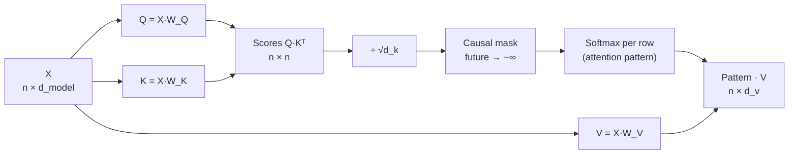

# Attention

## Why this matters

Attention is the mechanism that lets every token look at every other token, and it explains both what transformers are good at and why context is expensive. It is the single most important idea in Part 1.

In [1.3](/part-01-how-llms-work/1.3-embeddings), the embedding table gave each token a context-free vector: `" bank"` got the same row in "cash at the bank" and "the bank of the river". Attention is how that vector learns about its neighbours. It's also the one part of the model whose cost grows with the *square* of the input length, which is why long prompts are slow, why context windows have limits, and why so much of the engineering in 1.9, 1.15 and Part 10 exists.

**Learning goals**

- Compute scaled dot-product attention by hand on a tiny example
- Explain Q, K, V and causal masking
- Explain multi-head attention and its cost in sequence length

## Explanation

### The problem attention solves

After the embedding lookup you have one vector per position, and each knows only its own token. To predict what comes after "The animal didn't cross the street because **it**", the vector at `it` needs information from `animal` (or `street`) several positions back. Something has to move information **between positions**, and it has to work for any distance and any sentence.

The pre-transformer answer was recurrence: an RNN reads tokens one at a time and carries a single state vector forward. Everything the model knows about the past has to squeeze through that vector, one step at a time. Bahdanau, Cho and Bengio named the problem in 2014 for translation: "we conjecture that the use of a fixed-length vector is a bottleneck", and their fix was to let the decoder look back at *all* the encoder's states and take a weighted average of the relevant ones ([Neural Machine Translation by Jointly Learning to Align and Translate](https://arxiv.org/abs/1409.0473), ICLR 2015). That weighted average is attention.

The Transformer paper took the next step: drop recurrence entirely and build the model out of attention. Its Table 1 states the trade-off. A self-attention layer connects any two positions in O(1) sequential steps (an RNN needs O(n)), and its compute per layer is O(n²·d) against an RNN's O(n·d²) ([Attention Is All You Need](https://arxiv.org/abs/1706.03762), section 4). The first property is why transformers train fast on GPUs and handle long-range dependencies well. The n² is the bill, and this chapter ends with it.

### The idea: a soft dictionary lookup

Think of a key–value store. You give it a query, it finds the key that matches, and returns that key's value. Attention is the same thing made *soft* and differentiable:

- Every position publishes a **key** ("here's what I contain") and a **value** ("here's what I'll hand over if you pick me").
- Every position also sends out a **query** ("here's what I'm looking for").
- A query is compared with every key by dot product. The scores go through softmax to become weights that sum to 1.
- The output for that position is the **weighted average of all the values**.

Instead of returning one exact match, it returns a blend, leaning toward the best matches. And because the weights come from a softmax over dot products, the whole thing is differentiable, so training can shape what queries look for and what keys advertise.

### Q, K and V are learned projections

Where do queries, keys and values come from? Each is a linear projection of the same input vectors. With `X` the `n × d_model` matrix of position vectors (one row per token):

```
Q = X · W_Q     (n × d_k)
K = X · W_K     (n × d_k)
V = X · W_V     (n × d_v)
```

`W_Q`, `W_K` and `W_V` are learned weight matrices, the same for every position. Training decides what each projection extracts. 3Blue1Brown's example: a noun's query might come to mean "are there any adjectives in front of me?", and an adjective's key might come to mean "I'm an adjective". The dot product of the two is then large exactly when an adjective precedes the noun. Nobody programs that. It falls out of next-token prediction, the same way the embedding geometry did in 1.3.

The three roles are separate matrices for a reason. Who you are looking *for* (query), how you *advertise* yourself (key) and what you *hand over* (value) are three different questions, and a single vector would have to answer all three at once.

### Scaled dot-product attention, step by step

The whole mechanism is one line, equation 1 of the paper ([Attention Is All You Need](https://arxiv.org/abs/1706.03762), section 3.2.1):

```
Attention(Q, K, V) = softmax( Q·Kᵀ / √d_k ) · V
```

In words: "We compute the dot products of the query with all keys, divide each by √d_k, and apply a softmax function to obtain the weights on the values" (same section). Four steps:

1. **Scores.** `Q·Kᵀ` is an `n × n` matrix. Entry `(i, j)` says how much position `i`'s query matches position `j`'s key.
2. **Scale.** Divide every score by `√d_k`.
3. **Softmax per row.** Each row becomes a probability distribution: how position `i` splits its attention across positions. This `n × n` matrix of weights is the **attention pattern**.
4. **Mix values.** Multiply the pattern by `V`. Row `i` of the output is `Σⱼ weight(i, j) · Vⱼ`.



#### Worked example

Four tokens, `The cat sat down`, with `d_k = 4` (so `√d_k = 2`) and `d_v = 2`. To keep the arithmetic visible, start from Q, K and V directly, as if the projections were already done:

```
        Q              K              V
The   [1 0 1 0]      [1 1 0 0]      [1 0]
cat   [0 2 0 2]      [0 2 0 2]      [0 1]
sat   [2 0 0 2]      [2 0 2 0]      [1 1]
down  [0 0 1 3]      [0 0 2 2]      [2 0]
```

**Step 1, scores.** Each query dotted with each key. Row `cat`: `[0 2 0 2]·[1 1 0 0] = 2`, `·[0 2 0 2] = 8`, `·[2 0 2 0] = 0`, `·[0 0 2 2] = 4`. All rows:

```
         The  cat  sat  down   (keys)
The    [  1    0    4    2 ]
cat    [  2    8    0    4 ]
sat    [  2    4    4    4 ]
down   [  0    6    2    8 ]
```

**Step 2, scale** by `1/√4 = 0.5`: row `cat` becomes `[1 4 0 2]`.

**Step 3, causal mask and softmax** (the mask is explained in the next section: each token may only look at itself and earlier tokens, so the entries above the diagonal become −∞ and get weight 0). Row `cat` keeps only `[1 4]`: `e¹ = 2.718`, `e⁴ = 54.598`, sum 57.316, so the weights are `0.047` and `0.953`. The full pattern (computed on 2026-11-09 with a 20-line script, which is what you'll write in the practice):

```
         The    cat    sat    down
The    [1.000  0      0      0    ]
cat    [0.047  0.953  0      0    ]
sat    [0.155  0.422  0.422  0    ]
down   [0.013  0.256  0.035  0.696]
```

Every row sums to 1. `The` can only see itself, so it gets weight 1 whatever the scores say.

**Step 4, mix values.** Row `cat` is `0.047·[1 0] + 0.953·[0 1] = [0.047 0.953]`: almost entirely `cat`'s own value with a trace of `The`. Row `sat` is `0.155·[1 0] + 0.422·[0 1] + 0.422·[1 1] = [0.578 0.845]`, a genuine blend of three tokens. That output vector is what gets added back into `sat`'s position (1.5 shows how). After one attention layer, the vector at `sat` carries information about `The` and `cat`. That's how context gets in.

#### Why divide by √d_k

Without the scaling, row `cat`'s scores `[2 8]` give softmax weights of `0.002` and `0.998`. The pattern is nearly one-hot, and that's the problem. The paper's explanation: "for large values of d_k, the dot products grow large in magnitude, pushing the softmax function into regions where it has extremely small gradients" (section 3.2.1). When one weight is ~1 and the rest are ~0, small changes to the scores barely change the output, so gradients vanish and training stalls.

Footnote 1 of the paper gives the reason it grows with `d_k`: if the components of `q` and `k` are independent with mean 0 and variance 1, their dot product has mean 0 and **variance `d_k`**. So the standard deviation is `√d_k`, and dividing by it brings scores back to unit scale. A quick simulation on 2026-11-09 (20,000 random dot products each) gave standard deviations of 2.00, 7.96 and 11.35 for `d_k` = 4, 64 and 128, matching √4, √64 and √128 = 11.31. Qwen3-8B uses `head_dim: 128` ([config.json](https://huggingface.co/Qwen/Qwen3-8B/blob/main/config.json)), so unscaled scores would routinely be in the tens.

This is the same temperature knob from [1.8](/part-01-how-llms-work/1.8-sampling): dividing logits by a number before softmax flattens the distribution. Here the divisor is fixed by the architecture instead of chosen at sampling time.

Now see it drawn. 3Blue1Brown's attention chapter is the best visual treatment of everything so far, and it's the follow-up to the chapter you watched for 1.3.

::: info ▶️ Watch
[Attention in transformers, step-by-step](https://www.youtube.com/watch?v=eMlx5fFNoYc) (3Blue1Brown, Deep Learning ch. 6, 2024), **1:39–18:21** ("Motivating examples" through "Counting parameters") · video · ~17 min · **essential**

Look for: the attention pattern drawn as a grid with keys across and queries down, the adjective/noun example of what a query and key might learn, masking at 11:08, why the pattern's size is the square of the context (12:42), and the parameter count for one GPT-3 head (about 6.3 million). The [text version](https://www.3blue1brown.com/lessons/attention) covers the same ground under "The Attention Pattern", "Queries", "Keys" and "Counting Parameters". Then watch **19:19–23:19** ("Multiple heads" and "The output matrix", ~4 min) after the multi-head section below.
:::

### Causal masking

An LLM is trained to predict token `t+1` from tokens `1…t` (1.1). During training it processes the whole sequence at once: every position predicts its own next token in one forward pass, so one sequence of 4,096 tokens gives 4,096 training examples. That only works if position `t` **can't see** positions after it. Otherwise it would simply read the answer.

The **causal mask** enforces this. Before softmax, every score where the key comes after the query is set to −∞. `e^−∞ = 0`, so those positions get exactly zero weight and the rest renormalize among themselves. The paper's decoder does exactly this: "masking out (setting to −∞) all values in the input of the softmax which correspond to illegal connections" (section 3.2.3). The pattern is lower-triangular, like the worked example above.

Compare the worked example with and without the mask. Without it, `The` puts 0.579 of its weight on `sat`, a word that hasn't been written yet. With it, `The` sees only itself. The `down` row is unchanged, because the last token already sees everything.

Two consequences matter later:

- **Earlier positions never change when you append tokens.** Position `i`'s output depends only on positions `1…i`. So when the model generates token `n+1`, everything it computed for positions `1…n` is still valid. Their keys and values can be stored and reused instead of recomputed. That's the **KV cache**, the whole subject of [1.9](/part-01-how-llms-work/1.9-kv-cache-context-window), and the reason prompt caching (2.7) is possible.
- **"Decoder-only" means causal.** GPT, Claude, Qwen and Llama all use causal self-attention throughout. Encoder models like BERT use unmasked, bidirectional attention: every token sees the whole input, which suits embedding and classification but can't generate text left to right. Karpathy's lecture covers this distinction in its notes on encoder vs. decoder blocks (01:14:14).

Attention is also **blind to order** on its own. Shuffle the rows of `X` and you get the same outputs, shuffled. "Dog bites man" and "man bites dog" would produce the same set of vectors. That's why position has to be injected, as [1.3](/part-01-how-llms-work/1.3-embeddings#positional-information-a-preview-of-rope) previewed. In Qwen3 it happens right here: RoPE rotates each query and key by an angle set by its position before the dot product, so the score between positions `i` and `j` depends on their offset `i − j`.

::: tip 📖 Read (book)
Raschka, *Build a Large Language Model (From Scratch)*, ch. 3 "Coding Attention Mechanisms", sections **3.3 "Attending to different parts of the input with self-attention"** through **3.5 "Hiding future words with causal attention"** · book · ~1.5 h · optional ([code](https://github.com/rasbt/LLMs-from-scratch/tree/main/ch03/01_main-chapter-code))

The same steps as this chapter, in PyTorch, building up from attention with no trainable weights (3.3.1) to `W_Q`, `W_K`, `W_V` (3.4) and the mask (3.5.1). Look for: the masking trick in 3.5.1, which first masks *after* softmax and renormalizes, then shows that putting −∞ *before* softmax gives the same result in one step. Section 3.6 covers multi-head attention, the next section here. This code becomes the attention layer of the tiny GPT in 1.13.
:::

### Multi-head attention

One attention pattern per layer is limiting. A token might need to know which noun it agrees with, which earlier sentence it continues, *and* which bracket it closes, all at once, and one softmax row can only spread its weight one way. **Multi-head attention** runs several attentions in parallel, each with its own `W_Q`, `W_K`, `W_V`, and each with a smaller `d_k`:

1. Project into `h` separate heads, each with `d_k = d_model / h` dimensions.
2. Run scaled dot-product attention independently in each head.
3. Concatenate the heads' outputs and multiply by one more learned matrix, `W_O`, back to `d_model`.

In the paper's words: "Multi-head attention allows the model to jointly attend to information from different representation subspaces at different positions." The original model used `h = 8` heads with `d_k = d_v = d_model/h = 64` (section 3.2.2). Splitting `d_model` across heads keeps the total compute about the same as one big head. You get several patterns for the price of one.

Real numbers for the model on your Mac: Qwen3-8B has `num_attention_heads: 32` with `head_dim: 128`, and 36 layers ([config.json](https://huggingface.co/Qwen/Qwen3-8B/blob/main/config.json)). That's 32 × 36 = 1,152 separate attention patterns for every token in every forward pass. Heads tend to specialize (some track the previous token, some track syntax, some copy repeated text), but what each head does is learned, not designed. The interpretability chapter (1.14) shows how people find out.

#### Fewer keys and values: MQA and GQA

The same config also says `num_key_value_heads: 8`. Qwen3-8B has 32 query heads but only 8 key/value heads: each group of 4 query heads shares one K and one V. This is **grouped-query attention (GQA)**, "an intermediate (more than one, less than number of query heads) number of key-value heads" ([Ainslie et al., GQA](https://arxiv.org/abs/2305.13245), EMNLP 2023). The extreme version, one K/V head shared by all query heads, is **multi-query attention (MQA)**, proposed by Shazeer because sharing them greatly reduces "the size of these tensors" ([Fast Transformer Decoding: One Write-Head is All You Need](https://arxiv.org/abs/1911.02150), 2019).

GQA doesn't reduce the n² compute: there are still 32 query heads, each scoring every key. It reduces how many keys and values have to be **stored** for the KV cache. By the config numbers, Qwen3-8B stores 2 (K and V) × 36 layers × 8 heads × 128 dims × 2 bytes = 144 KiB per token at 16-bit precision. With 32 K/V heads it would be 576 KiB. That 4× is the difference between a long context fitting in your 24 GB or not, and [1.9](/part-01-how-llms-work/1.9-kv-cache-context-window) works through it.

### The O(n²) cost and why it matters for context

Back to the bill. The attention pattern is `n × n`: every token scores every earlier token. Double the prompt and the pattern has four times as many entries. Everything else in a transformer block (the Q/K/V/O projections and the MLP in 1.5) costs the same per token regardless of length. So there are two terms, and Kaplan et al. give the standard estimate of forward-pass compute per token ([Scaling Laws for Neural Language Models](https://arxiv.org/abs/2001.08361), section 2.1 and Table 1):

```
C_forward ≈ 2N + 2 · n_layer · n_ctx · d_attn
```

`N` is the non-embedding parameter count and `n_ctx` is how many tokens this one attends to. The first term is the fixed per-token cost of the weights. The second is attention reading the context, and it grows linearly *per token*, so quadratically for the whole sequence. Kaplan et al. note that when `d_model > n_ctx/12`, the context term is a relatively small fraction, which is why short-context estimates usually ignore it.

Plug in Qwen3-8B (`N` = 6.95B non-embedding from the [model card](https://huggingface.co/Qwen/Qwen3-8B), 36 layers, `d_attn` = 32 heads × 128 = 4,096):

| Context the token attends to | Weights term `2N` | Attention term | Attention share |
|---|---|---|---|
| 1,000 tokens | 13.9 GFLOP | 0.29 GFLOP | 2% |
| 8,000 | 13.9 | 2.4 | 15% |
| 32,000 | 13.9 | 9.4 | 40% |
| 40,960 (the config's `max_position_embeddings`) | 13.9 | 12.1 | 47% |

So for the short prompts most chat requests use, attention compute is a rounding error, and the weights dominate. For long-context work (whole codebases, long agent transcripts) it approaches half of the work. That matches the `d_model > n_ctx/12` rule: 4,096 × 12 ≈ 49,000 tokens is where the two terms meet.

Your Mac shows the trend. Here's the prefill speed of `qwen3:8b` in Ollama 0.40.14 at different prompt lengths, measured on 2026-11-09 with `num_ctx` 40960. The prompts were cut from this book's Part 0 chapters, with a random prefix so nothing came from a cache. Each length was run twice, except the longest, which was run once. The last column is what the formula above predicts. During prefill, the average token attends to about half the prompt, because of the causal mask.

| Prompt (tokens) | Prefill speed | Time per token | Slowdown vs. 529 tokens | Predicted by FLOPs |
|---|---|---|---|---|
| 529 | 357 tok/s | 2.80 ms | 1.00× | 1.00× |
| 2,122 | 349 tok/s | 2.87 ms | 1.03× | 1.02× |
| 8,350 | 302 tok/s | 3.32 ms | 1.19× | 1.08× |
| 16,236 | 248 tok/s | 4.03 ms | 1.44× | 1.17× |
| 32,936 | 192 tok/s | 5.22 ms | 1.87× | 1.34× |

Each token gets more expensive as the prompt grows, so the 33k-token prompt took 172 seconds to prefill, against 1.5 seconds for 529 tokens: 62× the tokens, 116× the time. The measured slowdown is larger than the FLOP estimate. FLOPs only count arithmetic, and on real hardware attention over a long context is often limited by moving keys and values through memory, not by the multiplications. Treat the formula as a lower bound on how fast long context gets expensive.

**Memory** is the other half of the problem. Computed naively, the score matrix for one head is `n × n` numbers. At 40,960 tokens and 2 bytes per number, that's 3.4 GB *per head per layer*. Nobody can store that, so production kernels never do. **FlashAttention** computes exact attention in tiles that fit in the GPU's fast on-chip memory, never writing the full matrix out. Its paper starts from exactly this problem: "the time and memory complexity of self-attention are quadratic in sequence length" ([FlashAttention](https://arxiv.org/abs/2205.14135), 2022). FlashAttention makes the memory linear in `n` and runs much faster, but the compute is still quadratic. 1.15 covers it and the approaches that change the n² itself.

What the n² means for you as an engineer:

- **Long prompts are slow before the first token.** Time to first token is mostly prefill, and prefill grows faster than linearly with prompt length. That's one more reason to keep prompts tight, on top of price.
- **Context windows are an engineering limit, not just a training one.** Compute and memory for attention grow quadratically, and KV-cache memory (1.9) grows linearly with every token kept.
- **Every token you add is read by every later token.** A 50,000-token tool output in an agent transcript isn't a one-off cost. Each later step attends over it again. That's the low-level reason context engineering (3.4) matters.

Karpathy's GPT lecture is the place to see all of this as code, built up from a for-loop average to masked, scaled, multi-head self-attention in about 40 minutes.

::: info ▶️ Watch
[Let's build GPT: from scratch, in code, spelled out](https://www.youtube.com/watch?v=kCc8FmEb1nY) (Karpathy, 2023), **42:13–1:24:25** · video · ~42 min · optional

From "version 1: averaging past context with for loops" through "multi-headed self-attention". Look for: the triangular-matrix trick at 47:11 (a causal average as one matrix multiply, which is masking in disguise), "THE CRUX OF THE VIDEO" at 1:02:00, where queries and keys appear, and the six notes from 1:11:38: attention as communication, attention operating over sets (no notion of space), and the √d_k scaling. It's PyTorch, but it reads easily if you know TypeScript.
:::

If you'd rather read than watch, Jay Alammar's illustrated walkthrough covers the same mechanics with the vectors drawn as colored cells, including the divide-by-8 (√64) step.

::: tip 📖 Read
[The Illustrated Transformer](https://jalammar.github.io/illustrated-transformer/) (Jay Alammar, 2018), section "Self-Attention in Detail" through "The Beast With Many Heads" · article · ~20 min · optional

It describes the original encoder–decoder model, so skip the encoder–decoder parts for now. Look for: the six numbered steps of self-attention for one word, which match the four steps above, and the figures for eight heads being concatenated and projected by `W_O`.
:::

## Practice

**Brief:** Implement single-head causal attention for a 4-token example in plain TypeScript (arrays, no libraries), print the attention weights, and check them against a hand calculation. Then extend it to two heads and measure the n² for yourself. All local, no model calls, free.

**Where:** `experiments/08-attention-by-hand/`: a standalone experiment. The README has the "What I tried / What happened / Why" skeleton, the input numbers, and tables to fill in.

**Steps:**

1. In `attention.ts`, write small helpers yourself: `matmul(a, b)`, `transpose(m)`, `softmax(row)` (subtract the row max before `Math.exp`, and explain in a comment why that doesn't change the result) and `formatMatrix(m)`.
2. Use the input from the README: four token vectors `X` (4 × 3) and weight matrices `W_Q`, `W_K` (3 × 2) and `W_V` (3 × 2). Compute `Q`, `K`, `V`.
3. Compute scores `Q·Kᵀ`, scale by `1/√d_k`, apply the causal mask (set `j > i` to `-Infinity`), softmax each row, and multiply by `V`. Print the score matrix, the attention pattern and the output.
4. **By hand,** on paper or in the README: compute row 3 of the pattern (the third token attending to tokens 1–3) and its output vector. Your script's numbers must match to 3 decimals.
5. Add assertions: every row of the pattern sums to 1 (within 1e-9), everything above the diagonal is exactly 0, and the first row is `[1, 0, 0, 0]`.
6. Run once **without** the mask and once **without** the scaling, and note in the README which rows change and how. Which token "sees the future" most?
7. Turn it into `multiHead(X, heads, W_O)` with two heads (the second head's weights are in the README too). Concatenate the head outputs, project with `W_O`, and print each head's pattern. Do the two heads attend differently?
8. In `scaling.ts`, time single-head attention with random inputs for `n` = 256, 512, 1024, 2048 and 4096 at `d_k = 64` (use `performance.now()`, and run each size a few times). Record the time and the ratio to the previous size. What ratio does O(n²) predict, and what do you get?

**Done when:** `node experiments/08-attention-by-hand/attention.ts` prints the pattern and output for one head and two heads, and all assertions pass. The README has your hand calculation of row 3 matching the script, the mask/scale comparison, and the scaling table with a sentence on whether the timings show n² growth.

## Check questions

1. In the worked example, the `cat` row has scaled scores `[1, 4]` over `The` and `cat` (after masking). Compute the attention weights and the output, given `V_The = [1, 0]` and `V_cat = [0, 1]`. What would the weights be without the √d_k scaling (raw scores `[2, 8]`), and why is that worse for training?

   <details><summary>Answer</summary>

   `e¹ = 2.718`, `e⁴ = 54.598`, sum 57.316, so the weights are `0.047` and `0.953`, and the output is `0.047·[1,0] + 0.953·[0,1] = [0.047, 0.953]`. Unscaled: `1/(1 + e⁶) = 0.002` and `0.998`, nearly one-hot. In that saturated region of the softmax, changing the scores barely changes the weights, so gradients through the attention pattern are tiny and learning slows. Dot products of `d_k`-dimensional vectors with unit-variance components have variance `d_k`, so dividing by `√d_k` brings them back to unit scale.

   </details>

2. What would go wrong if you trained a GPT-style model without the causal mask? And why does the mask make the KV cache possible?

   <details><summary>Answer</summary>

   Training predicts every position's next token in one pass. Without the mask, position `t` could attend to position `t+1` and copy the answer, so training loss would drop to near zero without the model learning to predict anything. At generation time the future doesn't exist yet, so the model would fail. Because of the mask, position `i`'s keys, values and outputs depend only on positions `1…i`. Appending a new token doesn't change anything computed for earlier positions, so their keys and values can be cached and reused instead of recomputed for every new token.

   </details>

3. Why are Q, K and V three separate projections instead of comparing the raw token vectors with each other directly?

   <details><summary>Answer</summary>

   Comparing raw vectors `x_i · x_j` would make attention symmetric (i attends to j exactly as much as j attends to i) and would tie "what I'm looking for" to "what I am". Separate `W_Q` and `W_K` let a token look for something different from what it advertises (a noun looking for adjectives, an adjective advertising itself as one). A separate `W_V` lets a token hand over different information from what it was matched on. All three are learned, so training decides what each extracts.

   </details>

4. Qwen3-8B has 32 query heads and 8 key/value heads. What does that save, and what doesn't it save?

   <details><summary>Answer</summary>

   It's grouped-query attention: each group of 4 query heads shares one key and one value head. It cuts the keys and values that must be computed and stored per token by 4×: the KV cache is 144 KiB per token at 16-bit instead of 576 KiB. That makes long contexts fit in memory and decoding less memory-bound. It doesn't reduce the number of attention patterns or the n² score computation: all 32 query heads still score every key.

   </details>

5. Your agent's prompt grows from 8,000 to 32,000 tokens over a session. Using `C ≈ 2N + 2·n_layer·n_ctx·d_attn` for Qwen3-8B, roughly how does per-token compute change, and what does the n² mean for the whole prompt's prefill?

   <details><summary>Answer</summary>

   With `2N ≈ 13.9` GFLOP and attention `2 × 36 × n × 4096`, per-token compute goes from about 13.9 + 2.4 = 16.3 GFLOP at 8k to about 13.9 + 9.4 = 23.3 GFLOP at 32k, roughly 1.4× per token. The whole prefill does 4× as many tokens, each attending over an average context (about half the prompt, because of the causal mask) that is also 4× longer. The weights part grows 4× and the attention part 16×. Roughly 111 + 9 = 121 TFLOP at 8k becomes 445 + 151 = 596 TFLOP at 32k, about 5×. Time to first token and cost both grow faster than the token count, which is one reason to trim context instead of letting it pile up.

   </details>

## My understanding

<!-- Written by the learner, in their own words. Agents never fill this in. -->
