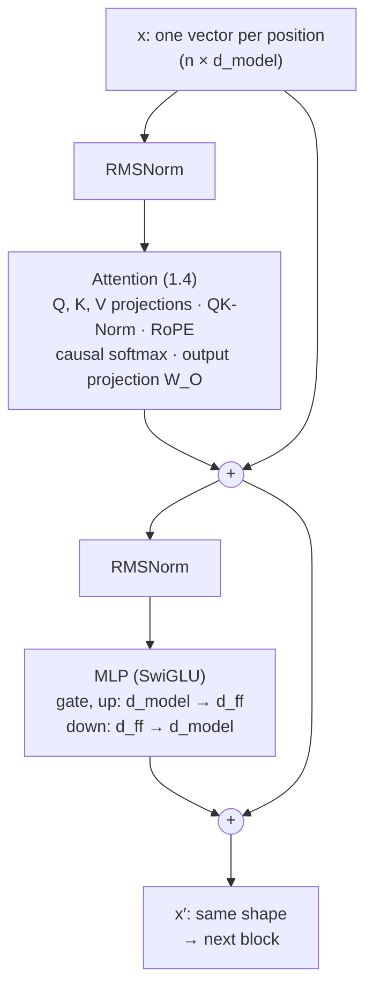

# The transformer block

## Why this matters

A modern LLM is the same block repeated dozens of times. Once you can draw one block and count its parameters, model cards, memory requirements and architecture papers become readable.

[1.3](/part-01-how-llms-work/1.3-embeddings) turned tokens into vectors, and [1.4](/part-01-how-llms-work/1.4-attention) showed how positions exchange information. This chapter puts those pieces together with the three things still missing: the **residual stream** that carries everything, the **normalization** that keeps it trainable, and the **MLP** that holds most of the parameters. By the end you'll be able to take a `config.json`, compute the parameter count to the last digit, and say where the 16 GB of a full-precision 8B model actually goes.

**Learning goals**

- Draw a decoder block and the data flow through it
- Explain residual streams, LayerNorm/RMSNorm and the MLP
- Explain RoPE at an intuitive level
- Count parameters for a small config

## Explanation

### One block, top to bottom

Here is one decoder block as Qwen3 builds it. The Qwen3 technical report lists the ingredients: "Grouped Query Attention (GQA), SwiGLU, Rotary Positional Embeddings (RoPE), and RMSNorm with pre-normalization", plus QK-Norm, which replaced the QKV bias used in Qwen2 ([Qwen3 Technical Report](https://arxiv.org/abs/2505.09388), section 2). Every recent open-weight model is a small variation on this.



Read it as two sub-layers, each with the same shape:

```
x = x + Attention(RMSNorm(x))     # positions exchange information
x = x + MLP(RMSNorm(x))           # each position processes what it gathered
```

That's the whole block. The input and output have the same shape, `n × d_model`, which is what lets you stack 36 of them. The full model is:

```
x = W_E[token_ids]                 # 1.3: embedding lookup
for block in blocks:               # 36 for Qwen3-8B
    x = block(x)
x = RMSNorm(x)                     # one final norm
logits = x · W_U                   # 1.1: one score per vocabulary entry
```

The rest of this chapter goes through each piece.

### The residual stream

The `x = x + …` lines are **residual connections**, and they change how you should picture the network. Don't think of it as a pipeline where each layer transforms the previous layer's output. Think of a **shared vector per position** that flows from the embedding to the unembedding, and every sub-layer **reads** a copy of it, computes something, and **adds** its result back. That vector is the **residual stream**.

Anthropic's interpretability team describes it this way: "Both the attention and MLP layers each "read" their input from the residual stream (by performing a linear projection), and then "write" their result to the residual stream by adding a linear projection back in", and so "all components of a transformer (the token embedding, attention heads, MLP layers, and unembedding) communicate with each other by reading and writing to different subspaces of the residual stream" ([A Mathematical Framework for Transformer Circuits](https://transformer-circuits.pub/2021/framework/index.html), Elhage et al., 2021). It's a `d_model`-wide bus: 4,096 numbers per position for Qwen3-8B. Each sub-layer writes a small update and leaves the rest alone.

Residual connections come from computer vision: He et al. used them to train networks hundreds of layers deep ([Deep Residual Learning for Image Recognition](https://arxiv.org/abs/1512.03385), 2015). They do two jobs:

- **Gradients have a highway.** The derivative of `x + f(x)` with respect to `x` is `1 + f′(x)`. Even if `f′` is tiny, the gradient passes through the `1` unchanged, so the embedding layer still gets a usable gradient through 36 blocks. Without residuals, deep stacks are very hard to train.
- **Each block only has to learn a correction.** A block that has nothing useful to add can output something close to zero and the stream passes through untouched. Blocks refine the representation instead of having to rebuild it.

This picture also explains 1.3's point about context: the vector at the `bank` position starts as the context-free embedding row, and attention layers keep *adding* information from the other tokens into it. By the middle layers, the stream at that position has drifted toward the river or the money sense.

### Normalization: pre-norm and RMSNorm

As blocks keep adding to the stream, its values can grow and drift in scale, and a matrix multiply is sensitive to the scale of its input. So each sub-layer normalizes its **input copy** first.

**LayerNorm** ([Ba et al., 2016](https://arxiv.org/abs/1607.06450)) does this per position. It subtracts the mean of the vector's `d_model` entries, divides by their standard deviation, then applies a learned per-dimension scale `g` and shift `b`:

```
LayerNorm(x) = (x − mean(x)) / sqrt(var(x) + ε) · g + b
```

**RMSNorm** drops the mean subtraction and the shift, and divides by the root mean square instead:

```
RMSNorm(x) = x / sqrt(mean(x²) + ε) · g
```

Zhang and Sennrich proposed it on the hypothesis that "re-centering invariance in LayerNorm is dispensable". They report comparable quality to LayerNorm while it "reduces the running time by 7%~64% on different models" ([Root Mean Square Layer Normalization](https://arxiv.org/abs/1910.07467), NeurIPS 2019). Qwen3 uses it with `rms_norm_eps: 1e-06` ([config.json](https://huggingface.co/Qwen/Qwen3-8B/blob/main/config.json)). The only parameters are the scale `g`: 4,096 numbers per norm.

**Where** the norm goes matters more than which norm. The original Transformer normalized *after* adding the residual (**post-norm**: `x = Norm(x + f(x))`), which puts a norm on the main stream itself. Every modern LLM normalizes only the copy going *into* the sub-layer (**pre-norm**: `x = x + f(Norm(x))`) and leaves the stream itself un-normalized, with one final norm before the unembedding. Xiong et al. showed why: with post-norm, "the expected gradients of the parameters near the output layer are large", so training needs "a carefully designed learning rate warm-up stage". With pre-norm, "the gradients are well-behaved at initialization" ([On Layer Normalization in the Transformer Architecture](https://arxiv.org/abs/2002.04745), ICML 2020). Pre-norm also keeps the gradient highway described above clean: nothing sits on the residual path except additions.

Qwen3 adds one more norm, **QK-Norm**: an RMSNorm applied to each query and key head (over its 128 dimensions) before RoPE and the dot product. The Qwen3 report says it was introduced "to ensure stable training" (section 2). It keeps the attention scores from 1.4 from growing too large. Raschka explains where it came from in the architecture comparison linked below.

### The MLP: where most of the parameters live

Attention moves information **between** positions. The MLP (also called the feed-forward layer) works on **each position separately**: the same small network is applied to every position's vector, with no mixing across positions. The classic form is up-project, nonlinearity, down-project:

```
MLP(x) = W_down · act(W_up · x)       # d_model → d_ff → d_model
```

`d_ff` is usually several times `d_model`. The original Transformer used `d_ff = 2048` against `d_model = 512` ([Attention Is All You Need](https://arxiv.org/abs/1706.03762), section 3.3). For Qwen3-8B, `intermediate_size` is 12,288, three times `d_model` (same config).

What does it do? 3Blue1Brown's chapter on MLPs gives the best intuition. Each row of `W_up` is like a question asked of the residual stream ("does this vector encode *Michael* and *Jordan*?"). The nonlinearity keeps only the rows that answered "yes". Each corresponding column of `W_down` is what gets added back to the stream when that row fires ("…then add the direction for *basketball*"). That's a plausible mechanism for how facts get stored, and it's why the MLPs hold most of the knowledge-shaped parameters.

::: info ▶️ Watch
[How might LLMs store facts](https://www.youtube.com/watch?v=9-Jl0dxWQs8) (3Blue1Brown, Deep Learning ch. 7, 2024), **0:00–17:04** ("Where facts in LLMs live" through "Counting parameters") · video · ~17 min · **essential**

Look for: the "Michael Jordan plays basketball" toy example, rows of the up-projection as questions and columns of the down-projection as answers, and the parameter count at 15:38. For GPT-3 the MLPs add up to about 116 billion of 175 billion parameters, "around two-thirds of the total". The rest, on **superposition** (17:04), is excellent preparation for 1.14. The [text version](https://www.3blue1brown.com/lessons/mlp) has the same figures.
:::

#### Activations: ReLU → GELU → SwiGLU

The nonlinearity has changed over time. The original Transformer used ReLU (`max(0, x)`). GPT-2 used GELU, a smooth version (Raschka's section 4.3 implements it). Modern models use a **gated** MLP. Shazeer tested GLU variants in the feed-forward layer and found that "some of them yield quality improvements over the typically-used ReLU or GELU activations" ([GLU Variants Improve Transformer](https://arxiv.org/abs/2002.05202), 2020). The one that won is **SwiGLU**:

```
MLP(x) = W_down · ( SiLU(W_gate · x) ⊙ (W_up · x) )      SiLU(z) = z · sigmoid(z)
```

There are now **two** up-projections. `W_up · x` is the signal, `SiLU(W_gate · x)` decides how much of each of the `d_ff` entries passes, and `⊙` multiplies them element by element. Qwen3's config says `hidden_act: "silu"`, and its weights have exactly these three matrices: `gate_proj`, `up_proj` and `down_proj`. The cost is a third matrix: the MLP now has `3 · d_model · d_ff` parameters instead of `2 · d_model · d_ff`.

### Positional encodings: learned, sinusoidal, RoPE

You saw in [1.4](/part-01-how-llms-work/1.4-attention#causal-masking) that attention is blind to order without help. [1.3](/part-01-how-llms-work/1.3-embeddings#positional-information-a-preview-of-rope) listed the three ways to add position: a fixed sinusoidal vector added to the embeddings (original Transformer), a learned position table added to the embeddings (GPT-2, which stops at 1,024 positions), and RoPE inside attention. Here's the intuition for RoPE, the one current models use.

**Pairs of dimensions as clock hands.** Split each query and key vector into pairs of dimensions, and treat each pair as a 2D arrow. At position `m`, rotate every pair by the angle `m · θ`, where each pair has its own speed `θ`. The EleutherAI write-up puts it as representing the vectors "as complex numbers and their positions as pure rotations that we apply to them" ([Rotary Embeddings: A Relative Revolution](https://blog.eleuther.ai/rotary-embeddings/), 2021).

**Why that encodes relative position.** The dot product of two 2D vectors depends only on their lengths and the angle *between* them. Rotate the query by `m·θ` and the key by `n·θ`, and the angle between them changes by `(m − n)·θ`. The absolute positions cancel out, and only the offset is left. A worked example with one pair, `θ = 0.5` radians per position, and `q = k = [1, 0]` before rotation:

| Query position | Key position | Offset | Score `cos((m − n)·θ)` |
|---|---|---|---|
| 3 | 1 | 2 | `cos(1.0)` = 0.540 |
| 10 | 8 | 2 | `cos(1.0)` = 0.540 |
| 3 | 3 | 0 | `cos(0)` = 1.000 |
| 7 | 1 | 6 | `cos(3.0)` = −0.990 |

The same offset gives the same score, wherever the pair sits in the sequence. That's the "relative" in "relative position". And unlike a learned table, there's no last row: any position just gets a bigger angle.

**Why many speeds.** A single fast rotation would wrap around after a few positions (at `θ = 0.5`, an offset of 13 is almost a full turn and looks like an offset of 0). So each pair rotates at a different speed, from very fast to very slow. Fast pairs distinguish neighbours, slow pairs distinguish distant tokens. It's the same frequency ladder as the sinusoidal encoding, with `rope_theta` setting how slow the slowest pair is: 10,000 in the original formula, 1,000,000 for Qwen3 (same config). A larger base means slower rotations, which helps with long contexts. [1.9](/part-01-how-llms-work/1.9-kv-cache-context-window) and [1.15](/part-01-how-llms-work/1.15-efficient-attention) come back to stretching it.

Three practical points:

- RoPE has **no parameters**. The rotation angles are fixed functions of position.
- It's applied to **queries and keys only**, not values, and not to the residual stream. Position affects *who attends to whom*, not *what gets passed along*.
- In Qwen3, it's applied after QK-Norm, inside every attention layer of every block.

### Stacking blocks and the LM head

The model is the embedding, `n_layer` identical blocks (with different weights), a final norm and the unembedding. Qwen3 dense models range from 28 layers (0.6B) to 64 (32B), with 36 for 8B and 40 for 14B ([Qwen3 Technical Report](https://arxiv.org/abs/2505.09388), Table 1). Making a model bigger means some mix of more layers (depth), a wider stream (`d_model`), a wider MLP (`d_ff`) and more heads.

The **LM head** is the unembedding `W_U` from 1.3 (called `lm_head` in the weight files): the final hidden vector times `W_U` gives one logit per vocabulary entry. Only the **last position's** logits are needed to generate the next token, but during training every position's logits are used, one prediction per position (1.4's causal mask makes that valid).

::: tip 📖 Read (book)
Raschka, *Build a Large Language Model (From Scratch)*, ch. 4 "Implementing a GPT model from scratch to generate text", sections **4.2 "Normalizing activations with layer normalization"** through **4.6 "Coding the GPT model"** · book · ~1.5 h · optional ([code](https://github.com/rasbt/LLMs-from-scratch/tree/main/ch04/01_main-chapter-code))

The GPT-2 version of this chapter in code: LayerNorm (4.2), a GELU feed-forward network (4.3), shortcut (residual) connections with a gradient experiment showing why they matter (4.4), the block (4.5) and the full model with a parameter count (4.6). Then open the bonus [Qwen3 From Scratch](https://github.com/rasbt/LLMs-from-scratch/tree/main/ch05/11_qwen3) notebook (`standalone-qwen3.ipynb`): the same structure with RMSNorm, SwiGLU, RoPE, QK-Norm and GQA swapped in. Diffing the two is the fastest way to see what changed from GPT-2 to a 2025 model. 1.13's tiny GPT builds on this code.
:::

### Counting parameters

Here's every weight tensor in Qwen3-8B, read from the headers of its `model-0000N-of-00005.safetensors` files on 2026-11-09 (the [index](https://huggingface.co/Qwen/Qwen3-8B/blob/main/model.safetensors.index.json) maps tensors to files; each file's header lists names and shapes). Shapes are `[out, in]`, and `d = d_model = 4,096`, `h = 32` query heads, `kv = 8` key/value heads, `hd = head_dim = 128`, `d_ff = 12,288`:

| Tensor (per block unless noted) | Shape | Formula | Parameters |
|---|---|---|---|
| `self_attn.q_proj` | 4096 × 4096 | `d · h·hd` | 16,777,216 |
| `self_attn.k_proj` | 1024 × 4096 | `d · kv·hd` | 4,194,304 |
| `self_attn.v_proj` | 1024 × 4096 | `d · kv·hd` | 4,194,304 |
| `self_attn.o_proj` | 4096 × 4096 | `h·hd · d` | 16,777,216 |
| `self_attn.q_norm`, `k_norm` | 128 each | `2 · hd` | 256 |
| `mlp.gate_proj` | 12288 × 4096 | `d · d_ff` | 50,331,648 |
| `mlp.up_proj` | 12288 × 4096 | `d · d_ff` | 50,331,648 |
| `mlp.down_proj` | 4096 × 12288 | `d_ff · d` | 50,331,648 |
| `input_layernorm`, `post_attention_layernorm` | 4096 each | `2 · d` | 8,192 |
| **One block** | | | **192,946,432** |
| × 36 blocks | | | 6,946,071,552 |
| `model.norm` (final, once) | 4096 | `d` | 4,096 |
| `embed_tokens` (once) | 151936 × 4096 | `V · d` | 622,329,856 |
| `lm_head` (once, not tied) | 151936 × 4096 | `V · d` | 622,329,856 |
| **Total** | | | **8,190,735,360** |

Checks against published numbers: the total is the model card's "8.2B", and the total minus the two embedding tables is 6,946,075,648, the card's "Number of Parameters (Non-Embedding): 6.95B" ([Qwen3-8B model card](https://huggingface.co/Qwen/Qwen3-8B)). There are no bias vectors anywhere (`attention_bias: false` in the config, and none in the headers).

What the table tells you:

- **The MLP is 78% of each block** (151.0M of 192.9M) and 66% of the whole model, the same two-thirds 3Blue1Brown found for GPT-3. Attention is 18% of the model, embeddings 15%. Norms are 0.004%.
- **GQA is visible in the shapes.** `k_proj` and `v_proj` are a quarter the size of `q_proj` because there are 8 K/V heads for 32 query heads (1.4).
- **The general formula** for a Qwen3-style dense block is `d·hd·(2h + 2kv) + 3·d·d_ff + 2·d + 2·hd`. You can rebuild the whole total from nine numbers in `config.json`, which is exactly the practice.
- **Parameters → memory.** At 2 bytes per parameter (bf16, the dtype in the headers), 8.19B parameters are 16.4 GB, too big to run comfortably next to everything else in 24 GB. Your `qwen3:8b` in Ollama is 5.2 GB (`ollama list` on 2026-11-09), about 5 bits per weight on average (5.2 GB × 8 ÷ 8.19B), because it's quantized. That's [1.12](/part-01-how-llms-work/1.12-quantization).
- **Parameters → compute.** The `2N` in 1.4's compute formula is this table's non-embedding total, times 2: roughly two FLOPs (a multiply and an add) per weight per token.

Families differ in the details: where norms go, whether embeddings are tied, how wide the MLP is, how many K/V heads, how attention is made cheaper. Raschka keeps a running comparison of them, with diagrams of each.

::: tip 📖 Read
[The Big LLM Architecture Comparison](https://magazine.sebastianraschka.com/p/the-big-llm-architecture-comparison) (Sebastian Raschka, 2025, updated through April 2026), sections "2.2 QK-Norm" and "6.1 Qwen3 (Dense)" first · article · ~30 min for those, much longer in full · optional

Look for: the side-by-side diagrams of Qwen3 against Llama 3 (same block, different depth and width), and QK-Norm explained as "yet another RMSNorm layer" applied to queries and keys before RoPE. Come back to the rest after 1.11 (mixture of experts) and 1.15 (efficient attention), which cover the bigger departures.
:::

If you'd like to see the block built in code, Karpathy's lecture adds each piece in turn and shows the loss drop as he does.

::: info ▶️ Watch
[Let's build GPT: from scratch, in code, spelled out](https://www.youtube.com/watch?v=kCc8FmEb1nY) (Karpathy, 2023), **1:24:25–1:42:39** ("feedforward layers of transformer block", "residual connections", "layernorm", "scaling up the model") · video · ~18 min · optional

If you watched 42:13–1:24:25 for 1.4, this continues directly. Look for: why training gets unstable as the network deepens and how residuals fix it, and the moment he switches from post-norm to pre-norm, noting that it departs from the original paper.
:::

## Practice

**Brief:** Read the `config.json` of Qwen3-14B (the same family as your `qwen3:14b` in Ollama) and compute its parameter count from the config, by hand or in a few lines of arithmetic. Then compare it with the published number.

**Where:** Notes only, no code: `notes/1.5-qwen3-14b-parameters.md`.

**Steps:**

1. Open [Qwen3-14B's config.json](https://huggingface.co/Qwen/Qwen3-14B/blob/main/config.json) and write down `vocab_size`, `hidden_size`, `num_hidden_layers`, `num_attention_heads`, `num_key_value_heads`, `head_dim`, `intermediate_size` and `tie_word_embeddings`. Is there an attention bias?
2. Draw one block in your notes (Mermaid or ASCII), labelled with the 14B's shapes: every projection with its `[out, in]` shape.
3. Compute the parameters for one block, component by component, the way the table above does for 8B. Then compute the total: blocks, final norm, embedding, and `lm_head` if it isn't tied.
4. Compare with the [Qwen3-14B model card](https://huggingface.co/Qwen/Qwen3-14B): both the total and the non-embedding count. If yours is off by more than rounding, find what you missed.
5. Work out the shares: what fraction is MLP, attention, embeddings? How does that compare with 8B?
6. Estimate memory: the size at bf16, and at 4.5 bits per weight. Compare the second with what `ollama list` reports for `qwen3:14b`.
7. Optional: check your per-tensor shapes against the real ones. The [index file](https://huggingface.co/Qwen/Qwen3-14B/blob/main/model.safetensors.index.json) lists every tensor name, and a safetensors file's header (the first 8 bytes give its length, then JSON) lists shapes. You can read just the header with an HTTP `Range` request, as 1.3's practice did.

**Done when:** the note has the config values, a labelled block diagram, a per-block table, a total that matches the model card's total and non-embedding numbers (to the card's rounding), the MLP/attention/embedding shares, and a two-line memory estimate checked against `ollama list`.

## Check questions

1. Write the two lines of a pre-norm decoder block. What does "residual stream" mean, and why does adding (rather than replacing) help a 36-layer model train?

   <details><summary>Answer</summary>

   `x = x + Attention(Norm(x))`, then `x = x + MLP(Norm(x))`. The residual stream is the per-position vector that runs from the embedding to the unembedding. Every sub-layer reads a normalized copy of it and adds its output back, so components communicate by writing into shared subspaces. Adding gives gradients an identity path: the derivative of `x + f(x)` includes a `1`, so earlier layers get a signal through every block, and each block only has to learn a correction. A block with nothing to add can output near zero.

   </details>

2. How does RMSNorm differ from LayerNorm, and why do modern models put the norm before each sub-layer instead of after the residual add?

   <details><summary>Answer</summary>

   RMSNorm divides by the root mean square and multiplies by a learned scale. It skips LayerNorm's mean subtraction and learned shift, which is cheaper with comparable quality. Post-norm (`Norm(x + f(x))`) puts a norm on the main path, and its gradients near the output are large at initialization, so it needs careful learning-rate warm-up. Pre-norm (`x + f(Norm(x))`) leaves the residual path as pure additions, so gradients are well-behaved and training is more stable. One final norm before the LM head finishes the job.

   </details>

3. Attention and the MLP are both in every block. What's the division of labour, and which one holds most of the parameters in Qwen3-8B?

   <details><summary>Answer</summary>

   Attention moves information between positions: each position gathers from earlier ones. The MLP processes each position independently: up-project, gate, down-project, which is a good place to store and apply learned associations ("facts"). In Qwen3-8B the MLP (`gate_proj`, `up_proj`, `down_proj`: 3 × 4096 × 12288 per block) is about 151M of each block's 193M parameters, 78% of the block and about two-thirds of the whole model.

   </details>

4. Using the RoPE picture, explain why a query at position 10 and a key at position 8 give the same score as a query at 3 and a key at 1 (same vectors before rotation). Why does RoPE use many rotation speeds instead of one?

   <details><summary>Answer</summary>

   Each dimension pair is rotated by `position · θ`. A dot product of 2D vectors depends only on their lengths and the angle between them, and the angle between the rotated query and key is `(m − n)·θ`. Both pairs have offset 2, so the scores are equal. One speed would wrap around: offsets that differ by a full turn would look the same. Using many speeds, from fast to slow, lets fast pairs separate neighbouring tokens and slow pairs separate distant ones, with `rope_theta` setting the slowest.

   </details>

5. A model card says "8.2B parameters, 6.95B non-embedding". Without looking anything else up, what can you conclude about the embeddings? And how much memory would the weights need at bf16?

   <details><summary>Answer</summary>

   About 1.25B parameters are embeddings. With a vocabulary around 150k, that's too many for one table at a typical width, which suggests two untied tables (input and output). For Qwen3-8B that's 2 × 151,936 × 4,096 ≈ 1.24B. At 2 bytes per parameter, 8.2B parameters need about 16.4 GB for the weights alone, before the KV cache or activations. That's why it's run quantized on a 24 GB Mac.

   </details>

## My understanding

<!-- Written by the learner, in their own words. Agents never fill this in. -->
