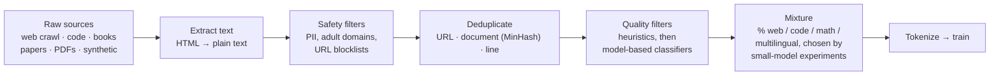
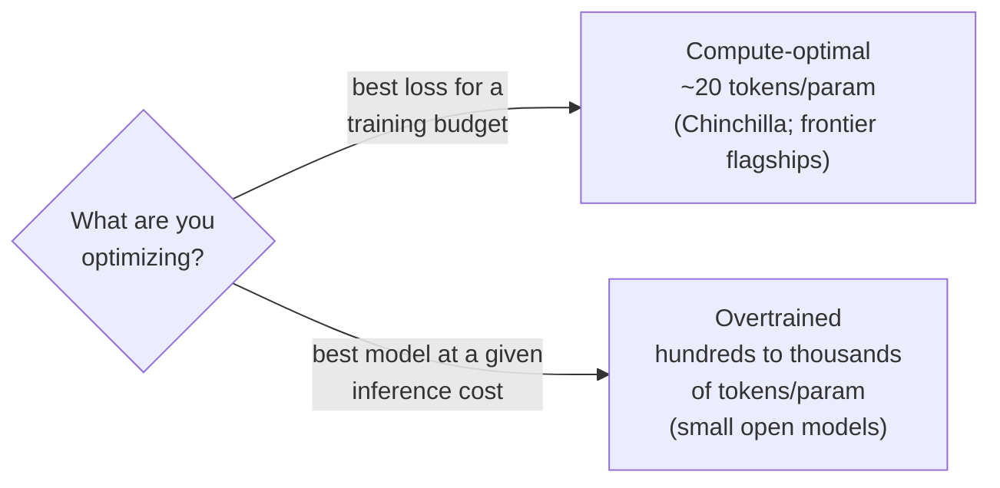

# Pretraining and scaling laws

## Why this matters

Pretraining is where a model gets almost all its knowledge, and scaling laws explain why labs spend what they spend. They also explain why a model "knows" things only up to a cutoff.

[1.5](/part-01-how-llms-work/1.5-transformer-block) gave you the machine: a stack of blocks with a few billion parameters, all random at the start. This chapter is about how those numbers get set. There's one objective, one huge pile of carefully cleaned text, and one budget question: given a fixed amount of compute, how big should the model be and how many tokens should it read? The answer to that question changed in 2022, and the way practice *departs* from the answer is why your 8B model in Ollama is as good as it is.

**Learning goals**

- Explain the pretraining objective and cross-entropy loss
- Describe data pipelines at a high level
- Explain compute-optimal scaling (Chinchilla) and how practice deviates from it

## Explanation

### The objective: next-token cross-entropy

[1.1](/part-01-how-llms-work/1.1-next-token-prediction) stated the task: given tokens 1…*t*, predict token *t*+1. Here it is precisely. For one position, the model produces a probability distribution over the vocabulary (softmax of the logits). The loss is the **negative log probability of the token that actually came next**:

```
loss_t = −log p(x_{t+1} | x_1 … x_t)
```

This is **cross-entropy** between the model's distribution and the "true" distribution, which puts all its mass on the real next token. A few values make the scale concrete (natural log, so the unit is **nats**):

| Probability given to the real next token | Loss |
|---|---|
| 0.9 | 0.105 |
| 0.5 | 0.693 |
| 0.1 | 2.303 |
| 0.01 | 4.605 |
| 1 / 151,936 (uniform over Qwen3's vocabulary) | 11.93 |

A freshly initialized model is close to that last row: it spreads probability roughly evenly, so its loss starts near `ln(vocab size)`. Training drives it down. The loss is averaged over **every position of every sequence** in a batch. That's where 1.4's causal mask pays off: one forward pass over a 4,096-token sequence gives 4,096 training examples, each one predicting its next token from only what came before.

Three things follow from this objective:

- **There are no labels to collect.** The text is its own supervision, which is why it scales to trillions of tokens. (This is called *self-supervised* learning.)
- **Low loss requires modelling everything that makes text predictable.** To predict the next token of a physics derivation, a Python file or a court ruling, the model has to pick up grammar, facts, code semantics and some reasoning. Nobody asks for those directly. They're what lowers the loss.
- **The loss is the gradient's only signal.** The gradient of `−log p` with respect to the logits is `p − one_hot(target)`: push the real token's logit up, push every other logit down in proportion to how much probability it took. Backprop (which you know) carries that back through all 36 blocks.

You'll also see the loss reported as **perplexity**, `exp(loss)`. It reads as an effective branching factor: a perplexity of 5 means the model is, on average, as uncertain as if it were choosing uniformly among 5 tokens. Lower is better for both. Both depend on the tokenizer, so you can only compare losses between models that share a tokenizer and evaluation text (1.2 showed how different tokenizers split the same text).

::: tip 📖 Read (book)
Raschka, *Build a Large Language Model (From Scratch)*, ch. 5 "Pretraining on unlabeled data", sections **5.1.2 "Calculating the text generation loss: cross-entropy and perplexity"** through **5.2 "Training an LLM"** · book · ~1.5 h · optional ([code](https://github.com/rasbt/LLMs-from-scratch/tree/main/ch05/01_main-chapter-code))

Look for: the loss computed by hand on a two-sentence batch (pick out each target's probability, take the log, average, negate) and then with `torch.nn.functional.cross_entropy`, which does the same thing. Then the training loop in 5.2: a small GPT-2 on a short story, where the training loss keeps falling but the validation loss stalls, because the dataset is tiny and the model memorizes it. That's the overfitting regime real pretraining is designed to avoid: frontier runs see most of their data once or a few times. 1.13's tiny GPT reuses this loop.
:::

### Data: where the tokens come from

The objective is simple. The data is where most of the engineering effort goes. Meta's Llama 3 paper is the most detailed public description of a frontier pretraining pipeline. It describes building the dataset "from a variety of data sources containing knowledge until the end of 2023", applying "several de-duplication methods and data cleaning mechanisms on each data source", and removing "domains that contain large amounts of personally identifiable information (PII), and domains with known adult content" ([The Llama 3 Herd of Models](https://arxiv.org/abs/2407.21783), section 3.1). The steps look roughly like this:



**Sources.** Most of the tokens come from the web. [Common Crawl](https://commoncrawl.org/) is the public starting point: a non-profit that publishes regular crawls of the web. Labs add their own crawls, code repositories, books, papers and, increasingly, text pulled out of PDFs and generated by other models. Qwen3's report says Qwen2.5-VL "is finetuned to extract text from extensive PDF documents", and they "generate synthetic data using domain-specific models": Qwen2.5-Math for math and Qwen2.5-Coder for code ([Qwen3 Technical Report](https://arxiv.org/abs/2505.09388), section 1).

**Filtering.** Raw web text is mostly navigation menus, ads, spam, boilerplate and near-empty pages. Pipelines remove it in layers: cheap heuristics first (Llama 3 uses repeated n-gram ratios to remove "lines that consist of repeated content such as logging or error messages", and a "dirty word" count to catch adult sites), then **model-based quality classifiers** that score each document. Hugging Face's FineWeb-Edu is a clear public example: they "used Llama-3-70B-Instruct to annotate 500k samples from FineWeb, scoring each for their educational quality on a scale from 0 to 5", trained a small classifier on those labels, and ran it over the whole corpus ([FineWeb blog post](https://huggingface.co/spaces/HuggingFaceFW/blogpost-fineweb-v1)). Using a big model to label data for a small classifier that filters data for the next model is now a standard move.

**Deduplication.** The web repeats itself. Lee et al. found that "over 1% of the unprompted output of language models trained on these datasets is copied verbatim from the training data", and in C4 a single 61-word sentence was "repeated over 60,000 times". Deduplicating let them "train models that emit memorized text ten times less frequently and require fewer training steps to achieve the same or better accuracy" ([Deduplicating Training Data Makes Language Models Better](https://arxiv.org/abs/2107.06499), 2021). Llama 3 deduplicates at three levels: by URL, by document (MinHash, which finds near-duplicates by comparing hashed n-gram sets), and by line, removing "lines that appeared more than 6 times in each bucket of 30M documents" (section 3.1.1). More isn't always better, though: FineWeb found that deduplicating across all crawls removed more than 90% of the oldest crawls, and in one old crawl tested on its own, the 10% that survived "was actually worse than the 90% of data we removed". They switched to deduplicating each crawl on its own (same blog post, "Deduplicating the data").

**Mixture.** Finally, the sources are blended in chosen proportions. Llama 3's "final data mix contains roughly 50% of tokens corresponding to general knowledge, 25% of mathematical and reasoning tokens, 17% code tokens, and 8% multilingual tokens", picked by training small models on candidate mixes and checking benchmarks (section 3.1.2). The mix also changes **during** training. Llama 3 ends with an annealing phase on "small amounts of high-quality code and mathematical data" (section 3.1.3). Qwen3 runs three stages: a long general stage, then a stage with "increasing the proportion of STEM, coding, reasoning, and synthetic data", then a long-context stage with sequences up to 32,768 tokens, in which the RoPE base goes from 10,000 to 1,000,000 (the `rope_theta` you read in 1.5's config) ([Qwen3 Technical Report](https://arxiv.org/abs/2505.09388), section 3.2).

::: info ▶️ Watch
[Deep Dive into LLMs like ChatGPT](https://www.youtube.com/watch?v=7xTGNNLPyMI) (Karpathy, 2025), **1:00–7:47** ("pretraining data (internet)") and **42:52–59:23** ("Llama 3.1 base model inference") · video · ~24 min · **essential**

If you watched 14:27–42:52 for 1.1, these are the parts on either side. In the first, look for the walk through FineWeb's pipeline (URL filtering, text extraction, language filtering, PII removal) and the size of the result (the FineWeb post gives 15 trillion tokens, 44 TB). In the second, look for the base model described as an internet-document simulator, its knowledge as a "lossy compression" of the web, the moment it recites a Wikipedia article almost verbatim (because that page was seen many times), and what it does when asked about events after its data ends.
:::

### Compute, parameters, tokens

Three numbers describe a pretraining run:

- **N**, the parameters (you counted them in 1.5)
- **D**, the training tokens
- **C**, the compute, in floating-point operations (FLOPs)

They're tied together by a rule you already half know. 1.4 used Kaplan et al.'s estimate of `2N` FLOPs per token for the forward pass. The backward pass costs about twice the forward pass, so training costs about `6N` FLOPs per token. Kaplan et al.: "Accounting for the backwards pass (approximately twice the compute as the forwards pass), we then define the estimated non-embedding compute as C ≈ 6ND" ([Scaling Laws for Neural Language Models](https://arxiv.org/abs/2001.08361), section 2.1).

```
C ≈ 6 · N · D
```

A sanity check against a published run: Llama 3 405B was trained on 15.6T tokens with 3.8 × 10²⁵ FLOPs ([Llama 3](https://arxiv.org/abs/2407.21783), section 1). `6 × 405e9 × 15.6e12 = 3.79e25`. The formula is that good.

So for a given compute budget C, you can pick a big model and fewer tokens, or a small model and more tokens. Which gives the lower loss?

### Scaling laws: Kaplan, then Chinchilla

**Kaplan (2020).** OpenAI trained many models of different sizes and found that "the loss scales as a power-law with model size, dataset size, and the amount of compute used for training, with some trends spanning more than seven orders of magnitude", while "other architectural details such as network width or depth have minimal effects within a wide range" ([Kaplan et al.](https://arxiv.org/abs/2001.08361), abstract). That was the big news: loss is *predictable* from scale. Train small models, fit a curve, and you can forecast what a 100× bigger run will reach before you pay for it. Labs still do exactly this. Their recommendation for spending compute, though, was to make the model much bigger and grow the data only slowly ("data requirements growing very slowly as D ∼ C^0.27", section 1.1). The models that followed grew to 175B–530B parameters, but "most models are trained for approximately 300 billion tokens" ([Chinchilla paper](https://arxiv.org/abs/2203.15556), Table 1).

**Chinchilla (2022).** DeepMind redid the analysis with over 400 models "ranging from 70 million to over 16 billion parameters on 5 to 500 billion tokens", and concluded the opposite: "for compute-optimal training, the model size and the number of training tokens should be scaled equally: for every doubling of model size the number of training tokens should also be doubled". The large models of the day were "significantly undertrained" ([Training Compute-Optimal Large Language Models](https://arxiv.org/abs/2203.15556), Hoffmann et al., abstract). They tested it: Chinchilla, 70B parameters on 1.4T tokens, used the same compute as their 280B Gopher (trained on 300B tokens) and beat it. Being 4× smaller, it "reduces inference cost considerably" too (section 1).

Their projections (Table 3) give the rule of thumb everyone quotes:

| Parameters | Compute-optimal tokens | Tokens per parameter |
|---|---|---|
| 1B | 20.2B | 20 |
| 10B | 205.1B | 21 |
| 67B | 1.5T | 22 |

**About 20 tokens per parameter.** That's "Chinchilla-optimal".

They also fitted a formula for the loss as a function of N and D, and it's worth reading term by term (section 3.3, equation 10):

```
L(N, D) = E + A / N^0.34 + B / D^0.28        E = 1.69, A = 406.4, B = 410.7
```

- **E = 1.69 nats** is the irreducible loss, which "should correspond to the entropy of natural text". No model gets below it: some next tokens are genuinely unpredictable.
- **A / N^0.34** is the penalty for a finite model. Even trained forever, a small network can't represent everything.
- **B / D^0.28** is the penalty for finite data. The model hasn't seen enough examples.

Both penalties shrink as power laws, and both shrink slowly: to halve the data term you need about 12× the tokens (2^(1/0.28) ≈ 11.9). Plugging in the paper's two models (the constants were fitted on DeepMind's own dataset, so treat the outputs as illustrative):

| Model | N | D | Model term | Data term | Predicted loss |
|---|---|---|---|---|---|
| Gopher | 280B | 300B | 0.052 | 0.251 | 1.993 |
| Chinchilla | 70B | 1.4T | 0.083 | 0.163 | 1.937 |

Gopher's model term is tiny and its data term is large: it was a big model starved of data. Chinchilla balances the two and comes out lower at the same compute.

### Why practice ignores Chinchilla: overtraining for cheap inference

Chinchilla answers a narrow question: **the lowest loss for a fixed training budget**. It says nothing about what happens after training, and after training is where the costs pile up. Every token you serve costs `2N` FLOPs, forever. A 70B model costs 1.4 × 10¹¹ FLOPs per token, and an 8B model costs 1.6 × 10¹⁰, nearly 9× less. If a smaller model can reach the same quality by reading more tokens, you pay more once (in training) and save on every request afterwards.

Using the Chinchilla formula to find a smaller model that matches Chinchilla's own loss (1.937):

| | Chinchilla | 8B, same loss |
|---|---|---|
| Parameters | 70B | 8B |
| Tokens needed | 1.4T | ~25.9T |
| Tokens per parameter | 20 | ~3,200 |
| Training compute (`6ND`) | 5.9 × 10²³ | 1.24 × 10²⁴ (2.1×) |
| Inference compute per token (`2N`) | 1.4 × 10¹¹ | 1.6 × 10¹⁰ (8.75× less) |

The 8B costs an extra 6.5 × 10²³ FLOPs to train and saves 1.24 × 10¹¹ FLOPs on every token it generates. It breaks even after about **5.3 trillion tokens served**. A popular model or an open-weight release passes that easily. The extrapolation is rough, because the formula was fitted on runs at around 20 tokens per parameter. Sardana et al. trained models at "extreme ranges (up to 10,000)" tokens per parameter and found that "model quality continues to improve", but also that fits made only from typical ratios "overestimate the impact of additional tokens at these extreme ranges". Their conclusion: labs "expecting reasonably large inference demand (~1B requests) should train models smaller and longer than Chinchilla-optimal" ([Beyond Chinchilla-Optimal](https://arxiv.org/abs/2401.00448), abstract).

That's what labs do. Meta, on Llama 3: "while the Chinchilla-optimal amount of training compute for an 8B parameter model corresponds to ~200B tokens, we found that model performance continues to improve even after the model is trained on two orders of magnitude more data. Both our 8B and 70B parameter models continued to improve log-linearly after we trained them on up to 15T tokens." And the reason: "Larger models can match the performance of these smaller models with less training compute, but smaller models are generally preferred because they are much more efficient during inference" ([Introducing Meta Llama 3](https://ai.meta.com/blog/meta-llama-3/), 2024). 15T tokens for 8B parameters is about **1,900 tokens per parameter**, nearly 100× Chinchilla's ratio.

The flagship is a different story. Meta's own scaling-law fit said that for a budget of 3.8 × 10²⁵ FLOPs, the optimum was "a 402B parameter model on 16.55T tokens", and they trained 405B on 15.6T. The paper sums up the strategy: "our flagship model is an approximately compute-optimal size for our training budget, we also train our smaller models for much longer than is compute-optimal. The resulting models perform better than compute-optimal models at the same inference budget" ([Llama 3](https://arxiv.org/abs/2407.21783), sections 3.2.1 and 1).

So there are two regimes:



The limit on overtraining is now **data**. If every lab wants tens of trillions of good tokens and the useful web is finite, the extra tokens have to come from somewhere: PDFs, other languages, synthetic data generated by earlier models, and multiple passes over the best data. That's the context for the synthetic data in Qwen3's pipeline above, and for [10.9](/part-10-modifying-serving-models/10.9-distillation-synthetic-data). It's also part of why the field turned to post-training and test-time compute for further gains ([0.1](/part-00-catch-up/0.1-what-changed), [1.10](/part-01-how-llms-work/1.10-reasoning-models)).

::: tip 📖 Read (book)
Chip Huyen, *AI Engineering* (O'Reilly, 2025), ch. 2 "Understanding Foundation Models", sections **"Training Data"** (with "Multilingual Models" and "Domain-Specific Models") and **"Model Size"** · book · ~1 h · optional ([ToC](https://github.com/chiphuyen/aie-book/blob/main/ToC.md))

The application engineer's view of this chapter: why training data decides what a model is good at (and why it's weaker in languages that are rare on the web, which matters for Bulgarian), and how to read a model's size, token count and compute together, with the Chinchilla law and its limits. For a second take on cross-entropy and perplexity, see ch. 3, "Understanding Language Modeling Metrics".
:::

### Knowledge cutoff

Pretraining data is collected up to some date, and then the run takes months. Post-training and release add more. Whatever the model knows about the world comes from that frozen snapshot, so every model has a **knowledge cutoff**: it knows nothing about events after it, and it doesn't know today's date unless someone tells it.

Three practical consequences:

- **The cutoff is fuzzy.** Not much has been written about the last few months before a crawl, compared with what will exist a year later. So the model saw only a little about its final months. Anthropic's [models overview](https://platform.claude.com/docs/en/about-claude/models/overview) lists two dates for each model, a "Reliable knowledge cutoff" and a "Training data cutoff", for this reason. Cheng et al. went further and measured "effective cutoffs" per source, finding that they "often drastically differ from reported cutoffs". One reason is that new Common Crawl dumps contain "non-trivial amounts of old data" ([Dated Data: Tracing Knowledge Cutoffs in Large Language Models](https://arxiv.org/abs/2403.12958), abstract).
- **Fresh facts need context, not weights.** For anything recent (this year's APIs, a library's latest version, prices), put the information in the prompt: retrieval ([2.9](/part-02-programming-with-llms/2.9-rag-fundamentals)), web search, tool calls. That's also why this book keeps model specs and prices on [Landscape](/landscape) instead of trusting a model's memory.
- **Coding agents feel it most.** A model will confidently write code for the version of a library it saw most during pretraining, and that's often not the latest one. Docs in context (or via MCP) are the fix, which is a theme of Parts 3 and 6.

## Practice

**Brief:** For two open models in your lab, find the published training-token counts and compute tokens-per-parameter. Explain why they are far above Chinchilla-optimal.

**Where:** Notes only, no code: `notes/1.6-tokens-per-parameter.md`.

**Steps:**

1. Pick two of your Ollama models: `qwen3:8b` or `qwen3:14b`, plus one more (`qwen2.5-coder:14b` and `qwen3:30b-a3b` each add an interesting twist; see steps 5 and 6).
2. Find the published pretraining token count for each, from the lab's own technical report, not a blog summary or a model's memory. Start from the [Qwen3 Technical Report](https://arxiv.org/abs/2505.09388) (section 3), the [Qwen2.5 Technical Report](https://arxiv.org/abs/2412.15115) and the [Qwen2.5-Coder Technical Report](https://arxiv.org/abs/2409.12186). Quote the sentence and link it.
3. Take the parameter count from the model card on Hugging Face (you did this for 8B and 14B in 1.5). Compute tokens per parameter, and how many times the Chinchilla ratio (~20) it is.
4. Compute the training FLOPs with `C ≈ 6ND`. Compare them with Chinchilla's 5.9 × 10²³ and Llama 3 405B's 3.8 × 10²⁵. Then use the Chinchilla Table 3 rows above to say roughly what size of model would be compute-optimal for your model's budget.
5. If you chose `qwen2.5-coder:14b`: it was trained further from a Qwen2.5 base model. Decide whether to count the base model's tokens too, and justify it in one sentence.
6. If you chose `qwen3:30b-a3b`: it's a mixture-of-experts model with about 3B parameters active per token and about 30B in total. Compute the ratio both ways. Which one makes sense for the training cost, and which for the inference cost? (You can come back to this after [1.11](/part-01-how-llms-work/1.11-mixture-of-experts).)
7. Write the "why" in your own words: a short paragraph that uses the training-vs-inference trade-off from this chapter. Then add one sentence on what you think limits how far labs can push this ratio.

**Done when:** the note has, for each model, the quoted and linked token count, the parameter count, tokens per parameter, its multiple of 20, and `6ND` in FLOPs, plus the compute-optimal comparison and your paragraph explaining the gap. Every number links to its source.

## Check questions

1. A model gives the real next token a probability of 0.25. What's its cross-entropy loss at that position, and the equivalent perplexity? Roughly what loss would a freshly initialized model with a 150k vocabulary have, and why?

   <details><summary>Answer</summary>

   `−ln(0.25) ≈ 1.386` nats, and perplexity `exp(1.386) = 4`: as uncertain as choosing uniformly among 4 tokens. A random model spreads probability about evenly across the vocabulary, so `p ≈ 1/150,000` and the loss is about `ln(150,000) ≈ 11.9` nats. Training pushes it down toward the irreducible entropy of the text.

   </details>

2. Name the main stages of a pretraining data pipeline, and give one non-obvious finding about deduplication.

   <details><summary>Answer</summary>

   Collect sources (web crawl, code, books, papers, PDFs, synthetic), extract text, apply safety filters (PII, adult content), deduplicate (URL, document-level MinHash, line-level), filter for quality (heuristics, then model-based classifiers), choose a mixture (and change it during training, for example annealing on high-quality code and math), then tokenize. Findings: deduplication cuts verbatim memorization about tenfold and reduces train/test overlap (Lee et al.). But FineWeb found that deduplicating across all crawls left mostly low-quality data in the oldest ones, and per-crawl deduplication worked better. More aggressive isn't automatically better.

   </details>

3. You have a budget of about 1.2 × 10²² FLOPs. Using `C ≈ 6ND` and the Chinchilla rule of thumb, what size of model and how many tokens? What would Kaplan-era practice have done with the same budget?

   <details><summary>Answer</summary>

   With `D = 20N`, `C = 6 · N · 20N = 120N²`, so `N = √(1.2e22 / 120) = 1e10`: about 10B parameters on about 200B tokens (Chinchilla's Table 3 row: 10B, 205B tokens, 1.23 × 10²² FLOPs). Kaplan-era practice favoured a much larger model trained on fewer tokens, which Chinchilla showed was undertrained: at equal compute it reaches a higher loss.

   </details>

4. Llama 3 8B was trained on ~15T tokens, almost 100× the Chinchilla-optimal amount. Why was that a good decision, given that a larger model could have reached the same quality with less training compute?

   <details><summary>Answer</summary>

   Chinchilla minimizes loss for a fixed *training* budget and ignores inference. Each generated token costs about `2N` FLOPs for the life of the model, so a smaller model is cheaper on every request and fits on more hardware (like a 24 GB Mac). Training longer costs more once, and quality keeps improving with more tokens (Meta saw log-linear gains up to 15T). With enough usage, the inference savings outweigh the extra training. That's Sardana et al.'s point, and Meta's stated reason: smaller models "are much more efficient during inference". The flagship 405B, by contrast, was close to compute-optimal.

   </details>

5. A model's documentation says its training data runs to March of some year. Why might it still be shaky on events from February of that year, and what should an application do about it?

   <details><summary>Answer</summary>

   The web keeps writing about events for months or years afterwards, so the last months before a crawl are thinly covered. Crawls also mix old and new pages, so effective cutoffs can differ a lot from the reported one (Cheng et al.). That's why Anthropic lists both a "reliable knowledge cutoff" and a "training data cutoff". An application that needs recent facts should put them in the context (retrieval, search, tools, docs) and give the current date, instead of relying on what's in the weights.

   </details>

## My understanding

<!-- Written by the learner, in their own words. Agents never fill this in. -->
