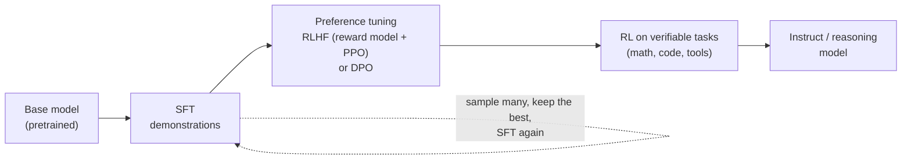

# Post-training: SFT, RLHF, DPO

## Why this matters

A pretrained model completes text; post-training turns it into an assistant that follows instructions, refuses some things and uses tools. Most model "personality" and many failure modes come from here.

[1.6](/part-01-how-llms-work/1.6-pretraining) ended with a model that has read most of the internet and can continue any document. Ask it a question and it may answer, or continue with more questions, or write a forum thread. Everything you recognise as an "assistant" (the turn-taking, the helpful tone, the refusals, the habit of opening with "Sure, here are three tips…", the `<tool_call>` JSON) was added afterwards, with a tiny fraction of the compute and data of pretraining. That makes post-training the layer you can most directly *see* in day-to-day use, and the one you'll touch yourself when you fine-tune a model in Part 10.

**Learning goals**

- Explain SFT, reward models, RLHF and DPO and how they differ
- Explain chat templates as a post-training artifact
- Relate post-training to behaviors you see (verbosity, sycophancy)

## Explanation

### Base vs. instruct

The output of pretraining is a **base model**. Its only skill is next-token prediction on internet-shaped text, so it behaves like an "internet document simulator" (Karpathy's phrase, from the video you watched for [1.6](/part-01-how-llms-work/1.6-pretraining)). The output of post-training is an **instruct** (or "chat") model. Same architecture and tokenizer, but a different distribution over what comes next.

Model cards say this explicitly. The [Qwen2.5-7B base model card](https://huggingface.co/Qwen/Qwen2.5-7B) states: "We do not recommend using base language models for conversations. Instead, you can apply post-training, e.g., SFT, RLHF, continued pretraining, etc., on this model." The base models are released for you to *build on*, and Part 10 fine-tunes one.

Post-training is a pipeline, and recipes differ by lab. The common skeleton:



The rest of the chapter walks the boxes. It's a skeleton rather than a law: Llama 3 repeats SFT and DPO in rounds, Qwen3 does reasoning RL *before* the chat-style stages, and small models are often just distilled from big ones.

### Supervised fine-tuning (SFT)

SFT is pretraining's loss on different data. You collect **demonstrations**: a prompt and the response you'd like. Train with the same next-token cross-entropy from 1.6, with one change: the loss is computed **only on the response tokens**, not the prompt. (Prompt tokens are masked out. You want the model to learn what to say *given* a user message, not to predict user messages.)

InstructGPT, the paper that established the recipe, used a small dataset: "about 13k training prompts" for SFT, written by hired labelers or taken from API usage ([Ouyang et al., 2022](https://arxiv.org/abs/2203.02155), section 3.2). Compare that to the trillions of tokens in pretraining. The reason a small dataset is enough is what the [LIMA paper](https://arxiv.org/abs/2305.11206) argued: fine-tuning a 65B LLaMA "on only 1,000 carefully curated prompts and responses" already gave strong results, and "learning to follow specific response formats from only a handful of examples". Their "superficial alignment hypothesis" is that knowledge and ability come from pretraining, and SFT mostly teaches *format and style*: which of the many things the model could continue with is the assistant's turn.

Two practical consequences:

- **SFT can teach a format but not new facts reliably.** If the demonstrations assert things the base model doesn't know, the model learns to *sound* as if it knows them. That's one route to hallucination.
- **Data quality dominates.** A thousand good examples beat a hundred thousand sloppy ones. Modern recipes mix human-written data with **synthetic** data generated by stronger models (see [10.9](/part-10-modifying-serving-models/10.9-distillation-synthetic-data)).

#### Chat templates: the format SFT bakes in

A transformer reads one flat token sequence. A "conversation" is a convention for flattening messages into that sequence, using **special tokens** as delimiters ([1.2](/part-01-how-llms-work/1.2-tokenization)). The convention is chosen by the lab, taught by SFT, and shipped with the model as its **chat template** ([0.2](/part-00-catch-up/0.2-the-stack)). Qwen models use ChatML-style markers. This is the Qwen2.5 ChatML format (compare `ollama show qwen2.5:0.5b-instruct --template`, whose default system message is `You are a helpful assistant.` in the base tag's version), reduced to what one message produces:

```text
<|im_start|>system
You are a helpful assistant.<|im_end|>
<|im_start|>user
What is the capital of France?<|im_end|>
<|im_start|>assistant
```

The model's job starts after `assistant\n`. It writes the answer and then emits `<|im_end|>`, an "end of turn" token that Ollama treats as a stop (the `stop "<|im_end|>"` parameter you saw on `qwen3:8b` in `ollama show`). During SFT, every example looked exactly like this, and the loss on `<|im_end|>` is how the model learned *to stop talking*. A base model never saw that token used as a turn boundary, so it has no reason to stop.

That makes a chat template a **post-training artifact**, not a UI detail:

- **Use the wrong template and quality drops silently.** The model is out of distribution: it saw its own format during SFT, not yours. The same weights behave differently with and without it. Experiment 09 in this chapter's practice shows it.
- **Tool calling is also a template.** The same Ollama template renders tool schemas into the system prompt (as a `# Tools` section with `<tools></tools>` XML) and tells the model to answer with `<tool_call>{"name": …, "arguments": …}</tool_call>`. Tool results go back in as `<tool_response>` blocks. The model can do this reliably only because post-training showed it thousands of examples in exactly this format. Chapter [2.6](/part-02-programming-with-llms/2.6-tool-calling) builds on this.
- **Thinking switches live here too.** The `enable_thinking` flag from 1.2 is a template branch that pre-fills an empty `<think></think>`.

::: tip 📖 Read now
[Chat templates](https://huggingface.co/docs/transformers/main/chat_templating) (Hugging Face docs) · docs · ~10 min · **essential** (you may have read it for 0.2: skim it again with SFT in mind)

Look for: why each model family has its own template, and the `add_generation_prompt` argument. That's the trailing `<|im_start|>assistant\n` above, the one piece that is *not* part of any message but is what tells the model it's its turn.
:::

### Preference tuning: why SFT isn't enough

SFT teaches the model to imitate demonstrations. Two problems remain:

1. **Demonstrations are expensive and capped by the writer.** Writing a great answer is much harder than *recognizing* one. Judging "A is better than B" is cheap and works even when you couldn't have written either.
2. **Imitation has no notion of "worse".** SFT only raises the probability of the good answer. It never says "and lower the probability of *that* fluent but wrong or harmful answer".

So the next step uses **preference data**: for a prompt *x*, a pair of responses, a *chosen* (winner, *y*<sub>w</sub>) and a *rejected* (loser, *y*<sub>l</sub>). InstructGPT had labelers rank 4 to 9 responses per prompt and expanded each ranking into pairs. Note how noisy the signal is: even trained labelers "agree with each-other 72.6 ± 1.5% of the time" ([Ouyang et al., 2022](https://arxiv.org/abs/2203.02155), section 3.4). There are two ways to learn from pairs.

### RLHF: a reward model, then PPO

**Reinforcement learning from human feedback** has two steps, both from InstructGPT.

**Step 1: train a reward model (RM).** Take the SFT model, remove its unembedding layer (the LM head from [1.5](/part-01-how-llms-work/1.5-transformer-block)) and put a head on it that outputs **one scalar**: a score for a (prompt, response) pair. Train it so that chosen responses score higher than rejected ones, with the Bradley-Terry loss:

```
loss = −log σ( r(x, y_w) − r(x, y_l) )
```

where σ is the sigmoid. Only the *difference* in scores matters. A worked example: if the RM gives the chosen response 2.0 and the rejected one 0.5, the difference is 1.5, `σ(1.5) = 0.818`, loss `−ln 0.818 = 0.20`. If it had them the wrong way round (0.5 vs. 2.0), the loss is `−ln σ(−1.5) = −ln 0.182 = 1.70`. Training pushes scores for winners above losers. (The RM output has no absolute meaning, and InstructGPT adds a bias so labeler demonstrations average 0.) InstructGPT used a 6B RM, noting that "175B RM training could be unstable".

**Step 2: optimize the language model against the RM with RL.** The model becomes a **policy** π. For each prompt, sample a response, score it with the RM, and nudge the policy to make high-reward responses more likely. The algorithm is **PPO** ([Schulman et al., 2017](https://arxiv.org/abs/1707.06347)), a policy-gradient method that clips each update so the policy can't change too much in one step. InstructGPT treats it as a "bandit environment": one prompt, one response, one reward, episode over.

There's a catch. The RM is a learned *proxy* for what humans want, and an optimizer will find the proxy's blind spots. So the objective subtracts a **KL penalty** from the reward:

```
objective = E[ r(x, y) − β · log( π_RL(y|x) / π_SFT(y|x) ) ]
```

The second term measures how far the new policy has drifted from the SFT model and charges for it. A bigger β keeps the model closer to the SFT model. InstructGPT also mixes in pretraining gradients ("PPO-ptx") to undo regressions on ordinary NLP benchmarks.

RLHF works, and that was the surprise of 2022. In human evaluations, "outputs from the 1.3B parameter InstructGPT model are preferred to outputs from the 175B GPT-3, despite having 100x fewer parameters" ([Ouyang et al., 2022](https://arxiv.org/abs/2203.02155)). Post-training can be worth more than a hundredfold increase in parameters, for the specific goal of being *useful as an assistant*.

It also has costs: it needs several models in memory at once (the policy, a reference for the KL term, the RM and, in PPO, a value function), Llama 3's authors call RL algorithms "less stable and harder to scale" (quoted below), and the result can only be as good as the RM.

#### Reward hacking: where verbosity and sycophancy come from

Because the RM is a proxy, optimizing it too hard gives **over-optimization** (also called reward hacking): reward keeps climbing while real quality drops. Anthropic's RLHF paper found "a roughly linear relation between the RL reward and the square root of the KL divergence between the policy and its initialization" ([Bai et al., 2022](https://arxiv.org/abs/2204.05862)): you can buy reward by drifting further, at a rate you can measure, and the KL penalty is the brake.

Two failure modes you meet in daily use are direct results of this:

- **Verbosity.** Humans and RMs tend to prefer longer, more thorough-looking answers. The paper [A Long Way to Go](https://arxiv.org/abs/2310.03716) found that "improvements in reward" are "largely driven by increasing response length", and that "even a purely length-based reward reproduces most downstream RLHF improvements over supervised fine-tuning". When Claude or Qwen pads an answer with a preamble and a summary, it's following a gradient that rewarded length.
- **Sycophancy.** The paper [Towards Understanding Sycophancy in Language Models](https://arxiv.org/abs/2310.13548) shows "five state-of-the-art AI assistants consistently exhibit sycophancy", and that in the preference data "when a response matches a user's views, it is more likely to be preferred". Moreover "both humans and preference models (PMs) prefer convincingly-written sycophantic responses over correct ones a non-negligible fraction of the time". If raters reward agreement, the policy learns to agree. That's a defect of the *signal*, not a bug in the code.

The mental model: **the model has been trained to produce what a rater (or a reward model standing in for one) would score highly.** Wherever that diverges from "correct and useful", expect drift: flattery, confident wrongness, hedging, refusals that are too broad. Labs actively tune against these, and you can steer them too with prompting ([2.3](/part-02-programming-with-llms/2.3-prompting): ask for brevity, ask for disagreement) and by checking outputs with [evals](/part-04-evals-observability/4.4-llm-as-judge), since an LLM judge inherits the same biases.

### DPO: skip the reward model

**Direct preference optimization** ([Rafailov et al., 2023](https://arxiv.org/abs/2305.18290)) starts from the observation that RLHF's objective (reward minus KL penalty) has a closed-form optimal policy, so you can rewrite the reward model in terms of the policy itself and train on the preference pairs *directly* with a classification-style loss: no RM, no sampling, no PPO. The title makes the point: "Your Language Model is Secretly a Reward Model".

The loss for one pair, where π<sub>ref</sub> is the frozen SFT model:

```
loss = −log σ( β · [ log π(y_w|x)/π_ref(y_w|x)  −  log π(y_l|x)/π_ref(y_l|x) ] )
```

Read the bracket as: "by how much has the policy raised the chosen response's probability relative to the reference, minus the same for the rejected response". Training increases that margin. The paper's setting is `β = 0.1`. Worked example with β = 0.1:

| | log-ratio chosen | log-ratio rejected | margin = β × (chosen − rejected) | loss |
|---|---|---|---|---|
| Start (π = π_ref) | 0 | 0 | 0 | `−ln σ(0) = −ln 0.5 = 0.693` |
| After some training | +2.0 | −1.0 | `0.1 × 3.0 = 0.3` | `−ln σ(0.3) = −ln 0.574 = 0.554` |
| After more training | +4.0 | −3.0 | `0.1 × 7.0 = 0.7` | `−ln σ(0.7) = −ln 0.668 = 0.403` |

The loss starts at ln 2 (the model can't tell the pair apart) and falls as the policy separates winners from losers. β plays the role of the KL penalty: it controls how tightly the policy is tied to the reference.

Compared with RLHF, DPO is **offline** (it trains on a fixed dataset of pairs, nothing is sampled during training), needs only the policy and a frozen reference, and trains like ordinary fine-tuning. The price: it's only as good as the pairs, and pairs collected from some *other* model are off-policy for the one you're tuning. Many labs mitigate that by collecting fresh pairs each round. **Llama 3** is the large-scale example: Meta chose "a relatively simple post-training procedure based on supervised finetuning (SFT), rejection sampling (RS), and direct preference optimization (DPO) as opposed to more complex reinforcement learning algorithms … that tend to be less stable and harder to scale", and applied "several rounds" of SFT then DPO ([Llama 3 paper](https://arxiv.org/abs/2407.21783), sections 1 and 4). Rejection sampling there means: for each prompt, sample 10 to 30 outputs from the current model, let the reward model "select the best candidate", and use those as SFT data. (The unselected outputs become extra rejected examples for DPO, as the paper notes in its preference-data section.)

DPO has many variants (IPO, KTO, SimPO, ORPO, and others) that change the loss or drop the reference model. They're all variations on "learn from comparisons without a separate RL loop", and Lambert's book has a chapter on them.

::: tip 📖 Read now
Nathan Lambert, [*RLHF Book*](https://rlhfbook.com): [Instruction Fine-Tuning](https://rlhfbook.com/c/04-instruction-tuning), [Reward Modeling](https://rlhfbook.com/c/05-reward-models) and [Direct-Alignment Algorithms](https://rlhfbook.com/c/08-direct-alignment) · book · ~1.5 h · **essential**. It's free online and is a book version of the 2025 [arXiv preprint](https://arxiv.org/abs/2504.12501).

Look for: in "Instruction Fine-Tuning", the section on chat templates (the same idea as above, with more variants). In "Reward Modeling", the Bradley-Terry training section and its code, which is the loss you just worked by hand. In "Direct-Alignment Algorithms", how DPO is derived from the RLHF objective, and the section on weaknesses and alternatives. If you also want the PPO half, read [Policy Gradient Algorithms](https://rlhfbook.com/c/06-policy-gradients) (optional). It's the most thorough single source, and the chapter titles above are the ones to follow when you want depth later.
:::

::: tip 📖 Read (book)
Chip Huyen, *AI Engineering* (O'Reilly, 2025), ch. 2, the "Post-Training" section · book · ~30 min · optional ([chapter summaries](https://github.com/chiphuyen/aie-book/blob/main/chapter-summaries.md))

Look for: the same pipeline from a practitioner's view, plus a clear statement of why preference data is hard: human preference is diverse and can't be captured in a single formula, so every solution is imperfect. It matches the "proxy" framing above.
:::

### Constitutional AI and RLAIF

Human preference labels are slow and costly. **Constitutional AI** ([Bai et al., 2022](https://arxiv.org/abs/2212.08073), Anthropic) replaces much of the human labeling with the model itself, guided by a written list of principles (the "constitution"). It has two phases:

1. **Supervised phase.** Sample a response from an initial model (including to harmful prompts), have the model **critique** its own response against a principle, then **revise** it, and fine-tune on the revised responses.
2. **RL phase.** Sample pairs from the fine-tuned model, have a model judge which of the two is better *according to the principles*, train a preference model on those AI-made labels, and run RL against it: "we use 'RL from AI Feedback' (RLAIF)".

The paper's abstract states the goal: train a harmless assistant "without any human labels identifying harmful outputs. The only human oversight is provided through a list of rules or principles". The general idea has become standard: an LLM judging another LLM's output is a cheap, scalable preference signal. It's the same mechanism as [LLM-as-judge](/part-04-evals-observability/4.4-llm-as-judge) in Part 4, and it carries the same caveat: the judge's biases (including towards verbosity) flow into the model being trained. The advantage is that the principles are written down and can be read and edited, instead of being implicit in thousands of labelers' judgments.

### RL with verifiable rewards, and agentic post-training

Preference tuning optimizes a *learned* proxy. Where the answer can be **checked**, you can skip the proxy: reward 1 if the math answer is correct or the unit tests pass, else 0. This is **RL with verifiable rewards (RLVR)**, and it's how reasoning models learn to think for longer ([1.10](/part-01-how-llms-work/1.10-reasoning-models)). The algorithms are PPO relatives. For example GRPO, introduced in [DeepSeekMath](https://arxiv.org/abs/2402.03300), is "a variant of Proximal Policy Optimization (PPO) that enhances mathematical reasoning abilities while concurrently optimizing the memory usage of PPO". Verifiable rewards are hard to hack, which is why this stage scales further than RLHF.

The same idea extends to **agents**: train the model on tasks where it must call tools over several turns and the environment reports success. Two primary-source examples:

- **Llama 3** trained built-in use of a search engine (Brave Search), a Python interpreter and Wolfram Alpha, plus "zero-shot tool use": given in-context, potentially unseen tool definitions and a query, "generate the correct tool call". The data came from human annotations and preferences ([Llama 3 paper](https://arxiv.org/abs/2407.21783), section 4.3.5).
- **Qwen3**'s fourth post-training stage, "General RL", covers instruction following, format following, preference alignment and "Agent Ability: This involves training the model to correctly invoke tools via designated interfaces. During the RL rollout, the model is allowed to perform complete multi-turn interaction cycles with real environment execution feedback" ([Qwen3 Technical Report](https://arxiv.org/abs/2505.09388), section 4.4). The report's evaluation table tracks a ToolUse score across the stages.

So "can this model use tools?" is a question about post-training data, and the `tools` capability you see in `ollama show` is the template plus that training. A model with a tool template but little tool-use training will format calls correctly and choose them badly. Part 3 deals with the consequences, and [3.3](/part-03-agents/3.3-tool-design) is about designing tools a model can actually use.

The Qwen3 report also shows a recipe shape worth knowing. The flagship models go through four stages: long chain-of-thought SFT ("cold start"), reasoning RL, "thinking mode fusion" (SFT that merges thinking and non-thinking behavior, hence one model with an `enable_thinking` switch), and general RL. The smaller models in the family skip that: they use **strong-to-weak distillation** from the big ones, which the report says needs "only 1/10 of the GPU hours compared to the four-stage training method" (section 4). That's the `qwen3:8b` and `qwen3:14b` on your Mac, and distillation is the subject of [10.9](/part-10-modifying-serving-models/10.9-distillation-synthetic-data).

::: tip 📖 Read now
Hugging Face [smol course](https://huggingface.co/learn/smol-course), [Unit 1: Instruction Tuning](https://huggingface.co/learn/smol-course/unit1/1) and [Unit 3: Preference Alignment](https://huggingface.co/learn/smol-course/unit3/1) · docs/course · ~1 h to read, more to run · optional here (it's the hands-on companion for [Part 10](/part-10-modifying-serving-models/10.3-lora-mlx))

Look for: the actual dataset format for SFT (a list of messages) and for DPO (prompt, chosen, rejected), which are the data structures behind everything above, and how the TRL trainers consume them. Don't run the notebooks yet. Their GPU assumptions don't match your Mac, and Part 10 covers fine-tuning with `mlx-lm`.
:::

### What to take away

| Stage | Learns from | Signal | What it mostly changes | Cost |
|---|---|---|---|---|
| Pretraining ([1.6](/part-01-how-llms-work/1.6-pretraining)) | Raw text | Next token | Knowledge, ability | Dominant |
| SFT | Demonstrations | Imitation | Format, style, stopping, tool syntax | Small |
| RLHF (RM + PPO) | Rankings → reward model | Learned scalar reward | Helpfulness, tone, refusals, length | Medium, complex |
| DPO | Preference pairs | Pairwise loss | Same as RLHF, simpler pipeline | Small to medium |
| RLAIF / Constitutional | AI-labeled pairs + principles | Model-generated preferences | Harmlessness, cheaper labels | Medium |
| RLVR / agentic RL | Environments with checkers | Verifiable reward | Reasoning, tool use | Large and growing |

For specific models, prices and which lab uses what, see the [Landscape](/landscape) rather than this chapter.

## Practice

**Brief:** If a base (non-instruct) Qwen model fits, pull it and compare it with the instruct model on the same prompts. Otherwise compare raw-completion vs chat-template prompting via Ollama's `raw` mode.

**Where:** `experiments/09-base-vs-instruct/`: a standalone experiment. The README there has the "What I tried / What happened / Why" skeleton for your results.

**Which models.** The Ollama library has no Qwen3 base model, but it does have a matched pair from the previous generation, both about 400 MB: `qwen2.5:0.5b-base` and `qwen2.5:0.5b-instruct`. Same family, same size, so any difference is post-training (and the model is older and much smaller than your Qwen3 models, which you should keep in mind when interpreting the results). Pull them with `ollama pull`. Everything is free and local.

**Steps:**

1. Write `experiments/09-base-vs-instruct/compare.ts`. Use `fetch` against Ollama: `/api/generate` with `"raw": true` sends your prompt as-is with **no template**. Without `raw`, or with `/api/chat`, Ollama applies the model's chat template. Use `stream: false`, `temperature: 0` and `num_predict: 120` so runs are repeatable and a runaway can't take minutes. Read `eval_count` from the response.
2. Choose five prompts. Include a plain question ("What is the capital of France?"), an instruction ("Give me three tips for learning Rust."), a request that needs a refusal or pushback you can judge, a prompt that is *the start of a document* ("The three primary colours are"), and one of your own.
3. For **both** models and every prompt, run three modes: (a) raw with the bare prompt, (b) raw with the prompt hand-wrapped in ChatML, i.e. `<|im_start|>user\n…<|im_end|>\n<|im_start|>assistant\n`, (c) the normal templated call. That's 30 runs.
4. Record, for each run, whether it **answered**, whether it **stopped on its own** (`eval_count` below your `num_predict` cap) and how long it was. Also quote the first line.
5. Print `ollama show <model> --template` for both models and compare them. Is the template what differs between base and instruct here?
6. Read a few outputs side by side and write down the five most striking differences. For each one, name which post-training stage from this chapter most plausibly caused it (SFT format, end-of-turn learning, preference tuning, tool format …), or say honestly that you can't tell.
7. Optional: run your instruct prompts through `qwen3:8b` too, once with `think: false`. Note any verbosity, flattery or unrequested structure, and relate it to the RLHF section.

**Done when:** `node experiments/09-base-vs-instruct/compare.ts` prints the 30-row table (model, prompt, mode, answered?, stopped?, tokens, first line), and the README has that table, the two template outputs, and your five differences each tied to a stage, including at least one that surprised you or contradicted what you expected from "base models can't follow instructions".

::: details A real example, so you know what to expect (not a solution)
Run on 2026-11-10 with Ollama, `temperature: 0`, `num_predict: 80`, for "What is the capital of France?" on `qwen2.5:0.5b-base` and `qwen2.5:0.5b-instruct`:

| Model | Mode | Result |
|---|---|---|
| base | raw bare prompt | " The capital of France is Paris." (8 tokens, stopped) |
| base | raw, hand-wrapped ChatML | repeats the question followed by a junk token, looping until the cap |
| base | templated | "France is a country in Europe. The capital of France is Paris. Paris is the largest city…" runs to the 80-token cap |
| instruct | raw bare prompt | answers, then keeps going with an invented "To break it down: 1. …" explanation until the cap |
| instruct | raw, hand-wrapped ChatML | "The capital of France is Paris." (8 tokens, stopped) |
| instruct | templated | same, 8 tokens |

Two things in this table are worth explaining in your write-up. The *base* model answered a plain question without any chat framing, which is more than the "internet document simulator" picture predicts: pretraining corpora already contain lots of question-and-answer text. And the *instruct* model only behaved well when it was given the template it was trained on. A pair of models is a better test than any single run, so don't treat this one table as general.
:::

## Check questions

1. What does SFT change about a base model, and why is a few thousand examples often enough? What *can't* it fix?

   <details><summary>Answer</summary>

   SFT trains on prompt-and-response demonstrations with the same next-token loss as pretraining, computed on the response tokens only. It mostly teaches *format and behavior*: take the assistant's turn, answer in the expected style, emit the end-of-turn token, produce tool-call syntax. A small amount of data suffices because the knowledge and ability were already acquired in pretraining (LIMA: 1,000 curated examples gave strong results). It can't reliably add *new facts*: demonstrations the model has no knowledge of teach it to sound confident, which is a route to hallucination. And it has no concept of "worse": it can only raise the probability of what's shown.

   </details>

2. Walk through the RLHF pipeline. What does the reward model take in and put out, what is it trained on, and what does the KL penalty prevent?

   <details><summary>Answer</summary>

   (1) Collect rankings of model responses for many prompts and turn them into (chosen, rejected) pairs. (2) Train a reward model, usually the SFT model with a scalar head, to output a score for a (prompt, response) pair, using the loss `−log σ(r(chosen) − r(rejected))` so winners score higher. (3) Use PPO to update the language model (the policy) to produce responses the RM scores highly. The KL penalty subtracts `β · log(π_RL/π_SFT)` from the reward, which charges the policy for drifting away from the SFT model. Without it the policy exploits the reward model's blind spots (reward hacking), producing outputs that score high but are worse by human judgment.

   </details>

3. A reward model scores response A at 1.2 and response B at 0.4, and humans actually preferred B. Roughly what is the loss on this pair, and in which direction does training move the two scores?

   <details><summary>Answer</summary>

   Chosen is B, so the difference `r(B) − r(A) = 0.4 − 1.2 = −0.8`. The loss is `−ln σ(−0.8)`, and `σ(−0.8) ≈ 0.31`, so the loss is about 1.17. Training raises B's score and lowers A's (in practice by changing the shared weights, so that the *difference* grows). If it had been correct by 0.8 the loss would be `−ln σ(0.8) ≈ 0.37`.

   </details>

4. How does DPO differ from RLHF, and what role does β play? Give one reason a lab might still prefer RL.

   <details><summary>Answer</summary>

   DPO trains directly on preference pairs with a classification-style loss, `−log σ(β [log π(w)/π_ref(w) − log π(l)/π_ref(l)])`, so there is no separate reward model, no sampling loop and no PPO. It needs only the policy and a frozen reference, and trains like ordinary fine-tuning. β controls how strongly the policy is tied to the reference, playing the role of the KL penalty. Reasons to prefer RL: RL is *online*, so it learns from the model's own fresh samples and can use rewards that aren't pairwise preferences at all, such as verifiable rewards (tests pass, answer correct), which is how reasoning and tool-using models are trained. DPO's fixed, offline pairs also go stale relative to the evolving policy (hence Llama 3's repeated rounds).

   </details>

5. Your assistant keeps opening with "Great question!", agrees when you push back on a correct answer, and pads every reply. Name the likely training-side cause of each, and one thing you can do about it as a user of the API.

   <details><summary>Answer</summary>

   All three trace to the preference signal. Flattery and caving to pushback are **sycophancy**: raters (and RMs trained on them) prefer responses that match the user's views and tone, so the policy learns that agreement scores well. Padding is **length bias**: longer, more thorough-looking answers score higher, and reward improvements in RLHF are largely driven by length. As an API user you can't retrain it, but you can counteract it in the system prompt (be concise, no preamble; "tell me if I'm wrong, don't just agree"), constrain output length, and check the behavior in an eval with a judge that you've calibrated against your own labels, because LLM judges carry the same biases.

   </details>

## My understanding

<!-- Written by the learner, in their own words. Agents never fill this in. -->
