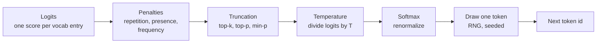

# Sampling and temperature

## Why this matters

In [1.1](/part-01-how-llms-work/1.1-next-token-prediction) you saw that the network's output is a probability distribution, and that "the answer" only exists once something **picks** a token from it. That something is the sampler. It's a few dozen lines of code with no learned weights, yet it decides whether the same model writes crisp code, loops forever on "the the the", or invents a creative story. It's also the main reason the same prompt gives different answers.

Most people set sampling parameters by superstition ("temperature 0 for code", "0.7 feels right"). After this chapter you should be able to predict what each knob does to a given distribution, know which knobs your provider still lets you turn, and pick settings from first principles.

**Learning goals**

- Explain greedy, temperature, top-k, top-p and min-p
- Predict the effect of each setting
- Choose settings for code, extraction and creative tasks

## Explanation

### The sampler is a small pipeline

Between the logits and the chosen token sits a pipeline of simple transformations. Each one takes a list of (token, score) pairs and returns a shorter or reshaped list. The last step draws one token at random, using a random number generator (RNG) that a **seed** can fix.



Three things to keep in mind:

- **Nothing here changes the model.** The logits come from the forward pass, the same every time for the same tokens (1.1). The sampler is configuration, so it's a request parameter.
- **Every step is optional.** Turn them all off and you get "pure" sampling straight from the model's distribution. Replace the random draw with argmax and you get greedy decoding.
- **The order is an implementation choice**, and it changes results. The diagram follows llama.cpp's default chain, which runs penalties first, then the truncation samplers, and applies temperature **last** ([llama.cpp `--samplers` default](https://github.com/ggml-org/llama.cpp/blob/master/tools/completion/README.md#sampling-params): `penalties;dry;top_n_sigma;top_k;typ_p;top_p;min_p;xtc;temperature`). Not every engine uses this order, so check yours. More on why that matters below.

### Softmax with temperature

Recall softmax from 1.1: *p<sub>i</sub>* = exp(*z<sub>i</sub>*) / Σ<sub>j</sub> exp(*z<sub>j</sub>*). **Temperature** *T* divides every logit before the softmax:

```
p_i = exp(z_i / T) / Σ_j exp(z_j / T)
```

Because only differences between logits matter, dividing by *T* scales every gap. Two tokens whose logits differ by 2 get a probability ratio of e² ≈ 7.4 at *T* = 1. At *T* = 0.5 the gap becomes 4 and the ratio e⁴ ≈ 55. At *T* = 2 the gap becomes 1 and the ratio e ≈ 2.7. So:

- ***T* = 1** leaves the model's distribution unchanged.
- ***T* < 1** sharpens it: the leader takes more of the mass.
- ***T* → 0** puts all the mass on the argmax. That's **greedy decoding**. You can't actually divide by 0, so implementations special-case it as "take the argmax".
- ***T* > 1** flattens it, and as *T* → ∞ every token becomes equally likely, including garbage.

The CTRL paper states this compactly: "*T* → 0 approximates a greedy distribution which magnifies the peaks in the probability distribution while *T* → ∞ flattens the distribution to make it more uniform" ([Keskar et al., 2019, §4.1](https://arxiv.org/abs/1909.05858)).

**Worked example.** Here is a real distribution from `qwen3:8b` on your Mac (Ollama 0.40.14, 2026-11-08, raw mode, `top_logprobs: 10`), continuing `My favorite programming language is`:

| Token | Logprob | p at *T* = 1 |
|---|---|---|
| `" Python"` | −0.61 | 0.54 |
| `" C"` | −1.53 | 0.22 |
| `" Java"` | −3.41 | 0.03 |
| `" JavaScript"` | −3.65 | 0.03 |
| `" python"` | −4.06 | 0.02 |
| … 5 more between 0.013 and 0.007, then the long tail | | |

The top 10 hold 88% of the mass. The other 12% is spread over the rest of a vocabulary with tens of thousands of entries. Now apply temperature. To keep the arithmetic visible, treat the top five as the whole vocabulary (use the logprobs as logits and renormalize):

| *T* | Python | C | Java | JavaScript | python |
|---|---|---|---|---|---|
| 0.2 | 0.99 | 0.01 | 0.00 | 0.00 | 0.00 |
| 0.5 | 0.86 | 0.14 | 0.00 | 0.00 | 0.00 |
| 0.7 | 0.77 | 0.21 | 0.01 | 0.01 | 0.01 |
| 1.0 | 0.65 | 0.26 | 0.04 | 0.03 | 0.02 |
| 1.5 | 0.52 | 0.28 | 0.08 | 0.07 | 0.05 |
| 2.0 | 0.44 | 0.28 | 0.11 | 0.10 | 0.08 |

Read the table as "what fraction of runs start with this word". At *T* = 0.5, roughly one run in seven says C. At *T* = 2, more than half the runs say something other than Python, and the misspelled-case `" python"` shows up 8% of the time. In the real, full vocabulary it's worse: the 12% tail also gets inflated, and the tail is where nonsense lives.

Two consequences are easy to miss:

- **Temperature compounds over a sequence.** A 1% chance of an odd token per step is a near-certainty of at least one odd token over a 500-token answer. Once an odd token is in the context, every later step is conditioned on it. That's why high temperature degrades long outputs much more than short ones.
- **Temperature doesn't change the ranking.** It never makes C more likely than Python. It only changes how often the runner-up gets picked.

### Why not always greedy?

If the top token is the model's best guess, why not always take it? Because the best token at each step doesn't add up to the best text. Greedy decoding is famous for falling into loops: once a phrase repeats, the repetition itself makes repeating again the most likely continuation. Holtzman et al. put it this way: "using likelihood as a decoding objective leads to text that is bland and strangely repetitive" ([The Curious Case of Neural Text Degeneration, 2019](https://arxiv.org/abs/1904.09751)).

This isn't just a 2019 problem. The Qwen3 model card, for the model family on your Mac, says for thinking mode: "DO NOT use greedy decoding, as it can lead to performance degradation and endless repetitions" ([Qwen3-14B model card, Best Practices](https://huggingface.co/Qwen/Qwen3-14B#best-practices)). Long reasoning traces are exactly where greedy loops show up.

Chip Huyen's article is the best single read on this whole chapter. It walks through temperature, top-k and top-p with clear figures, then connects sampling to test-time compute (1.10) and structured output (2.5).

::: info 📖 Read now
[Generation configurations: temperature, top-k, top-p, and test time compute](https://huyenchip.com/2024/01/16/sampling.html) (Chip Huyen, 2024), section "Sampling" (temperature, top-k, top-p, stopping condition) · article · ~20 min · **essential**

Look for: how temperature flattens or sharpens the distribution (compare with the table above), and why top-p adapts to context where top-k doesn't. Skim "Test Time Compute" and "Structured Outputs" now and come back to them in 1.10 and 2.5.
:::

If you own her book, the same material is expanded in *AI Engineering*, chapter 2, section "Sampling", subsections "Sampling Fundamentals" and "Sampling Strategies" ([table of contents](https://github.com/chiphuyen/aie-book/blob/main/ToC.md)). Optional: the article covers what you need here.

### Truncation samplers: top-k, top-p, min-p

Temperature reshapes the whole distribution, but the tail never goes to zero. **Truncation samplers** fix that by deleting candidates before the draw, then renormalizing the survivors. They differ only in **how they choose the cutoff**.

- **Top-k** keeps the *k* most likely tokens. A fixed count.
- **Top-p** (nucleus sampling) sorts tokens by probability and keeps the smallest set whose cumulative probability reaches *p*. A fixed amount of mass. Introduced by Holtzman et al. in the paper above.
- **Min-p** keeps every token whose probability is at least *p* × (probability of the top token). A threshold relative to the model's confidence. Ollama documents it as an "alternative to the top_p" in which the parameter "represents the minimum probability for a token to be considered, relative to the probability of the most likely token" ([Ollama Modelfile, parameters](https://docs.ollama.com/modelfile#valid-parameters-and-values)).

Apply each to the `My favorite programming language is` distribution above (full top-10 probabilities: 0.54, 0.22, 0.03, 0.03, 0.02, 0.01, …):

| Setting | Survivors | Why |
|---|---|---|
| top-k = 2 | Python, C | the two largest |
| top-k = 40 | 40 tokens, deep into the tail | count is fixed whatever the shape |
| top-p = 0.8 | Python, C, Java, JavaScript | cumulative 0.54 → 0.76 → 0.79 → 0.82 ≥ 0.8 |
| top-p = 0.9 | more than 10 tokens | the top 10 only reach 0.88 |
| min-p = 0.05 | Python, C, Java | threshold 0.05 × 0.54 = 0.027; JavaScript (0.026) just misses |
| min-p = 0.1 | Python, C | threshold 0.054 |

Now compare a **peaked** distribution. For the chat prompt `Name one color.`, the same model gave `"Blue"` at p ≈ 0.86 and `"Red"` at ≈ 0.14, and everything else below 10⁻⁶ (same session, `think: false`):

| Setting | Survivors on the peaked distribution |
|---|---|
| top-k = 40 | 40 tokens, 38 of them with p < 10⁻⁶ (harmless here because they have almost no mass) |
| top-p = 0.9 | Blue, Red |
| min-p = 0.05 | Blue, Red (threshold 0.043) |

The difference between the samplers shows up when the distribution is **flat**, like a creative continuation where the top token has 10% and dozens of reasonable options sit at 1–5%:

- **Top-k** with *k* = 40 can't tell flat from peaked. It keeps too many on peaked distributions (harmless) and too few or too many on flat ones, depending on luck.
- **Top-p** adapts to shape: on a flat distribution it needs many tokens to reach *p*, on a peaked one only a few. But on a very flat distribution, reaching 0.9 can mean dragging in hundreds of tail tokens.
- **Min-p** ties the cutoff to the top token. When the model is confident, the threshold is high and the tail is cut hard. When it's unsure, the threshold drops and more options survive. That's the property the min-p authors argue for: a "dynamic truncation method that adjusts the sampling threshold based on the model's confidence" ([Nguyen et al., *Turning Up the Heat*, ICLR 2025](https://arxiv.org/abs/2407.01082)).

**Order matters.** If truncation runs **before** temperature (llama.cpp's default chain, linked above), temperature only redistributes mass among survivors. You can then raise *T* to 1.5 for variety without letting the tail back in, because the tail was already deleted. That's the main argument of the min-p paper's title: min-p lets you "turn up the heat". If temperature runs **first**, a high *T* flattens the distribution and then top-p keeps far more tokens, so the two settings interact. This is why OpenAI's API reference says "We generally recommend altering this or `top_p` but not both" ([OpenAI, Create chat completion, `temperature`](https://developers.openai.com/api/reference/resources/chat/subresources/completions/methods/create)): on their stack the two knobs aren't independent.

::: tip 📖 Read (optional)
[The Curious Case of Neural Text Degeneration](https://arxiv.org/abs/1904.09751) (Holtzman et al., ICLR 2020), abstract and introduction · paper · ~25 min · optional

Look for: the example of likelihood-maximizing decoding degenerating into repeated text, and the argument that a fixed *k* is wrong because next-token distributions vary from flat to peaked. This is where top-p comes from.
:::

::: tip 📖 Read (optional)
[Turning Up the Heat: Min-p Sampling for Creative and Coherent LLM Outputs](https://arxiv.org/abs/2407.01082) (Nguyen et al., ICLR 2025), abstract and introduction · paper · ~20 min · optional

Look for: how top-p and min-p behave on a confident vs. an uncertain distribution, and map it onto the two tables above.
:::

If you want to see top-k and top-p implemented in a few lines of real library code, the Hugging Face blog walks through `model.generate()` with each setting and shows the outputs side by side.

::: tip 📖 Read (optional)
[How to generate text: using different decoding methods for language generation with Transformers](https://huggingface.co/blog/how-to-generate) (von Platen, Hugging Face, 2020, updated 2023) · article · ~15 min · optional

Look for: greedy vs. beam search vs. sampling on the same prompt, and the `no_repeat_ngram_size` trick (a blunt repetition penalty). Python, but you only need to read it.
:::

Go back to the Transformer Explainer you met in 1.1 and repeat the experiment with these ideas in mind: set temperature to 2, then switch top-k and top-p on and off, and watch the tail of the bar chart appear and disappear.

### Repetition penalties

Truncation stops the sampler from picking garbage, but it doesn't stop **loops**: a repeated phrase is not garbage, it's highly likely. Penalties attack loops by lowering the score of tokens that already appeared. There are three common flavors.

**1. Multiplicative repetition penalty** (llama.cpp and Ollama `repeat_penalty`, Hugging Face `repetition_penalty`). It comes from CTRL's "penalized sampling", which divides the logit of every token already in the generated text by a factor θ before the softmax. The authors found "greedy sampling and θ ≈ 1.2 yields a good balance between truthful generation and lack of repetition", and θ = 1 disables it ([Keskar et al., 2019, §4.1](https://arxiv.org/abs/1909.05858)). Implementations usually look back only over a window: Ollama's `repeat_last_n` defaults to 64 tokens ([Ollama Modelfile](https://docs.ollama.com/modelfile#valid-parameters-and-values)).

**2. Additive presence and frequency penalties** (OpenAI-style, also in OpenRouter and llama.cpp). Conceptually, they subtract from the logit of a token that already appeared:

```
z_i ← z_i − frequency_penalty × count_i − presence_penalty × (count_i > 0 ? 1 : 0)
```

Presence is a flat "you've used this already" fee. Frequency grows with every use. OpenAI documents both as numbers between −2.0 and 2.0 with a default of 0, where positive values "penalize new tokens based on whether they appear in the text so far" (presence) or "based on their existing frequency in the text so far" (frequency) ([OpenAI, Create chat completion](https://developers.openai.com/api/reference/resources/chat/subresources/completions/methods/create)). Negative values **encourage** repetition.

**3. Sequence-aware penalties** such as **DRY** ("Don't Repeat Yourself") penalize tokens that would **extend** a sequence already seen earlier, with a penalty that grows with the length of the repeat. llama.cpp describes it as "penalizing tokens based on their recent usage patterns" to reduce "long-range repetitions" ([llama.cpp, DRY repetition penalty](https://github.com/ggml-org/llama.cpp/blob/master/tools/completion/README.md#dry-repetition-penalty)). It's off by default there.

The catch: **repetition is often correct.** Code repeats identifiers, JSON repeats keys and punctuation, and an extraction task should repeat the source's exact words. A token-level penalty can't tell a loop from a variable name, so on code and structured output it pushes the model toward synonyms, renamed variables or broken syntax. That's why modern defaults leave penalties off: Ollama's `repeat_penalty` defaults to 1.0, "disabled" ([Ollama Modelfile](https://docs.ollama.com/modelfile#valid-parameters-and-values)), and llama.cpp's to 1.00 ([llama.cpp sampling params](https://github.com/ggml-org/llama.cpp/blob/master/tools/completion/README.md#sampling-params)).

When a model **does** loop, the model maker's advice is the place to start. The Qwen3 card suggests `presence_penalty` between 0 and 2 "to reduce endless repetitions", and warns that a higher value "may occasionally result in language mixing and a slight decrease in model performance" ([Qwen3-14B model card](https://huggingface.co/Qwen/Qwen3-14B#best-practices)). A penalty is a patch. Better prompts, a non-greedy sampler and a sensible `num_predict` limit are the real fixes.

### Seeds and determinism

The final draw needs random numbers. A pseudo-random generator started from the same **seed** produces the same sequence of numbers, so with the same logits and the same seed, the sampler makes the same choices. Ollama: "Setting this to a specific number will make the model generate the same text for the same prompt" ([Ollama Modelfile, `seed`](https://docs.ollama.com/modelfile#valid-parameters-and-values)).

That gives you two routes to "the same answer every time": greedy decoding (no randomness used), or sampling with a fixed seed (randomness replayed). **Both only work if the logits are bit-for-bit identical.** On a single local machine running one request at a time, they usually are. On a hosted API, they usually aren't, and the reason is surprising.

Floating-point addition isn't associative: (a + b) + c can differ from a + (b + c) in the last bits. GPU kernels sum large vectors in some order, and that order can depend on how many requests are **batched together** on the server at that moment. Different load → different batch size → different summation order → logits that differ in the last bits. Usually that changes nothing. But when two tokens are nearly tied, a last-bit difference flips the argmax, and from that token on the two completions diverge completely, because every later step is conditioned on a different context.

Thinking Machines measured this. They sent the same prompt 1,000 times at temperature 0 to Qwen3-235B-A22B-Instruct-2507 ("Tell me about Richard Feynman") and got 80 distinct completions; the completions agreed for the first 102 tokens and split at token 103. With **batch-invariant** kernels, all 1,000 were identical ([He et al., *Defeating Nondeterminism in LLM Inference*, Thinking Machines, 2025-09-10](https://thinkingmachines.ai/blog/defeating-nondeterminism-in-llm-inference/)). Their conclusion is that the usual "concurrency plus floating point" explanation misses the main cause, which is that kernels aren't batch-invariant and server load varies.

::: info 📖 Read now
[Defeating Nondeterminism in LLM Inference](https://thinkingmachines.ai/blog/defeating-nondeterminism-in-llm-inference/) (Horace He et al., Thinking Machines, 2025) · article · ~30 min (the core argument is everything before "How do we make kernels batch-invariant?", plus the "Experiments" section) · **essential**

Look for: the floating-point non-associativity example, why "concurrency + floating point" is "not entirely wrong" but incomplete, the definition of **batch invariance**, and the Feynman experiment numbers quoted above. The kernel details (RMSNorm, matmul, attention) are optional; they make more sense after 1.4, 1.5 and 1.9.
:::

What providers promise follows from this:

- **OpenAI**: `seed` makes the system "make a best effort to sample deterministically", but "Determinism is not guaranteed", and you should watch the `system_fingerprint` response field for backend changes ([OpenAI, Create chat completion, `seed`](https://developers.openai.com/api/reference/resources/chat/subresources/completions/methods/create)).
- **OpenRouter** forwards `seed` and warns "Determinism is not guaranteed for some models" ([OpenRouter, API parameters](https://openrouter.ai/docs/api-reference/parameters)).
- **Anthropic**: "If you were using `temperature = 0` for determinism, note that it never guaranteed identical outputs on prior models" ([Claude Opus 5.5 migration guide](https://platform.claude.com/docs/en/models/opus-5-5/migration-guide)).

The engineering takeaway: **treat LLM output as a distribution, even at temperature 0.** Don't write tests that compare outputs to an exact string. Cache responses if you need replayable results, and evaluate with several samples per input (Part 4).

### Provider defaults, and which ones you can change

What you can set depends on where the model runs. Defaults also hide in **two** places: the inference server's global defaults, and per-model settings the model packager ships.

**Ollama (local).** The [Modelfile parameter table](https://docs.ollama.com/modelfile#valid-parameters-and-values) lists the server defaults: `temperature` 0.8, `top_k` 40, `top_p` 0.9, `min_p` 0.0 (off), `repeat_penalty` 1.0 (off), `repeat_last_n` 64, `seed` 0. You can override any of them per request in the `options` object of `/api/generate` and `/api/chat` ([Ollama API: generate](https://docs.ollama.com/api/generate)), or bake them into a model with a Modelfile (10.1).

But a model can ship its own parameters. Run this on your Mac:

```
$ ollama show qwen3:14b --parameters
stop           "<|im_start|>"
stop           "<|im_end|>"
temperature    0.6
top_k          20
top_p          0.95
repeat_penalty 1
```

(Output from 2026-11-08, Ollama 0.40.14.) Those are exactly the Qwen team's **thinking-mode** recommendations: temperature 0.6, top-p 0.95, top-k 20, min-p 0 ([Qwen3-14B model card](https://huggingface.co/Qwen/Qwen3-14B#best-practices)). For non-thinking mode the card suggests temperature 0.7, top-p 0.8, top-k 20, min-p 0, so when you call with `think: false` you're running slightly off-recommendation unless you set them yourself. Lesson: before tuning anything, look at what the model already ships with.

**OpenAI-compatible APIs.** OpenAI's Chat Completions documents `temperature` from 0 to 2 (default 1), `top_p` default 1, the two penalties from −2 to 2 (default 0) and a `seed` that is marked both "Deprecated" and "in Beta" ([OpenAI, Create chat completion](https://developers.openai.com/api/reference/resources/chat/subresources/completions/methods/create)). The same page notes that "Parameter support can differ depending on the model used to generate the response" and points to OpenAI's reasoning guide for unsupported parameters. There's no top-k or min-p in OpenAI's own API.

**OpenRouter** passes a wider set through to the underlying provider: `temperature` (0–2), `top_p`, `top_k`, `min_p`, `top_a`, the presence/frequency penalties, `repetition_penalty` and `seed`. If you omit a parameter, the provider's own default applies, and support varies by provider, so check each model's provider section ([OpenRouter, API parameters](https://openrouter.ai/docs/api-reference/parameters)).

**Claude API.** This is the biggest change since you last looked. In API version `2026-10-21`, "a request that sends `temperature`, `top_p`, or `top_k` returns a 400 error, even at the parameter's default value". Requests sample with the defaults (temperature 1.0), and "Models that already accept only the defaults, such as Claude 4.7 and later models, sample as before" ([Migrating to API version 2026-10-21, "Sampling parameters are removed"](https://platform.claude.com/docs/en/api/migration-2026-10-21)). Anthropic's guidance for current models is to "Use prompting to guide the model's behavior" instead ([Claude Opus 5.5 migration guide](https://platform.claude.com/docs/en/models/opus-5-5/migration-guide)). For which Claude models are current, see [Landscape](/landscape#anthropic).

Why would a frontier lab remove the knobs? The docs don't give a reason, so treat this as interpretation: for models post-trained with heavy reinforcement learning (1.7, 1.10), the lab tunes the model **at** its default sampling settings, and other settings are off-distribution. The Qwen card's "DO NOT use greedy decoding" is the same idea from the open-weight side. The practical trend is that **sampling is becoming a property the model maker chooses, not a knob the app developer turns**, at least for hosted reasoning models. The knobs are still fully yours locally.

| Where | Temperature | Top-k | Top-p | Min-p | Penalties | Seed |
|---|---|---|---|---|---|---|
| Ollama (local) | yes | yes | yes | yes | `repeat_penalty` (and others) | yes |
| OpenAI Chat Completions | yes, model-dependent | no | yes, model-dependent | no | presence, frequency | deprecated, best effort |
| OpenRouter | forwarded if the provider supports it | same | same | same | same | same |
| Claude API (`2026-10-21`) | no (fixed default) | no | no | no | no | no |

### Choosing settings

Put it together into a decision procedure instead of a lookup table:

1. **Start from the model maker's recommendation**, which is what the model was tuned with. Check what's already shipped (`ollama show --parameters`, the model card) before changing anything. On the Claude API there's nothing to choose.
2. **Ask whether the task has one right answer.** If so, you want the mode of the distribution, so lower the temperature. If the task benefits from variety, keep or raise it.
3. **Cut the tail separately from shaping the head.** Use min-p (or top-p) to stop garbage, and temperature to control variety among sensible options.
4. **Don't fight loops with penalties first.** Check the prompt, the model choice and greedy settings before adding a repetition penalty, and never add one to code or JSON output.
5. **Never rely on settings for determinism.** Use caching or multiple samples instead.

Applied to the three task types in the learning goals:

| Task | Suggested start | Why |
|---|---|---|
| **Code** | Model's recommended settings, or slightly lower temperature (e.g. 0.2–0.6) for non-reasoning models. No repetition penalty. | You want the most likely correct token, but pure greedy risks loops, and for reasoning models (thinking on) greedy is explicitly discouraged. Penalties corrupt identifiers. |
| **Extraction / classification** | Low temperature (0–0.3), no penalties, and enforce the format with structured output (2.5) rather than sampling. | There's one right answer, and repeating source text verbatim is desired. A schema constraint does more for validity than any temperature. |
| **Creative writing, brainstorming** | Temperature 0.8–1.2 with min-p around 0.05–0.1 (where available). | Variety is the goal; min-p keeps the tail out so high temperature stays coherent. |
| **Sampling many candidates** (best-of-n, self-consistency, evals) | Temperature ≈ 1 with tail truncation. | You want diverse candidates to vote on or score. Low temperature makes all n samples the same. This comes back in 1.10. |

The ranges in this table are starting points to test, not facts. The only way to know is to measure on your task, which is what the practice does.

## Practice

**Brief:** Measure what temperature actually does to `qwen3:14b` on your Mac. In TypeScript, call local Ollama with the same prompt 10 times at each of temperature 0, 0.7 and 1.2, and measure output diversity: how many **distinct** answers you get, and how the **length** varies. Then test whether min-p rescues the high temperature, and whether a fixed seed makes runs repeat. It's all local, so it's free.

**Where:** `experiments/05-temperature/`: a standalone experiment. The README there has the "What I tried / What happened / Why" skeleton for your results.

::: tip 📖 Reference
[Ollama API: Generate a chat message](https://docs.ollama.com/api/chat) and the [Modelfile parameter table](https://docs.ollama.com/modelfile#valid-parameters-and-values) · docs · ~10 min · **essential** for the practice

Look for: the `options` object (`temperature`, `top_k`, `top_p`, `min_p`, `seed`, `num_predict`), `think: false` to skip the thinking trace, and the response fields `eval_count` (output tokens) and `message.content`.
:::

**Steps:**

1. Run `ollama show qwen3:14b --parameters` and paste the output into the README. These are the defaults your requests inherit unless you override them. Decide whether to keep `top_k` 20 and `top_p` 0.95 (the shipped defaults) for the whole experiment, and write down your choice: it matters for interpreting the results.
2. Write `experiments/05-temperature/diversity.ts`. Use `fetch` against `http://localhost:11434/api/chat` with `stream: false` and `think: false`. Cap output with `num_predict` (e.g. 200) so a runaway sample can't take minutes.
3. Use three prompts that span the task types in "Choosing settings":
   - **One right answer:** `What is 17 × 23? Reply with just the number.`
   - **Constrained choice:** `Suggest one name for a TypeScript library that validates environment variables. Reply with the name only.`
   - **Open creative:** `Write the opening sentence of a mystery novel.`
4. For each prompt and each temperature in `[0, 0.7, 1.2]`, run 10 requests. Record each output's text and `eval_count`.
5. For each (prompt, temperature) cell, compute: the number of **distinct** outputs (after trimming and lowercasing), the most common output and its count, and the mean and min–max of `eval_count`. Print a table.
6. Add two extra runs on the creative prompt:
   - Temperature **2.0**, with `min_p: 0` and then with `min_p: 0.1`. Read a few outputs from each. Does min-p keep the text coherent at a temperature that would otherwise produce garbage?
   - Temperature 1.2 with `seed: 42`, three times. Are the three outputs identical? Then change one character in the prompt and run again.
7. Fill in the README: the diversity table, a few example outputs per cell, and an explanation of each result in terms of this chapter (sharpening/flattening, truncation, seeds). Note anything that contradicts your prediction.

**Optional extension:** build a small Vue component for this chapter, a **temperature slider** that takes a hard-coded list of tokens and logprobs (use the `My favorite programming language is` table above) and draws the probability bars live as you move *T*, with a min-p slider that greys out the dropped tokens. VitePress can render Vue components inside markdown.

**Done when:** `node experiments/05-temperature/diversity.ts` prints a table with one row per (prompt, temperature) showing distinct-answer count out of 10 and mean output tokens, and the README has that table plus one sentence per prompt explaining the pattern, a verdict on min-p at temperature 2.0, and the result of the seed test.

## Check questions

1. A next-token distribution has two candidates with logits 3.0 and 1.0 (ignore all others). What are their probabilities at *T* = 1, *T* = 0.5 and *T* = 2? What happens as *T* → 0?

   <details><summary>Answer</summary>

   The probability ratio is e^(gap / *T*). At *T* = 1 the gap is 2, ratio e² ≈ 7.4, so p ≈ 0.88 and 0.12. At *T* = 0.5 the gap is 4, ratio ≈ 55, so p ≈ 0.98 and 0.02. At *T* = 2 the gap is 1, ratio ≈ 2.7, so p ≈ 0.73 and 0.27. As *T* → 0 the ratio goes to infinity: the top token gets all the mass, which is greedy decoding.

   </details>

2. You set top-k = 50 for a creative-writing app. At one step the top token has p = 0.95. At another, the top 200 tokens each have p ≈ 0.004. What goes wrong at each step, and how would min-p = 0.1 behave instead?

   <details><summary>Answer</summary>

   At the peaked step, top-k keeps 49 tokens that together hold only 5% of the mass. That's mostly harmless, but at high temperature some of them become reachable. At the flat step, top-k throws away 150 perfectly reasonable options and keeps an arbitrary 50. Min-p = 0.1 sets the threshold relative to the top token: at the peaked step it's 0.095, so only the top token survives (or a couple near it). At the flat step it's 0.0004, so all 200 survive. Min-p adapts to the model's confidence; top-k doesn't.

   </details>

3. Your extraction pipeline sometimes outputs JSON with a key spelled differently from the schema, but only after a colleague added `repeat_penalty: 1.3` "to stop loops". Explain the link.

   <details><summary>Answer</summary>

   A repetition penalty lowers the logits of tokens that already appeared in the recent window. JSON repeats keys, quotes, colons and commas by design, and an extraction should copy words from the source. The penalty pushes the model away from exactly those tokens, so it starts choosing near-synonyms or different spellings. For structured output, leave penalties off and enforce the format with a schema instead (2.5).

   </details>

4. You call a hosted model 100 times with temperature 0 and a fixed seed, and get 3 different outputs that agree for the first 80 tokens and then diverge. Your local Ollama gives the same output every time. Explain both.

   <details><summary>Answer</summary>

   Greedy decoding and seeds only guarantee identical output if the logits are bit-identical. On a hosted server your request is batched with other users' requests, and many kernels aren't batch-invariant: the floating-point summation order, and so the last bits of the logits, depend on batch size, which depends on load. Usually that changes nothing, but at a near-tie between two tokens (here around token 80) a tiny difference flips the argmax, and every later token is conditioned on a different prefix. Locally you're the only request, so the batch shape and logits are the same each time.

   </details>

5. You move a prompt that used `temperature: 0.2` from Claude Sonnet 4.6 to Claude Opus 5.5 on API version `2026-10-21`. What happens, and what do you do instead?

   <details><summary>Answer</summary>

   The request fails with a 400 error: in `2026-10-21`, sending `temperature`, `top_p` or `top_k` is rejected even at default values, and Claude 4.7 and later models only sample at their defaults anyway. Remove the parameter. If you needed consistency, get it from the prompt (clear instructions, examples), from structured output for format, and from caching or evals with multiple samples. Low temperature never guaranteed identical outputs anyway.

   </details>

## My understanding

<!-- Written by the learner, in their own words. Agents never fill this in. -->
