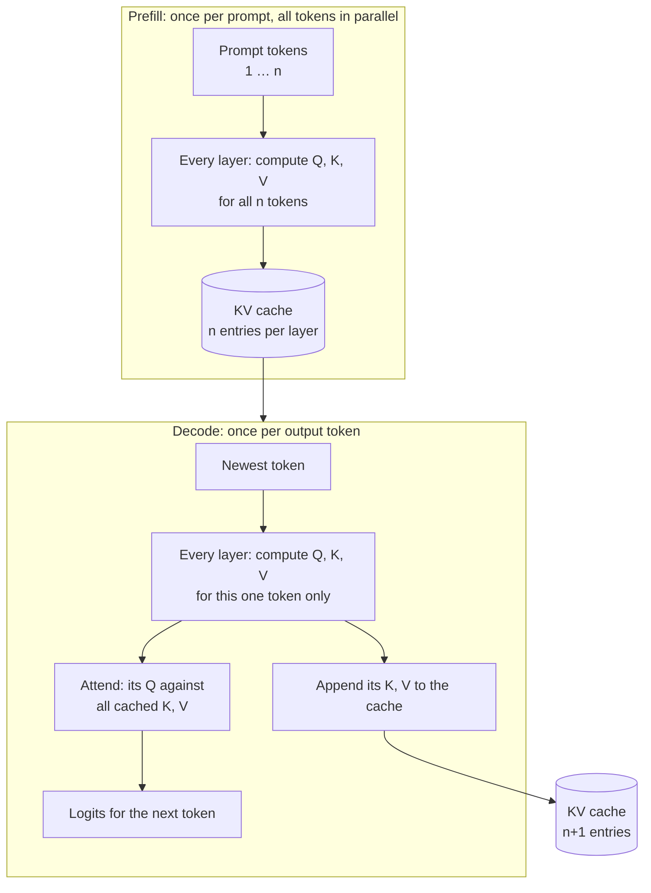

# The KV cache and the context window

## Why this matters

The context window is the hard limit on everything an agent can see, and the KV cache is what makes long contexts expensive in memory. Both explain things you will hit constantly: a long prompt that takes a minute before the first token, a model that fits in memory at 4k context but not at 64k, a provider bill that drops when a prefix is cached, and an agent that gets worse the longer it runs.

[1.4](/part-01-how-llms-work/1.4-attention) ended with a promise: because of the causal mask, the keys and values of earlier tokens never change, so they can be stored. This chapter cashes that in. You'll compute the size of the cache for the models on your Mac, see why Ollama's `num_ctx` setting changes memory use, and learn the difference between a context a model *accepts* and one it *uses well*.

**Learning goals**

- Explain the KV cache and compute its memory size
- Explain why Ollama's `num_ctx` changes memory use
- Explain context rot and lost-in-the-middle

## Explanation

### What the cache stores

Recall from [1.1](/part-01-how-llms-work/1.1-next-token-prediction) that a request has two phases. **Prefill** runs the whole prompt through the model in parallel. **Decode** then generates the answer one token at a time. Both phases run attention in every layer, and attention needs the **key** and **value** vector of every earlier token (1.4).

Without a cache, generating token `n+1` would recompute keys and values for all `n` earlier tokens in every layer, on every step. The causal mask means none of those numbers change when a token is appended. So the model computes them once, at the moment each token is processed, and keeps them. That store is the **KV cache**.



Only keys and values are cached, not queries: a query is used once, by the position it belongs to. Nothing is cached about the *outputs* of attention either, because those change with every new position's own query.

Two consequences follow, and they explain most of what you observe:

- **Prefill builds the cache; decode reads all of it and adds one entry.** Each decode step still has to read every weight *and* the whole cache from memory to produce one token. That's why decode is memory-bandwidth bound, and why it gets slower as the context grows: the cache is more data to read per step. (This is reasoning from the mechanism, not a quoted figure. Your practice measures it.)
- **The cache is the cost of not recomputing.** It trades compute for memory, and the memory grows by a fixed amount for every token you keep.

### How big is it?

Per token, each layer stores one key vector and one value vector for each **KV head**. So:

```
bytes per token = 2 (K and V) × layers × KV heads × head dim × bytes per number
```

The numbers come from the model's `config.json`. For Qwen3-14B, [the config](https://huggingface.co/Qwen/Qwen3-14B/blob/main/config.json) says `num_hidden_layers: 40`, `num_key_value_heads: 8` (against `num_attention_heads: 40`: that's GQA, from 1.4) and `head_dim: 128`. At 16-bit precision, 2 bytes per number:

```
2 × 40 × 8 × 128 × 2 = 163,840 bytes = 160 KiB per token
```

Note that the model's *width* (`hidden_size: 5120`) doesn't appear. Only the layer count and the K/V heads do, which is why grouped-query attention is such a large saving. If Qwen3-14B stored all 40 heads, the cache would be 800 KiB per token, five times bigger.

The cache grows linearly with the number of tokens kept:

| Tokens kept | KV cache, 16-bit (Qwen3-14B) |
|---|---|
| 1 | 160 KiB |
| 4,096 (4k) | 640 MiB |
| 16,384 (16k) | 2.5 GiB |
| 32,768 (32k) | 5 GiB |
| 40,960 (the config's `max_position_embeddings`) | 6.25 GiB |

The same formula on your other models, using their configs ([Qwen3-8B](https://huggingface.co/Qwen/Qwen3-8B/blob/main/config.json): 36 layers, 8 KV heads, head dim 128; [Qwen3-30B-A3B](https://huggingface.co/Qwen/Qwen3-30B-A3B/blob/main/config.json): 48 layers, 4 KV heads, head dim 128):

| Model | Per token (16-bit) | At 32k tokens | Weights in Ollama (`ollama list`) |
|---|---|---|---|
| `qwen3:8b` | 144 KiB | 4.5 GiB | 5.2 GB |
| `qwen3:14b` | 160 KiB | 5 GiB | 9.3 GB |
| `qwen3:30b-a3b` | 96 KiB | 3 GiB | 18 GB |

Your Mac has 24 GB of unified memory, shared with macOS and everything else. Weights are fixed; the cache is the part you choose by choosing the context length. The 30B MoE has the smallest cache per token of the three because it has few KV heads, but its weights already take most of the memory, which is why it was "tight" in your earlier notes. (Weights and quantization are the subject of [1.12](/part-01-how-llms-work/1.12-quantization); MoE is [1.11](/part-01-how-llms-work/1.11-mixture-of-experts).)

Three things make real numbers differ from this formula:

1. **Cache quantization.** The cache itself can be stored at lower precision. Ollama's [FAQ](https://docs.ollama.com/faq#how-can-i-set-the-quantization-type-for-the-kv-cache) describes `OLLAMA_KV_CACHE_TYPE`: `f16` is the default, `q8_0` "uses approximately 1/2 the memory of f16", `q4_0` approximately 1/4, and quantizing the cache requires Flash Attention to be enabled. It's a global server setting. So **before you estimate a cache size for your machine, find out which type your Ollama server runs with** (the practice below shows how). A wrong assumption here is a 2× error.
2. **Other buffers.** Besides weights and the cache, the runtime allocates scratch space for the computation itself. It isn't in the formula and also depends on the context length.
3. **Rounding in what the tools report.** `ollama ps` reports one total, not a breakdown.

::: tip The easiest thing to check
Ollama's server log prints the exact KV-cache size at load time, in a line starting `llama_kv_cache: size =`. On this Mac the Homebrew service logs to `/opt/homebrew/var/log/ollama.log`. It's the one number in this chapter you can read directly rather than infer.
:::

### Context window limits and `num_ctx`

Two different limits get called "the context window":

- **What the model was built and trained for.** For Qwen3-14B the config's `max_position_embeddings` is 40,960. The [model card](https://huggingface.co/Qwen/Qwen3-14B) says "32,768 natively and 131,072 tokens with YaRN", where YaRN is a rope-scaling technique, [a paper](https://arxiv.org/abs/2309.00071) the card links, that stretches the usable length beyond what the model was trained on. Beyond the trained range, quality is the model's problem, not a setting's.
- **What your server allocated for this request.** Ollama calls it `num_ctx` (a Modelfile parameter: "Sets the size of the context window used to generate the next token", per the [Modelfile reference](https://docs.ollama.com/modelfile#valid-parameters-and-values)) or *context length* in its settings.

The second is what you control, and it's a **memory reservation**. Ollama's [context-length docs](https://docs.ollama.com/context-length) are blunt about it: "Setting a larger context length will increase the amount of memory required to run a model." They also say the default depends on VRAM (4k below 24 GiB, 32k from 24 to 48 GiB, 256k from 48 GiB up), and that "tasks which require large context like web search, agents, and coding tools should be set to at least 64000 tokens". You can set it for the whole server with `OLLAMA_CONTEXT_LENGTH`, or per request through `options.num_ctx`, and `ollama ps` shows the allocated value in its CONTEXT column.

Why does a bigger `num_ctx` cost memory even if your prompt is short? Because the runtime sets aside the cache for the whole window when it loads the model, rather than growing it as tokens arrive. (Your practice confirms this: the log line above appears at load time, and `ollama ps` already shows the larger size after a one-word prompt.) Reserving up front is what lets the runtime fail early instead of running out of memory mid-generation.

Three practical rules follow:

- **The window is shared by everything.** Prompt, tool definitions, conversation history, the model's output and, with a thinking model such as Qwen3, its reasoning tokens all count against `num_ctx`. A 4k window with a 2k system prompt leaves little room to think.
- **A bigger window isn't free even when unused.** It takes memory from the weights (pushing layers to the CPU if the model no longer fits, which `ollama ps` shows under PROCESSOR) and from the rest of the system.
- **Size it to the task.** Chat needs little. Agents and coding tools accumulate tool results and history, which is why the docs suggest a high floor for them.

Context also costs time, not only memory. From 1.4: prefill compute grows faster than linearly with prompt length (the n² term). The `qwen3:8b` table there shows per-token prefill time nearly doubling between 529 and 32,936 tokens, so a 33k-token prompt took 172 seconds. Add the decode effect above, and long contexts are slow at both ends.

### Long contexts are accepted, not necessarily used

Fitting in the window doesn't mean the model uses what's in it. Two lines of evidence, one old and one new, say the same thing.

**Lost in the middle.** Liu et al. gave models multi-document question answering and key-value retrieval tasks and moved the position of the relevant information. Per [the abstract](https://arxiv.org/abs/2307.03172): performance "is often highest when relevant information occurs at the beginning or end of the input context, and significantly degrades when models must access relevant information in the middle of long contexts, even for explicitly long-context models". The result is a U-shaped curve over position. It was measured on 2023-era models, so treat the exact curve as dated and the *lesson* as durable: position matters.

**Context rot.** Chroma's [technical report](https://www.trychroma.com/research/context-rot) (July 14, 2025) evaluated 18 LLMs, including Claude 4, GPT-4.1, Gemini 2.5 and Qwen3 models, and found that "models do not use their context uniformly; instead, their performance grows increasingly unreliable as input length grows", even on deliberately simple tasks. Their point about the standard test is the useful one: needle-in-a-haystack, where a sentence is hidden in a long document and the model must find it, is "fundamentally a simple retrieval task" matching words directly. Models score near-perfectly on it, which says little about real work where the answer must be inferred or the context contains plausible distractors. Anthropic's engineering article on context uses the same term for the same effect: "as the number of tokens in the context window increases, the model's ability to accurately recall information from that context decreases", and frames context as "a finite resource with diminishing marginal returns".

The article also gives the architectural reason, which you can now connect to 1.4: every token attends to every other token, "n² pairwise relationships for n tokens", so each added token spreads attention thinner. Whether that fully explains the measured degradation is the kind of claim to hold loosely: the reports measure *that* it happens, and the mechanism is the authors' account.

::: info 📖 Read now
[Effective context engineering for AI agents](https://www.anthropic.com/research/effective-context-engineering-for-ai-agents) (Anthropic, 2025) · article · ~15 min · essential

Start at "Why context engineering is important to building capable agents". Look for: the definition of context rot and why they call context a finite resource with an "attention budget", and the techniques that follow (keep the context minimal, retrieve just in time, compact long histories). Those techniques are the practical answer to this section, and [3.4](/part-03-agents/3.4-context-engineering) builds on them.
:::

::: info 📖 Read now
[Context Rot: How Increasing Input Tokens Impacts LLM Performance](https://www.trychroma.com/research/context-rot) (Hong, Troynikov and Huber, Chroma, July 2025) · paper · ~20 min · essential

Read the introduction and then skim the experiment sections: the needle-question similarity result, the distractor results, and the repeated-words task. Look for: which of their tasks are as easy as a task can be (and still degrade), and what changes when the needle has to be matched by meaning rather than by words. Also read their "Limitations" section, which is honest about what a controlled synthetic task can and can't say about your agent.
:::

::: tip 📖 Read (optional)
[Lost in the Middle: How Language Models Use Long Contexts](https://arxiv.org/abs/2307.03172) (Liu et al., TACL 2023) · paper · ~20 min (abstract, intro, and the position-vs-accuracy figures) · optional

Look for: the U-shaped accuracy curve, and the result that models built for long inputs show the same dip as ordinary ones.
:::

What to do about it, as an engineer:

- **Put critical instructions and key facts at the start or the end** of long prompts, not buried in the middle.
- **Send less.** Retrieve the three relevant passages (Part 2) instead of pasting the whole manual, and drop or summarize stale history (Part 3).
- **Don't trust "it fit" as evidence it worked.** Test long-context behavior on your own task, with your own distractors. Needle-in-a-haystack scores say little.

### How prompt caching builds on this

The KV cache is per request: when a request finishes, a plain server can throw the cache away. **Prompt caching** is keeping it. If the next request starts with exactly the same tokens, the keys and values for that prefix are already computed (and still valid, for the same causal-mask reason), so the server skips that part of prefill and starts from the cache.

Anthropic's [prompt-caching docs](https://platform.claude.com/docs/en/build-with-claude/prompt-caching#how-prompt-caching-works) describe it at the API level: the system checks whether "a prompt prefix, up to a specified cache breakpoint, is already cached from a recent query", reuses it if found, and otherwise processes the whole prompt and caches the prefix. The cache references "the entire prompt: tools, system, and messages (in that order)", and by default has a 5-minute lifetime that is refreshed each time the content is used. The mechanism explains two rules you'll rely on in [2.7](/part-02-programming-with-llms/2.7-prompt-caching):

- **Only a prefix can be reused.** A key and value depend on every token before them (attention looks backward), so changing one token early in the prompt invalidates the cache from that point onward. Put stable content first (tools, system prompt, documents) and volatile content last.
- **A cache hit saves prefill, not decode.** It shortens time-to-first-token and the input cost; generating the output still costs the same.

For what cached tokens cost today, see [Landscape](/landscape#frontier-models) rather than a number here. The server-side machinery behind this, memory that is shared and paged between requests, is in the vLLM paper below and in [10.8](/part-10-modifying-serving-models/10.8-serving-optimizations).

::: tip 📖 Read (optional)
[Efficient Memory Management for Large Language Model Serving with PagedAttention](https://arxiv.org/abs/2309.06180) (Kwon et al., SOSP 2023) · paper · ~15 min (abstract and intro) · optional

The abstract states the problem plainly: the KV-cache memory per request "is huge and grows and shrinks dynamically", and managing it badly "can be significantly wasted by fragmentation and redundant duplication, limiting the batch size". Look for how they borrow virtual-memory paging from operating systems, and the sharing of cache across requests, which is the basis of prefix caching.
:::

The other family of fixes attacks the size itself. GQA, which you've already seen ([GQA paper](https://arxiv.org/abs/2305.13245)), shrinks the number of KV heads. Cache quantization shrinks the bytes per number. Sliding-window and other efficient-attention variants limit how many tokens are kept at all: [1.15](/part-01-how-llms-work/1.15-efficient-attention).

### Summary

| Question | Answer |
|---|---|
| What is cached? | Keys and values, per token, per layer, per KV head. |
| How big? | `2 × layers × KV heads × head dim × bytes per number`, per token. Qwen3-14B at 16-bit: 160 KiB. |
| Why does `num_ctx` change memory? | The runtime reserves the cache for the whole window up front. |
| Does a bigger window help quality? | Only if the model uses it. Accuracy often drops with length and with position. |
| What does prompt caching add? | Keeping the cache between requests, for an identical prefix. |

## Practice

**Brief:** Pick up the old roadmap item: run `qwen3:14b` with `num_ctx` 4k, 16k and 32k. Record memory (`ollama ps`), prefill speed and output speed. Then check your KV-cache estimate against the measured memory, and explain any gap. All local, free.

**Where:** `experiments/10-num-ctx/`: a standalone experiment. The README has the "What I tried / What happened / Why" skeleton and the tables to fill in.

**Steps:**

1. **Find your server's settings first.** Check which `OLLAMA_KV_CACHE_TYPE` and `OLLAMA_FLASH_ATTENTION` your `ollama serve` process runs with (for example, look at the environment of the process: `ps eww -p $(pgrep -f 'ollama serve')`, and see whether the Homebrew service's plist sets them). Write the values in the README. If neither is set, the cache type is the default, `f16`.
2. **Predict before you measure.** In the README, compute the KV-cache size of `qwen3:14b` at 4,096, 16,384 and 32,768 tokens for your cache type. The formula needs three numbers, which you can read from `ollama show qwen3:14b` or from `/api/show` (`model_info`: `block_count`, `head_count_kv`, `key_length`/`value_length`), and the bytes per number for your cache type (see the Ollama FAQ link above).
3. **Write `numctx.ts`** (TypeScript, plain `fetch`). For each `num_ctx` in 4096, 16384 and 32768: unload the model, send one request to `/api/generate` with `options.num_ctx` set, `think: false`, `stream: false` and a tiny prompt, then read `GET /api/ps` and record `size`, `size_vram` and `context_length`. Subtract: the slope `(size₃₂ₖ − size₄ₖ) / (32768 − 4096)` is the measured bytes per token. Compare it with your estimate.
4. **Measure speed at each setting.** Use one fixed prompt of about 3,000 tokens that fits in the smallest window (cut text from a chapter in this book, and start it with a random string so Ollama can't reuse an earlier cache). From the final response, compute prefill speed (`prompt_eval_count / prompt_eval_duration`) and output speed (`eval_count / eval_duration`; durations are in nanoseconds). Run each setting 3 times and put the median in the table. Does `num_ctx` alone change speed when the prompt is the same length?
5. **Explain the gap** between estimate and measurement in the README. If the slope isn't what you predicted, look at the server log lines starting `llama_kv_cache:` for the exact size, and think about the cache type and about buffers that aren't the cache.
6. **Optional stretch, position matters:** hide a one-sentence fact ("The access code is ...") at the start, middle and end of a ~12,000-token document made from book text, ask for it with `num_ctx` 16384, and run each position 5 times. Report how many of 5 were right. A few minutes of prefill per run is normal; 12,000 tokens on `qwen3:8b` takes about a minute going by the 1.4 table.
7. **Optional stretch, cache type:** with your cache type switched to the other setting (restart the Ollama service with a changed `OLLAMA_KV_CACHE_TYPE`), repeat step 3 for one `num_ctx`. Did the memory change by the factor the FAQ says?

**Done when:** `node experiments/10-num-ctx/numctx.ts` prints a table of `num_ctx`, memory, prefill tok/s and output tok/s for 4k, 16k and 32k, and the README has your prediction, the measured per-token slope, the cache type you found, and a short explanation of why they do or don't match.

## Check questions

1. Compute the KV-cache size per token for Qwen3-30B-A3B at 16-bit (48 layers, 4 KV heads, head dim 128), and the total at 32k tokens. Why is it smaller than Qwen3-14B's despite the bigger model?

   <details><summary>Answer</summary>

   `2 × 48 × 4 × 128 × 2 bytes = 49,152 × 2 = 98,304 bytes = 96 KiB per token`. At 32,768 tokens that's 3 GiB, against 5 GiB for the 14B. The cache depends on layers, KV heads and head dimension, not on total parameter count. The 30B model is a mixture of experts (1.11): most of its parameters sit in expert MLPs, which have nothing to do with attention, and it uses only 4 KV heads, so its cache is small. The weights, 18 GB in Ollama, are the large part.
   </details>

2. You set `num_ctx` to 32768 and send the prompt "hi". Why does `ollama ps` still show far more memory than with `num_ctx` 4096?

   <details><summary>Answer</summary>

   The runtime reserves the KV cache for the full window at load time, rather than growing it as tokens arrive. Memory use is determined by the setting, not by how many tokens you've sent. The extra memory is `(32768 − 4096) × bytes per token`, plus any scratch buffers that scale with context.
   </details>

3. A coworker says "the model has a 128k window, so I'll paste the whole repo in and it will find the bug". Give two reasons from this chapter to doubt it.

   <details><summary>Answer</summary>

   (a) Memory and time: the cache is linear in tokens and prefill gets slower than linearly, so a large prompt may not fit in the `num_ctx` that was actually allocated and will take a long time to process. A bigger window is also a reservation, not a free option. (b) Quality: lost-in-the-middle and context rot show accuracy often falls as input grows and when the relevant fact is mid-context, even though the prompt "fits". A good answer also suggests the fix: retrieve the relevant files, or let an agent search, instead of pasting everything.
   </details>

4. Why can a server reuse a cached prefix but not a cached *middle* of a prompt? What does that mean for where to put a changing timestamp in your system prompt?

   <details><summary>Answer</summary>

   A token's keys and values depend on every token before it (attention looks backward through the causal mask). A cached entry is therefore only valid if everything before it is identical. Change one early token and every later entry is wrong. So only an exact prefix can be reused. Put stable content (tools, instructions, documents) first and the timestamp, which changes every request, as late as possible, or the cache is invalidated on every call.
   </details>

5. Your agent works well for the first hour and then starts forgetting earlier instructions, even though it's nowhere near the model's window limit. What is the likely cause, and what are two ways to address it?

   <details><summary>Answer</summary>

   Context rot: accuracy degrades as the number of tokens grows, and facts in the middle of a long context are used less reliably, even under the window limit. Two remedies: keep the context small (summarize or drop old tool results, and compact the history), and put critical instructions where they're used well (start or end of the context), or re-state them. Retrieving only what's needed instead of accumulating everything is another. [3.4](/part-03-agents/3.4-context-engineering) covers these in depth.
   </details>

## My understanding

<!-- Written by the learner, in their own words. Agents never fill this in. -->
