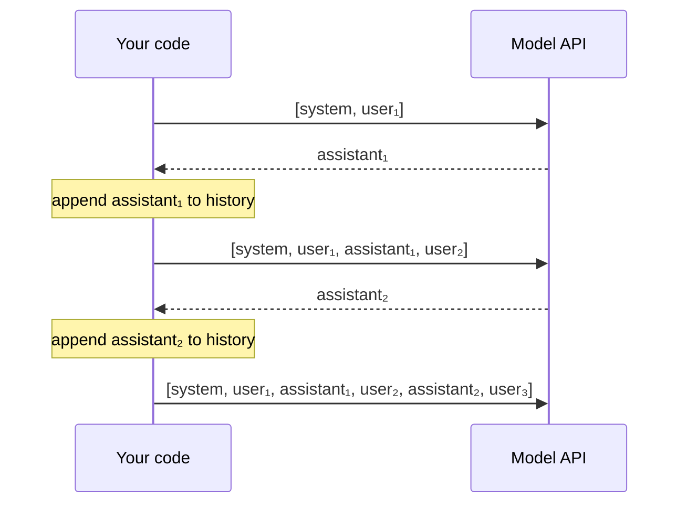

# Calling models: Anthropic, OpenAI-compatible, Ollama

## Why this matters

Everything in Parts 2–5 starts with an HTTP request to a model. The agent loop in Part 3, the evals in Part 4 and the harnesses in Part 5 are all programs that build a request, read a response, decide what to do next, and repeat. If you can read the three request shapes you'll meet in this book without a manual, the rest is much easier. The three shapes differ in small ways that cause most glue-code bugs: where the system prompt goes, whether the reply is a string or a list of blocks, what the usage fields are called, and what "the answer was cut off" looks like.

You already sent one request on each route in the smoke test ([0.4](/part-00-catch-up/0.4-your-lab), experiment 01). This chapter opens that code up: what's in each request, what comes back, who keeps the conversation, and what to do when a call fails.

**Learning goals**

- Call all three APIs from TypeScript with raw `fetch` and with SDKs
- Explain messages, roles and content blocks
- Read usage and stop reasons

## Explanation

### Three dialects of one idea

All three APIs do the same job: you send the **whole conversation so far** plus a few settings, and you get back **one more assistant message** and a record of what it cost. None of them remember anything between calls (more on that below). They differ in spelling.

| | Anthropic Messages | OpenAI-compatible Chat Completions | Ollama native |
|---|---|---|---|
| **Endpoint** | `POST https://api.anthropic.com/v1/messages` | `POST https://openrouter.ai/api/v1/chat/completions` or `POST http://localhost:11434/v1/chat/completions` | `POST http://localhost:11434/api/chat` |
| **Auth** | `x-api-key` header, plus `anthropic-version` | `Authorization: Bearer <key>` (Ollama: any placeholder) | none (local) |
| **System prompt** | top-level `system` field | a message with `role: "system"` | a message with `role: "system"` |
| **Output limit** | `max_tokens`, **required** | `max_tokens`, optional | `options.num_predict`, optional |
| **Where the reply is** | `content`: an array of **blocks** | `choices[0].message.content`: a string | `message.content`: a string |
| **Why it stopped** | `stop_reason` | `finish_reason` | `done_reason` |
| **Usage** | `usage.input_tokens`, `usage.output_tokens` | `usage.prompt_tokens`, `usage.completion_tokens` (OpenRouter adds `usage.cost`) | `prompt_eval_count`, `eval_count`, plus durations in nanoseconds |
| **Sampling settings** | none on current models (see below) | top-level `temperature`, `top_p`, … | inside `options` |
| **Streaming** | off unless `stream: true` | off unless `stream: true` | **on** unless `stream: false` |

Sources for the table: [Messages API reference](https://platform.claude.com/docs/en/api/messages), [OpenRouter API reference](https://openrouter.ai/docs/api-reference/overview), [Ollama chat API](https://docs.ollama.com/api/chat) and [Ollama OpenAI compatibility](https://docs.ollama.com/openai). I checked the Ollama columns, the system-message rows and the streaming default against your local Ollama 0.40.14 on 2026-11-10.

Two rows deserve a second look.

**Streaming default.** `/api/chat` streams by default: the Ollama reference gives `stream` a default of `true`. If you forget `stream: false` and call `res.json()`, it fails on the first line of newline-delimited JSON. [Chapter 2.2](/part-02-programming-with-llms/2.2-streaming) covers streaming properly. For this chapter, always pass `stream: false` to the native endpoint.

**Sampling settings.** On Anthropic, `temperature`, `top_p` and `top_k` are gone. API version `2026-10-21` removed them, and a request that sends any of them returns a 400 on every model ([API versions](https://platform.claude.com/docs/en/api/versioning)). Anthropic's advice is to omit them and steer with prompting ([Using the Messages API](https://platform.claude.com/docs/en/build-with-claude/working-with-messages)). So the sampling knobs from [1.8](/part-01-how-llms-work/1.8-sampling) are still real, but on Claude you can no longer turn them from your code. On Ollama and OpenRouter you still can.

::: info 📖 Read now
[Using the Messages API](https://platform.claude.com/docs/en/build-with-claude/working-with-messages) · docs · ~15 min · **essential**

This is the shortest authoritative tour of the native shape. Look for: the full request in `curl` form (which headers, which fields), the response JSON (`content` is an array, `usage` has two numbers, `stop_reason`), the statement that the API is stateless ("you always send the full conversational history"), and the warning about prefill. Skip the vision section for now.
:::

### The Anthropic Messages API

Here is the smoke test's request, with the interesting parts labelled. It's the bare `fetch` version: no SDK.

```ts
const res = await fetch('https://api.anthropic.com/v1/messages', {
  method: 'POST',
  headers: {
    'content-type': 'application/json',
    'x-api-key': process.env.ANTHROPIC_API_KEY!,
    'anthropic-version': '2026-10-21', // required; the SDKs send it for you
  },
  body: JSON.stringify({
    model: 'claude-haiku-5-5',
    max_tokens: 200, // required: a hard cap on output (0.4)
    system: 'Answer in one sentence.', // top level, not a message
    messages: [{ role: 'user', content: 'What is a token?' }],
  }),
})
const msg = await res.json()
```

A successful response has this shape (field names from the [Messages reference](https://platform.claude.com/docs/en/build-with-claude/working-with-messages); the text is made up):

```json
{
  "id": "msg_01XFDUDYJgAACzvnptvVoYEL",
  "type": "message",
  "role": "assistant",
  "content": [{ "type": "text", "text": "A token is …" }],
  "model": "claude-haiku-5-5",
  "stop_reason": "end_turn",
  "stop_sequence": null,
  "usage": { "input_tokens": 24, "output_tokens": 18 }
}
```

#### Messages, roles and content blocks

A **message** is `{ role, content }`. The roles you send are `user` and `assistant`. Consecutive turns with the same role are merged into one, and a request whose last message is an `assistant` one is **prefill**: the model continues that text ([Messages reference](https://platform.claude.com/docs/en/api/messages)). Prefill no longer works on newer models: Claude 4.6 and later return a 400 ([Errors](https://platform.claude.com/docs/en/api/errors#prefill-not-supported)). So treat "end the list with a user message" as the rule.

**`content` can be a string or an array of blocks.** `"content": "Hello"` is shorthand for `"content": [{ "type": "text", "text": "Hello" }]`. Blocks are what make the format extensible. The reference lists the block types a request can carry: `text`, `image`, `document`, `search_result`, `thinking`, `redacted_thinking`, `tool_use`, `tool_result` and several server-tool results. In a response you read `content` as a list and pick blocks by `type`. That's why the SDK example loops `for (const block of message.content)` and checks `block.type === 'text'` ([TypeScript SDK](https://platform.claude.com/docs/en/cli-sdks-libraries/sdks/typescript)). Taking `content[0].text` works for a plain chat and breaks the day the model emits a `thinking` or `tool_use` block first. Chapters [2.4](/part-02-programming-with-llms/2.4-reasoning-via-api) and [2.6](/part-02-programming-with-llms/2.6-tool-calling) are about exactly those blocks.

A consequence to remember now: **what you send back must be what you received.** If the latest assistant message has `thinking` blocks, you must return them unchanged, or the API answers 400 with "`thinking` or `redacted_thinking` blocks in the latest assistant message cannot be modified" ([Errors → Thinking blocks cannot be modified](https://platform.claude.com/docs/en/api/errors#thinking-blocks-cannot-be-modified)). History is not a string you can freely rewrite. It's a list of typed objects with rules.

#### The version header

`anthropic-version` pins the API contract. For a given version, Anthropic says it keeps existing input and output parameters but may add optional inputs and add new values to enum-like outputs ([Versions](https://platform.claude.com/docs/en/api/versioning)). The practical rule for your code is to **tolerate new values**: a `switch` over `stop_reason` needs a `default` branch. The current version in that page's history is `2026-10-21`, which is what `smoke.ts` sends. The official SDKs set the header for you, and a given SDK major version uses the API version that was current when it shipped ([TypeScript SDK → Semantic versioning](https://platform.claude.com/docs/en/cli-sdks-libraries/sdks/typescript#semantic-versioning)).

### OpenAI-compatible Chat Completions

OpenAI's Chat Completions shape became the lingua franca. [OpenRouter](https://openrouter.ai/docs/api-reference/overview) says its schemas are "very similar to OpenAI's APIs, with a few small differences" and normalizes them across providers. [Ollama](https://docs.ollama.com/openai) serves the same shape under `/v1/`. So one function can talk to both, and to anything else that copies the format, by changing a base URL and a key:

```ts
// One function, two servers. Only baseUrl, key and model change.
async function chat(baseUrl: string, key: string, model: string, messages: Msg[]) {
  const res = await fetch(`${baseUrl}/chat/completions`, {
    method: 'POST',
    headers: { 'content-type': 'application/json', authorization: `Bearer ${key}` },
    body: JSON.stringify({ model, messages, max_tokens: 200 }),
  })
  if (!res.ok) throw new Error(`HTTP ${res.status}: ${await res.text()}`)
  return res.json()
}
type Msg = { role: 'system' | 'user' | 'assistant'; content: string }

const system: Msg = { role: 'system', content: 'Answer in one sentence.' }
await chat('http://localhost:11434/v1', 'ollama', 'qwen3:8b', [system, { role: 'user', content: 'What is a token?' }])
await chat('https://openrouter.ai/api/v1', process.env.OPENROUTER_API_KEY!, 'openai/gpt-6-luna', [system, { role: 'user', content: 'What is a token?' }])
```

The response has `choices` (always an array; read `choices[0]`), each with a `message` holding `role` and `content` as a string, and a `finish_reason`. The `usage` object has `prompt_tokens`, `completion_tokens` and `total_tokens`, and OpenRouter adds `cost` ([OpenRouter API reference](https://openrouter.ai/docs/api-reference/overview)).

Differences from Anthropic worth keeping in mind:

- **The system prompt is just the first message.** Same for Ollama's native API.
- **`max_tokens` is optional** here, so a forgotten limit means the model's own default. Set it yourself, the way `smoke.ts` does.
- **`finish_reason` is normalized on OpenRouter.** Whatever the underlying provider says, you get one of `stop`, `length`, `tool_calls`, `content_filter` or `error`, and the provider's raw value stays in `native_finish_reason` ([OpenRouter API reference](https://openrouter.ai/docs/api-reference/overview)). That's the value of a router: your code reads one vocabulary.
- **The cost is in the response**, but only on OpenRouter. Ollama's `/v1` has no cost, because it's free.

::: info 📖 Read now
[OpenRouter API reference: overview](https://openrouter.ai/docs/api-reference/overview) · docs · ~10 min · **essential**

Look for: the list of OpenRouter-only request fields (`models` for fallbacks, `provider` for routing preferences), the sentence that unsupported parameters are ignored while the rest are forwarded to the provider, the `finish_reason` normalization and `native_finish_reason`, and where `usage` appears when streaming (once, in the last chunk).
:::

#### What Ollama's `/v1` doesn't do

Compatibility is a subset. Per the [Ollama OpenAI compatibility page](https://docs.ollama.com/openai), `/v1/chat/completions` supports streaming, JSON mode, tools, `seed`, `stop` and reasoning control, but not `tool_choice`, `logit_bias`, `user`, `n` or logprobs. There's also **no context-size setting**: the page says to create a Modelfile with `num_ctx` and build a new model with `ollama create`. And, as chapter 0.4 warned, the context a model gets is a server setting. So a request that works against OpenRouter can silently behave differently against Ollama.

One more trap, **observed on this machine** (Ollama 0.40.14, `qwen3:8b`, 2026-11-10). Qwen3 thinks by default, and `/v1` has no `think` field. A request with a small `max_tokens` comes back with an empty `content`, the reasoning in a separate `reasoning` field, and `finish_reason: "length"`:

```json
{ "choices": [{ "message": { "role": "assistant", "content": "", "reasoning": "Okay" },
               "finish_reason": "length" }],
  "usage": { "prompt_tokens": 16, "completion_tokens": 3, "total_tokens": 19 } }
```

The same request with `"reasoning_effort": "none"` (a field the compatibility page lists) answered normally. Sending `"think": false` to `/v1` did nothing: the model still thought. So the answer to "why is my reply empty?" is often "the token budget went to thinking". Reasoning over APIs is the subject of [2.4](/part-02-programming-with-llms/2.4-reasoning-via-api).

### Ollama's native API

Why would you use `/api/chat` when `/v1` exists? Because the native API exposes what the server actually has: `think`, `keep_alive`, `format` (JSON or a JSON schema) and an `options` object that holds `temperature` and `num_ctx` ([Ollama chat API](https://docs.ollama.com/api/chat)). It's the route experiments 00 and 01 used.

```ts
const res = await fetch('http://localhost:11434/api/chat', {
  method: 'POST',
  body: JSON.stringify({
    model: 'qwen3:8b',
    messages: [{ role: 'user', content: 'Count to 50' }],
    think: false,
    stream: false, // the native default is true
    options: { num_ctx: 8192, num_predict: 5, temperature: 0 },
  }),
})
```

What comes back (a real response from this machine, trimmed):

```json
{ "model": "qwen3:8b",
  "message": { "role": "assistant", "content": "1, 2," },
  "done": true, "done_reason": "length",
  "load_duration": 640458, "prompt_eval_count": 21, "prompt_eval_duration": 107446000,
  "eval_count": 5, "eval_duration": 129823000 }
```

`prompt_eval_count` and `eval_count` are your input and output tokens. The `*_duration` fields are in nanoseconds ([Ollama chat API](https://docs.ollama.com/api/chat)), which is what lets you compute tokens per second yourself: `eval_count / eval_duration × 1e9`. `load_duration` is the model-load time from 0.4's keep-alive section. Note that `done_reason` is `"length"` here: `num_predict: 5` cut the answer off. The reference describes `done_reason` as "the reason the response finished" without listing values, so treat `stop` and `length` as the two you've seen, and keep a default branch.

::: info 📖 Read now
[Ollama: Chat API](https://docs.ollama.com/api/chat) · docs · ~10 min · **essential**

Chapter 1.1 already pointed you here for the token counts. This time look for: the `stream` default, the `options` object (where `temperature` and `num_ctx` live), `think` and `keep_alive`, and every field in the response. Then read [OpenAI compatibility](https://docs.ollama.com/openai) next to it, and note the list of unsupported fields.
:::

### Multi-turn state: you keep it

None of the three APIs stores your conversation. Every request carries the whole history, and the model has no memory of the previous call beyond what you resend. Anthropic's docs put it as "the Messages API is stateless, which means that you always send the full conversational history" ([Using the Messages API](https://platform.claude.com/docs/en/build-with-claude/working-with-messages)). A chat app is a loop that appends to an array:



In code, the whole idea fits in a few lines (the OpenAI-style version; for Anthropic, `system` lives outside the array):

```ts
const history: Msg[] = [{ role: 'system', content: 'Answer in French.' }]

async function turn(userText: string) {
  history.push({ role: 'user', content: userText })
  const r = await chat('http://localhost:11434/v1', 'ollama', 'qwen3:8b', history)
  const reply = r.choices[0].message // { role: 'assistant', content: '…' }
  history.push({ role: reply.role, content: reply.content })
  return r
}
```

Three consequences follow, and each shows up again later.

1. **Cost and latency grow with the conversation.** Turn *n* pays for turns 1 to *n−1* again as input tokens. On this machine, a four-message history (system, user, assistant, user) was 49 input tokens against `qwen3:8b`, while a single short user message was 22 ([Ollama chat API](https://docs.ollama.com/api/chat) `prompt_eval_count`, measured 2026-11-10). That's the "agent that resends a growing conversation" problem from 0.4, and prompt caching ([2.7](/part-02-programming-with-llms/2.7-prompt-caching)) is the fix.
2. **The history is yours to edit.** You can drop old turns, summarize them, or insert a synthetic `assistant` message the model never wrote. Anthropic documents that earlier turns don't have to originate from Claude. This is the lever behind context engineering ([3.4](/part-03-agents/3.4-context-engineering)). Remember the rule from the Anthropic section: typed blocks such as `thinking` must come back unchanged.
3. **A conversation id is not a thing here.** Anything that *does* keep state server-side (Anthropic's beta message threads, OpenAI's Responses API) is an optional extra on top, and you'd opt into it. For this book, assume the loop above.

### Stop reasons: the branch you always write

Every response says why the model stopped. This is a control signal for your code, not decoration:

| Meaning | Anthropic `stop_reason` | OpenAI-compatible `finish_reason` | Ollama `done_reason` |
|---|---|---|---|
| Finished naturally | `end_turn` | `stop` | `stop` |
| Hit your output limit | `max_tokens` | `length` | `length` |
| Hit a stop sequence you set | `stop_sequence` | `stop` | (not listed in the docs) |
| Wants to call a tool | `tool_use` | `tool_calls` | (tool calls arrive in `message.tool_calls`) |
| Declined to answer | `refusal` | `content_filter` (roughly) | n/a |
| Ran out of context window | `model_context_window_exceeded` | (provider-specific) | n/a |

The Anthropic values and their meanings are quoted from [Handling stop reasons](https://platform.claude.com/docs/en/build-with-claude/handling-stop-reasons); the OpenRouter values from its [API reference](https://openrouter.ai/docs/api-reference/overview); the Ollama values are what I observed locally. The OpenAI-column `refusal` mapping is approximate: providers translate their own reasons, which is why OpenRouter keeps `native_finish_reason`.

Anthropic's page also adds `pause_turn` (a server-tool loop reached its iteration limit; send the content back to continue). Two cases matter for everything you build:

- **`max_tokens` / `length` means the output is truncated.** The text may be cut mid-sentence, and a `tool_use` block may be incomplete. Anthropic's advice is to raise `max_tokens` or continue the response. Never pass a truncated JSON string to `JSON.parse` without checking this first.
- **An empty reply is a valid response.** Anthropic documents a case where Claude returns 2–3 tokens with no content and `end_turn`, often after tool results, and says retrying it unchanged won't help ([Handling stop reasons](https://platform.claude.com/docs/en/build-with-claude/handling-stop-reasons)). The Qwen3 example above is another empty reply with a different cause. Your code should treat "no text" as a case to handle, not as an exception.

A minimal shape that survives new values:

```ts
function describeStop(reason: string | null): 'done' | 'truncated' | 'tool' | 'other' {
  switch (reason) {
    case 'end_turn': case 'stop': return 'done'
    case 'max_tokens': case 'length': return 'truncated'
    case 'tool_use': case 'tool_calls': return 'tool'
    default: return 'other' // refusal, pause_turn, content_filter, future values: look at them
  }
}
```

::: info 📖 Read now
[Handling stop reasons](https://platform.claude.com/docs/en/build-with-claude/handling-stop-reasons) · docs · ~10 min · **essential**

Look for: the table of seven values and the "recommended action" for each, the `max_tokens` section (and its incomplete `tool_use` example), "Handling empty responses", and the note that `stop_reason` is `null` in `message_start` when streaming and arrives in `message_delta`. Skip the `refusal` details until you need them.
:::

### Usage: reading the meter again

Chapter 0.4 gave you the usage fields in a table and the price formula. Two additions for this chapter:

- **`usage` belongs in every log line you write.** A request's id and token counts are the minimum you need to debug cost, latency and truncation later. Anthropic puts a unique `request-id` header on every response (and `request_id` in error bodies), and its TypeScript SDK exposes it as `message._request_id` ([Errors → Request ID](https://platform.claude.com/docs/en/api/errors#request-id)). OpenAI-compatible responses carry an `id`, and OpenRouter lets you look a request up by that id later (0.4).
- **Input tokens may not be the whole input.** With prompt caching, Anthropic's `input_tokens` counts only the tokens after the last cache breakpoint, and the total is `cache_read_input_tokens + cache_creation_input_tokens + input_tokens` ([Rate limits → Cache-aware ITPM](https://platform.claude.com/docs/en/api/rate-limits#cache-aware-itpm)). Without caching those two extra fields are 0 (or absent). [2.7](/part-02-programming-with-llms/2.7-prompt-caching) comes back to this.

### Errors, retries and rate limits

Calls fail. The skill is deciding what to do for each kind of failure. Two questions sort almost everything: *did the request reach the server and get rejected* (don't retry, fix it), or *is the server or network temporarily unable* (retry, with care)?

#### What the status codes mean

| Status | Anthropic `error.type` | OpenRouter meaning | Retry? |
|---|---|---|---|
| 400 | `invalid_request_error` | invalid or missing params, CORS | **No**: fix the request |
| 401 | `authentication_error` | invalid credentials, disabled key | **No**: fix the key |
| 402 | `billing_error` | insufficient credits | **No**: add credit |
| 403 | `permission_error` | forbidden (permissions, guardrail, moderation flag) | **No** |
| 404 | `not_found_error` | | **No**: wrong path or model |
| 408 | | request timed out | Yes |
| 413 | `request_too_large` | | **No**: shrink the request |
| 429 | `rate_limit_error` | rate limited | Yes, **after waiting** (with one exception below) |
| 500 / 502 / 503 | `api_error` | model down, or no provider meets your routing rules | Yes, with backoff |
| 504 | `timeout_error` | | Yes, or stream |
| 529 | `overloaded_error` | | Yes, with backoff |

Sources: [Anthropic errors](https://platform.claude.com/docs/en/api/errors) and [OpenRouter errors](https://openrouter.ai/docs/api-reference/errors). The "Retry?" column is my reading of them, and the SDKs agree with it: the Anthropic TypeScript SDK retries connection errors, 408, 409, 429 and 5xx by default ([TypeScript SDK → Retries](https://platform.claude.com/docs/en/cli-sdks-libraries/sdks/typescript#retries)).

Error **bodies** differ too. Anthropic returns `{ "type": "error", "error": { "type", "message" }, "request_id" }`. OpenRouter returns an `error` object with a numeric `code`, a `message` and optional `metadata`. Ollama's native API returns `{"error": "model 'nope:1b' not found"}` with a 404, and its `/v1` returns an OpenAI-style `{"error": {"message", "type", "param", "code"}}` for the same mistake (both observed here). Your error handling should read the status first and the body second, because the body's shape depends on the route.

Three traps that look like errors but aren't what they seem:

- **Spend limits and 429.** A 429 normally means "slow down". But when your organization hits its tier's monthly spend cap, Anthropic also returns `rate_limit_error` with **no `retry-after` header**, and retrying (including the SDK's automatic retries) fails until access resumes. The body has `error.details.error_code: "enforced_spend_limit_reached"` to tell the two apart ([Rate limits → Reaching your spend cap](https://platform.claude.com/docs/en/api/rate-limits#reaching-your-spend-cap)). A spend limit that *you* set yourself returns **400**, not 429 ([same page](https://platform.claude.com/docs/en/api/rate-limits#setting-your-own-spend-limit)). That matters for your €30: a cap you set is a hard stop, and your retry logic must not loop on it.
- **Errors in a stream.** If a stream fails after the first byte, the HTTP status was already 200. Anthropic documents this for SSE ([Errors](https://platform.claude.com/docs/en/api/errors)), and OpenRouter says a rate limit hit mid-stream arrives as an SSE event with `finish_reason: "error"` ([OpenRouter limits](https://openrouter.ai/docs/api-reference/limits)). Chapter 2.2 handles this.
- **Local failures.** "Connection refused" on `localhost:11434` means Ollama isn't running. A 404 for a model means you haven't pulled it. No retry will fix either.

#### Rate limits

Anthropic's rate limits are measured in requests per minute (RPM), input tokens per minute (ITPM) and output tokens per minute (OTPM), per model class and per usage tier, and exceeding any one gives a 429 naming which limit it was. They use a token bucket, "continuously replenished up to your maximum limit, rather than being reset at fixed intervals", and a rate of 60 RPM may be enforced as one request per second, so short bursts can trip it ([Rate limits](https://platform.claude.com/docs/en/api/rate-limits)). Three things to use:

- `retry-after` tells you how many seconds to wait. Earlier retries fail.
- The `anthropic-ratelimit-*` response headers (requests, tokens, input tokens and output tokens, each with `-limit`, `-remaining` and `-reset`) let you slow down *before* you get a 429.
- **Only uncached input counts toward ITPM**, so caching raises your effective throughput.

Limits by tier are tables of numbers that change, so look them up on the [Rate limits page](https://platform.claude.com/docs/en/api/rate-limits) when it matters. For a single-user study project at small scale you'll rarely see a 429 on Anthropic. OpenRouter's free `:free` models have much tighter limits: 20 requests per minute for all accounts, and a daily cap that depends on how many credits you've bought ([OpenRouter limits](https://openrouter.ai/docs/api-reference/limits)). Its OpenRouter-generated 429s carry `X-RateLimit-*` headers, and a `Retry-After` when every attempted provider gave a retry hint (same page).

#### A retry wrapper you can read in one screen

The SDKs retry for you (two times by default in both the Anthropic and OpenAI TypeScript SDKs: [Anthropic](https://platform.claude.com/docs/en/cli-sdks-libraries/sdks/typescript#retries), [openai-node](https://github.com/openai/openai-node)). With raw `fetch` you write it. A version that does the three things that matter (retry only transient statuses, honor `retry-after`, back off with jitter otherwise):

```ts
const RETRYABLE = new Set([408, 409, 429, 500, 502, 503, 504, 529])
const sleep = (ms: number) => new Promise((r) => setTimeout(r, ms))
const backoff = (attempt: number) => 500 * 2 ** attempt * (0.5 + Math.random() / 2) // ~0.25-0.5s, 0.5-1s, …

export async function postJson(url: string, headers: Record<string, string>, body: unknown, maxRetries = 2) {
  for (let attempt = 0; ; attempt++) {
    let res: Response
    try {
      res = await fetch(url, {
        method: 'POST',
        headers: { 'content-type': 'application/json', ...headers },
        body: JSON.stringify(body),
        signal: AbortSignal.timeout(60_000), // fetch has no timeout of its own
      })
    } catch (err) {
      if (attempt >= maxRetries) throw err // network error or timeout
      await sleep(backoff(attempt))
      continue
    }
    if (res.ok) return res.json()
    if (!RETRYABLE.has(res.status) || attempt >= maxRetries) {
      throw new Error(`HTTP ${res.status}: ${await res.text()}`)
    }
    const retryAfter = Number(res.headers.get('retry-after'))
    await sleep(retryAfter > 0 ? retryAfter * 1000 : backoff(attempt))
  }
}
```

I ran this against a local server that answered 429 twice with `retry-after: 1` and then 200: it returned the 200 body on the third request. Notice what it does *not* do: it doesn't retry a 400, 401, 402, 403 or 404, and it has no special case for the spend-cap 429. A careful version checks `error.details.error_code` and gives up on `enforced_spend_limit_reached`. Add that when you write your own.

::: info 📖 Read now
[Claude API errors](https://platform.claude.com/docs/en/api/errors) · docs · ~10 min · **essential**

Look for: the status table with `error.type` names, the paragraph on the SDK's automatic retries (twice, honoring `retry-after`), the error JSON shape with `request_id`, the "Long requests" warning about large `max_tokens` without streaming, and the "Common validation errors" section (prefill, thinking blocks, forced tool use). You'll hit some of those 400s in later chapters.
:::

::: tip 📖 Skim
[Rate limits](https://platform.claude.com/docs/en/api/rate-limits) · docs · ~10 min · optional

Skim for: the token-bucket paragraph, "Cache-aware ITPM", the response headers table, and "Reaching your spend cap". Ignore the per-tier tables unless you're planning load. Then skim [OpenRouter: Errors](https://openrouter.ai/docs/api-reference/errors) and [OpenRouter: Limits](https://openrouter.ai/docs/api-reference/limits) (~5 min together, optional) for the error codes and the `GET /api/v1/key` response you used in 0.4.
:::

### Raw `fetch` or an SDK?

You'll do both in the practice, so here is the trade-off.

**Raw `fetch`** shows you exactly what goes over the wire. That's why this chapter and the smoke test use it. It has no dependencies, works on any server that speaks the format, and makes the differences between the three APIs visible instead of papering over them. You pay with boilerplate: your own retries, timeouts, error classes and types for the response.

**An official SDK** adds what you've just been writing by hand. The Anthropic TypeScript SDK (`npm install @anthropic-ai/sdk`) gives typed request and response objects, automatic retries (2 by default), a default 10-minute timeout, typed errors (`BadRequestError`, `RateLimitError` and so on), `_request_id` on responses, and streaming helpers ([TypeScript SDK](https://platform.claude.com/docs/en/cli-sdks-libraries/sdks/typescript)). The `openai` package (`npm install openai`) gives the same for the Chat Completions shape, and Ollama's docs show pointing it at the local server with `baseURL: "http://localhost:11434/v1/"` and a placeholder `apiKey` ([Ollama OpenAI compatibility](https://docs.ollama.com/openai)). The same client works against OpenRouter with `baseURL: "https://openrouter.ai/api/v1"` ([OpenRouter Quickstart](https://openrouter.ai/docs/quickstart), as noted in 0.4).

```ts
import Anthropic from '@anthropic-ai/sdk'
import OpenAI from 'openai'

const claude = new Anthropic() // reads ANTHROPIC_API_KEY
const m = await claude.messages.create({
  model: 'claude-haiku-5-5',
  max_tokens: 200,
  system: 'Answer in one sentence.',
  messages: [{ role: 'user', content: 'What is a token?' }],
})
const text = m.content.flatMap((b) => (b.type === 'text' ? [b.text] : [])).join('')

// Same client class, two servers:
const ollama = new OpenAI({ baseURL: 'http://localhost:11434/v1/', apiKey: 'ollama' })
const router = new OpenAI({ baseURL: 'https://openrouter.ai/api/v1', apiKey: process.env.OPENROUTER_API_KEY })
const r = await ollama.chat.completions.create({
  model: 'qwen3:8b',
  messages: [{ role: 'user', content: 'What is a token?' }],
  max_tokens: 200,
})
console.log(r.choices[0].message.content, r.choices[0].finish_reason, r.usage)
```

What the SDKs *don't* remove is the knowledge from this chapter. The `openai` client pointed at Ollama still can't pass `num_ctx` or `think`, and still can't ask for `tool_choice`. The Anthropic SDK still returns blocks, not a string. The practice has you diff raw and SDK calls so you can see what the SDK added and what it hid. A reasonable rule for the rest of the book: raw `fetch` when learning a new API or debugging, an SDK in `project/`. [Part 3](/part-03-agents/3.2-agent-loop) rebuilds the agent loop both ways.

::: tip 📖 Skim
[openai-node](https://github.com/openai/openai-node) · repo · ~10 min · optional

Skim the README for: how a client is constructed, the retry and timeout defaults (2 retries, 10 minutes), and how errors are typed. You don't need the Realtime or Azure sections.
:::

::: info 📖 Read now
[Anthropic TypeScript SDK](https://platform.claude.com/docs/en/cli-sdks-libraries/sdks/typescript) · docs · ~15 min · **essential**

Read "Usage", "Counting tokens", "Handling errors", "Retries", "Timeouts" and "Long requests". Look for: the error class for each status code, the `maxRetries` and `timeout` options (client-wide and per request), and the warning that the SDK throws on a non-streaming request it expects to run longer than about 10 minutes. Skim the rest; streaming returns in 2.2 and tools in 2.6.
:::

## Practice

**Brief:** One TypeScript script that sends the **same multi-turn conversation** to Ollama, OpenRouter and Anthropic with raw `fetch`, then once more through the official SDKs. Diff the request and response shapes. You write all the code. I've provided only the folder and a README skeleton.

**Where:** `experiments/14-first-api-call/`: a standalone experiment, not a `project/` step. The folder has a README with the "What I tried / What happened / Why" skeleton. Create `package.json` and the scripts yourself.

**Steps:**

1. **Set up.** In `experiments/14-first-api-call/` run `npm init -y`, then `npm install @anthropic-ai/sdk openai`. Add `"type": "module"` to `package.json`. Node 26 runs `.ts` files directly (as `smoke.ts` does), so you don't need a compiler. Load keys with `node --env-file-if-exists=../../.env raw.ts`. Check that `node_modules/` is gitignored.
2. **Define one conversation** as plain data: a system prompt ("Answer in French, in one sentence"), then user → assistant → user, so that answering the last turn needs the first ("What did I just ask you about?"). Keep the assistant turn hand-written, so all three providers see identical input.
3. **Write `raw.ts`**: three functions, `ollamaNative()`, `openrouter()` and `anthropic()`, each building its provider's request from your one conversation (system as a message or as the top-level field, `max_tokens` set, `stream: false` on Ollama) and returning one **normalized** result: `{ text, stopReason, tokensIn, tokensOut, raw }`. Use the table at the top of the chapter. Also add a fourth, `ollamaOpenAI()`, for `/v1/chat/completions` on Ollama.
4. **Predict, then run.** Before running, write in the README what you expect for `tokensIn` on each route and whether the three answers will agree. Then run it and record the results.
5. **Break it on purpose,** one at a time, and record the status code and the body shape for each route: a wrong model name, a missing `max_tokens` on Anthropic, a missing key, `max_tokens: 5` (what's the stop reason on each route?), a `temperature` sent to Anthropic. Then stop Ollama's model (`ollama stop qwen3:8b`) or the server and note what a connection failure looks like.
6. **Thinking trap.** Send a request with `max_tokens: 5` to `qwen3:8b` on `/v1/chat/completions`, without `reasoning_effort`, and then with `reasoning_effort: "none"`. Compare `content`, `reasoning` and `finish_reason`. Does your normalized result hide the problem, or surface it?
7. **Add `postJson()`** from the chapter (or your own version) and make every raw call use it. Test it with a tiny local `http.createServer` that returns 429 with `retry-after: 1` twice and then 200.
8. **Write `sdk.ts`**: the same conversation through `@anthropic-ai/sdk` and through `openai` (once at `baseURL` Ollama, once at OpenRouter). Return the same normalized result. Print `message._request_id` for the Anthropic call.
9. **Diff.** In the README, fill in a table with one row per route and columns for: request URL, auth, where the system prompt goes, response path to the text, stop field and its value, usage field names and values, extra fields you didn't expect. Then a second table: what the SDK call hid or added relative to the raw call (retries, headers, types, errors).
10. **Spend log.** The paid calls here are tiny. Add the OpenRouter and Anthropic runs to `costs.md` (actual cost from `usage.cost` for OpenRouter, an estimate for Anthropic, with prices from [Landscape](/landscape)).
11. **Optional stretch:** make `turn()` from the chapter work against all three routes with one `history` array, and keep one conversation going across providers (a user turn answered by Claude, the next one by Qwen). What breaks, and why?

**Done when:**

- `raw.ts` and `sdk.ts` both run, and print the same normalized result shape for all four routes.
- The README has the predictions, the results, the on-purpose failures with their status codes and body shapes, and both diff tables.
- You can say, for each route, where the system prompt goes, what the stop field is called, and which two numbers are the token counts, without looking.
- The `max_tokens: 5` run shows a truncated stop reason on every route, and your code reports it as `truncated` instead of passing the text on as if it were complete.
- `costs.md` has the new paid rows and an updated running total.

## Check questions

1. You send a request to Anthropic's Messages API and get a 400 saying the request is invalid. Your code is the OpenAI-style one with `system` as the first message and no `max_tokens`. Name two things that are wrong for the Anthropic shape.

   <details><summary>Answer</summary>

   `max_tokens` is required on the Messages API, and the system prompt belongs in the top-level `system` field, not in `messages` as the first entry. (Anthropic does allow a `system`-role message later in the conversation on newer models, but a system message that carries content can't be the first entry.) Other usual suspects: a missing `anthropic-version` or `x-api-key` header, and sending `temperature`, `top_p` or `top_k`, which API version `2026-10-21` rejects with a 400.

   </details>

2. A user reports that your chat feature "forgets" what was said two messages ago. The code calls the API with only the newest user message. Why doesn't this work, and what changes?

   <details><summary>Answer</summary>

   None of the three APIs keeps conversation state. Each request must carry the whole history you want the model to see, so the code has to append every user message and every assistant reply to an array and send that array on each call. The cost is that input tokens grow with every turn, which is where trimming, summarizing and prompt caching come in later.

   </details>

3. Your Ollama `/v1/chat/completions` call returns `content: ""`, a `reasoning` field with a few words, and `finish_reason: "length"`. What happened, and how do you fix it?

   <details><summary>Answer</summary>

   The model (Qwen3) thinks by default, and the small `max_tokens` budget was used up by the reasoning before any answer text appeared, so the output was truncated and the visible `content` is empty. Either raise `max_tokens` or turn thinking down: on the `/v1` route send `reasoning_effort: "none"`, or switch to the native `/api/chat` and send `think: false`. Checking the stop reason would have told you the reply was truncated rather than "empty".

   </details>

4. Your retry wrapper gets a 429 from Anthropic with no `retry-after` header and keeps retrying for ten minutes. What should it have checked, and why is the status code alone not enough?

   <details><summary>Answer</summary>

   A 429 normally means "rate limited, wait and retry", but when the organization hits its tier's monthly spend cap, Anthropic also returns a 429 (`rate_limit_error`) with no `retry-after`, and retries fail until access resumes. The body's `error.details.error_code` is `enforced_spend_limit_reached` in that case, and the wrapper should stop. Also note that a spend limit you set yourself returns a 400, which a retry wrapper correctly never retries.

   </details>

5. You switch an experiment from the Anthropic SDK to the `openai` SDK pointed at Ollama and want to keep your `num_ctx` of 16384 and `think: false`. What do you do, and what does that say about "OpenAI-compatible"?

   <details><summary>Answer</summary>

   Neither can be set through the OpenAI-shaped request: the compatibility page says the OpenAI API has no context-size setting and to build a model variant with a Modelfile that sets `num_ctx`. For thinking, `/v1` accepts `reasoning_effort` instead of `think`. Otherwise you call the native `/api/chat` and pass `options.num_ctx` and `think`. "Compatible" means a common subset of the request and response shapes, not the same behavior, so server-specific settings stay with the server's own API.

   </details>

## My understanding

<!-- Written by the learner, in their own words. Agents never fill this in. -->
