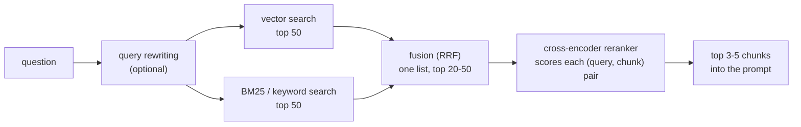

# Better retrieval: hybrid search and reranking

## Why this matters

[2.9](/part-02-programming-with-llms/2.9-rag-fundamentals) ended on a rule: when a RAG answer is wrong, look at the retrieved chunks first, because a model can't use what isn't in the prompt. Once you've done that for a while, two kinds of retrieval failure dominate. Either the right chunk **isn't found** (an exact error code, a function name or a product name that the embedding model treated as just another string, as in [2.8](/part-02-programming-with-llms/2.8-embeddings-in-practice)), or it **is found but ranks 11th** and you only send five. The standard fixes are cheap to describe: add a keyword search next to the vector search and merge the two lists (**hybrid search**), then let a slower, more accurate model re-order a wide shortlist (**reranking**). Anthropic's retrieval post puts the combination at the centre of its recipe, and its numbers (below) are the reason this chapter is core.

The other half of the chapter is more important than either technique: **how you know it helped.** A reranker you can't measure is a latency bill with a story attached. You'll finish with recall@k and MRR on your own questions, before and after each change.

**Learning goals**

- Combine BM25 and vector search (reciprocal rank fusion)
- Add a reranker
- Measure recall@k and MRR on your question set

## Explanation

### The shape of the fix: retrieve wide, then narrow

Every technique here fits one picture. The first stage is **cheap and recall-oriented**: it should make sure the answer-bearing chunk is somewhere in a long list, say the top 50. The later stages are **expensive and precision-oriented**: they decide which handful of those go in the prompt.

Anthropic's description of its own pipeline has exactly this shape: take "the top potentially relevant chunks (we used the top 150)", then pass them through a reranking model and keep "the top-K chunks (we used the top 20)" ([Anthropic: Contextual Retrieval](https://www.anthropic.com/news/contextual-retrieval)). The numbers are theirs, tuned for their data. What carries over is the funnel: each stage is allowed to be sloppier about order than the next, but not about **coverage**.

This also tells you what to measure. A reranker can only re-order what the first stage found. If the right chunk isn't in the candidates, no reranker can help, so the first stage is judged by **recall at the candidate depth** and the last stage by **where the right chunk lands in the few you send** (rank-sensitive metrics, last section).

### BM25: keyword search that doesn't know what words mean

You met BM25 in 2.8 as the thing that finds `ERR_4021`. Here is what it actually does, because knowing its mechanism tells you when it fails.

BM25 scores a document against a query by adding up, for each query term, three ingredients:

1. **Term frequency, with saturation.** The more often the term appears in the document, the higher the score, but with diminishing returns: the tenth occurrence adds much less than the second. A constant `k1` controls how fast it saturates.
2. **Inverse document frequency.** A term that appears in few documents is worth more than one that appears in most. "Embedding" tells you less than `ERR_4021` in a corpus about embeddings.
3. **Length normalization.** A match in a short chunk counts for more than the same match in a long one; a constant `b` controls how strongly.

SQLite's FTS5 implements it and documents its choices: `k1` and `b` "are both constants, hard-coded at 1.2 and 0.75 respectively", and the function returns a value where "the better the match, the numerically smaller the value returned", because FTS5 multiplies the textbook score by -1 so that a plain `ORDER BY bm25(ft)` puts the best match first ([SQLite FTS5](https://www.sqlite.org/fts5.html)). If you ever merge BM25 scores with other scores, remember that sign.

What BM25 is good at: exact identifiers, rare names, quoted phrases, error codes, flags, anything where the user pastes the words the document contains. What it can't do: **it has no idea that "change your credentials" and "reset your password" mean the same thing.** It matches tokens, so a query that shares no word with the answer scores zero. The two retrievers fail on opposite things:

| Failure | Vector search | BM25 |
|---|---|---|
| Exact code, name or flag (`ERR_4021`, `eager_input_streaming`) | Often blurry: a similar-looking code scores close (2.8) | Strong |
| Paraphrase ("change your credentials" for "reset password") | Strong | Misses: no shared words |
| Common words in the question ("How do I ... the ...") | Handled by meaning | Stop words and filler add noise unless weighted down by IDF |
| Typos | Tolerant | Misses unless you add fuzzy matching |
| Needs a model at index time | Yes (embeddings) | No |
| Language handling | Depends on the embedding model | Depends on the tokenizer (FTS5 lets you choose one) |

Three practical points that bite when you wire up FTS5 yourself:

- **Don't pass the raw question to `MATCH`.** FTS5 has its own query syntax (quotes, `AND`/`OR`/`NOT`, column filters, `-`, `:`), and a user question containing a hyphen or a colon can raise a syntax error or mean something you didn't intend. Turn the question into a list of quoted terms yourself.
- **Decide AND vs. OR.** With the default implicit AND, a long natural-language question matches nothing, because no chunk contains every word. Joining the terms with `OR` and letting BM25 rank is the usual fix for questions; drop very short and filler words first.
- **Index what you embed.** If you prepend the heading trail or a contextual sentence to the text before embedding (2.9), do the same for the BM25 index. Anthropic's "Contextual BM25" is the same idea applied on the keyword side.

::: info 📖 Read now
[SQLite FTS5](https://www.sqlite.org/fts5.html) · docs · ~15 min · **essential**

You skimmed it in 2.8; read it as the tool you'll build on. Look for: the full-text query syntax (what a bare word, a quoted phrase and `OR` do, and which characters are special), the `bm25()` section including the sign explanation above, and the tokenizer options. The page is long: you need the sections on creating a table, queries, and auxiliary functions.
:::

### Hybrid search and rank fusion

Run both retrievers, then merge. The merge is where people go wrong, because the two lists aren't comparable. A BM25 score has no fixed range (it grows with query length and corpus statistics) and a cosine similarity sits in a narrow band; "add them up" gives one of them the vote by accident. Normalizing both (min-max, z-score) is possible but fragile: one outlier stretches the scale. It also needs raw scores from both systems, which a hosted search service may not give you.

**Reciprocal rank fusion (RRF)** sidesteps scores entirely and uses only each document's **rank** in each list. From the original paper: for a set of rankings R, the score of a document d is the sum over rankings of `1 / (k + r(d))`, where r(d) is its rank (1 = best) and "k = 60 was fixed during a pilot investigation and not altered during subsequent validation" ([Cormack, Clarke and Büttcher, SIGIR 2009](http://cormack.uwaterloo.ca/cormacksigir09-rrf.pdf)). Two properties explain why it's the default. High ranks matter more, but "the importance of lower-ranked documents does not vanish" the way it would with an exponential; and the constant k "mitigates the impact of high rankings by outlier systems", so one retriever's confident #1 can't dominate by itself. The paper reports RRF beating Condorcet fusion on every TREC set it tested and the best individual system on all but one (TREC 9, where the best run had a human in the loop); and that k = 60 was near-optimal though the choice was not critical. It is a two-page paper from 2009 about a simple formula, and it has held up.

A worked example with four chunks and two lists, so you can check your own implementation against it:

| Chunk | Vector rank | BM25 rank | RRF score (k = 60) |
|---|---|---|---|
| B | 3 | 2 | 1/63 + 1/62 = 0.0320 |
| A | 1 | 8 | 1/61 + 1/68 = 0.0311 |
| D | not in list | 1 | 1/61 = 0.0164 |
| C | 2 | not in list | 1/62 = 0.0161 |

Read the table for its behaviour. B wins without being first anywhere: **agreement between retrievers beats a single high rank.** A, first in the vector list but eighth in BM25, is barely behind. D and C, each found by only one retriever, fall below both. That is the intended trade: fusion favours chunks both retrievers like, which is the safe choice, at the cost of burying a chunk that only one of them found. Hold that thought for the measurement below.

Knobs worth knowing, in the order to touch them:

1. **Depth per list.** Fuse the top 50 of each, not the top 5: a chunk ranked 12th by BM25 and 9th by vectors only wins if both lists are deep enough to contain it.
2. **Weights.** Multiply a list's contribution by a weight if you trust one retriever more (BM25 for code and identifiers, vectors for prose). Tune on your questions, not by taste.
3. **k.** Leave it at 60 until you have a reason; the paper found it uncritical.

Jason Liu, who has written a lot on practical RAG, makes the same recommendation in plain terms: use "both full-text search and vector search (embeddings)", observing that full-text search "can be faster, but vector search can provide better recall"; he also reports, on one dataset of repository issues, about 55% recall for full-text search against about 65% for embeddings ([Jason Liu: Systematically Improving Your RAG](https://jxnl.co/writing/2024/05/22/systematically-improving-your-rag/)). Those figures belong to his data. The portable part is that **which retriever wins depends on the corpus**, which is a reason to measure rather than to assume.

::: info 📖 Read now
[Cormack, Clarke and Büttcher: Reciprocal Rank Fusion outperforms Condorcet and individual rank learning methods](http://cormack.uwaterloo.ca/cormacksigir09-rrf.pdf) · paper · ~10 min (2 pages) · **essential**

Short enough to read whole. Look for: the one-line formula, the argument for the shape of `1 / (k + rank)`, and the contrast with CombMNZ, which needs scores and a cut-off rank. Notice that the unsupervised method matched or beat the supervised learning-to-rank systems the authors set out to study.
:::

### Reranking: a cross-encoder reads the query and the chunk together

In 2.8 you saw the split between two model shapes (glossary: bi-encoder vs. cross-encoder). Search uses a **bi-encoder**: query and chunk are embedded **separately**, so chunk vectors are computed once at index time and a query costs one embedding plus a nearest-neighbour lookup. The price is that the model has to squeeze everything about a chunk into one vector before it knows what will be asked.

A **cross-encoder** takes the query and one chunk **together** as a single input and outputs one relevance score. The Sentence Transformers documentation states the trade-off plainly: cross-encoders have "the higher performance, as they perform attention across the query and the document", but "scoring thousands or millions of (query, document)-pairs would be rather slow", which is why the documented pattern is a fast retriever followed by a re-ranker over its shortlist ([Sentence Transformers: Retrieve & Re-Rank](https://www.sbert.net/examples/sentence_transformer/applications/retrieve_rerank/README.html)). In cost terms: a bi-encoder search touches the query once; a reranker runs the model **once per candidate, per query**, and none of it can be precomputed, because the input depends on the question.

That cost sets the design:

- **Depth.** Rerank tens to low hundreds of candidates, not the corpus. The Sentence Transformers page uses 100 as its example; Anthropic reranked 150. More candidates raise the chance the right chunk is in the pool and raise latency linearly.
- **Latency is on the request path.** Anthropic's note is honest about it: reranking "inevitably adds a small amount of latency, even though the reranker scores all the chunks in parallel", and there's a trade-off between reranking more chunks and cost and latency ([Anthropic: Contextual Retrieval](https://www.anthropic.com/news/contextual-retrieval)). Measure it on your hardware; a local reranker on a laptop is a different animal from a hosted one.
- **The reranker's score is an ordering, not a probability.** Use it to sort and to cut at k. A fixed threshold needs calibration on your data, as with similarity scores in 2.8.

What it buys: on Anthropic's setup, adding reranking on top of contextual embeddings and contextual BM25 took the top-20 retrieval failure rate from 2.9% to 1.9% (5.7% without any of the three techniques), a 67% reduction in total ([Anthropic: Contextual Retrieval](https://www.anthropic.com/news/contextual-retrieval)). One more caution from the literature: the BEIR benchmark, which evaluates retrieval models zero-shot across many datasets, concluded that "BM25 is a robust baseline" and that re-ranking and late-interaction models "on average achieve the best zero-shot performances" at high computational cost, while dense retrievers "often underperform" ([Thakur et al.: BEIR](https://arxiv.org/abs/2104.08663)). So the ordering of effort is: get BM25 right, add vectors for coverage, fuse, then pay for a reranker when measurement says the right chunk is in the pool but too low.

**What you can use as a reranker.** This is the part that changes fastest, so treat the list as options to check, not a recommendation, and keep prices on [Landscape](/landscape) rather than in your code comments:

| Option | What it is | Fits your setup? |
|---|---|---|
| Hosted rerank APIs | A provider scores `(query, documents[])` for you | Costs money per call; check the provider's current docs and Landscape before using. Not needed for this chapter. |
| An open reranker run in Node | [`@huggingface/transformers`](https://huggingface.co/docs/transformers.js/index) lists `text-classification` among its supported tasks, and the [Xenova/bge-reranker-base](https://huggingface.co/Xenova/bge-reranker-base) card shows `pipeline('text-classification', 'Xenova/bge-reranker-base')` on a single sentence, plus an `AutoTokenizer` + `AutoModelForSequenceClassification` snippet that scores query-document pairs. | Runs in TypeScript, local and free; first run downloads the model. Verify the output shape yourself (it is a classifier, so it returns a label and a score). I did not run it. |
| A Qwen3 reranker | [Qwen3-Reranker-0.6B](https://huggingface.co/Qwen/Qwen3-Reranker-0.6B) (Apache-2.0) scores a pair by the probability of "yes" against "no" in a judging prompt. Its card documents Transformers, Sentence Transformers and vLLM, and says nothing about Ollama or llama.cpp. | Python-side. Ollama's library has community uploads with "rerank" in the name, but I found no rerank endpoint in Ollama's own documentation, so don't assume one. I did not run it. |
| **A general LLM as the reranker** | Prompt a model you already run (`qwen3:8b`) to rate each (question, chunk) pair, then sort by the rating | Works today through Ollama's chat API and costs nothing; slower and noisier than a trained reranker, which is itself a useful lesson. I used it for the measurement below. |

::: info 📖 Read now
[Sentence Transformers: Retrieve & Re-Rank](https://www.sbert.net/examples/sentence_transformer/applications/retrieve_rerank/README.html) · docs · ~15 min · **essential**

The cleanest statement of why two stages. Look for: the bi-encoder diagram versus the cross-encoder diagram, the sentence on why a cross-encoder can't be used for the first pass, and the sizes of the candidate list in the example. Ignore the Python; the idea is what you need.
:::

::: tip 📖 Skim
[Qwen3-Reranker-0.6B model card](https://huggingface.co/Qwen/Qwen3-Reranker-0.6B) · docs · ~10 min · optional

A modern small reranker. Look for: the exact judging prompt (system message, `<Instruct>`, `<Query>`, `<Document>`), how the score is computed from the "yes" and "no" logits, and the instruction line. This is the same pointwise idea as the LLM-as-reranker you'll prompt by hand, specialised by training.
:::

::: tip 📖 Skim
[Transformers.js docs](https://huggingface.co/docs/transformers.js/index) and the [Xenova/bge-reranker-base model card](https://huggingface.co/Xenova/bge-reranker-base) · docs · ~15 min · optional

Only if you choose the local-reranker route in Node. Look for: the `pipeline` API, the list of supported tasks, and the usage snippet on the model card. Check how a pair of texts is passed in and what comes back before you write code around it.
:::

### Query rewriting: fix the question before searching

Everything so far improves how chunks are found for the query as typed. **Query rewriting** changes the query. It earns its place when users type queries that are bad search inputs:

- **Follow-up questions.** "And what about the Pro plan?" is useless alone. An LLM call turns the conversation so far plus the new message into a **standalone question** ("What are the usage limits on the Pro plan?") before retrieval. This one is nearly always worth doing in chat.
- **Multi-part questions.** "Compare how streaming and tool calling handle errors" needs information from two places. Splitting into sub-queries, retrieving for each and merging the results is the fix for the "needs two places" question of the 2.9 practice.
- **Multiple phrasings.** Generate three alternative wordings, retrieve for each, fuse the lists with RRF. You've already built the fusion; a list per phrasing is one more input.
- **Hypothetical answers (HyDE).** Ask a model to write a plausible answer to the question and embed that instead. Gao et al. describe the generated document as one that "captures relevance patterns but is unreal and may contain false details", with a retriever then mapping it to real documents ([Gao et al.: HyDE](https://arxiv.org/abs/2212.10496)). It helps when questions and documents are worded very differently. The risk is also in that sentence: a confidently wrong hypothetical answer can pull in the wrong neighbourhood.

Rewriting costs an LLM call on every query (latency before retrieval even starts), and it can distort a question that was fine. So apply the same rule as for everything else in this chapter: **add it for a failure you've seen, and check on your question set that it fixed that failure without breaking others.** Because it feeds the first stage, it shows up in recall at the candidate depth, not in reranker metrics.

::: tip 📖 Skim
[Gao et al.: Precise Zero-Shot Dense Retrieval without Relevance Labels (HyDE)](https://arxiv.org/abs/2212.10496) · paper · ~15 min (abstract and introduction) · optional

Look for: the two-step recipe (generate, then encode), why the authors say the generated text can be wrong and still work, and the comparison against an unsupervised dense retriever and against fine-tuned ones.
:::

### Retrieval metrics: recall@k, precision@k, MRR

You defined hit rate and MRR in 2.9. Here they become the scoreboard, so define them carefully. Hamel Husain's evals FAQ treats retrieval as its own search problem to evaluate first, with the traditional measures: Recall@k ("of all relevant documents, how many did you retrieve in the top k?"), Precision@k ("of the k documents retrieved, how many were relevant?") and MRR ("how high up was the first relevant document?"), and suggests generating test queries synthetically from documents in your corpus ([Hamel Husain: Evals FAQ](https://hamel.dev/blog/posts/evals-faq/#q-how-should-i-approach-evaluating-my-rag-system)).

For a question set where each question has **one** answer-bearing chunk (the usual case at your scale), the formulas simplify:

- **recall@k** = (questions whose answer chunk is in the top k) / (all questions). It's yes/no per question, then averaged. Use a large k to judge a candidate list (recall@50) and a small k to judge what you send (recall@5).
- **precision@k** = relevant results in the top k / k. With one answer chunk per question it is at most 1/k, so it is mostly useful once questions have several relevant chunks or when you're worried about noise in the prompt.
- **MRR** = average of `1 / rank` of the first relevant chunk, 0 when it is absent. Ranks 1, 2, 3, 10 give 1, 0.5, 0.33, 0.1. It rewards moving the right chunk up even when recall@5 doesn't change.

A small hand example. Four questions, answer chunk ranks 1, 3, absent (not in the top 50), 2:

- recall@3 = 3/4 = 0.75; recall@1 = 1/4 = 0.25
- MRR = (1 + 0.333 + 0 + 0.5) / 4 = 0.458

Two metrics, two jobs. **recall@k tells you whether a stage found the chunk; MRR tells you how well it ordered it.** A reranker should barely move recall at a deep cut-off (it re-orders the same pool) and should move MRR and recall at small k. If the reranker doesn't change those, either your first stage already ranks well, or the reranker is no better than the fused order, and both are worth knowing.

Some other traps in your own measurement:

- **Define "relevant" before you run anything.** Several chunks may contain the answer (a glossary and the chapter body; two chapters that explain the same thing). Decide whether any chunk containing the expected answer string counts, or only the one you labelled; write the rule down and keep it for every run.
- **Don't tune on the questions you report.** With 10 to 12 questions, one question moving is 8 to 10 percentage points of recall. Treat a change of one question as noise, and prefer questions you didn't look at while building.
- **Questions you wrote while reading the chapters share words with them.** That flatters BM25. Make some questions paraphrases that avoid the document's own wording; that is where vectors earn their place, and where you'd learn what hybrid buys.
- **Ranks are relative to a corpus.** Re-chunking changes every rank. Store the chunker and parameters next to the results, as in 2.9.

#### A small measurement, to show the mechanics

On 2026-11-10 I ran all four configurations on the book itself: chapters 2.1 to 2.9 split into 307 chunks on headings (long sections cut at paragraph breaks around 1,500 characters), each chunk indexed with its file and heading in front. Vector search used `qwen3-embedding:0.6b` through Ollama with the query instruction from 2.8; BM25 used SQLite FTS5 with the question turned into quoted terms joined by `OR`; fusion was RRF with k = 60 over the top 50 of each; the reranker was `qwen3:8b` with thinking off and temperature 0, asked to rate each of the top 20 fused chunks for "does this passage contain the answer" from 0 to 9, ties kept in fused order. Twelve questions I wrote from facts I had seen in those chapters, roughly half of them leaning on an exact identifier or option name and half phrased more loosely (I did not control the split); a chunk counted as right if it contained the expected phrase. The script was not kept in the repo, so treat the numbers as an unreproduced illustration, not data you can re-check. Ranks of the first right chunk (a dash means absent from the top 50):

| Question (short) | Vector | BM25 | Hybrid (RRF) | Hybrid + rerank top 20 |
|---|---|---|---|---|
| Zod schema to JSON Schema | 1 | 1 | 1 | 1 |
| Stream tool arguments without buffering | 44 | 1 | 11 | 10 |
| Max explicit cache markers | 3 | 1 | 1 | 1 |
| What a spend-cap 429 lacks | 1 | 1 | 1 | 1 |
| Score of the wrong error code | 5 | 1 | 2 | 2 |
| Contextual embeddings alone: failure reduction | 1 | 4 | 1 | 1 |
| Why 1-hour cache isn't always cheaper | 5 | 9 | 6 | 1 |
| Where parallel tool results go | 2 | 1 | 1 | 1 |
| Name for a trailing assistant message | 19 | 2 | 2 | 1 |
| Replacement for the thinking budget | 5 | 17 | 5 | 3 |
| SQL to create a keyword table | 2 | 1 | 1 | 1 |
| Time to first token | 2 | 1 | 2 | 1 |

| | recall@1 | recall@3 | recall@5 | MRR |
|---|---|---|---|---|
| Vector | 3/12 | 7/12 | 10/12 | 0.459 |
| BM25 | 8/12 | 9/12 | 10/12 | 0.743 |
| Hybrid (RRF) | 6/12 | 9/12 | 10/12 | 0.663 |
| Hybrid + rerank | 9/12 | 11/12 | 11/12 | 0.828 |

Read it for the mechanics, not as a verdict. Twelve questions on one corpus I had just read can't rank methods, and these questions very likely favour keyword matching (I wrote them from the text), which is exactly the bias warned about above. With that said, four things are worth taking away:

1. **BM25 beat vectors here**, and it needed no model. On a technical corpus full of identifiers, that is plausible, and it is why you measure before assuming the vector store is the main act.
2. **Fusion was not better than the best single retriever.** Its MRR (0.663) sits between the two. What it did was cap the damage: vectors ranked one answer 44th and another 19th, BM25 ranked two answers 17th and 9th, and hybrid never fell below 11th. That insurance is its real value; it is not a guaranteed uplift.
3. **The reranker helped most where fusion left the answer at ranks 5 to 11** ("why 1-hour isn't free", "thinking budget"), and left some questions it couldn't fix (the streaming-arguments question ended at rank 10: the chunk with the exact option name was found first by BM25, then diluted by fusion, and a general LLM's rating didn't pull it back).
4. The reranker here was a general 8B model prompted to rate passages, which is the weakest honest version of the idea. It cost 240 model calls for 12 questions (20 per question) and, on my machine, minutes of wall-clock time, so a trained cross-encoder that scores a pair in a few milliseconds is a different cost story.

::: tip 📖 Skim
[Hamel Husain: Evals FAQ, "How should I approach evaluating my RAG system?"](https://hamel.dev/blog/posts/evals-faq/#q-how-should-i-approach-evaluating-my-rag-system) · article · ~10 min (that answer) · essential

The page is a long FAQ; read only this question's answer. Look for: why retrieval is evaluated before generation, the three metrics in one place, and how it suggests building the query set from your own documents. It points forward to Part 4, where the question set becomes a regression eval.
:::

::: tip 📖 Skim
[Jason Liu: Systematically Improving Your RAG](https://jxnl.co/writing/2024/05/22/systematically-improving-your-rag/) · article · ~25 min · optional

Look for: generating synthetic questions per chunk as a baseline, what he reports for his two datasets (recall numbers for repository issues; for essays only that the two retrievers "basically performed the same", with full-text search about 10 times faster), and how his hybrid recommendation is framed. Treat his numbers as his data's, not yours.
:::

::: tip 📖 Skim
[Anthropic: Introducing Contextual Retrieval](https://www.anthropic.com/news/contextual-retrieval) · article · ~10 min (second reading) · essential

You read this for 2.9. Read the BM25 and reranking sections again now. Look for: the "top 150 then top 20" funnel, the latency caveat for reranking, and which configuration the 67% figure belongs to.
:::

::: tip 📖 Skim
[Thakur et al.: BEIR](https://arxiv.org/abs/2104.08663) · paper · ~10 min (abstract, second reading) · optional

Look for: the three families it compares (sparse, dense, re-ranking) and its statement about BM25 as a baseline.
:::

::: tip 📕 Book
Chip Huyen, *AI Engineering* (O'Reilly, 2025), ch. 6 "RAG and Agents": "Retrieval Algorithms" (p. 257) and "Retrieval Optimization" (p. 268), up to "RAG Beyond Texts" on p. 273 ([table of contents](https://github.com/chiphuyen/aie-book/blob/main/ToC.md)) · book · ~1 h · optional

You may have read the first half for 2.9. Look for: how the chapter compares term-based and embedding-based retrieval, and what it says to do after the first retrieval pass. The [chapter summary](https://github.com/chiphuyen/aie-book/blob/main/chapter-summaries.md#chapter-6-rag-and-agents) says term-based retrievers "can provide strong baselines" and embedding-based ones "have the potential to outperform" them, which matches the measurement above.
:::

### Putting it in order: what to try, and when

| Symptom in your retrieval traces | Likely cause | First thing to try |
|---|---|---|
| Right chunk absent from the top 50, and the query holds an identifier | Vectors blur exact strings | Add BM25; fuse |
| Right chunk absent, query is a paraphrase | BM25 has no overlap; or the chunk lacks its context | Vector side; contextual retrieval (2.9); query rewriting |
| Right chunk in the top 50 but rank 6 to 30 | Ordering | Reranker over the top 20 to 50 |
| Chat follow-ups retrieve garbage | The query isn't standalone | Rewrite the question using the conversation |
| Question needs two sections | One query can't match both | Split into sub-queries, retrieve each, fuse |
| Reranker changes nothing | The first stage already orders well, or the reranker is weak | Look at the rank histogram before and after, not a single average |

Change one thing at a time and re-run the same questions. That discipline matters more than any technique on the list.

## Practice

**Brief:** Add BM25 and rank fusion, then a reranker, to your 2.9 RAG pipeline. Report recall@5 and MRR for each configuration on the **same** 10 or more questions you wrote for 2.9. All local and free (`qwen3-embedding:0.6b`; `qwen3:8b` or `qwen3:14b` through Ollama). You write all the code; I haven't provided any.

**Where:** `experiments/22-rag/`: the same folder as 2.9. Copy nothing across experiments; extend your own scripts and add a new section to the README (the skeleton is there: "2.10: better retrieval"). Keep `questions.json` and the chunk index from 2.9 unchanged so the before and after are comparable.

**Steps:**

1. **Freeze the baseline.** Re-run your 2.9 vector retrieval, with no code change, on the same questions. Record for each question the rank of the answer-bearing chunk (up to 50, else "absent") and compute recall@5, recall@50 and MRR. These numbers are your "before". Write down your rule for what counts as a right chunk (see the traps above).
2. **Add questions that test the new ideas.** Make sure the set has at least 3 questions with an exact string (a flag, a file name, a code) and at least 3 paraphrases that avoid the document's own words. If your set from 2.9 lacks these, add them now and re-run the baseline on the full set. Say which questions you added after seeing results, if any.
3. **Predict before you run.** For each question, write which of vector, BM25 and hybrid you expect to rank the answer highest.
4. **Build the BM25 side.** Create an FTS5 table over the same chunk text you embed (with the same heading prefix). Write the function that turns a question into a safe `MATCH` string. Return the top 50 chunk ids by `bm25()`. Run all questions through it alone and compute the same three metrics. Check at least one question where the sign of the score confuses you.
5. **Fuse.** Write reciprocal rank fusion over the two top-50 lists with k = 60. Test it against the four-chunk table in the chapter before you trust it. Compute the metrics for the hybrid list. Then change one thing (the depth per list, a weight on BM25, or k) and note what moved.
6. **Add a reranker.** Take the top 20 of the fused list and re-order it with one of: a prompted local LLM, or an open cross-encoder in Node. For each question save the order before and after. Compute recall@5 and MRR for the reranked list, and time the rerank step per question.
7. **Break it.** Find the question where the reranker made things worse than the fused order, if any, and say in one sentence why. If none, find the question it fixed that fusion couldn't.
8. **Optional: query rewriting.** Choose one question that failed in every configuration. Try one rewrite (a standalone question, three phrasings fused, or a hypothetical answer), re-run only that question, and say whether it fixed it. Then re-run all questions to check that it didn't hurt others.
9. **Optional: does retrieval still matter to answers?** Re-run the 2.9 generation step on the best retrieval configuration and compare your retrieval-versus-generation failure counts with 2.9's.

**Done when:**

- The README table has one row per question and one column per configuration (vector, BM25, hybrid, hybrid plus rerank) with the rank of the right chunk, plus a totals table with recall@5, recall@50 and MRR for each.
- It records the same 10+ questions as 2.9 (with any additions listed) and your retrieval rule for what counts as right.
- Your fusion code reproduces the chapter's four-chunk example.
- The README says what the reranker's per-question latency was, and what you'd have to change to afford it in a real app.
- It names one question each method fixed and one it did not.
- You can state, with your own numbers, whether the hybrid and reranker steps moved the chunks that were absent or the chunks that were present but low.

## Check questions

1. Your vector search ranks `ERR_4021 refresh token` below five chunks about other error codes. Why, and what is the cheapest fix?

   

Answer

   An embedding model compresses meaning, so an identifier that is a rare token string is just one part of a vector, and a different but similar-looking code can score close (the 2.8 measurement: 0.416 for the wrong code against 0.510 for the right one). BM25 matches the exact token and weights rare terms heavily through IDF. The cheapest fix is to add BM25 (SQLite FTS5 is enough) and fuse it with the vector list, so the keyword match lifts the right chunk without losing paraphrase matching.

   

2. Why can't you just add a BM25 score and a cosine similarity to merge two result lists, and what does reciprocal rank fusion do instead?

   

Answer

   The scores live on different scales: BM25 has no fixed range and depends on query length and corpus statistics (and in FTS5 a lower value is better), while cosine similarity sits in a narrow band, so a sum lets one of them dominate by accident. Normalising helps only partly and is thrown off by outliers. RRF ignores scores and sums `1 / (k + rank)` over the lists a document appears in (k = 60 in the original paper), so only the ranks matter, a document in both lists beats one in a single list, and one retriever's confident first place cannot dominate alone.

   

3. A reranker is added and recall@50 is unchanged while MRR rises from 0.46 to 0.58. Is that consistent with a working reranker? What would worry you instead?

   

Answer

   Yes, it is what a reranker should do: it re-orders the same candidate pool, so recall at a deep cut-off stays the same, and it moves the right chunk higher, which MRR and recall at small k reward. What would worry you is the opposite: recall@50 moving at all (you've changed the first stage, not only the reranker), or MRR not moving (the pool already ordered well, or the reranker is no better than the fused order). Also check whether the improvement is one or two questions in a set of ten before believing it.

   

4. Why is a cross-encoder more accurate than comparing embeddings, and why don't you use it for the first-stage search?

   

Answer

   It reads the query and the chunk together, so attention can compare their words directly, instead of squeezing the chunk into one vector before the question is known. The cost is that the input depends on the query, so nothing can be precomputed: scoring needs one model run per (query, chunk) pair. Running that against the whole corpus per query is far too slow, so it only re-orders a shortlist from a cheap first stage (tens to a few hundred candidates), with latency growing with the candidate count.

   

5. Your retrieval metrics improved after you added query rewriting, but you tuned the rewrite prompt while looking at the same 10 questions you report. What's wrong, and what do you do?

   

Answer

   You tuned on the test set, so the improvement may only reflect those ten questions; with ten questions, one question changing is ten percentage points. Keep a set of questions you did not look at while tuning (write new ones, or hold some back), re-run the configurations on them, and report both. Also record the cost: rewriting adds an LLM call before retrieval on every query, so check that it didn't change questions that were already fine.

   

## My understanding

<!-- Written by the learner, in their own words. Agents never fill this in. -->
