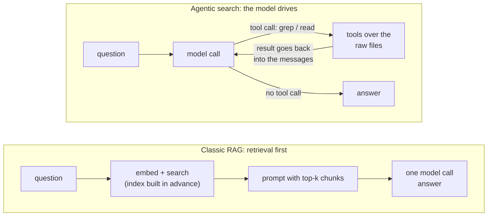

# Agentic search vs. vector DB

## Why this matters

Chapters 2.8 to 2.10 built a retrieval pipeline: chunk, embed, search, fuse, rerank, prompt. It is the default answer to "the model needs to know my documents". It is not the only answer, and for one very visible kind of corpus it is not what the best tools use. Coding agents mostly don't keep a vector database of your repository. They run `grep`, list files and read them, in the loop you built in [3.2](/part-03-agents/3.2-agent-loop).

That is a design choice you will face yourself: when a model needs information from a pile of text, do you build a retriever that runs before the model, or give the model search tools and let it look? The two have different costs, fail in different ways, and the right pick depends on the corpus more than on fashion. This chapter gives you the mechanism of the second option, the arguments for and against it, a cost model you can reason with, and a small measurement of my own that shows a failure the arguments don't prepare you for.

**Learning goals**

- Compare agentic search with classic RAG on cost, latency and quality
- Explain why coding agents prefer grep/read tools
- Pick an approach for a given corpus

## Explanation

### Two ways to get the right text into the prompt

In the pipeline from [2.9](/part-02-programming-with-llms/2.9-rag-fundamentals) the retrieval happens **before** the model runs. Your code embeds the question, searches an index you built in advance, and pastes the winners into the prompt. The model sees the result of one search it didn't choose.

In **agentic search** there is no retriever in front of the model. The model gets search tools (list files, grep, read a file) and a loop. It decides what to look for, reads what comes back, decides whether that was enough, and searches again if not. The "retriever" is the model plus the loop from 3.2.

Everything that 2.10 made you build as separate machinery has a counterpart in the loop, done by the model with prompting instead of code:

| In the RAG pipeline | In agentic search |
|---|---|
| Query rewriting (2.10) | The model writes its own queries, and tries different words after a miss |
| Candidate list, then reranker | The model reads grep hits and decides which file to open |
| Fixed top-k | The model stops when it judges it has enough |
| Multi-hop questions need a special design | The next query can use what the last one returned |
| Index, built and kept fresh | None: the tools read the files as they are now |

The right-hand column is why the approach is attractive, and the table's last row is the part the arguments below lean on. It also hides the catch: every cell on the right is a judgement the model must get right, and nothing in the loop will tell you when it didn't.

### What the tools are

The tool set is small and ordinary. Claude Code's documentation groups its built-in tools into categories, and one of them is **Search**: "Find files by pattern, search content with regex, explore codebases", next to file operations and shell execution ([Claude Code: How Claude Code works](https://code.claude.com/docs/en/how-claude-code-works)). Its Grep tool is built on ripgrep and uses ripgrep's regex syntax, not POSIX grep ([Claude Code: Tools reference](https://code.claude.com/docs/en/tools-reference)); that page also says Grep and Glob are absent by default on macOS, Linux and WSL, where Claude searches with `find` and `grep` through the Bash tool instead (the page lists the settings that bring them back). The shape matters more than the names:

- **list / glob**: file names and directory structure. Cheap, and names are information.
- **grep**: exact or regex matches with a bit of surrounding context. The workhorse.
- **read**: a file, or a line range of one.

All three return **text you can bound**. The thing you give the model is not a document, it is a way to find documents. This leads to the idea the Anthropic engineers use to describe it.

### Just-in-time context loading

Anthropic's context-engineering article names two strategies. The older is what you built in 2.9: "embedding-based pre-inference time retrieval". The one the article says teams increasingly augment it with is "just in time": agents "maintain lightweight identifiers (file paths, stored queries, web links, etc.)" and "use these references to dynamically load data into context at runtime using tools". Claude Code is the article's example: its "primitives like glob and grep allow it to navigate its environment and retrieve files just-in-time" ([Anthropic: Effective context engineering for AI agents](https://www.anthropic.com/research/effective-context-engineering-for-ai-agents)).

Three properties follow from that, and they are worth separating:

1. **Lightweight identifiers stand in for content.** A file path costs a dozen tokens; the file may cost ten thousand. The agent carries paths, line numbers and queries, and pays for content only when it opens something.
2. **Progressive disclosure.** The article says this lets agents "incrementally discover relevant context through exploration", and that each interaction yields context that informs the next decision. A directory listing tells the agent which files exist; file names hint at purpose; a grep hit narrows it to a line range. The same idea appears as agent skills, where only a name and description are loaded up front ([0.3](/part-00-catch-up/0.3-standards-and-orgs)).
3. **The window holds working notes, not the library.** Whatever is not currently useful is just not in `messages`. This is the context-engineering side of the loop's growth problem from 3.2: the loop only grows, so what you let in matters. [3.4](/part-03-agents/3.4-context-engineering) is the full treatment.

::: info 📖 Read now
[Anthropic: Effective context engineering for AI agents](https://www.anthropic.com/research/effective-context-engineering-for-ai-agents) · article · ~20 min · **essential**

Read the whole article once, slowly; it is the frame for most of Part 3. For this chapter, look for: the section on "just in time" context strategies, what Claude Code does by default (and the hybrid it calls out), and the stated trade-off. Notice that the article never says "never use embeddings"; it says what to add and when.
:::

### Why it works so well for code

Take the properties of a codebase and compare them with what 2.9 and 2.10 spent their effort on.

- **Exact strings are the query.** The question "where is `parseConfig` called?" has a literal answer. This is the case where 2.8 showed embeddings are weak and BM25 is strong; grep is the sharpest keyword search there is, with regex on top. The identifier you need is also in the code, in a spelling the model can usually guess or discover.
- **Code isn't chunkable without loss.** A function depends on its imports, its callers and its types. Cline's engineering blog makes the point bluntly: "when you chunk code for embeddings, you're literally tearing apart its logic." Reading a whole file, then following an import to another, keeps the logic intact.
- **The corpus changes under you.** In a coding session the files change every few minutes, by the agent's own edits. The same post: "An index, by definition, is a snapshot frozen in time." An index must be rebuilt or incrementally updated; `grep` reads the disk as it is ([Cline: Why Cline doesn't index your codebase](https://cline.bot/blog/why-cline-doesnt-index-your-codebase-and-why-thats-a-good-thing)). Cline sells an agent built this way, so treat the post as a vendor's argument, but the staleness and chunking points are mechanism, not marketing.
- **Structure is navigation.** Directory names, file names and imports are a table of contents that someone already wrote. A retriever throws it away when it flattens everything into chunks, unless you put the path back in (which 2.9 had you do).
- **There is a ground truth to check against.** A coding agent can run the tests. Wrong search results show up as failing work, which makes a sloppy search recoverable.
- **No second copy to protect.** Embeddings of your source are another store of sensitive data to secure (Cline's third argument). Whether that outweighs the benefits is your call, but it is a real cost of an index.

::: tip 📖 Read now (second source, and a different tool)
[Cline: Why Cline doesn't index your codebase](https://cline.bot/blog/why-cline-doesnt-index-your-codebase-and-why-thats-a-good-thing) · article · ~10 min · optional

A short argument from a company that bet on exploration. Look for the three problems it names with indexing, and ask for each: does it apply to your notes or documentation corpus, or only to source code? Keep the vendor's interest in mind.
:::

A middle path exists and is worth knowing, because it shows where the cheap half of indexing still pays. Aider builds a **repo map**: a compact listing of files and their most important symbols (classes, functions, signatures) that goes into the prompt up front. It ranks them on "a graph where each source file is a node and edges connect files which have dependencies", and fits them into a token budget set by `--map-tokens`, which defaults to 1k tokens ([Aider: Repository map](https://aider.chat/docs/repomap.html)). That is retrieval, computed from structure instead of from embeddings, and delivered up front instead of through a tool: the "some data up front" half of a hybrid.

### Where it doesn't work

Code is a friendly case. Move to other corpora and the same properties turn against you.

- **The words you need aren't the words in the text.** Ask "how do I get my money back?" over a policy handbook that says "reimbursement". Grep finds nothing for "money back", and the model has to guess synonyms. An embedding retriever bridges that gap by design (2.8). Agents can try several words, but each try costs a turn.
- **Large, flat piles of documents.** Ten thousand support tickets have no table of contents. There is nothing to navigate, and a grep for a common word returns more than fits.
- **Many users, many small questions.** Agentic search spends a handful of model calls per question. At high volume and with a latency budget, "embed once, one model call" is hard to beat.
- **The agent has to be good at searching.** Search is a skill, and small local models in particular are not reliably good at it. The next section shows what that looks like.
- **Silent confidence.** A RAG pipeline always shows you what was retrieved, so you can diagnose it (2.9). An agent can read three files, miss the fourth, and answer fluently. The trace helps afterwards; it doesn't prevent it.

Anthropic's own multi-agent research system makes the opposite choice from a static pipeline on purpose. It says retrieval-augmented approaches "use static retrieval" and that its system uses "a multi-step search that dynamically finds relevant information" ([Anthropic: How we built our multi-agent research system](https://www.anthropic.com/research/multi-agent-research-system)). That is a web research task, where no index of the corpus could exist; the same article is also where the cost numbers in the next section come from.

### Cost and latency

The two designs spend money in different places.

| | Classic RAG | Agentic search |
|---|---|---|
| **Up front** | Chunking, embedding every chunk, storing the index, re-indexing on change | Nothing |
| **Per question** | One query embedding, one search, **one** model call carrying k chunks | **N** model calls, each carrying the whole history so far, plus tool time |
| **What scales with corpus size** | Index build and storage; search stays fast | Nothing in the design, but each search returns more noise, so turns go up |
| **What scales with question difficulty** | Nothing: a hard question costs the same as an easy one | Turns, and with them tokens and seconds |
| **Predictability** | High: same cost per question | Low: a distribution with a long tail |

The per-question row is where agentic search gets expensive, because of what you learned in 3.2: the loop resends the whole message list every turn. Here is an illustrative calculation. The numbers are made up to show the shape; measure your own.

Suppose the system prompt and tool definitions are 1,500 tokens, the question is 50, and each tool round (the model's call plus the returned text) adds about 600 tokens. A five-turn search bills input tokens of roughly 1,550 + 2,150 + 2,750 + 3,350 + 3,950 = **13,750**, because turn *n* carries everything before it. A RAG call with the same 1,500-token prompt and five 400-token chunks bills about **3,500**. Agentic search here costs about four times the input of the pipeline for one question, before output tokens and before counting that a hard question might need ten turns, not five. Two things pull that down. Prompt caching ([2.7](/part-02-programming-with-llms/2.7-prompt-caching)) makes the repeated prefix cheap on providers that cache, because each turn's prefix equals the previous turn's. And one model call that must answer from five chunks may be a worse answer than five turns of looking. Prices per token go on [Landscape](/landscape), not here.

Latency has the same shape. The article says it directly: "runtime exploration is slower than retrieving pre-computed data" (Anthropic's context-engineering article, above). Each turn is a full model round trip plus the tool, and a turn can't start before the previous one finishes. The multi-agent research article puts numbers on the token side: agents "typically use about 4× more tokens than chat interactions" and multi-agent systems "use about 15× more tokens than chats". It also reports that, on its BrowseComp evaluation, three factors explained 95% of the performance variance and "token usage by itself explains 80% of the variance" (same article). Read that as a reminder that spending more search tokens is often what buys quality: the cost isn't waste, it is the mechanism. The honest comparison is cost per correct answer on your questions, not cost per call.

::: info 📖 Read now
[Anthropic: How we built our multi-agent research system](https://www.anthropic.com/research/multi-agent-research-system) · article · ~20 min · optional here (essential in 3.10)

You'll meet this article again for multi-agent design. For this chapter, read only the parts about why a static retrieval pipeline wasn't enough, the guidance on search strategy ("Start wide, then narrow down"), and the token-usage section. Look for how they describe the cost, and what they say it is worth.
:::

### Hybrids: retrieval as one tool among many

The either/or framing is a trap. The strongest real systems combine both, and there are two common ways.

**Retrieval up front, exploration on top.** Put cheap, high-value context in before the loop starts, then let the model look for the rest. Anthropic's article describes this hybrid as "retrieving some data up front for speed, and pursuing further autonomous exploration at its discretion", and notes it "might be better suited for contexts with less dynamic content, such as legal or finance work". CLAUDE.md files and Aider's repo map are both "up front" pieces; `grep` is the "at its discretion" piece.

**Retrieval as a tool.** Wrap your 2.10 pipeline in a function, `search_docs(query)`, and give it to the agent next to `grep` and `read_file`. Now the model chooses: a conceptual question goes to the semantic search, an exact identifier goes to grep, and a promising chunk gets opened with `read_file` for its full context. The tool's description is how you teach it which to use ([3.3](/part-03-agents/3.3-tool-design) covers writing it). Your retriever becomes a component the agent calls with its own query, which also fixes the weakest part of the classic pipeline, a single query chosen before anything is known.

The literature calls the general idea **agentic RAG**: a survey defines it as embedding "autonomous AI agents into the RAG pipeline", using reflection, planning, tool use and multi-agent collaboration to manage retrieval dynamically ([Singh et al.: Agentic Retrieval-Augmented Generation: A Survey on Agentic RAG](https://arxiv.org/abs/2501.09136)). Treat it as a taxonomy and a vocabulary, not as evidence that one architecture wins.

::: tip 📖 Read now
[Singh et al.: Agentic Retrieval-Augmented Generation: A Survey on Agentic RAG](https://arxiv.org/abs/2501.09136) · paper · ~15 min (abstract and introduction) · optional

A survey, so skim for vocabulary: the architecture classes it distinguishes (single agent, multiple agents, and so on) and the open challenges it lists around evaluation and efficiency. Look for whether it gives you a measurement, or only a taxonomy.
:::

### A throwaway measurement: what the arguments don't tell you

To make the failure side concrete I built a throwaway version of the practice. Local Ollama, native `/api/chat`, `think: false`, temperature 0, a loop of about 50 lines, two tools: `grep` (ripgrep over chapters 2.1 to 2.10, 20 lines max per call) and `read_file` (80 lines max). The system prompt told the model to answer only from the chapters and say "not in the sources" otherwise. Five questions with known answers (four answerable, one not in the chapters), one run each, on 2026-11-10 on the M4 Pro. A single run at temperature 0 on five questions is an anecdote, not a benchmark, and I'm reporting it as one. The script was not committed, so the numbers below are unverified: nobody can rerun them from this repo.

| Setup | Correct (of 5) | What happened |
|---|---|---|
| `qwen3:8b`, plain tool descriptions | 1 | Searched once, with a pattern copied from the question (e.g. `"end of a cacheable prefix"`), got "no matches", and answered. Three answers said the chapters don't mention it; one invented a field name (`<prefix_end>`). Each question took 2 turns and under 1,200 tokens |
| `qwen3:14b`, same prompts | 1 | Same behaviour: one whole-phrase grep, then "not in the sources" |
| `qwen3:14b`, grep description says "one or two short distinctive keywords, never a whole sentence" and the prompt says to try at least three greps before giving up | 3 | Two answerable questions found (3,678 and 3,967 tokens, 15 to 19 seconds each, including one `read_file`). Two still missed: it gave up after three greps that were all long phrases again |

The unanswerable question was "correct" in all three runs, but the 14b model gave its refusal on turn 1 **without searching at all**. That row is right for the wrong reason: an agent that says "not in the sources" to everything also passes it.

Read three lessons off this:

- **The failure is in query formulation, not in the tools.** The text was there, a one-word grep (`cache_control`) would have found it. A phrase copied from the question is a bad grep pattern, because prose rarely repeats your wording. RAG's embedding hides that problem; grep exposes it.
- **The tool description and the system prompt moved the result from 1 to 3 out of 5.** That is tool design ([3.3](/part-03-agents/3.3-tool-design)) doing the work a retrieval algorithm did in 2.10. Instructive "no matches" results (suggest shorter keywords, list the files) are the next obvious change, and the practice has you try one.
- **Check that the agent searched.** In your step log, a "not in the sources" with zero tool calls is a finding, not a pass.

### Picking an approach

Ask about the corpus, then about the questions, then about the traffic.

| If the corpus is... | Lean toward | Because |
|---|---|---|
| A code repository (changing, exact identifiers, navigable) | Agentic search; optionally a repo-map-style summary up front | Freshness, no lossy chunking, exact-string queries; tests give feedback |
| A few dozen documents that fit in the window | Neither: put them in the prompt (2.9 "Do you need RAG?"), cached if repeated (2.7) | Zero machinery, nothing to miss |
| A large, mostly static, unstructured corpus (support articles, wikis, papers) with a latency budget | RAG with hybrid search and a reranker (2.10) | The words differ from the query's; no structure to navigate; predictable cost per question |
| A large corpus where questions need several hops or follow-ups | Hybrid: `search_docs` as a tool in an agent loop | The model can re-query using what it learned |
| A corpus whose words are exact and structured (logs, config, tickets with IDs, contracts) | Agentic or keyword-first (BM25/grep), with embeddings as an extra | Exact strings decide it |
| Anything where a wrong answer is expensive | Whichever you can evaluate: one that exposes what was retrieved, with questions you measured on | You can only trust what you can diagnose (2.9, Part 4) |

Two rules cut through it. **Measure on your questions**: the experiment below is the same question set in both designs, because the arguments in this chapter are plausible on both sides and only your corpus decides. And **start with the simplest thing that works**, which for a small corpus is grep, and for a big one is the pipeline you already built.

## Practice

**Brief:** Answer the same question set with your agent from 3.2, given only `grep` and `read_file` tools over the book, and compare accuracy, tokens and time with the 2.10 pipeline. All local and free. You write all the code; I haven't provided any.

**Where:** `experiments/22-rag/`: a standalone experiment, not a `project/` step. The README there already has sections for 2.9 and 2.10; this chapter adds a "2.11: agentic search" section with empty tables. Reuse the agent loop from `project/` by copying it (don't import across folders), and reuse `questions.json` unchanged so the comparison is fair.

**Steps:**

1. **Fix the comparison first.** In the README's 2.11 section, write down what counts as a correct answer for each of your ten questions (same rule as in 2.9: the expected answer in a few words, plus the source) and what you will measure per question: correct yes/no, number of turns, tokens in and out, wall-clock seconds, and which files the agent read. Take the 2.9/2.10 pipeline's numbers (answers, tokens in the prompt, seconds) from your earlier runs, and rerun the pipeline if you didn't record them.
2. **Write two tools.** `grep(pattern, path?)`: case-insensitive regex over the book's markdown, returning at most N lines as `file:line:text` and saying how many were cut. `read_file(path, start?, end?)`: a line range with a cap and a truncation marker saying how to get more. Neither may throw into the loop; both return instructive text on errors (2.6, 3.2). Decide whether to shell out to `rg` or search in JavaScript, and write down why. Don't add `run_shell`: the point is that these two are all the model has.
3. **Write the system prompt** and keep it short: what the corpus is, what the tools do, that answers come only from the files, the exact refusal sentence from 2.9. Don't add search tips yet; that is step 8.
4. **Predict before running.** For each question: will the agent find it, in how many turns, and which questions will it fail? Which of the ten will agentic search beat the pipeline on, and which will it lose?
5. **Run all ten** with `qwen3:14b` (thinking off for speed, temperature 0) through your 3.2 loop, with a turn limit. Log per step as in 3.2 and add a per-question summary line: turns, tokens, seconds, exit status.
6. **Label each question by hand,** the way you did in 2.9: **did a tool result ever contain the answer-bearing text** (the search analogue of retrieval), and **given what it saw, was the final answer right**? Then assign one of the same four outcomes. For the unanswerable question, record whether the agent searched at all before refusing.
7. **Classify the failures.** For each wrong or missed question, put the first wrong step in one of: bad query (pattern copied from the question, wrong words), gave up too early, opened the wrong file, ran out of turns, read it and still got it wrong, answered without searching. Count them.
8. **Change one thing and re-run all ten:** a sentence of search advice in the grep description, an instructive "no matches" result (suggest shorter keywords), a `list_files` tool, a larger turn limit, or `qwen3:8b` versus `qwen3:14b`. Record before and after, and say which failure class it moved.
9. **Build the comparison table** in the README: pipeline (2.9), pipeline plus 2.10 improvements, agentic search, and agentic after your change, each with accuracy, mean and worst-case tokens per question, mean and worst-case seconds. Report the *spread*, not only the mean.
10. **Optional: the hybrid.** Wrap your 2.10 retrieval as a `search_docs(query)` tool beside `grep` and `read_file`, add a sentence on when to use which, and re-run. Does the agent pick the right tool? Do the failure classes change?
11. **Optional: one paid model,** a cheap one from [Landscape](/landscape), a handful of runs only, with the spend recorded in `costs.md`. Do the failures that survived the change in step 8 go away with a stronger model?
12. **Write the "Why" bullets** in the README and commit.

**Done when:**

- The README's 2.11 section has a table of the ten questions with correct yes/no, turns, tokens, seconds and files read, and a count of failures per class from step 7.
- You can show from your logs, for the unanswerable question, whether the agent searched before it refused.
- You recorded one change from step 8 with before and after numbers.
- The comparison table has pipeline and agentic rows with accuracy, tokens and seconds, including the spread.
- You can say, from your numbers and not from this chapter, which approach you would use for this corpus and why.

## Check questions

1. Your friend says: "Coding agents grep instead of using a vector database, so vector search is obsolete." Give two properties of source code that make grep work well, and one corpus where the argument fails.

   

Answer

   Any two of: queries are often exact identifiers (grep's strength, BM25's strength, embeddings' weakness); code can't be chunked without cutting its logic (imports, callers, types); the repository changes constantly, so an index goes stale while grep reads the disk as it is; file and directory names are a navigable structure; tests give feedback that makes a bad search recoverable. It fails on corpora where the query's words differ from the text's (a policy handbook asked "money back" when it says "reimbursement"), on large flat piles of documents without structure, and under high volume with a tight latency budget, where one embed-and-answer call is cheaper and more predictable.

   

2. A five-turn agentic search costs about four times the input tokens of a one-call RAG answer in this chapter's example, even though each tool result is small. Why, and name two things that reduce the gap.

   

Answer

   The loop resends the entire message list every turn, so turn *n* bills everything from turns 1 to *n*-1 again: the cost grows with turns squared, not linearly. Reducers: prompt caching (2.7), which makes the repeated prefix cheap on providers that support it; bounded tool outputs (a line cap, a truncation marker); lightweight identifiers instead of loading whole files; fewer turns through better search advice in the tool description; or delegating to a subagent so the exploration doesn't stay in the main context. The honest metric is cost per correct answer on your questions, since more tokens often buy quality.

   

3. In this chapter's measurement, `qwen3:14b` answered "not in the sources" to the unanswerable question in every run, and also failed most of the answerable ones. What would you check before trusting the refusal result, and what does it tell you about testing agents?

   

Answer

   Check the step log: did the agent call a search tool before refusing? In those runs it refused on turn 1 without searching, so it would also have refused an answerable question. A refusal is only evidence of a good agent if it came after a real search that returned nothing relevant. In general, an unanswerable-question test needs a trace check (searched, read, then refused) or it rewards a model that gives up, and a result like "10 of 10 correct on refusals" means nothing without it.

   

4. You have 40 internal markdown documents of about 2,000 words each (roughly 80,000 words, which fits the window of the larger models on Landscape), queried a few times a day by one team. Which approach do you build first, and what would make you change?

   

Answer

   Start with the simplest one: if it fits, put it in the prompt (cached if the same prefix repeats, 2.7), or a grep and read agent if you want it cheaper per question. Don't build an index for a few queries a day over a corpus that fits. Change when the evidence says so: the corpus grows past the window or the cost per question matters (RAG with hybrid search), questions use words that never appear in the text and the agent can't guess them (add semantic search as a tool), or volume and latency requirements rise. In every case, decide using your own ten-question set, not the arguments.

   

5. Describe in two sentences what "retrieval as a tool" means and what it fixes compared with the classic pipeline.

   

Answer

   You wrap the retrieval pipeline in a function such as `search_docs(query)` and give it to the agent next to grep and read, so the model decides when to call it, with which words, and whether to follow up. It fixes the pipeline's weakest assumption, that one query chosen before anything was known is enough: the agent can rewrite its query after seeing results, switch to grep for an exact string, and open a promising chunk's whole file for context.

   

## My understanding

<!-- Written by the learner, in their own words. Agents never fill this in. -->
