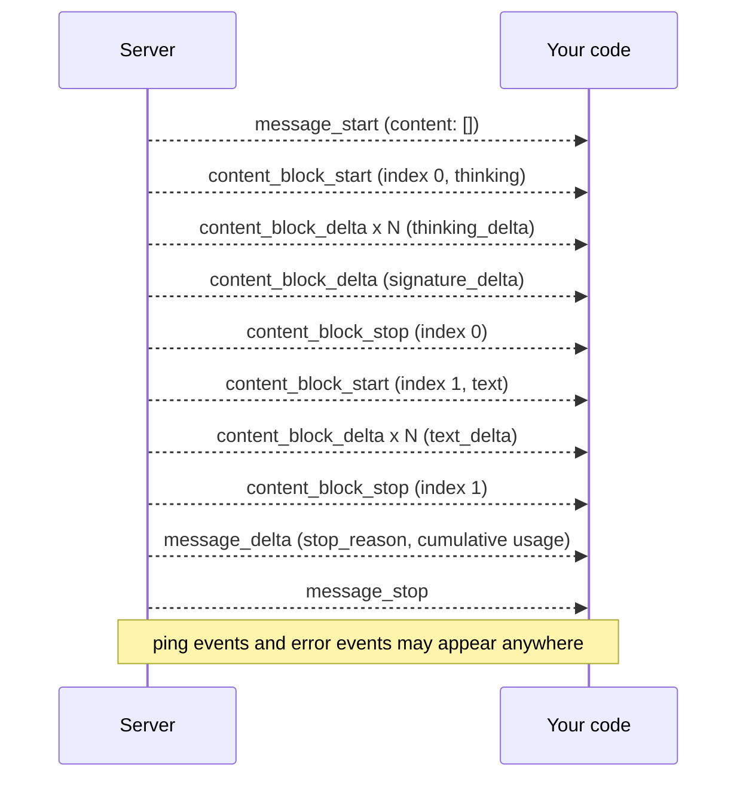

# Streaming

## Why this matters

A model generates one token at a time ([1.8](/part-01-how-llms-work/1.8-sampling)), so a long answer takes many seconds to finish. If you wait for the whole response, the user stares at nothing for that long. If you stream it, the first words show up almost at once, and the total time is the same. That's the whole user-facing case, and it's why every chat product streams.

For the things you'll build in Parts 3 to 5 the case is stronger. An agent streams *thinking* and *tool calls* as well as text: a harness shows the plan as it forms, starts rendering a file edit before the model has finished writing it, and can cancel a run that is going wrong. All of that sits on one mechanism: a long-lived HTTP response that delivers small typed events. The three APIs from [2.1](/part-02-programming-with-llms/2.1-calling-models) frame those events differently, and the places where they differ (tool-call arguments that arrive as broken JSON, usage that shows up in the last event, errors after a 200) cause most streaming bugs.

**Learning goals**

- Parse server-sent events by hand
- Handle text, thinking and tool-call deltas
- Measure time to first token

## Explanation

### What streaming is, on the wire

Streaming changes nothing about the request except one flag. The response is still a normal HTTP response, but the server doesn't close it after one body. It keeps it open, writes a piece, flushes, and writes the next piece as the model produces it. HTTP calls this a chunked body, and you read it as a stream of bytes instead of calling `res.json()`.

What those bytes look like is a separate decision, and the three routes from 2.1 made two different ones:

| | Anthropic Messages | OpenAI-compatible (OpenRouter, Ollama `/v1`) | Ollama native `/api/chat` |
|---|---|---|---|
| **Turn it on** | `"stream": true` | `"stream": true` | on by default; `"stream": false` turns it off |
| **Framing** | server-sent events | server-sent events | newline-delimited JSON (NDJSON) |
| **Content type** | `text/event-stream` | `text/event-stream` | `application/x-ndjson` |
| **End of stream** | `message_stop` event | `data: [DONE]` line | a line with `"done": true` |

Sources: [Anthropic streaming](https://platform.claude.com/docs/en/build-with-claude/streaming), [OpenRouter streaming](https://openrouter.ai/docs/api-reference/streaming) and [Ollama streaming](https://docs.ollama.com/api/streaming). I confirmed the Ollama rows, including `[DONE]` on `/v1`, against local Ollama 0.40.14 on 2026-11-10.

### Server-sent events by hand

**Server-sent events (SSE)** is a tiny text protocol. The MDN page is short enough to read in full (it's the first resource below), but the whole format is these rules ([MDN: Using server-sent events](https://developer.mozilla.org/en-US/docs/Web/API/Server-sent_events/Using_server-sent_events)):

- The response has content type `text/event-stream` and is UTF-8 text.
- A **message** (event) is one or more lines, ended by a blank line: "Messages in the event stream are separated by a pair of newline characters."
- Each line is `field: value`. The fields that matter are `event` (the event name), `data`, `id` and `retry`; "All other field names are ignored."
- Several `data:` lines in one message are joined with a newline between them.
- A line that starts with a colon is a comment and is ignored. Servers use comments as keep-alives.

A real Anthropic-style event is therefore two lines and a blank line:

```text
event: content_block_delta
data: {"type": "content_block_delta","index": 0,"delta": {"type": "text_delta", "text": "ello frien"}}

```

(That example is from [Anthropic's streaming page](https://platform.claude.com/docs/en/build-with-claude/streaming).) Note the two things people trip over:

1. **The unit is the message, not the network chunk.** TCP and `fetch` hand you arbitrary slices of bytes. One chunk may hold half a line, or three events, or end in the middle of a multi-byte character such as `é`. A parser has to buffer until it has seen the blank line.
2. **Anthropic repeats the event name inside the JSON** (`"type": "content_block_delta"`), so you could ignore the `event:` line. OpenAI-style streams have no `event:` line at all, only `data:`. Read the type from the JSON and your code works on both.

The browser's built-in `EventSource` parses SSE for you, but it only issues GET requests, and an LLM call is a POST with a body and an auth header. (MDN's page doesn't say this; it's in the [HTML Standard](https://html.spec.whatwg.org/multipage/server-sent-events.html).) So you read the response body yourself. Here is a complete parser, about 30 lines, that I ran against local Ollama and against a one-byte-at-a-time stream to test the buffering:

```ts
export type SseEvent = { event: string; data: string; id?: string }

export async function* parseSse(body: ReadableStream<Uint8Array>): AsyncGenerator<SseEvent> {
  const decoder = new TextDecoder() // stateful: keeps half of a split UTF-8 character
  let buffer = ''
  let event = 'message'
  let data: string[] = []
  let id: string | undefined

  for await (const chunk of body) {
    buffer += decoder.decode(chunk, { stream: true })
    let nl: number
    while ((nl = buffer.search(/\r\n|\n|\r/)) !== -1) {
      const sep = buffer.slice(nl).match(/^(\r\n|\n|\r)/)![0]
      const line = buffer.slice(0, nl)
      buffer = buffer.slice(nl + sep.length)
      if (line === '') {                       // blank line: the message is complete
        if (data.length) yield { event, data: data.join('\n'), id }
        event = 'message'; data = []; id = undefined
      } else if (line.startsWith(':')) {
        // comment / keep-alive: ignore
      } else {
        const i = line.indexOf(':')
        const field = i === -1 ? line : line.slice(0, i)
        let value = i === -1 ? '' : line.slice(i + 1)
        if (value.startsWith(' ')) value = value.slice(1) // one optional space after the colon
        if (field === 'event') event = value
        else if (field === 'data') data.push(value)
        else if (field === 'id') id = value
      }
    }
  }
}
```

Use it like this (the OpenAI-compatible route; the loop body is the part that changes per provider):

```ts
const res = await fetch(url, { method: 'POST', headers, body: JSON.stringify({ ...request, stream: true }) })
if (!res.ok) throw new Error(`HTTP ${res.status}: ${await res.text()}`) // errors before the stream are ordinary errors
for await (const ev of parseSse(res.body!)) {
  if (ev.data === '[DONE]') break
  const chunk = JSON.parse(ev.data)
  // ...
}
```

The `res.ok` check matters: if the request is rejected (bad key, bad model), you get a normal JSON error with a normal status code, not a stream. Only after the server has sent headers with 200 does the body become events.

Ollama's native route is simpler: one JSON object per line, no `data:` prefix, no blank lines. Split on `\n` (still buffering across chunks) and `JSON.parse` each line ([Ollama streaming](https://docs.ollama.com/api/streaming)).

::: info 📖 Read now
[MDN: Using server-sent events](https://developer.mozilla.org/en-US/docs/Web/API/Server-sent_events/Using_server-sent_events) · docs · ~10 min · **essential**

Look for: the "Event stream format" section (fields, blank-line dispatch, the comment line), the example with two `data:` lines becoming one message, and the `retry` and `id` fields. Skip the PHP server code. Then compare the example stream with the raw bytes your parser sees: that's all there is to SSE.
:::

### Anthropic's stream: typed blocks and deltas

Anthropic's stream is a small state machine. From [the streaming page](https://platform.claude.com/docs/en/build-with-claude/streaming), every stream follows this event flow:

1. `message_start`: a `Message` object with empty `content`.
2. For each content block: one `content_block_start`, one or more `content_block_delta`, one `content_block_stop`. Each block has an `index` that matches its position in the final `content` array.
3. One or more `message_delta` events: top-level changes such as the `stop_reason` and `usage`.
4. `message_stop`.



That is also the answer to chapter 2.1's note that `stop_reason` is `null` in `message_start` when streaming: it arrives later, in `message_delta`. Three rules from the same page keep your handler honest:

- **Pings.** "Event streams might also include any number of `ping` events." Ignore them.
- **Cumulative usage.** The token counts in `message_delta`'s `usage` are cumulative, so take the last one, don't add them up.
- **Unknown events.** New event types may be added under the versioning policy, and your code "should handle unknown event types gracefully": a `default` branch that ignores, not a throw.

The `delta` inside `content_block_delta` has its own `type`, and this is where text, thinking and tools diverge ([same page](https://platform.claude.com/docs/en/build-with-claude/streaming)):

| `delta.type` | Field | Belongs to block | What to do |
|---|---|---|---|
| `text_delta` | `text` | `text` | append to the visible answer |
| `thinking_delta` | `thinking` | `thinking` | append to a (usually collapsed) reasoning view |
| `signature_delta` | `signature` | `thinking` | store it; it arrives just before `content_block_stop` and verifies the thinking block's integrity |
| `input_json_delta` | `partial_json` | `tool_use` | append to a string; parse later |

A switch on `event.type`, then on `delta.type`, handles all four. Keeping a per-index record is what lets a stream contain several blocks, such as thinking, then text, then a tool call:

```ts
type Block = { type: string; text: string; json: string; signature?: string }
const blocks = new Map<number, Block>()
let stopReason: string | null = null, outputTokens = 0

for await (const ev of parseSse(res.body!)) {
  const e = JSON.parse(ev.data)
  switch (e.type) {
    case 'content_block_start':
      blocks.set(e.index, { type: e.content_block.type, text: '', json: '' })
      break
    case 'content_block_delta': {
      const b = blocks.get(e.index)!
      const d = e.delta
      if (d.type === 'text_delta') { b.text += d.text; process.stdout.write(d.text) }
      else if (d.type === 'thinking_delta') b.text += d.thinking
      else if (d.type === 'signature_delta') b.signature = d.signature
      else if (d.type === 'input_json_delta') b.json += d.partial_json
      break
    }
    case 'message_delta':
      stopReason = e.delta.stop_reason
      outputTokens = e.usage.output_tokens // cumulative: overwrite, don't add
      break
    case 'error': throw new Error(`${e.error.type}: ${e.error.message}`) // see "Errors after a 200"
    default: break // ping, message_start, message_stop, content_block_stop, unknown future events
  }
}
```

I haven't run the Anthropic part against the live API (that's the learner's practice, below); the field names are from the docs page above. If you'd rather not write this state machine, the SDK does it: `client.messages.stream(...)` exposes `.on("text", ...)` handlers and `await stream.finalMessage()` returns the same `Message` object as a non-streaming call ([streaming page](https://platform.claude.com/docs/en/build-with-claude/streaming)). The docs also recommend this helper for requests with a large `max_tokens`, because a long non-streaming request is the thing that times out (2.1 mentioned the warning). Write the manual version once, to know what the helper does, and use the helper in `project/`.

If thinking is turned on, the thinking block comes first. With `display: "omitted"` the block opens, gets an empty `thinking_delta` and one `signature_delta`, and closes: no thinking text is streamed ([streaming page](https://platform.claude.com/docs/en/build-with-claude/streaming)). Request-side thinking settings are [2.4](/part-02-programming-with-llms/2.4-reasoning-via-api).

::: info 📖 Read now
[Anthropic: Streaming messages](https://platform.claude.com/docs/en/build-with-claude/streaming) · docs · ~20 min · **essential**

Look for: the event-flow list, the cumulative-usage warning, the error-event example, "Content block delta types" (text, input JSON, thinking, signature), and the "Full HTTP stream response" examples with real event sequences for plain text, tool use and thinking. Read the tool-use example next to your handler and trace each event. Skip the other-language SDK tabs and the web-search example for now.
:::

### OpenAI-style chunks

The OpenAI-compatible stream is flatter. There are no block events. Each SSE message is a `chat.completion.chunk` object, and its `choices[0].delta` holds whatever is new. Here is a real run against local Ollama (`/v1`, `qwen3:8b`, 2026-11-10; I trimmed the repeated `id`, `created` and `system_fingerprint` fields):

```text
data: {"object":"chat.completion.chunk","choices":[{"index":0,"delta":{"role":"assistant","content":"Hello"},"finish_reason":null}]}

data: {"object":"chat.completion.chunk","choices":[{"index":0,"delta":{"content":"!"},"finish_reason":null}]}

 ... more content chunks ...

data: {"object":"chat.completion.chunk","choices":[{"index":0,"delta":{},"finish_reason":"length"}]}

data: {"object":"chat.completion.chunk","choices":[],"usage":{"prompt_tokens":18,"completion_tokens":8,"total_tokens":26}}

data: [DONE]
```

Compared with Anthropic's:

- **`delta.content` is the only text path.** `delta.role` appears on the first chunk only. There's no `content_block_start`: text is implicitly "block 0".
- **`finish_reason` is `null` until the last content chunk**, then a final chunk with an empty `delta` carries it.
- **Usage is a separate, last chunk, and only when you ask.** OpenRouter says every stream "ends with an extra chunk that carries the `usage` object"; that chunk repeats the terminal `finish_reason`, so treat it as accounting rather than a second ending ([OpenRouter streaming](https://openrouter.ai/docs/api-reference/streaming)). On Ollama's `/v1` I sent `stream_options: {"include_usage": true}` to get it, and its usage chunk had `choices: []` plus a non-standard `timings` object. Your code must therefore expect `choices` to be empty on some chunks: `chunk.choices[0]?.delta`.
- **The end is a literal `data: [DONE]`**, which is not JSON. Check for it before `JSON.parse`, or the parser throws on the last line ([OpenRouter streaming](https://openrouter.ai/docs/api-reference/streaming)).
- **Comments can appear.** OpenRouter "occasionally sends comments to prevent connection timeouts", lines such as `: OPENROUTER PROCESSING`. My parser skips them. A hand-rolled `line.slice(6)` plus `JSON.parse` would not.

OpenAI's newer Responses API streams differently again: "semantic events" with names such as `response.output_text.delta` ([OpenAI: Streaming API responses](https://developers.openai.com/api/docs/guides/streaming-responses)). It's closer to Anthropic's typed events than to the flat chunks above. This book uses Chat Completions, because OpenRouter and Ollama speak it, so the Responses API stays a pointer.

Where does thinking go on the OpenAI-compatible routes? Not in `content`. On Ollama's `/v1` the reasoning arrived in a separate `reasoning` field in the non-streamed reply (2.1), so a streaming handler that reads only `delta.content` sees nothing while the model is thinking. Ollama's native stream is explicit: each line has `message.content` and, with `think: true`, a `message.thinking` that fills first while `content` is `""` (observed locally with `qwen3:8b`, 2026-11-10). On any route, check a thinking model against your handler, because the field name differs by server and a handler that reads the wrong one just looks frozen. That "looks frozen" is a TTFT measurement trap too, covered below.

::: tip 📖 Skim
[OpenRouter: Streaming](https://openrouter.ai/docs/api-reference/streaming) · docs · ~8 min · optional

Skim for: the comment lines to ignore, the final usage chunk, mid-stream errors, and the cancellation section with its list of providers where aborting stops billing. You'll use most of this in the practice.
:::

### Tool calls: accumulating partial JSON

The hard part of streaming is tool calls. A text delta is a string you can print immediately. A tool call's arguments are a JSON object, and the model emits it a few characters at a time. Anthropic is explicit about the shape ([streaming page](https://platform.claude.com/docs/en/build-with-claude/streaming)): "the deltas are *partial JSON strings*, whereas the final `tool_use.input` is always an *object*." So `input_json_delta` events carry fragments like these, taken from the docs' own example:

```text
{"location": "San Fra          <- first partial_json: not valid JSON on its own
nci                           <- second fragment, and so on
sco, CA"}                     <- the last one closes it
```

The recipe has three steps, and the [fine-grained tool streaming page](https://platform.claude.com/docs/en/agents-and-tools/tool-use/fine-grained-tool-streaming) writes it as the "accumulation contract": on `content_block_start` with a `tool_use` block, start an empty string (the block's initial `input` is a placeholder `{}`); on each `input_json_delta`, append `partial_json`; on `content_block_stop`, parse the string. My handler above already does this with `b.json`. The final step is the one to guard:

```ts
function finishToolUse(b: Block, stopReason: string | null) {
  if (stopReason === 'max_tokens') return { ok: false, reason: 'truncated', raw: b.json }
  try { return { ok: true, input: JSON.parse(b.json || '{}') } }
  catch { return { ok: false, reason: 'invalid_json', raw: b.json } }
}
```

Why guard it? Two things. First, a stream that stops at `max_tokens` can be cut inside a parameter, which is the "never pass a truncated JSON string to `JSON.parse`" warning from 2.1 showing up in a new place. Second, there's an opt-in mode, **fine-grained tool streaming** (`eager_input_streaming: true` on a tool), in which the API streams the arguments "without server-side buffering or JSON validation". The docs warn that "you might receive partial or invalid JSON" ([fine-grained tool streaming](https://platform.claude.com/docs/en/agents-and-tools/tool-use/fine-grained-tool-streaming)). In the default mode the API buffers and validates each parameter value before streaming it, so for a large parameter, such as a whole file, nothing arrives until the model has finished writing that value; in the eager mode fragments arrive from the moment it starts. The default mode also, per the streaming page, emits one complete key and value at a time, so you'll see pauses between bursts of deltas. When the JSON is unusable, the docs' advice is to hand it back to the model as a tool result with `is_error: true` instead of crashing.

The OpenAI-style version has the same idea with different plumbing. Tool calls appear under `delta.tool_calls`, an array where each entry has an `index`, and the first fragment of a call carries its `id` and function `name` while later fragments carry more of `function.arguments` as a string to concatenate. The grouping key is the `index` of the tool call, like Anthropic's block `index`. I observed one case locally: Ollama's `/v1` (`qwen3:8b`, one tool defined, "Weather in Paris? use the tool") sent the whole call in a single chunk, `"arguments":"{\"city\":\"Paris\"}"`, then a chunk with `finish_reason: "tool_calls"`. Ollama's native stream did the same with `arguments` already a parsed object, not a string. So a correct handler accumulates fragments by `index`, and also works when the "stream" delivers the whole thing at once. Don't assume the model streams arguments piecemeal: that's a property of the server. I haven't verified the multi-fragment OpenAI shape against a live OpenAI-compatible server for this chapter, so check it in the practice with an OpenRouter model.

What do you do while arguments stream? Usually nothing: you can't run a tool with half its arguments. But you can show progress ("writing `poem.txt`…"), start rendering a diff, or, for eager streams, begin showing a file as it's written. Execution waits for `content_block_stop` and a successful parse. [2.6](/part-02-programming-with-llms/2.6-tool-calling) puts this inside the full tool loop.

::: tip 📖 Skim
[Anthropic: Fine-grained tool streaming](https://platform.claude.com/docs/en/agents-and-tools/tool-use/fine-grained-tool-streaming) · docs · ~10 min · optional

Skim for: the warning about invalid JSON, the three-step "accumulation contract", the TypeScript example that guards the parse, and "Handling invalid JSON in tool responses" (the `is_error` tool result). Skip the other languages.
:::

### Errors after a 200

2.1 flagged this; here is the mechanism. The HTTP status is sent with the headers, before the first token. If something fails later, the status is already 200 and the only way to tell you is an event in the stream. Anthropic sends an `error` event ("during periods of high usage, you might receive an `overloaded_error`, which would normally correspond to an HTTP 529 in a non-streaming context") ([streaming page](https://platform.claude.com/docs/en/build-with-claude/streaming)). OpenRouter says "The HTTP status remains 200 OK since headers were already sent" and, on Chat Completions, puts a top-level `error` field and `finish_reason: "error"` in the stream ([OpenRouter streaming](https://openrouter.ai/docs/api-reference/streaming)). The same page warns that a 200 with no content can still be a failure.

Three consequences for your code:

1. **"The request succeeded" is not a fact until the terminal event arrives.** Track whether you saw `message_stop`, `[DONE]` or `done: true`. If the connection ends without one, the response is incomplete, whatever the status said.
2. **Retries get harder.** A non-streaming call failing is cheap to retry. A stream failing at token 400 has produced 400 tokens you've already shown. Anthropic documents recovery by capturing what arrived and starting a new request that continues from it. For Claude 4.6 and later, that continuation is a user message saying the previous response was interrupted and to continue from where it left off. Tool-use and thinking blocks "cannot be partially recovered" ([streaming page, Error recovery](https://platform.claude.com/docs/en/build-with-claude/streaming)). The simple policy is: retry the whole request if nothing has been shown, and surface the partial text otherwise.
3. **The retry wrapper from 2.1 only covers the request until the headers.** Everything after is yours.

### Cancellation

Users press Stop, navigate away, or a harness decides a run is wasted. Cancelling means closing the connection, and in JavaScript that's an `AbortController`. Passing its `signal` to `fetch` lets you abort both the request and the reading of its body: MDN says `abort()` "is able to abort fetch requests, consumption of any response bodies, and streams", and a pending read then rejects with an `AbortError` ([MDN: AbortController](https://developer.mozilla.org/en-US/docs/Web/API/AbortController)).

```ts
const ctrl = new AbortController()
process.once('SIGINT', () => ctrl.abort()) // Ctrl-C stops the stream, not just the process
try {
  const res = await fetch(url, { method: 'POST', headers, body, signal: ctrl.signal })
  for await (const ev of parseSse(res.body!)) { /* ... */ }
} catch (err) {
  if ((err as Error).name === 'AbortError') console.log('\n[stopped]') // deliberate, not a failure
  else throw err
}
```

Two questions decide whether this is just a UI nicety:

- **Does the server stop generating?** Closing the socket tells the server you left, but whether it stops the model is the provider's business. OpenRouter documents that aborting a streaming request stops processing and billing only for supported providers (it lists OpenAI, Anthropic, Azure, Together and DeepSeek as supported, and Groq, Google, AWS Bedrock and Mistral among those that aren't), and otherwise "the model will continue processing and you will be billed for the complete response" ([OpenRouter streaming](https://openrouter.ai/docs/api-reference/streaming)). That list will change; check the page when it matters. On Ollama, cancelling is also how you free the GPU for the next request.
- **What do you keep?** After an abort you have a partial message. A partial `thinking` block has no signature, and a partial `tool_use` has unparseable JSON, so neither can go back into the history (2.1: "typed blocks such as `thinking` must come back unchanged"). Keep the text you showed, drop the unfinished tool call and thinking, and write down that it was interrupted.

### Backpressure

**Backpressure** is the consumer telling the producer to slow down. MDN defines it as "the process by which a single stream or a pipe chain regulates the speed of reading/writing" ([MDN: Streams API concepts](https://developer.mozilla.org/en-US/docs/Web/API/Streams_API/Concepts)). With `for await (const chunk of res.body)` you get it automatically: the loop doesn't pull the next chunk until the body of the loop finishes, the stream's internal queue fills, and the runtime stops reading from the socket, so TCP flow control pushes back on the server.

For LLM output this rarely bites, because tokens arrive at tens per second, which is slow for a computer. It becomes real in three places: a slow consumer inside the loop (an `await` on a database write or a network call per token, so the queue grows while the model keeps generating), a fan-out (the same stream relayed to a browser over a slow connection), and a UI that re-renders on every token. The fixes are the usual ones. Batch the work (flush the UI every 30 to 50 ms, not per token), don't `await` slow side effects inside the per-token loop, and let the relay propagate the pressure by piping the stream instead of copying chunks into an unbounded array. You'll build the relay in [8.6](/part-08-production/8.6-streaming-ui-auth). For now, know that your parser being an async generator is what makes it correct by default.

::: tip 📖 Skim
[MDN: Streams API concepts](https://developer.mozilla.org/en-US/docs/Web/API/Streams_API/Concepts) · docs · ~10 min · optional

Skim for: the definition of backpressure, `desiredSize` and the high water mark, and the "Internal queues" section. You won't write a `ReadableStream` by hand in this book, but the vocabulary shows up in every proxy and UI framework.
:::

### TTFT vs. throughput

A streamed response has two speeds, and they answer different questions.

- **Time to first token (TTFT)**: the time from sending the request to the first piece of *visible output*. It's what the user feels as "is it working?". It's made of network time, queueing, loading the model if it isn't in memory, **prefill** (the model reading your whole prompt in parallel, [1.9](/part-01-how-llms-work/1.9-kv-cache-context-window)), and, on a reasoning model, all the thinking that happens before the answer.
- **Throughput** (tokens per second, "tok/s"): the speed once the output has started: **decode**, one token per step. It decides how long the *rest* of the answer takes, and it's what the speed check in experiment 00 measured.

Total time is roughly TTFT + output tokens ÷ throughput. A long prompt hurts TTFT (more prefill); a long answer hurts total time (more decode); they're independent knobs. Prefill and decode have different bottlenecks ([1.9](/part-01-how-llms-work/1.9-kv-cache-context-window)), which is why one number can't describe both.

Measuring them correctly takes care:

1. **Start the clock at the request, not at the first event.** `performance.now()` just before `fetch`, so connection setup counts.
2. **Stop at the first *visible* delta.** Anthropic's `message_start` arrives before any token, and pings and comments are not tokens. The first `text_delta` is TTFT for the answer; the first `thinking_delta` is the "time to first thinking". Report both when thinking is on, because a thinking model has a short first and a long second.
3. **Compute throughput after the first token:** `(outputTokens − 1) / (tLast − tFirst)`, using the provider's own token count where the stream gives one (`message_delta.usage.output_tokens`, the OpenAI-style usage chunk, Ollama's `eval_count`). Don't count chunks: a chunk isn't always one token (Anthropic's page says current tool streaming emits whole key-value pairs, and my Ollama `/v1` run sent one token per chunk, but you can't rely on it).
4. **Cross-check where you can.** Ollama's final line has `eval_count` and `eval_duration` (nanoseconds), so `eval_count / eval_duration × 1e9` is the server's own tok/s. Your client number should be close; if it's much lower, your loop is the bottleneck (the backpressure section above).
5. **Repeat, and report the spread.** On this machine, with other processes sharing Ollama, I measured the TTFT of the same 30-token `qwen3:8b` request on `/v1` as 33.9 s, 5.7 s and 1.1 s in three runs 2026-11-10: the first included a model load, the others differed in what else the server was doing. One run tells you nothing; the cold run and the warm run are different quantities. Keep both.

Prices and model speeds aren't in this chapter on purpose. For what each provider charges and which models are fast, see [Landscape](/landscape).

::: info 📖 Read now
[Ollama: Streaming](https://docs.ollama.com/api/streaming) · docs · ~5 min · **essential**

A short page: the NDJSON format, the `done` field, how to disable streaming. Look for what the final chunk contains, then open the [chat API](https://docs.ollama.com/api/chat) reference again and find the duration fields you'll use to cross-check tok/s.
:::

## Practice

**Brief:** Extend the 2.1 script to stream from all three providers, print tokens as they arrive, and log TTFT and tokens/s for each. You write all the code. I've provided only the folder and a README skeleton.

**Where:** `experiments/15-streaming/`: a standalone experiment, not a `project/` step. Create `package.json` and the scripts yourself, starting from your `experiments/14-first-api-call/raw.ts`.

**Steps:**

1. **Set up** like 14: `npm init -y`, `"type": "module"`, `node --env-file-if-exists=../../.env stream.ts`. You don't need the SDKs for the main part. Check that `node_modules/` stays out of git.
2. **Write `sse.ts`**: your own SSE parser as an async generator (the one in this chapter is a reference to compare against, not to paste). Test it without a network: feed it a `ReadableStream` that delivers the sample stream **one byte at a time**, including a multi-byte character, a comment line, a two-line `data:` message and a stream that ends without the final blank line. Decide what each case should do before you run it.
3. **Write one function per route**, each an `async function*` that yields **normalized events**: `{ kind: 'text' | 'thinking' | 'tool_call' | 'usage' | 'done' | 'error', ... }`. Routes: Ollama native (NDJSON, `think: true` on `qwen3:8b`), OpenRouter (SSE, OpenAI chunks, `stream_options: { include_usage: true }`) and Anthropic (SSE, typed blocks, with `thinking` configured as in [2.4](/part-02-programming-with-llms/2.4-reasoning-via-api), or skipped if you haven't read it). Reuse the conversation from experiment 14.
4. **Print as it arrives:** text to stdout without newlines, thinking in a different color (or `[thinking]` markers). Check by eye that the text really appears incrementally; a loop that collects everything and prints at the end isn't streaming.
5. **Measure.** For each route compute: TTFT to the first text delta, TTFT to the first thinking delta (if any), tokens/s after the first token from the provider's own token count, and total time. Run each route **three times** and put all runs in the README, marking the first Ollama run if the model had to load. Cross-check Ollama against `eval_count / eval_duration`.
6. **Tool call.** Define one tiny tool (`get_weather(city)`) and make each route stream a call to it. Accumulate the arguments, parse them at the right moment, and yield a `tool_call` event only when the arguments are complete. Print how many fragments each route used. Then force a failure: set `max_tokens` so small that the tool arguments are cut off, and check that your code reports `truncated` instead of passing a half-parsed object on.
7. **Cancel.** Abort a stream after 10 text tokens with an `AbortController`. Note what each route sends or does next, and (for the paid routes) look at the usage afterwards: were you billed for the full answer? Write it in the README, with the Ollama `ollama ps` or server behavior you noticed.
8. **Break it on purpose,** one at a time, and record what your code does: a wrong model name (is it an HTTP error or a stream error?), a bad key, and `Ctrl-C` in the middle of a stream. Then truncate the stream yourself (close the connection after the first few events, e.g. with a tiny local `http.createServer` that writes half of an SSE stream and ends). Does your code notice that no terminal event arrived?
9. **Spend log.** Add the OpenRouter and Anthropic runs to `costs.md` (use `usage.cost` where OpenRouter returns it, an estimate for Anthropic with prices from [Landscape](/landscape)).
10. **Optional stretch:** call Anthropic with `eager_input_streaming: true` on a tool that writes a long file, and compare when the first argument fragment arrives with and without it. Or add a 50 ms batching writer between your event stream and stdout and measure how much a slow `await` inside the per-token loop slows the stream without it.

**Done when:**

- `sse.ts` passes your one-byte-at-a-time test, and the README says how it treats comments, multi-line `data:` and a missing final blank line.
- All three routes stream through the same normalized event type, text appears incrementally, and the final event always says why the stream ended.
- The README has a table of TTFT (text and, where relevant, thinking), tokens/s and total time for three runs per route, with the Ollama cold run marked and the Ollama cross-check.
- The tool-call run shows accumulated arguments parsed only at block end, and the truncated run is reported as `truncated`.
- You can explain, for each route, which field carries text, which carries thinking, where usage arrives and what the last event is, without looking.
- `costs.md` has the new paid rows and an updated running total.

## Check questions

1. Your SSE parser works on a short test but crashes in production with `JSON.parse` errors on lines like `: OPENROUTER PROCESSING` and `[DONE]`. What went wrong with each, and how should the parser treat them?

   <details><summary>Answer</summary>

   A line starting with a colon is an SSE comment (a keep-alive), so the parser should skip it before looking at fields. `data: [DONE]` is a real `data` message, but its payload isn't JSON: it's a sentinel that means the stream is over, so compare it as a string first and stop, then `JSON.parse` everything else. A parser that does `JSON.parse(line.slice(6))` on every line fails on both.

   </details>

2. Why can't you treat each `fetch` chunk as one SSE event? Give two ways it breaks.

   <details><summary>Answer</summary>

   Chunks are arbitrary slices of bytes, and an event ends only at a blank line. One chunk can hold half an event (so the JSON is cut off), or several events at once. A chunk can also end in the middle of a multi-byte UTF-8 character, which is why the decoder must be stateful (`decode(chunk, { stream: true })`). The parser has to buffer until it has a complete message.

   </details>

3. A Claude stream gives you three `input_json_delta` events for a tool call, with `partial_json` values `{"city": "Pa`, `ris"`, `}`. When do you call `JSON.parse`, on what, and what two situations can still make it throw?

   <details><summary>Answer</summary>

   Concatenate the fragments per block `index` and parse once, at that block's `content_block_stop`, on the whole string (`{"city": "Paris"}`). Parsing earlier gives invalid JSON. It can still throw when the stream stopped at `max_tokens` in the middle of a parameter, and when fine-grained tool streaming (`eager_input_streaming`) is on, because the API doesn't validate the JSON before sending it. In both cases you report the failure (for example as an `is_error` tool result) rather than running the tool.

   </details>

4. A user reports "the app froze for 40 seconds, then printed the whole answer at once", on a thinking model. Your code prints only `delta.content` (or `text_delta`). What is probably happening, what would you measure, and what do you change?

   <details><summary>Answer</summary>

   The model is spending those 40 seconds generating thinking tokens that arrive in a different field (`thinking_delta`, `message.thinking`, or a `reasoning` field depending on the route), which a text-only handler ignores. So TTFT to visible text is long while the stream was in fact moving. Measure time to the first thinking delta as well as to the first text delta. Then show thinking progress in the UI (a spinner or collapsed reasoning), or reduce or turn off thinking for that request if the task doesn't need it.

   </details>

5. Your OpenRouter request was cancelled by the user after 2 seconds, but the invoice shows the full response. Give a likely reason, and say what the stream's HTTP status tells you about a mid-stream failure.

   <details><summary>Answer</summary>

   Aborting a stream only stops generation and billing if the underlying provider supports cancellation. For providers that don't, OpenRouter says the model keeps processing and you're billed for the whole response. As for mid-stream failures, the status is useless: it was already 200 when the headers went out, so errors arrive as events (`error` on Anthropic, a top-level `error` with `finish_reason: "error"` on OpenRouter). Only the terminal event (`message_stop`, `[DONE]`, `done: true`) tells you the response finished.

   </details>

## My understanding

<!-- Written by the learner, in their own words. Agents never fill this in. -->
