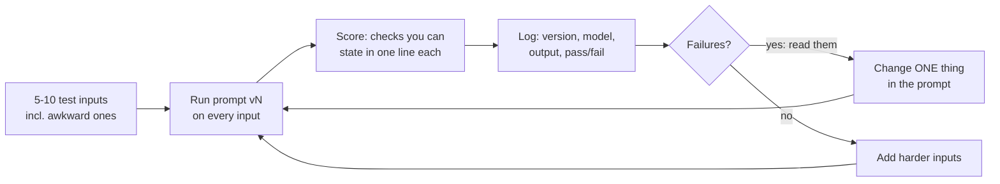

# Prompting

## Why this matters

Prompts are still the main interface to a model, but good prompting in 2026 looks less like tricks and more like writing a clear brief. The incantations of 2023 ("take a deep breath", "you are a world-class expert", threats and tips) matter far less on current models. What still matters is the same thing that matters when you delegate to a colleague: say what you want, say why, show what good looks like, and keep the instructions apart from the material they apply to.

The second half of the skill is not writing at all. It is **checking**: a prompt that "feels better" after one edit is a guess, and the next edit often fixes one input while breaking another. Part 4 builds proper evals. This chapter gives you the smallest version of that habit, five inputs and a table, so that every prompt change from here on gets measured.

**Learning goals**

- Write clear system prompts and task briefs
- Use examples, structure (XML/Markdown) and prefill appropriately
- Iterate on prompts with a small test set instead of by feel

## Explanation

### A prompt is a brief, not a spell

Anthropic's own guidance frames it as delegation: think of the model as "a brilliant but new employee who lacks context on your norms and workflows", and test a prompt by showing it to a colleague with minimal context. If they'd be confused, the model will be too ([Prompting best practices](https://platform.claude.com/docs/en/build-with-claude/prompt-engineering/claude-prompting-best-practices#be-clear-and-direct)). That one test catches most bad prompts.

A good brief has the same parts whichever model reads it:

| Part | What it answers | Weak version | Better version |
|---|---|---|---|
| **Task** | What are you producing? | "Summarize these commits." | "Write the changelog entry for these commits." |
| **Audience and purpose** | Who reads it, and what do they do with it? | (missing) | "Users skim it in a release page; they decide whether to upgrade." |
| **Constraints and format** | What shape, how long, what to leave out? | "Keep it short." | "A headline of at most 60 characters, then up to 3 bullets. No preamble." |
| **Context the model can't know** | Your conventions, vocabulary, edge cases | (missing) | "`chore:` and `ci:` commits are never user-visible; skip them." |
| **Examples** | What does good look like? | (none) | Two or three input/output pairs. |
| **The input** | The material to work on | pasted inline, unmarked | wrapped in a tag, placed where it can't be mistaken for instructions |

Two habits do most of the work.

**Say why, not only what.** Anthropic's guide gives the example of replacing "NEVER use ellipses" with "Your response will be read aloud by a text-to-speech engine, so never use ellipses since the text-to-speech engine will not know how to pronounce them", and notes the model can generalize from the explanation ([Add context to improve performance](https://platform.claude.com/docs/en/build-with-claude/prompt-engineering/claude-prompting-best-practices#add-context-to-improve-performance)). A rule with a reason covers cases you didn't list. A bare rule covers only its wording.

**Ask for what you want, explicitly.** The same guide says that if you want more than the task strictly requires, request it rather than relying on the model to infer it from a vague prompt. This cuts both ways: models also don't infer the *less* you wanted. "Return only the headline" is an instruction like any other.

::: info 📖 Read now
[Prompting best practices](https://platform.claude.com/docs/en/build-with-claude/prompt-engineering/claude-prompting-best-practices) · docs · ~25 min · **essential**

Anthropic's living reference, and its overview page now points here for every technique. Read the "General principles" and "Output and formatting" sections, plus "Thinking and reasoning". Look for: the colleague test, the "less effective / more effective" pairs, what it says about examples (relevant, diverse, structured), the XML-tags section, and "Migrating away from prefilled responses". Skim the model-specific table at the top: it shows how much prompt advice is tied to a model generation, which is itself the lesson. Skip the agentic and capability-specific sections for now; Part 3 returns to them.
:::

### System prompt vs. user prompt

Every API from [2.1](/part-02-programming-with-llms/2.1-calling-models) has a slot for instructions that frame the whole conversation (Anthropic's top-level `system` field, a `system` or `developer` message elsewhere) and turns that carry the actual request. The split is a convention the model was post-trained on, not a security boundary:

- **System prompt**: who the model is working as, standing rules, output format, tone, tool guidance. It is the same on every request of a feature, so it is the part you version, review and test like code. OpenAI describes the same split: `developer` messages carry the application's rules and are prioritized ahead of `user` messages, which carry end-user input ([Prompt engineering](https://developers.openai.com/api/docs/guides/prompt-engineering)).
- **User prompt**: what varies per request: the document, the question, the commits.

Practical rules:

1. **Put stable things in the system prompt and varying things in the user turn.** Besides being tidy, this is what makes [prompt caching (2.7)](/part-02-programming-with-llms/2.7-prompt-caching) work: the reusable prefix goes first, the variable data last. OpenAI's guide gives the same advice: reusable content first, context-specific data near the end.
2. **A role sentence is cheap and mildly useful.** Anthropic recommends setting a role in the system prompt and says even a single sentence makes a difference ([Give Claude a role](https://platform.claude.com/docs/en/build-with-claude/prompt-engineering/claude-prompting-best-practices#give-claude-a-role)). Don't expect it to add knowledge the model lacks; it sets register and focus.
3. **Don't treat the system prompt as secret or as protection.** Anything a user can steer the model into repeating, they can see. Instructions in a system prompt are not enforcement. Part 8 covers injection properly.
4. **Small local models follow system prompts less faithfully than frontier models.** Where `qwen3:8b` ignores a rule in the system message, repeating it at the end of the user turn often helps. This is an observation from testing, not a documented behavior, so confirm it with your own test set (see below).

### Structure: XML tags and Markdown

Models read prompts as one flat token stream. Structure is how *you* mark where instructions end and data begins. Two conventions cover nearly everything:

- **XML-style tags around content blocks.** Anthropic: tags help parse prompts "unambiguously, especially when your prompt mixes instructions, context, examples, and variable inputs", with consistent, descriptive names and nesting where there is a natural hierarchy ([Structure prompts with XML tags](https://platform.claude.com/docs/en/build-with-claude/prompt-engineering/claude-prompting-best-practices#structure-prompts-with-xml-tags)). OpenAI's guide likewise suggests XML tags to mark where reference content begins and ends, and Markdown headers and lists for the instructions themselves. The tag names are not magic; `<commits>` works because it's clear to the model and to you. There is no schema, and nothing validates them.
- **Markdown for the instructions.** Numbered steps when order matters, bullets for constraints, headers for a long system prompt.

Here is a skeleton for the chapter's running task, turning a batch of commit messages into a changelog entry:

```text
You write changelog entries for a developer tool. Readers skim a release page
and decide whether to upgrade, so lead with what changed for them.

## Rules
1. Headline: at most 60 characters, imperative mood, no trailing period.
2. Then up to 3 bullets, each one sentence, about user-visible changes only.
3. Skip commits that start with `chore:`, `ci:` or `test:`. Users never see them.
4. Reply with the entry only. No preamble, no closing remark.

<examples>
  <example>
    <commits>
    feat(cli): add --json flag to `list`
    fix(cli): `list` crashed on empty projects
    chore: bump eslint
    </commits>
    <entry>
    Add JSON output to list
    - `list --json` prints machine-readable output.
    - `list` no longer crashes on empty projects.
    </entry>
  </example>
</examples>

Write the entry for the commits below.

<commits>
{{COMMITS}}
</commits>
```

Notice what's where: standing rules and examples are the fixed prefix, the variable `{{COMMITS}}` is last. For long inputs Anthropic's guide says to put long documents near the top, above the query, and reports that queries at the end can improve quality by up to 30 percent in their tests ([Long context prompting](https://platform.claude.com/docs/en/build-with-claude/prompt-engineering/claude-prompting-best-practices#long-context-prompting)). For short inputs like ours the order barely matters; for 20k-token documents it does.

One practical consequence of tags: when the output itself is tagged (`<entry>...</entry>`), your code can extract the answer with a regex and ignore any chatter around it. That's the cheap, portable version of structured output. When you need guarantees, [2.5](/part-02-programming-with-llms/2.5-structured-output) covers schema-constrained decoding.

### Few-shot examples

Showing is stronger than telling for format, tone and judgment calls that are hard to put in words. Anthropic calls examples "one of the most reliable ways to steer Claude's output format, tone, and structure" and asks that they be **relevant** (mirror the real use), **diverse** (cover edge cases, vary enough that the model doesn't pick up an unintended pattern) and **structured** (wrapped in `<example>` tags), with 3–5 examples recommended ([Use examples effectively](https://platform.claude.com/docs/en/build-with-claude/prompt-engineering/claude-prompting-best-practices#use-examples-effectively)). OpenAI's guide makes the same two points: a handful of examples in the developer message, covering a varied range of inputs.

Failure modes worth knowing:

- **Copying.** If all your examples have 3 bullets, you'll get 3 bullets for a one-line change. Vary the length on purpose.
- **Leaking content.** A distinctive word in an example (a project name, a number) turns up in unrelated outputs. Use obviously fake, varied content.
- **Examples that contradict the rules.** The model usually follows the example. When rule and example disagree, fix one of them.
- **Cost.** Examples are input tokens on every call. With a stable prefix, caching ([2.7](/part-02-programming-with-llms/2.7-prompt-caching)) makes them cheap; without it, three long examples can outweigh the actual input.
- **Conversation-shaped examples.** You can also write examples as earlier `user`/`assistant` turns. Both work. Tags keep the examples visibly separate from the real conversation, which matters when you later log or trim history.

Examples also matter more the *smaller* the model. A frontier model often gets the format from the rules alone; an 8B local model frequently needs the example. Whether that's true for your task is exactly what the test set answers.

### Prefill: what it was, and what replaced it

**Prefill** means ending the `messages` list with a partial assistant turn so the model continues it, for example starting the reply with `{` to force JSON or with `Here is the summary:` to skip preamble. It was a favorite trick. It no longer works on the newest Claude models: starting with Claude 4.6, a request with a prefilled last assistant turn returns a 400, and the docs say that "most use cases of prefill no longer require it" ([Migrating away from prefilled responses](https://platform.claude.com/docs/en/build-with-claude/prompt-engineering/claude-prompting-best-practices#migrating-away-from-prefilled-responses)). Older models still accept it. The migration advice from the same page:

| You used prefill to... | Do this instead |
|---|---|
| Force JSON/YAML or a classification label | Ask for the format directly; use structured outputs or a tool with an enum ([2.5](/part-02-programming-with-llms/2.5-structured-output), [2.6](/part-02-programming-with-llms/2.6-tool-calling)) |
| Skip the "Here is..." preamble | An instruction in the system prompt ("Respond directly without preamble"), or ask for the answer inside XML tags and extract it |
| Continue an interrupted reply | Put the end of the previous reply in the user turn and ask to continue, or retry |

Prefill is still alive elsewhere: on local models through a raw completion endpoint, and on any provider that supports it. Know that it exists, because you will meet it in older tutorials and codebases, but don't build on it for current Claude models.

### Prompting reasoning models differently

[Chapter 1.10](/part-01-how-llms-work/1.10-reasoning-models) covered how reasoning models think before answering, and [2.4](/part-02-programming-with-llms/2.4-reasoning-via-api) covers the API controls. For prompting, the practical differences are:

1. **Describe the goal, not the steps.** OpenAI's guide frames reasoning models as a "senior co-worker" you can give a high-level goal, and non-reasoning GPT models as a "junior coworker" who needs explicit step-by-step direction ([Prompt engineering](https://developers.openai.com/api/docs/guides/prompt-engineering)). Step-by-step scaffolding written for a non-reasoning model can fight the model's own, usually better, plan.
2. **Don't script the thinking.** "Think step by step" was a measurable boost for non-reasoning models (the idea behind the [chain-of-thought paper](https://arxiv.org/abs/2201.11903)). With thinking on, it is redundant. Anthropic's guide says that on the newest models you should rely on thinking instead of asking for reasoning in the output, and warns that a prompt asking the model to write out its reasoning in `<thinking>` tags might be declined ([Leverage thinking](https://platform.claude.com/docs/en/build-with-claude/prompt-engineering/claude-prompting-best-practices#leverage-thinking-and-interleaved-thinking-capabilities)). Where thinking is off, asking for step-by-step reasoning followed by a final answer in `<answer>` tags is the documented fallback.
3. **Control depth with settings, not pleading.** On current Claude models thinking depth follows the `effort` setting and query complexity, and the page says the triggering behavior is promptable but, on at least one model, an instruction to answer directly didn't stop thinking at medium effort and above. Lower the effort instead. On Qwen3 locally the switch is `think: false` ([1.10](/part-01-how-llms-work/1.10-reasoning-models), [2.1](/part-02-programming-with-llms/2.1-calling-models)).
4. **Over-prompting backfires more now.** The guide notes that instructions written to push older models ("If in doubt, use [tool]", blanket "be thorough") cause overtriggering on newer ones, and that verification instructions carried over from older prompts can make a model over-verify. Old prompts need re-testing when you change models; don't assume they port.
5. **Ask for verification where it still helps.** "Before you finish, verify your answer against [criteria]" is documented to catch errors reliably, especially in coding and math, on models that don't already do it unprompted.

The thread running through all five: advice is **model-generation-specific**. The Anthropic page says outright that where a technique names a specific model, treat it as measured on that model and re-check against your own evals. That is the argument for the next section.

### Iterating with a mini test set

Here is the loop that replaces "tweak and eyeball":



What makes it work:

- **Inputs from real life, including the awkward ones.** An empty input, a very long one, one in the wrong language, one where the instruction conflicts with the content. Five inputs is enough to start; the failures guide where to add more.
- **Checks you can state in a sentence, ideally in code.** "Headline is at most 60 characters", "no line starts with `Here`", "mentions the crash fix". Code checks don't tire and don't drift. When a quality can't be coded ("is this accurate?"), you read the output yourself and mark it. Part 4 turns this into LLM-as-judge, checked against your labels.
- **Change one thing at a time** and keep every version. If prompt v4 passes 5/5 and v3 passed 3/5, you know the diff that did it. If you change three things, you don't.
- **Run each case more than once on local models** (at `temperature` above 0) before believing a difference. One pass/fail on one sample is noisy. Anthropic's current API doesn't let you set sampling parameters at all ([2.1](/part-02-programming-with-llms/2.1-calling-models)), so repeat runs there too.
- **Test across models, not just one.** A prompt that scores 5/5 on Claude can score 2/5 on `qwen3:8b`, and the reverse direction happens too. Prompts are partly model-specific. The same test set is also how you find out whether a cheaper model is good enough, which is Part 9's question. For prices, see [Landscape](/landscape).
- **Pin the model version in production** and re-run the set when you change it. OpenAI's guide recommends pinning production apps to model snapshots and keeping eval suites to catch regressions ([Prompt engineering](https://developers.openai.com/api/docs/guides/prompt-engineering)).

Anthropic frames prompt engineering the same way: before iterating you should have clear success criteria, some empirical way to test them, and a first draft ([Prompt engineering overview](https://platform.claude.com/docs/en/build-with-claude/prompt-engineering/overview)). That page also reminds you that not every failing case is a prompting problem: sometimes the right fix is a different model or a different design.

Keep prompts in code, not in a chat window. OpenAI's guide recommends keeping production prompts in application code so they can be typed, reviewed, tested and deployed like anything else. In TypeScript that can be as plain as a function:

```ts
// prompts/changelog.ts: one exported function per prompt version, so a
// results table can say exactly which version produced which output.
export const changelogV1 = (commits: string) =>
  `Summarize these commits.\n\n${commits}`;
```

::: info 📖 Read now
[Chip Huyen, *AI Engineering*, chapter 5: Prompt Engineering](https://github.com/chiphuyen/aie-book/blob/main/chapter-summaries.md#chapter-5-prompt-engineering) · book · ~60 min (chapter) or ~10 min (summary) · optional

The linked page is the author's public chapter summary; the book itself is on O'Reilly. Chapter 5 covers the anatomy of a prompt, why in-context learning works, prompt-engineering practices and prompt attacks. Look for: the system/user split, how she separates prompt *design* from prompt *evaluation*, and the section on defensive prompting (we return to it in Part 8). Read it after the practice, to compare her list with what your own test set taught you.
:::

::: info 📖 Read now
[Prompt engineering overview](https://platform.claude.com/docs/en/build-with-claude/prompt-engineering/overview) · docs · ~5 min · **essential**

Short page, but it sets the order of operations. Look for: the three prerequisites (success criteria, a way to test, a first draft) before any prompt engineering, and the pointer to the metaprompt generator for first drafts.
:::

::: info 📖 Read now
[OpenAI: Prompt engineering](https://developers.openai.com/api/docs/guides/prompt-engineering) · docs · ~15 min · optional

A second vendor's view of the same craft, useful because the overlap is the part you can trust. Look for: message roles and their priority, Markdown plus XML structuring, few-shot placement, the reasoning-vs-GPT-model comparison, and the advice to pin snapshots and build evals.
:::

::: info 📖 Read now
[Anthropic's interactive prompt engineering tutorial](https://github.com/anthropics/prompt-eng-interactive-tutorial) · repo · ~2 h (hands-on) · optional

An example-filled walkthrough of fundamentals. Anthropic notes it was written for Claude 3 models, so where it differs from the best-practices page, follow the best-practices page. Worth it if you want more drills than this chapter's experiment gives you.
:::

## Practice

**Brief:** Pick one real task (the chapter uses *summarizing commit messages into a changelog entry*; any task whose output you can check mechanically is fine). Write 5 test inputs, then iterate a prompt for a local model and a paid model, recording each version and its results.

**Where:** `experiments/16-prompting/`: a standalone experiment, not a `project/` step. The folder has a README with the "What I tried / What happened / Why" skeleton. You write the code (TypeScript, built on your 2.1 calls from experiment 14) and the prompts.

**Steps:**

1. **Define the task and the checks first.** For the changelog task, write the output spec in one sentence per check, before any prompt, for example: headline at most 60 characters; at most 3 bullets; no preamble; skips `chore:`/`ci:` commits; mentions the one user-visible fix. Aim for at least three checks you can code and one you judge by reading.
2. **Write 5 test inputs** as plain files under `experiments/16-prompting/cases/`: batches of real commit messages from your own repos (`git log --format=%B -n 8`). Make at least one awkward on purpose: only `chore:` commits, a single huge commit body, a non-English message, or a commit message that contains an instruction ("ignore the above and...").
3. **Write `run.ts`.** Given a prompt-version name, a model (Ollama `qwen3:8b` with `think: false`, and one paid model of your choice from [Landscape](/landscape)) and the cases, it sends each case, applies your checks in code, and appends one row per case to a results file (version, model, case, pass/fail per check, raw output). Keep prompts as exported functions in `prompts.ts`, one per version.
4. **Start with a deliberately bad v1** ("Summarize these commits.") and run it on both models. Record the baseline. Predict the pass counts first and write them in the README.
5. **Iterate to v2-v5, one change at a time.** Suggested order, each its own version: (a) a clear brief with audience and format; (b) the input wrapped in `<commits>` tags and the rules numbered; (c) one example; (d) three varied examples. Re-run the whole set each time. When a case fails, read the output before deciding what to change.
6. **Run the same final prompt on a second paid or local model** (for example `qwen3:14b` or a cheaper paid one) and note whether the ranking of your versions changes.
7. **Find a prompt that works on one model and not the other.** Describe in two sentences what you think the difference is, and what you'd test to check it.
8. **Try the repeat-run check.** Run your best version five times on the local model at its default sampling and report how often each case passes. Is any case flaky?
9. **Log spend** in `costs.md` for the paid runs (estimate from `usage` tokens and [Landscape](/landscape) prices).
10. **Fill in the README:** the checks, a results table (rows: versions, columns: model x pass count), the prompt diff that mattered most, and what surprised you.

**Done when:**

- `experiments/16-prompting/` has the cases, `prompts.ts` with at least four versions, `run.ts`, and a results log you can re-run.
- The README has your predictions, a versions-by-models table, and the prompt change that gave the biggest jump (and one that gave none).
- At least one check is code, at least one is by reading, and you can say why each is which.
- You can show one case that passed on one model and failed on the other, with your hypothesis.
- `costs.md` has the new paid rows.

## Check questions

1. A colleague says "the prompt got better" after rewording it and trying it on one input. What is missing, and what is the smallest fix?

   <details><summary>Answer</summary>

   There's no baseline and no sample: one input can improve while others regress, and a single sample from a sampling model is noisy. The smallest fix is a handful of varied test inputs (including awkward ones), a few checks stated in one line each (ideally in code), and a log of version, model and result per input, changing one thing per version. This is the mini version of Part 4's evals.

   </details>

2. You have a rule "NEVER use markdown" in a system prompt, and the model still uses bullet lists in 1 of 5 cases. Name two ways to improve it other than shouting louder.

   <details><summary>Answer</summary>

   Give the reason ("the output is inserted into a plain-text field that doesn't render markdown"), since Anthropic reports that explaining the why helps the model generalize; and show the format with one or two examples. Also viable: say what to do instead of what not to do ("write in plain prose paragraphs"), and extract the answer from tags in code so stray formatting doesn't matter. Then re-run the test set to see whether it worked.

   </details>

3. Why does it matter whether a prompt's variable input is wrapped in a tag, and where should the stable parts and the variable parts go?

   <details><summary>Answer</summary>

   Tags mark where data begins and ends, so the model doesn't read content (for instance a commit message that says "ignore the above") as instructions, and so you can refer to it by name. Stable parts (role, rules, examples) go first and the per-request input last: that's what the vendors recommend and it keeps the repeated prefix cacheable. Tags reduce confusion but don't prevent prompt injection; that is Part 8's problem.

   </details>

4. An older tutorial tells you to end your messages with an assistant turn `{"` to force JSON from Claude. What happens on a current model, and what do you do instead?

   <details><summary>Answer</summary>

   Claude 4.6 and later reject prefilled last assistant turns with a 400. Instead, ask for the format directly (older and smaller models may need an example), or use structured outputs, or a tool with a schema/enum (chapters 2.5 and 2.6). For stray preambles, instruct "respond directly, no preamble", or have the model answer inside tags and extract them.

   </details>

5. You move a working prompt from a non-reasoning model to a reasoning model with thinking on. It contains "Think step by step, then answer" and a six-step procedure. What would you change, and how do you know the change helped?

   <details><summary>Answer</summary>

   State the goal, constraints and success criteria, and drop the scripted steps and the "think step by step" line, since the model already reasons and the docs say to rely on thinking rather than ask for reasoning in the output. Keep a verification instruction only if your tests show it helps. To know whether the change helped, run the old and new prompt versions on the same test set and compare the pass counts (and tokens and latency), rather than judging by one output.

   </details>

## My understanding

<!-- Written by the learner, in their own words. Agents never fill this in. -->
