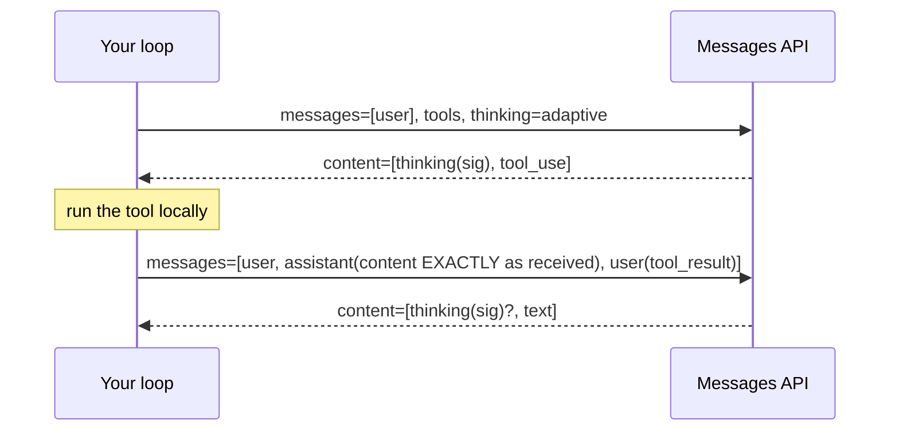

# Using reasoning models through the API

## Why this matters

[1.10](/part-01-how-llms-work/1.10-reasoning-models) explained where thinking comes from and when it pays. This chapter is the other half: thinking is now a request parameter with a price, a place in the response, and rules about what you must send back on the next turn. Get those wrong and you get 400 errors on the second turn of a tool loop, an empty answer because the budget went to thinking, a bill several times what you estimated, or a cache that never hits.

None of this is deep. It is a set of small, provider-specific contracts that change often (Claude's budget-based shape is already deprecated, see below), so the chapter teaches the *questions* every API answers and shows the current answers, with links to the pages that will change.

**Learning goals**

- Turn thinking on and off and set budgets/effort in each API
- Handle thinking blocks in multi-turn conversations and tool use
- Estimate the cost of thinking

## Explanation

### Four questions every API answers

Whatever the provider, a reasoning-capable API has to answer the same four questions. Learn these and each new provider is a lookup, not a new idea.

1. **Switch:** is thinking on, and can you turn it off?
2. **Amount:** how do you say how much? (an effort level, a token budget, or nothing)
3. **Visibility:** what comes back: raw text, a summary, nothing readable?
4. **Continuity:** what must you send back on the next request so the model can continue its reasoning?

| | Switch | Amount | Visibility | Continuity (what you send back) |
|---|---|---|---|---|
| **Claude** (Messages API) | `thinking.type`: `adaptive` (also the default on Claude 5 models), `disabled` where accepted | `output_config.effort`: `low` to `max` | `thinking` blocks; summary or empty, per `display` | The assistant `content` array, unmodified, with its `signature`s |
| **OpenAI** (Responses API) | `reasoning.effort` (`none` where the model supports it) | `reasoning.effort`, plus `max_output_tokens` as a cap | Hidden; optional `reasoning.summary` | `previous_response_id`, or replay the reasoning items (stateless) |
| **Gemini** | on by default on most current models | `thinking_level` | Optional summaries | Server-held with `previous_interaction_id`, or resend `thought` blocks (stateless) |
| **Ollama** (`/api/chat`) | `think: true` or `false` | Levels only on models that list them (`gpt-oss`); Qwen3 is on/off | Separate `message.thinking` field | Nothing required for Qwen3 chat; you choose whether to keep the thinking text |

Sources, in order of the rows: Claude's [thinking overview](https://platform.claude.com/docs/en/build-with-claude/thinking) and [steering page](https://platform.claude.com/docs/en/build-with-claude/thinking-steering-and-cost); OpenAI's [reasoning guide](https://developers.openai.com/api/docs/guides/reasoning); Gemini's [thinking docs](https://aistudio.google.com/docs/thinking); Ollama's [thinking docs](https://docs.ollama.com/capabilities/thinking). The next four sections fill in one row each.

### Claude: adaptive thinking and effort

The older shape was `thinking: {type: "enabled", budget_tokens: N}`: you set a token budget and the model thought against it on every request. Anthropic's [extended thinking page](https://platform.claude.com/docs/en/build-with-claude/extended-thinking) now labels that a legacy feature: it is deprecated, and Claude 4.7 and later models reject it with a 400. The replacement is **adaptive thinking**: the model decides per request whether to think and how much, and you steer it with an **effort level** (the [steering page](https://platform.claude.com/docs/en/build-with-claude/thinking-steering-and-cost) lists `low`, `medium`, `high`, `xhigh` and `max`, with `high` the default on most models and `medium` on Opus 5.5 and Haiku 5.5).

Two things to notice in the request. Effort lives in `output_config`, *not* inside `thinking`. And the "off" switch depends on the model: the [per-model table on the thinking page](https://platform.claude.com/docs/en/build-with-claude/thinking) shows that, for example, Opus 5.5 and Fable 5.2 reject `thinking: {type: "disabled"}`, Haiku 5.5 accepts it at `high` effort or below, and Sonnet 5.5 rejects it but offers `{type: "between_tools"}`, which turns off up-front thinking. So "how do I turn thinking off?" has no single answer on Claude. The portable lever is lowering effort, which the steering page also calls the better first lever than asking in the prompt (it notes that prompt instructions to think less or answer directly did not reliably reduce thinking on several current models).

```ts
// Adaptive thinking with a chosen effort (raw fetch, as in 2.1).
// Shapes follow the Claude docs linked above (not run against the live API: unverified); check the per-model table before sending "disabled".
const res = await fetch("https://api.anthropic.com/v1/messages", {
  method: "POST",
  headers: {
    "x-api-key": process.env.ANTHROPIC_API_KEY!,
    "anthropic-version": "2026-10-21",
    "content-type": "application/json",
  },
  body: JSON.stringify({
    model: "claude-haiku-5-5",
    max_tokens: 8000, // thinking AND the answer share this cap
    thinking: { type: "adaptive", display: "summarized" },
    output_config: { effort: "low" },
    messages: [{ role: "user", content: "..." }],
  }),
});
const msg = await res.json();
for (const block of msg.content) {
  if (block.type === "thinking") console.log("summary:", block.thinking); // may be ""
  if (block.type === "text") console.log("answer:", block.text);
}
console.log(msg.usage.output_tokens, msg.usage.output_tokens_details?.thinking_tokens);
```

The **`display`** field is about what you *see*, not what you pay. On Claude 5 and later models it defaults to `"omitted"`: the `thinking` field comes back as an empty string and only the `signature` is populated ([thinking page](https://platform.claude.com/docs/en/build-with-claude/thinking)). `"summarized"` returns a summary, never the raw chain of thought. `"omitted"` has one benefit: when streaming, the server skips streaming the thinking text, so the answer starts sooner. Set it explicitly on older models whose default is `"summarized"`.

The older budget shape still exists on older models. Its rules, from the [extended thinking page](https://platform.claude.com/docs/en/build-with-claude/extended-thinking): a minimum budget of 1,024 tokens, `budget_tokens` below `max_tokens`, and the budget is "a target rather than a strict cap". The same page maps the migration: remove `budget_tokens`, set `{type: "adaptive"}`, and put the depth in `output_config.effort`. Notice what changed in semantics, not just syntax: with a fixed budget the model thinks on every request, while adaptive thinking may skip thinking entirely on easy inputs at lower effort.

### OpenAI, Gemini: the same questions, different words

**OpenAI.** On the Responses API you set `reasoning: { effort: ... }`. Per OpenAI's [reasoning guide](https://developers.openai.com/api/docs/guides/reasoning), "supported values are model-dependent and can include" `none`, `minimal`, `low`, `medium`, `high`, `xhigh` and `max`: some models reject `none` with a 400 (the guide says this for GPT-6 Astra). The reasoning itself stays hidden; you can request a summary with `reasoning.summary`. Reasoning tokens are reported in `usage.output_tokens_details.reasoning_tokens`, "billed as" output tokens, and `max_output_tokens` caps reasoning plus visible output together. If the cap is hit the response has `status: "incomplete"` with `incomplete_details.reason: "max_output_tokens"`, possibly before any visible output, so you pay for reasoning and get no answer. The guide recommends reserving at least 25,000 tokens for reasoning and output when you start experimenting. The guide also says Chat Completions uses `reasoning_effort` instead and does not support function calling with GPT-6 Astra or GPT-6.1 Sol, so use Responses for those.

**Gemini.** The [Gemini thinking docs](https://aistudio.google.com/docs/thinking) put `thinking_level` (values from `minimal` to `xhigh`, depending on the model; Gemini 4 models don't take `minimal`) and `thinking_summaries` in `generation_config`. Thinking is on by default for most models in the page's table (`gemini-2.5-flash-lite` is the exception); only the final output is returned unless you request summaries; thinking tokens are in `usage.total_thought_tokens` and "response pricing is the sum of output tokens and thinking tokens". As with the others, `max_output_tokens` covers thought tokens and the status turns `incomplete` if the limit is hit mid-reasoning, with thinking still billed.

Compare the three: the same two ideas (a coarse level instead of a token count; a single output cap shared by thinking and answer) appeared independently in all three. That is the durable shape. Which specific models take which values is on [Landscape](/landscape#frontier-models) and the pages above, not here.

### Ollama: `think`, and what the model actually supports

Locally the switch is the `think` field on `/api/chat`. Per the [Ollama thinking docs](https://docs.ollama.com/capabilities/thinking), `think: true` requests thinking output, `false` requests none (a model that can't disable thinking uses its lowest supported level instead), `null` uses the model default, and a string selects a level from the list the model advertises. You discover that list with `/api/show`: the response has a top-level `thinking` object with `values` and `default` (`[false]` means no thinking support). The reply carries the reasoning in `message.thinking` and the answer in `message.content`; when streaming, reasoning chunks arrive before answer chunks.

Checked on this machine (2026-11-10, Ollama 0.40.14): `qwen3:14b` advertises `levels false, true` and `default true` in `ollama show`, so it is on/off, not graded. One run each of "Is 91 prime? Answer yes or no.":

| `think` | Output tokens (`eval_count`) | `message.content` | `message.thinking` length |
|---|---|---|---|
| `true` | 682 | `No.` | 1,978 characters |
| `false` | 3 | `No.` | 0 |

Same answer, about 230 times the tokens (single run, anecdotal, default sampling; your experiment measures this properly). Two practical notes from the same session. First, `think: "high"` sent to Qwen3 was accepted without an error and the model simply thought: the docs say unsupported level names fall back to the model default, so a typo in a level fails *silently*. Check `/api/show` rather than trusting that no error means it worked. Second, `qwen3:8b` with no `think` field thought by default (about 420 output tokens for that same question), which is the trap [2.1](/part-02-programming-with-llms/2.1-calling-models) showed from the `/v1` side: a small `max_tokens` gets eaten by thinking, leaving empty `content`. On `/v1` the lever is `reasoning_effort` (2.1), on `/api/chat` it is `think`.

There is no token-budget knob. The Qwen3 report describes a thinking budget implemented by the runtime, as covered in [1.10](/part-01-how-llms-work/1.10-reasoning-models#hybrid-thinking-models-and-the-knobs-you-actually-get), but Ollama's request exposes only `think` and `num_predict`. A manual budget is `num_predict` as a blunt cap, and if it fires mid-thought you get no answer. That is a truncation, not a "budget".

### Thinking blocks: what you must send back

This is where most thinking bugs live, and it is why the response shape matters. On Claude a response with thinking looks like:

```json
{ "content": [
  { "type": "thinking", "thinking": "…summary or empty…", "signature": "WaUjzkyp…" },
  { "type": "tool_use", "id": "toolu_01…", "name": "get_weather", "input": { "location": "Paris" } }
] }
```

The `signature` is described on the [thinking page](https://platform.claude.com/docs/en/build-with-claude/thinking) as an encrypted copy of the full reasoning that you pass back unchanged. That explains the odd fact in the display section: even when the visible text is empty, the block is not empty, it carries the real reasoning in encrypted form, and the server decrypts it when you return it. The rules, from the same page and the [tool workflow walk-through](https://platform.claude.com/docs/en/build-with-claude/thinking-tool-workflows):

- When you return a tool result, send the assistant message back **exactly as received**, thinking blocks included. Modified thinking blocks are rejected with a 400; dropping them is worse, because it loses the reasoning "even without an error" (tool workflow page).
- A block type you may not know: the API can return `redacted_thinking` blocks (safety-redacted reasoning, an opaque `data` field). The page warns that filtering on `block.type == "thinking"` alone silently drops them and breaks the protocol. In TypeScript the rule is: don't filter, don't map, push `msg.content` as it came.
- Toggle thinking between turns, not within one. If you change it mid-turn the API does not error; it silently disables thinking for that request.
- Not every turn has a thinking block. Adaptive thinking may skip it, and the page says that in adaptive mode "no assistant turn needs to start with one", so don't build logic that assumes it.



```ts
// The one line that matters in a tool loop with thinking.
messages.push({ role: "assistant", content: msg.content }); // verbatim: no filter(), no map()
messages.push({
  role: "user",
  content: msg.content
    .filter((b: any) => b.type === "tool_use") // filtering is fine HERE: this builds the tool_result list
    .map((b: any) => ({ type: "tool_result", tool_use_id: b.id, content: runTool(b) })),
});
```

Across *turns* (not just within a tool loop), the thinking page says you can pass all thinking blocks back and the API filters them: which prior-turn blocks stay in context depends on the model, and retained ones count as input tokens. A block is also checked against what precedes it: on the newest models, changing the system prompt, tools or an earlier message makes every thinking block after the change fail a prefix check, which can return a 400, and blocks from a model that can't read them are dropped without error (the [thinking page](https://platform.claude.com/docs/en/build-with-claude/thinking) has the details). The practical rule for your harness: make the message array **append-only** and store assistant content as the API returned it, not as a string you extracted. Rewriting history (for trimming or injecting reminders) is the thing that breaks thinking validity, so compaction in a harness ([3.4](/part-03-agents/3.4-context-engineering) territory) must account for it.

The other providers have the same shape under other names. OpenAI's reasoning guide says to return the reasoning items from a tool-calling response alongside the tool outputs; with `store: false` the items carry `encrypted_content` and you replay every output item in original order; and "persisted reasoning provides continuity; it does not expose the model's raw reasoning". Gemini's docs say that in stateless mode you must "always resend all `thought` blocks exactly as they were received", while stateful use (`store: true` with `previous_interaction_id`) lets the server manage them. Ollama is the odd one out: the docs linked above don't require you to send `thinking` back, so for ordinary Qwen3 chat I drop old thinking text between turns, since it is just context you pay for again (a judgment call: check your model's behavior).

### Interleaved thinking with tools

In a tool loop, the model can think once at the start of the turn or think again after each tool result. The second is **interleaved thinking**. The [tool workflow page](https://platform.claude.com/docs/en/build-with-claude/thinking-tool-workflows) shows both: without it, the model thinks once, then calls the next tool with no new reasoning; with it, it reasons about each tool result ("got $7,500, now compare with the average") before the next call. With adaptive thinking it is automatic on supporting models with no beta header; the older manual mode needed a beta header on some models and had none at all on others (the [extended thinking page](https://platform.claude.com/docs/en/build-with-claude/extended-thinking) lists which).

Two consequences for an agent. It makes each step smarter and each step costlier, and the steering page says follow-up requests that only process a tool result may skip thinking even at high effort levels; "the first request after new user input typically carries most of the reasoning". So watch your *per-turn* thinking tokens, not just the first call's. And these thinking blocks are part of the assistant turn you must replay, so a long tool chain carries a growing pile of signed blocks, which is billed as input on models that keep all prior thinking.

### Cost and latency: estimating what thinking will cost

Thinking tokens are billed as output tokens, whatever you can see. Claude's [pricing section](https://platform.claude.com/docs/en/build-with-claude/thinking-steering-and-cost#pricing) says you are billed for the full thinking process, not the summary, that the billed count "does not match the visible token count", and that thinking blocks from earlier turns still in context are billed as input. OpenAI bills reasoning tokens as output ([reasoning guide](https://developers.openai.com/api/docs/guides/reasoning)); Gemini bills output plus thinking tokens ([thinking docs](https://aistudio.google.com/docs/thinking)). Locally the price is wall-clock time and memory (1.10).

So the estimator is short. For a request:

```
cost = input_tokens × price_in  +  (visible_output + thinking_tokens) × price_out
thinking_share = thinking_tokens / output_tokens
```

Both usage fields are reported: Claude's example in the steering page has `output_tokens: 348` and `output_tokens_details.thinking_tokens: 312`, i.e. about 90% of the output bill was invisible reasoning. Prices change, so take `price_in` and `price_out` from [Landscape](/landscape) at the time, and compute the bill from the usage the API returns, never from the text you can see (counting the characters of a summary undercounts the bill by construction). To forecast before running, you need a distribution, not one number: run the task set at each setting, take median and 90th-percentile thinking tokens per task, and multiply. That is what the practice does.

Four things move the number besides "think or not":

- **The cap.** `max_tokens` (Claude), `max_output_tokens` (OpenAI, Gemini) cover thinking and answer together. A cap sized for a no-thinking reply is too small once thinking starts; the Claude steering page gives the two remedies (raise the cap, or lower effort) and says which one depends on whether the truncated requests needed the reasoning. Always check `stop_reason` / `status` / `done_reason`, as in 2.1.
- **The level.** Lower effort is the calibrated control on Claude; `reasoning.effort` and `thinking_level` do the same elsewhere. The "think less" sentence in a prompt is the wording-sensitive fallback.
- **The cache.** On Claude, the resolved effort is rendered into the prompt, so changing it (or the thinking configuration) between requests can invalidate message-level cache breakpoints (the [steering page](https://platform.claude.com/docs/en/build-with-claude/thinking-steering-and-cost) has a three-request run showing `cache_read_input_tokens` dropping to zero after an effort change, and that setting effort explicitly to the default does not break the cache). Pick one configuration per conversation. This links to [2.7](/part-02-programming-with-llms/2.7-prompt-caching).
- **The loop.** In an agent each step can think, so a task of 10 tool calls multiplies the per-call figure. Per-step cheap settings for formatting steps and expensive ones for planning steps is the usual split ([1.10's table](/part-01-how-llms-work/1.10-reasoning-models#when-to-turn-thinking-on)).

Latency tracks output tokens: a long hidden chain delays the first visible token. On Claude the lever that specifically helps time-to-first-text when streaming is `display: "omitted"` (above); the lever that helps total time is fewer thinking tokens.

### Leaked reasoning in local models

Experiment 00 hit this on `qwen3:30b-a3b`: with thinking off, the model reasoned anyway, and the raw text ending in `</think>` landed in the answer ([experiment 00 README](/experiments/00-speed-check)). 1.10 separated this *format leak* from *unfaithful reasoning*; here is what to do about the format leak in code.

- **Prefer the structured field.** With `think` set explicitly on `/api/chat`, a supported model's reasoning arrives in `message.thinking` and never in `content` (the docs describe the two separate fields). Leaks are a sign the server's parser didn't recognize the model's format, or `think` was off while the model thought anyway. In the experiment-00 run, `think: false` was not honored on that model.
- **Treat a leak as an expected input, not an exception.** For models you don't control, strip defensively: take the text after the last `</think>`, and if there is an opening `<think>` with no close, treat the response as truncated mid-thought (a budget accident, not an answer).
- **Never put the leaked block back into history.** It is context you pay for again on every later turn, and chat models do not need it.
- **Measure by `done_reason` and `eval_count`.** A suspiciously large `eval_count` with a short answer means thinking ran.

```ts
// Defensive extraction for local models: use the structured field first.
function visibleAnswer(m: { content: string; thinking?: string }) {
  const text = m.content;
  const close = text.lastIndexOf("</think>");
  if (close !== -1) return { answer: text.slice(close + "</think>".length).trim(), leaked: true };
  if (text.includes("<think>")) return { answer: "", leaked: true, truncated: true }; // opened, never closed
  return { answer: text.trim(), leaked: false };
}
```

::: info 📖 Read now
[Claude docs: Thinking](https://platform.claude.com/docs/en/build-with-claude/thinking) · docs · ~20 min · essential

Look for: the per-model table of what each `thinking` value does, the `display` options, the "Preserving thinking blocks" and "Thinking with tool use" sections, and `redacted_thinking`. This page is long: skip the per-language code tabs.
:::

::: info 📖 Read now
[Claude docs: Thinking in tool and multi-turn workflows](https://platform.claude.com/docs/en/build-with-claude/thinking-tool-workflows) · docs · ~10 min · essential

Look for: the two-request round trip, the line that echoes `response.content` unchanged, and the with/without interleaving comparison. This is the loop you will build in Part 3.
:::

::: info 📖 Read now
[Claude docs: Steering thinking](https://platform.claude.com/docs/en/build-with-claude/thinking-steering-and-cost) · docs · ~15 min · essential

Look for: the effort table, the cost-control section (what `max_tokens` does and doesn't bound), the pricing section and `thinking_tokens` in `usage`, and the cache-invalidation example.
:::

::: info 📖 Read now
[Ollama: Thinking](https://docs.ollama.com/capabilities/thinking) · docs · ~10 min · essential

Look for: the `/api/show` `thinking` object, what `think` accepts, and the streaming loop that switches from thinking to content. You used this in 1.10; now compare the values it advertises for `qwen3:14b` with what you send.
:::

::: tip 📖 Read (optional)
[OpenAI: Reasoning models](https://developers.openai.com/api/docs/guides/reasoning) · docs · ~15 min · optional

Look for: `reasoning.effort` and which models reject which values, `incomplete_details`, and the stateful vs. stateless ways of carrying reasoning across turns.
:::

::: tip 📖 Read (optional)
[Gemini: Thinking](https://aistudio.google.com/docs/thinking) · docs · ~10 min · optional

Look for: the models and levels table, the signature rules for stateless use, and how `max_output_tokens` interacts with thought tokens.
:::

### Summary

- Every API answers four questions: switch, amount, visibility, continuity. The answers differ; the questions don't.
- On Claude, use adaptive thinking plus `output_config.effort`; "off" depends on the model, and effort is the portable lever. `budget_tokens` is legacy and rejected on newer models.
- Echo assistant content verbatim, including `thinking` and `redacted_thinking` blocks, and keep history append-only.
- Thinking tokens are billed as output tokens. Read them from `usage`, not from the visible text, and keep the cap high enough for both thinking and answer.
- Locally, `think` is on/off for Qwen3, a typo'd level fails silently, and a leaked `<think>` block must be stripped and kept out of history.

## Practice

**Brief:** Rerun the 1.10 task set through the APIs with different budgets/effort levels on one paid and one local model. Record correctness, tokens and cost in `costs.md`.

**Where:** `experiments/17-thinking-api/`: a standalone experiment, not a `project/` step. The folder has a README with the "What I tried / What happened / Why" skeleton. You write all the code, in TypeScript with plain `fetch` (no starter code needed: you did this in experiment 14). It reuses the five tasks and checkers from `experiments/11-thinking-tradeoff/tasks.json`; do that experiment first, or write the task file now.

**Steps:**

1. **Choose the grid.** Paid model: the cheapest current Claude on [Landscape](/landscape#anthropic) (Haiku 5.5 at the time of writing). Settings: thinking `disabled` (check the per-model table first, since not every model accepts it) and effort `low`, `medium`, `high`. Local model: `qwen3:14b` with `think: false` and `true`, plus a manual `num_predict` cap at about 25% and 50% of your median thinking length from experiment 11.
2. **Predict.** In the README, for each task write the setting you expect to be the cheapest that still answers correctly, and your guess for the thinking share of output tokens on the hardest task.
3. **Estimate the bill before you spend.** From Landscape prices and your experiment-11 token counts, compute an upper bound for the paid grid (tasks × settings × 3 runs) and write it in the README. Set `max_tokens` high enough for thinking plus answer (the steering page explains why), and put the bound in `costs.md` as a planned row.
4. **Write `run.ts`.** For each task × setting × 3 runs, send one request and record: correct (your checker on the visible text), `stop_reason` or `done_reason`, input tokens, output tokens, **thinking tokens** (`usage.output_tokens_details.thinking_tokens` on Claude; derive from `eval_count` and the length of `message.thinking` locally, since Ollama does not report a separate count), wall-clock seconds, and whether any thinking text was returned. Write every run to `results.json`. Keep `display` at its default and record what comes back: for Claude 5 models, expect empty `thinking` fields.
5. **Count the truncations.** A run that stops on `max_tokens` (or `num_predict`) is "ran out of budget", not "wrong". Report them separately.
6. **Compute cost per correct answer** for each setting, with prices from Landscape and tokens from `usage`. Add real rows to `costs.md` for every paid run (the Anthropic Usage page shows the actual charge; reconcile your estimate with it).
7. **A tool turn.** Add one tool (`get_time`, `add(a,b)`, anything) and make a two-request round trip on Claude with thinking on, echoing `content` verbatim. Then break it on purpose: rebuild the assistant message with only the `text` and `tool_use` blocks. Record what happens (status code and error message, or no error at all). Then keep the thinking block but edit its `signature`. Record that too.
8. **A leak hunt.** Run `qwen3:30b-a3b` with `think: false` on a few prompts (it is tight on memory, so close other apps). Does reasoning reach `content`? If it does, write the function that strips it and show it handling both a closed and an unclosed `<think>`.
9. **Explain** in the README: which setting won per task on cost per correct answer; whether effort `low` skipped thinking entirely on the easy tasks (count the runs with `thinking_tokens` of 0); whether the cache-invalidation claim holds (send two identical long-prefix requests, then change `effort`, and compare `cache_read_input_tokens`; needs a prompt above the minimum cacheable length, see [2.7](/part-02-programming-with-llms/2.7-prompt-caching) when you get there, so this step can wait).
10. **Optional stretch:** run the same grid on a second paid provider through OpenRouter or its own API and fill the four-question table above from your own requests, not from the docs.

**Done when:**

- `results.json` has every run, and the README has the prediction, the cost bound, a table of per-setting accuracy, median tokens, thinking share, median seconds and cost per correct answer for both models, and the truncated-run count.
- `costs.md` has a row per paid batch with tokens and cost, and an updated running total.
- You have a recorded outcome (status code and message, or no error) for the two broken tool-turn variants.
- You can state, without looking, which field carries the thinking tokens on Claude and what `display: "omitted"` changes and doesn't change in the bill.

## Check questions

1. Your Claude tool loop runs without errors, but the model's steps after each tool result seem to forget why it called the tool. Your code builds the assistant message from `content.filter(b => b.type === "text" || b.type === "tool_use")`. What is wrong, and what is the fix?

   <details><summary>Answer</summary>

   The filter drops the `thinking` block (and any `redacted_thinking` block). The tool-use rules say to send the assistant message back complete and unmodified, with its signatures: the thinking carries the reasoning behind the tool call, and dropping it loses that reasoning even without an error (modified thinking blocks, by contrast, are rejected with a 400). Push `response.content` as it came; filter only when building the list of tool results.
   </details>

2. A response shows `output_tokens: 1,400` but the thinking text in the response is two sentences. What do you pay for, and where do you find how much of the output was reasoning?

   <details><summary>Answer</summary>

   You pay for all 1,400 output tokens: thinking is billed in full whatever `display` returns, and the visible text is only a summary or empty. `usage.output_tokens_details.thinking_tokens` gives the reasoning part (always at most `output_tokens`), so the visible-answer part is roughly the difference. Estimating cost from the visible text undercounts.
   </details>

3. You set `max_tokens: 1000` on a hard request with thinking on, and get a truncated response with no answer text. Give two fixes and say how you would choose.

   <details><summary>Answer</summary>

   Raise `max_tokens` (thinking and answer share the cap), or lower the effort so the model thinks less. If the truncated requests needed the reasoning to be correct, raise the cap; if they were over-thought for their difficulty, lower the effort. Check the stop reason (`max_tokens`, `incomplete`, `length`) so you notice.
   </details>

4. You lower `effort` from `medium` to `low` halfway through a long cached conversation to save money. Total cost goes up on the next request. Why?

   <details><summary>Answer</summary>

   On Claude the resolved effort level is rendered into the prompt, so changing effort can invalidate the message-level cache breakpoints: the next request re-creates the cache (cache-creation tokens instead of cache-read tokens). Pick one effort per conversation, or use a per-message mechanism that leaves earlier breakpoints intact where the platform supports one.
   </details>

5. With `qwen3:30b-a3b` and `think: false`, your parser sometimes returns answers that start with several paragraphs of reasoning. Give two defensive measures and one thing you must avoid doing with the result.

   <details><summary>Answer</summary>

   Take the text after the last `</think>`, and treat an unclosed `<think>` as a truncated response rather than an answer; also prefer the structured `message.thinking`/`content` split and watch `eval_count` against answer length to detect hidden thinking. Do not append the leaked text to conversation history: it inflates the context you pay for on every later turn and the chat model doesn't need it.
   </details>

## My understanding

<!-- Written by the learner, in their own words. Agents never fill this in. -->
