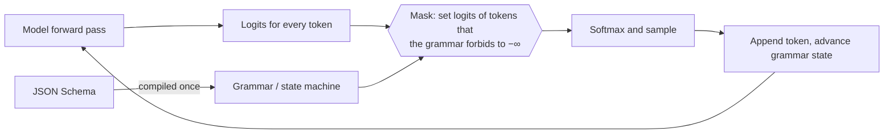

# Structured output

## Why this matters

Most LLM features in real software need JSON your code can trust, not prose. A job-posting parser feeds a database, a classifier feeds a `switch`, an agent's tool call feeds a function. One missing comma, one renamed key, one reply wrapped in Markdown fences and the pipeline throws at 3 a.m.

You already know the boring fix: ask nicely and `JSON.parse` in a `try`. This chapter is about the better ones. Three of the APIs from [2.1](/part-02-programming-with-llms/2.1-calling-models) can now **constrain generation itself** so the output is valid against your schema by construction. But "valid" is not "correct", and the guarantee has edges. You'll learn where the guarantee comes from, where it stops, and what to put around it in TypeScript.

**Learning goals**

- Use JSON schema / structured output modes in each API
- Validate with Zod and handle failures
- Explain constrained decoding

## Explanation

### Three levels of control

There are three ways to get JSON out of a model, and the difference is *who enforces what*:

| Level | You send | What's guaranteed | What can still go wrong |
|---|---|---|---|
| **1. Prompt only** | "Return JSON with these keys…" | nothing | prose around the JSON, Markdown fences, a missing key, a wrong type, truncated output |
| **2. JSON mode** | `format: "json"` (Ollama), `response_format: {type: "json_object"}` (OpenAI-style) | the text parses as JSON ([Ollama](https://docs.ollama.com/capabilities/structured-outputs), [OpenAI](https://developers.openai.com/api/docs/guides/structured-outputs)) | any shape you didn't ask for: wrong keys, wrong types |
| **3. Schema-constrained** | a JSON Schema (`output_config.format`, `response_format: json_schema`, `format: {…schema…}`) | the text parses **and** matches the schema, up to the provider's supported features | wrong *values*, refusals, truncation, unsupported schema features |

OpenAI's guide states the difference plainly: both modes make the output valid JSON, but "only Structured Outputs" ensure schema adherence ([OpenAI: Structured Outputs](https://developers.openai.com/api/docs/guides/structured-outputs)).

Here is what level 1 versus level 3 looks like on this machine. **Observed locally** (Ollama 0.40.14, `qwen3:8b`, `think: false`, `temperature: 0`, 2026-11-10), same job posting, three runs of the prompt-only request:

````text
Prompt: Return JSON with title, company, remote (boolean), salary_min (integer EUR).
        Extract: "Sr. backend dev wanted @ Acme GmbH, hybrid/remote ok!! 70-85k EUR, Berlin"

reply (all three runs): ```json
{ "title": "Sr. backend dev", "company": "Acme GmbH", "remote": true, "salary_min": 70 }
```
````

The model obeyed the keys and still handed back a reply wrapped in a Markdown fence, with `salary_min: 70` where you wanted `70000`. A bare `JSON.parse` fails on the fence. Passing `format: "json"` removed the fence, and a schema with a `description` on the salary field got `70000`. Those are two different fixes for two different failures, and you will meet both.

### How constrained decoding works

Chapter [1.8](/part-01-how-llms-work/1.8-sampling) showed that generation is a loop: the model produces a **logit** for every token in its vocabulary, you turn them into probabilities, sample one token, append it and repeat. Constrained decoding adds one step in the middle:



The schema is first compiled into a **grammar** (a finite-state machine or a context-free grammar). At every step the grammar knows which tokens could legally come next given what has been written so far, and every other token gets its logit set to minus infinity before sampling. The model can't *choose* an illegal token, because its probability is zero.

A worked example. The schema says `remote` is a boolean, and the output so far is `{"title": "Sr. backend dev", "company": "Acme GmbH", "remote": `. The grammar state is "expecting a JSON boolean", so the only legal next tokens are those that begin `true` or `false`. Everything else (`"yes"`, `1`, `null`, a space, a newline) is masked out. If the model's raw preference was a quote mark, that preference is simply thrown away and the best remaining token wins.

This is how the idea is described in the literature: Willard and Louf frame generation as transitions in a finite-state machine and build an index over the model's vocabulary so that "which tokens are legal here" is a lookup, not a scan ([Efficient Guided Generation for LLMs](https://arxiv.org/abs/2307.09702), 2023). llama.cpp, the engine under Ollama, implements the same idea with a grammar format called **GBNF**, and it converts a subset of JSON Schema into GBNF for you ([llama.cpp grammars README](https://github.com/ggml-org/llama.cpp/blob/master/grammars/README.md)). Two consequences from that README are worth knowing: the schema is "only used to constrain the model output and is not injected into the prompt", and "unsupported features are skipped silently".

::: tip 📖 Skim
[llama.cpp: GBNF grammars](https://github.com/ggml-org/llama.cpp/blob/master/grammars/README.md) · docs · ~10 min · optional

This is the engine-level view of constrained decoding. Look for: the short `root ::= …` example grammar, the section on converting JSON Schema to a grammar, and the list of JSON Schema features that are broken or not supported. You won't write GBNF in this book, but reading it once makes "the schema is a grammar" concrete.
:::

#### Where the guarantee stops

Constraining the *syntax* does not constrain the *meaning*. Five limits to hold in your head:

1. **Valid is not correct.** The mask only removes illegal tokens. **Observed locally** (same setup as above, native `/api/chat`, schema without any `description`, `salary_min: integer | null`, `temperature: 0`, one run): the reply was perfectly schema-valid and said `"salary_min": 7000000000000000`. An integer is an integer to the grammar. Adding a `description` ("lower bound of yearly salary in whole euros, e.g. 70000; null if not stated") and renaming the field `salary_min_eur` fixed it. The schema is part of your prompt, so write it like one.
2. **The model still has to fit its answer in the schema.** If the text says "salary negotiable" and the schema requires an integer, something will be invented. Give the model an exit: make the field nullable or add an `"unknown"` enum value.
3. **Truncation breaks the guarantee.** A reply that hits `max_tokens` is cut mid-JSON. Anthropic's docs say this explicitly: with `stop_reason: "max_tokens"` the output "might be incomplete and not match the schema" ([Structured outputs](https://platform.claude.com/docs/en/build-with-claude/structured-outputs)). Always check the stop reason from [2.1](/part-02-programming-with-llms/2.1-calling-models#stop-reasons-the-branch-you-always-write) before parsing.
4. **Refusals don't follow your schema.** The same Anthropic page says a `stop_reason: "refusal"` response comes back as HTTP 200, is billed, and "might not match the schema". OpenAI's guide likewise says to check for a `refusal` item before parsing.
5. **Not every provider enforces.** OpenRouter's `strict: true` asks providers with a native strict mode to enforce the schema, but "enforcement varies by provider": some guarantee it, some treat it as a strong hint. Support is per endpoint, not per model, so you set `require_parameters: true` to route only to endpoints that support it ([OpenRouter: Structured outputs](https://openrouter.ai/docs/guides/features/structured-outputs)).

There's a sixth, subtle one: forcing the shape can cost quality. If a field comes before the reasoning that justifies it, the model must commit to an answer first. Put a short `reasoning` or `evidence` string *before* the field that depends on it, or use a reasoning model with its thinking separated from the constrained content (chapter [2.4](/part-02-programming-with-llms/2.4-reasoning-via-api)). I confirmed on this machine that Ollama's `format` constrains only the final `content`: with thinking left on, `qwen3:8b` returned its reasoning in a separate `thinking` field and a schema-valid `content`.

### The API for each route

All three routes from [2.1](/part-02-programming-with-llms/2.1-calling-models) can do level 3, with three different spellings of the same idea.

#### Anthropic: `output_config.format`

You pass the schema in `output_config.format` with `type: "json_schema"`, and the reply's text block holds JSON that matches it ([Structured outputs](https://platform.claude.com/docs/en/build-with-claude/structured-outputs)). A request body, with the rest as in 2.1:

```json
{
  "model": "claude-haiku-5-5",
  "max_tokens": 1024,
  "messages": [{ "role": "user", "content": "Extract the job posting: …" }],
  "output_config": {
    "format": {
      "type": "json_schema",
      "schema": {
        "type": "object",
        "properties": { "title": { "type": "string" }, "remote": { "type": "boolean" } },
        "required": ["title", "remote"],
        "additionalProperties": false
      }
    }
  }
}
```

Things the page tells you that bite in practice:

- **Strict tool use is a separate feature.** `strict: true` on a tool definition validates the tool name and inputs; JSON outputs control what Claude *says*. They can be combined in one request. Tool calling is [2.6](/part-02-programming-with-llms/2.6-tool-calling).
- **First use of a schema is slower.** Schemas compile into a grammar; the first request pays for it, and compiled grammars are cached for 24 hours from last use. Changing the schema structure invalidates the cache, and changing `output_config.format` invalidates the prompt cache for that thread ([2.7](/part-02-programming-with-llms/2.7-prompt-caching)).
- **Only a subset of JSON Schema works.** Supported: the basic types, `enum`, `const`, `anyOf`, `$ref` to local definitions, `required`, `additionalProperties: false`, a list of string formats (`date`, `date-time`, `email`, `uri`, `uuid` and a few more), and `minItems` of 0 or 1. Not supported: recursive schemas, `minimum`/`maximum`, `minLength`/`maxLength`, and `additionalProperties` set to anything but `false`. Using an unsupported feature returns a 400.
- **Enum casing can drift.** The docs warn the model "might change capitalization" in `enum` and `const` values, and the response completes without error, so compare case-insensitively.
- **Which models:** the page lists the supported ones; `claude-haiku-5-5` and the other current IDs on [Landscape](/landscape#anthropic) are on it. Check the page before assuming an older model works.

#### OpenAI-compatible: `response_format`

On the Chat Completions shape, you send `response_format: { type: "json_schema", json_schema: { name, strict: true, schema } }`. OpenRouter documents exactly that shape ([OpenRouter: Structured outputs](https://openrouter.ai/docs/guides/features/structured-outputs)). OpenAI's own newer Responses API spells it `text.format` instead, with `strict: true` ([OpenAI: Structured Outputs](https://developers.openai.com/api/docs/guides/structured-outputs)). The practical points from the OpenRouter page:

- Not every model supports it: filter the models page by `supported_parameters=structured_outputs`, or look at the `structured_outputs` parameter on a model's page. If the model doesn't support it, the request fails rather than silently falling back.
- Add `description`s to schema properties: OpenRouter lists this as a best practice.
- Streaming works: the partial text is JSON that is only valid once complete, so don't parse until the end ([2.2](/part-02-programming-with-llms/2.2-streaming)).

Ollama's `/v1/chat/completions` lists `response_format` among supported fields ([OpenAI compatibility](https://docs.ollama.com/openai)); the page doesn't spell out which types, so I tried it: **observed locally** (Ollama 0.40.14, `qwen3:8b`, `reasoning_effort: "none"`), a `json_schema` request with `strict: true` returned a schema-valid reply.

#### Ollama native: `format`

On `/api/chat`, `format` takes either `"json"` or a JSON Schema object ([Ollama: Structured outputs](https://docs.ollama.com/capabilities/structured-outputs)). The same page gives three tips, all worth following: also describe the shape in the prompt (it "helps ground" the response), set the temperature to 0 for more deterministic output, and use the schema from your validation library rather than writing it twice. Ollama announced the feature on 2024-12-06 ([blog](https://ollama.com/blog/structured-outputs)); that post doesn't describe the mechanism, but the engine underneath is llama.cpp's grammar sampler from the previous section.

Because the schema isn't injected into the prompt (llama.cpp's note above), **a schema-only request gives the model no instructions about the fields.** My `description` fix worked for exactly that reason, and it's why the Ollama docs tell you to describe the shape in the prompt too. On Anthropic and OpenAI the schema is also visible to the model in some form, but write good descriptions anyway.

::: info 📖 Read now
[Claude: Structured outputs](https://platform.claude.com/docs/en/build-with-claude/structured-outputs) · docs · ~20 min · **essential**

Read "JSON outputs", the supported-and-unsupported schema lists, "Latency and caching", and the `stop_reason` caveats. Look for: the `output_config.format` shape, the Zod helper (`zodOutputFormat` with `client.messages.parse()`), what `parse()` validates that the API itself doesn't, and the complexity limits. Skip the migration notes unless you meet the old `output_format` parameter in someone's code.
:::

::: info 📖 Read now
[Ollama: Structured outputs](https://docs.ollama.com/capabilities/structured-outputs) · docs · ~8 min · **essential**

Short page. Look for: the `format` field with a schema, the Zod example in JavaScript (`z.toJSONSchema`), and the two tips about the prompt and temperature. The cloud variant of Ollama doesn't support structured outputs, so everything here runs against your local server.
:::

### JSON Schema and Zod

**JSON Schema** is the language every API above speaks: a JSON document that says "an object with these properties, these required, these types". It's verbose to write by hand and impossible to keep in sync with your TypeScript types. **Zod** is the TypeScript-first answer: you write the schema once as code, get the static type from it, validate with it at runtime, and convert it to JSON Schema for the API.

```ts
import * as z from 'zod'

const Job = z.object({
  title: z.string(),
  company: z.string(),
  remote: z.boolean(),
  salary_min_eur: z
    .number()
    .int()
    .nullable()
    .describe('Lower bound of yearly salary in whole euros; null if not stated'),
  seniority: z.enum(['junior', 'mid', 'senior', 'unknown']),
})

type Job = z.infer<typeof Job> // the TS type, derived: no second definition

const jsonSchema = z.toJSONSchema(Job) // what you send as `format` / `schema`
```

Three Zod facts, from the Zod docs ([Basics](https://zod.dev/basics), [JSON Schema](https://zod.dev/json-schema)):

- `z.toJSONSchema()` is how Zod 4 produces JSON Schema; the default target is Draft 2020-12. It throws on types JSON has no equivalent for (`Date`, `bigint`, `Map`, `Set`, transforms, custom types) unless you pass `unrepresentable: "any"`. The `io` option picks the *input* or *output* side of schemas with transforms or defaults.
- `.safeParse(x)` never throws and returns `{ success: true, data }` or `{ success: false, error }`. `.parse(x)` throws a `ZodError` whose `issues` carry the `path` and `message` of each problem.
- `.describe("…")` ends up as `description` in the JSON Schema. That is the channel for field-level instructions.

**Observed with Zod 4.6.7:** `.int()` emits `"minimum": -9007199254740991, "maximum": 9007199254740991` in the JSON Schema, and `z.object` sets `additionalProperties: false` by default. Anthropic's documented list above says `minimum`/`maximum` aren't supported, which is why their SDK helper `zodOutputFormat()` "transforms the schema for the API" and then validates the response against your *original* Zod schema, including constraints the API can't take ([Structured outputs](https://platform.claude.com/docs/en/build-with-claude/structured-outputs)). With a raw `fetch` you do that stripping yourself, or use the SDK helper. Ollama's `format` accepted the unmodified `z.toJSONSchema(Job)` output with the bounds in place in my test (`qwen3:8b`, same setup as above), so the learner's local path needs no cleanup.

The general pattern, then, is **two layers**: the API enforces a schema (the subset it supports), and Zod validates the result against the schema you actually care about, including rules like "salary must be positive" that the API can't express.

::: info 📖 Read now
[Zod: Basics](https://zod.dev/basics) and [Zod: JSON Schema](https://zod.dev/json-schema) · docs · ~15 min · **essential**

Look for: `parse` vs. `safeParse` and the shape of the result, `z.infer`, and in the JSON Schema page the `target`, `io` and `unrepresentable` options plus the list of types that can't be converted. Skip everything about codecs and async refinements for now.
:::

### Validation and retry

Even with level 3 you validate, for three reasons: a provider might not enforce (point 5 above), a response can be truncated or refused, and your schema has rules the API doesn't know. And at levels 1 and 2 you validate because you have to.

The loop is short. Strip any fence, parse, validate with `safeParse`, and on failure **send the validation error back** as a follow-up message so the model can fix the specific problem. I ran this against `qwen3:8b` on this machine (the fence-stripping step is what handled the fenced reply from the first example); `call` is whatever function sends `messages` to your provider and returns the text:

```ts
import * as z from 'zod'

type Msg = { role: 'user' | 'assistant'; content: string }
type Result<T> = { ok: true; data: T; attempts: number } | { ok: false; error: string; attempts: number }

// Strip a Markdown fence if the model added one, then parse and validate.
function parseJson<T>(schema: z.ZodType<T>, raw: string): { ok: true; data: T } | { ok: false; error: string } {
  const body = raw.trim().replace(/^```(?:json)?\s*/i, '').replace(/\s*```$/, '')
  let json: unknown
  try {
    json = JSON.parse(body)
  } catch (e) {
    return { ok: false, error: `Not valid JSON: ${(e as Error).message}` }
  }
  const r = schema.safeParse(json)
  return r.success ? { ok: true, data: r.data } : { ok: false, error: z.prettifyError(r.error) }
}

async function extract<T>(
  schema: z.ZodType<T>,
  call: (messages: Msg[]) => Promise<string>,
  prompt: string,
  maxAttempts = 3,
): Promise<Result<T>> {
  const messages: Msg[] = [{ role: 'user', content: prompt }]
  let error = ''
  for (let attempt = 1; attempt <= maxAttempts; attempt++) {
    const text = await call(messages)
    const parsed = parseJson(schema, text)
    if (parsed.ok) return { ok: true, data: parsed.data, attempts: attempt }
    error = parsed.error
    // show the model its own bad reply plus exactly what was wrong with it
    messages.push(
      { role: 'assistant', content: text },
      { role: 'user', content: `That reply failed validation:\n${error}\nReturn only corrected JSON.` },
    )
  }
  return { ok: false, error, attempts: maxAttempts }
}
```

`z.prettifyError()` turns a `ZodError` into lines such as `✖ Invalid input: expected boolean, received string → at remote`, which is a good message to show a model (I checked the output on a deliberately bad object with Zod 4.6.7). Some design points:

- **Cap the attempts** (2 or 3) and return a failure value instead of looping. Each retry costs a full call, and the history grows ([2.1](/part-02-programming-with-llms/2.1-calling-models#multi-turn-state-you-keep-it)).
- **Retry only what retrying can fix.** A parse or validation failure, yes. A `max_tokens` stop reason: raise the limit instead. A `refusal`: no. A 429 or 5xx: that's the transport retry from 2.1, a different layer.
- **Count failures.** The rate at which level 1 needs retries, and the rate at which level 3 still fails validation, are the numbers the practice asks you to measure. They tell you whether the native mode is earning its restrictions.
- **A failed result is data, not an exception.** Return `{ ok: false }` and let the caller decide: skip the record, queue it for a human, or fall back to a stronger model. That decision shows up again in the eval chapters of Part 4.

### Schema design tips

The schema is a prompt, an API contract and a validator at once. What helps all three:

1. **Name and describe fields as if for a new colleague.** `salary_min_eur` with a description beats `salary`. Both OpenRouter's docs and the Ollama tips point at descriptions and prompt text as the main steering channel, and my local salary example showed why.
2. **Give every field an exit.** Use `nullable()` for "not stated" and an `"unknown"` / `"other"` member in enums. Without an exit the model invents an answer to satisfy the grammar.
3. **Use enums for closed sets, strings for open ones.** An enum is one of the strongest constraints you can give. Watch for the casing drift on Anthropic.
4. **Keep it flat and small.** Anthropic documents complexity limits (for example, up to 24 optional parameters and 16 union-type parameters per request, and a compile timeout that returns a 400 "Schema is too complex for compilation"). Deep nesting and many optionals also give the model more ways to go wrong. Prefer arrays of simple objects.
5. **Mark most fields required, and let `null` carry "missing".** OpenAI's examples list every property in `required` with `additionalProperties: false`, and Anthropic's schemas do the same; `.optional()` in Zod is the opposite shape and the limits above count optionals.
6. **Don't rely on constraints the API can't enforce.** `minLength`, `minimum` and regexes may be rejected or skipped by a provider. Keep them in Zod, where `safeParse` enforces them, and be ready for a retry.
7. **Put reasoning fields first.** If you want an explanation or evidence quote, place it before the answer it supports, and keep it short: Anthropic warns that asking for step-by-step reasoning in a property can trigger a `reasoning_extraction` refusal.
8. **Normalize in code, not in the schema.** Ask for what the text says (`"70-85k EUR"` as `min` and `max`), then do currency conversion and date arithmetic in TypeScript, where it's testable.

::: tip 📖 Skim
[OpenAI: Structured Outputs](https://developers.openai.com/api/docs/guides/structured-outputs) · docs · ~15 min · optional

The vendor that popularized the `response_format` / `strict: true` spelling. Skim for: JSON mode versus Structured Outputs, how refusals show up, and the Zod helper in the Node SDK (`zodTextFormat`). Useful as the OpenAI-side view of everything above, and because OpenRouter models mostly use this shape.
:::

::: tip 📖 Skim
[OpenRouter: Structured outputs](https://openrouter.ai/docs/guides/features/structured-outputs) · docs · ~8 min · optional

Skim for: the `response_format` shape, the `strict` caveat, and `require_parameters: true`. This page decides whether your paid-model runs in the practice are really constrained or only prompted.
:::

::: tip 📖 Skim
[Efficient Guided Generation for Large Language Models](https://arxiv.org/abs/2307.09702) · paper · ~15 min (abstract, introduction) · optional

The paper behind the Outlines library. Skim the abstract and introduction for: the finite-state-machine view of generation and the vocabulary index. The rest is implementation detail you can skip.
:::

## Practice

**Brief:** Extract structured data from 10 messy job-posting texts into a Zod schema with a local model and a paid model, and **measure the validity rate with and without native structured output**. Validity here is two numbers: *parses and validates against your Zod schema*, and *matches your hand-written answer*.

**Where:** `experiments/18-structured-output/`: a standalone experiment, not a `project/` step. The folder has a README with the "What I tried / What happened / Why" skeleton. You write all the code; I haven't provided any.

**Steps:**

1. **Set up.** In `experiments/18-structured-output/` run `npm init -y` and `npm install zod`, add `"type": "module"`, and write scripts that run with `node --env-file-if-exists=../../.env script.ts` like in experiment 14. You can call the models with raw `fetch` as in 2.1; add `@anthropic-ai/sdk` only if you want to try `zodOutputFormat`.
2. **Write the schema** as a Zod object with 5 or 6 fields: at least one `boolean`, one nullable integer (salary), one `enum` with an `"unknown"` member, and one array of strings (skills). Put a `.describe()` on every field that has a trap.
3. **Write 10 messy texts** (job postings, or recipes if you prefer: ingredients and quantities) and your own **answer key** as a JSON file. Make them hard on purpose: salary as "70-85k", "competitive", or "£400/day"; remote hidden in a sentence; skills in prose; one text with no salary at all; one in another language; one very short. Keep the key in a separate file so the scripts can't see it while extracting.
4. **Predict.** In the README, before running anything, write what you expect for the validity rate of each condition below.
5. **Run a matrix** over the 10 texts, **three conditions** × **two models** (6 cells), with `temperature: 0` where the API allows it (Anthropic doesn't take sampling settings, see [2.1](/part-02-programming-with-llms/2.1-calling-models)):
   - **A. Prompt only:** the schema pasted into the prompt as text, no native feature, no retry.
   - **B. Native structured output:** Ollama `format: z.toJSONSchema(Job)` for `qwen3:8b` (try `think: false`), and `output_config.format` for `claude-haiku-5-5` or `response_format` for an OpenRouter model of your choice. For a paid model that's not Claude, check on its OpenRouter page that `structured_outputs` is supported, and set `require_parameters: true`.
   - **C. Native plus the validate-and-retry loop** from the chapter, with at most 2 retries.
6. **Score every run** with `safeParse` and record, per cell: parsed as JSON, passed Zod, matched the answer key (compare field by field), number of attempts, and the stop reason. Save the raw replies so you can look at the failures.
7. **Classify every failure** into one of: not JSON, fenced, wrong shape, wrong type, valid but wrong value, truncated, refused. In the README, a table of counts per condition and model.
8. **Probe the limits.** Pick the failure you find most interesting and make it worse on purpose: remove the `describe` from the salary field, lower `max_tokens` until the output truncates, or add a field the text can't answer and remove the `nullable`. Record what the model does when the schema leaves no honest answer.
9. **Spend log.** Add the paid runs to `costs.md` (actual `usage.cost` for OpenRouter, estimate for Anthropic using prices on [Landscape](/landscape)).

**Done when:**

- You have a table of 6 cells (3 conditions × 2 models) with *valid-against-schema* and *correct-against-key* rates and the average attempts.
- Your README has your predictions and says which were wrong.
- At least one failure per condition is classified, with the raw reply quoted.
- You can say in one sentence what native structured output did and didn't change for each model.
- The step 8 probe shows what happens when a schema leaves no honest answer.
- `costs.md` has the paid rows and an updated running total.

## Check questions

1. A teammate says "we use JSON mode, so our output always matches the schema." What's wrong with that?

   <details><summary>Answer</summary>

   JSON mode only guarantees that the text parses as JSON. It says nothing about keys, types or enums. Only schema-constrained structured output (a JSON Schema passed through `format`, `response_format: json_schema` or `output_config.format`) enforces the shape, and even that depends on the provider enforcing it and on the schema using supported features. You still validate.

   </details>

2. Explain in two or three sentences how constrained decoding guarantees a boolean field contains `true` or `false`. Why can it not guarantee the boolean is the right one?

   <details><summary>Answer</summary>

   The schema is compiled into a grammar or state machine. At each step, tokens the grammar doesn't allow in the current state get their logits set to minus infinity before sampling, so after `"remote": ` only tokens that begin `true` or `false` can be chosen. The mask only removes illegal tokens; among the legal ones the model still picks by its own preferences, so it can say `false` for a remote job. Valid is a property of syntax and structure, correct is a property of meaning.

   </details>

3. Your Claude call with `output_config.format` returns HTTP 200, but `JSON.parse` throws on the text. Name two stop reasons that could explain it and what you do for each.

   <details><summary>Answer</summary>

   `max_tokens`: the reply was cut off mid-JSON, so retry with a higher limit (don't send the broken text back for repair). `refusal`: the model declined and the text is a refusal message, not your schema, so don't retry blindly; treat it as a failure to handle. In both cases the Anthropic docs say the output "might not match the schema", which is why you check `stop_reason` before parsing.

   </details>

4. Your Zod schema has `z.number().int().min(0).max(100)`. You send `z.toJSONSchema(schema)` to the Claude API with raw `fetch` and get a 400. What's the likely cause and what are two ways out?

   <details><summary>Answer</summary>

   The generated JSON Schema contains `minimum` and `maximum`, which Anthropic lists as unsupported numerical constraints, and using an unsupported feature returns a 400. Ways out: use the SDK helper `zodOutputFormat()` with `client.messages.parse()`, which transforms the schema for the API and then validates the response against your original Zod schema; or strip the unsupported keywords yourself, send the simpler schema, and keep the range check in your own `safeParse`.

   </details>

5. A validate-and-retry loop gets the same Zod error three times in a row. List two things to try before raising `maxAttempts`.

   <details><summary>Answer</summary>

   Look at what the schema leaves the model: a field with no honest answer (add `nullable()` or an `"unknown"` member), a missing or vague `describe`, or a constraint the model can't see (a regex or range that only Zod knows). Then look at the model and mode: move from prompt-only to native structured output, lower the temperature, or try a stronger model. Repeating a failing request with the same error message rarely helps when the cause is the schema.

   </details>

## My understanding

<!-- Written by the learner, in their own words. Agents never fill this in. -->
