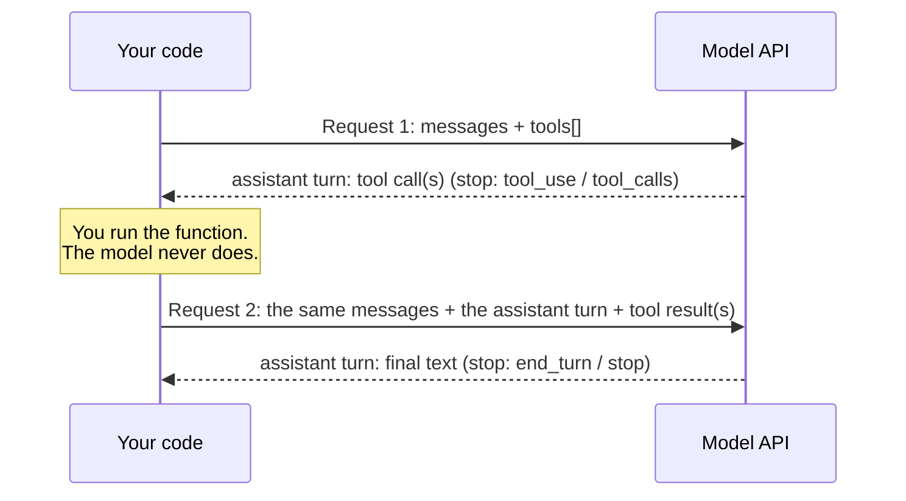

# Tool calling

## Why this matters

A language model can only emit text. It can't read your file, query your database or send an email. **Tool calling** is the contract that fixes this: you describe functions to the model, the model answers with a structured request to call one, your code runs it, and you hand the result back. Anthropic's docs put it flatly: "The model never runs anything on its own. It emits a structured request, your code (or Anthropic's servers) runs the operation, and the result flows back into the conversation" ([How tool use works](https://platform.claude.com/docs/en/agents-and-tools/tool-use/how-tool-use-works)).

This is the bridge from "chat API" to "agent". The loop in Part 3 is this chapter's round trip inside a `while`. Here you do **one** round trip by hand, on purpose, so that when the loop and the SDKs arrive you know exactly what they are automating, and what to look at when they misbehave.

If you did [2.5](/part-02-programming-with-llms/2.5-structured-output), you already know the hard part. A tool's arguments are structured output: a JSON Schema in, JSON that matches it out. What's new is the conversation protocol wrapped around it.

**Learning goals**

- Define tools with JSON schema
- Handle tool-use requests and send results back correctly
- Handle parallel tool calls and errors

## Explanation

### The round trip

One tool call is **two requests**, not one. Everything else in this chapter is detail on this picture:



Four things to notice, because every bug in this area is one of them:

1. **The API is stateless** ([2.1](/part-02-programming-with-llms/2.1-calling-models#multi-turn-state-you-keep-it)). Request 2 must carry the whole history: the original user message, the assistant turn containing the call, and the result. The model learns about the result only because you sent it.
2. **The assistant turn that contains the call goes back verbatim.** It is part of the history, and the result refers to it.
3. **The stop reason is your branch.** On Claude it is `stop_reason: "tool_use"`; on OpenAI-style APIs `finish_reason: "tool_calls"` ([2.1's table](/part-02-programming-with-llms/2.1-calling-models#stop-reasons-the-branch-you-always-write)). A reply can also end with a plain answer and no tool call at all: with `auto` choice the model decides each turn. Don't assume a call.
4. **Tools cost tokens.** The definitions are part of every request's input, and so are the call and result blocks. Anthropic says so explicitly: tokens come from "the `tools` parameter in API requests (tool names, descriptions, and schemas)", the `tool_use` blocks and the `tool_result` blocks, plus a built-in tool-use system prompt ([Tool use overview](https://platform.claude.com/docs/en/agents-and-tools/tool-use/overview#pricing)). Ten verbose tools resent on every turn add up, which is why [3.3](/part-03-agents/3.3-tool-design) is a chapter on design.

### Tool definitions

A tool definition is a name, a description and a JSON Schema for the arguments. On Claude the fields are `name` (matching `^[a-zA-Z0-9_-]{1,128}$`), `description`, `input_schema`, and optionally `input_examples` ([Define tools](https://platform.claude.com/docs/en/agents-and-tools/tool-use/define-tools)):

```json
{
  "name": "get_weather",
  "description": "Get the current weather for a city. Use it when the user asks about current conditions, not forecasts. Returns temperature in Celsius and a short summary. Does not accept coordinates.",
  "input_schema": {
    "type": "object",
    "properties": {
      "city": { "type": "string", "description": "City name, optionally with country, e.g. 'Sofia, Bulgaria'" }
    },
    "required": ["city"]
  }
}
```

The same tool in the OpenAI-style and Ollama shape wraps it differently: `{"type": "function", "function": {"name", "description", "parameters"}}`, where `parameters` is the schema ([Ollama tool calling](https://docs.ollama.com/capabilities/tool-calling), [OpenRouter tool calling](https://openrouter.ai/docs/guides/features/tool-calling)). Same three ideas, different key names; the table near the end collects them.

**The description is the interface.** The model never sees your function body. It sees the name, the description and the schema, and nothing else, and chooses from those alone. Anthropic calls detailed descriptions "by far the most important factor in tool performance" and asks for what the tool does, when to use it (and when not to), what each parameter means, and the caveats such as what the tool does not return; "at least 3–4 sentences" per tool ([Define tools](https://platform.claude.com/docs/en/agents-and-tools/tool-use/define-tools#best-practices-for-tool-definitions)). Compare that with `"Gets the weather."`. The example above is deliberately wordy for that reason. The same page lists further tips you'll apply in [3.3](/part-03-agents/3.3-tool-design): fewer, more capable tools instead of many thin ones, namespaced names like `github_list_prs`, and responses that return only high-signal fields.

**Schema and `strict`.** The arguments the model produces are generated text, so they can be wrong in the ways chapter 2.5 listed. Claude's docs: when a call is invalid (for example, missing a required parameter), "it usually means that there wasn't enough information for Claude to use the tool correctly", and the fix during development is better descriptions ([Handle tool calls](https://platform.claude.com/docs/en/agents-and-tools/tool-use/handle-tool-calls#handling-errors-with-is_error)). To remove the whole class of malformed arguments, Claude has `strict: true` on a tool definition ("strict tool use"), which guarantees inputs match the schema. OpenAI has the same switch, and notes that Chat Completions requests "remain non-strict by default" ([OpenAI: Function calling](https://developers.openai.com/api/docs/guides/function-calling)). It is the 2.5 machinery (a schema compiled into constrained decoding) applied to tool arguments, with the same caveat: valid is not correct. `"city": "Sofia"` is valid when the user asked about Plovdiv.

**Validate anyway.** Whatever the mode, treat the arguments as untrusted input from a probabilistic caller. Run them through your Zod schema before touching a file system or a database, exactly as 2.5 did. It is cheap, and it turns "the model passed a path outside the sandbox" into an error message instead of an incident.

### The wire format, step by step

Here is one full round trip in each dialect, for the weather tool. The Claude example follows the docs ([Handle tool calls](https://platform.claude.com/docs/en/agents-and-tools/tool-use/handle-tool-calls)); the Ollama and OpenAI-compatible JSON is what I saw from a local `qwen3:8b` (Ollama 0.40.14, `think: false`, `temperature: 0`, 2026-11-10, with a `read_file` tool rather than the weather one).

#### Anthropic

**Request 1** has `tools` and a user message. **The response** has `stop_reason: "tool_use"` and a `tool_use` block among its `content` blocks, often after some text:

```json
{
  "stop_reason": "tool_use",
  "role": "assistant",
  "content": [
    { "type": "text", "text": "I'll check the weather in Sofia." },
    { "type": "tool_use", "id": "toolu_01A09q90qw90lq917835lq9", "name": "get_weather", "input": { "city": "Sofia, Bulgaria" } }
  ]
}
```

`input` is already a parsed object. `id` is what ties a result to this call. **Request 2** appends the whole assistant `content` as an assistant message, then a **user** message holding a `tool_result`:

```json
[
  { "role": "user", "content": "What's the weather in Sofia?" },
  { "role": "assistant", "content": [ /* the content array above, unchanged */ ] },
  {
    "role": "user",
    "content": [
      { "type": "tool_result", "tool_use_id": "toolu_01A09q90qw90lq917835lq9", "content": "4°C, light rain" }
    ]
  }
]
```

There is no `tool` role. Claude's docs say it directly: unlike APIs "that separate tool use or use special roles like `tool` or `function`, the Claude API integrates tools directly into the `user` and `assistant` message structure." Results are content blocks in a user message. The formatting rules from the same page, which the API enforces with a 400:

- The tool-result message must come **immediately** after the assistant message with the calls. No message in between.
- In that user message the `tool_result` blocks must come **first**; any text goes after all of them.
- `content` of a result can be a string, or a list of `text`, `image`, `document` or `search_result` blocks.

The Claude 400 you will meet first, per the docs, reads like "tool_use ids were found without tool_result blocks immediately after". It means one of the rules above is broken.

#### OpenAI-compatible (Chat Completions)

The call arrives on the assistant **message** as `tool_calls`; each has an `id`, and **`arguments` is a JSON string**, not an object. Locally through Ollama's `/v1/chat/completions`:

```json
{
  "finish_reason": "tool_calls",
  "message": {
    "role": "assistant",
    "content": "",
    "tool_calls": [
      { "id": "call_tf9bdjvj", "index": 0, "type": "function",
        "function": { "name": "read_file", "arguments": "{\"path\":\"a.txt\"}" } }
    ]
  }
}
```

You have to `JSON.parse(arguments)` yourself, which can throw: that is the same "partial or invalid JSON" hazard as 2.2 and 2.5. The result goes back as a **message with `role: "tool"`** and a `tool_call_id` matching the call's `id`. OpenRouter documents exactly this: "`role: "tool"` messages, each linked to its call by `tool_call_id`" ([OpenRouter tool calling](https://openrouter.ai/docs/guides/features/tool-calling)). OpenAI's newer Responses API uses different items: a `function_call` with a `call_id` and JSON-string `arguments`, answered by a `function_call_output` input item with the same `call_id` and an `output` ([OpenAI: Function calling](https://developers.openai.com/api/docs/guides/function-calling)). Same idea; the IDs are called `call_id` there.

OpenRouter adds a rule that matters for a router: "the `tools` parameter must be included in every request" (including request 2), so it can validate the schema on each call ([OpenRouter tool calling](https://openrouter.ai/docs/guides/features/tool-calling)). Send the same `tools` array both times on every route; on Claude you must keep it too, because tool blocks in the history refer to it.

#### Ollama native `/api/chat`

Tools use the same `{"type": "function", "function": {…}}` definition, but the response and the result differ from the OpenAI shape. **Observed locally:** `arguments` is an **object**, each call has an `index`, and, although the Ollama page's examples don't show one, my `0.40.14` server also returned an `id` on each call:

```json
{
  "role": "assistant",
  "content": "",
  "tool_calls": [
    { "id": "call_qn6sza6q", "function": { "index": 0, "name": "read_file", "arguments": { "path": "a.txt" } } }
  ]
}
```

The result goes back as `{"role": "tool", "tool_name": "read_file", "content": "…"}`: matched by **name**, not by ID, per the docs: "append one message per result with `role` `"tool"`, `tool_name` set to the called function's name" ([Ollama tool calling](https://docs.ollama.com/capabilities/tool-calling)). Two quirks that can fool a stop-reason branch: **`done_reason` was `"stop"` even when the message held tool calls** (so on Ollama's native API, branch on `message.tool_calls`, not on the stop field), and the `content` is empty when the model only calls tools.

| | Anthropic Messages | OpenAI-compatible Chat Completions | Ollama native |
|---|---|---|---|
| Tool definition | `{name, description, input_schema}` | `{type:"function", function:{name, description, parameters}}` | same as OpenAI-style |
| Where the call is | `tool_use` block in `content` | `message.tool_calls[]` | `message.tool_calls[]` |
| Arguments | `input`, a parsed object | `function.arguments`, a **JSON string** | `function.arguments`, an object |
| Call ID | `id` (`toolu_…`) | `id` (`call_…`) | `id` observed locally; docs match by name |
| Signal to branch on | `stop_reason: "tool_use"` | `finish_reason: "tool_calls"` | `message.tool_calls` is non-empty (`done_reason` was `stop`) |
| Result goes in | a `user` message, `tool_result` block, `tool_use_id` | a `tool` message, `tool_call_id` | a `tool` message, `tool_name` |
| Error flag | `is_error: true` | none; put it in the text | none; put it in the text |
| Forcing | `tool_choice` `auto`/`any`/`tool`/`none` | `tool_choice` `auto`/`required`/`none`/named | not honoured on `/v1` (below) |

### Tool results and errors

A tool result is **text the model will read**, so it is part of your prompt. Three habits follow.

**Errors are results, not exceptions.** If the function throws, don't crash the program and don't skip the answer. Catch it and report it back, so the model can adapt: apologise to the user, retry with different arguments or pick another tool. On Claude you flag it with `is_error: true`:

```json
{ "type": "tool_result", "tool_use_id": "toolu_01A09…", "is_error": true,
  "content": "FileNotFoundError: 'config.yml' does not exist. Files in this directory: config.yaml, README.md" }
```

On OpenAI-style and Ollama there is no flag, so the text itself has to say it failed. I tested this locally: a `tool` result of `Error: ENOENT: no such file a.txt. Files here: notes.txt, todo.txt` made `qwen3:8b` reply that the file didn't exist, listed the two available files and offered to read one instead. That last part is the point.

**Write instructive errors.** Anthropic's tip: instead of `"failed"`, say what went wrong and what to try next, such as `"Rate limit exceeded. Retry after 60 seconds."` ([Handle tool calls](https://platform.claude.com/docs/en/agents-and-tools/tool-use/handle-tool-calls#handling-errors-with-is_error)). The `Files in this directory:` in my example costs you three lines and saves the model a guess. Anthropic's engineering article makes the same point for returned data in general: concise, token-efficient output, and error messages that explain how to fix the problem ([Writing tools for agents](https://www.anthropic.com/engineering/writing-tools-for-agents)).

**Cover every failure mode.** There are four, and they live in different places:

| What went wrong | Where you notice | What you send back |
|---|---|---|
| The tool threw (file missing, HTTP 500) | your `try/catch` | an error result with a useful message |
| The model asked for a tool you don't have, or sent bad arguments | your dispatch / Zod `safeParse` | an error result naming the problem and the valid options |
| The arguments string isn't valid JSON (OpenAI-style) | `JSON.parse` throws | an error result: "arguments were not valid JSON" |
| The reply was cut off (`max_tokens`) | stop reason `max_tokens` / `length` | **don't run the call.** Raise the limit and redo the request: the call may be incomplete ([2.1](/part-02-programming-with-llms/2.1-calling-models#stop-reasons-the-branch-you-always-write)) |

Also keep results **small**. A tool that returns a whole 2 MB file feeds all of it into the next request and every one after it. Truncate with a clear marker (`[truncated: 200 of 5,000 lines, use offset to read more]`) and let the model ask for more. That is the seed of [3.4 context engineering](/part-03-agents/3.4-context-engineering).

::: warning Tool results are untrusted
A tool result may carry text you don't control: a web page, an email, a file somebody wrote. Anthropic warns that an attacker can embed instructions in it to redirect the model (indirect prompt injection), and recommends keeping such content inside `tool_result` blocks, not in the system prompt ([Handle tool calls](https://platform.claude.com/docs/en/agents-and-tools/tool-use/handle-tool-calls)). This book returns to it in Part 8. For now: whatever the model reads from a tool, assume a stranger could have written it.
:::

### Parallel tool calls

A single assistant turn can contain **several** tool calls. Ask "what's the weather in Sofia and in Plovdiv?" and a capable model emits two calls at once. Claude documents it plainly: the response has `stop_reason: "tool_use"` and "can contain several `tool_use` blocks in a single assistant turn" ([Parallel tool use](https://platform.claude.com/docs/en/agents-and-tools/tool-use/parallel-tool-use)). Locally, `qwen3:8b` on Ollama's native API returned two `read_file` calls (indices 0 and 1, with different ids) for "Read a.txt and b.txt".

Three rules for handling them:

1. **Answer every call.** One result per call, matched by ID (or, on Ollama native, by name and order). A call without a result is a malformed history.
2. **On Claude, all results go in one user message.** Claude's docs: "one `tool_result` for each `tool_use` block, all together in the next user message". Splitting them across several user messages is called out as the most common mistake, and it "teaches Claude to avoid parallel calls". The `tool_result` blocks still come before any text.

   ```json
   [
     { "role": "assistant", "content": [ /* tool_use A, tool_use B */ ] },
     { "role": "user", "content": [ /* tool_result A, tool_result B */ ] }
   ]
   ```

   On Chat Completions and Ollama you append one `tool` message per call, in the same step.
3. **Execution order is yours.** The API "doesn't prescribe an execution order": run independent reads with `Promise.all`, and run writes or anything with side effects sequentially. If you skip a call because an earlier one failed, still send a result for it, with `is_error: true` and a note such as "Not executed: the preceding call failed."

A TypeScript skeleton for the Claude shape, to show the structure (it follows the docs and I haven't run it; no paid calls):

```ts
type ToolUse = { type: 'tool_use'; id: string; name: string; input: unknown }
type ToolResult = { type: 'tool_result'; tool_use_id: string; content: string; is_error?: boolean }

// `registry` maps tool names to async functions that validate their own input and may throw.
async function runAll(calls: ToolUse[], registry: Record<string, (input: unknown) => Promise<string>>): Promise<ToolResult[]> {
  return Promise.all(
    calls.map(async (c): Promise<ToolResult> => {
      const fn = registry[c.name]
      if (!fn) return { type: 'tool_result', tool_use_id: c.id, is_error: true, content: `Unknown tool "${c.name}". Available: ${Object.keys(registry).join(', ')}` }
      try {
        return { type: 'tool_result', tool_use_id: c.id, content: await fn(c.input) }
      } catch (e) {
        return { type: 'tool_result', tool_use_id: c.id, is_error: true, content: String(e) }
      }
    }),
  )
}
// Then: messages.push({ role: 'assistant', content: response.content }, { role: 'user', content: results })
```

`Promise.all` returns results in call order, and each result carries its own `tool_use_id`, so the pairing survives. Note how an error becomes one more result rather than a rejected promise that loses the other call's answer.

**Turning parallelism off.** If your tools aren't safe to run together, or you want one step at a time, switch it off. On Claude it is a field **inside** `tool_choice`, not a top-level parameter: `tool_choice: { type: "auto", disable_parallel_tool_use: true }` gives at most one call per turn ([Parallel tool use](https://platform.claude.com/docs/en/agents-and-tools/tool-use/parallel-tool-use#disable-parallel-tool-use)). On OpenAI-style APIs it is the top-level `parallel_tool_calls: false`, documented by OpenAI and OpenRouter ([OpenAI](https://developers.openai.com/api/docs/guides/function-calling), [OpenRouter](https://openrouter.ai/docs/guides/features/tool-calling)). Parallel calls are also the first thing a small local model gets wrong, so check that your code copes with zero, one and many calls per turn.

### Forcing or disabling tools

Left alone, the model decides each turn whether to call a tool ("auto"). You can change that with `tool_choice`. Claude has four settings ([Define tools](https://platform.claude.com/docs/en/agents-and-tools/tool-use/define-tools#forcing-tool-use)):

| `tool_choice` | Meaning |
|---|---|
| `{"type": "auto"}` | The model decides. Default when `tools` are present. |
| `{"type": "any"}` | The model must call one of the tools, any one. |
| `{"type": "tool", "name": "get_weather"}` | The model must call this tool. |
| `{"type": "none"}` | No tool calls, even though the tools are defined. |

OpenAI-style APIs spell it `"auto"`, `"required"` (one or more calls), `"none"`, and a named function; the Responses API also has `allowed_tools` to restrict to a subset ([OpenAI: Function calling](https://developers.openai.com/api/docs/guides/function-calling)). Why you'd force: a pipeline where a step must produce a structured action, or a test where you want the call regardless of what the model feels like. Why you'd use `none` with the tools still listed: the history contains tool blocks (so the `tools` array is required) but this turn should be a plain-text summary.

Caveats worth knowing before you build on forcing, all from Claude's page:

- **Not every model allows it.** At the time of writing, `any` and `tool` return a 400 for Claude Opus 5.5 and Sonnet 5.5 (among others), and are rejected with manual extended thinking. The suggested replacement is `auto` plus `strict: true`, or structured outputs from [2.5](/part-02-programming-with-llms/2.5-structured-output) when you need a fixed JSON shape. Check the table on the page, not your memory. `claude-haiku-5-5` ([Landscape](/landscape#anthropic)) accepts forced tool use.
- **No preamble.** Forcing prefills the assistant message, so the model emits no text before the `tool_use` block, and it skips thinking. To get an explanation, use `auto` and say in the prompt which tool to use.
- **Changing `tool_choice` invalidates the prompt cache** for message blocks (tool definitions and the system prompt stay cached), which matters for [2.7](/part-02-programming-with-llms/2.7-prompt-caching).

And a locally observed catch on Ollama: its OpenAI-compatibility page checks `tools` as supported but leaves `tool_choice` unchecked ([Ollama: OpenAI compatibility](https://docs.ollama.com/openai)), and I confirmed it. With `tool_choice: "none"` on `/v1/chat/completions`, `qwen3:8b` still returned a `read_file` call. Don't rely on `tool_choice` for a local model: enforce it yourself, by omitting `tools` for a turn where calls must not happen, or by ignoring the call.

Prompting works at the soft end too. Claude's docs show that a line such as "Use the tools to investigate before responding" nudges it to call tools more, while "Use your judgment about whether to call a tool or respond directly" keeps it conservative ([Tool use overview](https://platform.claude.com/docs/en/agents-and-tools/tool-use/overview#when-claude-uses-tools)). The same page warns about missing parameters: when the user's request lacks a required value, a model "might also infer a reasonable value", so a vague prompt can produce a confident guess in the arguments.

### What differs across the three, in practice

Beyond the table above, five practical differences you'll hit in the practice:

1. **Who picks the shape.** Anthropic: blocks inside user/assistant messages. OpenAI-style and Ollama: a separate `tool` role. Code that normalizes the history across providers has to translate between these, which is the first thing a library such as the Vercel AI SDK does for you in [3.11](/part-03-agents/3.11-agent-sdks).
2. **Arguments: object or string.** Only the OpenAI shape sends a string you must parse. Guard the `JSON.parse`.
3. **Matching: by ID or by name.** Claude and OpenAI-style by ID. Ollama's docs say by `tool_name`. That is one more reason to return results in call order when a model makes several calls to the same tool.
4. **How well local models behave.** A model that can call tools at all has to be trained for it and have a chat template that renders tools ([0.2](/part-00-catch-up/0.2-the-stack)). Ollama's model pages label such models with a `tools` tag. Expect a small local model to sometimes skip a call, make up an argument, or call twice when you wanted once. That is not a bug in your code: it is the capability gap to measure, and it is why the practice runs both a local and a paid model.
5. **Thinking and tools.** With reasoning on, Claude requires its thinking blocks to go back unmodified in tool loops, and Ollama's docs say to keep the accumulated `thinking` in the assistant message you send back ([2.4](/part-02-programming-with-llms/2.4-reasoning-via-api), [Ollama tool calling](https://docs.ollama.com/capabilities/tool-calling)). A tool round trip with thinking on that drops them is a common source of odd failures.

### Server tools, tool runners and MCP

Everything above is the **client-tool** pattern: your code runs the function. Claude also has **server tools** (such as web search and code execution) that Anthropic runs: you enable them and read the result, with no `tool_result` for you to write ([How tool use works](https://platform.claude.com/docs/en/agents-and-tools/tool-use/how-tool-use-works)). When one turn mixes a server tool and a client tool, the response still ends in `tool_use`, and you answer only the client tool. The docs also describe a **tool runner** in the SDK that runs your tools and sends results back automatically ([Tool runner](https://platform.claude.com/docs/en/agents-and-tools/tool-use/tool-runner)); [3.11](/part-03-agents/3.11-agent-sdks) will use it. And MCP, in [3.6](/part-03-agents/3.6-mcp-using), is a standard for serving a set of tool definitions plus their implementations to any client, so you don't hand-write them for each application. You can skip all three today: the manual round trip is the foundation under every one of them.

::: info 📖 Read now
[Claude: Define tools](https://platform.claude.com/docs/en/agents-and-tools/tool-use/define-tools) · docs · ~20 min · **essential**

Look for: the four fields of a tool definition, the "Best practices" list (and the good versus poor description), `input_examples`, and the "Forcing tool use" section with its table of which models reject `any` and `tool`. Skip the code in languages you don't use.
:::

::: info 📖 Read now
[Claude: Handle tool calls](https://platform.claude.com/docs/en/agents-and-tools/tool-use/handle-tool-calls) · docs · ~15 min · **essential**

Look for: the three fields of a `tool_use` block, the "Important formatting requirements" note (result must immediately follow, `tool_result` first), `is_error`, and the tip on instructive errors. This is the exact request you will build by hand in the practice.
:::

::: info 📖 Read now
[Ollama: Tool calling](https://docs.ollama.com/capabilities/tool-calling) · docs · ~10 min · **essential**

Look for: the `tools` shape, `message.tool_calls`, the `tool` role with `tool_name`, the multi-call note about handling only `tool_calls[0]`, and the streaming and thinking examples. Compare its JavaScript example with what you saw in the Claude docs: where does each put the result?
:::

::: tip 📖 Skim
[Claude: Parallel tool use](https://platform.claude.com/docs/en/agents-and-tools/tool-use/parallel-tool-use) · docs · ~10 min · optional

Skim for: "Execution semantics", the single-user-message rule with its wrong and correct message arrays, and `disable_parallel_tool_use`. Read the troubleshooting list if your parallel calls stop appearing.
:::

::: tip 📖 Skim
[Claude: How tool use works](https://platform.claude.com/docs/en/agents-and-tools/tool-use/how-tool-use-works) · docs · ~10 min · optional

The conceptual page: where tools run (user-defined, Anthropic-schema, server), the loop keyed on `stop_reason`, and "when to use tools and when not to". Skim the loop section; it is the shape of [3.2](/part-03-agents/3.2-agent-loop).
:::

::: tip 📖 Skim
[OpenAI: Function calling](https://developers.openai.com/api/docs/guides/function-calling) and [OpenRouter: Tool calling](https://openrouter.ai/docs/guides/features/tool-calling) · docs · ~15 min · optional

Skim for: `tool_choice` values, `parallel_tool_calls`, `strict`, the `call_id` / `tool_call_id` pairing, and OpenRouter's rule to send `tools` on every request and filter models with `supported_parameters=tools`. Needed when your paid model in the practice is not Claude.
:::

::: tip 📖 Skim
[Anthropic: Writing effective tools for agents](https://www.anthropic.com/engineering/writing-tools-for-agents) · article · ~20 min · optional

A preview of [3.3](/part-03-agents/3.3-tool-design). Skim for: consolidating tools instead of wrapping every endpoint, token-efficient responses, and error messages that tell the model what to do next.
:::

## Practice

**Brief:** Give a model one tool, `read_file`, and handle **one** tool-call round trip by hand, against local `qwen3:8b` and a paid model. No loop yet: you call the API, run the function, call again, and stop. You write all the code. I've provided only the folder and a README skeleton.

**Where:** `experiments/19-tool-call/`: a standalone experiment, not a `project/` step.

**Steps:**

1. **Set up.** In `experiments/19-tool-call/` run `npm init -y`, add `"type": "module"`, and `npm install zod`. Run scripts as `node --env-file-if-exists=../../.env script.ts`. Call the models with raw `fetch`, as in 2.1. Put two or three small text files in a `sandbox/` folder, and make one of them contain something the model can't guess (a made-up code word).
2. **Write the tool.** A `readFile(path)` function that reads only inside `sandbox/` (reject `..` and absolute paths), plus one Zod schema for its arguments. Derive the JSON Schema for the tool definition from the Zod schema, as in 2.5. Write the description as the chapter says: what it does, what it doesn't, what the path means.
3. **Predict.** In the README, before running: for the prompt "What is the code word in `<file>`?", will each model call the tool? Will `qwen3:8b` send valid arguments? What goes wrong if you leave out the second request?
4. **Local round trip.** With `qwen3:8b` on Ollama's native `/api/chat` (`think: false`), send request 1. Print the raw `message`. Run the tool for each call, append the assistant message and a `tool` message, send request 2, and print the final text. Do exactly one round trip.
5. **Paid round trip.** Do the same against **one** paid model: Anthropic Messages (`claude-haiku-5-5` is cheap, see [Landscape](/landscape#anthropic)) or a tool-capable OpenRouter model (filter by `supported_parameters=tools`). Note where the call sits in the response, the argument type, the ID field, and how the result goes back. Keep `max_tokens` small.
6. **Diff the two.** In the README, a table: where the call is, object or string arguments, how ids work, how the result is attached, which stop field signals a call, and one thing that surprised you.
7. **Break it on purpose,** one at a time, on both models, and record what the model does and what your code must do: (a) ask for a file that doesn't exist, returning the error as a result; (b) return the same error with and without a hint listing the files that do exist; (c) leave out the second request's `tools`; (d) on Claude, put a text block *before* the `tool_result` and send results in the wrong place; (e) ask a question that needs no file, and make sure your code survives a reply with no tool call; (f) set `max_tokens` so low that the call is cut off.
8. **Two calls.** Ask for two files in one sentence. Count the calls on each model, handle all of them with the rules from the chapter, and note what the local model does differently from the paid one.
9. **Forcing.** Try `tool_choice` to force the call on the paid model (check the model table first), and `tool_choice: "none"` on both routes. Record what you get on Ollama's `/v1/chat/completions` versus native.
10. **Spend log.** Add the paid runs to `costs.md` (actual cost for OpenRouter, an estimate for Anthropic using prices on [Landscape](/landscape)).

**Done when:**

- Both models complete one round trip and your code prints the raw request 1 response, the tool result, and the final text for each.
- Your README has predictions (and which were wrong), the diff table, and the observed result of each on-purpose failure in step 7.
- Your tool refuses a path outside `sandbox/` and returns that as an error result the model can read, and your code never throws on a bad call.
- A two-file question works on both models, with every call answered.
- You can say, without looking, where the call is and how the result goes back on each route.
- `costs.md` has the paid rows and an updated running total.

## Check questions

1. In one sentence each: what does the model do and what does your code do in a tool call? Why does one tool call need two API requests?

   <details><summary>Answer</summary>

   The model only emits a structured request naming a tool and its arguments; your code validates the arguments, runs the function and sends the output back. The API is stateless and the model can't run anything, so request 1 gets the call and request 2, carrying the history, the assistant turn with the call and the result, gets the final answer.

   </details>

2. You send a Claude tool result as `{"role": "user", "content": [{"type": "text", "text": "Here you go:"}, {"type": "tool_result", ...}]}` and get a 400. What are the two rules in play, and what's the fix?

   <details><summary>Answer</summary>

   The tool-result message has to come immediately after the assistant message with the `tool_use` block, and in it the `tool_result` blocks have to come first, with any text after all of them. Move the `tool_result` block ahead of the text (or drop the text) and make sure no other message sits in between.

   </details>

3. Claude answers with two `tool_use` blocks. Your code sends two separate user messages, one result each. What can go wrong, and what do you send instead? What's the OpenAI-style equivalent?

   <details><summary>Answer</summary>

   Claude's docs call this the most common mistake: it teaches the model to stop making parallel calls, and the history is not formatted the way the API expects. Send one user message with both `tool_result` blocks, each carrying the matching `tool_use_id`, results before any text. On Chat Completions you append one `tool` message per call, each with the matching `tool_call_id`, before the next request.

   </details>

4. The function behind a tool throws "file not found". Write down what you send back on Claude and on Ollama, and what makes it a good message.

   <details><summary>Answer</summary>

   On Claude, a `tool_result` with `is_error: true` and a text message. On Ollama (and OpenAI-style) a normal `tool` message whose text says it failed, since there's no error flag. A good message says what went wrong and what to try next, for example naming the files that do exist, so the model can retry or tell the user, instead of just "failed".

   </details>

5. A teammate sets `tool_choice: "none"` on a local Ollama model through `/v1/chat/completions` to stop tool calls, and the model still calls the tool. What do you tell them, and what's a more reliable fix?

   <details><summary>Answer</summary>

   Ollama's OpenAI-compatibility page doesn't list `tool_choice` as supported, and in a local test the call came anyway. So don't rely on it for local models. Leave `tools` out of the request for turns where calls must not happen, or ignore or reject any call that comes back. On providers that do honour it (Claude, OpenAI), `none` works, but check the model page.

   </details>

6. Which three things differ between how a Claude, an OpenAI-style and an Ollama-native response carry arguments, and how does that change your parsing code?

   <details><summary>Answer</summary>

   Claude puts the call in a `tool_use` content block with `input` as an already-parsed object. OpenAI-style puts it in `message.tool_calls[]` and `function.arguments` is a JSON string that you must `JSON.parse` (and guard against invalid JSON). Ollama native has `tool_calls` with `arguments` as an object, and results match by `tool_name`. A normalization layer has to parse the string only on the OpenAI shape and look in different places for the call and the ID.

   </details>

## My understanding

<!-- Written by the learner, in their own words. Agents never fill this in. -->
