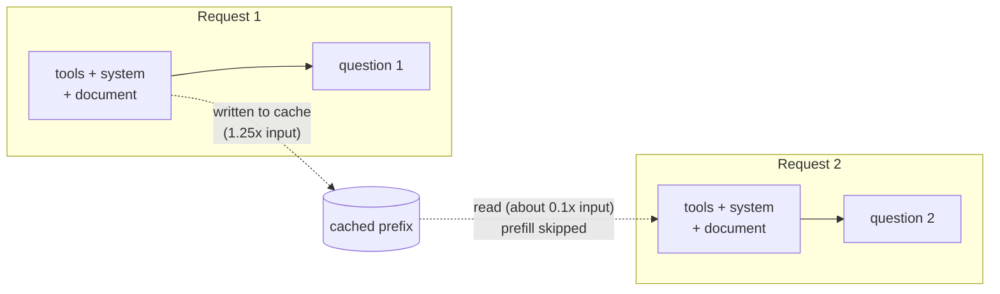

# Prompt caching and cost

## Why this matters

An LLM API is stateless. Every request carries the whole prompt: tools, system prompt, documents, and the full conversation so far. A chat of 20 turns resends turn 1 twenty times, and an agent that loops through 30 tool calls resends its system prompt and tool definitions 30 times. Without caching you pay full input price, and wait for full prefill, for text the model processed seconds ago.

Prompt caching lets the provider reuse that work. A cache read is billed at a small fraction of the normal input price ([Anthropic: Prompt caching](https://platform.claude.com/docs/en/build-with-claude/prompt-caching#pricing)), and the prefill for the cached part is skipped. For agent loops, where the prefix is most of every request, this is the largest single cost lever you have. It also constrains how you write prompts: the order of the content decides whether you get hits.

[2.1](/part-02-programming-with-llms/2.1-calling-models) warned that `input_tokens` is not the whole input once caching is on. This chapter explains why, and what to do about it. [1.9](/part-01-how-llms-work/1.9-kv-cache-context-window) explained the mechanism inside one request; here the same idea works across requests.

**Learning goals**

- Explain how prefix caching works and what breaks it
- Use cache controls in the Anthropic API and read cache usage fields
- Design prompts for cache hits

## Explanation

### From one request to many: reusing the KV cache

In [1.9](/part-01-how-llms-work/1.9-kv-cache-context-window) you saw that, thanks to the causal mask, the keys and values of a token depend only on that token and the ones before it. Inside one request the model computes them once during prefill and reuses them for every generated token. Prompt caching extends the same idea across requests: if a new request starts with exactly the same tokens as an earlier one, the work already done for that shared start does not need to be redone.

Two consequences follow from the causal mask, and they explain nearly every rule in this chapter:

- **Only a prefix can be reused.** The state for token *n* depends on tokens 1 to *n*. Change token 5 and everything after it is different, even if the text after it is identical. There is no way to cache "the document, wherever it appears".
- **The match must be exact.** Anthropic's docs put it as "100% identical" content up to the breakpoint, including text and images ([Anthropic: Prompt caching](https://platform.claude.com/docs/en/build-with-claude/prompt-caching#how-prompt-caching-works)). One different character, or a different key order in a JSON block, is a different prefix.

Providers don't publish the storage details, so "what is stored" is my reading of the mechanism rather than a documented fact: the documentation talks about reusing the processed prefix, which is consistent with stored keys and values. What is documented is the behaviour: a hit lowers cost and latency, and **output generation is unaffected** ([Anthropic: Prompt caching](https://platform.claude.com/docs/en/build-with-claude/prompt-caching#how-prompt-caching-works)). The model still decodes the answer from scratch; caching only skips the prefill of the matched prefix. Sampling stays random: DeepSeek's page says the same thing explicitly ("only the input prefix is cached"; output is still computed) ([DeepSeek: Context caching](https://api-docs.deepseek.com/guides/kv_cache)).



### Explicit and automatic caching

Providers differ in who decides *where* the cache boundary goes.

| Style | You do | Examples |
|---|---|---|
| **Explicit markers** | Mark the end of the prefix you want cached with `cache_control` | Anthropic (up to 4 breakpoints), Alibaba Qwen and Gemini explicit caching through OpenRouter |
| **Automatic** | Nothing. The provider caches prefixes it sees repeated | OpenAI (1,024-token minimum), DeepSeek, Grok, Moonshot, Gemini 2.5+ implicit caching |

Sources: [OpenRouter: Prompt caching](https://openrouter.ai/docs/guides/best-practices/prompt-caching) for the list, [OpenAI: Prompt caching](https://developers.openai.com/api/docs/guides/prompt-caching) for OpenAI.

The line is blurring. Anthropic now has both: a **top-level** `cache_control` field turns on automatic caching, where the breakpoint moves to the last cacheable block as the conversation grows, and you can still put explicit breakpoints on individual blocks. The two share the limit of four breakpoints ([Anthropic: Prompt caching](https://platform.claude.com/docs/en/build-with-claude/prompt-caching#automatic-caching)). OpenAI is moving the other way: from GPT-5.6 on you can choose implicit mode or explicit-only mode with `prompt_cache_breakpoint` markers, up to four cache writes per request ([OpenAI: Prompt caching](https://developers.openai.com/api/docs/guides/prompt-caching)). Check each provider's current page before you rely on a detail; this is a fast-moving area, which is why `last_verified` is on this chapter.

What the styles mean for you:

- With **automatic** caching you can't control what is cached, only how you order your prompt. You get savings for free, but you also can't guarantee a hit. DeepSeek's page calls it "best-effort" and does not promise a 100% hit rate ([DeepSeek: Context caching](https://api-docs.deepseek.com/guides/kv_cache)).
- With **explicit** caching you decide the breakpoint and pay a write premium for it. You get predictability, and you can design around it.

### Anthropic's cache controls

A request is hashed in a fixed order: **`tools`, then `system`, then `messages`**. A breakpoint caches everything from the start of the request up to and including the block it's on, and a change at one level invalidates that level and every level after it ([Anthropic: Prompt caching](https://platform.claude.com/docs/en/build-with-claude/prompt-caching#how-prompt-caching-works)).

The shape of a request with one explicit breakpoint, caching a long document and leaving the question outside it:

```ts
// Sketch based on the docs' examples, not run (no paid calls while writing this).
const body = {
  model: "claude-haiku-5-5",
  max_tokens: 512,
  system: "You answer questions about the document. Be brief.",
  messages: [
    {
      role: "user",
      content: [
        {
          type: "text",
          text: LONG_DOCUMENT,
          cache_control: { type: "ephemeral" }, // everything up to here is the prefix
        },
        { type: "text", text: "Question 1: ..." }, // after the breakpoint: not cached
      ],
    },
  ],
};
```

The rules you need to know, all from the same page:

- **Minimum length.** A prompt below the model's minimum cacheable length is processed without caching, and **no error is returned**. The minimum is model-specific (512 tokens for the 5.5 family and newer, 1,024, 2,048 or 4,096 for others), so check the table for your model ([Anthropic: Prompt caching](https://platform.claude.com/docs/en/build-with-claude/prompt-caching#cache-limitations)). The usual first-timer bug is a "cached" prompt that is simply too short.
- **TTL.** The default lifetime is 5 minutes (`{"type": "ephemeral"}`). `{"type": "ephemeral", "ttl": "1h"}` gives an hour at a higher write price. Each hit refreshes the lifetime at no extra cost, and the clock starts at the *start* of the request that wrote or read the entry. If you mix TTLs in one prompt, the 1-hour entries must come before the 5-minute ones ([Anthropic: Prompt caching](https://platform.claude.com/docs/en/build-with-claude/prompt-caching#1-hour-cache-duration)).
- **Lookback.** A write happens only at a breakpoint, but a read looks backward up to 20 blocks for an entry an earlier request wrote. In a growing conversation with many blocks (agents with many tool calls), add a second breakpoint closer to the previous one before the gap reaches 20 ([Anthropic: Prompt caching](https://platform.claude.com/docs/en/build-with-claude/prompt-caching#how-prompt-caching-works)).
- **Don't put a breakpoint on content that changes.** A breakpoint after a timestamp or per-request context never hits. Put it on the last block that stays identical across requests.
- **Concurrency.** An entry becomes available only after the first response *starts*. If you fire 5 parallel requests with the same prefix, they all miss and all pay the write. Send one, wait for the first response, then send the rest ([Anthropic: Prompt caching](https://platform.claude.com/docs/en/build-with-claude/prompt-caching#pre-warming-the-cache)). The docs also describe pre-warming with `max_tokens: 0`, which writes the cache without generating output.
- **Isolation.** Caches are never shared across organizations, and on the Claude API they are also isolated per workspace ([Anthropic: Prompt caching](https://platform.claude.com/docs/en/build-with-claude/prompt-caching#cache-storage-and-sharing)).

### Reading the usage fields

Every response tells you what happened. The numbers to read are in `usage`:

```json
{
  "usage": {
    "input_tokens": 2048,
    "cache_read_input_tokens": 1800,
    "cache_creation_input_tokens": 248,
    "output_tokens": 503,
    "cache_creation": { "ephemeral_5m_input_tokens": 148, "ephemeral_1h_input_tokens": 100 }
  }
}
```

(The docs' own example.) What each means ([Anthropic: Prompt caching](https://platform.claude.com/docs/en/build-with-claude/prompt-caching#tracking-cache-performance)):

| Field | Meaning |
|---|---|
| `cache_creation_input_tokens` | Tokens written to the cache by this request (sum of the `cache_creation` breakdown) |
| `cache_read_input_tokens` | Tokens read from the cache |
| `input_tokens` | Tokens **after the last breakpoint**: the uncached part |
| total input | `cache_read_input_tokens + cache_creation_input_tokens + input_tokens` |

If both cache fields are 0, nothing was cached, usually because the prompt was under the minimum. Two traps for someone used to OpenAI's chat completions: `input_tokens` is *not* the prompt size, and if you log only `input_tokens` your dashboards will show a dramatic and wrong cost drop. Other providers report the same thing under different names: OpenAI `usage.input_tokens_details.cached_tokens` (and, from GPT-5.6, `cache_write_tokens`) ([OpenAI: Prompt caching](https://developers.openai.com/api/docs/guides/prompt-caching)), DeepSeek `prompt_cache_hit_tokens` and `prompt_cache_miss_tokens` ([DeepSeek: Context caching](https://api-docs.deepseek.com/guides/kv_cache)), OpenRouter `prompt_tokens_details.cached_tokens` and `cache_write_tokens` ([OpenRouter: Prompt caching](https://openrouter.ai/docs/guides/best-practices/prompt-caching)).

### What it costs: write premium and read discount

Anthropic prices relative to the model's base input price: a 5-minute write costs **1.25×**, a 1-hour write **2×**, and a read **0.1×**, with a lower read multiplier on some models (0.05× on Opus 5.5 and Sonnet 5.5, 0.025× on the Fable models). Breakpoints themselves are free; you pay for writes, reads and uncached input ([Anthropic: Prompt caching](https://platform.claude.com/docs/en/build-with-claude/prompt-caching#pricing)). The dollar prices for each model live on [Landscape](/landscape#anthropic); this chapter uses only the ratios, because the ratios change less often.

Take a document of *D* tokens and 5 questions about it, ignoring the (small) questions and answers, with the 0.1× read multiplier:

| Strategy | Input cost, in units of "*D* at base price" |
|---|---|
| No caching | 5 × 1 = **5.00** |
| 5-minute cache, questions sent sequentially within the TTL | 1.25 + 4 × 0.1 = **1.65** (about 67% less) |
| 1-hour cache, same sequence | 2 + 4 × 0.1 = **2.40** (about 52% less) |
| 5-minute cache, 5 requests fired **in parallel** | 5 × 1.25 = **6.25** (25% *more* than no caching) |

Three things to take from the table:

1. **The write premium pays for itself on the second request.** Two uses: 1.25 + 0.1 = 1.35, versus 2.00 without caching. A prefix you use once is a waste of the 25%.
2. **The 1-hour TTL isn't free insurance.** After two requests it costs about 2.1 against 2.0, and it only wins once there are three or more. Use it when requests are spaced more than 5 minutes apart, so that the 5-minute entry would have expired between them (and been rewritten).
3. **Concurrency can turn caching into a cost.** The last row is the concurrency rule above, applied.

Other providers price differently. Per OpenRouter's table, OpenAI, Grok, Moonshot and Groq charge nothing extra for cache writes on most models, with cache reads at 0.25× or 0.5× (OpenAI from GPT-5.6 adds a 1.25× write price), and DeepSeek charges 1× for writes and 0.1× for reads ([OpenRouter: Prompt caching](https://openrouter.ai/docs/guides/best-practices/prompt-caching)). With free writes, automatic caching has no downside; with a write premium, you decide whether a prefix will be reused.

Caching also helps rate limits: only uncached input counts toward Anthropic's input-tokens-per-minute limit on current models, as noted in [2.1](/part-02-programming-with-llms/2.1-calling-models). (Check the [rate limits page](https://platform.claude.com/docs/en/api/rate-limits#cache-aware-itpm) for which models.)

::: info 📖 Read now
[Anthropic: Prompt caching](https://platform.claude.com/docs/en/build-with-claude/prompt-caching) · docs · ~25 min · **essential**

A long page; read the top half and skim the rest. Look for: the "two ways to enable it" (top-level `cache_control` vs per-block), the 4-breakpoint limit and what the 20-block lookback means for a long conversation, the minimum-length table, the TTL rules (refresh on hit, 1-hour before 5-minute), the **table of what invalidates the cache** (tools, images, `tool_choice`, thinking settings), the usage fields, and the concurrency note. Skip the Bedrock/cloud-provider details unless you use them.
:::

### Designing prompts for cache hits

Caching is a layout problem. The rule is the one the Claude Code team states as their first principle: "static content first, dynamic content last" ([Claude Code team: Prompt caching is everything](https://claude.com/blog/lessons-from-building-claude-code-prompt-caching-is-everything)). Order the request from the least to the most changing:

| Position | Content | Changes |
|---|---|---|
| 1 | Tool definitions | Almost never |
| 2 | System prompt: role, rules, style | Rarely |
| 3 | Reference material: the document, retrieved files, few-shot examples | Per task or per session |
| 4 | Conversation so far | Appended every turn |
| 5 | The new user message | Every request |

Concrete habits:

- **Put variable data at the end, never in the middle.** A date, a user name, a request ID or "today is..." at the top of the system prompt makes every request a new prefix. If the model needs the date, add it to the latest message.
- **Append, don't rewrite.** Editing or summarizing an earlier turn changes the prefix from that point on. Update stale information by appending a note (Claude Code adds a `<system-reminder>` to the next message) rather than editing the earlier text ([Claude Code team: Prompt caching is everything](https://claude.com/blog/lessons-from-building-claude-code-prompt-caching-is-everything)).
- **Keep tool definitions byte-stable.** Same tools, same order, same descriptions. The Claude API docs list tool changes as invalidating the whole cache, from tools onward ([Anthropic: Prompt caching](https://platform.claude.com/docs/en/build-with-claude/prompt-caching#what-invalidates-the-cache)). Non-deterministic key ordering in serialized JSON, which some languages produce, quietly breaks it too; build prompts from sorted or fixed templates.
- **Don't change the model, effort, `tool_choice` or speed setting mid-conversation.** Caches are per model, and the invalidation table lists these settings. The Claude Code team's example: 100k tokens into a conversation with an expensive model, asking an easy question of a cheaper one can cost *more*, because the cheaper model has to build its own cache ([Claude Code team: Prompt caching is everything](https://claude.com/blog/lessons-from-building-claude-code-prompt-caching-is-everything)). Their answer is subagents with a hand-off message rather than a switch.
- **Put a breakpoint after the last stable block**, and a second one before the lookback window would run out in long conversations.
- **Monitor the hit rate like uptime.** Compute `cache_read / (cache_read + cache_creation + input)` per request and log it. A sudden drop means someone put something dynamic into the prefix.
- **Cache what's expensive to recompute: tools, system prompt, big documents and long conversations.** A 200-token prompt is below the minimum anyway.

The same ideas apply to automatic caching providers. OpenAI's guide gives the same structure advice: stable instructions, tool definitions and reference material first, dynamic content last, append new messages instead of rewriting, and don't extend a message that already ends at a cached breakpoint ([OpenAI: Prompt caching](https://developers.openai.com/api/docs/guides/prompt-caching)). Through a gateway like OpenRouter, there's one extra knob: sticky routing sends later requests to the provider that served the cached one (a `session_id` makes it explicit), since a cache lives at one provider ([OpenRouter: Prompt caching](https://openrouter.ai/docs/guides/best-practices/prompt-caching)).

### Where it breaks: a checklist

When `cache_read_input_tokens` is 0 and you expected a hit, go through this list in order:

1. Is the prefix at or above the model's **minimum length**? (Silent failure.)
2. Did the **5 minutes** pass since the last request? (Check timing from the start of the previous request.)
3. Did anything before the breakpoint change: a timestamp, tool definition, image, `tool_choice`, thinking or effort setting, model? Diff the two request bodies.
4. Is the breakpoint on a block that varies per request?
5. Were the requests **concurrent**?
6. Is another organization, workspace or provider in the path? A gateway that strips `cache_control` silently turns caching off.
7. Is the conversation longer than **20 blocks** past the last write, with no breakpoint in range?

### How Claude Code uses caching

Claude Code is the most instructive real example, because it's an agent loop whose requests are almost all prefix. Each turn it re-sends the system prompt with tool definitions, the project context (CLAUDE.md, auto memory), the whole conversation and the new message. "On a normal turn, the prefix is the entire previous request and only the latest exchange is new" ([Claude Code docs: How Claude Code uses prompt caching](https://code.claude.com/docs/en/prompt-caching#how-the-cache-is-organized)). The layers are ordered by how often they change: system prompt and tools, then project context, then conversation.

That order explains the behaviours that surprise people. The docs list what costs you a slow, uncached turn: switching models (each model has its own cache), changing the effort level on most models, turning on fast mode, connecting or removing an MCP server when its tools are loaded upfront, `/compact` (it replaces the conversation layer by design), and upgrading Claude Code. What keeps the cache: editing CLAUDE.md mid-session (it doesn't invalidate, but it also doesn't apply until `/clear`, `/compact` or a restart), switching permission mode, invoking skills, and running `/recap` ([Claude Code docs](https://code.claude.com/docs/en/prompt-caching#actions-that-invalidate-the-cache)).

Three design choices from the team's write-up are worth stealing for your own agents ([Claude Code team: Prompt caching is everything](https://claude.com/blog/lessons-from-building-claude-code-prompt-caching-is-everything)):

- **Plan mode doesn't change the tool list.** Instead of removing the edit tools when you enter plan mode, which would invalidate the cache, all tools stay in the request and entering plan mode is itself a tool call.
- **Defer tools, don't remove them.** MCP tools can be sent as lightweight stubs with `defer_loading: true`, and the model discovers them through tool search; the stubs stay in the same order, so the prefix is stable.
- **Compaction reuses the parent's prefix.** A summarization call with its own system prompt and no tools diverges at the first token, so none of the cache applies. The fix is to send the parent's exact system prompt, tools and history and put the summarization instruction as a new message at the end.

On lifetimes: the docs say a Claude subscription gets a one-hour TTL for the main conversation within the plan's included usage, and API keys get five minutes unless you set `promptCacheTtl` or `CLAUDE_CODE_PROMPT_CACHE_TTL` ([Claude Code docs](https://code.claude.com/docs/en/prompt-caching#which-ttl-each-request-gets)). The same page covers how to see your hit rate: `/usage` adds a "Prompt cache (main)" line in recent versions, or you can read the `cache_read_input_tokens` and `cache_creation_input_tokens` fields from a status line script ([Claude Code docs](https://code.claude.com/docs/en/prompt-caching#check-cache-performance)).

::: info 📖 Read now
[Claude Code docs: How Claude Code uses prompt caching](https://code.claude.com/docs/en/prompt-caching) · docs · ~20 min · **essential**

Read "How the cache is organized", the lists of actions that invalidate and keep the cache, and "Cache lifetime". Look for: which everyday action you do in Claude Code costs a cold turn (model switch, effort change, `/compact` after a break), and which habit it recommends ("pick your model and effort level at the top of a session"). Skim the plugin and gateway sections.
:::

::: info 📖 Read now
[Lessons from building Claude Code: Prompt caching is everything](https://claude.com/blog/lessons-from-building-claude-code-prompt-caching-is-everything) · article · ~10 min · **essential**

By a member of the Claude Code team. Look for: the ordering rules, the plan-mode trick and the compaction trick. Ask yourself which of those would apply to the agent loop you'll write in Part 3.
:::

::: info 📖 Read next
[OpenAI: Prompt caching](https://developers.openai.com/api/docs/guides/prompt-caching) · docs · ~10 min · optional

Look for: how automatic caching differs (no write price before GPT-5.6, minimum prompt length, `prompt_cache_key`), and the usage field. Then skim [OpenRouter: Prompt caching](https://openrouter.ai/docs/guides/best-practices/prompt-caching) (docs, ~10 min, optional) for the provider table and sticky routing, and [DeepSeek: Context caching](https://api-docs.deepseek.com/guides/kv_cache) (docs, ~5 min, optional) for the simplest case: on by default, `prompt_cache_hit_tokens` and `prompt_cache_miss_tokens` in `usage`.
:::

## Practice

**Brief:** Send a long fixed document plus 5 different questions to Claude with and without cache control. Record cache read/write tokens, latency and cost in `costs.md`.

**Where:** `experiments/20-prompt-caching/`: a standalone experiment, not a `project/` step. The folder has a README with the "What I tried / What happened / Why" skeleton. You write all the code; I haven't provided any.

**Steps:**

1. **Set up.** In `experiments/20-prompt-caching/` create a TypeScript script that runs with `node --env-file-if-exists=../../.env script.ts`, like in experiments 14 and 15. Raw `fetch` is enough; the usage fields are in the JSON response. Use `claude-haiku-5-5`: the cheapest model on [Landscape](/landscape#anthropic), and its minimum cacheable length is listed in the docs table.
2. **Get a long fixed document.** Pick text you can reuse for free, at least about 5,000 tokens: a long README, a chapter of this book, a public-domain text. Make it comfortably above the minimum for your model. Write down the token count the API reports.
3. **Write 5 different questions** about the document, with answers short enough that output cost doesn't hide the input cost (set a small `max_tokens`).
4. **Predict.** In the README, before running anything, write what you expect for the total cost and total latency of A and B below, and what `usage` will show on each of the 5 calls in B.
5. **Condition A: no cache control.** Send the 5 questions one after another, each as an independent request with the document first. Record, per call: all four usage numbers, time to the full response (and time to first token if you stream, see [2.2](/part-02-programming-with-llms/2.2-streaming)), and the estimated cost using the multipliers above and the prices on [Landscape](/landscape#anthropic).
6. **Condition B: cache control on the document block.** Same 5 questions, sequentially, with a breakpoint after the document. Record the same columns. Check: which call writes, which calls read, and what `input_tokens` holds.
7. **Re-run hygiene.** A repeat run inside 5 minutes reads the cache written by your earlier run, so your first call won't write. Decide how you will start every run from a cold cache (the layout rules in this chapter hint at how), and write it down.
8. **Break it on purpose, twice.** (a) Run B with the 5 requests in **parallel** instead of sequentially. (b) Put something that changes per request (a timestamp) **before** the document and run B again. Record `usage` for each and explain it with the rules above.
9. **Spend log.** Add every paid run to `costs.md` with token counts and the estimated cost, and update the running total. Prices are on [Landscape](/landscape#anthropic). The whole experiment should cost a few cents at Haiku prices; if your estimate is much higher, shorten the document.

**Done when:**

- Your README has a table: per call, for A and B, with `input_tokens`, `cache_creation_input_tokens`, `cache_read_input_tokens`, latency and estimated cost, plus totals.
- You wrote predictions first and say which were wrong.
- You can show from your own numbers which call wrote the cache, and that the total input still adds up to the document size plus the question.
- The two broken variants in step 8 each have a `usage` record and a one-sentence explanation tied to a rule from the chapter.
- You state in the README the break-even number of requests for your measured costs.
- `costs.md` has the rows and an updated total.

## Check questions

1. What does the model need to be true about two requests for the second one to hit the first one's cache, and why can't a document be cached when it appears after a changing timestamp?

   <details><summary>Answer</summary>

   The second request must start with exactly the same tokens (including tools, then system, then messages, in that order) up to the breakpoint. Because of the causal mask ([1.9](/part-01-how-llms-work/1.9-kv-cache-context-window)), the state for each token depends on every token before it, so a changed timestamp early in the prompt gives everything after it a different state, including the document. Caching works on prefixes, not on content wherever it appears.

   </details>

2. A response has `input_tokens: 40`, `cache_read_input_tokens: 0`, `cache_creation_input_tokens: 0`, although you put `cache_control` on a 300-token system prompt. What happened, and how would you know the total prompt size in a working-cache response?

   <details><summary>Answer</summary>

   The prompt is most likely below the model's minimum cacheable length, so it was processed uncached and without an error. Both cache fields being 0 is the signal. In a working response the total input is `cache_read_input_tokens + cache_creation_input_tokens + input_tokens`, since `input_tokens` counts only what comes after the last breakpoint.

   </details>

3. You have a 20,000-token reference document and expect 3 questions over the next 2 minutes, then nothing for an hour. Which TTL would you pick and what does the cost look like in units of the document's base input price (read multiplier 0.1)?

   <details><summary>Answer</summary>

   The default 5-minute TTL. The sequence costs 1.25 + 2 × 0.1 = 1.45 units against 3 without caching, and nothing is lost to the idle hour. The 1-hour TTL would cost 2 + 0.2 = 2.2, which is more for no benefit, since the requests all fall inside 5 minutes. The longer TTL pays only when gaps between uses exceed 5 minutes and there are enough uses to recoup the 2× write.

   </details>

4. Your agent fires 8 sub-questions in parallel with the same 30,000-token prefix and your bill goes up after you turned on caching. Explain, and fix it.

   <details><summary>Answer</summary>

   A cache entry becomes available only after the first response starts, so 8 simultaneous requests all miss, and all 8 pay the write premium (about 1.25×) instead of the base price. Fix: send one request first, wait until its response begins, then send the other 7, which read the entry at the discounted rate. Alternatively pre-warm the cache with a request that has `max_tokens: 0` first.

   </details>

5. You maintain an agent that adds a "current time" line to the top of the system prompt and loads a different set of tools depending on the task. Describe two changes that would raise the cache hit rate.

   <details><summary>Answer</summary>

   Move the time into the newest user message or a tool result (Claude Code adds a `<system-reminder>` to the next message), so the system prompt stays identical. Keep the tool list fixed and byte-stable: instead of loading different tools per task, send the same list and let the model's instructions or a deferred-loading stub mechanism decide which to use. Both keep the longest possible stable prefix. You'd confirm the improvement by logging the hit rate.

   </details>

## My understanding

<!-- Written by the learner, in their own words. Agents never fill this in. -->
