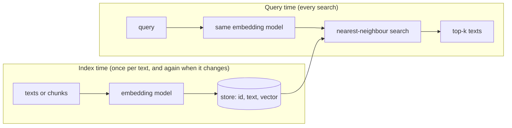

# Embeddings in practice

## Why this matters

Embedding models turn text into vectors you can search, cluster and compare. They are cheap, fast and often run locally, which makes them a workhorse under RAG and memory.

[1.3](/part-01-how-llms-work/1.3-embeddings) explained what these vectors are and why cosine similarity means something. This chapter is the engineering side: which model to call, what the request and response look like, how to store the vectors and search them, how to tell whether one model is better than another, and when not to use embeddings at all. Chapters 2.9 to 2.11 (RAG, better retrieval, agentic search) all build on the retrieval loop you assemble here.

**Learning goals**

- Choose and call an embedding model (local and paid)
- Store vectors and search them
- Know the limits of semantic similarity

## Explanation

### The retrieval loop in one picture

Every embedding application, from "which note talks about X?" to a production RAG system, runs the same two loops:



Three things are fixed by this picture and cause most beginner bugs:

1. **The same model on both sides.** Coordinates mean something only inside the model that produced them (1.3). Ollama's embeddings page says it outright: "Use the same embedding model for indexing and querying" ([Ollama: Embeddings](https://docs.ollama.com/capabilities/embeddings)). Changing models means re-embedding the whole corpus, so store the model name and dimension next to the vectors.
2. **Embedding happens at index time, so queries are cheap.** The expensive pass over every document runs once. A query costs one embedding call plus a vector comparison.
3. **What you get back is text, not an answer.** Search returns the stored passages closest to the query. Generating an answer from them is a separate step (2.9).

### Embedding models vs. LLMs

An embedding model is usually a transformer like the ones in Part 1, with the language-modelling head replaced by pooling and trained with a contrastive objective (1.3 has the table). What changes for you as a programmer:

| | Chat / reasoning LLM | Embedding model |
|---|---|---|
| Output | A stream of tokens | One fixed-size vector per input text |
| Latency shape | Time to first token, then tokens per second | One request, one answer; batching is the main lever |
| Sampling | Temperature, top-p | None: the same input gives the same vector |
| Size | Billions of parameters, GBs of memory | Often small: 0.6B (639 MB) and 300M (622 MB) are Ollama's [qwen3-embedding](https://ollama.com/library/qwen3-embedding) and [embeddinggemma](https://ollama.com/library/embeddinggemma) |
| Input limit | Large context window | Smaller and worth checking: embeddinggemma's page lists a 2K context; qwen3-embedding's lists 32K for the 0.6B tag |
| Failure mode | Wrong or made-up text | Plausible but wrong neighbours, with no error |

Two consequences. First, embedding calls are **deterministic and cacheable**: hash the text and the model name, and never pay for the same chunk twice. Second, the input limit is a hard design constraint. A text longer than the model's window is truncated or rejected, so long documents must be split into **chunks** first. How to split them well is 2.9's subject; here you can chunk by paragraph or by a fixed number of characters and move on.

### Calling a model: local and paid

You met the pattern in 2.1: one HTTP endpoint per provider, a JSON body, a JSON answer. Embeddings are simpler than chat because there's no streaming, no roles and no stop reason.

**Local, with Ollama.** `POST http://localhost:11434/api/embed` takes a `model` and an `input` that is a string or an array of strings, and returns `embeddings`: one array per input ([Ollama: Embeddings](https://docs.ollama.com/capabilities/embeddings), [API reference](https://docs.ollama.com/api/embed)). The docs state that the endpoint "returns L2-normalized (unit-length) vectors." The model from the 1.3 practice is already on your machine:

```ts
async function embed(texts: string[]): Promise<number[][]> {
  const res = await fetch("http://localhost:11434/api/embed", {
    method: "POST",
    headers: { "Content-Type": "application/json" },
    body: JSON.stringify({ model: "qwen3-embedding:0.6b", input: texts }),
  });
  if (!res.ok) throw new Error(`embed failed: ${res.status} ${await res.text()}`);
  return (await res.json()).embeddings;
}
```

Send **batches**, not one text per request: an array in `input` saves a round trip per text. On 2026-11-10, embedding 100 chunks of about 280 tokens each in one `/api/embed` call with `qwen3-embedding:0.6b` on the M4 Pro took about 6 seconds, model loading included, so a few hundred chunks of notes take under a minute. Cap the batch size (say 32 to 64 texts) so one bad request doesn't lose everything.

**Paid, with an API.** The shapes differ in small ways, and the differences are where bugs live:

| Provider | Request | Notes |
|---|---|---|
| Ollama | `POST /api/embed`, `{model, input}` → `{embeddings: [...]}` | Unit-length output ([docs](https://docs.ollama.com/capabilities/embeddings)). Optional `dimensions` for Matryoshka models (1.3). |
| OpenAI | `POST /v1/embeddings` with `model` and `input`; models `text-embedding-3-small` (1536 dimensions) and `text-embedding-3-large` (3072) | Normalized to length 1; a `dimensions` parameter shortens vectors; 8192 input tokens ([OpenAI: Embeddings](https://developers.openai.com/api/docs/guides/embeddings)). |
| OpenRouter | `POST /embeddings` with `model` such as `openai/text-embedding-3-small`, `input` string or array | One key, many providers; the models page can be filtered to embedding output ([OpenRouter: Embeddings](https://openrouter.ai/docs/api-reference/embeddings)). |
| Anthropic | None | "Anthropic does not offer its own embedding model." The docs point to Voyage AI ([Claude docs: Embeddings](https://platform.claude.com/docs/en/build-with-claude/embeddings)). |

The last row surprises people who live inside Claude Code: **Claude cannot give you embeddings.** For a Claude-centred stack you pick a separate embedding vendor (Voyage AI, a provider through OpenRouter, or a local model), and the chat model and the embedding model have nothing to do with each other. Prices and current model lineups change, so check [Landscape](/landscape) and the provider pages instead of trusting this chapter.

::: info 📖 Read now
[Ollama: Embeddings](https://docs.ollama.com/capabilities/embeddings) · docs · ~5 min · **essential**

Very short. Look for: the request shape with an array `input`, the statement that vectors are unit length, and the two tips (cosine similarity, same model for index and query). Notice what it leaves out: no model recommendation, so choosing one is on you (below).
:::

::: info 📖 Read now
[Claude docs: Embeddings](https://platform.claude.com/docs/en/build-with-claude/embeddings) · docs · ~10 min · **essential**

Read "Before implementing embeddings", "How to get embeddings with Anthropic", the quickstart example, and the FAQ entries on `input_type`, similarity functions and Matryoshka truncation. The Voyage-specific setup is optional. Look for: the three selection factors (domain fit, inference performance, customisation), the `input_type` of `query` vs. `document`, and the sentence that unit-length vectors make cosine and dot product equivalent.
:::

### Query and document are not the same kind of text

A search query ("reset password") and the passage that answers it ("To change your credentials, open Settings...") look nothing alike, and models are trained for that asymmetry. They handle it by treating the two sides differently. Voyage prepends a hidden prompt: with `input_type="query"` the text becomes "Represent the query for retrieving supporting documents: ...", and for documents "Represent the document for retrieval: ..." ([Claude docs: Embeddings](https://platform.claude.com/docs/en/build-with-claude/embeddings)). Qwen3-Embedding does it with an instruction prefix on the query side only, as 1.3 showed with numbers. The OpenAI and Ollama requests shown above have no such parameter: with Qwen3-Embedding through Ollama **you** add the prefix.

How much this matters, measured on 2026-11-10 with `qwen3-embedding:0.6b`: the query `ERR_4021` against four short texts scored 0.510 against the right error message, 0.416 against a different error code (`ERR_4210`) and 0.402 against another (`ERR_4012`). With the plain string `Error ERR_4021` and no instruction prefix, the scores were 0.669, 0.649 and 0.606. The ordering survived, but the margin between right and wrong shrank from 0.094 to 0.020. The prefix isn't decoration. Read each model's card for the exact format, and apply the same convention at index and query time.

### Dimensions and storage cost

A vector from `qwen3-embedding:0.6b` has 1,024 numbers (the chapter-1.3 practice measured it too; the [model page](https://ollama.com/library/qwen3-embedding) lists output sizes up to 4096 for the 8B). Stored as 32-bit floats that is 1,024 × 4 = 4,096 bytes per chunk, about 4 MB per thousand chunks and about 4 GB per million. Three ways to shrink that:

- **Fewer dimensions** with Matryoshka-trained models (1.3): ask for `dimensions: 256`, or cut a stored vector to its first 256 numbers. Claude's docs add the step people forget: after truncating, **normalize again**, because a cut vector no longer has length 1. OpenAI says the same.
- **Lower precision.** Store `float16` or `int8` instead of `float32`. The Claude docs describe the vendor-side version: `int8` cuts storage 4x and binary 32x, at some cost in retrieval accuracy. pgvector's `halfvec` stores 16-bit floats at `2 * dimensions + 8` bytes ([pgvector](https://github.com/pgvector/pgvector)).
- **Fewer chunks.** Often the cheapest: don't embed boilerplate, duplicates and navigation text.

More dimensions isn't automatically better. A longer vector can represent more distinctions, and the [LIMIT paper](https://arxiv.org/abs/2508.21038) shows a theoretical ceiling tied to dimension (see the limits section below), but past a point you pay in storage and speed for little retrieval gain. Measure on your own data.

### Normalization and distance metrics

Three ways to say "close" for vectors **a** and **b**:

| Metric | Formula | Bigger is closer? |
|---|---|---|
| Dot product | Σ aᵢbᵢ | Yes |
| Cosine similarity | (a · b) / (‖a‖ ‖b‖) | Yes, range −1 to 1 |
| Euclidean (L2) distance | ‖a − b‖ | No, smaller is closer |

For **unit vectors** the three agree. Cosine reduces to the dot product, because both lengths are 1, and for unit vectors ‖a − b‖² = 2 − 2(a · b), so ranking by Euclidean distance is ranking by dot product reversed. Voyage and OpenAI state both consequences in their docs: "Cosine similarity is equivalent to dot-product similarity, although the latter can be computed more quickly" and cosine and Euclidean give identical rankings ([OpenAI](https://developers.openai.com/api/docs/guides/embeddings), [Claude docs](https://platform.claude.com/docs/en/build-with-claude/embeddings)).

Practical rules:

1. **Check, don't assume, that vectors are unit length.** Print `Math.hypot(...v)` for a few. Ollama's `/api/embed` and the two API providers above return normalized vectors (I measured 1.0000 for `qwen3-embedding:0.6b`); a model you run yourself may not.
2. If they are unit length, use the **dot product**: it is the cheapest operation, and it's what vector databases optimize.
3. If you truncate dimensions, mix sources, or aren't sure, **normalize yourself** (divide by the norm) when you store the vector. Then you can always use dot product.
4. In a database, read the sign: pgvector's `<#>` is the *negative* inner product, so that `ORDER BY` ascending still means "best first" ([pgvector](https://github.com/pgvector/pgvector)).

### Where to store vectors

Searching is a **nearest-neighbour** problem: find the stored vectors with the largest dot product with the query. You have a spectrum of options, and the right one depends on corpus size more than on anything else.

| Option | What it is | Good for | Watch out for |
|---|---|---|---|
| **In memory** | An array of `Float32Array` plus a scan | Up to tens of thousands of chunks; experiments; CLIs | You re-embed or reload on every start unless you save the vectors to a file |
| **SQLite** | A table with a `BLOB` column per vector, a scan in your code; or an extension such as [sqlite-vec](https://github.com/asg017/sqlite-vec) | Local apps, personal tools, one-file deployment | The extension is "pre-v1, so expect breaking changes", and Node needs `allowExtension: true` to load one ([Node: SQLite](https://nodejs.org/api/sqlite.html)) |
| **Postgres + pgvector** | A `vector(n)` column, distance operators, optional indexes | You already run Postgres; vectors need to sit next to other data and joins | Index limits: `vector` up to 2,000 dimensions, `halfvec` up to 4,000 ([pgvector](https://github.com/pgvector/pgvector)) |
| **Dedicated vector DB** | A service built for vectors (Qdrant, Pinecone, Weaviate and others) | Very large corpora, many tenants, heavy filtering at scale | Another system to run, sync and pay for; compare it against what you already have before adopting |

Why the plain scan goes so far: on 2026-11-10, a brute-force scan of 10,000 random 1,024-dimension vectors in plain TypeScript on the M4 Pro took about 10 ms. A personal corpus of notes is a few thousand chunks, so an **exact** scan is fast enough and has perfect recall. This is the reason to start simple: SQLite or a JSON file plus a loop is usually the right first version.

When the corpus grows, scanning gets too slow and you switch to **approximate nearest neighbour (ANN)** indexes. pgvector describes the two it supports: "By default, pgvector performs exact nearest neighbor search, which provides perfect recall", and adding an index switches to approximate search, which trades some accuracy for speed. **HNSW** builds a multilayer graph (better speed-recall trade-off, slower builds, more memory); **IVFFlat** groups vectors into lists and searches the ones closest to the query (faster to build, lower query performance) ([pgvector](https://github.com/pgvector/pgvector)). The word to remember is **recall**: an approximate index may miss a true nearest neighbour, and it never tells you. Tune recall against an exact scan on a sample of your own queries before you trust it.

Storing a vector in SQLite from Node takes no extension. `node:sqlite` is built in: a `TypedArray` binds as a `BLOB` parameter, and a `BLOB` comes back as a `Uint8Array` ([Node: SQLite](https://nodejs.org/api/sqlite.html)). I checked that a `Float32Array([0.5, -0.25])` round-trips this way on Node 26. One trap: the returned `Uint8Array` may not start at a 4-byte-aligned offset in its underlying buffer, and `new Float32Array(buffer, byteOffset, n)` throws on a misaligned offset. Copy the bytes first (`blob.slice()` gives a fresh buffer starting at 0), then wrap them. Also save the **model name** and **dimension** in the table: an index built with one model and queried with another returns confident garbage.

::: info 📖 Read now
[Node.js: SQLite](https://nodejs.org/api/sqlite.html) · docs · ~10 min · **essential**

Read the stability note, the `Database` constructor and options, the prepared-statement methods (`run`, `all`, `get`), and the type-mapping section for `BLOB`. Look for: how `TypedArray` binds in and what comes back out, and the `allowExtension` option that you only need if you load sqlite-vec. The class is `Database` in current docs, with `DatabaseSync` kept as a deprecated alias, so you'll see both names in examples.
:::

::: tip 📖 Skim
[pgvector](https://github.com/pgvector/pgvector) · repo · ~10 min · optional

You won't run Postgres here, but the README is the clearest short statement of the whole storage trade-off. Look for: the distance operators table, "exact" vs. "approximate" search, HNSW vs. IVFFlat, and the dimension limits. Read it so you can recognise the same ideas in any vector database.
:::

### Choosing a model: benchmarks and your own data

Dozens of embedding models exist, and a model that tops one list can be mediocre on your content. The standard comparison is **MTEB**, the Massive Text Embedding Benchmark. The paper describes eight task types (retrieval, classification, clustering and others), 58 datasets and 112 languages, evaluated on 33 models, and its headline finding is that "no particular text embedding method dominates across all tasks" ([Muennighoff et al., 2022](https://arxiv.org/abs/2210.07316)). The [leaderboard](https://huggingface.co/spaces/mteb/leaderboard) is the live, interactive version, and the [`mteb` repo](https://github.com/embeddings-benchmark/mteb) is the toolkit for running your own models on it, including its multilingual extension.

How to read it without fooling yourself:

- **Filter to the task you have.** For search you care about the *retrieval* score, not the overall average. A model that's best at classification can be worse at retrieval.
- **Match the language and domain.** You write notes in English and maybe Bulgarian; a multilingual score and a code-retrieval score answer different questions.
- **Check size and context.** A model with a top score and an 8B parameter count may not fit your latency or your 24 GB of memory next to a chat model. The sizes on [the Qwen3-Embedding page](https://ollama.com/library/qwen3-embedding) (0.6B, 4B, 8B) show the trade-off: the family's page claims the 8B ranked first on the multilingual MTEB leaderboard as of 2025-06-05, which says nothing about today's ranking or about your notes.
- **Leaderboards are public, so models can be tuned to them.** Treat a few points of difference as noise.
- **Build a tiny eval of your own.** Write 20 queries for which you know the right passage, and measure how often each candidate model puts it in the top 3 (the "hit rate at 3" or recall@3). Twenty queries and half an hour will tell you more about your data than a leaderboard. Part 4 turns this habit into a method.

Starting points, without prices: for local use, qwen3-embedding or embeddinggemma through Ollama; for a hosted API, an embedding model from OpenAI, Voyage AI, or any provider on OpenRouter. The lineup moves, so confirm on the leaderboard and on [Landscape](/landscape).

::: info 📖 Read now
[MTEB leaderboard](https://huggingface.co/spaces/mteb/leaderboard) · docs (interactive) · ~10 min · **essential**

Open it and filter by the retrieval task and by model size. Look for: how scores differ between the overall average and retrieval, which models are small enough for your machine, and what the leaderboard lets you filter by (task, language, model size). Pick two models and note why you would or wouldn't use each.
:::

::: tip 📖 Skim
[Muennighoff et al.: MTEB: Massive Text Embedding Benchmark](https://arxiv.org/abs/2210.07316) · paper · ~15 min (abstract and introduction) · optional

Look for: the list of task types, and the argument for why a single-task benchmark was misleading.
:::

### When keyword search beats embeddings

Semantic similarity is a blur by design, and blur loses to precision in several common cases.

**Exact tokens and identifiers.** I embedded four texts and the query `ERR_4021`, with `qwen3-embedding:0.6b` on 2026-11-10. The right text ("Error ERR_4021: refresh token expired.") scored 0.510 with the instruction prefix. A *different* error code (`ERR_4210`, disk quota) scored 0.416 and the generic sentence "How to fix expired login sessions and authentication problems" 0.332. The model sees "an error code string" and similar strings are close. A keyword index doesn't blur: SQLite's FTS5 with `MATCH '"ERR_4021"'` returned exactly one row. Product names, function names, error codes, SKUs, ticket ids and people's names are all like this.

**Negation and polarity.** Same session: the query "The deploy succeeded" scored 0.761 against "The deployment went through without errors" and 0.720 against "The deploy did not succeed." Opposite meaning, 0.04 apart. The model captures the topic, and the little word "not" barely moves the vector. Antonyms had the same problem in the 1.3 practice.

**Rare words and exact phrases.** If the user searches for a quoted phrase, they want that phrase.

**Small, structured, or well-labelled corpora.** If your notes have titles and tags, `grep` and filters may already answer "which note mentions X".

A related and slower failure is structural. The [LIMIT paper](https://arxiv.org/abs/2508.21038) (Weller et al., accepted to ICLR 2026) argues that a single vector per text can only return a limited number of different top-k result sets, a bound tied to the embedding dimension, and builds a simple dataset on which state-of-the-art embedding models fail. You don't need the proof; take the practical point: embeddings aren't a universal retriever, however big the model.

The standard keyword scoring function is **BM25**: it scores a document by how often the query's terms appear in it, how rare those terms are in the corpus, and a length adjustment. SQLite ships it: create an FTS5 table with `CREATE VIRTUAL TABLE ft USING fts5(body)` and query with `SELECT * FROM ft WHERE ft MATCH ? ORDER BY bm25(ft)`. The docs say that "the better the match, the numerically smaller the value returned" ([SQLite FTS5](https://www.sqlite.org/fts5.html)), so ascending order is best first, and it works in `node:sqlite` as well; I ran it. BM25 is also a hard-to-beat baseline: the BEIR benchmark across many retrieval datasets calls it "a robust baseline" in zero-shot settings ([Thakur et al., 2021](https://arxiv.org/abs/2104.08663)).

This is not a contest to win. Keyword search finds the exact string and misses paraphrases ("password reset" vs. "change your credentials"); embeddings do the opposite. The usual answer is to run both and merge the rankings, which is **hybrid search**, and 2.10 covers it. For now, remember the diagnostic: **if the user's query contains a specific string they'd paste, test BM25 first.**

::: tip 📖 Skim
[SQLite FTS5](https://www.sqlite.org/fts5.html) · docs · ~10 min (the opening sections and the `bm25()` part) · optional

The page is long: read the first sections on creating a table and `MATCH`, then the `bm25()` paragraph. Look for: the query syntax for phrases and prefixes, and why a lower score is a better match.
:::

::: tip 📖 Skim
[Weller et al.: On the Theoretical Limitations of Embedding-Based Retrieval](https://arxiv.org/abs/2508.21038) · paper · ~15 min (abstract and introduction) · optional

Look for: how the authors build a task that is easy for people but hard for single-vector models, and what they suggest instead of one vector per text.
:::

::: tip 📖 Skim
[Thakur et al.: BEIR](https://arxiv.org/abs/2104.08663) · paper · ~10 min (abstract) · optional

Look for: why the benchmark is "zero-shot", and what it says about BM25 against newer models.
:::

### Other limits to keep in mind

- **Similar is not relevant.** Embeddings return the passages most like the query, which isn't the same as the ones that answer it. A question and a passage that repeats the question both score high.
- **A score is a ranking tool, not a probability.** In the experiments above the right answer scored 0.51 and 0.67 depending on a prefix. There's no universal "0.7 means relevant" threshold; it differs by model and by corpus. Use top-k, and calibrate any cutoff on your own examples.
- **Chunk boundaries matter.** A fact that spans two chunks may be found by neither. Chunking is 2.9.
- **A static index goes stale.** When a note changes, its vector must change too. Store a content hash next to each vector and re-embed only what changed.
- **Embedding isn't private by default.** Hosted APIs receive your text. Local models keep it on your machine. Check this before sending notes anywhere.

## Practice

**Brief:** Embed your own `notes/` and book chapters with a local embedding model, store them in SQLite (or in memory), and build a TS CLI that answers "which note talks about X?". Then find where it fails and add the keyword search that fixes it. All local and free.

**Where:** `experiments/21-semantic-search/`: a standalone experiment, not a `project/` step. The folder has a README with the "What I tried / What happened / Why" skeleton. You write all the code; I haven't provided any.

**Steps:**

1. **Set up.** In `experiments/21-semantic-search/` run `npm init -y`, set `"type": "module"`, and write scripts that run with plain `node script.ts` as in the earlier experiments. You need no dependencies: `fetch` for Ollama and `node:sqlite` for storage. The model is `qwen3-embedding:0.6b`, already pulled for experiment 07. Make a note of the model name and the vector dimension: they go in the table.
2. **Choose the corpus and chunk it.** Include `notes/*.md`, `GLOSSARY.md` and the chapters under `book/part-*/`. Split each file into chunks by heading or paragraph, keeping each chunk under about 1,500 characters. Keep, per chunk: file path, the heading it sits under, and the text. Print the number of chunks.
3. **Write `index.ts`.** Embed all chunks in batches (32 to 64 per request), and store them in a SQLite file `index.db` with the columns `path`, `heading`, `text`, `hash`, `model`, `dim` and the vector as a `BLOB`. Make it **incremental**: a chunk whose hash is unchanged isn't embedded again. Print how many were new and the elapsed time.
4. **Check the vectors.** Print the norm of five stored vectors. Decide, with the rule in this chapter, whether you can search with a plain dot product, and write down why.
5. **Write `search.ts`.** Take the query from the command line, embed it **with the model's query instruction** (see 1.3 and the model card), load all vectors, score them by dot product, and print the top 5 as `score  path#heading  first line of text`.
6. **Predict, then test.** Write five queries in the README for which you know which note or chapter should win, plus three you expect to be hard. Run all eight. For each, record whether the right file came first, in the top 3, or not at all.
7. **Measure what the instruction does.** Run your five known queries with and without the query instruction. Record the score of the right answer and the gap to the best wrong one.
8. **Break it on purpose.** Find at least two failures from this list and record the scores: an exact identifier or command name from the book (a file name, `npm run check`, an environment variable); a negated query ("a chapter that does not use thinking"); a query in Bulgarian for English content; a query whose answer is split across two chunks.
9. **Add keyword search.** Create an FTS5 table from the same chunks and write `keyword.ts` with `bm25()`. Run your failing queries from step 8 through it. Which failures did it fix, and which got worse?
10. **Optional: merge them.** Combine the two top-10 lists with a simple rule (for example reciprocal rank fusion: score = Σ 1 / (60 + rank)) and re-run all queries. That is the idea 2.10 builds on.
11. **Optional: compare two models.** Pull `embeddinggemma` and rebuild the index into a second file. Compare hit rate in the top 3 on your eight queries and the index size, and write down which one you'd keep and why.

**Done when:**

- `node search.ts "..."` prints top-5 results with scores and paths from the SQLite index, without re-embedding the corpus, and re-running `index.ts` embeds only changed chunks.
- Your README records the chunk count, dimension, model name, index time and index file size.
- It has your predictions for the eight queries, and says which were wrong.
- It lists at least two concrete failures with scores and a one-sentence reason for each.
- It shows what BM25 fixed and what it didn't, with the query and the rank in each system.
- You can explain in one sentence why vectors from a different model can't be searched with the same index.

## Check questions

1. Your index was built with model A, and you change the query code to use model B because it ranks higher on MTEB. The program runs and returns results. What's wrong, and what should the program have done?

   <details><summary>Answer</summary>

   The query vector and the stored vectors now live in different spaces, so the dot products are meaningless, yet nothing errors: you get confident, wrong rankings. Coordinates only mean something inside the model that produced them (1.3). The program should have stored the model name and dimension with the index and refused to query on a mismatch, and the fix is to re-embed the whole corpus with model B.

   </details>

2. A model returns unit-length vectors. Why can you replace cosine similarity with a dot product, and what must you do if you cut the vectors from 1,024 to 256 dimensions?

   <details><summary>Answer</summary>

   Cosine is the dot product divided by the two lengths; for unit vectors both lengths are 1, so the dot product is the cosine (and Euclidean distance gives the same ranking). A truncated vector is no longer unit length, so you must normalize it again (divide by its norm) before using the dot product. The Claude and OpenAI docs both say so.

   </details>

3. You search a few thousand notes. Someone suggests a dedicated vector database. What do you say, and what changes your mind?

   <details><summary>Answer</summary>

   A few thousand chunks is small: a brute-force scan takes milliseconds (about 10 ms for 10,000 vectors of 1,024 dimensions in the measurement above) and gives perfect recall, so an in-memory array or SQLite `BLOB`s is enough and simpler. Reasons to change course: the corpus grows to where a scan is too slow, so you need an approximate index (HNSW, IVFFlat), which trades recall for speed; many users or tenants; heavy filtering; or the vectors need to live in a database you already run, such as Postgres with pgvector.

   </details>

4. A user searches your docs for `ERR_4021` and the top result is about `ERR_4210`. Why does that happen, and what do you try first?

   <details><summary>Answer</summary>

   Embeddings capture the overall meaning of a text, and two error-code strings look alike to the model, so a different code scores close to the right one (0.416 vs. 0.510 in the measurement above). Exact identifiers are a keyword problem: try BM25 (SQLite FTS5 `MATCH`) first. If you also need paraphrase matching, run both and merge the results, which is hybrid search (2.10).

   </details>

5. Model X is first on the MTEB overall average. Name three things you check before adopting it for searching your own notes.

   <details><summary>Answer</summary>

   Any three of: its score on the retrieval tasks rather than the average (MTEB finds no method dominates all tasks); language and domain fit; size, speed and context limit against your hardware; whether it needs a query instruction or `input_type`; whether the leaderboard is far from your data (models can be tuned to public benchmarks). Best of all, a small eval of your own: 20 queries with known answers and the hit rate at top 3.

   </details>

## My understanding

<!-- Written by the learner, in their own words. Agents never fill this in. -->
