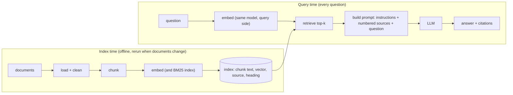
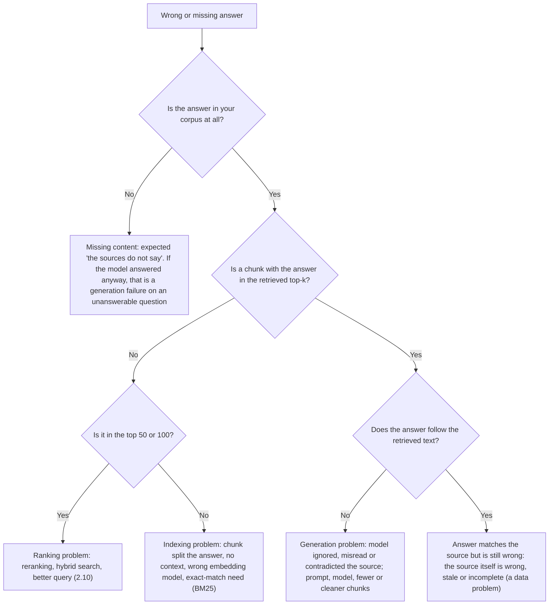

# RAG fundamentals

## Why this matters

Retrieval-augmented generation (RAG) gives a model knowledge it wasn't trained on: your notes, your docs, last week's tickets. It is one of the most widely used patterns in LLM apps, and its core idea fits in one sentence: **find the relevant text first, then put it in the prompt**. Anthropic's description is the same size: RAG "retrieves relevant information from a knowledge base and appends it to the user's prompt" ([Anthropic: Contextual Retrieval](https://www.anthropic.com/news/contextual-retrieval)).

You already have both halves. [2.8](/part-02-programming-with-llms/2.8-embeddings-in-practice) built the retrieval loop (embed, store, nearest-neighbour search) and ended with "what you get back is text, not an answer". [2.1](/part-02-programming-with-llms/2.1-calling-models) and [2.3](/part-02-programming-with-llms/2.3-prompting) gave you the generation half. This chapter joins them and then spends most of its time on the part that decides whether the result is any good: **what goes into the index (chunking), what comes out of it (retrieval quality), and how to tell which of the two is to blame when an answer is wrong.** Most RAG failures are retrieval failures, and a system you can't diagnose is a system you can't improve.

**Learning goals**

- Build a minimal RAG pipeline
- Choose chunking strategies and explain their trade-offs
- Diagnose whether a bad answer is a retrieval or a generation problem

## Explanation

### The pipeline in one picture

RAG is two pipelines that meet at a store. The offline one prepares the text; the online one runs per question.



Six stages, and each can fail on its own:

| Stage | Question it answers | Typical failure |
|---|---|---|
| Load and clean | Is the text we index the text the user needs? | Navigation menus and boilerplate indexed; tables flattened into nonsense |
| Chunk | What is one searchable unit? | The answer is split across two chunks, or buried in a long one |
| Embed and index | Can we find a chunk by its meaning? | Wrong model for the language; exact identifiers missed (2.8) |
| Retrieve | Which k chunks go in the prompt? | The right chunk exists but ranks 11th |
| Build the prompt | How does the model see the sources? | Sources unlabelled, instructions vague, answer ignores them |
| Generate | Does the answer follow the sources? | Fills gaps from memory; misreads a source; cites the wrong one |

Two ideas to hold on to for the rest of the chapter. First, the model sees only what you put in the prompt, so **an answer can only be as good as the retrieved chunks**. Second, the stages are separable: you can inspect the retrieved chunks without calling a model at all. That separability is what makes failures diagnosable.

### Do you need RAG?

Not always. If the whole knowledge base fits in the prompt, putting it all in is simpler than any pipeline, and Anthropic's own advice in September 2024 was exactly that: below 200,000 tokens (about 500 pages of material) "you can just include the entire knowledge base in the prompt", with prompt caching making it faster and cheaper ([Anthropic: Contextual Retrieval](https://www.anthropic.com/news/contextual-retrieval)). Context windows have grown since then, so see [1.9](/part-01-how-llms-work/1.9-kv-cache-context-window) for how the window works and [Landscape](/landscape) for current sizes, and [2.7](/part-02-programming-with-llms/2.7-prompt-caching) for how caching changes the cost.

Whole-corpus prompting stops being the right call when:

- The corpus is bigger than the window, or you'd pay for a huge prefix on every question.
- **Accuracy drops with more text.** Chroma's chunking report argues that although it is possible to insert whole documents, "in practice doing so is often inefficient, and can distract the model" ([Chroma: Evaluating Chunking Strategies](https://research.trychroma.com/evaluating-chunking)). Liu et al. measured one mechanism: performance "is often highest when relevant information occurs at the beginning or end of the input context, and significantly degrades when models must access relevant information in the middle of long contexts" ([Lost in the Middle](https://arxiv.org/abs/2307.03172), tested on 2023-era models, so treat the size of the effect as dated and the direction as a reason to measure).
- You need **source attribution** or per-user access control: retrieval gives you a list of exactly which documents were used.
- The data changes often. Re-embedding one changed chunk is cheaper than re-sending the corpus.

For a few notes and one chapter, "paste it all in" is a fair baseline to beat. RAG earns its place when the corpus is large, mixed, or access-controlled, which is the case for the practice below: all the book chapters plus your notes.

The name comes from Lewis et al., who combined a pre-trained generator with a retriever over a document index for knowledge-intensive tasks ([RAG paper](https://arxiv.org/abs/2005.11401), 2020). In that paper the retriever and generator are trained together. What the industry means today is the lighter version: a frozen LLM plus a retrieval step you wrote, glued with a prompt.

### Chunking: what is one searchable unit?

An embedding model takes one text and returns one vector (2.8). A whole chapter averaged into one vector matches almost every query a little and none well; a single sentence loses the context that makes it meaningful. **Chunking** is the choice of the unit in between. It matters because the chunk is simultaneously:

- the thing the embedding represents (small chunks give sharper vectors),
- the thing the retriever returns (large chunks carry more surrounding context),
- the thing you pay for in the prompt, k chunks × chunk size tokens, and
- the thing a citation points to.

Those pull in opposite directions, which is why there is no universal chunk size. The usual starting range is a few hundred tokens: Anthropic's primer describes chunks as "usually no more than a few hundred tokens" ([source](https://www.anthropic.com/news/contextual-retrieval)). Check the input limit of your embedding model too (2.8): `embeddinggemma`'s page lists a 2K context.

#### Four families of strategy

**1. Fixed-size.** Cut every N characters or tokens, optionally with an overlap so a sentence cut at the boundary appears whole in the next chunk. Trivial to write and predictable in size, and blind to meaning: it will split mid-sentence, mid-table and mid-code-block. Overlap is a patch for that, and it costs index size (every overlapped token is embedded twice) and produces near-duplicate hits.

**2. Recursive.** Try the largest natural separator first (blank line), and only if a piece is still too long split it by the next one (line break, then sentence end, then space). The goal is the largest unit that fits, keeping paragraphs intact where possible. This is what LangChain's `RecursiveCharacterTextSplitter` does, and in Chroma's evaluation (July 2024, which follows LangChain's implementation) such heuristic splitters "often perform well in practice when parametrized appropriately", while default settings for some popular splitters "can lead to relatively poor performance" ([Chroma report](https://research.trychroma.com/evaluating-chunking)). The lesson there is that the defaults of a library are a starting guess: the Chroma authors had to change the default separators of the recursive splitter because they "would commonly result in very short chunks".

**3. Semantic.** Let the embedding model place the boundaries. One variant splits into sentences, embeds a sliding window, and cuts where the distance between neighbouring windows jumps (Kamradt's method, described in the Chroma report). The Chroma authors also tried a clustering variant and an approach that asks an LLM to do the chunking, and found both "competitive" ([Chroma report](https://research.trychroma.com/evaluating-chunking)). The cost is an embedding pass (or an LLM pass) at index time, plus variable chunk sizes that you then have to cap. It helps most when the text has no structure of its own, such as transcripts and long prose.

**4. Document-aware (structure-aware).** Use the structure the author already gave you: Markdown headings, HTML sections, function and class boundaries in code, slides, table rows, Q&A pairs. Each chunk is one section, and long sections fall back to a recursive split. You also get **metadata for free**: the file path and the heading trail (`2.8 > Where to store vectors`) become fields you can show as a citation, filter on, and prepend to the chunk text. For a markdown book this is the obvious first choice.

| | Fixed | Recursive | Semantic | Document-aware |
|---|---|---|---|---|
| Needs structure in the source | No | No (uses separators) | No | Yes |
| Index-time cost | None | None | Embeddings or an LLM | None (parsing) |
| Chunk sizes | Uniform | Bounded | Variable | Variable, cap with a fallback |
| Typical weakness | Splits meaning | Ignores topic shifts | Cost; threshold tuning | Needs a parser per format; oversized sections |
| Good first use | A baseline to beat | Plain prose | Transcripts, unstructured text | Markdown, HTML, code, docs sites |

#### What chunking changes in practice

One small measurement, to show the mechanics and not to settle anything. On 2026-11-10 I split the text of chapter 2.8 four ways, embedded the chunks with `qwen3-embedding:0.6b` (with the query instruction from 2.8), asked four factual questions about the chapter, and recorded the rank of the first chunk that contained the answer string:

| Strategy | Chunks | Average length (chars) | Rank of the answer chunk, 4 questions |
|---|---|---|---|
| Fixed 500 characters, no overlap | 49 | 499 | 1, 1, 1, 1 |
| Fixed 500, overlap 50 | 55 | 493 | 1, 4, 1, 1 |
| Paragraphs, up to 1,200 characters | 25 | 976 | 1, 1, 1, 1 |
| Heading-aware (a section per chunk, long ones split by paragraph) | 28 | 899 | 1, 1, 2, 2 |

Read this for the right lessons. Four easy questions over one chapter can't rank strategies, and they didn't: three of the four hit rank 1 or 2 almost everywhere. What it does show: the chunk counts differ by more than 2x for the same text, a 50-character overlap changed which chunk won for one question without any reason you could predict in advance, and "heading-aware" was not automatically best. Nothing replaces an eval set on your own questions, and that is why the practice below has you write ten.

Rules of thumb that survive that caveat:

1. **Start with document-aware where structure exists, recursive where it doesn't**, at a few hundred tokens, and measure before trying anything fancier. Chroma found strategy choice can move recall by "up to 9%", which is real but not a reason to start with the most exotic splitter ([Chroma report](https://research.trychroma.com/evaluating-chunking)).
2. **Keep metadata with every chunk**: source path, heading trail, position. You need it for citations and for debugging.
3. **Never lose the question's context in the chunk.** A chunk that reads "It grew by 3% over the previous quarter" is unfindable. That problem has a name and a fix, next.
4. **Changing the chunking means re-embedding everything.** Store the chunker's name and parameters next to the index, as you did with the model name in 2.8.

::: info 📖 Read now
[Chroma: Evaluating Chunking Strategies for Retrieval](https://research.trychroma.com/evaluating-chunking) · article · ~25 min · **essential**

A technical report from the makers of a vector database, and one of the few that measures chunking at all. Look for: why the authors argue that benchmarks like MTEB can't evaluate chunking (they score whole documents), the token-level metrics (recall, precision and IoU) as a way to score a chunker without an LLM, and the table of strategies and settings. Skim the dataset-generation section: it shows how to produce test questions from your own corpus, which you'll need in Part 4.
:::

### Contextual retrieval: giving each chunk its address

The failure behind rule 3 is that **chunking destroys context**. Anthropic's example: after splitting SEC filings, a chunk says "The company's revenue grew by 3% over the previous quarter." Which company? Which quarter? The question "What was the revenue growth for ACME Corp in Q2 2023?" has no reason to match it ([Anthropic: Contextual Retrieval](https://www.anthropic.com/news/contextual-retrieval)).

**Contextual Retrieval** fixes that at index time. For each chunk, an LLM is shown the whole document and the chunk and asked to write a short situating sentence, which is then prepended to the chunk before it is embedded and before the BM25 index is built (Anthropic calls these Contextual Embeddings and Contextual BM25). Their prompt, from the same post:

```text
<document>
{{WHOLE_DOCUMENT}}
</document>
Here is the chunk we want to situate within the whole document
<chunk>
{{CHUNK_CONTENT}}
</chunk>
Please give a short succinct context to situate this chunk within the overall document for the purposes of improving search retrieval of the chunk. Answer only with the succinct context and nothing else.
```

The generated context is "usually 50-100 tokens". The reported effect, averaged over their test domains (codebases, fiction, ArXiv papers and science papers) with the top 20 chunks retrieved: Contextual Embeddings cut the retrieval failure rate by 35% (5.7% to 3.7%); adding Contextual BM25 made it 49% (5.7% to 2.9%); adding a reranking step (2.10) made it 67% (5.7% to 1.9%) ([Anthropic: Contextual Retrieval](https://www.anthropic.com/news/contextual-retrieval)). Two caveats from the same article: the numbers are Anthropic's own and the setup is specific (a top-20 cut-off and particular embedding models, with Gemini and Voyage embeddings reported as particularly effective), and the article says to "always run evals" on your own data.

The cost structure is what to understand. It is a one-off **index-time** cost: one LLM call per chunk, and every call includes the whole document. That is the textbook case for prompt caching ([2.7](/part-02-programming-with-llms/2.7-prompt-caching)): load the document into the cache once and reuse it for each of its chunks. Anthropic's post says that is what makes the technique cheap with Claude; for current prices go to [Landscape](/landscape). With a local model through Ollama there is no per-token bill, only time.

You don't always need an LLM to get most of the idea. If your chunks come from structured documents, **prepending the document title and heading trail** (`Chapter 2.8 Embeddings in practice > Where to store vectors`) is a free version of contextualisation, and it is a good first thing to try. The LLM version earns its cost when the missing context is not in the structure: which company, which version, which customer.

::: info 📖 Read now
[Anthropic: Introducing Contextual Retrieval](https://www.anthropic.com/news/contextual-retrieval) · article · ~20 min · **essential**

The best short tour of a modern RAG pipeline: the plain pipeline, why BM25 is added, why chunks lose context, the contextualising prompt, and reranking. Look for: the "context conundrum" example, the exact prompt, how the three configurations are compared (1 minus recall@20), and the "Implementation considerations" list. Note which parts reappear in 2.10.
:::

::: tip 📖 Skim
[Claude cookbook: Contextual Embeddings](https://platform.claude.com/cookbook/capabilities-contextual-embeddings-guide) · docs · ~15 min · optional

The runnable version of the article, in Python. Skim for the data flow and how the context is stored next to the chunk; you will write it in TypeScript yourself if you try it.
:::

### Prompting with retrieved context

Retrieval gave you k chunks. The prompt turns them into evidence. Everything from [2.3](/part-02-programming-with-llms/2.3-prompting) applies; four things are specific to RAG.

**1. Separate instructions, sources and question, and label every source.** Number the chunks and give each a stable handle (path and heading). The numbers are what the model will cite and what your code will parse. XML-style tags or a clearly delimited block keep the sources from blending into the instructions:

```ts
type Chunk = { id: number; path: string; heading: string; text: string };

function buildPrompt(question: string, chunks: Chunk[]): { system: string; user: string } {
  const sources = chunks
    .map((c) => `<source id="${c.id}" path="${c.path}" heading="${c.heading}">\n${c.text}\n</source>`)
    .join("\n");
  return {
    system: [
      "Answer the question using only the sources provided.",
      "After each claim, cite the source id in square brackets, like [2].",
      'If the sources do not contain the answer, reply exactly: "The sources do not say."',
    ].join("\n"),
    user: `<sources>\n${sources}\n</sources>\n\nQuestion: ${question}`,
  };
}
```

**2. Give the model a legitimate way to say no.** Without the "the sources do not say" instruction, a model asked something the chunks don't cover will answer from memory, which is the exact thing RAG was supposed to prevent. I ran both cases locally on 2026-11-10 with `qwen3:8b` (temperature 0, thinking off) and the system prompt above. Given a source chunk containing "a brute-force scan of 10,000 random 1,024-dimension vectors ... took about 10 ms", the answer to "How long did the brute-force scan of 10,000 vectors take?" was "about 10 ms [1]". Given a source about pgvector's exact search instead, a near miss from the same chapter, it answered "The sources do not say." With no sources and no such instruction, the same model answered "approximately 1 hour" for a measurement that only exists in this book. Same question, three behaviours, and the difference is entirely retrieval and prompt. That refusal path also gives you a signal: a spike in "the sources do not say" means retrieval is missing things.

**3. Ask for citations, and verify them in code.** A citation is a claim that "this source supports this sentence", and models sometimes cite wrongly. Two levels of checking: parse the `[n]` markers and check each refers to a chunk you actually sent (cheap, catches inventions), and for important answers have a second check, a code or LLM judge, confirm the cited chunk really supports the claim (Part 4). You can also ask for a short direct quote with each citation, which is easy to string-match against the chunk.

Claude's API has this built in. With **citations** enabled on a document, "the API parses citations into the response formats ... and extracts `cited_text` directly, citations are guaranteed to contain valid pointers to the provided documents", and `cited_text` does not count towards output tokens ([Claude docs: Citations](https://platform.claude.com/docs/en/build-with-claude/citations)). Two details matter for RAG. Plain text is chunked into sentences by default, and the docs suggest that to let Claude cite specific sentences from your RAG chunks you "put each RAG chunk into a plain text document", or use custom content documents if you want no further chunking. And citations can't be combined with structured outputs (2.5), so you pick one per request. For RAG over your own retrieval tool, `search_result` content blocks let tool results carry a `source` (any stable string, such as `kb://article-1234`), a `title` and text, and with citations enabled Claude cites them automatically ([Claude docs: Search results](https://platform.claude.com/docs/en/build-with-claude/search-results)). The hand-rolled `[n]` scheme above works on any provider, including local models; the API feature is more reliable on Claude.

**4. Mind how many chunks you send and where.** More chunks raise the chance the answer is present and also the amount of distraction. Anthropic compared 5, 10 and 20 chunks and found 20 best of those, "but it's worth experimenting on your use case" ([source](https://www.anthropic.com/news/contextual-retrieval)). Given the position effect in Lost in the Middle (above), put the best-ranked chunks first, and consider putting the question after the sources, as in the code above. Don't paste unrelated chunks to "be safe".

One more rule belongs here and gets its own chapter in Part 8: **retrieved text is untrusted input.** A document you indexed can contain "ignore previous instructions", and the model will see it in the prompt next to your own instructions. Index only content you trust or sandbox what the model can do with it.

::: tip 📖 Skim
[Claude docs: Citations](https://platform.claude.com/docs/en/build-with-claude/citations) · docs · ~10 min · optional

Look for: the three document types and how each one is chunked, what a citation object contains for plain text (character indices) and for custom content (block indices), and the incompatibility with structured outputs.
:::

::: tip 📖 Skim
[Claude docs: Search results](https://platform.claude.com/docs/en/build-with-claude/search-results) · docs · ~10 min · optional

Look for: the `search_result` block schema, and the two ways to supply results (returned from a tool, or placed directly in a user message). This is the shape you'd use when 2.11's agentic search returns chunks from a tool.
:::

### Failure analysis: retrieval or generation?

A user says "the answer was wrong". Where do you look? The whole point of keeping the stages separable is that the check is mechanical. For each failing question, you need three things: the question, the chunk (or chunks) that actually contain the answer, and the chunks your system retrieved. Then ask the questions in this order:



The decision that matters most is the third box, and you can make it **without any LLM**: print the retrieved chunks, check by eye or string match whether an answer-bearing chunk is among them. If not, no prompt change can fix the answer, and you have a retrieval failure. If yes, and the model still got it wrong, it is a generation failure. Doing the two checks in this order is cheap and saves most of the wasted effort: the common mistake is to tune the prompt, or swap the model, for a failure that was decided one stage earlier. Chip Huyen puts the dependency plainly: "The success of a RAG system depends on the quality of its retriever" ([*AI Engineering*, ch. 6 summary](https://github.com/chiphuyen/aie-book/blob/main/chapter-summaries.md#chapter-6-rag-and-agents)).

Barnett et al. list seven failure points from three case studies, which map onto the tree above ([Seven Failure Points When Engineering a RAG System](https://arxiv.org/abs/2401.05856)):

| # | Failure point (their name) | Where it lives |
|---|---|---|
| FP1 | Missing content: the question can't be answered from the documents, yet the system answers | Data, and generation (no "I don't know" path) |
| FP2 | Missed the top-ranked documents: the answer exists but isn't returned | Retrieval |
| FP3 | Not in context, consolidation strategy limitations: retrieved, but dropped before the prompt | Retrieval and prompt assembly |
| FP4 | Not extracted: the answer is in the context, but the model fails to pull it out, typically given noise or contradictions | Generation |
| FP5 | Wrong format: asked for a table or list, ignored | Generation |
| FP6 | Incorrect specificity: too general or too specific for the user | Prompt and generation |
| FP7 | Incomplete: not wrong, but misses information that was in the context | Generation |

Their two takeaways are worth keeping: "validation of a RAG system is only feasible during operation" and its "robustness ... evolves rather than designed in at the start" ([same paper](https://arxiv.org/abs/2401.05856)). Translated: build the habit of collecting failing questions and labelling their cause, not a perfect pipeline up front.

#### Measuring retrieval separately

Once you have labelled questions (each with the chunk that answers it), two numbers describe the retrieval stage:

- **Hit rate at k (recall@k)**: the fraction of questions for which an answer-bearing chunk appears in the top k. This is the metric from 2.8, and the one Anthropic's article reports as 1 minus recall@20.
- **MRR (mean reciprocal rank)**: average of 1 / (rank of the first right chunk). It rewards getting the right chunk to the top, which matters when you send few chunks.

And for generation, given the chunks you really sent, a **grounded** judgement per answer: is each claim supported by the cited source? Check it by hand for now. Part 4 turns this into LLM-as-judge checked against your labels.

Use a *known corpus* to build the eval: when you write the question you already know the answer file, so labelling is free. That is the plan for the practice.

::: tip 📖 Skim
[Barnett et al.: Seven Failure Points When Engineering a Retrieval Augmented Generation System](https://arxiv.org/abs/2401.05856) · paper · ~20 min · optional

Look for: the three case studies (and how different the domains are), the table of failure points, and the "lessons" section. Notice how few of the seven are about the model.
:::

::: tip 📖 Skim
[Liu et al.: Lost in the Middle](https://arxiv.org/abs/2307.03172) · paper · ~10 min (abstract and figures) · optional

Look for: the U-shaped accuracy curve as the position of the relevant document changes, and what the authors say it implies for retrieval-based tasks. Remember its models are from 2023; re-test on the model you use.
:::

::: tip 📖 Skim
[Lewis et al.: Retrieval-Augmented Generation for Knowledge-Intensive NLP Tasks](https://arxiv.org/abs/2005.11401) · paper · ~10 min (abstract and introduction) · optional

The paper that named the technique. Look for: what problem it targets (knowledge access and provenance) and the difference between its trained retriever and a frozen pipeline.
:::

::: tip 📕 Book
Chip Huyen, *AI Engineering* (O'Reilly, 2025), ch. 6 "RAG and Agents": the "RAG" half only, pp. 253-274: "RAG Architecture", "Retrieval Algorithms", "Retrieval Optimization" ([table of contents](https://github.com/chiphuyen/aie-book/blob/main/ToC.md)) · book · ~1 h · optional

Look for: term-based vs. embedding-based retrieval, chunking and reranking advice, and how it frames RAG as a special case of an agent whose retriever is a tool (the thread that 2.11 and Part 3 pick up). Skip the "Agents" half until Part 3. The [chapter summary](https://github.com/chiphuyen/aie-book/blob/main/chapter-summaries.md#chapter-6-rag-and-agents) is free if you don't have the book.
:::

### What goes wrong, in order of how often it bites

1. **The answer isn't in the top k.** Check the rank of the right chunk, not just whether it's in the top 5. A right chunk at rank 11 says "reranking or hybrid search" (2.10); a right chunk absent from the top 100 says "indexing problem".
2. **The chunk is there but unfindable by its own text.** It lacks its subject (contextual retrieval), or the query uses a different word for the same thing (query rewriting, hybrid search; 2.10).
3. **The answer spans chunks.** Neither half is a good match. Try a larger chunk, overlap, or merging a hit with its neighbours.
4. **Exact strings.** Identifiers, error codes and commands: BM25 first (2.8).
5. **The model answers anyway.** No refusal path, or the instruction is buried. Test with an unanswerable question.
6. **Stale index.** The document changed and the vector didn't (2.8): store a content hash.
7. **A multi-part question.** "Compare A and B" needs two retrievals. That is where fixed pipelines hit a wall, and 2.11 shows what to do about it.

## Practice

**Brief:** Extend the 2.8 search into a RAG Q&A over the book. Write 10 questions with known answers and check which failures are retrieval and which are generation. All local and free: `qwen3-embedding:0.6b` for retrieval and `qwen3:8b` or `qwen3:14b` through Ollama for answers. You write all the code; I haven't provided any.

**Where:** `experiments/22-rag/`: a standalone experiment, not a `project/` step. The folder has a README with the "What I tried / What happened / Why" skeleton, shared with chapters 2.10 and 2.11, which add their own sections. You can reuse your index and scripts from `experiments/21-semantic-search/` (copy them, don't import across folders).

**Steps:**

1. **Set up and write the questions first.** In `experiments/22-rag/` set up the TypeScript project as in experiment 21. Before you write any retrieval code, write **10 questions** over the book chapters (and optionally your notes) in `questions.json`, each with: the question, the **expected answer** in a few words, and the **path and heading** of the chunk that contains it. Include at least 6 plain factual questions, 2 that need an exact string (a command, a file name), 1 that needs information from two places, and **1 that the corpus can't answer** (expected answer: "not in the sources"). Add a prediction column in the README: which of the ten do you expect to fail, and why?
2. **Chunk with metadata.** Reuse or rewrite the chunker from experiment 21, document-aware (split on headings, fall back to paragraphs for long sections). Keep path and heading trail. Store the chunker name and parameters with the index.
3. **Retrieve.** Embed the query with the query instruction and take the top k by dot product (start with k = 5). Print, for each question, the rank of the first chunk that matches your expected path and heading, or "absent" if it isn't in the top 50.
4. **Build the prompt and answer.** Write the prompt builder with numbered, labelled sources, the "only from the sources" rule, the exact refusal sentence and `[n]` citations. Call your local model with temperature 0 and thinking off for speed. Save, per question: retrieved ids with scores, the exact prompt, the answer.
5. **Label each question by hand.** For each of the ten, record two things separately, without letting one decide the other: **retrieval** (the answer-bearing chunk in the top k: yes or no, and its rank) and **generation** (given the sources, is the answer correct and does each `[n]` support its claim: yes or no). Then assign one of four outcomes in a table: retrieved and right, retrieved but wrong (generation failure), not retrieved but right anyway (the model knew it), not retrieved and wrong (retrieval failure).
6. **Check the citations in code.** Write a small check that every `[n]` in an answer is a source id you sent, and count the answers that fail it.
7. **Test the refusal path.** Look at what your system does with the unanswerable question, then remove the refusal sentence from the prompt and run the same question again. Record both answers.
8. **Change one thing, then re-measure.** Pick one retrieval change from this list and re-run all ten: prepend the heading trail to each chunk's text before embedding; change the chunk size; change k from 5 to 3 and to 10; add a hand-written one-line context to chunks. Record hit rate (answer chunk in the top k) before and after, and say whether your change moved the retrieval failures or the generation failures.
9. **Optional: swap the generator.** Run the same prompts with `qwen3:14b` or `qwen3:8b` with thinking on. Did generation failures change? Did retrieval failures? (They shouldn't have: a good check of your diagnosis.)
10. **Optional: contextual retrieval.** For one long chapter, generate a situating sentence per chunk with the Anthropic prompt and a local model, prepend it, re-embed, and compare ranks on the same ten questions. Record how long indexing took.

**Done when:**

- `node ask.ts "..."` prints the answer, the sources with ids, paths and scores, and runs without re-embedding the corpus.
- `questions.json` holds ten questions with expected answers and expected chunk locations, and the README says which you predicted would fail.
- Your README contains a table of the ten questions with two separate columns (retrieval hit and rank; generation correct) and the four-way outcome, and states how many failures were retrieval and how many were generation.
- Your citation check has run, and you can say how many answers cited a source that was not in the prompt.
- It shows what the unanswerable question did with and without the refusal instruction.
- It records one change from step 8 with before and after numbers.
- You can explain in one sentence why the retrieved chunks, not the final answer, are the first thing to look at.

## Check questions

1. A user reports a wrong answer. You print the prompt and see that none of the five retrieved chunks contains the information. A teammate suggests switching to a stronger model. What do you say, and what do you check next?

   <details><summary>Answer</summary>

   A stronger model can't use information that isn't in the prompt, so this is a retrieval failure and the fix is upstream. Check where the answer-bearing chunk ranks: if it's in the top 50 or 100, the problem is ranking (reranking, hybrid search; 2.10); if it's absent, look at indexing: was the answer split across chunks, is the chunk missing its subject (contextual retrieval), is it an exact-string case (BM25), is the embedding model wrong for the language? Also confirm the answer is really in the corpus.

   </details>

2. Your retrieved top 5 contains the right chunk, and the answer is still wrong. Name two things you try, and the one thing you don't touch.

   <details><summary>Answer</summary>

   It's a generation failure, so work on the prompt and the model: tighter instructions ("only from the sources", ask for a quote), fewer and cleaner chunks (noise and contradictions cause failures like Barnett's FP4), ordering the best chunk first, a stronger or reasoning-enabled model. Don't touch chunking or the embedding model: retrieval already delivered the right chunk, and changing it will confuse the next measurement.

   </details>

3. Why does the chunk "The company's revenue grew by 3% over the previous quarter" retrieve badly for "What was ACME Corp's revenue growth in Q2 2023?", and what are two ways to fix it?

   <details><summary>Answer</summary>

   After chunking, the text no longer says which company or period it refers to, so neither the embedding nor a keyword index has anything linking it to ACME or Q2 2023. Fixes: contextual retrieval, where an LLM writes a short situating sentence per chunk that is prepended before embedding and BM25 indexing (Anthropic reports a 35% lower failure rate for embeddings alone and 49% with BM25); or, cheaper, prepend the document title and heading trail from the document's own structure. Larger chunks that keep the heading in view also help.

   </details>

4. You have a markdown documentation site and a folder of meeting transcripts. Which chunking strategy do you start with for each, and why?

   <details><summary>Answer</summary>

   The docs: document-aware, one chunk per heading section, falling back to a recursive split for long sections, with the heading trail kept as metadata and citation. The structure is already there and gives free context. The transcripts: they have no headings, so start with recursive splitting at a few hundred tokens (maybe with a small overlap to keep speaker turns whole), and try semantic chunking if topic shifts are what hurts retrieval. In both cases measure on your own questions: the differences between strategies are modest and data-dependent.

   </details>

5. The system answers a question about a topic your documents don't cover, confidently and with plausible detail. Name the failure, give two prompt-level and one pipeline-level mitigation.

   <details><summary>Answer</summary>

   Barnett et al.'s FP1, missing content: the model fills the gap from its own memory. Prompt-level: instruct it to answer only from the sources and to reply with a fixed refusal sentence when they don't contain the answer; require a citation for every claim and reject answers with none or with unknown source ids. Pipeline-level: use the retrieval scores or an LLM relevance check to decide that nothing retrieved is relevant enough, and return the refusal without calling the generator (calibrate the cutoff on your own examples, since scores aren't probabilities; 2.8). Keep an unanswerable question in your eval set so you notice if this regresses.

   </details>

## My understanding

<!-- Written by the learner, in their own words. Agents never fill this in. -->
