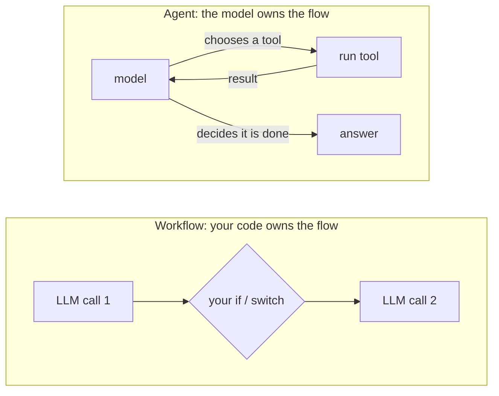
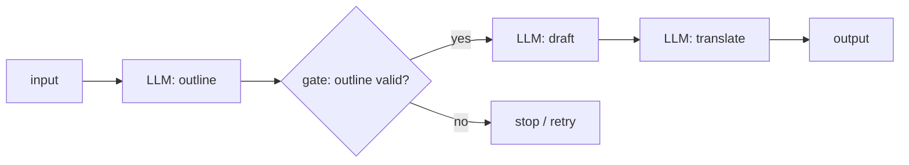
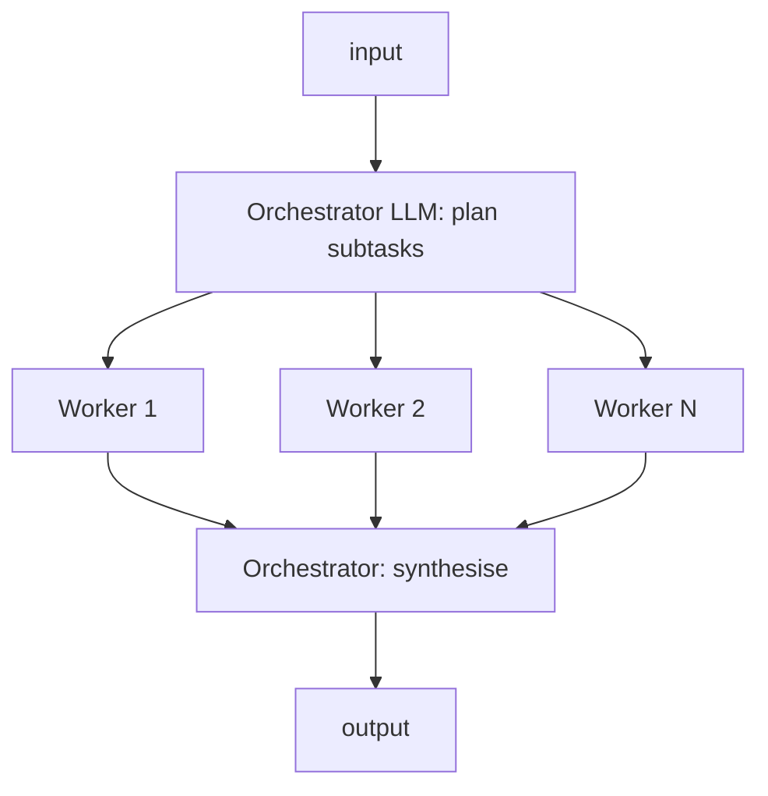
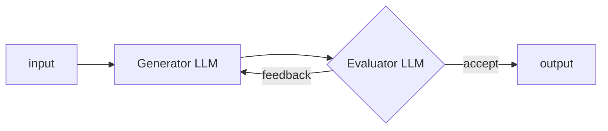
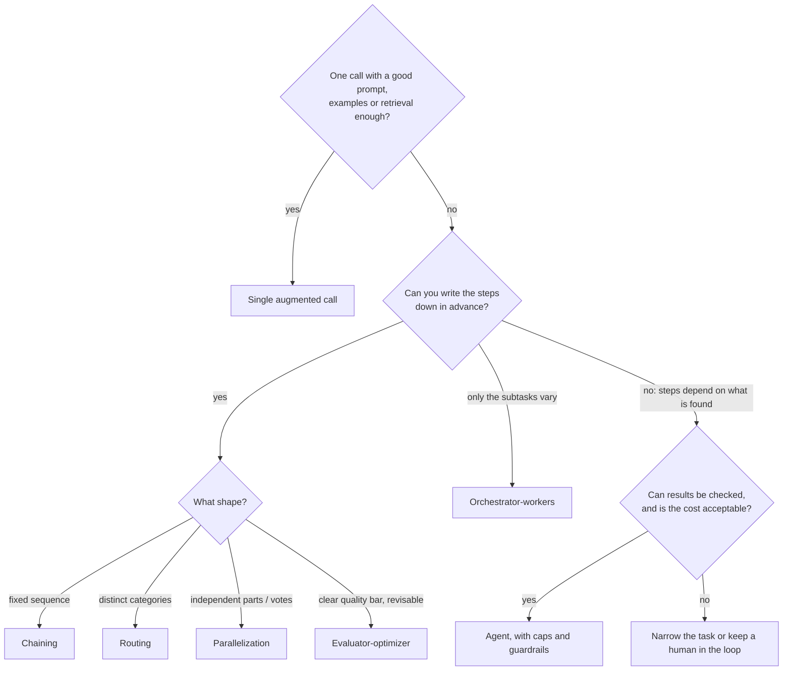

# Workflows vs. agents

## Why this matters

"Agent" is the most overloaded word in the field, and the cost of using it loosely is real: teams build an autonomous loop for a task that three fixed prompts would solve, then spend months making it reliable. A fixed workflow is cheaper, faster, easier to test and easier to debug. An agent can handle problems you can't write the steps for. The most useful skill at the start of Part 3 is knowing which one a problem needs, and being able to say why.

Anthropic's own guidance opens with the same advice: "we recommend finding the simplest solution possible, and only increasing complexity when needed. This might mean not building agentic systems at all. Agentic systems often trade latency and cost for better task performance" ([Building effective agents](https://www.anthropic.com/engineering/building-effective-agents)).

You already have the raw material. [2.6](/part-02-programming-with-llms/2.6-tool-calling) showed one tool round trip done by hand. This chapter zooms out: how do you arrange several model calls (and tool calls) into a system, and who decides the order, your code or the model? [3.2](/part-03-agents/3.2-agent-loop) then builds the agent end of that spectrum from scratch.

**Learning goals**

- Name the common workflow patterns (chaining, routing, parallelization, orchestrator-workers, evaluator-optimizer)
- Define an agent precisely
- Choose between them for a given task

## Explanation

### One question separates them: who decides the next step?

Anthropic draws the line this way ([Building effective agents](https://www.anthropic.com/engineering/building-effective-agents)):

- **Workflows** are "systems where LLMs and tools are orchestrated through predefined code paths."
- **Agents** are "systems where LLMs dynamically direct their own processes and tool usage, maintaining control over how they accomplish tasks."

Same ingredients (model calls, tools, prompts), different owner of the control flow. In a workflow, **your code** holds the `if`s, the sequence and the loop bounds, and the model fills in the content of each step. In an agent, **the model** picks the next action each turn, and your code mostly executes it and enforces limits. Anthropic uses *agentic system* as the umbrella term for both.



This is a spectrum, not two boxes. A workflow with one step where the model picks among tools is already a little agentic, and every production agent has fixed code around it (iteration caps, permissions, timeouts). Still, the question "who decides the next step, and can I write the steps down in advance?" is the one to ask first.

### The building block: the augmented LLM

Every pattern below is made of one unit. Anthropic calls it the **augmented LLM**: "an LLM enhanced with augmentations such as retrieval, tools, and memory", where the model can "actively use these capabilities", for example generating its own search queries, selecting tools and deciding what to retain ([Building effective agents](https://www.anthropic.com/engineering/building-effective-agents)).

You have built each part of this already:

| Augmentation | Where you saw it |
|---|---|
| The model call itself, with a system prompt | [2.1](/part-02-programming-with-llms/2.1-calling-models), [2.3](/part-02-programming-with-llms/2.3-prompting) |
| Structured output (a reliable shape for the next step to consume) | [2.5](/part-02-programming-with-llms/2.5-structured-output) |
| Tools | [2.6](/part-02-programming-with-llms/2.6-tool-calling) |
| Retrieval | [2.9](/part-02-programming-with-llms/2.9-rag-fundamentals) |
| Memory | [3.5](/part-03-agents/3.5-memory) |

Structured output deserves a note because it is the glue of every workflow. When step 1 must hand step 2 a category, a score or a list of subtasks, a schema-constrained reply (2.5) turns "parse the model's prose" into "read a field". The patterns below are mostly plumbing around that.

Before reaching for any pattern, check whether **one augmented call** is enough. Anthropic says as much: "for many applications, optimizing single LLM calls with retrieval and in-context examples is usually enough." A better prompt, a few examples or retrieval beat an architecture surprisingly often.

### The five workflow patterns

Each is a small, named way to wire augmented LLM calls together with code. The descriptions follow Anthropic's article; the code sketches are mine, in TypeScript, with `llm()` standing for any call from Part 2 that returns text or a parsed object.

#### 1. Prompt chaining

Split a task into a fixed sequence. Each call works on the previous call's output, and code between steps can **gate** the result (check it, reject it, stop early).



```ts
const outline = await llm(`Outline a post about: ${topic}`)
if (!meetsCriteria(outline)) throw new Error("bad outline") // the gate is plain code
const draft = await llm(`Write the post from this outline:\n${outline}`)
return await llm(`Translate to German:\n${draft}`)
```

Use it when the task cleanly decomposes into fixed steps and each step being easier is worth the extra latency. Anthropic's examples: generate marketing copy then translate it; write an outline, check it, then write the document. The trade you are making: **latency for accuracy**, because each call has a narrower job.

#### 2. Routing

Classify the input first, then send it to a specialised prompt, model or sub-workflow. It separates concerns: a refund question and a technical question want different instructions, and cramming both into one prompt makes each worse.

```ts
const { category } = await llmJson(RouteSchema, `Classify this ticket: ${ticket}`)
const handler = { refund: refundPrompt, technical: techPrompt, general: generalPrompt }[category]
return await llm(handler(ticket))
```

It works when the categories are distinct and the classification is accurate, by an LLM or by a conventional classifier or even a regex. Anthropic's examples include customer-service triage and sending easy questions to a smaller model and hard ones to a larger one. That second use is also the seed of the cost routing in Part 9. The failure mode to remember: a wrong route is silent. The specialised prompt will happily answer the wrong kind of question, so measure the router on its own ([Part 4](/part-04-evals-observability/4.1-error-analysis)).

#### 3. Parallelization

Run several calls at once and combine the results with code. Two flavours:

- **Sectioning:** independent subtasks run side by side. One model screens the user input for policy problems while another answers it; or each call scores a different aspect of an output.
- **Voting:** the same task runs several times (often with different prompts) and you aggregate, for example three code reviews each looking for vulnerabilities, flag if any (or most) agree.

```ts
const [safety, answer] = await Promise.all([llmJson(SafetySchema, q), llm(answerPrompt(q))])
if (!safety.ok) return refusal
return answer
```

Use it when subtasks are independent (speed) or when several attempts raise your confidence. In TypeScript this is just `Promise.all`; the engineering questions are rate limits and what to do when one branch fails. Cost goes up linearly with the number of branches. Note the difference from the next pattern: here the branches are decided by you in advance.

#### 4. Orchestrator-workers

A central LLM looks at the input, **decides what the subtasks are**, delegates each to a worker call, then synthesises the results. It looks like parallelization on a diagram, but Anthropic names the key difference: it's "flexibility: subtasks aren't pre-defined, but determined by the orchestrator based on the specific input."



Use it when you can't predict the subtasks: the files to change in a coding task depend on the task, a research question needs a different set of searches each time. This pattern is the border country. The orchestrator makes a decision your code didn't pre-write, so it already has a taste of agency. What keeps it a workflow in Anthropic's taxonomy is the shape: one planning step, one fan-out, one synthesis, with your code driving the sequence. [3.10](/part-03-agents/3.10-multi-agent) takes it further.

#### 5. Evaluator-optimizer

One call generates, another critiques against explicit criteria, and the generator revises, in a loop until the evaluator accepts or your code hits a cap.



```ts
let draft = await llm(task)
for (let i = 0; i < MAX_ROUNDS; i++) {              // the cap is yours, not the model's
  const verdict = await llmJson(VerdictSchema, evalPrompt(task, draft))
  if (verdict.pass) return draft
  draft = await llm(revisePrompt(task, draft, verdict.feedback))
}
return draft // best effort after the cap
```

Use it when you have **clear evaluation criteria** and revision measurably helps: translation with nuance, code that must meet a checklist. Two cautions. First, a model grading its own kind of output tends to be lenient, so the quality of the loop depends on how sharp and checkable the criteria are (Part 4 returns to judging LLM judges). Second, notice that this contains a loop. A loop doesn't make it an agent: the model never chooses what to *do*, only whether to accept, and the iteration bound lives in your code.

#### Which pattern for which shape

| Pattern | Your code decides | The model decides | Reach for it when |
|---|---|---|---|
| Chaining | the sequence | content of each step | the task splits into fixed, easier steps |
| Routing | which branches exist | which branch | inputs fall into distinct categories |
| Parallelization | the branches | content of each branch | subtasks are independent, or you want votes |
| Orchestrator-workers | fan-out and synthesis shape | what the subtasks are | the subtasks can't be known in advance |
| Evaluator-optimizer | the round cap | accept or revise | you have clear, checkable criteria |

These compose. A real workflow is often a route that leads to a chain whose last step is an evaluator-optimizer. Anthropic stresses that the patterns are "not prescriptive": building blocks to combine and measure, not a taxonomy to satisfy.

### What makes something an agent

Once the model, not your code, picks the next step, you have an agent. Several well-known definitions say the same thing from different angles:

- Anthropic (above): the LLM dynamically directs its own process and tool use. Concretely, agents "begin their work with either a command from, or interactive discussion with, the human user", then plan and operate independently, gaining "ground truth" from the environment (tool results, code execution) at each step, and can pause for human feedback. They are "typically just LLMs using tools based on environmental feedback in a loop" ([Building effective agents](https://www.anthropic.com/engineering/building-effective-agents)).
- OpenAI: "Agents are systems that independently accomplish tasks on your behalf." An agent uses an LLM "to manage workflow execution and make decisions", can recognise when a workflow is complete, can halt and hand control back to the user on failure, and has tools it "dynamically selects" depending on state, "always operating within clearly defined guardrails". By their definition, "simple chatbots, single-turn LLMs, or sentiment classifiers" are not agents ([A practical guide to building agents](https://cdn.openai.com/business-guides-and-resources/a-practical-guide-to-building-agents.pdf), pp. 4-5).
- Simon Willison's one-liner, which he argued in 2025 had become widely enough agreed to be useful: "An LLM agent runs tools in a loop to achieve a goal" ([blog post](https://simonwillison.net/2025/Sep/18/agents/)).

Read them together and the working definition for this book is:

> An **agent** is an LLM that, in a loop, chooses which tool to call next based on what the environment returned, until it decides the goal is met (or a limit you set stops it).

Four parts, and each one is something to look for:

1. **A goal**, usually in natural language.
2. **Tools** that act on, or read from, an environment (2.6).
3. **A loop** where each tool result goes back into the context and the model chooses again.
4. **A stopping rule**: the model signals completion, plus limits from your code (iteration cap, token or cost budget, timeout). Anthropic explicitly says to include stopping conditions such as a maximum number of iterations.

The loop's mechanics are [3.2](/part-03-agents/3.2-agent-loop); it's the 2.6 round trip inside a `while`.

::: tip A note on vocabulary
The two vendors use "workflow" slightly differently. OpenAI's guide says a workflow is "a sequence of steps that must be executed to meet the user's goal" (the *task*), and an agent is what executes it, whereas Anthropic uses "workflow" for the *system design* with predefined code paths, opposed to agents. This book follows Anthropic's usage. When you read other material, check which one it means.
:::

#### Tests you can apply

- **Can you draw the flowchart before the run?** If yes, it's a workflow. If the number and order of steps depend on what the model finds along the way, it's an agent.
- **Who can end the run?** If it ends because your code reached the last step, workflow. If the model chose to stop (within your caps), agent.
- **Is there a tool-results-back-to-model loop?** A tool call that happens once at a fixed point (like a retrieval step before a prompt) is a workflow step. A loop where results shape the next choice is agent behaviour.

### Autonomy versus predictability

The decision is a trade, and both sides cost something.

| | Workflow | Agent |
|---|---|---|
| Control flow | written by you | chosen by the model each turn |
| Predictability | high: same shape every run | lower: runs differ, paths can't all be enumerated |
| Testing | unit-test each step, snapshot the graph | need evals on whole trajectories (Part 4) |
| Latency and cost | bounded and often lower | variable and often higher |
| Handles unknown unknowns | no: only the cases you coded | yes: it can try another approach |
| Failure mode | the wrong branch, a brittle step | wandering, looping, compounding errors |
| Debugging | read the step that failed | read the whole trace |

Anthropic's summary: workflows offer "predictability and consistency for well-defined tasks", agents are the better option "when flexibility and model-driven decision-making are needed at scale". They also warn that agents bring "higher costs, and the potential for compounding errors", so test them extensively in sandboxes with guardrails. Anthropic's multi-agent research write-up gives a measured size of the cost side: "agents typically use about 4× more tokens than chat interactions, and multi-agent systems use about 15× more tokens than chats" ([How we built our multi-agent research system](https://www.anthropic.com/engineering/multi-agent-research-system)). That is their data on their research workload, not a constant, but the order of magnitude is the point: autonomy is paid for in tokens. For current prices see [Landscape](/landscape).

Two more things shape the decision.

**Verifiability is what makes agents safe to run.** Both vendors' strongest agent examples have a way for the environment to say whether the work is right: code can be run against tests, customer-support resolutions can be measured. Anthropic's coding-agent example works because "code solutions are verifiable through automated tests". If you can't check an agent's result, you can't trust a loop that acts on it.

**Models improve, so the boundary moves.** A task that needed a rigid chain two years ago may be fine with one agentic call now, and a harness that compensated for a weak model may now be dead weight. Anthropic's article itself carries a note that much of its tooling description has changed since December 2024. Keep the principle, expect the details to shift.

### How to choose

Walk down this list and stop at the first yes:



OpenAI's guide has a complementary list of where agents earn their cost: workflows with **complex decision-making** (nuanced judgment, exceptions, context-sensitive calls, such as refund approval), **rules that have become difficult to maintain** (extensive, intricate rulesets), and **heavy reliance on unstructured data** ([A practical guide to building agents](https://cdn.openai.com/business-guides-and-resources/a-practical-guide-to-building-agents.pdf), p. 5). Their payment-fraud framing: a rules engine is a checklist, an agent is more like a seasoned investigator who evaluates context even when no rule is broken.

A few worked examples:

| Task | Pick | Why |
|---|---|---|
| Turn a changelog into release notes in three languages | Chain (draft, check, translate) | Fixed steps, each easier alone |
| Support inbox: refunds vs. bugs vs. questions | Route to specialised prompts | Distinct categories, cheap to classify |
| Review a pull request for security, style and tests | Parallelization (sectioning) | Independent aspects, speed matters |
| "Fix this failing test in an unfamiliar repo" | Agent | Unknown number of steps; the test run is the ground truth |
| Answer a broad research question from the web | Orchestrator-workers, or a multi-agent system | Subtasks depend on the question; value can justify the 15x token cost |
| Extract fields from invoices | Single call plus structured output (2.5) | No orchestration needed at all |

### Start simple, and keep the way up open

Both vendors give the same incremental advice. Anthropic: add complexity "only when it demonstrably improves outcomes" and measure. OpenAI: "customers typically achieve greater success with an incremental approach" rather than jumping straight to a fully autonomous architecture, and "maximize a single agent's capabilities first" before splitting into several (pp. 12-15). They name two multi-agent shapes: a **manager** agent that calls specialised agents as tools, and **decentralized** agents that hand off to each other. [3.10](/part-03-agents/3.10-multi-agent) covers both, and this book keeps with the single-agent case until then.

Anthropic ends on three principles: keep the design simple, show the agent's planning steps for transparency, and put real effort into the **agent-computer interface**, meaning the tool descriptions and formats. That last one is the subject of [3.3](/part-03-agents/3.3-tool-design).

On **frameworks**, Anthropic's advice is to start with direct API calls: frameworks help with calling models, defining tools and chaining calls, but "extra layers of abstraction" can obscure the prompts and responses and make debugging harder, and if you use one you should understand what is under it. That is why this book builds an agent from scratch in 3.2 before touching an SDK in [3.11](/part-03-agents/3.11-agent-sdks), and why this chapter's practice uses nothing but `fetch`.

### Where Claude Code and friends sit

Claude Code, Codex CLI and similar tools are agents: you give a goal, and the model chooses reads, edits and commands based on what comes back, within permission and iteration limits you set. But look inside and you also find workflow patterns: sub-agents are orchestrator-workers, a "review" step is evaluator-optimizer, and hooks are plain code gates between model steps. Production systems are agents with workflows built into them, and workflows with an agent step in the middle. Knowing the patterns lets you read these systems' behaviour instead of treating them as magic ([Part 5](/part-05-harnesses/5.2-harness-anatomy) takes one apart).

::: info 📖 Read now
[Anthropic: Building effective agents](https://www.anthropic.com/engineering/building-effective-agents) · article · ~25 min · **essential**

Look for: the one-sentence workflow/agent split, the augmented LLM picture, and for each of the five patterns the "when to use" line and the examples. Then the "Agents" section, especially stopping conditions and the checkpoint idea, and the closing three principles. Skip the two appendices on first read, then come back to Appendix 2 before 3.3. The page notes some tooling has changed since December 2024; the patterns haven't.
:::

::: info 📖 Read now
[OpenAI: A practical guide to building agents](https://cdn.openai.com/business-guides-and-resources/a-practical-guide-to-building-agents.pdf) · article (PDF) · ~25 min (pp. 4-6 and 12-17) · **essential**

Look for: how it defines an agent and the three "when should you build one" criteria (pp. 4-6), then the orchestration section: when it says to stay with a single agent, the guidance on when to split, and the manager vs. decentralized diagrams. Compare its definition of "workflow" with Anthropic's, and note where the two vendors agree. The code samples use OpenAI's Agents SDK, which you don't need to run.
:::

::: info 📖 Read now
[Simon Willison: "I think 'agent' may finally have a widely enough agreed upon definition to be useful jargon now"](https://simonwillison.net/2025/Sep/18/agents/) · article · ~10 min · optional

Look for: the one-line definition, why he thinks agreement matters (jargon is only useful when people share it), and the older definitions he kept collecting. A good antidote to the word's vagueness.
:::

::: info 📖 Read now
[Anthropic: How we built our multi-agent research system](https://www.anthropic.com/engineering/multi-agent-research-system) · article · ~20 min · optional

Look for: orchestrator-workers in production (a lead agent plus parallel subagents), the token-cost paragraph, and which kinds of tasks they say suit it and which (most coding) don't. You'll return to this in 3.10.
:::

## Practice

**Brief:** Implement **one workflow** in TypeScript for a task of your choice: route the input, hand it to a specialised prompt, and run an evaluator-optimizer on the result. No agent loop and no tools chosen by the model: your code owns every step. You write all the code. I've provided only the folder and a README skeleton.

**Where:** `experiments/23-workflows/`: a standalone experiment, not a `project/` step.

**Steps:**

1. **Choose a task.** Pick something where inputs fall into two or three clear categories and the output can be judged against written criteria. Examples (pick your own if you prefer): rewrite support emails in a house style by type of email; turn commit messages into release notes; explain error messages for beginners or experts. Write down the task and the categories in the README, plus 8-10 test inputs, including at least two that sit on a category boundary.
2. **Set up.** `npm init -y`, `"type": "module"`, `npm install zod`, scripts run with `node --env-file-if-exists=../../.env script.ts`. Call models with raw `fetch` as in 2.1. Start with local `qwen3:8b` (`think: false`) for every call, so iteration costs nothing.
3. **Baseline first.** Before building any workflow, send each test input to a *single* call with one good prompt. Save the outputs. The workflow has to beat this, or you have learned something valuable.
4. **Predict.** In the README, before building the workflow: will it beat the baseline? Where will the router be wrong? How many evaluator rounds will it typically take? What will it cost in calls?
5. **Route.** Add a classification call that returns a category through a schema-constrained reply (2.5). Then dispatch to a prompt specialised for that category. Print the chosen route for every input.
6. **Evaluate and optimize.** Write explicit criteria (3-5 checkable points, in the README). Add an evaluator call that returns `{ pass, feedback }` and a revise call that uses the feedback. Cap the rounds in your code.
7. **Instrument.** Log, per input: route, number of model calls, rounds used, and total time. Print a summary table.
8. **Compare.** Run all test inputs through baseline and workflow. Judge the outputs yourself against your criteria (by hand, to start with). Record where the workflow won, lost, or tied, and what the extra calls cost in time and tokens.
9. **Break it on purpose,** one at a time, and note what your code did: (a) force a wrong route and see what the specialised prompt does; (b) use an evaluator criterion that can never be satisfied and check the cap holds; (c) swap in a different model for the evaluator only (local vs. one paid model, see [Landscape](/landscape); keep it to a handful of calls) and see whether verdicts change.
10. **Classify it.** In the README, answer in your own words: at which exact point did your code hold the control flow, and what would have to change for the model to hold it instead? That is the line between this experiment and [3.2](/part-03-agents/3.2-agent-loop).
11. **Spend log.** If you used a paid model, add the rows to `costs.md`.

**Done when:**

- Every test input goes through route, specialised prompt and evaluator-optimizer, and your code never calls more than the round cap you set.
- The README has the task and categories, predictions (and which were wrong), the baseline-vs-workflow comparison with your own judgment, and the observed result of each on-purpose failure in step 9.
- You can point to the line of code that decides the next step at each stage, and show that no model output chooses an action.
- You can say whether the workflow was worth its extra calls for your task, and give the evidence.

## Check questions

1. In one sentence each: what is the difference between a workflow and an agent, and what is the single question that separates them in practice?

   <details><summary>Answer</summary>

   In a workflow, LLMs and tools are orchestrated through predefined code paths; in an agent, the LLM dynamically directs its own process and tool use. The question: who decides the next step, your code or the model, and could you have drawn the flowchart before the run?

   </details>

2. Match each to a pattern: (a) a cheap classifier sends refund requests to one prompt and bug reports to another; (b) three prompts each review the same diff for vulnerabilities and you flag it if any agree; (c) a model decides which files need changes, edits each in a separate call and merges the summaries; (d) draft, critique against a checklist, revise, up to three times.

   <details><summary>Answer</summary>

   (a) Routing. (b) Parallelization, the voting flavour. (c) Orchestrator-workers, because the subtasks are determined by the model from the input and not predefined. (d) Evaluator-optimizer, with the cap kept in your code.

   </details>

3. The evaluator-optimizer pattern contains a loop. Why is it still a workflow and not an agent?

   <details><summary>Answer</summary>

   The model never picks an action. Your code fixes the sequence (generate, evaluate, revise), the model only decides accept or revise, and the iteration cap is in your code. An agent chooses which tool to call next from what the environment returned, and the path through the task isn't known in advance.

   </details>

4. Your team wants an agent to turn support emails into one of three reply templates. What do you advise, and what would have to be true for you to change your mind?

   <details><summary>Answer</summary>

   Route, not an agent: three known categories is the textbook routing case, and a single call with structured output might even be enough. Start there and measure. An agent would only be justified if the right action depended on what the model discovers while working (looking up orders, checking policies, handling exceptions) and results could be verified, and if the extra cost and variance were acceptable.

   </details>

5. A colleague says "our 5-step prompt chain is an agent because it uses an LLM and tools." Using both vendors' definitions, how do you answer?

   <details><summary>Answer</summary>

   Anthropic: the steps and their order are predefined code paths, so it's a workflow. OpenAI: an agent uses an LLM to manage workflow execution, picks tools dynamically by state and can tell when it's done; a fixed chain has none of that control. Either way the discriminating property is who controls the flow, not whether an LLM or tools are involved. It may be exactly the right design, because predictable, testable and cheaper is a win.

   </details>

## My understanding

<!-- Written by the learner, in their own words. Agents never fill this in. -->
