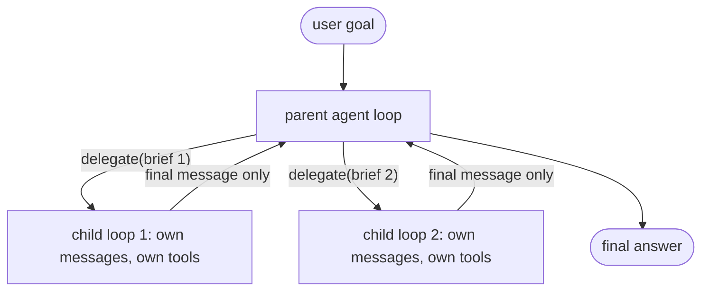

# Multi-agent patterns

## Why this matters

Multiple agents can work in parallel and keep their contexts clean, but they cost far more tokens and add coordination failures. Knowing when the trade is worth it is the point of this chapter.

You already own the pieces. [3.1](/part-03-agents/3.1-workflows-vs-agents) named orchestrator-workers as a pattern, [3.2](/part-03-agents/3.2-agent-loop) built the loop, and [3.4](/part-03-agents/3.4-context-engineering) listed sub-agent isolation as one of three tools against context rot. This chapter puts them together, and the topic comes with an unusual amount of disagreement among practitioners. Two well-known write-ups, one titled "How we built our multi-agent research system" and one titled "Don't Build Multi-Agents", are both right about their own tasks. Reading them side by side is the fastest way to learn where the line is.

**Learning goals**

- Describe orchestrator-worker, sub-agent and parallel patterns
- Explain the token cost of multi-agent systems
- Decide when to use one

## Explanation

### What "multi-agent" means mechanically

Strip the word down to what the code does. A **sub-agent** is a second run of the loop from 3.2, started by a tool call from the first one. The parent calls a tool (call it `delegate`), your code starts a fresh `messages` array, runs a complete loop to its own natural stop, and returns the child's final message as the tool result. The parent never sees the child's intermediate steps.



Two things in that picture carry all the weight, and everything below follows from one or the other:

1. **What goes down** is only the brief the parent writes. The Agent SDK docs state it plainly: for a normal sub-agent, "the only content you pass from parent to subagent is the Agent tool's prompt string", so the parent must put file paths, error messages and decisions into it ([Subagents in the SDK](https://code.claude.com/docs/en/agent-sdk/subagents), "What subagents inherit").
2. **What comes back** is only the final message. Same docs: "intermediate tool calls and results stay inside the subagent; only its final message returns to the parent" ("Benefits of using subagents").

Whether the children run one after another or at the same time is a separate choice. The three patterns below differ in what the parent does with those two channels.

### Pattern 1: sub-agent for context isolation

The simplest and most widely useful pattern. The parent's job here is not to be faster or cleverer; it is to keep its own context clean. Claude Code's documentation gives this as the reason to reach for one: "when a side task would flood your main conversation with search results, logs, or file contents you won't reference again: the subagent does that work in its own context and returns only the summary" ([Create custom subagents](https://code.claude.com/docs/en/sub-agents), intro). The built-in `Explore` sub-agent exists for exactly this: a read-only searcher whose forty file reads never enter your session.

This is 3.4's context-rot argument turned into an architecture. A `read_file` result that lands in the parent's `messages` is paid for again on every later turn (3.2). The same result inside a child is paid for until the child ends and is then discarded. What survives is a summary, a lossy compression chosen by the child, and that is both the benefit and the risk (see failure modes).

Good fits: "find where X is handled and tell me which files matter", "run the test suite and report only the failures", "read these five docs and answer this question". Poor fits are the cases the same docs assign to the main conversation: tasks that "need frequent back-and-forth", where "multiple phases share significant context, such as planning, implementation, and testing", or where latency matters, because a fresh sub-agent "starts fresh and may need time to gather context" ([same page](https://code.claude.com/docs/en/sub-agents), "When to use the main conversation instead").

### Pattern 2: orchestrator-workers

Here the parent (the **lead** or **orchestrator**) first decides *what the subtasks are*, then delegates each to a worker, then synthesises. It is the 3.1 workflow pattern, except that the workers are full agent loops with tools rather than single LLM calls. The defining feature is that the subtask list is not known in advance: it depends on the input.

What makes or breaks it is the **brief**. A worker starts with nothing but the brief and its own system prompt. Anthropic's research team found that terse delegation made agents duplicate work, leave gaps or miss information, and concluded: "Each subagent needs an objective, an output format, guidance on the tools and sources to use, and clear task boundaries" ([How we built our multi-agent research system](https://www.anthropic.com/engineering/multi-agent-research-system), "Prompt engineering and evaluations for research agents").

The same article describes a second ingredient, **effort scaling in the prompt**: models are poor judges of how much work a task deserves, so the lead prompt embeds rules of thumb (a simple fact-finding task gets one agent and a handful of tool calls, a comparison a few sub-agents, complex research many), because without them early versions spawned far too many sub-agents for simple queries. A sketch of a good brief for a research worker:

| Brief element | Example for "compare three vector databases" |
|---|---|
| Objective | "Find how Qdrant handles filtered search at scale and whether it supports hybrid (dense + sparse) queries." |
| Output format | "At most 200 words. Bullets. For each claim, the URL it came from." |
| Tools and sources | "Use web search and fetch. Prefer the vendor's docs and the GitHub repo over blog posts." |
| Boundaries | "Do not cover pricing or other databases: other workers have those." |
| Stop rule | "Stop after 8 tool calls, or when you can answer the objective." |

### Pattern 3: parallel exploration

Run several workers at the same time on independent subtasks, or on the same task with different approaches. Two different gains hide here, and they are worth keeping apart:

- **Wall-clock time.** Independent subtasks finish "in the time of the slowest one rather than the sum of all of them" ([Subagents in the SDK](https://code.claude.com/docs/en/agent-sdk/subagents), "Benefits of using subagents"). Anthropic reports that parallelising (3 to 5 sub-agents at once, each using several tools at once) cut research time by up to 90% for complex queries ([research system article](https://www.anthropic.com/engineering/multi-agent-research-system), "Prompt engineering and evaluations for research agents"). That is for breadth-first web research, not a general number.
- **Diversity.** Several attempts at the same problem, aggregated by your code, is the "voting" half of the 3.1 parallelization pattern, now with agents instead of single calls. Useful when one run is unreliable and you can tell good from bad, for example by running the tests.

Parallelism does not reduce tokens. It spends them at the same time. The wall-clock gain is the whole point, and it makes the failure modes below show up faster. It also needs independence: if worker B's work depends on a decision worker A is making, running them together invites the inconsistency described next.

### Coordination and failure modes

The things that go wrong are mostly the things that go wrong between people on a team, and the fixes read the same way.

| Failure | What it looks like | Typical fix |
|---|---|---|
| **Vague brief** | Workers duplicate each other or leave gaps | The five brief elements above, and non-overlapping scopes |
| **Over-delegation** | Many sub-agents for a trivial question | Effort-scaling rules in the lead prompt; a hard cap in code (the Agent SDK has limits for spawn depth, concurrent sub-agents and spend: see "Cap subagent depth, concurrency, and spend" in its docs) |
| **Lost context** | The worker lacks something the parent knew (a constraint, an earlier decision) and answers the wrong question | Put it in the brief; or use a "fork" that copies the parent's conversation, which Claude Code offers, at the price of a bigger context in every child |
| **Conflicting assumptions** | Two workers each make a reasonable but incompatible decision (naming, style, data shape) | Don't parallelise work that has to be consistent: one agent does it, or the parent fixes the decisions first and puts them in every brief |
| **Lossy summary** | The child found the answer but its summary dropped the caveat that mattered | Ask for evidence (file paths, URLs, quoted lines) alongside conclusions, and have the parent verify anything it will act on |
| **Telephone game** | Detail degrades as outputs pass through the coordinator | Anthropic's appendix suggests letting sub-agents write output to a filesystem and pass back lightweight references, "to minimize the 'game of telephone'" ([research system article](https://www.anthropic.com/engineering/multi-agent-research-system), "Appendix") |
| **Runaway or stalled child** | A child loops, or hits its turn limit without finishing | Per-child `max turns` (3.2) and a distinct "unfinished" result the parent can see; the Agent SDK marks a sub-agent's output as partial when it stops at `maxTurns` ([Subagents in the SDK](https://code.claude.com/docs/en/agent-sdk/subagents), "AgentDefinition configuration") |
| **Synchronous bottleneck** | The lead waits for the slowest worker and can't steer while it waits | Anthropic names it as a limit of their own system: their lead agents wait for each set of sub-agents, so "the lead agent can't steer subagents, subagents can't coordinate" ([same article](https://www.anthropic.com/engineering/multi-agent-research-system), production challenges) |
| **Prompt injection spreads** | A worker reads a web page with hostile instructions, and its summary carries them to the parent | Treat child output as untrusted data ([8.1](/part-08-production/8.1-prompt-injection)). Claude Code scans sub-agent output for instruction-shaped text before the parent reads it ([Subagents in the SDK](https://code.claude.com/docs/en/agent-sdk/subagents), "What subagents inherit") |

Anthropic also flags a debugging problem: "Multi-agent systems have emergent behaviors, which arise without specific programming. For instance, small changes to the lead agent can unpredictably change how subagents behave" ([same article](https://www.anthropic.com/engineering/multi-agent-research-system), "Effective evaluation of agents"). You need tracing across the tree. The step log from 3.2, with a `parentRunId` field, is a cheap start; [4.7](/part-04-evals-observability/4.7-tracing) does it properly.

### The case against: Cognition's "Don't Build Multi-Agents"

In June 2025, Walden Yan at Cognition (the company behind the Devin coding agent) published an argument against the common orchestrator-workers design: [Don't Build Multi-Agents](https://cognition.com/blog/dont-build-multi-agents). Its two principles are worth memorising:

1. "Share context, and share full agent traces, not just individual messages."
2. "Actions carry implicit decisions, and conflicting decisions carry bad results."

His example: a lead splits "build a Flappy Bird clone" into a background-and-pipes subtask and a bird subtask. One worker builds a Super Mario-style background, the other a bird that doesn't look or move like a Flappy Bird, and the parent must merge two misunderstandings. Giving both workers the parent's context fixes the first problem but not the second: each still acts on its own unstated assumptions, so the styles clash. His recommendation is a single-threaded linear agent, with a model that compresses history when it gets long.

Notice how little this conflicts with the research system. The post itself describes the sub-agents Claude Code had at that time as not running in parallel with the main agent and mostly answering narrow questions, a "purposefully simple approach" that keeps investigation out of the main history. That is Pattern 1. What he rejects is parallel workers that *write* interdependent output. Anthropic says something similar about its own approach: some domains that need all agents to share the same context, or that involve many dependencies between agents, are not a good fit, and in their experience most coding tasks are in that group ([research system article](https://www.anthropic.com/engineering/multi-agent-research-system), "Benefits of a multi-agent system"). Read-heavy, breadth-first work with a small final output (research) parallelises well. Write-heavy, tightly coupled work (one codebase edited in many places) does not.

A practical way to hold both positions: **read in parallel, write in series.** Fan out to gather information, fan in to one agent that holds all the decisions and does the writing.

### Cost

Anthropic's headline numbers, from the same "Benefits" section: "In our data, agents typically use about 4× more tokens than chat interactions, and multi-agent systems use about 15× more tokens than chats." On the BrowseComp benchmark, token usage by itself explained 80% of the variance in performance, and they conclude that "Multi-agent systems work mainly because they help spend enough tokens to solve the problem." The economics follow: such systems need tasks "where the value of the task is high enough to pay for the increased performance" ([research system article](https://www.anthropic.com/engineering/multi-agent-research-system)).

A multi-agent run costs roughly:

```
parent turns  +  Σ over children (child turns × that child's growing context)  +  briefs and summaries passing through the parent
```

Each child pays its own fixed overhead (system prompt, tool definitions, the brief) and re-reads its own history on every turn, the same cost shape as in 3.2. For model prices, see [Landscape](/landscape); don't hard-code them.

Here is a made-up, round-number example (illustrative arithmetic, not a measurement, and it ignores prompt caching) showing that delegation can be cheaper *or* dearer than it looks. A research task needs 20 tool calls, each returning 5k tokens. Every turn re-sends the whole history, so the input tokens of turn k are about k × 5k:

| Design | Input tokens (approx.) | How |
|---|---|---|
| One agent, 20 turns | 5k × (1+2+...+20) = **1,050k** | context grows through the whole run |
| Lead + 4 workers, 5 turns each, 1k summaries | 4 × 5k × (1+2+3+4+5) = 300k, plus about 30k for the lead | each child's context stays short; only summaries reach the lead |

On these numbers delegation uses roughly a third of the input tokens. The effect comes from quadratic re-reading, and it is why sub-agent isolation (Pattern 1) can *save* money on read-heavy work. The 15× figure comes from a different regime: workers that each run full research loops of their own, in parallel, to cover far more ground than one agent would. There you are buying coverage, not saving tokens. Two traps follow. If workers each re-read the same shared material, you pay for it once per worker. And a vague brief makes children over-search, so you pay for the overlap.

A cost-reducing lever: let workers run on a cheaper model than the lead. The Agent SDK's `model` field on a sub-agent definition does this, and Claude Code's docs list controlling costs by routing tasks to lower-cost models as a reason to use sub-agents ([Create custom subagents](https://code.claude.com/docs/en/sub-agents)). Anthropic's own system used a stronger model for the lead (Claude Opus 4) than for the workers (Claude Sonnet 4).

### When to use one, and when not to

Use this as a checklist, in order. Stop at the first "no".

1. **Does one agent with good tools and context management ([3.3](/part-03-agents/3.3-tool-design), [3.4](/part-03-agents/3.4-context-engineering)) actually fail?** Measure it. 3.1 gave the same advice from both Anthropic and OpenAI: exhaust a single agent first.
2. **Is the failure caused by context, not capability?** If the agent loses the thread because its history is full of exploration noise, isolation (Pattern 1) is a direct fix. If it just reasons badly, more agents won't help.
3. **Is the work read-heavy and breadth-first, with independent subtasks?** Research, searching a large codebase, reviewing many files against separate criteria: yes. Editing many interdependent files: no.
4. **Can each child's output be a small summary?** If the child has to write 2,000 lines the parent must see, you have a telephone game.
5. **Is the task worth the tokens?** A one-off investigation that saves an hour is. A per-request feature in a cheap app may not be.
6. **Can you evaluate it?** Anthropic started with about 20 realistic queries and judged outcomes more than exact steps, because agents reach the same answer by different paths ([research system article](https://www.anthropic.com/engineering/multi-agent-research-system), "Effective evaluation of agents"). Part 4 builds this. Without it you can't tell whether the extra machinery helped.

Most real systems end up with the shape "one main agent plus a few sub-agents for isolation and parallel reading", which is the shape of Claude Code's own sub-agents. Chapter [6.5](/part-06-claude-code/6.5-parallel-work) covers using them day to day. Fleets of peer agents talking to each other are rarer, and A2A ([3.12](/part-03-agents/3.12-a2a)) addresses agents across organisational boundaries, a different problem.

### Resources, in the order to read them

Start with the case study. It is long, but it is the best public account of a multi-agent system in production I know of.

::: info 📖 Read now
[Anthropic: How we built our multi-agent research system](https://www.anthropic.com/engineering/multi-agent-research-system) · article · ~20 min · essential

Look for: the lead/worker architecture figure, the 15× token figure and what they say about it, the prompting principles (especially how the lead delegates and how effort is scaled), the failure modes of early versions, and which tasks they say are a poor fit. Compare that poor-fit list with Cognition's argument next. (You may have skimmed this in 3.1; read it again with the cost and failure-mode tables above open.)
:::

Now the counterpoint. It is short, and written about coding agents.

::: info 📖 Read now
[Cognition: Don't Build Multi-Agents](https://cognition.com/blog/dont-build-multi-agents) · article · ~15 min · essential

Look for: the two principles, the Flappy Bird example (why sharing context isn't enough when actions embed decisions), and what it says about Claude Code's sub-agents. Then decide for yourself which of its objections apply to a read-only research sub-agent and which to parallel code-writing workers.
:::

Then the concrete mechanics: what a sub-agent actually receives and returns.

::: info 📖 Read now
[Claude Agent SDK: Subagents in the SDK](https://code.claude.com/docs/en/agent-sdk/subagents) · docs · ~15 min · essential

Look for: the "What subagents inherit" table (the brief is the only channel in), the benefits list, the depth, concurrency and spend caps in "Cap subagent depth, concurrency, and spend", and the note that sub-agents can spawn sub-agents of their own. This is the production version of the `delegate` tool you build below.
:::

::: info 📖 Read now
[Claude Code: Create custom subagents](https://code.claude.com/docs/en/sub-agents) · docs · ~15 min (intro, built-in subagents, when to use the main conversation) · optional

Look for: the built-in `Explore`, `Plan` and general-purpose sub-agents and what each is for, and the list of cases where the main conversation is the better choice.
:::

## Practice

**Brief:** Add a `delegate` tool to `project/` that runs a sub-agent with its own context and returns a summary. Compare one research-style task with and without delegation (quality, tokens). You write all the code; I haven't provided any.

**Where:** A step in the growing `project/` (see `project/ROADMAP.md`, step 9, which builds on step 1 and uses the step log from 3.2). Write your findings in `notes/multi-agent.md`.

**Steps:**

1. **Pick the task first.** A research-style task whose raw material is bulky: for example, "which chapters in `book/` mention prompt caching, and what does each say about it?", or "summarise how error handling differs across these four files". It should need at least 10 tool calls for a single agent. Write it in `notes/multi-agent.md` with your **predictions**: tokens (input and output) for each design, and whether quality will differ.
2. **Baseline run.** Run the task with the existing single agent, with `--max-turns` high enough to finish. Record from the step log: turns, input and output tokens (summed over all turns), wall-clock time, exit status, and a quality note on the answer. Run it at least twice (agents are non-deterministic) and use the same model for every run.
3. **Design the `delegate` tool** before coding it. Decide, and write down in the README: its argument schema (at minimum a task description; consider whether to take a separate output format and a turn limit), what the child's system prompt says, which tools the child gets (can it call `delegate` itself? should it?), and what a child's result looks like when it ends at its turn limit instead of finishing.
4. **Implement `delegate`.** It starts a new `messages` array, runs the same loop function as the parent with the child's tools and limits, and returns the child's final message as the tool result. Reuse your loop; don't copy it. Limit recursion, and make errors inside the child come back as ordinary tool results (3.2's rule).
5. **Log the tree.** Every step-log line from a child must say which run it belongs to and who its parent is. Report tokens per child and for the whole tree, so you can sum them.
6. **Write the delegation instructions.** Tell the parent when to delegate and what a good brief contains (objective, output format, tools, boundaries). Run the task with only this prompt changed: a deliberately vague version, the full version, and the full version plus a cap on how many children it may start.
7. **Delegated run.** Same task, same model, at least twice. Record the same metrics, plus the number of children and what each was asked.
8. **Compare.** In `notes/multi-agent.md`: a table of baseline versus delegated (tokens in and out, total tokens including children, wall-clock time, answer quality, any wrong or missing facts, checked against the source files). Compare it with your predictions. Say which failure modes from this chapter appeared, with the log lines that show them.
9. **Try the opposite task.** Choose a small task where delegation shouldn't help, such as a quick targeted lookup, and run it both ways. Record what the child cost and whether the answer got better.
10. **Decide.** Write a short rule, in your own words, for when `delegate` should be used in your project, and put a first draft of it into the delegation instructions.

Costs: keep to a handful of runs on one paid model, or run everything on local Qwen; the point is the relative token counts, which show on either. Record any paid spend in `costs.md`. A local 8b model will probably follow a delegation brief poorly: that is a result worth writing down, not a reason to switch silently.

**Done when:**

- `delegate` runs a child with a fresh `messages` array and returns only its final message to the parent.
- The step log can be filtered by run and parent, and shows per-child and whole-tree token totals.
- A child that hits its turn limit comes back to the parent as a clearly marked unfinished result.
- `notes/multi-agent.md` has your predictions, a baseline-versus-delegated table with at least two runs per design, and your rule for when to delegate.
- The note names at least one run where delegation made things worse or no better, and explains why using the log.

## Check questions

1. What exactly does a parent agent give a sub-agent, and what does it get back? Why do both answers matter for the design?

   <details><summary>Answer</summary>

   The parent gives only the brief it writes (plus the child's own system prompt and tool definitions); the child does not see the parent's history, unless you deliberately use a fork-style design that copies it. The parent gets back only the child's final message, not the intermediate tool calls and results. The first fact makes the quality of the brief decisive: anything the child needs but isn't told is simply missing. The second gives you context isolation, but also makes summaries a lossy channel, so anything the parent will act on should come with evidence.

   </details>

2. A single agent doing a 20-step read-heavy task can cost more input tokens than four sub-agents doing 5 steps each, yet Anthropic reports multi-agent systems use about 15 times the tokens of chat. Reconcile these.

   <details><summary>Answer</summary>

   Each turn re-sends the entire history, so a single long run's input cost grows roughly quadratically with its length. Splitting the same reading across short, separate contexts cuts that re-reading, so isolation can reduce tokens for the same work. The 15x figure describes a different use: workers that each run their own full research loops in parallel to cover far more ground than one agent would. There the extra tokens buy coverage, and in Anthropic's data token usage explains most of the performance difference. So it depends on whether you use delegation to isolate the same work or to do more work, and on how much shared material each worker re-reads.

   </details>

3. Cognition argues against parallel sub-agents, and Anthropic ships a parallel multi-agent research system. Why can both be right?

   <details><summary>Answer</summary>

   They are about different workloads. Cognition's worry is workers whose outputs must be consistent with each other (writing code that fits together): each action embeds implicit decisions the others can't see, and merging the results fails. Anthropic's research workers mostly read and report on independent subtopics, so there is little to conflict, and the lead does the single act of synthesis. Anthropic itself says domains with many dependencies between agents, such as most coding tasks, are a poor fit. The rule of thumb is to read in parallel and write in series.

   </details>

4. Your lead agent keeps spawning a dozen sub-agents for questions a single search would answer, and two of them return nearly identical findings. Name two causes and two fixes.

   <details><summary>Answer</summary>

   Causes: the lead prompt has no rules for scaling effort to the task's complexity, and the briefs are vague or overlapping, so children have no clear scope. Fixes: put explicit effort-scaling rules in the lead's prompt (when to use no workers, one or several); give each brief an objective, output format, tool guidance and boundaries naming what other workers cover; and enforce a hard cap on the number and depth of children in code, since prompts only steer.

   </details>

5. You're asked to build a feature that touches nine files that depend on each other. Would you use parallel sub-agents? What would you do instead, and where would sub-agents still help?

   <details><summary>Answer</summary>

   Not for the editing: the files depend on each other, so parallel writers would make conflicting decisions that someone has to reconcile. Use one agent that holds the whole picture and writes the changes in sequence, perhaps with the key decisions written down first. Sub-agents still help for the read-only parts: exploring the codebase to find the relevant files, running the test suite and reporting only the failures, or reviewing the result against separate criteria, each returning a compact summary so the main agent's context stays clean.

   </details>

## My understanding

<!-- Written by the learner, in their own words. Agents never fill this in. -->
