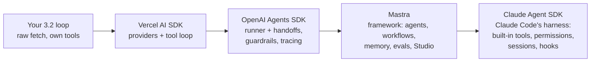
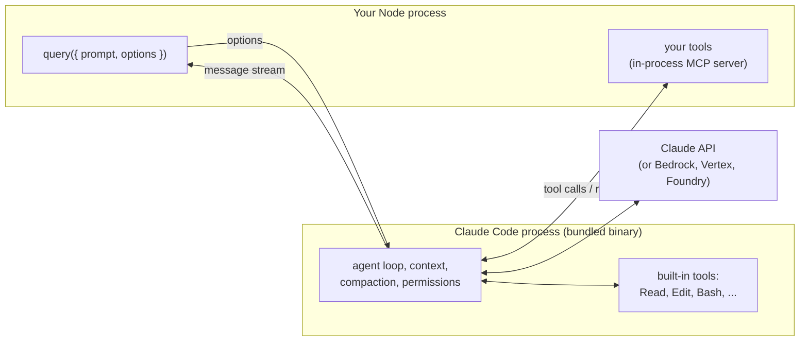

# TS agent SDKs: rebuild with one

## Why this matters

You wrote the agent loop by hand in [3.2](/part-03-agents/3.2-agent-loop) and gave it real tools in [3.3](/part-03-agents/3.3-tool-design). The loop was short. What made it work was everything around it: validated arguments, errors returned as results, a turn cap, a step log, output caps. An agent SDK packages some of that around the same loop. Which parts it packages, and what it takes from you in return, differs a lot between SDKs.

Four TypeScript options come up again and again, and they aren't four versions of the same product. The Vercel AI SDK is a provider abstraction with a loop helper on top. The OpenAI Agents SDK is a runner with a few agent primitives. Mastra is an application framework. The Claude Agent SDK is Claude Code's whole harness, callable from your code. Once you have your own loop to compare against, you can see the differences directly, and you can tell when an SDK saves you work and when it hides decisions you'd rather make yourself.

**Learning goals**

- Compare Vercel AI SDK, Claude Agent SDK, OpenAI Agents SDK and Mastra
- Rebuild the project agent with one of them
- Say what you gained and lost

## Explanation

### What an agent SDK provides

Take your 3.2 loop apart and you get roughly these pieces. Each SDK takes over some of them:

| Piece | In your hand-written loop | What an SDK may take over |
|---|---|---|
| **Wire format** | You picked one (Ollama native or OpenAI-compatible) and wrote the message shapes | A provider layer that converts one internal message format into each provider's API |
| **Tool definition** | A JSON schema, a description and a function, kept in sync by hand | A `tool()` helper: one Zod schema gives you the JSON schema, argument validation and TypeScript types |
| **The loop** | `while` the reply has tool calls: run them, append the results, call again | A runner with a stop condition and a default step limit |
| **Errors** | Caught in each tool, returned as text | A policy for thrown errors, which may or may not match the one you'd choose |
| **Observability** | Your JSONL step log | Callbacks per step, tracing (sometimes on by default, sent to the vendor) |
| **Context** | Whatever you added in 3.4 | Sometimes compaction, sessions and memory |
| **Built-in tools** | None: you wrote `read_file`, `edit_file` and the rest | From none at all up to a full set of file, shell and search tools |
| **Multi-agent** | Your 3.10 `delegate` tool | Handoffs, agents as tools, sub-agents |
| **Permissions** | None, or a check you wrote yourself | Approval callbacks, allow and deny rules, permission modes |

The column on the right is a spectrum. At one end a library hands you a better `fetch` and leaves the agent to you; at the other end a library *is* the agent, and you configure it. The four SDKs sit at different points:



Read the diagram as "how much is decided for you", not as a ranking. The ordering is my own reading of the four sets of docs below. It is not a scale any of them publishes, and Mastra and the OpenAI SDK overlap more than one arrow suggests.

One question cuts across all of them, and it's worth asking of every SDK: **who owns the loop?** With the AI SDK and the OpenAI SDK, the loop runs in your Node process and you can step into it each turn. With the Claude Agent SDK, the loop runs inside a separate Claude Code process and you watch the messages it streams back. Most of what you gain and lose follows from that.

### Vercel AI SDK

The AI SDK (npm package `ai`) started as a provider abstraction. AI SDK Core offers "a standardized approach to interacting with LLMs" through a published language model specification, so you can switch providers with the same API ([Providers and models](https://ai-sdk.dev/docs/foundations/providers-and-models)). Official provider packages include `@ai-sdk/openai`, `@ai-sdk/anthropic` and `@ai-sdk/google`. The same page lists community providers, among them `@openrouter/ai-sdk-provider` for OpenRouter and `ollama-ai-provider` for Ollama, and points to an OpenAI Compatible provider (`@ai-sdk/openai-compatible`, [docs](https://ai-sdk.dev/providers/openai-compatible-providers)) for any server that speaks the OpenAI format. For local Qwen, prefer the OpenAI-compatible provider aimed at Ollama's [OpenAI-compatible endpoint](https://docs.ollama.com/openai): the `ollama-ai-provider` package was last published on 2025-01-17 ([npm registry](https://registry.npmjs.org/ollama-ai-provider)), before the current major versions of the SDK.

You've already met this SDK: [8.6](/part-08-production/8.6-streaming-ui-auth) uses it for streaming UI, and that chapter warns that version 7 changed some APIs, so check the version of any tutorial you copy from. The current release on npm on 2026-11-13 was 7.0.172 ([npm registry](https://registry.npmjs.org/ai/latest)).

The agent piece is `ToolLoopAgent`. The docs describe agents as "large language models (LLMs) that use tools in a loop to accomplish tasks", and the class "handles the loop, context management, and stopping conditions" ([Agents overview](https://ai-sdk.dev/docs/agents/overview)). The shape:

```ts
// Shape only, not a solution: compare it to your 3.2 loop.
import { ToolLoopAgent, tool, isStepCount } from 'ai'
import { z } from 'zod'

const agent = new ToolLoopAgent({
  model,                              // a provider instance or a "provider/model" string
  instructions: 'You are ...',
  tools: {
    read_file: tool({
      description: '...',             // your 3.3 description, unchanged
      inputSchema: z.object({ path: z.string() }),
      execute: async ({ path }) => { /* ... */ },
    }),
  },
  stopWhen: isStepCount(10),
})
const result = await agent.generate({ prompt: goal })
```

What the docs say about the loop ([Building agents](https://ai-sdk.dev/docs/agents/building-agents), [Loop control](https://ai-sdk.dev/docs/agents/loop-control)):

- A **step** is one model generation. The loop ends when the model returns a finish reason other than tool calls, when a called tool has no `execute`, when a call needs approval, or when a stop condition fires.
- **`stopWhen`** takes one condition or an array. Built-ins: `isStepCount(n)`, `hasToolCall(...names)`, and `isLoopFinished()`, which never fires. You can write your own: it receives all steps and returns true to stop.
- **The default is 20 steps.** "By default, `ToolLoopAgent` stops after 20 steps using `isStepCount(20)`", as "a safety measure to prevent runaway loops". Compare that with your own `--max-turns`.
- **`prepareStep`** runs before each step and can change the model, the active tools, `toolChoice`, sampling settings, or replace the message list. That last one is where your 3.4 compaction would go.

On errors, if `execute` throws, "the AI SDK adds them as `tool-error` content parts to enable automated LLM roundtrips in multi-step scenarios"; a call to a tool that doesn't exist or with input that fails the schema surfaces as `NoSuchToolError` or `InvalidToolInputError`, and a `repairToolCall` hook can try to fix a malformed call ([Tool calling](https://ai-sdk.dev/docs/ai-sdk-core/tools-and-tool-calling)). That's close to your 3.2 rule (failures become data), but the text the model reads is the exception message, not the instructive message you wrote in 3.3. Keep catching inside your tools.

The overview page also mentions a `HarnessAgent` class for running "a preconfigured established harness, such as Claude Code, Codex, or Pi, instead of building the loop yourself", and an open-source framework, eve, "built on the AI SDK" for durable, long-running agents ([Agents overview](https://ai-sdk.dev/docs/agents/overview)). Both are out of scope here; they show the AI SDK growing up the spectrum from the bottom.

**Character:** a thin layer. You still decide almost everything, and tool definitions are portable across every provider it supports. It's the smallest step from your hand-written loop.

::: info 📖 Read now
[AI SDK: Agents overview](https://ai-sdk.dev/docs/agents/overview) and [Loop control](https://ai-sdk.dev/docs/agents/loop-control) · docs · ~20 min · **essential**

Look for: what `ToolLoopAgent` says it handles (and so what it doesn't), the three built-in stop conditions and the default of 20 steps, and the list of things `prepareStep` may change per step. For each item, find the line in your own `project/` loop that does the same job. If there's no such line, that's a feature you'd gain.
:::

### Claude Agent SDK: Claude Code's harness as a library

This one is different in kind. The docs' own comparison table describes the Agent SDK as "a library that runs the Claude Code binary, with Claude Code's capabilities, such as built-in tools, permissions, sessions, and hooks", and sets it against the Client SDK, where "you write the tool loop yourself" ([Agent SDK overview](https://code.claude.com/docs/en/agent-sdk/overview)). Anthropic renamed it from the Claude Code SDK because the harness "can power many other types of agents, too" ([Building agents with the Claude Agent SDK](https://claude.com/resources/articles/building-agents-with-the-claude-agent-sdk)).

Mechanically: `npm install @anthropic-ai/claude-agent-sdk`. Both the TypeScript and Python SDKs "bundle a native Claude Code binary, so most installs need no separate Claude Code install" ([Quickstart](https://code.claude.com/docs/en/agent-sdk/quickstart)). You call `query({ prompt, options })` and iterate over the messages it streams: assistant messages with tool calls, and a final `result` message with a subtype you check before reading the answer (you met the subtypes in 3.2).



What changes when you rebuild your agent with it:

- **You probably delete your tools.** Claude Code's built-in tools already do what your `read_file`, `edit_file`, `list_files`, `search` and `run_shell` do: `Read`, `Edit` and `Bash`, plus `Glob` and `Grep`, which on macOS and Linux are left out of the default set (Claude runs `find` and `grep` through `Bash` instead) unless you name them in `tools` or `allowedTools` ([Tools reference](https://code.claude.com/docs/en/tools-reference), "Glob tool behavior"). You control two layers separately: `tools` decides which built-ins are in context at all (`tools: []` removes all of them), and `allowedTools` decides which calls are pre-approved ([Custom tools](https://code.claude.com/docs/en/agent-sdk/custom-tools), "Configure allowed tools"). For a fair comparison with your own tools, you can keep only yours.
- **Your own tools become MCP tools.** `tool(name, description, zodShape, handler)` defines one, `createSdkMcpServer({ name, version, tools })` wraps them in a server that "runs in-process inside your application, not as a separate process", and you pass it in `mcpServers`. The model sees the name `mcp__{server}__{tool}`, and you list that name in `allowedTools`. Handlers return MCP-style results (`content`, optional `isError`). A thrown exception doesn't stop the loop: the server "converts it to an error result carrying the raw exception message", so, as with the AI SDK, return `isError: true` with your own message when the raw one isn't enough (same page, "Handle errors"). [3.7](/part-03-agents/3.7-mcp-building) has the MCP background.
- **Defaults come from Claude Code, not from you.** Two from the [TypeScript reference](https://code.claude.com/docs/en/agent-sdk/typescript) matter for this chapter. `maxTurns` defaults to `undefined`, meaning no turn limit (3.2 recommended setting it, and `maxBudgetUsd` as well). And `settingSources` defaults to "CLI defaults (all sources)": run inside this repo, the agent loads your user and project settings, which includes `CLAUDE.md`, skills and hooks, unless you pass `[]`. That's convenient for a product and confusing in a comparison. `systemPrompt` is a minimal prompt by default; `{ type: 'preset', preset: 'claude_code' }` gives you Claude Code's own.
- **You get the harness for free:** sessions you can resume or fork, hooks around every tool call, sub-agents (3.10), permissions, compaction, and OpenTelemetry export ([4.7](/part-04-evals-observability/4.7-tracing)).

The price is in the provider column. Authentication is an Anthropic API key, or Amazon Bedrock, Claude Platform on AWS, Google Cloud's Agent Platform or Microsoft Foundry through environment variables ([Quickstart](https://code.claude.com/docs/en/agent-sdk/quickstart)), and all of those serve Claude models. Your Pro plan doesn't cover it: "Anthropic does not allow third party developers to offer claude.ai login or rate limits for their products, including agents built on the Claude Agent SDK" ([overview](https://code.claude.com/docs/en/agent-sdk/overview)), so SDK runs are billed per token from your API credit. Can you aim it at local Qwen? Ollama does expose a subset of the Anthropic Messages API, and its docs show setting `ANTHROPIC_BASE_URL=http://localhost:11434` for Claude Code ([Ollama: Anthropic compatibility](https://docs.ollama.com/api/anthropic-compatibility)), with prompt caching and `tool_choice` among the unsupported features. But Claude Code's gateway docs say Anthropic "doesn't support routing Claude Code to non-Claude models through any gateway" ([LLM gateways](https://code.claude.com/docs/en/llm-gateway)). Treat it as an experiment that might work, not a configuration to build on. Also note the SDK doesn't load `.env` files itself; the [Quickstart](https://code.claude.com/docs/en/agent-sdk/quickstart) says to load the file yourself (it suggests `dotenv`), and Node's [`--env-file`](https://nodejs.org/api/cli.html#--env-filefile) flag does the same job.

**Character:** the most capability for the least code, and the least control over the loop, which runs in a separate process. In practice it works only with Claude models. It's the right choice when what you want is "Claude Code, but embedded"; it's the wrong choice for comparing local and paid models.

::: info 📖 Read now
[Claude Agent SDK: Overview](https://code.claude.com/docs/en/agent-sdk/overview) and [Give Claude custom tools](https://code.claude.com/docs/en/agent-sdk/custom-tools) · docs · ~25 min · **essential**

Look for: in the overview, the comparison table (Agent SDK vs CLI vs Client SDK vs Managed Agents) and the capabilities list. In custom tools: the four parts of a tool, the `mcp__{server}__{tool}` naming rule, the `tools` vs `allowedTools` table (availability vs permission), and the "Handle errors" table. Ask yourself which of your 3.3 design decisions survive the move and which the harness now makes for you.
:::

::: info 📖 Read now
[Anthropic: Building agents with the Claude Agent SDK](https://claude.com/resources/articles/building-agents-with-the-claude-agent-sdk) · article · ~15 min · optional

You may have read it for 3.2 as a description of the loop. Read it again as a product rationale: why the harness is built around "giving Claude a computer", and why agentic search through the file system is its default way of gathering context. That explains why the built-in tools look the way they do.
:::

### OpenAI Agents SDK (JS)

`@openai/agents` describes itself as "a lightweight, powerful framework for multi-agent workflows and voice agents", MIT-licensed, and "provider-agnostic, supporting OpenAI APIs and more" ([repo README](https://github.com/openai/openai-agents-js)). Its concepts are agents (instructions, tools, guardrails, handoffs), agents as tools, handoffs, guardrails, human-in-the-loop, sessions and tracing.

The loop lives in a `Runner` (`run()` uses a default instance). Per the docs, it calls the current agent's model; if the output is final, it returns; if it's a handoff, it switches agents and keeps the history; if there are tool calls, it runs them, appends the results and repeats. `maxTurns` **defaults to 10**, and reaching it throws `MaxTurnsExceededError` ([Running agents](https://openai.github.io/openai-agents-js/guides/running-agents/)). Note that this is an exception, not a result status like the Claude SDK's `error_max_turns`: you'd map it to your own exit status.

Function tools use `tool({ name, description, parameters, execute })` with a Zod schema. The tools guide lists several categories beyond your own functions: hosted OpenAI tools (web search, code interpreter), built-in execution tools (computer use, shell, apply_patch), agents as tools and MCP servers. An `errorFunction` option turns a thrown error into "a model-visible result", and `needsApproval` requires a human before a call runs ([Tools](https://openai.github.io/openai-agents-js/guides/tools/)). The docs are terse on what happens by default when a tool throws, so find out in your own run (the practice asks you to).

The distinctive primitive is the **handoff**: "Handoffs let an agent delegate part of a conversation to another agent", and to the model they're tools named like `transfer_to_refund_agent`. Use a handoff when the specialist should take over the conversation; "if the specialist should stay behind the original agent, use agents as tools instead" ([Handoffs](https://openai.github.io/openai-agents-js/guides/handoffs/)). The second is the pattern you built as `delegate` in 3.10.

**Provider support** is real but uneven. The default is OpenAI's own Responses API. Other models come in through a custom `ModelProvider` or through an adapter that plugs any AI SDK model into the runner ([Models](https://openai.github.io/openai-agents-js/guides/models/)): `aisdk()` from `@openai/agents-extensions/ai-sdk`, which the docs say "is still in beta, so it is worth testing carefully with your chosen provider, especially smaller ones". Deferred tool loading, tool search and Programmatic Tool Calling aren't supported through the adapter ([AI SDK integration](https://openai.github.io/openai-agents-js/extensions/ai-sdk/)). Tracing is enabled by default in server runtimes such as Node and goes to OpenAI's Traces dashboard ([Tracing](https://openai.github.io/openai-agents-js/guides/tracing/)); `tracingDisabled` turns it off for a run ([Running agents](https://openai.github.io/openai-agents-js/guides/running-agents/)). When you run local Qwen through the adapter, decide on purpose whether you want traces leaving your machine.

**Character:** a small runner with good multi-agent primitives. Most capable on OpenAI models; other models go through an adapter layer, which is one more thing to debug.

::: info 📖 Read now
[OpenAI Agents SDK (JS): Running agents](https://openai.github.io/openai-agents-js/guides/running-agents/) and [Models](https://openai.github.io/openai-agents-js/guides/models/) · docs · ~20 min · optional

Look for: the three-way branch in the loop (final output, handoff, tool calls), `maxTurns` and the error it throws, how tracing is switched off, and in Models the paragraph on non-OpenAI providers and the features that need the Responses API. The pages have a very long sidebar; scroll to the body.
:::

### Mastra

Mastra calls itself "the modern TypeScript framework for AI-powered applications and agents". The core is Apache-2.0, and code in `ee/` directories is under a separate source-available enterprise license ([repo README](https://github.com/mastra-ai/mastra)). It's the only one of the four that's a framework in the full sense: you scaffold a project with `npm create mastra@latest`, and the box contains agents, a graph-based workflow engine (`.then()`, `.branch()`, `.parallel()`), human-in-the-loop suspend and resume, memory, MCP servers, evals and observability (same README).

An agent is `new Agent({ id, name, instructions, model, tools })` from `@mastra/core/agent`. Tools come from `createTool({ id, description, inputSchema, outputSchema, execute })`, and the docs warn that "plain object tool definitions silently fail to execute; tools MUST be defined via `createTool()`" ([Agents overview](https://mastra.ai/docs/agents/overview), [Tools](https://mastra.ai/docs/agents/tools)). The `outputSchema` is something none of the others ask for: Mastra validates your tool's result too.

Models are `"provider/model"` strings resolved by Mastra's model router, with keys read from the matching environment variable; OpenRouter works as `openrouter/...`, local models need an OpenAI-compatible server and a custom `url`, and AI SDK provider instances are accepted wherever a string is ([Models](https://mastra.ai/models)).

One default to know before your first run: `maxSteps` in `agent.generate()` is **5**, "but can be increased" ([generate() reference](https://mastra.ai/reference/agents/generate)). A five-step cap ends a lot of your 3.3 tasks before they finish, which looks like a model failure when it's a configuration one.

**Character:** the most "batteries included" option that still runs your loop in your process. Worth it if you want workflows, memory and the Studio UI together; heavy if all you want is the loop.

::: info 📖 Read now
[Mastra: Agents overview](https://mastra.ai/docs/agents/overview) · docs · ~15 min · optional

Look for: the `Agent` constructor fields, the `provider/model-name` string, the `createTool()` warning, and the list of everything else an agent can plug into (memory, processors, guardrails, sub-agents, Studio). Count the concepts you'd need to learn to rebuild your project agent, and compare with the AI SDK.
:::

### Side by side

Everything here is from the pages cited above, as of 2026-11-12 (rechecked 2026-11-13). These SDKs change monthly, so recheck a default before relying on it.

| | Vercel AI SDK | Claude Agent SDK | OpenAI Agents SDK | Mastra |
|---|---|---|---|---|
| **What it is** | Provider layer + `ToolLoopAgent` | Claude Code's harness, run as a bundled binary | Runner + agent primitives | Application framework |
| **Who runs the loop** | Your process | A Claude Code process | Your process | Your process |
| **Default loop cap** | 20 steps | None (`maxTurns` unset) | 10 turns, then throws | 5 steps (`generate`) |
| **Tool definition** | `tool({ description, inputSchema, execute })` | `tool(name, desc, zodShape, handler)` in an in-process MCP server | `tool({ name, description, parameters, execute })` | `createTool({ id, description, inputSchema, outputSchema, execute })` |
| **Built-in tools** | None of its own; provider-executed tools pass through | Claude Code's file, shell and search tools | Hosted OpenAI tools, shell, apply_patch, computer use | Some (for example a web fetch tool) |
| **Models** | Any with a provider package; OpenAI-compatible for the rest | Claude only (Anthropic, Bedrock, Vertex, Foundry) | OpenAI by default; others via `ModelProvider` or the beta AI SDK adapter | Model-router strings, OpenAI-compatible URLs, AI SDK providers |
| **Local Qwen via Ollama** | Yes (OpenAI-compatible provider) | Unsupported | Through the adapter (beta) | Yes (OpenAI-compatible URL) |
| **Multi-agent** | Compose agents as tools yourself | Sub-agents | Handoffs, agents as tools | Supervisor agents, workflows |
| **License** | Apache-2.0 | Anthropic Commercial Terms | MIT | Apache-2.0 core, `ee/` enterprise |

Licenses are from each package's npm entry and README; the Claude Agent SDK's use is "governed by Anthropic's Commercial Terms of Service" ([overview](https://code.claude.com/docs/en/agent-sdk/overview), "License and terms").

### Lock-in and provider support

"Lock-in" here means four different things, and they don't come together:

1. **Model lock-in.** Can you change the model without changing code? The AI SDK and Mastra make this a one-line change. The OpenAI SDK makes it possible, through an adapter. The Claude Agent SDK doesn't support it at all. For this study, where the point is to compare local and paid models ([Part 9](/part-09-model-landscape-cost/9.1-paid-apis)), this matters most. Prices and model options are on [Landscape](/landscape#access-routes).
2. **Feature lock-in.** Even where models are swappable, the best features usually aren't. Hosted tools and tool search on the OpenAI side need the Responses API; the Claude Agent SDK's built-in tools need Claude Code. Every time you use one, you move further from switching cheaply.
3. **API lock-in.** Your code is written against the SDK's types: its message format, its tool shape, its result object. The AI SDK changing its server helpers in 7.0 ([8.6](/part-08-production/8.6-streaming-ui-auth)) is a normal event, not an exception. The less your own code touches SDK types, the cheaper an upgrade or a move.
4. **Data and telemetry lock-in.** Where do traces, sessions and memory live? On by default and sent to a vendor dashboard (the OpenAI SDK), stored in Claude Code's session files, or in a store Mastra manages. Check before you send real data through any of them.

The cheapest defence is the one you've half-built already. **Keep your tool implementations as plain functions** (input in, string or error message out) with no SDK imports, and write a thin adapter per SDK that wraps them in that SDK's `tool()` shape. Then your tool design from 3.3, which is where most of the quality comes from, moves with you, and an SDK is a choice you can undo. This is a design opinion, not something the docs say, but it's the same separation [5.4](/part-05-harnesses/5.4-mini-harness) will ask of your harness.

Two caveats of my own, so you don't over-read the comparison. Lines of code is a poor measure of an SDK on its own: the Claude Agent SDK version of your agent can be a dozen lines because a whole harness sits behind it, and what you can't change counts as much as what you didn't write. And a smaller turn count with an SDK doesn't mean the SDK is smarter: it may have a different system prompt, different tools or a different default cap. Hold those fixed before you compare.

## Practice

**Brief:** Rebuild the `project/` agent with one SDK in a separate entry point (keep the hand-written loop). Compare lines of code, features and model support in the project README.

**Where:** a step in the growing `project/` (see `project/ROADMAP.md`, step 10). It builds on step 2 from [3.3](/part-03-agents/3.3-tool-design): the same tools, tasks and logs. You write all the code; I haven't provided any.

**Choosing the SDK.** If you want to compare local and paid models with one code path, pick the **Vercel AI SDK** (closest to your loop, works with Ollama). If you want to see what a full harness gives you, pick the **Claude Agent SDK**, and budget for it: it runs on your Anthropic API credit, not your Pro plan, so set `maxBudgetUsd` and record the spend in `costs.md`. Doing both is a fine optional extension; doing one well is the task.

**Steps:**

1. **Snapshot the baseline.** Before touching anything, run your three 3.3 tasks (or three of your 3.2 battery goals) on your hand-written agent and keep the JSONL logs. Count the lines of your loop and tools with `wc -l` (or a line counter that skips blanks and comments; say which).
2. **Separate tools from the loop.** If your tool implementations import anything loop-specific, move them into plain functions (`(args) => Promise<string>`) that both entry points can share. The hand-written agent must still pass its runs after this refactor.
3. **Predict.** In the README's new section, write down before you run: how many lines the SDK entry point will be, which of your features (turn cap, exit statuses, step log, output caps, compaction, `delegate`) you'll get for free, which you'll have to rebuild, and which you'll lose.
4. **Add the second entry point** (for example `src/agent-sdk.ts` with its own npm script). Wrap your shared tools in the SDK's tool shape. With the Claude Agent SDK, decide whether to use your tools (`tools: []` plus your in-process MCP server) or Claude Code's built-ins, and write down why; set `settingSources: []` so this repo's own settings don't leak in, and set `maxTurns`.
5. **Rebuild the exits and the log.** Set the turn or step cap to the same value as your own loop. Map every way a run can end to the same exit statuses you print today (including the SDK's own limit error or result subtype). Write the same JSONL step log from the SDK's per-step callbacks or message stream, so `jq` works on both.
6. **Run the same tasks** on the same model as the baseline (local Qwen for the AI SDK, a cheap Claude model from [Landscape](/landscape) for the Claude Agent SDK). Then switch models once: a paid model through OpenRouter for the AI SDK, or a second Claude model for the Claude Agent SDK. Record the spend in `costs.md`.
7. **Probe the edges.** Make one tool throw an uncaught exception and read what the model received. Remove your step cap and find the SDK's default. Find where the SDK would let you change the message list between steps (your 3.4 compaction).
8. **Write the comparison** in `project/README.md`: a table of lines of code (loop, tools, glue), features (gained, rebuilt, lost), model support (what you ran, what you couldn't), and turn counts and outcomes per task for both entry points. Then a short paragraph: which entry point you'd keep developing for Parts 4 and 5, and why. Commit.

**Done when:**

- Two entry points run the same goals: the hand-written loop (still working) and the SDK version. Both use the same tool implementations from shared modules.
- The SDK entry point has an explicit turn or step cap equal to your own, prints the same set of exit statuses, and writes a JSONL log in the same format as the hand-written one.
- Both entry points have logs for the same three tasks on the same model, plus at least one run of the SDK version on a second model.
- You've seen, in a log, what the model receives when a tool throws inside the SDK, and written it down.
- `project/README.md` has the comparison table (lines of code, features gained, rebuilt and lost, model support, per-task results), the predictions from step 3 with what turned out wrong, and your decision on which entry point to keep.

## Check questions

1. "Who owns the loop?" Answer it for the Vercel AI SDK and for the Claude Agent SDK, and give one concrete thing you can do in one that you can't do (or can't do as easily) in the other.

   <details><summary>Answer</summary>

   With the AI SDK the loop runs in your process: `ToolLoopAgent` calls the model, runs your `execute` functions and decides when to stop, and `prepareStep` lets you change the model, the active tools or the whole message list before every step (compaction, model switching mid-run). With the Claude Agent SDK, the loop runs inside a Claude Code process that the library starts; you send options and read the message stream, and you hook in through hooks, permission callbacks and your MCP tools. You get Claude Code's built-in tools, permissions, sessions and compaction without writing them, but you can't rewrite the history between turns the way `prepareStep` can, and you can't swap in a non-Claude model.

   </details>

2. You move your agent to Mastra and three of your five 3.3 tasks now end unfinished, with no error. Your hand-written loop finished all five. What do you check first, and why?

   <details><summary>Answer</summary>

   The step limit. Mastra's `generate()` defaults to `maxSteps: 5`, and a multi-file edit task can easily take more steps than that, so the run stops with the model mid-task. That looks like a model failure but is a configuration one. Defaults differ across SDKs (20 steps in the AI SDK, 10 turns in the OpenAI SDK, no limit in the Claude Agent SDK), so set the cap explicitly to the same value as your own loop and make the end-of-run status say "limit reached", not "finished".

   </details>

3. Your manager-style multi-agent design has a triage agent that passes billing questions to a billing specialist, which then talks to the user directly. In the OpenAI Agents SDK, is that a handoff or an agent-as-tool, and how does the model see it?

   <details><summary>Answer</summary>

   A handoff, because the specialist takes over the conversation. To the model a handoff is a tool, named like `transfer_to_billing_agent`, and when it's called the runner switches the current agent and keeps the history. If the triage agent should stay in control and only get an answer back, that's an agent used as a tool, which is the pattern you built as `delegate` in 3.10.

   </details>

4. Name the four kinds of lock-in from this chapter and, for your own project, the one that matters most and the cheapest defence against it.

   <details><summary>Answer</summary>

   Model lock-in (can you change the model?), feature lock-in (do you depend on provider-only features such as hosted tools or Claude Code's built-ins?), API lock-in (how much of your code uses the SDK's types?), and data or telemetry lock-in (where traces, sessions and memory live). For this study it's model lock-in, because the point is to compare local Qwen with paid models. The cheapest defence is to keep tool implementations as plain functions with no SDK imports and wrap them per SDK in a thin adapter, so the tool design survives a change of SDK and you choose an SDK with models you can actually run.

   </details>

5. Your Claude Agent SDK entry point is 25 lines and your hand-written loop plus tools is 400. Is the SDK version "better"? What else would you need to compare to say?

   <details><summary>Answer</summary>

   Not on that evidence. The 25 lines sit on top of a whole harness you didn't write and can't change, so lines of code measure what you maintain, not what you depend on. Compare behaviour on the same tasks with the same caps, model and tool set (built-ins vs your own tools is a different experiment), what each run costs, which features you gained, rebuilt or lost (exit statuses, logs, local models), how much control you kept over the loop and the context, and what an upgrade or a move to another provider would cost. Then decide which one fits the project's goals.

   </details>

## My understanding

<!-- Written by the learner, in their own words. Agents never fill this in. -->
