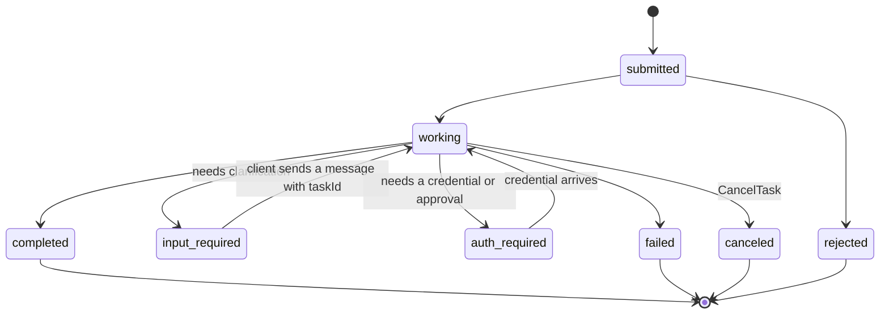
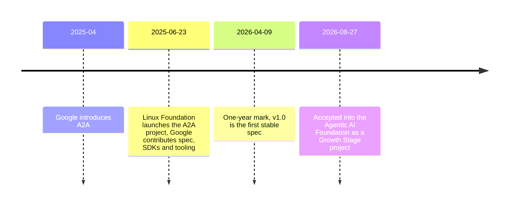

# A2A: agent-to-agent protocol

## Why this matters

MCP connects agents to tools, and A2A connects agents to other agents, including agents run by other organizations. It is worth understanding even if you never deploy it.

In [3.10](/part-03-agents/3.10-multi-agent) you delegated work to a sub-agent. You wrote its system prompt, picked its tools, ran its loop in your own process, and got its final message back as a tool result. All of that assumes you own the other agent. Now suppose the other agent belongs to a supplier, a different team, or a SaaS vendor. You can't see its prompt, tools or model. It may take twenty minutes, ask you a question halfway through, or need a login before it can continue. A function call can't carry that relationship. A2A is the industry's attempt at a standard wire contract for it.

[0.3](/part-00-catch-up/0.3-standards-and-orgs) gave you the one-paragraph version. This chapter goes one level down: the objects on the wire, the task state machine, how A2A differs from MCP now that MCP has tasks of its own, and who governs it. Then you'll put your own agent behind an A2A endpoint and call it from a second program.

**Learning goals**

- Explain A2A's model: agent cards, tasks, messages
- Compare A2A with MCP
- Know its governance and adoption status

## Explanation

### The problem: a counterpart you can't see into

The A2A docs name three actors ([Core concepts](https://a2a-protocol.org/latest/topics/key-concepts/)): the **user** (a person or service with a goal), the **A2A client** (an app or agent acting for the user) and the **A2A server**, also called the **remote agent**, which exposes an HTTP endpoint. The design principle that shapes everything else is **opacity**: to the client, the remote agent is a black box whose memory, tools and reasoning stay hidden.

Compare that with what you had in 3.10:

| | Sub-agent (3.10) | Remote agent over A2A |
|---|---|---|
| Who writes its prompt and tools | You | Someone else, invisible to you |
| Where it runs | Your process | Their server, behind auth |
| How you learn what it can do | You defined it | You read its self-description (Agent Card) |
| Duration | One loop, while you wait | Seconds to hours, possibly paused for input or auth |
| What comes back | A final message string | A task with a state, status messages and artifacts |
| Trust | Your code, your model | Untrusted input from another party |

Every part of the protocol below answers one row of that table.

### How the specification is built

A2A 1.0.0 is the current released version ([spec, versions list](https://a2a-protocol.org/latest/specification/)). The spec has three layers:

1. **A canonical data model**, written as Protocol Buffer messages: AgentCard, Task, Message, Part, Artifact and so on.
2. **Abstract operations** that every agent supports regardless of transport: Send Message, Send Streaming Message, Get Task, List Tasks, Cancel Task, Subscribe to Task, four push-notification config operations, and Get Extended Agent Card.
3. **Protocol bindings** that map those operations onto a wire format: JSON-RPC 2.0, gRPC, and HTTP+JSON (REST). Custom bindings are allowed.

So "A2A over JSON-RPC" and "A2A over REST" are the same protocol with different envelopes. In JSON-RPC the operation is the `method` field (`"method": "SendMessage"`). In REST it is a path such as `POST /message:send` or `GET /tasks/{id}`. Clients send an `A2A-Version` header (for example `A2A-Version: 1.0`), and an empty value is treated as 0.3 ([spec](https://a2a-protocol.org/latest/specification/), section 3).

::: warning Most tutorials you'll find are for 0.3
Version 1.0 renamed almost everything on the wire ([What's new in v1.0](https://a2a-protocol.org/latest/whats-new-v1/)). JSON-RPC methods went from `message/send`, `tasks/get` and `tasks/cancel` to `SendMessage`, `GetTask` and `CancelTask`. Enum values went from `completed` and `input-required` to `TASK_STATE_COMPLETED` and `TASK_STATE_INPUT_REQUIRED`, and roles from `user` to `ROLE_USER`. Parts lost their `kind` field. The card's top-level `url` moved into `supportedInterfaces[]`. If a blog post shows `"kind": "text"` or `message/send`, it's describing 0.3. The prose docs (like "Life of a Task") still use the short lowercase state names, and so does this chapter when it talks about states in general.
:::

### Agent Cards and discovery

An **Agent Card** is a JSON document in which an A2A server describes itself: identity, endpoint, capabilities, skills and authentication requirements. Its required fields are `name`, `description`, `supportedInterfaces`, `version`, `capabilities`, `defaultInputModes`, `defaultOutputModes` and `skills` ([spec](https://a2a-protocol.org/latest/specification/), section 4.4). Here is a small card for the kind of agent you'll expose in the practice. It's my own example, modelled on the spec's examples in section 4.6.1:

```json
{
  "name": "Study repo assistant",
  "description": "Answers questions about the files in one local study repository by reading them.",
  "version": "0.1.0",
  "supportedInterfaces": [
    { "url": "http://localhost:4100/a2a", "protocolBinding": "JSONRPC", "protocolVersion": "1.0" }
  ],
  "capabilities": { "streaming": false, "pushNotifications": false },
  "defaultInputModes": ["text/plain"],
  "defaultOutputModes": ["text/plain"],
  "skills": [
    {
      "id": "repo-qa",
      "name": "Answer questions about the repo",
      "description": "Reads chapters and notes, then answers with file paths as evidence. Read-only.",
      "tags": ["docs", "search", "read-only"],
      "examples": ["Which chapters mention prompt caching?"]
    }
  ]
}
```

Three things to notice.

**Skills are prose, not schemas.** An `AgentSkill` has an `id`, `name`, `description` and `tags` (all required), plus optional `examples` and input/output media types. Compare an MCP tool from [3.6](/part-03-agents/3.6-mcp-using), whose `inputSchema` is a JSON Schema your client can validate against. A skill tells a client (or the client's model) *what the agent is good at*, and the actual request is a natural-language message. This is deliberate: you're talking to an agent that will interpret the request, not calling a function. It also means everything you learned about tool descriptions in [3.3](/part-03-agents/3.3-tool-design) applies here. A vague skill description makes a client route badly.

**Media types, not data types.** `defaultInputModes` and `defaultOutputModes` are media types like `text/plain`, `application/json` or `image/png`. They tell the client which kinds of [Parts](#messages-parts-and-artifacts) the agent accepts and produces.

**The endpoint is a list.** One agent can offer several interfaces at once, for example JSON-RPC and gRPC, or a 0.3 and a 1.0 interface side by side during a migration ([What's new in v1.0](https://a2a-protocol.org/latest/whats-new-v1/)). The client picks one it supports.

**Finding the card.** The A2A docs describe three strategies ([Agent Discovery](https://a2a-protocol.org/latest/topics/agent-discovery/)):

1. **Well-known URI.** The server publishes the card at `https://{domain}/.well-known/agent-card.json` (following RFC 8615), and the client does a plain `GET`. Good for public agents.
2. **Curated registries.** A central catalog that clients query by skill or tag. Typical inside an enterprise or a marketplace. The spec deliberately does **not** define a registry API, so every registry is its own product.
3. **Direct configuration.** The card URL (or the card itself) sits in a config file or environment variable. Simplest for private setups, and what you'll use in the practice.

Cards change rarely, so the discovery page asks servers to send `Cache-Control` and an `ETag`, and clients to use conditional requests.

**Public card, extended card, signed card.** A public card can leak things you'd rather not publish: internal URLs, or skills only some customers may use. So a card can set `capabilities.extendedAgentCard: true`, and an authenticated client then calls `GetExtendedAgentCard` to receive a fuller version ([spec](https://a2a-protocol.org/latest/specification/), section 6.9). Cards may also be signed with JSON Web Signature over a canonicalized form of the JSON, so a client can check that the card came from the claimed provider and wasn't altered (section 8.4). Note what a signature does and doesn't prove: it proves *who* wrote the description, not that the description is *true*.

::: info 📖 Read now
[A2A: Core concepts](https://a2a-protocol.org/latest/topics/key-concepts/) · docs · ~10 min · essential

Look for: the three actors, the five fundamental elements (Agent Card, Task, Message, Part, Artifact) and the three interaction mechanisms. Then read the companion page [Agent Discovery](https://a2a-protocol.org/latest/topics/agent-discovery/) for the three discovery strategies and the advice on protecting cards. Keep the table above open: each element answers one difference from a sub-agent.
:::

### Messages, Parts and Artifacts

The object model is small:

```mermaid
flowchart LR
  C[contextId<br/>one conversation] --> T1[Task 1]
  C --> T2[Task 2<br/>referenceTaskIds: Task 1]
  T1 --> S1[status<br/>state + message + timestamp]
  T1 --> H1[history<br/>Messages]
  T1 --> A1[artifacts<br/>Artifact: name, parts]
  H1 --> M[Message<br/>messageId, role, parts]
  M --> P[Part<br/>text | raw | url | data]
  A1 --> P
```

- A **Message** is one turn of communication: a `messageId`, a `role` (`ROLE_USER` for the client side, `ROLE_AGENT` for the remote agent) and a list of `parts`. It can carry a `contextId`, a `taskId`, and `referenceTaskIds` pointing at earlier tasks.
- A **Part** is one piece of content. In 1.0 a Part is identified by which field it has: `text`, `raw` (bytes), `url` (a file by reference) or `data` (structured JSON), plus optional `mediaType`, `filename` and `metadata`.
- An **Artifact** is a task's output: an `artifactId` (unique within the task), an optional `name` and `description`, and at least one Part ([spec](https://a2a-protocol.org/latest/specification/), section 4.1.7). Messages are the conversation *about* the work. Artifacts are the work product. A clarifying question goes in a status message; the generated report goes in an artifact.
- A **`contextId`** groups related tasks and messages into one conversation. The server may generate it, and clients treat server-generated IDs as opaque.

Here is one exchange over the JSON-RPC binding. The request follows the spec's examples; the response is my own illustration of the shape (section 9.4.1 says the `result` contains exactly one of `task` or `message`):

```json
{ "jsonrpc": "2.0", "id": 1, "method": "SendMessage",
  "params": { "message": {
    "messageId": "9f0c…", "role": "ROLE_USER",
    "parts": [{ "text": "Which chapters mention prompt caching?" }] } } }
```

```json
{ "jsonrpc": "2.0", "id": 1, "result": { "task": {
    "id": "task-41", "contextId": "ctx-7",
    "status": { "state": "TASK_STATE_COMPLETED", "timestamp": "2026-11-12T10:15:03Z" },
    "artifacts": [{ "artifactId": "a-1", "name": "answer",
      "parts": [{ "text": "2.9 and 3.4 … (book/part-02-…/2.9-prompt-caching.md)" }] }] } } }
```

### Tasks and their lifecycle

A **Task** is A2A's unit of stateful work: an `id`, an optional `contextId`, a `status`, `artifacts`, a `history` of messages and `metadata`. But not every reply needs one. "Life of a Task" describes three kinds of agent ([Life of a Task](https://a2a-protocol.org/latest/topics/life-of-a-task/)):

- **Message-only** agents always answer with a plain Message. Think of a stateless lookup.
- **Task-generating** agents always create a Task.
- **Hybrid** agents use messages to agree on scope, then create a task for committed work.

When a server does create a task, it moves through the states defined in the spec ([spec](https://a2a-protocol.org/latest/specification/), section 4.1.3). The diagram is my own sketch of the typical paths; the spec defines the states and which are terminal or interrupted, and the transitions below follow its descriptions:



The states fall into three groups, and the grouping is what you code against:

| Group | States | What the client does |
|---|---|---|
| Active | `submitted`, `working` | Wait: poll, stream or receive a push |
| **Interrupted** | `input-required`, `auth-required` | Act: send a message to the same `taskId`, or obtain a credential |
| **Terminal** | `completed`, `failed`, `canceled`, `rejected` | Read the result. The task will never change again |

Some consequences are worth stating plainly, because each one is a design decision you'd otherwise make by accident:

- **Terminal means immutable.** A message sent to a terminal task fails with `UnsupportedOperationError`. To refine a result ("make the boat red"), the client starts a **new task in the same `contextId`** and lists the old task in `referenceTaskIds`. Each request stays a separate, traceable unit of work. Life of a Task's sailboat example shows the artifact versioning convention that follows: the new artifact gets a new `artifactId` but should reuse the same `name`, and the client, not the protocol, keeps the version history.
- **Blocking is the default.** `SendMessage` waits until the task is terminal or interrupted. Setting `returnImmediately: true` in the request's configuration returns as soon as the task exists, and you follow it some other way.
- **`rejected` is not `failed`.** Rejected means the agent declined the work (out of scope, policy). Failed means it tried and something broke. Your client logic and your evals should count them separately.
- **`auth-required` is a fallback channel for authorization**, not authorization itself. An agent that needs, say, an OAuth token for a downstream API or a human's approval before a destructive action can move to `auth-required` and let the client sort it out. The credential still travels out of band, and the spec says the state alone must never be treated as permission for anything (section 7.6). Chains of agents can pass `auth-required` upward until a human answers.

**Three ways to follow a task.** The core concepts page lists them:

| Mechanism | Operation | Fits |
|---|---|---|
| Polling | `GetTask` until terminal or interrupted | Simple clients, short tasks |
| Streaming | `SendStreamingMessage` or `SubscribeToTask`, over Server-Sent Events | A client that stays connected and wants progress |
| Push notifications | Register a webhook with `CreateTaskPushNotificationConfig` | Hours-long tasks, clients that disconnect |

A stream that belongs to a task starts with the Task object, then sends status and artifact update events, and must close when the task reaches a terminal state (spec, section 3). You've seen the same pattern in [2.2](/part-02-programming-with-llms/2.2-streaming): an initial object, then deltas, then a clear end.

::: info 📖 Read now
[A2A: Life of a Task](https://a2a-protocol.org/latest/topics/life-of-a-task/) · docs · ~15 min · essential

Look for: when an agent should answer with a Message and when with a Task, why terminal tasks can't restart, how `contextId` and `referenceTaskIds` tie follow-ups together, the `input-required` example for an ambiguous request, and the sailboat example's artifact naming. Ask yourself which of the three agent types your project agent should be. You'll need the answer in the practice.
:::

Now the primary source. You don't need to read all of it. It's long, and much of it is binding detail.

::: info 📖 Read now
[A2A specification](https://a2a-protocol.org/latest/specification/) · docs · ~45 min (sections 3, 4.1, 4.4, 7, 8 and 9) · essential

Look for: section 3, the operations and when `SendMessage` blocks; section 4.1, Task, TaskState, Message, Part and Artifact with their required fields; section 4.4, the AgentCard and AgentSkill tables; section 7, auth and in-task authorization; section 8, discovery and card signing; section 9, the JSON-RPC binding you'll implement, including the error code table in section 5.4. Keep it open while you do the practice. When your server and the spec disagree, the spec wins.
:::

### Security: whose problem is it?

A2A treats a remote agent as an ordinary enterprise web application ([spec](https://a2a-protocol.org/latest/specification/), section 7). Production traffic must use TLS. The card's `securitySchemes` say what the server accepts (API key, HTTP bearer or basic, OAuth 2.0, OpenID Connect, mutual TLS). The client gets credentials out of band and sends them on every request, and the server authenticates every request and makes its own authorization decisions. A2A doesn't invent identity. It points at the web's existing machinery.

What the spec can't solve for you is **trust in content**. The other agent's status messages and artifacts are text produced by a model you don't control, and if your agent reads them into its context, they're untrusted input in exactly the sense of [8.1 Prompt injection](/part-08-production/8.1-prompt-injection). The same is true of skill descriptions if your client lets a model pick agents by reading cards. A signed card tells you who wrote it, not whether it's honest. Treat A2A output the way you'd treat a web page your agent fetched: useful data, never instructions.

### A2A vs MCP

[0.3](/part-00-catch-up/0.3-standards-and-orgs) gave the A2A project's own summary: MCP is vertical (it deepens one agent), A2A is horizontal (it connects agents across a boundary). The auto-repair-shop example on the [A2A and MCP](https://a2a-protocol.org/latest/topics/a2a-and-mcp/) page uses both at once: a shop-manager agent talks to the customer and to a mechanic agent over A2A, the mechanic drives its scanner and repair manuals through MCP, and orders parts from a supplier's agent over A2A again.

A common shortcut for the difference is "MCP is synchronous, A2A is long-running." That's no longer accurate. MCP now has a **Tasks** extension: a server can answer a request with a durable task handle, the client polls `tasks/get`, and states include `working`, `input_required`, `completed`, `failed` and `cancelled` ([MCP: Tasks](https://modelcontextprotocol.io/specification/2026-07-28/basic/utilities/tasks)). The two protocols have converged on the same idea for long work. The real difference is the **counterpart**:

| | MCP | A2A |
|---|---|---|
| The other side is | A server offering capabilities: tools, resources, prompts | An agent offering to do work for you |
| Contract | Tool `inputSchema` (JSON Schema), structured result | Skill described in prose, natural-language messages, media-typed Parts |
| Who decides how | Your model chooses the tool and the arguments | The remote agent plans and chooses its own tools |
| Conversation | Each call stands alone (tasks are a handle on one request) | `contextId` groups many tasks and turns into a conversation |
| Output | A tool result | Status messages plus versionable artifacts |
| Discovery | Configured by the host (`.mcp.json`, registries) | Agent Card, often at a well-known URL |
| Typical boundary | Inside your application, or a vendor's API wrapped for your agent | Between teams or organizations |
| Long-running work | Tasks extension (opt-in on both sides) | Core: task states, streaming, push notifications |

**Can you just wrap an agent as an MCP tool?** Yes, and the A2A docs say so: a skill can be exposed as an MCP tool, which works well for stateless, tool-like calls. What you lose is the multi-turn part: negotiation, `input-required`, follow-up tasks in one context. In their words, "A2A is about agents *partnering* on tasks; MCP is more about agents *using* capabilities" ([A2A and MCP](https://a2a-protocol.org/latest/topics/a2a-and-mcp/)).

A practical way to decide, which is my own rule of thumb rather than something from the specs:

1. You own both sides and they run in one process: neither. Use a sub-agent (3.10).
2. The other side is a capability with a clear input shape (search, a database, a build): MCP.
3. The other side is someone else's agent that decides *how* to do the work, may ask questions back, or runs for minutes to hours: A2A.
4. Many teams' agents must find each other without hard-coded integrations: A2A, plus a registry you'll have to choose, because the spec doesn't define one.

::: info 📖 Read now
[A2A and MCP](https://a2a-protocol.org/latest/topics/a2a-and-mcp/) · docs · ~10 min · optional (essential if you skipped it in 0.3)

Look for: the tools-versus-agents distinction, the repair-shop diagram, and the paragraph on exposing A2A skills as MCP tools and what that gives up. Then check whether the MCP Tasks extension changes any of its arguments.
:::

::: info 📖 Read now
[MCP: Tasks](https://modelcontextprotocol.io/specification/2026-07-28/basic/utilities/tasks) · docs · ~10 min · optional

Look for: the "Why not just block?" list, the task status table, and the fact that tasks are an extension both sides must opt into. Put it next to the A2A state diagram above: which A2A states have no MCP equivalent, and why might that be?
:::

### Governance and adoption

The dates, each from a primary source:



- **Linux Foundation project, 2025-06-23.** The Linux Foundation announced the A2A project at Open Source Summit North America, with Google contributing the protocol; AWS, Cisco, Microsoft, Salesforce, SAP and ServiceNow appear in the release as participants ([LF press release](https://www.linuxfoundation.org/press/linux-foundation-launches-the-agent2agent-protocol-project-to-enable-secure-intelligent-communication-between-ai-agents)). The release says Google first launched A2A in April 2025 and stresses that the project will stay "vendor neutral".
- **Version 1.0, announced 2026-04-09.** The one-year release calls 1.0 the first stable specification and lists what it added: multi-protocol support, multi-tenancy, modernized security flows, signed Agent Cards and a migration path from 0.3. It reports SDKs in five languages (Python, JavaScript, Java, Go, .NET), Azure AI Foundry, Copilot Studio and Amazon Bedrock AgentCore support, and "more than 150 organizations" backing the standard ([LF press release, 2026-04-09](https://www.linuxfoundation.org/press/a2a-protocol-surpasses-150-organizations-lands-in-major-cloud-platforms-and-sees-enterprise-production-use-in-first-year)).
- **Agentic AI Foundation, 2026-08-27.** A2A was accepted as a Growth Stage project in the AAIF, the Linux Foundation fund that already hosted MCP, goose and AGENTS.md ([A2A blog](https://a2a-protocol.org/latest/blog/2026/08/27/a-new-chapter-for-a2a-joining-the-agentic-ai-foundation/)). So A2A was under neutral Linux Foundation governance for more than a year before joining the AAIF. What changed is that it now sits in the same foundation as MCP, which makes it less likely the two will compete and more likely they'll be designed to fit together. The [AAIF project list](https://aaif.io/projects/) is the place to check the current roster. [Landscape](/landscape#key-standards-and-orgs) tracks the version and status.

**How to read the adoption numbers.** "Backed by 150 organizations" counts companies that support the standard, not deployments or traffic. The AAIF post names platform integrations (Google Cloud, Bedrock AgentCore, Azure AI Foundry), enterprise vendors connecting their products (ServiceNow, Salesforce, Atlassian, SAP) and frameworks with A2A support (LangGraph, CrewAI, Pydantic AI, AG2, BeeAI). That's solid evidence that A2A will be *available* wherever you build. It isn't evidence that agents from different companies routinely talk to each other in production, and I didn't find a public measurement of that. Compare MCP, where one person can install a server in their editor and see value the same day. A2A's value needs a counterpart on the other side of an organizational boundary, so adoption naturally moves at the speed of business partnerships.

For you as a learner, the honest conclusion is: understand the model, because the ideas (self-describing agents, task state machines, interrupted states, artifacts as outputs) show up in every serious agent platform. Implement A2A when there's a real agent on the other side that you don't own.

::: info 📖 Read now
[A2A joins the Agentic AI Foundation](https://a2a-protocol.org/latest/blog/2026/08/27/a-new-chapter-for-a2a-joining-the-agentic-ai-foundation/) · article · ~5 min · optional

Look for: what "neutral governance" is supposed to protect against, and the list of platforms and frameworks with support. Then skim the [Linux Foundation's launch release](https://www.linuxfoundation.org/press/linux-foundation-launches-the-agent2agent-protocol-project-to-enable-secure-intelligent-communication-between-ai-agents) for the starting point a year earlier. Sort each adoption claim into "support exists" or "used in production", and see how many land in the second group.
:::

::: info 📖 Read now
[What's new in A2A v1.0](https://a2a-protocol.org/latest/whats-new-v1/) · docs · ~10 min · optional

Look for: the method rename table, the enum and Part changes, and the Agent Card restructuring. Read it before you trust any A2A tutorial or sample code: if it predates 1.0, this page tells you what to translate.
:::

## Practice

**Brief:** Expose your `project/` agent as a minimal A2A server with an Agent Card, and call it from a second script. You write all the code; I haven't provided any.

**Where:** `experiments/24-a2a/` (a standalone experiment, not a `project/` step). Its `README.md` has the results template. It needs the agent loop from project step 1 ([3.2](/part-03-agents/3.2-agent-loop)).

You'll write the server by hand against the JSON-RPC binding first, without an SDK, because the point is to see the wire. Then an independent implementation, the official JavaScript SDK, tells you whether you actually speak A2A.

**Steps:**

1. **Make the agent callable.** If your project agent is only a CLI, export a function such as `runAgent(prompt) → { text, turns, usage, stopReason }` from `project/` and import it from the experiment. Don't copy the loop. Use local Qwen so the experiment costs nothing.
2. **Decide the agent type first.** Using "Life of a Task", decide in the README whether your agent is message-only, task-generating or hybrid, and why. (A loop that may take many turns is a good case for always returning a Task.)
3. **Write the Agent Card** as `agent-card.json`: every required field, one or two skills whose descriptions you'd be happy for another team's model to route on, one `JSONRPC` interface on localhost with `protocolVersion: "1.0"`, and `streaming` and `pushNotifications` set to `false`. Check each field against the spec's section 4.4 tables.
4. **Server, part 1: discovery.** `server.ts` (plain `node:http` or Express) serves the card at `GET /.well-known/agent-card.json` with a `Cache-Control` header.
5. **Server, part 2: `SendMessage`.** One JSON-RPC endpoint at the interface URL. On `SendMessage`, create a Task with an `id` and a `contextId` (generate one if the message has none), run the agent on the text Parts, and return `{ "task": … }` with the answer as an Artifact and the state `TASK_STATE_COMPLETED`. If the agent throws or hits its turn limit, return `TASK_STATE_FAILED` with a status message saying why (that's not a JSON-RPC error: the request itself was fine). Keep tasks in an in-memory map.
6. **Server, part 3: the rest of a minimal surface.** `GetTask` reads from the map (unknown id: JSON-RPC error `-32001` `TaskNotFoundError`). Unknown methods return `-32601`. Requests whose `A2A-Version` header you don't support get a `VersionNotSupportedError` rather than a guess. Support `returnImmediately: true`: return the task in `TASK_STATE_WORKING`, finish it in the background, and update the map. Sending a message to a terminal task returns `UnsupportedOperationError` (`-32004`).
7. **Client.** `client.ts` takes a base URL, fetches the card, picks the first interface with a binding it supports, sends a question with `returnImmediately: true`, polls `GetTask` until the state is terminal or interrupted, and prints the artifact text, the state and the time taken. Then it asks a follow-up as a **new task in the same `contextId`** with `referenceTaskIds` set to the first task. Decide whether your server uses that history (it doesn't have to; record what you chose).
8. **Interop test.** Write `sdk-client.ts` using `@a2a-js/sdk` (install it in the experiment folder; its [README](https://github.com/a2aproject/a2a-js) shows the client factory) and send the same question to your hand-written server. Every failure here is a place your server doesn't match the spec. Fix the server, not the SDK client, and list each fix in the README. Optional: point the [A2A Inspector](https://github.com/a2aproject/a2a-inspector) at your server too, which validates the card and logs every exchange.
9. **Break it on purpose** and record what the client sees in each case: the server is down when the card is fetched; the card lists an interface URL that doesn't answer; the agent hits its turn limit; you send a message to a completed task.
10. **Compare with MCP.** If you did [3.7](/part-03-agents/3.7-mcp-building), write five lines in the README: what was the same about exposing your code over MCP and over A2A, and what A2A made you decide that MCP didn't.

Cost: €0 on local Qwen. If you try a paid model, record it in `costs.md`.

**Done when:**

- `curl localhost:<port>/.well-known/agent-card.json` returns a card with every required field, and the README says why your skill descriptions are worded the way they are.
- `client.ts` discovers the endpoint from the card (no hard-coded RPC URL), runs a task to a terminal state by polling, prints the artifact, and runs a follow-up task in the same `contextId`.
- The official SDK client gets a correct answer from your hand-written server, and the README lists what you had to fix to get there.
- The four broken cases in step 9 each produce a clear state or error on the client, written down in the README.
- The README answers: in your setup, what did A2A add over calling `runAgent` directly, and when would that be worth it?

## Check questions

1. You're building an agent that must get a shipping quote from a logistics partner. The partner offers both an MCP server with a `get_quote` tool and an A2A agent. What would make you pick each one?

   <details><summary>Answer</summary>

   Pick the MCP tool when the quote is a capability with a clear input shape (origin, destination, weight) and an immediate structured answer: your model fills in the schema and gets a result, and that's all you need. Pick the A2A agent when the partner's side has to decide how to do the work: it may ask for missing details (`input-required`), negotiate options over several turns in one `contextId`, need approval or credentials (`auth-required`), or take long enough that you need task states, streaming or push notifications. If the A2A agent's skill would only ever be used as a one-shot call, wrapping it as a tool loses little. The A2A docs say exposing skills as MCP tools works for stateless calls but gives up the multi-turn collaboration.

   </details>

2. Why does A2A forbid sending more messages to a completed task, and how do you ask for a change to its result?

   <details><summary>Answer</summary>

   Terminal states (`completed`, `failed`, `canceled`, `rejected`) are immutable, so every request stays a separate unit of work whose inputs and outputs can be traced and won't be rewritten later. A message to a terminal task fails with `UnsupportedOperationError`. To refine the result, you start a new task in the same `contextId` and list the original in `referenceTaskIds`. The new artifact gets a new `artifactId` and should reuse the same `name`, and the client keeps the version history.

   </details>

3. What's the difference between the "interrupted" and the "terminal" task states, and why does a client need to treat them differently?

   <details><summary>Answer</summary>

   Interrupted states (`input-required`, `auth-required`) mean the task is paused and waiting for the client: it needs a clarifying message sent to the same `taskId`, or a credential or approval obtained out of band. Terminal states mean the task is finished and will never change. A blocking `SendMessage` returns on either, so a client that only checks for "done" will treat a question from the agent as a final answer, or wait forever on a task that is waiting for it. Interrupted needs action; terminal needs you to read the result.

   </details>

4. An Agent Card is signed with a valid JWS from a well-known company. Is it now safe to let your agent follow instructions found in that agent's artifacts? Why or why not?

   <details><summary>Answer</summary>

   No. The signature proves who published the card and that it wasn't tampered with. It says nothing about whether the agent's output is trustworthy. Artifacts and status messages are produced by a model you don't control and may contain content from anywhere, including injected instructions from the remote agent's own inputs. Treat them as untrusted data (8.1): use them as information, never as instructions, and limit what your agent can do after reading them.

   </details>

5. "MCP is for quick synchronous tool calls; A2A is for long-running work." What's wrong with this summary today, and what's a better one?

   <details><summary>Answer</summary>

   MCP now has a Tasks extension with durable task handles, polling, and states including `working`, `input_required` and `completed`, so long-running work isn't unique to A2A. The better distinction is the counterpart. MCP exposes capabilities whose shape your model fills in (JSON Schema inputs), and your agent decides how to use them. A2A exposes an opaque agent that decides how to do the work itself, is described in prose skills, groups turns into a conversation with `contextId`, and returns artifacts. MCP deepens one agent; A2A connects agents across a boundary.

   </details>

## My understanding

<!-- Written by the learner, in their own words. Agents never fill this in. -->
