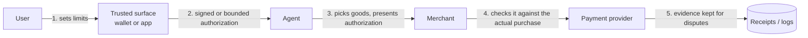
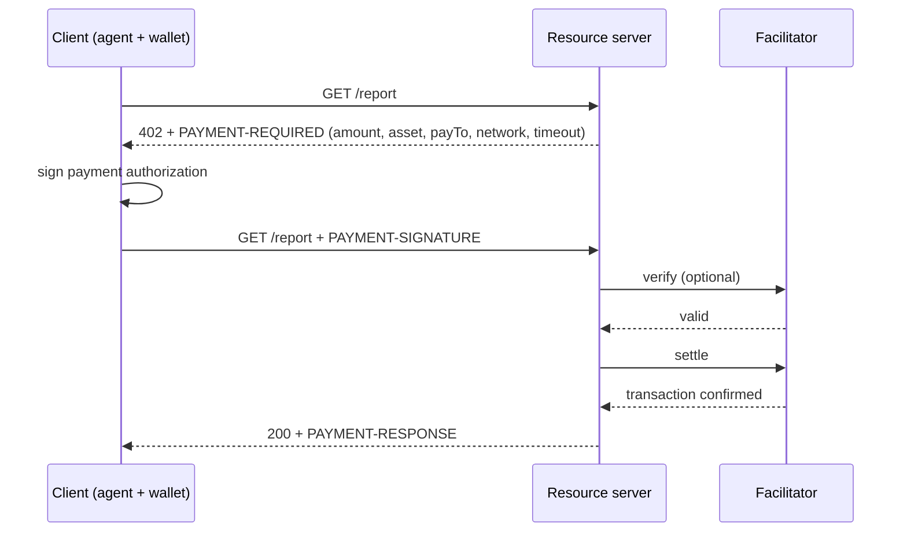

# Agent payments (sidebar)

## Why this matters

Agents that buy things need new protocols for authorization and payment. This short sidebar maps the space without going deep.

Every agent you've built so far can read, write and call tools. The moment a tool is "pay for this", the stakes change: the cost of a wrong action is real money, and it may not be reversible. A prompt-injected agent that deletes a scratch file is an annoyance. One that wires funds is an incident. The payment protocols below exist because card networks, banks and merchants were built around a human clicking "Buy" on a page the merchant controls, and none of that fits an agent acting for someone who isn't watching.

You will probably never implement one of these. But the way they answer one question, *how does a person prove to a third party that this agent may spend this much, on this thing, now?*, is the clearest worked example of agent authorization you can read. It reuses ideas you already know: scoped credentials from [3.6](/part-03-agents/3.6-mcp-using), untrusted input from [3.12](/part-03-agents/3.12-a2a), and the "who is in the loop" decisions from [3.10](/part-03-agents/3.10-multi-agent).

**Learning goals**

- Name the main agent-payment protocols and who backs them
- Explain the authorization problem they solve

## Explanation

### Why payments are hard for agents

A card payment today answers four questions without anyone noticing, because a human at a merchant's checkout page answers them implicitly:

| Question | Human at a checkout page | Agent acting for a human |
|---|---|---|
| **Who is paying?** | Card number, 3-D Secure, a biometric on the phone | The agent holds no card. The merchant sees software, not a customer |
| **Did they mean this?** | They saw the cart and the total, and pressed the button | The agent chose the cart. The user may have said only "find me a good pair of running shoes" |
| **Can the merchant prove it later?** | The checkout session, the IP, the 3-D Secure result | A chat transcript with a model that can be wrong or manipulated |
| **Who is liable when it goes wrong?** | The card rules assume a human at a screen | Unclear: user, agent developer, merchant, issuer |

The protocols differ in detail, but they all do the same three things in different words:

1. **Turn intent into something verifiable.** The user's wish ("up to €150, running shoes, from these shops") becomes a signed or otherwise tamper-evident object, not a sentence in a prompt.
2. **Hand the agent a bounded capability, not a credential.** The agent never receives the card number. It receives a token or authorization limited by amount, payee, time and use count.
3. **Leave evidence.** After the fact, the merchant, the payment provider and a dispute process can reconstruct who authorized what.

If this sounds like OAuth scopes plus signed receipts, that is a fair first approximation. The new part is that the *intent* is open-ended and the actor is a model you can't fully trust.

This diagram is my own generalization. Each protocol fills the boxes differently, as the next sections show.

### The protocol landscape

There is no single winner, and the names overlap. Roughly, they split by *what they standardize*:

| Protocol | Standardizes | Payment rail | Stewards (as of 2026-11-12) |
|---|---|---|---|
| **AP2** (Agent Payments Protocol) | Proof of what the user authorized, as signed "mandates" | Rail-agnostic (cards, bank transfer, stablecoins) | Announced by Google; donated to the FIDO Alliance |
| **ACP** (Agentic Commerce Protocol) | The checkout conversation between an agent platform and a merchant, plus a single-use payment token | Card payments via a payment provider (Stripe's token first) | OpenAI and Stripe, as founding maintainers |
| **x402** | Payment inside HTTP itself, using status code 402 | Stablecoin transfers onchain | x402 Foundation at the Linux Foundation; originated at Coinbase |

The sections below source each cell. Prices and fees don't belong in this chapter, and neither does a ranking of who is winning: adoption claims in this area are mostly press releases. [Landscape](/landscape#key-standards-and-orgs) tracks the current status of each protocol.

### AP2: signed proof of what the user authorized

Google announced AP2 on 2025-09-16, saying it was developed with more than 60 organizations, among them Mastercard, PayPal, American Express and Coinbase ([Google Cloud announcement](https://cloud.google.com/blog/products/ai-machine-learning/announcing-agents-to-payments-ap2-protocol)). On 2026-04-28 Google said it was donating AP2 to the FIDO Alliance and releasing v0.2. The same day FIDO announced new technical working groups, with a Payments group chaired by Mastercard and Visa, and Google and Mastercard contributing AP2 and Mastercard's Verifiable Intent work to it ([Google's post](https://blog.google/products-and-platforms/platforms/google-pay/agent-payments-protocol-fido-alliance/), [FIDO announcement](https://fidoalliance.org/fido-alliance-to-develop-standards-for-trusted-ai-agent-interactions/)). The code and docs are Apache 2.0 and the repo's changelog lists v0.2 as the latest release ([repo](https://github.com/google-agentic-commerce/AP2)). Since a 0.x spec under active standardization can change, treat everything below as a snapshot.

**The core object is the mandate.** The [AP2 specification](https://ap2-protocol.org/ap2/specification/) defines a Checkout Mandate and a Payment Mandate, each in two stages, and secures them as SD-JWTs, a signed JSON format that supports selective disclosure of fields. The constraint types are listed on the [checkout mandate](https://ap2-protocol.org/ap2/checkout_mandate/) and [payment mandate](https://ap2-protocol.org/ap2/payment_mandate/) pages:

- An **open mandate** carries the user's *constraints*: for checkout, which line items and which merchants are allowed; for payment, things like an amount range, allowed payees, allowed payment instruments, a budget and recurrence. It is authorized by the user through a trusted surface, and names the agent's public key, so only that agent can use it.
- A **closed mandate** binds one concrete purchase: the specific merchant-signed checkout (by hash), the payee, the exact amount, the payment instrument. In the autonomous flow the agent signs it with its own key; the spec binds it to the open mandate by hash, so it can't claim more than the user allowed.

The spec calls these two flows **human present** and **human not present**. When the human is present, the user sees the final cart on their trusted surface, authenticates (for example with a biometric) and the closed mandates are signed on the spot. When the human is not present, the user signs only the open mandates in advance, and the agent shops alone within those bounds ([flows](https://ap2-protocol.org/ap2/flows/)).

::: warning Names differ between the announcement and the spec
The 2025 announcement and many blog posts talk about "Intent Mandates" and "Cart Mandates". The v0.2 spec uses Checkout and Payment mandates with open and closed stages. That mapping is my reading of the two documents, not something either one states, so check the spec's own terms before you quote them.
:::

**How AP2 treats fraud.** The spec's security page is unusually blunt: it assumes preventing prompt injection is infeasible and says every LLM and agent must be considered a potential attacker ([AP2 security considerations](https://ap2-protocol.org/ap2/security_and_privacy_considerations/)). So it doesn't try to make the agent trustworthy. It bounds the damage. The merchant verifies that the checkout hash matches what the user approved; the open mandate's constraints cap the worst-case amount and payee; and the payment credential is released only after the final Payment Mandate verifies. For disputes, the checkout mandate and receipt, and the payment mandate and receipt, can be combined into what the spec calls a non-repudiable picture of the transaction. Specifics of dispute resolution and retention are explicitly out of scope ([spec](https://ap2-protocol.org/ap2/specification/)).

**Relation to what you know.** AP2 is available as an extension to A2A ([AP2 home](https://ap2-protocol.org/)), which is why it sits right after 3.12: a shopping agent talks to a merchant's agent over A2A and the mandates travel as extension data. Its home page also lists samples that pay with x402, which leads to the third protocol.

::: info 📖 Read now
[AP2: Specification](https://ap2-protocol.org/ap2/specification/) · docs · ~25 min · essential

Look for: the roles (shopping agent, trusted surface, credential provider, merchant, payment processor), what each mandate contains in its open and closed form, and who signs each one. Then read the section on verification and disputes. Ask of every field: which party can check it, and what attack does it stop?
:::

::: info 📖 Read now
[AP2: Security and privacy considerations](https://ap2-protocol.org/ap2/security_and_privacy_considerations/) · docs · ~10 min · optional

Look for: the threat model (agents as potential attackers) and the list of mitigations. Compare it with the prompt-injection discussion you'll meet in Part 8.
:::

### ACP: a checkout API plus a single-use token

The Agentic Commerce Protocol is maintained by OpenAI and Stripe as founding maintainers, is Apache 2.0 and is marked beta on its repo. Its spec versions are dates; the README marks 2026-04-17 as the latest stable ([ACP repo](https://github.com/agentic-commerce-protocol/agentic-commerce-protocol)). Stripe's launch post, dated 2025-09-29, says it was co-developed with OpenAI ([Stripe](https://stripe.com/blog/developing-an-open-standard-for-agentic-commerce)).

ACP is less about cryptographic proof and more about a plain REST contract. The merchant implements a handful of endpoints: create, update, retrieve, complete and cancel a *checkout session*, with idempotency keys on every write ([checkout OpenAPI](https://github.com/agentic-commerce-protocol/agentic-commerce-protocol/blob/main/spec/2026-04-17/openapi/openapi.agentic_checkout.yaml)). The agent platform, such as a chat app, collects the buyer's choices and drives the session. The merchant stays in control of the cart, the price and the order.

Payment is a separate, second call: **delegated payment**. The platform sends the buyer's payment details to the payment provider, which returns a token. OpenAI's spec describes it as single-use and set with an *allowance*: a maximum amount, a currency, an expiry, the checkout session it is for and the one merchant that may use it ([OpenAI: delegated payment spec](https://developers.openai.com/commerce/specs/payment.md)). Stripe's version, the Shared Payment Token, has the same shape: usage limits for currency, amount and expiry, resolvable only once ([Stripe: Shared Payment Tokens](https://docs.stripe.com/agentic-commerce/concepts/shared-payment-tokens)). The merchant never sees the card, and the agent never holds one.

Two design choices stand out:

- **The merchant is still the merchant of record.** OpenAI's production guide says the selling merchant, not OpenAI or the payment provider, is merchant of record, and handles refunds and chargebacks ([OpenAI: production guide](https://developers.openai.com/commerce/guides/production.md)). So existing dispute machinery keeps working, which is a pragmatic way to get liability answered.
- **Fraud limits are the token's limits plus risk signals.** The delegate request carries a required risk-signals array, each signal with a type (the spec's only example is card testing) and the action taken, such as blocked or manual review ([payment spec](https://developers.openai.com/commerce/specs/payment.md)). The merchant accepts or declines the order with its normal fraud checks.

Notice the contrast with AP2: ACP's token proves *the platform vouched for a bounded payment*; AP2's mandates aim to prove *the user themselves authorized these bounds*, in a form a third party can verify. They are not rivals at every layer: AP2's spec says it operates as a security feature within a commerce protocol and is designed to be compatible with UCP, a third name you may see ([AP2 specification](https://ap2-protocol.org/ap2/specification/)). I did not read UCP, so I say nothing more about it.

::: info 📖 Read now
[OpenAI: Delegated payment spec](https://developers.openai.com/commerce/specs/payment.md) · docs · ~10 min · essential

Look for: every field of the allowance and why it is there. Match each one to a risk: amount cap, expiry, merchant binding, session binding, single use. Which risk is left that none of them covers?
:::

### x402: payment as an HTTP status code

HTTP has had a status code 402 "Payment Required" for decades, reserved and unused. x402 gives it a job. The [x402 docs](https://docs.x402.org/core-concepts/http-402.md) describe the V2 exchange with three headers: the server answers a request with `402` and a `PAYMENT-REQUIRED` header listing acceptable payment options; the client picks one, signs a payment payload and retries with `PAYMENT-SIGNATURE`; the server verifies it, does the work and returns the resource with a `PAYMENT-RESPONSE` header describing settlement.

The diagram follows the [client-server](https://docs.x402.org/core-concepts/client-server.md) and [facilitator](https://docs.x402.org/core-concepts/facilitator.md) pages. A **facilitator** is a service that verifies payment payloads and broadcasts the transaction so the resource server doesn't have to run blockchain infrastructure; the docs say it doesn't hold funds or act as custodian, and that a server may verify and settle itself instead.

**What the signature authorizes.** For the main "exact" scheme on EVM chains, the client signs an authorization naming the payer, recipient, exact amount, a validity window and a single-use nonce. The scheme spec says the facilitator pays the gas but cannot modify the amount or destination ([exact scheme on EVM](https://github.com/x402-foundation/x402/blob/main/specs/schemes/exact/scheme_exact_evm.md)). The README states the design rule: payment schemes must not let the facilitator or resource server move funds except in accordance with the client's intentions ([x402 README](https://github.com/x402-foundation/x402)). Compare that with ACP's token: both bound amount, payee and time, but x402 does it with a signature over a stablecoin transfer, with no card network involved.

**Who backs it.** On 2026-04-02 the Linux Foundation announced the x402 Foundation, with the protocol contributed by Coinbase and described as initially developed by Coinbase, Cloudflare and Stripe. The release lists expressions of initial support from companies including AWS, Google, Mastercard, Microsoft, Shopify, Stripe and Visa ([Linux Foundation announcement](https://www.linuxfoundation.org/press/linux-foundation-is-launching-the-x402-foundation-and-welcoming-the-contribution-of-the-x402-protocol)). Read "initial intent and support" literally: it is not a statement that any of these ship it. Some secondary articles give a different launch date. I used the press release. The repo has moved from `coinbase/x402` to the `x402-foundation` GitHub org, and the V2 spec's changelog dates v2.0 to 2025-12-09 ([spec](https://github.com/x402-foundation/x402/blob/main/specs/x402-specification-v2.md)).

**Where it fits.** x402 targets machine-to-machine pay-per-call: an agent paying a data API a fraction of a cent per request, with no account, no API key and no checkout. That is a different job from buying shoes, which is why AP2 ships x402 samples rather than treating it as a competitor.

::: info 📖 Read now
[x402 docs: HTTP 402](https://docs.x402.org/core-concepts/http-402.md) · docs · ~10 min · essential

Look for: the three headers and what each carries. Then skim the [client and server](https://docs.x402.org/core-concepts/client-server.md) page, in particular its advice on what to do when a request times out after the client has sent a signed payment.
:::

### Risks

The protocols bound the damage. They don't make the agent safe. These are the risks the sources themselves point to, plus the ones that follow from them.

- **Prompt injection and manipulation.** AP2 designs on the assumption that the agent can be turned against you ([security page](https://ap2-protocol.org/ap2/security_and_privacy_considerations/)). That is the right assumption. The consequence for your design is that the limit lives in the signed constraints, not in the system prompt. "Never spend more than €50" in a prompt is a hope. A budget in the mandate or token is a control. This ties to the trust-in-content point from [3.12](/part-03-agents/3.12-a2a).
- **Over-broad authorization.** A wide open mandate or a generous allowance is the same mistake as an admin token in an agent's environment. Least privilege applies: tight amount, one merchant, short expiry.
- **Unknown outcomes and double payment.** The x402 docs say a timeout or lost response doesn't prove a payment failed, and that after sending a signed payment the client should treat the outcome as unknown and not automatically authorize a second one ([x402 client-server](https://docs.x402.org/core-concepts/client-server.md)). Your agent loop's retry logic from [3.2](/part-03-agents/3.2-agent-loop) is dangerous around payments. ACP's idempotency keys are the same lesson from the other direction.
- **Irreversibility.** The x402 pages I read say nothing about refunds or chargebacks, and settlement is an onchain transfer, so you should assume it is final once confirmed. That is my inference, not a quoted claim. ACP keeps card-style chargebacks through the merchant of record, and AP2 leaves dispute procedure out of scope. Which rail you choose decides your recourse.
- **Liability is still open.** None of the AP2 pages I read allocates liability among user, agent developer, merchant and payment provider. Evidence (receipts, hashes) makes a dispute *decidable*; it doesn't say who pays.
- **Standards churn.** AP2 is v0.x and moving into a new standards body. ACP is marked beta. x402 has already had a V2 rewrite of its wire format. Anything you build now will change.
- **Concentration of trust.** A facilitator, a credential provider or an agent platform becomes a party you must trust. The protocols reduce what they can do (they can't change the amount), but they can still refuse, delay or log.

### Where the pieces fit

| Question | AP2 | ACP | x402 |
|---|---|---|---|
| What does the user authorize? | Constraints in a signed open mandate | Implicitly, in the agent platform's UI; the token carries the limits | A signed transfer authorization per payment |
| Bounded by | Amount range, payees, budget, items, merchants | Max amount, currency, expiry, merchant, session, single use | Exact amount, recipient, validity window, nonce |
| Who can verify it? | Merchant, credential provider, network, processor | Payment provider and merchant | Server or facilitator, and the chain |
| Recourse | Evidence for disputes; procedure out of scope | Merchant of record handles refunds and chargebacks | Not described in the pages read |

## Practice

**Brief:** Read one protocol spec and write a half-page summary in `notes/agent-payments.md`: what is authorized, by whom, and how fraud is limited.

**Where:** Notes only, no code (`notes/`). No experiment folder and no `project/` step.

Pick the protocol that interests you most. If you have no preference, take AP2: its spec is the most explicit about who signs what.

**Steps:**

1. **Read the primary spec**, not a blog post: the AP2 specification, the OpenAI delegated payment spec plus the ACP checkout OpenAPI file, or the x402 docs plus the exact-scheme spec. Budget about an hour.
2. **Draw the actors.** In your notes, list every party in the flow and what each one holds (a key, a token, a credential, nothing).
3. **Answer "what is authorized".** Write one sentence describing the object that carries the authorization (a mandate, an allowance, a signed payload) and list its fields that limit the agent.
4. **Answer "by whom".** Say who creates that object, who signs it, and what the agent itself is allowed to add or change.
5. **Answer "how is fraud limited".** Name three attacks (for example a prompt-injected agent, a replayed authorization, a dishonest merchant) and for each say which field or check stops it, or that the spec leaves it open.
6. **Find the gap.** Write two lines on what the spec doesn't cover: liability, refunds, dispute procedure, privacy. Quote or cite the page where you looked.
7. **Compare.** In two lines, say how a second protocol answers the "what is authorized" question differently.

**Done when:**

- `notes/agent-payments.md` is about half a page and answers the three questions (authorized, by whom, fraud limits) in your own words, with a link to the spec section behind each.
- You named at least one thing the spec leaves out, and where you checked.
- You can say, without looking, why a budget line in a system prompt isn't an equivalent control.

## Check questions

1. In one sentence, what is the authorization problem agent-payment protocols solve?

   

Answer

   A merchant or payment provider has to be able to verify that a particular person allowed a particular agent to spend a bounded amount, on bounded things, at a bounded time, even though the agent chose the details itself and the person wasn't watching. Without that, the only evidence is a chat transcript with a model that can be wrong or manipulated.

   

2. Match each to its main idea: AP2, ACP, x402. Name one steward for each.

   

Answer

   AP2 standardizes signed mandates that prove what the user authorized, on any payment rail; Google announced it and donated it to the FIDO Alliance. ACP standardizes the merchant checkout API plus a single-use, allowance-bounded payment token; OpenAI and Stripe are its founding maintainers. x402 puts payment into HTTP with status code 402 and signed stablecoin transfers; it is a Linux Foundation project, contributed by Coinbase.

   

3. Why is "the agent never sees the card number" not enough on its own?

   

Answer

   Because the agent can still spend through whatever capability it is given. A token or authorization that allows €5,000 at any merchant hands a manipulated agent a lot of room. The bound has to be in the capability itself: amount, payee, expiry and single use, so a prompt-injected agent's worst case is small.

   

4. Your agent calls a pay-per-request API over x402. The request times out right after sending the signed payment. What should the retry logic do, and why?

   

Answer

   Treat the payment outcome as unknown, check the status through the server or settlement response if possible, and don't automatically create and sign a second payment. A timeout doesn't prove the payment failed, and a blind retry can pay twice. This is the same idempotency concern behind ACP's idempotency keys.

   

5. Why might you prefer a rail with a merchant of record, as in ACP's design, over a direct stablecoin transfer for a consumer purchase?

   

Answer

   Recourse. With a merchant of record, refunds and chargebacks run through the existing card dispute process. In the x402 pages I read, nothing describes refunds or chargebacks, and an onchain transfer is effectively final. For small machine-to-machine calls that trade-off can be fine. For a consumer buying goods it usually isn't.

   

## My understanding

<!-- Written by the learner, in their own words. Agents never fill this in. -->
