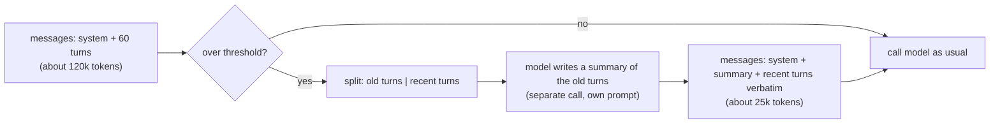

# Context engineering

## Why this matters

Your loop from [3.2](/part-03-agents/3.2-agent-loop) works on a ten-turn task and falls apart on a hundred-turn one. Usually the model didn't get worse. The history it reads each turn did: it is longer, full of file contents the agent read once and never needed again, and the instruction that mattered is buried in the middle. Long-running agents fail mostly because of what is (or isn't) in their context, so curating that window is the core skill of agent building. It is the part of the job that stays hard when models get better.

[1.9](/part-01-how-llms-work/1.9-kv-cache-context-window) explained what a long context costs and why quality drops. This chapter is the engineering answer: a small toolbox (cheaper system prompts, loading things just in time, clearing old tool results, compaction, notes outside the window, sub-agents) and a habit of measuring before you reach for it.

**Learning goals**

- Explain context rot and the attention budget
- Apply compaction, note-taking and sub-agent isolation
- Measure context growth in your own agent

## Explanation

### Context as a finite resource

"Context engineering" is the term that replaced "prompt engineering" for agents (see [0.1](/part-00-catch-up/0.1-what-changed)). Anthropic's article defines it as the strategies for curating and maintaining "the optimal set of tokens" during inference, and the difference from prompting is that it is *continual*: a prompt is written once, but an agent's context is rebuilt on every turn from the system prompt, tool definitions, message history, tool results and anything you retrieved ([Effective context engineering for AI agents](https://www.anthropic.com/engineering/effective-context-engineering-for-ai-agents), Sep 29, 2025).

The article gives two reasons to treat the window as scarce even when it is huge:

- **Context rot.** "As the number of tokens in the context window increases, the model's ability to accurately recall information from that context decreases." You met the evidence in [1.9](/part-01-how-llms-work/1.9-kv-cache-context-window): Chroma's measurements across 18 models, and the lost-in-the-middle position effect.
- **An attention budget.** The article's picture is that a model "draws on" a limited budget when it reads a large context. Its explanation is architectural: attention relates every token to every other, which gives "n² pairwise relationships for n tokens" ([1.4](/part-01-how-llms-work/1.4-attention) has the mechanism), so as context grows the model's ability to hold those relationships "gets stretched thin". Treat that as the authors' framing of an empirical effect rather than a law with a number attached.

Hence its conclusion that context is "a finite resource with diminishing marginal returns", and the goal of finding "the smallest set of high-signal tokens that maximize the likelihood of your desired outcome". The size of the window is a ceiling, not a target. Current Claude models offer up to 1M tokens ([Context windows](https://platform.claude.com/docs/en/build-with-claude/context-windows)); [Landscape](/landscape) lists sizes for every provider. A bigger window means you hit the wall later. It doesn't change what your agent reads well.

There is also a plain cost reason. Every turn of the loop re-sends the whole history. [2.7](/part-02-programming-with-llms/2.7-prompt-caching) showed that caching makes the unchanged prefix cheaper to read, but not free, and the Anthropic docs are explicit that "cached prompt prefixes still occupy the context window: prompt caching changes what you pay for those tokens, not whether they count" ([Context windows](https://platform.claude.com/docs/en/build-with-claude/context-windows)). A useless 20,000-token file read at turn 3 is paid for at turns 4 to 40, and attended to every time.

### What fills the window

Before you can curate, know the contents. Everything in the request counts toward the window: "the system prompt, every message in `messages` (including tool results, images, and documents), and your tool definitions", plus the output of the turn including thinking ([Context windows](https://platform.claude.com/docs/en/build-with-claude/context-windows)). In a coding agent the typical order of growth is:

| Part of the context | Behaviour over a run | Lever |
|---|---|---|
| System prompt, project instructions (`CLAUDE.md`, `AGENTS.md`) | Fixed, paid every turn | Write it at the right altitude (next section) |
| Tool definitions | Fixed, paid every turn; grows with every tool you add | Fewer, clearer tools ([3.3](/part-03-agents/3.3-tool-design)); load on demand ([3.9](/part-03-agents/3.9-advanced-tool-use)) |
| User and assistant messages | Slow growth | Compaction |
| **Tool results** | Fast growth, often most of the window | Truncate at the tool, clear old ones, delegate to a sub-agent |
| Thinking blocks | Depends on the model; kept by default on newer Claude models | Thinking-block clearing (see below) |

Claude Code's own docs make the same point with a timeline: before you type anything, `CLAUDE.md`, auto memory, MCP tool names and skill descriptions are already loaded; every file read then adds to the context ([Explore the context window](https://code.claude.com/docs/en/context-window)).

A worked example shows why tool results dominate. These numbers are made up for illustration; measure your own.

| Turn | What happens | New tokens | Context size |
|---|---|---|---|
| 0 | System prompt and tool definitions | 2,500 | 2,500 |
| 1 | User goal | 100 | 2,600 |
| 2 | Model calls `read_file` | 80 | 2,680 |
| 2 | Tool result: a 600-line file | 7,000 | 9,680 |
| 3 to 10 | Seven more file reads and model messages, about 7,500 each | 52,500 | 62,180 |

After ten turns nearly all of the 62,000 tokens are file contents the model read once. And the *input tokens billed over the run* are not 62,000: each request re-sends its predecessor, so the sum over the nine model calls is the area under that staircase, about 290,000 tokens before any caching discount. That is the quantity to watch, and it grows faster than linearly with turns.

#### How to measure it

You can't manage what you don't measure, and the measurement is cheap because the API already reports it:

- **Anthropic API:** every response has a `usage` field. With prompt caching the input is split across `input_tokens`, `cache_read_input_tokens` and `cache_creation_input_tokens`, and "all three count toward the window". To estimate a request *before* sending it, use the [token counting API](https://platform.claude.com/docs/en/build-with-claude/token-counting) ([Context windows](https://platform.claude.com/docs/en/build-with-claude/context-windows)).
- **Ollama:** the final response of `/api/chat` carries `prompt_eval_count` and `eval_count` (you used them in the [1.9](/part-01-how-llms-work/1.9-kv-cache-context-window) practice). One trap: if Ollama reused a cached prefix, the prompt count can be smaller than the real prompt length, so treat the number as "tokens processed this turn" and check it against a character-based estimate when it looks too good.
- **Claude Code:** `/context` shows "a live breakdown by category" of what is loaded ([Explore the context window](https://code.claude.com/docs/en/context-window)). Run it in a long session of your own before you write code; it is a free source of intuition.

Your [step log](/part-03-agents/3.2-agent-loop) already has a "tokens in/out per turn" column. Plotting *context size per turn* from it is the first deliverable of this chapter's practice.

### System prompts at the right altitude

The system prompt is the one piece of context you write by hand, so it is where over-engineering starts. Anthropic describes two failure modes and a target between them ([article](https://www.anthropic.com/engineering/effective-context-engineering-for-ai-agents), "The anatomy of effective context"):

- **Too brittle:** "hardcoding complex, brittle logic in their prompts to elicit exact agentic behavior". It breaks on the first input you didn't foresee and is a maintenance burden.
- **Too vague:** "high-level guidance that fails to give the LLM concrete signals for desired outputs", or assuming shared context the model doesn't have.
- **The right altitude** is "the Goldilocks zone between" them: specific enough to guide behaviour, flexible enough to leave the model heuristics to reason from.

Two versions of the same instruction for your coding agent:

```text
Brittle: If the user asks about a function, first run `grep -rn <name> src/`.
If there are more than 5 results, run `grep -rn <name> src/ | head -5`. If the
file is longer than 300 lines read lines 1-100, then ...

Vague:   Be efficient with files.

About right: Find code with search before reading whole files. Read only the
part you need (use line ranges for big files). Before editing, re-read the
current version of the region. If a command fails, read its error and try a
different approach rather than repeating it.
```

The third states the *reason* and the *habits*, not a decision tree. The article's other advice, which pays back in tokens: organize the prompt into distinct sections (it suggests XML tags or Markdown headers), start with a minimal prompt on the best model, and add instructions only in response to failure modes you actually observed. Minimal does not mean short. It means each line earns its place.

Two companions to the prompt live in the same context budget:

- **Tools.** A bloated tool set is a context cost and a decision problem. The article's test: "if a human engineer can't definitively say which tool should be used in a given situation, an AI agent can't be expected to do better." Tool design is [3.3](/part-03-agents/3.3-tool-design).
- **Examples.** The article's advice is a few diverse, canonical examples, "the 'pictures' worth a thousand words", instead of a laundry list of edge cases.

### Just-in-time retrieval

The older pattern was to retrieve everything that might be relevant *before* inference (embedding search, as in [2.9](/part-02-programming-with-llms/2.9-rag-fundamentals)) and put it in the prompt. Agents allow the opposite: keep "lightweight identifiers (file paths, stored queries, web links, etc.)" and let the model load the data with tools at the moment it needs it. The article's example is Claude Code, which can "leverage Bash commands like head and tail to analyze large volumes of data" without loading the full objects into context ([article](https://www.anthropic.com/engineering/effective-context-engineering-for-ai-agents), "Context retrieval and agentic search").

What this buys you:

- **Progressive disclosure.** The model discovers context step by step: file names and sizes hint at purpose, a directory layout shows structure, a listing leads to a targeted read. Each step informs the next, and only what is needed enters the context. [3.8](/part-03-agents/3.8-agents-md-and-skills) applies the same idea to skills (load the description first, the body when needed).
- **Metadata as signal.** `tests/` versus `src/` versus a timestamp tell the model something before a single byte of content is read.

What it costs: it's slower than precomputed retrieval, and the model needs good tools and heuristics ("Without proper guidance, an agent can waste context by misusing tools, chasing dead-ends, or failing to identify key information", the article warns). The article's recommendation is often a hybrid: load a little up front for speed (Claude Code loads `CLAUDE.md` files at startup) and let the agent explore for the rest. Its general advice is "do the simplest thing that works". When retrieval by embeddings beats search with `grep` is the question of [2.11](/part-02-programming-with-llms/2.11-agentic-search).

At the tool level, the practical rule from [2.6](/part-02-programming-with-llms/2.6-tool-calling) and [3.3](/part-03-agents/3.3-tool-design) applies directly: **return less by default.** A `read_file` that returns 200 lines with a marker such as `[truncated: lines 1-200 of 5,000; pass offset to read more]` is a just-in-time tool. One that returns the whole file is a context leak.

### Tool-result clearing

Once the agent has used a tool result, its raw text is often dead weight: the file was read, the edit was made, and the conclusion is in the assistant's next message. The article calls clearing old results "One of the safest lightest touch forms of compaction" (same article, "Context engineering for long-horizon tasks"). Nothing is summarized, so nothing is hallucinated: you replace the old content with a placeholder and keep the fact that the call happened.

Two ways to do it:

1. **In your harness.** Before each request, walk the message list and replace the content of tool results older than the last *N* with a stub such as `[result cleared: read_file src/auth.ts, 7,012 tokens; call again if needed]`. Keep the `tool_use`/`tool_result` pairing intact: the call and an answer for it must both remain, or the history is malformed ([3.2](/part-03-agents/3.2-agent-loop)). The stub should say what was cleared and how to get it back, which is just-in-time retrieval again.
2. **On the Anthropic API,** the beta *context editing* feature does it server-side. The strategy `clear_tool_uses_20250919` "clears tool results when conversation context grows beyond your configured threshold", oldest first, replacing them with placeholder text. Its parameters are `trigger` (default 100,000 input tokens), `keep` (default the 3 most recent tool uses), `clear_at_least`, `exclude_tools` and `clear_tool_inputs` (default `false`: only results are cleared, not the call arguments). It needs the beta header `anthropic-beta: context-management-2025-06-27`, and "your client application maintains the full, unmodified conversation history", so the server edits a copy of what it reads ([Context editing](https://platform.claude.com/docs/en/build-with-claude/context-editing), a beta feature whose details may have changed since this was verified).

The same docs flag the catch that connects this chapter to [2.7](/part-02-programming-with-llms/2.7-prompt-caching): clearing "invalidates cached prompt prefixes when content is cleared", because the prefix changed. That is why `clear_at_least` exists: clearing 500 tokens and paying to rewrite the cache is a loss. The general rule is to clear in rare, large steps instead of trimming a little every turn. The same logic applies to your own harness.

Which results are safe to clear? Ones you can regenerate: file reads, directory listings, search hits. Which aren't? Ones that are a one-time observation (a failing test's output you will need to quote later, a value read from a changing system). Mark those as excluded, or take a note of the finding before clearing (see structured note-taking below).

### Compaction

Compaction is "the practice of taking a conversation nearing the context window limit, summarizing its contents, and reinitiating a new context window with the summary" ([article](https://www.anthropic.com/engineering/effective-context-engineering-for-ai-agents)). It is the first lever for long-term coherence, and also the lossiest, so it earns the most thought.



**What the real systems do.** Claude Code's `/compact` "replaces the conversation with a structured summary", and after that "most startup content reloads automatically": project-root `CLAUDE.md` and auto memory are re-injected from disk, and it re-reads up to five of the most recently modified files the session touched. Content that lived only in the message history is gone unless the summary kept it: for example, path-scoped rules and nested `CLAUDE.md` files "load into message history ... so compaction summarizes them away with everything else" ([Explore the context window](https://code.claude.com/docs/en/context-window), "What survives compaction"). It also compacts automatically near the limit, and you can steer it: `/compact focus on the auth bug fix` makes the summary keep "what you choose instead of what the automatic pass guesses is important". The article says Claude Code passes the message history to the model to compress "the most critical details" (architectural decisions, unresolved bugs, implementation details) while discarding redundant tool output, and then continues with the summary plus those recent files.

On the API there are now three routes ([Compaction overview](https://platform.claude.com/docs/en/build-with-claude/compaction), all in beta at verification time): *compaction on demand* (you send a request and swap the returned summary block in), *compaction at a token threshold* (the API compacts inside your ordinary requests), and your own summarizer. Reasons to write your own, which is this chapter's practice, are that you must understand the mechanics before delegating them, that you need it for local models, and that it lets you decide what a summary must contain.

**Writing a good compaction step.** A few design decisions decide whether it works:

1. **Trigger.** Compact at a threshold well before the window is full (a fraction of the *usable* window, e.g. 50 to 70 percent), not when the API starts rejecting. Quality has already dropped by then (context rot), and a summary call needs room for the history it is summarizing. Count tokens from the API's own `usage`, not your guess. A local model with `num_ctx` of 8k hits "full" very early ([1.9](/part-01-how-llms-work/1.9-kv-cache-context-window)).
2. **Split point.** Keep the most recent turns verbatim: the model is mid-thought there, and a summary of the last two steps is worse than the steps. Never split a `tool_use` from its `tool_result`.
3. **The summary prompt.** The article's advice: "start by maximizing recall to ensure your compaction prompt captures every relevant piece from the trace, then iterate to improve precision by eliminating superfluous content". Ask for specific things: the user's goal and constraints; decisions made and why; files touched and their state; commands that failed and what was learned; what is left to do; and exact identifiers (paths, names, error text) that must survive. A summary that says "worked on authentication" has lost the information that mattered.
4. **What to put back.** After compaction, the model has lost its own recent view. Re-inject what is cheap and vital: the system prompt (it is never summarized), the original user goal verbatim, the current plan or todo list.
5. **Cost.** The summarization is a model call over the long history. [2.7](/part-02-programming-with-llms/2.7-prompt-caching) noted the trick the Claude Code team uses: send the parent's exact system prompt, tools and history with the summarization request as a new final message, so the cache still applies. A summary call with a new system prompt "diverges at the first token" and reads the whole history uncached.
6. **Thinking blocks.** If you pass thinking blocks back, rewriting the history is exactly what [2.4](/part-02-programming-with-llms/2.4-reasoning-via-api) warned about: they have to come back unchanged, so check how your model treats them when you replace turns with a summary.

**Failure modes to watch for** (these are the judgement of this book, not a quoted result, so test them in your practice):

- *Lost detail.* The summary drops a constraint from the first message, and the agent later violates it. Cure: re-inject the original goal verbatim, and add "constraints" to the summary prompt.
- *Drift through repeated compaction.* Summaries of summaries lose more each round. Cure: keep structured notes ([next](#structured-note-taking)) as the stable layer and have the summary reference them.
- *False memory.* The summary states something as done that was only attempted. Cure: have the summary distinguish verified from unverified, and have the agent re-check cheaply (re-run the test) after resuming.

Compaction has costs that clearing doesn't, and the Anthropic engineers' advice is consistent: prefer clearing for things you can re-fetch, and summarize what has no other home. Anthropic's docs reach the same ordering for the API: server-side compaction is "the primary strategy" for long conversations, and context editing covers the "finer control" cases ([Context editing](https://platform.claude.com/docs/en/build-with-claude/context-editing)).

### Structured note-taking

Compaction rewrites history after the fact. **Note-taking** moves information out of the window *on purpose, as you go*. The article: "agentic memory, is a technique where the agent regularly writes notes persisted to memory outside of the context window. These notes get pulled back into the context window at later times." The simplest forms are a to-do list the agent keeps updating, or a `NOTES.md` it writes decisions and findings into. Their example is Claude playing Pokémon, tracking tallies like "for the last 1,234 steps I've been training my Pokémon in Route 1" across context resets, and, after a reset, reading its own notes to continue ([article](https://www.anthropic.com/engineering/effective-context-engineering-for-ai-agents)).

Why it works when compaction alone doesn't: notes are *structured* (you choose the fields) and *persistent* (they survive any number of resets). The model reads them, instead of re-reading a summary of a summary. The Anthropic multi-agent research system does the same at a larger scale: the lead agent "saves its plan to Memory to persist the context", because the context may be truncated past 200,000 tokens ([How we built our multi-agent research system](https://www.anthropic.com/engineering/multi-agent-research-system), Jun 13, 2025).

A layout that works for a coding agent: `NOTES.md` with sections **Goal**, **Constraints**, **Done** (with evidence), **Open questions**, **Next step**. A rule in the system prompt: "update the notes after each milestone, and read them first after context was cleared". Notes can be combined with clearing: Anthropic's context-editing docs say that with the memory tool, "when your conversation context approaches the configured clearing threshold, Claude receives an automatic warning to preserve important information", so it can save what it needs before the results are cleared ([Context editing](https://platform.claude.com/docs/en/build-with-claude/context-editing)).

Notes across *sessions*, with a proper memory tool, are [3.5 Memory](/part-03-agents/3.5-memory). The distinction for now: notes in this chapter serve one long task; memory serves many. And for tasks that outlive one context window by design, see [5.6 Long-running agents](/part-05-harnesses/5.6-long-running-agents).

### Sub-agents for context isolation

The last tool is not to compress a context but to avoid growing it. A sub-agent is a separate agent call with its own fresh window: the lead hands it a focused task, the sub-agent may read tens of thousands of tokens, and only a short result goes back. The article says specialized sub-agents "handle focused tasks with clean context windows", exploring extensively but returning "a condensed, distilled summary of its work (often 1,000-2,000 tokens)", which gives a "clear separation of concerns" ([article](https://www.anthropic.com/engineering/effective-context-engineering-for-ai-agents)).

Claude Code's built-in **Explore** sub-agent is the standard example: a read-only agent for file discovery and code search, which "keeps exploration results out of your main conversation context" ([Subagents](https://code.claude.com/docs/en/sub-agents)). The subagent docs name the right case: use one when "a side task would flood your main conversation with search results, logs, or file contents you won't reference again". A non-fork sub-agent "doesn't see your conversation history", so the task description you give it is its whole world.

Two honest caveats:

- **It isn't free.** Sub-agents "send their own requests", which count toward the same usage limits, and many sub-agents returning detailed results "can consume significant context" back in the parent ([Subagents](https://code.claude.com/docs/en/sub-agents)). Anthropic's research-system post reports agents using "about 4× more tokens than chat interactions" and multi-agent systems "about 15×" ([post](https://www.anthropic.com/engineering/multi-agent-research-system)). Isolation buys cleaner context, not cheaper runs.
- **The summary is the interface.** If the sub-agent's summary omits the one detail the lead needs, nothing in the lead's window can recover it. Specify the return format in the task ("return file paths and one-line findings, no code blocks").

The `delegate` tool is the project step in [3.10](/part-03-agents/3.10-multi-agent), and the trade-offs of multi-agent systems more broadly are there.

### Choosing between them

| Technique | What it does to the window | Lossy? | Reach for it when | Cost |
|---|---|---|---|---|
| Smaller tool output, truncation | Prevents growth | At the tool | Always | None |
| Just-in-time retrieval | Loads on demand | No | Large corpora, unknown needs | More turns |
| Tool-result clearing | Replaces old results with stubs | Only what you can re-fetch | Long runs with many reads | Cache rewrite when it fires |
| Compaction | Replaces old turns with a summary | Yes | Long conversations that need continuity | A model call; summary quality risk |
| Notes | Stores state outside the window | No (you pick fields) | Tasks that span resets | A write per milestone |
| Sub-agents | Moves reads to another window | Summary only | Search and research with big intermediate output | Extra tokens, extra latency |

Anthropic's own guidance on the choice (in its sub-agent section): compaction suits tasks "requiring extensive back-and-forth", note-taking suits "iterative development with clear milestones", and multi-agent architectures "handle complex research and analysis where parallel exploration pays dividends" ([article](https://www.anthropic.com/engineering/effective-context-engineering-for-ai-agents)). In practice you stack them: truncate at the tool, clear old results, keep notes, compact as a backstop, delegate the noisy reads.

One more thing to know about models in 2026: some Claude models track their own window. Per the docs, Claude Sonnet 5 and a few other models have "context awareness": they track their remaining window (their "token budget") throughout a conversation, while newer ones (Opus 4.7 and later, Sonnet 5.5 and others) don't get those injected tags and can instead be given an explicit budget with task budgets (beta) ([Context windows](https://platform.claude.com/docs/en/build-with-claude/context-windows), "Context awareness"). Don't build on that: your harness should manage context whether or not the model notices, and local Qwen models will not know how full they are.

::: info 📖 Read now
[Effective context engineering for AI agents](https://www.anthropic.com/engineering/effective-context-engineering-for-ai-agents) (Anthropic Engineering, Sep 29, 2025) · article · ~20 min · **essential**

You may have read the first half through 1.9 and 0.1. Read the whole thing now, with your own agent in mind. Look for: the two failure modes of a system prompt and where yours sits; "just in time" and "progressive disclosure"; the three techniques for long-horizon tasks and which fit which situation; the sub-agent return size (1,000-2,000 tokens). Note what the article doesn't give: any threshold or benchmark number for when to compact. That is what your practice measures.
:::

::: info 📖 Read now
[Explore the context window](https://code.claude.com/docs/en/context-window) (Claude Code docs) · docs · ~15 min · **essential**

A timeline of a real session. Look for: what is already in context before you type; the table of what survives compaction and what doesn't (which of your own habits depend on something that is summarized away?); the five ways to act before auto-compaction runs (`/compact` with a focus, `/clear` between tasks, delegating large reads). Then run `/context` in one of your sessions.
:::

::: info 📖 Read now
[Context editing](https://platform.claude.com/docs/en/build-with-claude/context-editing) (Anthropic API docs, beta) · docs · ~15 min · optional

Read the tool-result clearing section and its parameter table. Look for: why `clear_at_least` exists (the cache), what `keep` and `exclude_tools` let you protect, and the paragraph on combining it with the memory tool. Skim thinking-block clearing; it ties back to 2.4. Compare with the [Compaction overview](https://platform.claude.com/docs/en/build-with-claude/compaction), which explains the three ways to compact (the page for your own summarizer is the one you are about to write).
:::

::: info 📖 Read now
[Subagents](https://code.claude.com/docs/en/sub-agents) (Claude Code docs) · docs · ~15 min · optional

Read the opening and "built-in subagents". Look for: what a subagent does and doesn't inherit, what comes back to the parent, and the warning about many subagents returning detailed results. The full write-up of multi-agent design is [3.10](/part-03-agents/3.10-multi-agent).
:::

## Practice

**Brief:** Add context tracking (tokens per turn) and compaction to `project/`: when context passes a threshold, summarize older turns. Compare a long task with and without compaction. You write the code; I haven't provided any.

**Where:** a step in the growing `project/` (see `project/ROADMAP.md`, step 3, built on step 1; it does not need the 3.3 tools, but a `search` or `list_files` tool will make the long task more realistic). Write your findings in `notes/context-engineering.md`.

**Steps:**

1. **Make a long task and a planted fact.** Create a scratch directory with about 30 text or code files of a few hundred lines each (copy chapters from `book/` or a repo you know). Write a goal that forces many reads and ends with a question that needs one specific detail from an early file ("which file defines X, and what is its default value?"). Plant one unusual constraint in your first message ("answer in the form `file:line`") to test whether it survives.
2. **Predict.** In the notes, guess the context size at turn 10 and turn 30 without compaction, which tool dominates it, and whether the agent still answers the early-file question right at the end.
3. **Track context per turn.** From the API response's own counters (`usage` on Anthropic, `prompt_eval_count` on Ollama), record input tokens per turn in your step log, plus the cumulative sum. Add a flag to print a one-line summary at the end (turns, peak context, total input tokens). Do not estimate by characters except as a cross-check.
4. **Baseline run, no compaction.** Run the long task on one model (start local: `qwen3:8b` or `qwen3:14b`; raise `num_ctx` deliberately and record what you set). Chart or tabulate context size by turn from the log. Record whether the answer is right and where, if anywhere, the agent began to go wrong.
5. **Add the cheap lever first.** Implement clearing: older than the last *N* tool results become stubs saying what was cleared. Run again. Compare the peak context and the answer with the baseline.
6. **Add compaction.** A threshold option (`--compact-at <tokens>`). When the last response's input tokens pass it: keep the system prompt and the original goal, summarize the older turns with a separate model call, keep the last few turns verbatim, and never separate a tool call from its result. Write the summary prompt yourself. Log each compaction (tokens before, tokens after, the summary text).
7. **Run the same task with compaction** at two thresholds, one low and one high (rerun each at least twice, since model output varies). Compare: peak context, total input tokens, number of turns, whether the planted fact and the constraint survived, and the final answer.
8. **Read your own summaries.** For each one, list what it kept and what it lost. Find one thing it got wrong or left out. Change the summary prompt to fix it and see if the next run differs.
9. **Optional stretch:** add a `NOTES.md` that the agent writes after each milestone and reads after compaction. Does it beat the summary on the planted-fact test? Or a paid-model run of the same task, a handful at most, with the spend in `costs.md`.
10. **Write `notes/context-engineering.md`:** predictions and what was wrong, one table of the runs (variant, peak context, total input tokens, correct?), the failures you saw, and your answer to "at what size does this model start to fail at this task, and where would you put the threshold?"
11. **Commit.**

**Done when:**

- The step log shows input tokens per turn for every run, and the program prints peak context and total input tokens at the end.
- `--compact-at` triggers compaction when the last request passed the threshold, keeps recent turns verbatim, keeps tool calls paired with their results, and logs before/after sizes and the summary text.
- You ran the same long task with and without compaction (and with clearing), and `notes/context-engineering.md` has a table that compares peak context, total input tokens and correctness.
- The notes name at least one detail that a summary lost, with the log line, and the change you made to the summary prompt.
- You can say, from your own numbers, where the threshold should be and why.

## Check questions

1. A friend says "context windows are 1M tokens now, so we can put everything in." Give two separate reasons, one about quality and one about cost, that this fails for an agent.

   <details><summary>Answer</summary>

   Quality: context rot. Accuracy and recall degrade as the number of tokens grows, so the model attends worse to the details that matter even though the prompt fits, and position effects such as lost-in-the-middle add to that (the article calls context "a finite resource with diminishing marginal returns"). Cost: every turn re-sends the whole history, so a token added at turn 3 is processed again at every later turn. Caching makes repeat reads cheaper but they still count toward the window, and any change to the prefix (clearing, compaction) invalidates the cache.

   </details>

2. Your agent read twenty files in the first fifty turns and is now at 150,000 tokens. Which technique do you try first, which second, and why that order?

   <details><summary>Answer</summary>

   Tool-result clearing first: the file contents are regenerable (the agent can read them again), so replacing old results with stubs loses nothing that can't be re-fetched and involves no model call. Compaction second, for what remains: reasoning, decisions and state that exist only in the history and can't be re-fetched, which needs a summary. Notes help in both cases, as a place to put what must not be lost. Even better, prevent the growth up front: truncate large reads and use search plus line ranges.

   </details>

3. After compaction your agent starts ignoring a rule from the user's first message. What happened, and what are two ways to prevent it?

   <details><summary>Answer</summary>

   The first message was summarized, and the summary left the rule out or softened it, so the model no longer sees it. Fixes: re-inject the original goal and constraints verbatim after compaction instead of summarizing them, add "constraints and instructions" as a required part of the summary prompt, or put persistent rules where they survive (the system prompt, or project instruction files that are re-read from disk, which is what Claude Code does for `CLAUDE.md`). Keeping the rule in a notes file the agent re-reads also works.

   </details>

4. Why does clearing old tool results cost you a prompt-cache miss, and what does `clear_at_least` do about it?

   <details><summary>Answer</summary>

   Prompt caching reads a prefix of the request, and clearing changes content inside that prefix, so everything from the change onward is no longer a cache hit and must be rewritten (priced as a cache write). `clear_at_least` sets the minimum number of tokens a clearing pass must remove, and the pass is skipped if it can't remove that many, so you don't pay a cache rewrite to recover a few hundred tokens. The general rule: clear rarely and in large steps.

   </details>

5. When is a sub-agent the right tool for a context problem, and what is the risk?

   <details><summary>Answer</summary>

   When a side task would produce a large amount of intermediate material you won't reuse (searching a codebase, reading many files, going through logs), so the work can happen in a fresh window and only a short summary returns. The risks: the summary is the only interface, so anything omitted is lost to the lead; the sub-agent starts without your conversation, so the task description must carry what it needs; and it costs extra tokens and latency (Anthropic reports multi-agent systems using about 15 times the tokens of chat), so it buys a cleaner context, not a cheaper run.

   </details>

## My understanding

<!-- Written by the learner, in their own words. Agents never fill this in. -->
