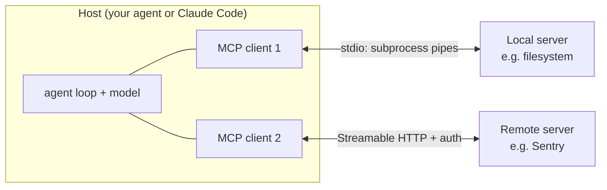
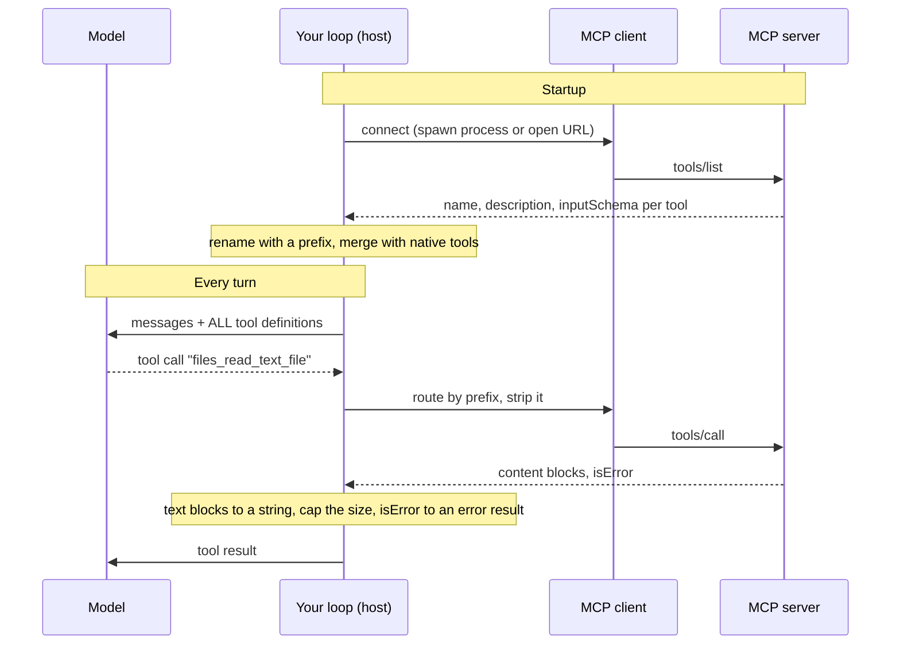

# MCP: using servers

## Why this matters

By now your agent has a handful of tools you wrote yourself: `read_file`, `run_shell`, `edit_file`, `search`. Every one of them took you an afternoon to design and test ([3.3](/part-03-agents/3.3-tool-design)). Now think about the tools you *don't* want to write: GitHub, Sentry, a browser, a database, your calendar. Each has an API, and each agent harness would need its own adapter for each of them. That is the problem the Model Context Protocol (MCP) exists to solve: write the adapter once as a **server**, and any MCP-capable application can use it.

For you, MCP matters in two directions. As a *user*, it is how you plug existing tools into Claude Code, and how you let your own agent borrow tools someone else wrote. As an *engineer*, it is a protocol you will have to reason about: it decides what crosses the wire, what runs on your machine with your privileges, and how many tool definitions land in your model's context. [3.7](/part-03-agents/3.7-mcp-building) has you write a server. This chapter is the client side: how it is built, how it is secured (or isn't), and how to wire it into the loop you already have.

**Learning goals**

- Explain MCP's architecture: hosts, clients, servers, transports
- Explain tools, resources and prompts
- Connect an MCP server to Claude Code and to your own agent

## Explanation

### Why a protocol

Without a standard, N applications times M tools means N×M integrations, each with its own conventions for naming, schemas, authentication and errors. MCP's own introduction describes itself as "an open-source standard for connecting AI applications to external systems" and offers a USB-C analogy: one standardized port instead of one cable per device ([MCP introduction](https://modelcontextprotocol.io/docs/getting-started/intro)). If you have used the Language Server Protocol, the shape is the same: editors and language tooling used to be paired one by one, and LSP made each side implement one protocol. [0.3](/part-00-catch-up/0.3-standards-and-orgs) covers who governs MCP and how it came to be one of several open agent standards; this chapter assumes you know that and looks at how it works.

It helps to be precise about what the protocol does *not* do. The architecture overview says: "MCP focuses solely on the protocol for context exchange—it does not dictate how AI applications use LLMs or manage the provided context" ([architecture overview](https://modelcontextprotocol.io/docs/learn/architecture)). A server describes tools; it does not decide which ones reach the model, how many, or what happens to the output. Those remain your harness's job, and as you'll see below, most of the practical trouble with MCP lives there.

### Participants: host, client, server

MCP has three roles ([architecture overview](https://modelcontextprotocol.io/docs/learn/architecture)):

- **Host:** the AI application the user talks to (Claude Code, Claude Desktop, VS Code, *your agent*).
- **Client:** a component inside the host that holds one connection to one server.
- **Server:** a program that provides context (tools, data, prompt templates) to clients.

The detail that surprises people is the cardinality: the host creates **one client per server**, each with its own dedicated connection. "Client" in MCP is not your app; it is a connection object inside it.



*Server* names a role, not a location. The overview's example: Claude Desktop launching the filesystem server runs it locally over stdio, while the official Sentry server runs on Sentry's platform and is reached over HTTP; the first is called a "local" server and the second a "remote" one. Local stdio servers typically serve a single client; remote servers typically serve many.

One more thing to hold on to: **the model never speaks MCP.** The model sees ordinary tool definitions and emits ordinary tool calls, exactly as in [2.6](/part-02-programming-with-llms/2.6-tool-calling). The *host* translates between those and MCP requests. You'll be writing that translation layer in the practice.

### Layers and transports

MCP has two layers ([architecture overview](https://modelcontextprotocol.io/docs/learn/architecture)). The **data layer** is a JSON-RPC 2.0 protocol that defines messages and semantics: discovery, the primitives, notifications. The **transport layer** defines how those messages are carried and, for HTTP, how they are authenticated. The same JSON-RPC messages travel over every transport; the spec says "Protocol semantics are identical on every transport. A transport is a binding" ([transports](https://modelcontextprotocol.io/specification/2026-07-28/basic/transports)).

Two standard transports exist:

| | stdio | Streamable HTTP |
|---|---|---|
| Where the server runs | A subprocess your host launches | Anywhere with a URL |
| Framing | Newline-delimited JSON on the process's stdin and stdout | One HTTP POST per message to a single endpoint; the reply is a JSON object or an SSE stream |
| Typical use | Local tools: files, git, a database on your machine | Hosted services shared by many users |
| Auth | None in the protocol; credentials come from the environment | HTTP-level: bearer tokens, OAuth |
| Lifecycle | Your host starts it and ends it by closing stdin | The server is an independent process |

Sources for the table: [stdio](https://modelcontextprotocol.io/specification/2026-07-28/basic/transports/stdio) and [Streamable HTTP](https://modelcontextprotocol.io/specification/2026-07-28/basic/transports/streamable-http).

Three practical consequences of the stdio rules. First, the server "MUST NOT write anything to its `stdout` that is not a valid MCP message", so a stray `console.log` in a server corrupts the stream; logs go to `stderr`, which the client may capture or ignore. Second, the client launches the server, so the config for a stdio server is a *command line*: when you add one, you are choosing code to run on your machine (more on that in the security section). Third, when the client ends the session, it closes the server's stdin and waits for it to exit, and only then escalates to killing the process; your host must do this or you will leak child processes.

**An older transport you will still meet.** Earlier servers used HTTP+SSE, a two-endpoint design from the first spec revision. The spec classes it as deprecated and says new implementations should not adopt it ([Streamable HTTP, backward compatibility](https://modelcontextprotocol.io/specification/2026-07-28/basic/transports/streamable-http)), and Claude Code's docs say the same of SSE servers: "Use HTTP servers instead, where available" ([Claude Code MCP docs](https://code.claude.com/docs/en/mcp)). You'll still see `sse` in old READMEs.

::: warning The protocol changed under older tutorials
The current spec revision is dated 2026-07-28 ([Landscape](/landscape) tracks it). Compared with the 2025 revisions, the connection model changed: the Streamable HTTP page says the revision removed "protocol-level sessions" and the GET stream endpoint, and states that "Resumable SSE streams via `Last-Event-ID` are not supported" ([Streamable HTTP](https://modelcontextprotocol.io/specification/2026-07-28/basic/transports/streamable-http)). The architecture overview describes MCP as "a stateless protocol": every request carries the protocol version and the client's capabilities in its `_meta` field, and the old `initialize` handshake is replaced by an optional `server/discover` request ([architecture overview](https://modelcontextprotocol.io/docs/learn/architecture)). Anything written before that (including blog posts that say "first the client sends `initialize`") describes the previous era. Clients and servers can fall back to the older behaviour when talking to a counterpart from that era ([stdio, backward compatibility](https://modelcontextprotocol.io/specification/2026-07-28/basic/transports/stdio)), and plenty of servers in the wild will still be older.
:::

TypeScript SDK note, with a date on it: the repository README says the `main` branch is v2 and implements the 2026-07-28 spec, recommends `@modelcontextprotocol/client` for clients, and says the v1 package `@modelcontextprotocol/sdk` keeps receiving bug and security fixes for at least six months after the v2 release on 2026-07-27 ([typescript-sdk README](https://github.com/modelcontextprotocol/typescript-sdk)). Examples you find online may import the v1 package. They are not wrong so much as from the previous era; check which package an example uses before copying it.

### What a conversation looks like on the wire

You rarely write JSON-RPC by hand, because the SDK does it. You should still see it once, because it shows what a client actually does. All of this is from the architecture overview's worked example, trimmed ([architecture overview](https://modelcontextprotocol.io/docs/learn/architecture)):

```json
// 1. (optional) What do you support?
{ "jsonrpc": "2.0", "id": 1, "method": "server/discover", "params": { "_meta": { "io.modelcontextprotocol/protocolVersion": "2026-07-28", "...": "client info and capabilities" } } }
// -> supportedVersions, capabilities { tools: { listChanged: true }, resources: {} }, serverInfo

// 2. What tools do you have?
{ "jsonrpc": "2.0", "id": 2, "method": "tools/list", "params": { "_meta": { "...": "..." } } }
// -> { tools: [ { name, title, description, inputSchema }, ... ], ttlMs, cacheScope }

// 3. Run one.
{ "jsonrpc": "2.0", "id": 3, "method": "tools/call",
  "params": { "name": "weather_current", "arguments": { "location": "San Francisco" }, "_meta": { "...": "..." } } }
// -> { content: [ { type: "text", text: "Current weather in San Francisco: ..." } ] }
```

Look at step 2's response: each tool has a `name`, a `description` and an `inputSchema` (JSON Schema). That is exactly the triple from [3.3](/part-03-agents/3.3-tool-design), and exactly what you pass to the model API as a tool definition. So the "translation layer" in your host is small: `tools/list` becomes your tool definitions, a model tool call becomes `tools/call`, and the `content` array becomes your tool result. Everything hard about it is in the edges: names, sizes, errors, trust.

### Tools, resources, prompts

Servers offer three **primitives**. The spec's page for each starts with a *user interaction model*, and the difference between them is **who decides when it is used** ([tools](https://modelcontextprotocol.io/specification/2026-07-28/server/tools), [resources](https://modelcontextprotocol.io/specification/2026-07-28/server/resources), [prompts](https://modelcontextprotocol.io/specification/2026-07-28/server/prompts)):

| Primitive | Controlled by | What it is | Methods | How Claude Code surfaces it |
|---|---|---|---|---|
| **Tools** | The model ("model-controlled") | Functions with an input schema that do things or fetch things | `tools/list`, `tools/call` | Ordinary tools named `mcp__<server>__<tool>`, subject to permission prompts |
| **Resources** | The application ("application-driven") | Data identified by a URI (a file, a database schema, a record), read-only context | `resources/list`, `resources/read`, templates, subscriptions | `@` mentions in the prompt, alongside files |
| **Prompts** | The user ("user-controlled") | Server-defined message templates with arguments, like slash commands | `prompts/list`, `prompts/get` | Slash commands such as `/mcp__github__pr_review 456` |

The Claude Code column comes from its docs sections "Use MCP resources" and "Use MCP prompts as commands" ([Claude Code MCP docs](https://code.claude.com/docs/en/mcp)).

Two things follow from this table. First, **tools are the primitive almost every agent uses**, because they are the only one the model drives by itself; resources and prompts need a UI or a human decision. In your own loop, resources are only useful if you decide how they get into context (inject one at the start of a run? expose a `read_resource` tool?), and prompts only if you give the user a way to pick one. The practice uses tools only; resources are a good extension. Second, the spec says "the protocol itself does not mandate any specific user interaction model" for any of the three: the controller is a recommendation about intent. A host may expose resources to the model as tools, as Claude Code does for listing and reading them (its docs say it "automatically provides tools to list and read MCP resources when servers support them").

**Client-side primitives.** Servers can also ask things of the client. The one that matters is *elicitation*: the server asks the user for input or confirmation (for example "which GitHub username?") through a multi-round-trip pattern. Two older ones, *sampling* (the server asks the host's model for a completion) and *logging*, are marked deprecated as of 2026-07-28, with the overview advising "new implementations should integrate directly with LLM provider APIs" and log to stderr or OpenTelemetry ([architecture overview](https://modelcontextprotocol.io/docs/learn/architecture)). If you built a client from a 2025 tutorial and implemented sampling, that is why current material de-emphasizes it. Your first client can ignore all of them.

### Results and errors

Back to what you designed in 3.3: tool results and errors steer the model, so what does MCP do with them?

A `tools/call` result carries a `content` array of typed blocks: text, image, audio, resource links, embedded resources, and optionally `structuredContent` validated against an `outputSchema` ([tools](https://modelcontextprotocol.io/specification/2026-07-28/server/tools)). Your loop currently deals in strings, so the translation is a decision: concatenate text blocks, and for the rest either drop them with a visible placeholder (`[image omitted]`) or pass them natively if your model API supports it. Don't silently drop.

Errors come in two kinds, and the distinction matches your 3.2 rule that errors are results, not exceptions. The spec: **protocol errors** are standard JSON-RPC errors for things like an unknown tool or a malformed request ("issues with the request structure itself that models are less likely to be able to fix"); **tool execution errors** are results with `isError: true` for API failures, validation problems and business-logic errors, and are meant to carry "actionable feedback that language models can use to self-correct". Clients "SHOULD provide tool execution errors to language models" ([tools](https://modelcontextprotocol.io/specification/2026-07-28/server/tools)). So your client wrapper should turn `isError: true` into an error result for the loop, and should turn a thrown protocol error (or a dead process) into one too, never an exception that ends the run.

### Putting MCP tools into your loop

Here is the whole integration, with the points where it can go wrong marked:



Things to get right, each one a decision rather than a lookup:

- **Name collisions.** Names are unique only within one server. The spec says clients aggregating several servers "MAY encounter naming collisions (for example, two servers each exposing a `search` tool) and SHOULD implement a disambiguation strategy such as prefixing tool names with a server identifier", and adds that the server's self-reported name "is not guaranteed to be unique" ([tools](https://modelcontextprotocol.io/specification/2026-07-28/server/tools)). So prefix with *your configured* server key, not the name the server reports. Claude Code does this with `mcp__<server>__<tool>`, which is also how you write permission rules for them.
- **Output size.** A server author's idea of a reasonable result is not yours. Claude Code warns when an MCP tool's output exceeds 10,000 tokens and caps it at 25,000 by default, settable with `MAX_MCP_OUTPUT_TOKENS` ([Claude Code MCP docs](https://code.claude.com/docs/en/mcp)). Your loop needs its own cap, with the truncation notice from 3.3, applied to MCP results exactly like native ones.
- **Context cost.** Every connected server's tool definitions are sent on every request, for as long as the connection lives ([3.4](/part-03-agents/3.4-context-engineering) explains why that history costs more each turn). Connecting five servers to get one tool is a real cost: the definitions you don't use still occupy attention and tokens. Claude Code's answer is *tool search*, on by default: its docs say tool search "keeps MCP context usage low by deferring tool definitions until Claude needs them", loading only tool names and server instructions at start ([Claude Code MCP docs](https://code.claude.com/docs/en/mcp)). You'll build the same idea in [3.9](/part-03-agents/3.9-advanced-tool-use). Until then, your cheap defence is an **allowlist** in your config: expose only the tools you need from each server.
- **Tool descriptions are someone else's writing.** In 3.3 you wrote descriptions for a model. With MCP, a third party wrote them, and you are passing them to your model. Read them. Servers with vague or overlapping tools get the problems from the 3.3 transcript-reading table, and you can't edit them (but you can rename, filter, or wrap them in your host).
- **Changes while connected.** The tool list can change; servers can offer opt-in change notifications over a `subscriptions/listen` stream ([architecture overview](https://modelcontextprotocol.io/docs/learn/architecture)), and the overview says "Clients should also rely on polling to preserve freshness". Your first client can list once at startup; just know the assumption.
- **Lifetime.** A stdio server is a child process. Start it before the loop, close its stdin when the run ends, and decide what happens if it dies mid-run. The stdio page says a client "SHOULD restart it" and that in-flight requests are lost ([stdio](https://modelcontextprotocol.io/specification/2026-07-28/basic/transports/stdio)); a tool call after a crash should become an error result, not a hang.

In TypeScript, the SDK's client tutorial shows the whole connection in a few lines ([first client](https://github.com/modelcontextprotocol/typescript-sdk/blob/main/docs/get-started/first-client.md), v2 package `@modelcontextprotocol/client`):

```ts
import { Client } from '@modelcontextprotocol/client';
import { StdioClientTransport } from '@modelcontextprotocol/client/stdio';

const client = new Client({ name: 'my-first-client', version: '1.0.0' });
const transport = new StdioClientTransport({ command: 'npx', args: ['tsx', 'src/index.ts'] });
await client.connect(transport);

const { tools } = await client.listTools();
const result = await client.callTool({ name: 'get-alerts', arguments: { state: 'CA' } });
await client.close();
```

That is the tutorial's own code, shown only so you can see the shape: a `Client`, a transport, `connect`, `listTools`, `callTool`, `close`. For HTTP the same page set shows swapping in `StreamableHTTPClientTransport` with the server's URL ([connect docs](https://github.com/modelcontextprotocol/typescript-sdk/blob/main/docs/clients/connect.md)). What you build around it (the config, prefixing, caps, error mapping, process lifetime) is the practice.

::: info 📖 Read now
[MCP: Architecture overview](https://modelcontextprotocol.io/docs/learn/architecture) · docs · ~20 min · **essential**

You may have read part of this in 0.3. Read it again with a client implementer's eyes. Look for: the `_meta` fields that every request carries and why that makes the protocol stateless, the `tools/list` and `tools/call` examples (map each field onto the tool definition you give a model), the deprecation notes for sampling and logging, and the pseudo-code under "How this works in AI applications", which is the loop you are about to write.
:::

::: info 📖 Read now
[MCP specification: Tools](https://modelcontextprotocol.io/specification/2026-07-28/server/tools) · docs · ~15 min · **essential**

Look for: the two error mechanisms, the note on name collisions when aggregating servers, the `structuredContent` and `outputSchema` fields, and the Security Considerations at the bottom (what clients should do before passing tool results to the model). Notice how much of that list is your harness's job, not the server's.
:::

::: info 📖 Read now
[MCP TypeScript SDK: Build a client (first-client tutorial)](https://github.com/modelcontextprotocol/typescript-sdk/blob/main/docs/get-started/first-client.md) · docs · ~15 min · **essential**

Look for: the import paths (client, stdio transport), what `listTools` and `callTool` return, and how the tutorial shuts the client down. It is the one page you need open while doing the practice.
:::

### Using servers from Claude Code

Claude Code is the quickest way to feel what a server does before you write any client code. The commands change over time, so learn the model rather than the flags. From the Claude Code docs ([MCP in Claude Code](https://code.claude.com/docs/en/mcp)):

- A remote server is added with `claude mcp add --transport http <name> <url>`; a local stdio server with `claude mcp add <name> -- <command> [args...]`, where everything after `--` is passed to the server untouched. `claude mcp list` and `/mcp` inside a session show what is connected.
- Servers live in one of three **scopes**: local (default, only you in this project), project (a `.mcp.json` at the project root, shared via git) and user (all your projects). When a server is defined in several places, local beats project beats user.
- A project `.mcp.json` can reference environment variables (`${VAR}`), so a shared file need not contain secrets. Claude Code asks for approval before using project-scoped servers from a `.mcp.json`, which matters when you clone a repository you didn't write.
- Remote servers that need OAuth: add the server, run `/mcp`, and follow the browser login. Tokens are stored and refreshed for you.

Notice that `.mcp.json` is a good shape for *your* agent's server config too: a named map of servers, each with a command and arguments (or a URL) and environment. Borrowing it makes your config readable to anyone who has used Claude Code. [6.6](/part-06-claude-code/6.6-mcp-plugins) goes deeper on MCP, plugins and managing this at scale.

::: info 📖 Read now
[Claude Code: Connect to tools via MCP](https://code.claude.com/docs/en/mcp) · docs · ~20 min · **essential**

Look for: the three transports and which one the docs mark deprecated, the three scopes and their precedence, the `.mcp.json` format and environment variable expansion, how OAuth login works from `/mcp`, the output limits, and the sections on MCP resources, MCP prompts and tool search. The page is long and updated often; read the sections just listed, skim the rest.
:::

### Auth

Authentication depends on the transport, and the spec is blunt about it: authorization is optional; implementations using stdio "SHOULD NOT" follow the authorization spec and instead "retrieve credentials from the environment" ([authorization](https://modelcontextprotocol.io/specification/2026-07-28/basic/authorization)). That means a stdio server's credentials are normally environment variables you pass in the config (`GITHUB_TOKEN=...`), and **the server process sees whatever you give it**. Pass the minimum, and don't let a shell expansion hand a server your whole environment.

For HTTP servers the spec builds on OAuth 2.1. You don't need the details to use a server, but you should know the shape, because it tells you what your client has to do:

1. The client calls the MCP endpoint without a token and gets **401** with a `WWW-Authenticate` header whose `resource_metadata` points at the server's *protected resource metadata*.
2. That document names the *authorization server*; the client discovers its endpoints and obtains a client ID (the spec prefers client ID metadata documents, with pre-registration and the now-deprecated dynamic registration as alternatives).
3. The client sends the user to the browser to authorize, using **PKCE** and a `resource` parameter naming the MCP server, then exchanges the code for a token.
4. Every later request carries `Authorization: Bearer <token>` (never in the query string). A request that needs more scope gets **403** with `insufficient_scope`, and the client may re-authorize with more scope.

The 401, discovery, PKCE and `resource` steps come from the flow diagram and rules in the authorization spec ([authorization](https://modelcontextprotocol.io/specification/2026-07-28/basic/authorization)). The server side of the story (audience validation, why a server must never forward a client's token to another API, confused deputy) is covered in [8.6](/part-08-production/8.6-streaming-ui-auth) and again in 3.7.

For *your* agent, the pragmatic path: a stdio server with credentials from the environment, or an HTTP server with a static API key or bearer token in a header, which the HTTP transport page lists as supported ("bearer tokens, API keys, and custom headers", per the architecture overview). Implement the full OAuth flow in your own client only if you have a concrete reason; otherwise let Claude Code handle OAuth servers.

::: info 📖 Read now
[MCP specification: Authorization](https://modelcontextprotocol.io/specification/2026-07-28/basic/authorization) · docs · ~30 min · optional

Look for: the flow diagram (read it as a sequence of what your client would have to implement), the "Scope Selection Strategy" and "Step-Up Authorization Flow" sections, and the token-handling rules ("MCP servers MUST NOT accept or transit any other tokens"). Skim the RFC list at the top; you don't need to read the RFCs.
:::

### Security: you are running other people's code

Using a third-party server is a trust decision with two halves, and it helps to keep them apart.

**Half one: the server is code.** A local stdio server is a program your host launches *with your privileges*. The MCP security best practices page lists the risks: "Arbitrary code execution. Attackers can execute any command with MCP client privileges", plus no visibility into what runs and command obfuscation, and gives examples of malicious startup commands (one pipes your SSH key to a remote host). Its mitigations for clients are a consent step that shows the exact command without truncation, warnings for dangerous patterns, and running servers in a sandbox with minimal privileges ([security best practices](https://modelcontextprotocol.io/docs/2026-07-28/tutorials/security/security_best_practices), "Local MCP Server Compromise"). The page also notes that servers meant to run locally should use stdio to limit access to the client, or require an authorization token over HTTP.

The same applies to `npx -y some-package`: that line downloads and runs whatever the registry serves today. The official `servers` repository says its reference servers are "intended as reference implementations" and "educational examples", not "production-ready solutions" ([modelcontextprotocol/servers](https://github.com/modelcontextprotocol/servers)); the repo has also archived many servers, including GitHub, Slack and PostgreSQL, so an old tutorial's `npx` line may point at something that is no longer maintained.

**Half two: the server is text the model reads.** Everything a server sends goes into your model's context: tool descriptions on connect, tool results on every call. That is the prompt-injection surface from [8.1](/part-08-production/8.1-prompt-injection), and a server that fetches external content (web pages, issues, emails) carries other people's text through to the model. Claude Code's docs put it this way: "Verify you trust each server before connecting it. Servers that fetch external content can expose you to prompt injection risk." ([Claude Code MCP docs](https://code.claude.com/docs/en/mcp)). The spec adds that "clients MUST consider tool annotations to be untrusted unless they come from trusted servers" ([tools](https://modelcontextprotocol.io/specification/2026-07-28/server/tools)), so a server's claim that its tool is read-only is a hint, not a guarantee. And "there SHOULD always be a human in the loop with the ability to deny tool invocations", with the client showing tool inputs before calling, to avoid "malicious or accidental data exfiltration" (same page, Security Considerations).

Put those together and you have the standing risk: a server with access to private data, another that reads untrusted content, and any server that can send data out, connected to the same agent, give an injected instruction everything it needs ([lethal trifecta](/part-08-production/8.1-prompt-injection)). Each server may be fine alone. The danger is in the *combination* the agent holds.

What I would do, as my own judgement rather than anything a source mandates:

- Prefer servers whose source you can read and whose package or repository you can pin to a version; read the tool list a server returns before you let a model see it.
- Scope each server as narrowly as it allows: a directory for a file server, a read-only token for an API. A tool allowlist in your host is a second layer.
- Don't connect a server "just in case": every one is code to trust, tokens to hold and definitions in every prompt.
- Keep permission prompts on for tools that write, delete or send, as [5.4](/part-05-harnesses/5.4-mini-harness) will have you design for your harness.
- Treat tool results like any untrusted input: cap them, and don't give an agent that just read a web page the ability to run shell commands unsupervised.

::: info 📖 Read now
[MCP: Security best practices](https://modelcontextprotocol.io/docs/2026-07-28/tutorials/security/security_best_practices) · docs · ~25 min · **essential**

Read "Local MCP Server Compromise" in full and skim "Token Passthrough" and "Scope Minimization". Look for: which risks fall on you as a client builder (consent before running commands, sandboxing, URL validation, SSRF when following discovery URLs) and which fall on server authors (token passthrough, confused deputy, state handle hijacking). The latter set is the input to 3.7.
:::

### Inspect before you integrate

One tool earns a place in your workflow before any code: the **MCP Inspector**, the project's developer tool for testing servers, with web, CLI and terminal UI modes, started with `npx @modelcontextprotocol/inspector` ([repo](https://github.com/modelcontextprotocol/inspector)). It shows a server's tools exactly as a client receives them, lets you call them by hand and shows the raw messages. When the model misuses an MCP tool, the Inspector tells you whether the server's definition or your host's translation is at fault.

::: info 📖 Read now
[MCP Inspector](https://github.com/modelcontextprotocol/inspector) · repo · ~10 min · optional

Look for: the launch command for connecting to a stdio server and the tools tab. Use it in practice step 2 to read the tool definitions you are about to hand your model.
:::

::: info 📖 Read now
[MCP reference servers (modelcontextprotocol/servers)](https://github.com/modelcontextprotocol/servers) · repo · ~10 min · optional

Look for: the list of maintained reference servers (filesystem, fetch, memory, git, and others), the archived list, and the README's own disclaimer about what the code is for. Pick your practice server from this list.
:::

## Practice

**Brief:** Add an MCP client to `project/` using the TS SDK, connect one existing MCP server, and expose its tools to your loop alongside the native tools.

**Where:** a step in the growing `project/` (see `project/ROADMAP.md`, step 5). It builds on step 2 from [3.3](/part-03-agents/3.3-tool-design): your loop, native tools, step log and output cap. Notes go in `notes/mcp-using.md`. You write all the code; I haven't provided any.

**Steps:**

1. **Choose and vet a server.** Pick one stdio server from the reference list that fits a study project, for example the filesystem server pointed at a scratch directory, or the memory or fetch server. In your notes, record: the exact command you will run, where the code comes from (package and version, or repository), what it can touch, and what you decided about trusting it after skimming its source or README. Don't pick a server that needs a token for a service holding data you care about yet.
2. **Look before you wire.** Start the server in the MCP Inspector and read its tool list. For each tool, write down whether you'd have designed it that way, using the 3.3 checks (name, description, schema, output). Call two tools by hand and note what the raw result looks like, including one failing call.
3. **Connect it to Claude Code** (`claude mcp add ...`, then `/mcp`). Give Claude Code a small task that needs the server and note the tool names it shows (`mcp__...`). Remove the server again afterwards, or keep it at local scope; decide deliberately.
4. **Predict.** Before writing the client, write what you expect to go wrong when your local `qwen3` model sees native and MCP tools together: wrong tool picks, malformed arguments, too many definitions, anything else.
5. **Write the client module.** Read servers from a config file in the `.mcp.json` shape (a named map with `command`, `args`, `env`). For each server: connect over stdio with the SDK, call `listTools`, convert each tool to your loop's definition format, and prefix names with the config key. Apply an allowlist from the config if one is set.
6. **Dispatch.** Route a model tool call by prefix to the right client, strip the prefix, call it, and convert the result: join text blocks, mark any other block type visibly, apply your output cap and truncation notice, turn `isError` into an error result. Log the server name, tool, duration and size in your step log.
7. **Lifetime and failures.** Close the clients (and so the child processes) on every exit path. Then break things on purpose and make sure none reaches the loop as an exception: a command that doesn't exist, a server killed mid-run, a call with bad arguments, a call for a tool that isn't there.
8. **Run tasks that need both kinds of tool.** Use at least two tasks, one on a local model and one on a paid model from [Landscape](/landscape) (a handful of runs; record any spend in `costs.md`). Compare against the same tasks with native tools only: calls made, tokens per turn (reuse your 3.4 tracking), and whether the model chose the right tool.
9. **Measure the context cost.** Record how many tokens the MCP tool definitions add to every request. Then apply the allowlist to cut the server down to what the tasks need, and record the difference.
10. **Security drill.** With the filesystem server (or the one you chose), ask the agent to do something outside the scope you configured, and write down what stopped it: the server, your host, or nothing. Then write one sentence on which combination of servers you would never connect to this agent together.
11. **Write down** what you'd change if MCP tools needed to be dynamic (loaded on demand, as in 3.9), and what you learned about where the protocol ends and your harness begins. Commit.

**Done when:**

- `project/` connects to at least one MCP server over stdio from a config file, and the model can call its tools in the same turn as the native ones.
- Tool names are prefixed with your config key, the allowlist works, and an unknown or unlisted tool call returns an error result.
- MCP results go through your output cap, and `isError` results reach the model as errors.
- Starting a missing command, killing the server mid-run, and bad arguments each produce a message you have read and judged recoverable; none throws into the loop, and no child process survives the run.
- `notes/mcp-using.md` has the vetting notes, the Inspector observations, your prediction versus what happened on both models, and the context-cost numbers before and after the allowlist.
- You can say, from your own run, one thing the MCP tools cost beyond writing the tool yourself, and one thing they saved.

## Check questions

1. A host connects to three MCP servers. How many MCP clients does it create, and what does the model itself know about MCP?

   <details><summary>Answer</summary>

   Three: the host creates one client per server, each with a dedicated connection. The model knows nothing about MCP. It sees ordinary tool definitions and emits ordinary tool calls, and the host translates them into `tools/call` requests and the results back into tool results.

   </details>

2. Tools, resources and prompts are all "things a server offers". Who decides when each one is used, and which of the three does an agent loop use automatically?

   <details><summary>Answer</summary>

   Tools are model-controlled, resources are application-driven (the host decides how to include them in context), and prompts are user-controlled (typically slash commands). Only tools are driven by the model, so a loop uses them automatically; resources and prompts need the host to decide how they reach the context or the user. The spec says none of this is mandated, so a host may expose resources through tools, as Claude Code does for listing and reading them.

   </details>

3. You connect a filesystem server and a Git server, and both expose a `search` tool. What goes wrong, and how do you fix it in your host? Why shouldn't you use the name the server reports about itself?

   <details><summary>Answer</summary>

   Tool names are unique only within one server, so the two collide and the model or your router can't tell them apart. Prefix each tool with an identifier for its server, as the spec suggests (Claude Code uses `mcp__server__tool`). Use the key from *your* configuration, because the spec says the server's self-reported name isn't guaranteed to be unique and shouldn't be relied on for disambiguation.

   </details>

4. A stdio MCP server's `tools/call` returns `isError: true` with a message, and a different call to a nonexistent tool returns a JSON-RPC error. How should each reach the model, and why are they treated differently?

   <details><summary>Answer</summary>

   Tool execution errors (`isError: true`: API failures, validation problems, business-logic errors) carry actionable feedback the model can use to retry differently, so the client should pass them to the model as error results. Protocol errors (unknown tool, malformed request) describe a problem with the request itself that a model is less likely to fix; a client may show them to the model but they rarely help recovery. In both cases your loop should produce an error result rather than throw, as in 3.2.

   </details>

5. You add a popular MCP server from a blog post with `npx -y`. Name two different ways it could harm you even if its tools behave correctly, and two things that reduce the risk.

   <details><summary>Answer</summary>

   (1) The server is code run with your privileges: a malicious or compromised package (or a poisoned startup command in a shared config) can read files, exfiltrate secrets or run commands. (2) Its tool descriptions and results are text in your model's context: a server that fetches external content can carry prompt injection, and combined with other servers that hold private data or can send data out, that is the lethal trifecta. Mitigations include reading and pinning the server's source or version, giving it minimal environment variables and directory or token scope, running it in a sandbox, exposing only the tools you need, keeping permission prompts on for risky tools and not combining servers that complete the trifecta. Any two ways and two mitigations of this kind are fine.

   </details>

## My understanding

<!-- Written by the learner, in their own words. Agents never fill this in. -->
