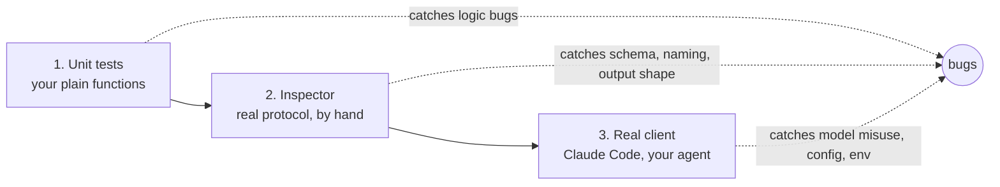

# Build an MCP server

## Why this matters

In [3.6](/part-03-agents/3.6-mcp-using) you were the host: you wrote the client side and decided what to trust. Building a server shows the protocol from the other side, and it changes how you read every server you will ever install. Once you have written a `tools/list` response yourself, a bloated tool list, a vague description or a missing error path stops looking like "how MCP is" and starts looking like a design decision somebody made.

It is also one of the most useful small things you can build. A server turns "something your code can do" into "something every MCP-capable agent can do", including Claude Code, your own loop from [3.2](/part-03-agents/3.2-agent-loop), and whichever harness you try next. The study repo is a good subject: it has structured data (chapter frontmatter), free text (your notes) and one place an agent could legitimately write (the study log).

**Learning goals**

- Build a TS MCP server with tools and a resource
- Test it with the MCP inspector
- Use it from Claude Code and from your own agent

## Explanation

### What a server is, in code

From the outside a server is a process that answers JSON-RPC requests like `tools/list` and `tools/call` ([3.6](/part-03-agents/3.6-mcp-using#what-a-conversation-looks-like-on-the-wire) showed the messages). From the inside, the TypeScript SDK reduces it to four pieces:

1. **An `McpServer` instance**, which holds your name, version and registrations.
2. **Registrations**: `registerTool`, `registerResource`, `registerPrompt`, each a name, a config object and a handler.
3. **A schema library.** The SDK's own tutorial uses Zod, and says the Zod `inputSchema` is the only schema you write: the SDK derives the JSON Schema the model sees, validates arguments before your handler runs, and infers the handler's argument types ([first server tutorial](https://github.com/modelcontextprotocol/typescript-sdk/blob/main/docs/get-started/first-server.md)).
4. **A transport entry point.** For a local server that is `serveStdio`, which takes a factory function and owns the stdin/stdout plumbing.

Here is the smallest useful shape. The example is a made-up inventory server, not the practice; the imports and call shapes follow the tutorial and the [tools page](https://github.com/modelcontextprotocol/typescript-sdk/blob/main/docs/servers/tools.md) of the SDK docs:

```ts
import { McpServer } from '@modelcontextprotocol/server'
import { serveStdio } from '@modelcontextprotocol/server/stdio'
import * as z from 'zod/v4'

function createServer(): McpServer {
  const server = new McpServer({ name: 'inventory', version: '1.0.0' })

  server.registerTool(
    'find_items',
    {
      description: 'Find inventory items whose name contains the query. Returns one name per line.',
      inputSchema: z.object({
        query: z.string().describe('Text to match against item names'),
        limit: z.number().int().max(25).optional(),
      }),
    },
    async ({ query, limit }) => {
      const names = findItems(query).slice(0, limit ?? 10)
      return { content: [{ type: 'text', text: names.join('\n') || 'No matches.' }] }
    },
  )
  return server
}

void serveStdio(createServer)
console.error('inventory server running on stdio') // stderr, never stdout
```

Three things to notice. The server is constructed by a **factory**, because the SDK builds an instance per connection. The handler returns `content`, the same typed-block array you unpacked in 3.6, and any "failure" you want the model to see is a normal result (`isError: true`) rather than an exception. And the last line writes to **stderr**: stdout is the protocol channel, so one stray `console.log` corrupts the stream ([serving over stdio](https://github.com/modelcontextprotocol/typescript-sdk/blob/main/docs/serving/stdio.md)). That is the same rule 3.6 gave from the client's side; on the server's side it is the single most common first-hour bug.

The packages are the v2 line: `@modelcontextprotocol/server` for servers and `@modelcontextprotocol/client` for clients, ES modules only, run directly with `tsx` so there is no build step ([first server tutorial](https://github.com/modelcontextprotocol/typescript-sdk/blob/main/docs/get-started/first-server.md)). As 3.6 warned, older tutorials import the v1 `@modelcontextprotocol/sdk` package and a different `McpServer` import path; check which package an example uses before copying it.

::: info 📖 Read now
[MCP TypeScript SDK: Build a server (first-server tutorial)](https://github.com/modelcontextprotocol/typescript-sdk/blob/main/docs/get-started/first-server.md) · docs · ~15 min · **essential**

Look for: the three imports, the factory passed to `serveStdio`, why `type=module` matters, and the one-line command that runs the server under the Inspector. This is the page to keep open during the practice, as the client tutorial was in 3.6.
:::

### The server-side checklist: what the SDK does and doesn't do

The SDK validates input against your schema for you; arguments that fail validation come back to the model as a tool result with `isError: true` before your handler runs ([SDK tools docs](https://github.com/modelcontextprotocol/typescript-sdk/blob/main/docs/servers/tools.md)). Everything else about the quality of the server is yours. The spec's own security section for tools lists what servers **must** do: validate all tool inputs, implement proper access controls, rate limit tool invocations and sanitize tool outputs ([spec: Tools, security considerations](https://modelcontextprotocol.io/specification/2026-07-28/server/tools)). For a local, single-user stdio server the rate limit is mostly academic, but the other three are not: your server runs with your privileges, and the text it returns goes into a model's context.

### Designing the tools: reuse 3.3

Everything in [3.3](/part-03-agents/3.3-tool-design) applies unchanged, because an MCP tool definition *is* the triple you designed there: `name`, `description`, `inputSchema` ([spec: Tool](https://modelcontextprotocol.io/specification/2026-07-28/server/tools)). The differences are about who your callers are.

- **You don't know the host.** Your own agent, Claude Code and another vendor's harness will all see your tools. So the description carries all the guidance; you can't rely on a system prompt to explain it. Write the description for a model that has seen nothing else about your project.
- **Names.** The spec says names should be 1 to 128 characters of letters, digits, `_`, `-` and `.`, and unique within a server. Hosts that aggregate several servers will prefix yours (Claude Code uses `mcp__server__tool`, as in [3.6](/part-03-agents/3.6-mcp-using#putting-mcp-tools-into-your-loop)), so don't bake the server name into every tool: `list_chapters`, not `study_repo_list_chapters`.
- **Outputs are your budget.** The host will cap what it takes, but you know what is high signal. Claude Code warns when a tool's output exceeds 10,000 tokens and limits it to 25,000 by default ([Claude Code MCP docs](https://code.claude.com/docs/en/mcp)). A tool that returns whole files by default is a context-cost bug in every host.
- **Errors are results.** The spec splits errors into protocol errors (unknown tool, malformed request) and tool execution errors (`isError: true`: bad input, business-logic failure) that carry "actionable feedback that language models can use to self-correct" ([spec: error handling](https://modelcontextprotocol.io/specification/2026-07-28/server/tools)). A handler that throws is the third, accidental path. Catch what you can predict and say what to do next: "No chapter 9.99. Valid ids look like 3.7; call list_chapters to see them."
- **Statelessness.** The 2026-07-28 revision has no protocol-level session, so a server can't count on per-connection state. The spec's guidance is to return an explicit handle from a creation tool and accept it on later calls, and to say the handle's lifetime in the description ([spec: Stateful tools](https://modelcontextprotocol.io/specification/2026-07-28/server/tools)). Your practice server needs none of this, because each call reads files fresh, but it is the reason not to cache "the current chapter" in a module variable.

**Structured output.** A tool may declare an `outputSchema` and return `structuredContent` next to the text. The spec says a tool that returns structured content should also return the serialized JSON in a text block, for compatibility ([spec: structured content](https://modelcontextprotocol.io/specification/2026-07-28/server/tools)). Use it when callers are programs (your own agent could parse it); for a model reading the result, a compact text rendering is usually better. The spec's note on the name: `structuredContent` is server-produced result data, unrelated to LLM "structured outputs" (schema-constrained generation, from [2.5](/part-02-programming-with-llms/2.5-structured-output)).

**Annotations.** A tool can carry hints such as `readOnlyHint` and `destructiveHint`, which hosts use to decide on approval prompts; the SDK docs stress they don't change how the tool runs ([SDK tools docs](https://github.com/modelcontextprotocol/typescript-sdk/blob/main/docs/servers/tools.md)). The spec's trust rule goes the other way: clients must treat annotations as untrusted unless the server is trusted ([spec: Tool](https://modelcontextprotocol.io/specification/2026-07-28/server/tools)). Mark your write tool honestly, and don't count on the hint as your only safeguard; the safeguard is what the code refuses to do.

A server's tools also fall into read-only and writing ones, and the two deserve different care:

| Kind | Study-repo example | Care it needs |
|---|---|---|
| Read, structured | List chapters with status | Filters so the default answer is small; clear empty and not-found results |
| Read, free text | Search notes | Result cap, snippets not whole files, never read outside `notes/` |
| Write | Append a line to the study log | Narrowest possible effect, validated input, `destructiveHint` honest, confirmation by the host |

### Resources and prompts

Of the three primitives, tools are the ones a model drives. Resources and prompts are the other two, and the spec's distinction from 3.6 holds from the server side: you offer them, and the host or user decides when they are used.

A **resource** is data identified by a URI that a client can read. In the SDK, `registerResource` takes a name, a fixed URI, metadata and a read callback; the callback returns `{ contents: [...] }`, where each item echoes the `uri` it answers for and carries `text` or a base64 `blob` ([SDK resources docs](https://github.com/modelcontextprotocol/typescript-sdk/blob/main/docs/servers/resources.md)). A **`ResourceTemplate`** registers a URI pattern instead of one URI; the matched variables reach the callback, and its `list` key is required, so pass `undefined` when the instances are unbounded, or a callback to make them show up in `resources/list`. For this repo, `study://glossary` could be a fixed resource and `study://chapter/{id}` a template.

Is a resource worth it when a tool could return the same text? Ask who should trigger the read. A resource is context that a *person* picks (in Claude Code, `@` mentions list resources next to files, per its [MCP docs](https://code.claude.com/docs/en/mcp)); a tool is something the *model* decides to call. If the model needs chapter text mid-task, it needs a tool; if you want to hand it the glossary at the start of a conversation, a resource is the right fit. Many servers offer both for the same data. Your own agent will ignore resources unless you decide how they reach the context (3.6 raised this question), so when you test from your agent in practice, expect to use tools.

A **prompt** is a server-defined message template with arguments, surfaced in Claude Code as a slash command named after the server ([SDK prompts docs](https://github.com/modelcontextprotocol/typescript-sdk/blob/main/docs/servers/prompts.md); [Claude Code MCP docs](https://code.claude.com/docs/en/mcp)). `registerPrompt` takes a name, a config with an optional Zod `argsSchema`, and a callback returning `{ messages }`, each with a `role` and one content block. The right use is a workflow you repeat: "plan today's session from my chapter statuses" as `/mcp__study__plan_session`. It is the least-used primitive, and the practice makes it optional.

::: info 📖 Read now
[MCP TypeScript SDK: Resources](https://github.com/modelcontextprotocol/typescript-sdk/blob/main/docs/servers/resources.md) · docs · ~10 min · optional

Look for: the difference between a fixed resource and a template, what `list: undefined` means, and where `mimeType` goes. Skim [Prompts](https://github.com/modelcontextprotocol/typescript-sdk/blob/main/docs/servers/prompts.md) afterwards; it is shorter.
:::

### Testing and debugging

A server has a testing advantage over a model-driven feature: its behaviour is deterministic. Use that, in three layers, cheapest first.



**1. Plain functions first.** Keep the logic (parse frontmatter, search files, append a line) in ordinary functions that know nothing about MCP, and keep the handlers thin. Those are testable with `node --test`, like the rest of this repo, and a failing test points at your logic rather than at the protocol.

**2. The Inspector.** The MCP Inspector is the reference tool for testing and debugging servers; it ships as one package with three clients: a web UI, a CLI and a terminal UI ([Inspector docs](https://modelcontextprotocol.io/docs/2026-07-28/tools/inspector)). Pass it the command that launches your server:

```sh
npx @modelcontextprotocol/inspector npx tsx src/index.ts   # web UI; prints a URL with a per-launch token
npx @modelcontextprotocol/inspector --cli node server.js --method tools/list   # scriptable, no browser
```

The first form is the one the SDK tutorial uses; the second (CLI with `--method tools/list`) is from the Inspector docs, along with `--method tools/call --tool-name ... --tool-arg k=v` for calling a tool. In the web UI you see your tools exactly as a client receives them: if the description you wrote reads badly there, a model will have the same problem. Call each tool by hand, with good input, with bad input, and with input that matches nothing. Watch the raw messages. The Inspector also stores secrets you give it (OAuth tokens and stdio `env:` values) in the OS keychain where available, per its docs, so don't paste real credentials into it casually.

**3. A real client**, and in-process tests. The SDK's testing guide says there is no in-process shortcut for stdio: use `StdioClientTransport` to spawn the real server process and `close()` it when done; handler failures come back as ordinary results with `isError: true`, not as exceptions ([SDK testing guide](https://github.com/modelcontextprotocol/typescript-sdk/blob/main/docs/testing.md)). Your own client module from 3.6 already does this, which makes your agent the integration test.

Debugging habits that save time:

- **If the host says "failed to connect", run the server's command by hand in a terminal.** A crash on startup (missing import, wrong Node version) is visible there. In Claude Code, `claude mcp list` and `/mcp` show each server's status ([Claude Code MCP docs](https://code.claude.com/docs/en/mcp)).
- **Log to stderr**, deliberately and verbosely while developing. It is the only channel you have.
- **If the model misuses a tool, look at the definition in the Inspector first.** Almost every "the model is dumb" report is a description or schema problem; this was the 3.3 lesson.
- **Check startup time.** Claude Code has a startup timeout for servers, configurable with `MCP_TIMEOUT`, and a per-server `timeout` field ([Claude Code MCP docs](https://code.claude.com/docs/en/mcp)). A server that scans a thousand files at boot is a server that sometimes doesn't connect.

::: info 📖 Read now
[MCP Inspector: documentation](https://modelcontextprotocol.io/docs/2026-07-28/tools/inspector) · docs · ~15 min · **essential**

Look for: the three launch modes, how to pass a stdio command, the CLI form for `tools/list` and `tools/call`, and the secrets warning. Then open the Web client page it links to for the tab-by-tab walkthrough.
:::

::: tip 📖 Read now
[MCP TypeScript SDK: Testing](https://github.com/modelcontextprotocol/typescript-sdk/blob/main/docs/testing.md) · docs · ~10 min · optional

Look for: why stdio servers are tested by spawning the real process, and how handler failures surface in a test. Much of the page is about HTTP serving, which your first server doesn't need.
:::

### Packaging and configuration

A stdio server is not a product until a host can start it. Configuration is a command line, and it is where the sharp edges are.

**For Claude Code**, the syntax is `claude mcp add [options] <name> -- <command> [args...]`: everything after `--` is passed to the server untouched, and options like `--env` and `--scope` go before it ([Claude Code MCP docs](https://code.claude.com/docs/en/mcp)). Scope decides where the entry is stored: `local` (the default, only you in this project), `project` (a `.mcp.json` file shared through the repo) or `user` (all your projects). Claude Code prompts for approval before using project-scoped servers from `.mcp.json`; and in non-interactive runs (`claude -p`, Agent SDK sessions) it can't show that prompt and loads project-scoped servers without asking, per the same page. A project-scoped entry is a command that runs on every collaborator's machine, which is the 3.6 security lesson turned on yourself.

The `.mcp.json` shape for a local server is the one you already read in 3.6:

```json
{
  "mcpServers": {
    "study": {
      "command": "npx",
      "args": ["tsx", "/absolute/path/to/server.ts"],
      "env": { "STUDY_ROOT": "/absolute/path/to/ai-engineering" }
    }
  }
}
```

Design decisions that matter more than the syntax:

- **Absolute paths, or paths the server derives itself.** A host decides the working directory, not you. Resolve the repo root from the server file's own location (or an environment variable) instead of `process.cwd()`, and your server works from any project.
- **Config through environment variables.** Stdio has no auth in the protocol; credentials and settings come from the environment ([3.6](/part-03-agents/3.6-mcp-using#layers-and-transports)). Read them once at startup, fail with a clear stderr message if one is missing, and never echo them in tool output.
- **Pin and version.** The server's `name` and `version` are what clients see in `serverInfo`. Bump the version when a tool's schema changes; a client that cached `tools/list` should notice. (The spec lets a response say how long it may be cached, with `ttlMs` and `cacheScope`, and wants a deterministic tool order so clients and model prompt caches can reuse it: [spec: listing tools](https://modelcontextprotocol.io/specification/2026-07-28/server/tools).)
- **Distribution.** For a personal server, `npx tsx path/to/server.ts` is enough. To share one, publish to npm with a `bin` entry and let users run `npx -y your-package`, and read 3.6's security section from the perspective of the person who would be running it.
- **HTTP is the same factory.** The SDK serves one `createServer` over stdio or over HTTP, and the HTTP side adds authorization, sessions-or-not and deployment questions ([SDK serving docs](https://github.com/modelcontextprotocol/typescript-sdk/tree/main/docs/serving)). That belongs to [8.6](/part-08-production/8.6-streaming-ui-auth); a local study server doesn't need it.

::: info 📖 Read now
[Claude Code: Connect to tools via MCP](https://code.claude.com/docs/en/mcp) · docs · ~15 min · **essential**

You read the client half in 3.6. This time look for: `claude mcp add` with `--` and `--scope`, the `.mcp.json` format, the approval prompt for project servers, `claude mcp list` and `/mcp` for status, and the startup and output limits (`MCP_TIMEOUT`, 25,000 tokens by default). Look, too, for how MCP resources and prompts appear to the user.
:::

### Securing your own server

In 3.6 you judged other people's servers. Now you are the supplier, so apply the same checklist to yourself:

- **Confine the filesystem.** A tool that takes a path or a chapter id and builds a file path is a path-traversal risk, exactly as for the memory tool in [3.5](/part-03-agents/3.5-memory). Resolve the final path and refuse anything outside the directory you intended (`notes/`, `book/`). Prefer taking an id and looking it up in a list you built over taking a path.
- **Keep the write tool narrow.** One that appends a dated line to a known file under a known heading, with a length cap, is a different animal from "write text to any file". If the model is tricked by text in a note it searched (prompt injection arrives through your read tools too), the worst it can do should be a bad log line.
- **Treat what you return as untrusted text.** Notes you wrote last month are data, but a note that contains "ignore previous instructions" is still text that lands in a model's context. For this repo that is low risk; for a server over email or web pages it is the core risk, covered in [8.1](/part-08-production/8.1-prompt-injection).
- **Describe the effects honestly.** Mark the write tool as writing; say in its description what it changes.

The 3.6 reading on [security best practices](https://modelcontextprotocol.io/docs/2026-07-28/tutorials/security/security_best_practices) split risks into client-builder and server-author halves; the second half, token passthrough and confused deputy, applies once your server holds credentials for another service and serves more than one user.

## Practice

**Brief:** Build an MCP server in `project/` that exposes this study repo: chapter list and status, search notes, append to the `PROGRESS.md` log. Connect it to Claude Code.

**Where:** a step in the growing `project/` (see `project/ROADMAP.md`, step 6). It is a separate entry point from your agent: a new folder, for example `project/mcp-study/`, with its own `package.json` if you want it to stand alone. It builds on the MCP client from step 5 in [3.6](/part-03-agents/3.6-mcp-using). Notes go in `notes/mcp-building.md`. You write all the code; I haven't provided any.

**Steps:**

1. **Design before code.** In your notes, write the tool list: for each of three tools (`list_chapters`, `search_notes`, `append_progress_log` are the suggested names), the name, a description written for a model that has never seen this repo, the input schema, and what the output looks like on success, on empty and on error. Check each against the 3.3 checklist (granularity, names, poka-yoke, output size). Decide what `list_chapters` returns by default so the answer is small, and how filtering works (by part, by status).
2. **Scaffold.** Create the project (ES modules, `@modelcontextprotocol/server`, `zod`, `tsx`), copy the minimal shape from the first-server tutorial, and register a single `list_chapters` tool that returns a hard-coded answer. Run it under the Inspector and confirm you see the tool and can call it.
3. **Implement `list_chapters`.** Read chapter frontmatter from `book/part-*/*.md` (the repo already parses it in `scripts/`; read that code before writing your own, and decide whether to reuse or reimplement it). Return id, title, tier, status and written-or-stub. Put the logic in plain functions with `node --test` tests, and keep the handler thin. Resolve the repo root from the server file's location or an environment variable, not `process.cwd()`.
4. **Implement `search_notes`.** Search `notes/` (and any other folder you decide on, justified in your notes). Return file path, line number and a short snippet per match, capped in count and in snippet length, with a visible "N more matches, narrow your query" line when capped. Make a search that finds nothing return a useful message, not an empty string.
5. **Implement `append_progress_log`.** Append one dated line to the "My log" section of `PROGRESS.md`. Decide and write down: the input (text only? date defaulted by the server?), the length cap, how you find the section, what happens if it's missing, and which file the tool can ever touch. Mark it with annotations that tell the truth. Note that `PROGRESS.md` is yours, and that the repo's agents are told never to write there, so this tool is a deliberate change to that rule, to be used only on your instruction; say so in the tool description.
6. **Add one resource** (`study://glossary` as a fixed resource, or `study://chapter/{id}` as a template). Check in the Inspector that it lists and reads, and in Claude Code that it appears in the `@` menu. Optional: add one prompt, such as planning a study session from chapter statuses.
7. **Break it on purpose.** Through the Inspector or CLI mode call each tool with bad input: an unknown chapter id, a path-traversal attempt such as `../../.env`, an enormous log line, a missing `PROGRESS.md` (temporarily rename a copy, not your real file). Every case should produce a result you have read and judged helpful; none should throw, hang, or touch a file outside your allowlist. Then run `claude mcp add` with a wrong path and read what the failure looks like, and fix it.
8. **Connect it to Claude Code** with `claude mcp add` (stdio, absolute paths, your chosen scope; decide deliberately between local and project). Verify with `/mcp`. Ask Claude Code three questions that need the server: which chapters are `reading`, where you wrote about a topic in your notes, and add a log line. Record which tool names it used and whether the descriptions were enough, revising the descriptions if not.
9. **Connect it to your own agent** through the client module from 3.6, using the same `.mcp.json` shape. Run the same three tasks on a local model and on a paid model from [Landscape](/landscape) (a few runs; record any spend in `costs.md`). Note differences in tool choice and argument quality, and what you changed in a description because of them.
10. **Write down** the cost of each tool definition in tokens (reuse your 3.4 tracking), what you'd change if the server had to serve other people (auth, rate limits, per-user data), and what building this taught you about the client you wrote in 3.6. Commit.

**Done when:**

- The server starts with `npx tsx` and shows three tools and at least one resource in the Inspector, with descriptions you would be comfortable having a stranger's model read.
- `list_chapters` and `search_notes` return capped, useful output, including for empty and not-found cases; `append_progress_log` can only append a bounded line to `PROGRESS.md`.
- The bad-input cases in step 7 each produce a readable error result; nothing throws and nothing reads or writes outside the intended folders. Pure logic has `node --test` tests.
- Nothing is written to stdout except protocol messages; logs go to stderr.
- Claude Code lists the server in `/mcp`, calls its tools, and your own agent does the same through your 3.6 client, with the same server and the same config shape.
- `notes/mcp-building.md` has the tool design, the Inspector observations, what you changed in descriptions after watching real use, and the token cost of the definitions.
- You can say, from your own run, which of the three tools the models used correctly on the first try and why, and what a resource gave you that a tool would not.

## Check questions

1. Your stdio server works in the Inspector but Claude Code shows it as failed, and the log says it received invalid JSON from the server. What is the most likely cause, and where should diagnostics go instead?

   <details><summary>Answer</summary>

   Something wrote to stdout that is not a protocol message, most commonly a `console.log`. On stdio the host parses every stdout line as a protocol message, so any other output corrupts the stream. Diagnostics go to stderr (`console.error`). (A server that crashes on startup is the other usual suspect: run the command by hand to see it.)

   </details>

2. Your server's `append_progress_log` handler throws an exception when `PROGRESS.md` is missing. Why is that worse than returning an error result, and what should the result say?

   <details><summary>Answer</summary>

   An exception is an accidental protocol-level failure: the model gets a generic error, or nothing, and has nothing to act on. The spec splits errors into protocol errors, which the model is unlikely to recover from, and tool execution errors (`isError: true`) that carry actionable feedback the model can use to self-correct. The result should say what happened and what to do, for example that the log file wasn't found at the expected path and the user should check the repo setup, rather than inviting a blind retry.

   </details>

3. A resource and a tool could both return the glossary. Who triggers each, and which would you register for "the model needs a definition mid-task"?

   <details><summary>Answer</summary>

   A resource is application- or user-driven: the host or person decides to attach it (in Claude Code, via the `@` menu). A tool is model-controlled: the model decides to call it. For mid-task needs, register a tool, because the model has to be able to ask. A resource is for context a person hands over at the start; many servers offer both for the same data.

   </details>

4. Why shouldn't you use `process.cwd()` to find the repo root in a stdio server, and what do you use instead?

   <details><summary>Answer</summary>

   The host chooses the working directory when it launches the server, so the same code would read different directories under Claude Code, your agent and the Inspector. Resolve the root from the server file's own location or from an environment variable supplied in the config's `env` block, and fail with a clear stderr message if it isn't valid.

   </details>

5. You mark `append_progress_log` with `destructiveHint: false` and `readOnlyHint: false`. Is that enough to make it safe? What do clients do with annotations, and what is your actual safeguard?

   <details><summary>Answer</summary>

   No. Annotations are hints for clients, for example to decide on approval prompts; they don't change what the tool does, and the spec says clients must treat them as untrusted unless the server is trusted. The real safeguard is in the code: it can only append a bounded, validated line to one known file, so even a manipulated model can do little harm. Honest annotations and a clear description are good practice on top of that.

   </details>

## My understanding

<!-- Written by the learner, in their own words. Agents never fill this in. -->
