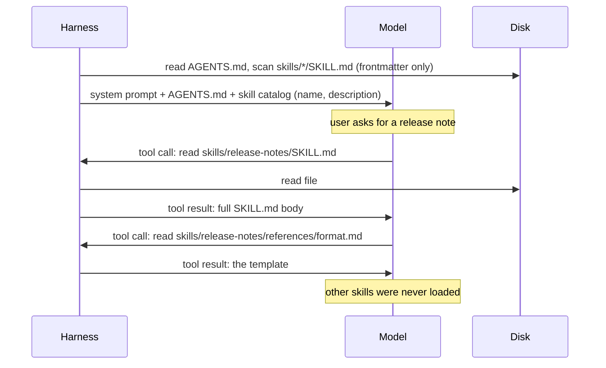

# AGENTS.md and agent skills

## Why this matters

Every session of your agent starts from zero. It doesn't know that this repo runs tests with `npm run check`, that `src/legacy/` must not be copied, or how your team writes a release note. You can retype that every time, or you can put it in files the agent finds by itself. Two open formats now cover this. **AGENTS.md** holds the project instructions that are always true. **Agent skills** hold procedures that are only sometimes needed, and they load only when a task calls for them.

Both are [context engineering](/part-03-agents/3.4-context-engineering) written down as file formats. AGENTS.md is a fixed cost paid on every turn, so it has to be short. A skill costs a sentence until it's used, so you can have dozens. Both are plain markdown, so any harness can read them, including the one you are building in `project/`. In this chapter you will see what each format specifies, what the evidence says about writing them, and how a harness implements them. Then you add both to your agent.

**Learning goals**

- Write an effective AGENTS.md/CLAUDE.md
- Explain progressive disclosure in agent skills
- Write a skill and load it in your own agent

## Explanation

### Two kinds of durable context

[3.4](/part-03-agents/3.4-context-engineering) sorted what fills the window by when it is paid for. Project instructions and skills sit at the two ends of that scale:

| | Project instructions (AGENTS.md, CLAUDE.md) | Agent skills (SKILL.md folders) |
|---|---|---|
| Loaded | At session start, in full | Name and description at start; body when a task matches; extra files when the body points to them |
| Cost | Every token, every turn | About a sentence per skill until used |
| Holds | Facts and rules that apply to almost every task | Procedures and reference material for a class of task |
| Who decides it loads | The harness | The model (or the user, with a command) |
| Failure mode | Bloat: rules that crowd out the task | Never triggering, or triggering on the wrong task |

The last column is about **who decides**. Project instructions are injected by your code, so they are always there. A skill loads only if the model reads its one-line description and decides it's relevant, so the description works much like a tool description: the model reads it to decide whether to use the skill ([3.3](/part-03-agents/3.3-tool-design) applies here too).



### AGENTS.md: purpose and adoption

AGENTS.md is "a simple, open format for guiding coding agents", described as "a README for agents" ([agents.md](https://agents.md)). The README is for humans. AGENTS.md holds the extra detail an agent needs that would clutter a README: build and test commands, code style, testing instructions, security notes, commit and PR conventions. It is plain markdown with no required fields ("AGENTS.md is just standard Markdown. Use any headings you like").

The format specifies very little: the file name and where it goes. In a monorepo you put one in each package. Agents read the nearest file in the directory tree, and "the closest AGENTS.md to the edited file wins; explicit user chat prompts override everything" ([agents.md](https://agents.md), FAQ). The site says it is used by over 60,000 open-source projects and lists more than twenty agents and tools that read it, among them Codex, Cursor, Gemini CLI, GitHub Copilot's coding agent, Aider, opencode and VS Code. It is now stewarded by the Agentic AI Foundation. [0.3](/part-00-catch-up/0.3-standards-and-orgs) covers its history (OpenAI, August 2025) and governance.

What the format doesn't specify is *how* a harness loads the file. That varies between harnesses, and you should know the differences before you rely on a file in a real repo:

| Harness | What it loads | Source |
|---|---|---|
| The format itself | The nearest AGENTS.md to the edited file wins | [agents.md](https://agents.md) |
| Codex | One file per directory, from the project root down to the current directory, **concatenated** in that order, so later (closer) files override earlier ones. `AGENTS.override.md` replaces `AGENTS.md` in the same directory. Loading stops when the combined size reaches `project_doc_max_bytes`, 32 KiB by default. Read once when Codex starts. | [Codex: Custom instructions with AGENTS.md](https://learn.chatgpt.com/docs/agent-configuration/agents-md) |
| Claude Code | Its own `CLAUDE.md` hierarchy. It reads `AGENTS.md` only when there is no `CLAUDE.md` in the working directory or above it, unless you import it | [Claude Code memory docs](https://code.claude.com/docs/en/memory#agents-md), covered in [6.2](/part-06-claude-code/6.2-claude-md-and-memory) |

So "nearest wins" in the format means "all of them, concatenated, with the nearest last" in Codex, and the cap means a long root file can silently push out a package-level one. The common workaround for Claude Code is a `CLAUDE.md` that imports `AGENTS.md`, or a symlink (the agents.md FAQ suggests renaming an existing file to `AGENTS.md` and leaving a symlink under the old name). For your own harness, the lesson is that loading rules are a design decision. You will make them yourself in the practice.

::: info 📖 Read now
[agents.md](https://agents.md) · docs · ~10 min · **essential**

A single page. Look for: the sample file (which sections does it have, and which would your repo need?), the monorepo paragraph, and the FAQ answers on precedence and on whether the agent runs the test commands you list. Then compare that with the Codex page below: the format says "nearest wins", while Codex concatenates.
:::

::: info 📖 Read now
[Custom instructions with AGENTS.md](https://learn.chatgpt.com/docs/agent-configuration/agents-md) (Codex docs) · docs · ~10 min · optional

Codex's loading rules in full. Look for: the global file in `~/.codex`, the walk from the project root down to the current directory, `AGENTS.override.md`, the 32 KiB cap, and the fallback file names. These are the details your own loader has to decide.
:::

### What belongs in project instructions

You might expect the answer to be "as much as possible." The best evidence so far says the opposite. Gloaguen et al. ran coding agents (Claude Code, Codex and Qwen Code, with four model pairings) on real repository issues with and without a context file ([Evaluating AGENTS.md](https://arxiv.org/abs/2602.11988), v3, 2026). From the paper:

- Context files did not significantly change task success. LLM-generated files lowered the average resolution rate by about 2%. Developer-written files raised it by 2.4%, which was not statistically significant.
- They did change cost: inference cost went up by about 20% or more with generated files, because agents followed the instructions and explored, tested and reasoned more (a few extra steps per task).
- Agents followed the instructions well, but repository overviews, "although popular and recommended by model providers, are not helpful".
- The authors' advice: leave out LLM-generated files for now, and limit human-written ones to "specific additional instructions beyond what is already available in the codebase".

That is one paper, mostly on Python repositories, and it measures issue resolution, not every use. It still fits the guidance you get from the [6.2](/part-06-claude-code/6.2-claude-md-and-memory) filter for CLAUDE.md, which applies unchanged to AGENTS.md: for each line, ask whether the agent could find it by reading the code and whether it would actually look. If both answers are yes, cut the line ([Best practices](https://code.claude.com/docs/en/best-practices), "Tell Claude what it can't see"). The model already sees the code, so instructions are useful mainly where the code is misleading or silent.

What earns a line:

- **How to check work here.** The exact test, typecheck and lint commands, including the single-file form. Agents run the commands you list ([agents.md](https://agents.md), FAQ), so this line directly changes what the agent does.
- **Non-standard conventions.** Anything that differs from what a model would assume: a custom error helper, a banned library, a generated directory, a naming rule.
- **Traps.** Code that looks dead but is live, an env var that tests need, a command that is slow or destructive.
- **Boundaries.** What not to touch without asking. If the rule must never be broken, also enforce it in code (a permission check or hook). An instruction is context, not configuration ([6.2](/part-06-claude-code/6.2-claude-md-and-memory)).

What doesn't:

- Directory tours and architecture overviews (the paper's "not helpful" finding).
- Generic advice ("write clean code"), which can't be checked and changes nothing.
- Procedures you need only sometimes (release steps, writing a migration). They cost tokens on every task. Make them skills.
- Rules for one corner of the repo. Put a nested AGENTS.md in that directory.

A practical habit follows from this. Write the file by hand and keep it short. Add a line when you have corrected the agent for the same thing twice. Delete a line when the code makes it obvious. If you use a generator such as `/init`, treat its output as a draft to cut down, not a finished file.

### Agent skills: SKILL.md and metadata

A skill is "a directory containing a SKILL.md file" plus any scripts and resources the task needs ([Equipping agents for the real world with Agent Skills](https://www.anthropic.com/research/equipping-agents-for-the-real-world-with-agent-skills), Anthropic, Oct 16, 2025). Anthropic built the format for Claude and then published it as an open standard, Agent Skills, whose specification lives at agentskills.io ([0.3](/part-00-catch-up/0.3-standards-and-orgs) has the history). The layout:

```
release-notes/
├── SKILL.md          # required: frontmatter + instructions
├── scripts/          # optional: code the agent runs
├── references/       # optional: docs the agent reads when told to
└── assets/           # optional: templates, schemas, data
```

`SKILL.md` is YAML frontmatter followed by markdown. The specification defines these fields ([Specification](https://agentskills.io/specification)):

| Field | Required | Rule |
|---|---|---|
| `name` | yes | 1–64 characters, lowercase letters, digits and hyphens, no leading, trailing or double hyphen, **must match the folder name** |
| `description` | yes | 1–1024 characters, says what the skill does **and when to use it** |
| `license` | no | A licence name or a bundled licence file |
| `compatibility` | no | Up to 500 characters of environment requirements; most skills don't need it |
| `metadata` | no | A string-to-string map for anything else |
| `allowed-tools` | no | Experimental: tools pre-approved while the skill runs |

The body has no required format. The spec recommends step-by-step instructions, input and output examples and edge cases. Harnesses add their own fields. Claude Code, for example, adds `disable-model-invocation` (only the user can trigger the skill) and `context: fork` (run it in a sub-agent), and silently ignores fields it doesn't recognize ([Claude Code: Skills](https://code.claude.com/docs/en/skills)). Anything outside the spec's fields is harness-specific, so a skill that relies on them won't behave the same in another harness.

Here is a small, complete skill for this study repo:

```markdown
---
name: chapter-check
description: Checks a book chapter against this repo's chapter format and explains each failure. Use when asked to check, validate or lint a chapter in book/, or before committing a chapter.
---

# Checking a chapter

1. Run `npm run check -- <id>` (the id is the chapter number, e.g. `3.8`).
2. For each problem, read `references/rules.md` and quote the rule it breaks.
3. Fix only what the check reports. Never edit the "My understanding" section.

## Gotchas
- Quote chapter ids in frontmatter: YAML reads 1.10 as 1.1.
- A resource callout passes only if its URL is also in book/resources.md.
```

The description does two jobs: it says what the skill does, and it says when to use it, with words a user would actually type ("check", "validate", "lint"). Agents choose skills by matching the request against descriptions, so a vague one like "helps with chapters" never triggers. The spec's good and poor examples make the same point.

### Progressive disclosure

Skills load in three tiers. The spec gives a token budget for each ([Specification](https://agentskills.io/specification), "Progressive disclosure"):

1. **Metadata** (about 100 tokens): every skill's `name` and `description`, loaded at startup.
2. **Instructions** (under 5,000 tokens recommended, and `SKILL.md` under 500 lines): the full body, loaded when the skill is activated.
3. **Resources** (as needed): files in `scripts/`, `references/` and `assets/`, loaded only when the instructions point to them.

Anthropic's article explains why: the metadata "provides just enough information for Claude to know when each skill should be used", and because files load only on demand, the amount of context a skill can bundle "is effectively unbounded" ([Anthropic](https://www.anthropic.com/research/equipping-agents-for-the-real-world-with-agent-skills)). A script adds a fourth option: the agent can *run* `scripts/extract.py` and read only its output, so neither the script's code nor the file it processes has to enter the context. That is also why the article suggests code where you need a deterministic result.

This is the progressive disclosure idea from [3.4](/part-03-agents/3.4-context-engineering) (file names hint, a listing leads to a targeted read), with the hints written by the skill's author instead of found by the agent. Two writing rules follow:

- **Say when to load each file.** "Read `references/api-errors.md` if the API returns a non-200 status" works. "See references/ for details" doesn't, because the agent can't tell when it needs them ([Best practices for skill creators](https://agentskills.io/skill-creation/best-practices), "Structure large skills with progressive disclosure").
- **Keep references one level deep** from `SKILL.md`, not chains of files that point to more files ([Specification](https://agentskills.io/specification), "File references").

The same best-practices page has the most useful guidance on what goes in a skill. It overlaps with the AGENTS.md advice: add only what the agent would get wrong without it ("Would the agent get this wrong without this instruction?"). Pick a default instead of listing equal options. Teach a procedure rather than one specific answer. Collect **gotchas**, the environment-specific facts that "defy reasonable assumptions", in `SKILL.md` itself, because the agent may not recognize when it needs a separate file. And the starting point it recommends is real work, not a model's general knowledge: do the task once with an agent, note your corrections, then turn that into the skill.

::: info 📖 Read now
[Equipping agents for the real world with Agent Skills](https://www.anthropic.com/research/equipping-agents-for-the-real-world-with-agent-skills) (Anthropic, Oct 16, 2025) · article · ~15 min · **essential**

The article that introduced skills. Look for: the three levels in the PDF-skill example (which file is level 3 and why it isn't in `SKILL.md`), the paragraph on running code without loading it, the four development tips (start from evaluation, structure for scale, think from Claude's side, iterate with Claude), and the security section. Note that the article is about Claude products. The open spec below is what your own harness implements.
:::

::: info 📖 Read now
[Agent Skills specification](https://agentskills.io/specification) · docs · ~10 min · **essential**

Short and exact. Look for: the `name` rules (your loader will have to decide how strict to be), what a good `description` contains, the token budgets in "Progressive disclosure", and the `skills-ref validate` tool. If you only skimmed it in 0.3, read it properly now.
:::

::: info 📖 Read now
[Best practices for skill creators](https://agentskills.io/skill-creation/best-practices) · docs · ~20 min · optional

Read before you write your skill. Look for: "Add what the agent lacks, omit what it knows", "Provide defaults, not menus", the gotchas section pattern and the tip after it, and "Read agent execution traces, not just final outputs". The same advice applies to AGENTS.md.
:::

### Implementing skills in your own harness

Claude Code and Codex already implement all of this. Your agent in `project/` does not. The Agent Skills site has a guide for harness authors, and it breaks the work into five steps ([How to add skills support to your agent](https://agentskills.io/client-implementation/adding-skills-support)):

1. **Discover.** At startup, scan skill directories for subfolders that contain a file named exactly `SKILL.md`. Local agents usually scan a project scope and a user scope. The cross-client convention is `.agents/skills/`, and many also scan `.claude/skills/`. When two skills share a name, project overrides user, and you log a warning.
2. **Parse.** Split the frontmatter from the body and keep `name`, `description` and `location` (the absolute path) in a map keyed by name. Be **lenient**: warn but load on a name that doesn't match its folder; skip only when the description is missing or the YAML can't be parsed at all. The guide mentions a common case, an unquoted colon in a description (`description: Use when: ...`), which is invalid YAML that other harnesses accept.
3. **Disclose.** Put the catalog in the system prompt (or in the description of an activation tool), with a short instruction on how to load a skill. Leave out disabled skills. If there are none, leave the whole section out rather than show an empty list.
4. **Activate.** Use one of two designs. With **file-read activation**, the model calls your existing `read_file` on the `location`, and you need no new code. With a **dedicated tool** such as `activate_skill(name)`, you can constrain `name` to an enum of real skill names (so the model can't invent one), strip the frontmatter, wrap the body in tags such as `<skill_content name="...">`, list the skill's bundled files without reading them, and log each activation.
5. **Manage context over time.** Protect activated skill content from your compaction ([3.4](/part-03-agents/3.4-context-engineering)): losing it "silently degrades the agent's performance without any visible error". Skip a second activation of a skill that is already loaded.

The guide also has a trust warning. Project-level skills come from the repository you are working in, and that repository may be untrusted, so a freshly cloned repo could "silently inject instructions" into your agent. Anthropic's article says the same: install skills only from trusted sources and audit the scripts and anything that connects to the network ([Anthropic](https://www.anthropic.com/research/equipping-agents-for-the-real-world-with-agent-skills), "Security considerations"). AGENTS.md has the same risk. Both are text your harness puts into the context automatically, so an attacker who can edit a file in the repo can edit your agent's instructions. That is prompt injection with a file-based delivery route, covered in [8.1](/part-08-production/8.1-prompt-injection).

Claude Code shows the details a mature harness ends up deciding ([Claude Code: Skills](https://code.claude.com/docs/en/skills)): the description plus `when_to_use` text is cut at 1,536 characters in the listing; an invoked skill "enters the conversation as a single message and stays there across later turns" and is not re-read from disk; and after auto-compaction it re-attaches the most recent invocation of each skill, keeping the first 5,000 tokens of each within a combined 25,000-token budget. Your version can be much simpler, but it has to answer the same questions: how much catalog text, and what happens to a loaded skill when the history is compacted.

::: info 📖 Read now
[How to add skills support to your agent](https://agentskills.io/client-implementation/adding-skills-support) · docs · ~20 min · **essential**

This is the spec for your practice step. Look for: the tier table with token costs, the two places to put the catalog, the two activation patterns and the advantages listed for a dedicated tool, the lenient-validation list, and "Protect skill content from context compaction". Decide which pattern you'll build before you start coding.
:::

### Skills vs tools vs MCP

All three extend an agent, so they get confused. They differ in what they add and in what reaches the context:

| | Tool | MCP server | Skill |
|---|---|---|---|
| Adds | An action: code your harness runs ([3.3](/part-03-agents/3.3-tool-design)) | Actions, resources and prompts served by another process over a protocol ([3.6](/part-03-agents/3.6-mcp-using)) | Know-how: instructions, plus optional scripts and reference files |
| Model sees up front | Name, description, input schema of every tool | The same, for every tool the server exposes | Name and description only |
| On use | Your code runs; a result comes back | The server runs; a result comes back | Text is read into the context; scripts run through tools the agent already has |
| Needs | Code in the harness | A running server and a client | A folder of files and a way to read them |
| Good for | Something the model can't do with text | Sharing capabilities across harnesses and teams | How to do a task with the capabilities the agent already has |

They also stack. A skill can say "use the GitHub MCP server's `list_issues` tool, then group results by label like this". The MCP server provides the capability, and the skill provides the know-how to use it. A skill with no tools to act through can only describe what to do. A tool with no explanation is something the model has to figure out on its own.

The comparison also shows a context cost. Tools and MCP servers usually put full schemas in the context up front, which is why a large MCP setup gets expensive and why [3.9](/part-03-agents/3.9-advanced-tool-use) adds tool definitions loaded on demand. That is progressive disclosure for tools. Skills were designed for it from the start.

A quick rule for choosing:

- Does it need to do something your agent can't already do (call an API, query a database)? → a **tool**, or an **MCP server** if it should work across harnesses.
- Is it how to do something with what the agent already has (commands, files, steps, a template)? → a **skill**.
- Is it true for nearly every task in this repo, and short? → **AGENTS.md**.
- Must it never be broken? → code: a permission check, hook or sandbox, with the instruction as an explanation only.

## Practice

**Brief:** Teach `project/` to read an `AGENTS.md` at startup and to discover skills from a `skills/` folder (metadata first, full text on demand). Write one skill and check the agent uses it. You write the code; I haven't provided any.

**Where:** a step in the growing `project/` (see `project/ROADMAP.md`, step 7, built on step 3, the context tracking from 3.4). Write your findings in `notes/agents-md-and-skills.md`.

**Steps:**

1. **Decide the loading rules first.** In the notes, write down: where your agent looks for `AGENTS.md` (only the working directory, or the walk from the git root down like Codex?), what happens with more than one file, a size cap and what happens past it, and where the skill folders are (`project/skills/` for this step; optionally also `.agents/skills/`). Then decide on file-read or dedicated-tool activation and write one sentence on why.
2. **Load AGENTS.md.** Read it at startup and add it to the system prompt under a clear heading, with the path it came from. If the file is missing, start normally; if it is over your cap, warn. Log the token count it adds (reuse your 3.4 tracking).
3. **Write a real AGENTS.md** for a test directory the agent will work in (not this study repo, whose `CLAUDE.md` is for Claude Code). Use the filter from this chapter: test command, one non-standard convention, one trap, one boundary. Keep it under about 20 lines. Add one rule you can check in the output, such as "end every answer with the files you read".
4. **Discover skills.** At startup, scan `skills/*/SKILL.md`, parse the frontmatter (a small YAML library is fine), and build a map of `name → { description, location }`. Be lenient as the guide describes: warn on a name that doesn't match its folder, skip and log a skill with no description. Print the catalog with `--list-skills`.
5. **Disclose the catalog.** Add the names and descriptions to the system prompt with a two- or three-line instruction on how to activate a skill. If there are no skills, add nothing. Measure what the catalog costs in tokens.
6. **Activate on demand.** Either rely on `read_file` with the `location`, or add `activate_skill` with an enum of names that returns the body (frontmatter stripped, wrapped in a tag, bundled files listed but not read). Log every activation in the step log.
7. **Protect loaded skills.** Make your compaction from 3.4 keep activated skill content (or re-inject it after the summary). Don't load a skill twice in one session.
8. **Write one skill** that teaches something the model would get wrong without it, in your test directory's domain. Give it a `references/` file that the body tells the agent to read only in a stated situation. Validate it with `skills-ref validate` if you install it, or check the spec's `name` rules by hand.
9. **Predict, then test triggering.** Write five prompts: two that should trigger the skill, two that shouldn't, and one borderline. Predict each outcome in the notes, then run all five on local Qwen (and, optionally, a handful on a paid model, with the spend in `costs.md`). Record which ones activated, whether the reference file was read, and whether the output followed the skill.
10. **Fix the description.** Change only the description to fix a wrong trigger or a missed one, and rerun the five prompts. Then check your AGENTS.md rule: was it followed in every run?
11. **Write `notes/agents-md-and-skills.md`:** your loading rules and why, the catalog's token cost against the full skill body's, the trigger table before and after the description change, and one thing you would move between AGENTS.md and a skill after seeing the runs.
12. **Commit.**

**Done when:**

- The agent loads `AGENTS.md` at startup, shows where it came from, and starts cleanly without one. The step log records its token cost.
- `--list-skills` prints every discovered skill. A malformed skill produces a warning, not a crash.
- The system prompt contains only names and descriptions. The step log shows a skill body entering the context only after an activation, and a reference file only when the body's condition was met.
- Activated skill content survives a compaction, and a skill is never loaded twice in a session.
- The notes have the five-prompt trigger table before and after the description change, with the prediction next to each result.

## Check questions

1. A teammate runs `/init`, gets a 200-line AGENTS.md with a full architecture tour, and commits it. Using the evidence in this chapter, what do you expect, and what would you cut?

   <details><summary>Answer</summary>

   Expect little or no gain in task success and a real cost increase. In Gloaguen et al., LLM-generated context files lowered resolution rates slightly and raised inference cost by about 20%, because agents follow the instructions and explore and test more. Repository overviews in particular were not helpful. Cut everything the agent can find by reading the code (layout, stack, dependencies) and every generic rule. Keep the test and check commands, non-standard conventions, traps and boundaries. Move procedures into skills and corner-specific rules into nested files.

   </details>

2. Your repo has a root AGENTS.md (32 KB) and `packages/api/AGENTS.md`. You run Codex in `packages/api/`, and it ignores a rule from the package file. What is a likely cause, and how would the same layout behave under the agents.md "nearest wins" rule and in Claude Code?

   <details><summary>Answer</summary>

   Codex concatenates files from the root down and stops adding files once the combined size reaches `project_doc_max_bytes` (32 KiB by default), so a large root file can push out the package file. Fix: shrink the root file or raise the cap. Under the format's own rule, the nearest file (the package one) wins for files edited there. Claude Code reads `AGENTS.md` only if there is no `CLAUDE.md` in the working directory or above it, so in a repo with a `CLAUDE.md` neither file loads unless it is imported. The format names the file; each harness decides how to load it.

   </details>

3. Explain progressive disclosure in skills as three tiers with rough costs. Why can an agent have 50 skills installed but not 50 MCP servers?

   <details><summary>Answer</summary>

   Tier 1: name and description of every skill at startup (about 100 tokens each). Tier 2: the full `SKILL.md` body when the model activates it (under 5,000 tokens recommended). Tier 3: referenced scripts, references and assets only when the instructions call for them; scripts can be run without their code entering the context. Fifty skills cost a few thousand tokens of catalog. MCP servers usually put every tool's full name, description and input schema into the context up front, so fifty servers can fill a large part of the window before the task starts, unless the harness adds on-demand tool loading (3.9).

   </details>

4. Your skill never triggers, although its body is excellent. Where do you look first, and why there?

   <details><summary>Answer</summary>

   The `description`. Until activation, the model sees only the name and description, so it decides whether to load the skill from those alone. A description that says what the skill does but not when to use it, or that uses words different from the ones users type, won't match. Rewrite it to state both what and when, with the keywords of real requests, and test it on prompts that should and shouldn't trigger it. Then check that the harness actually shows the catalog (the skill wasn't skipped for a missing description or unparseable YAML, and wasn't filtered out).

   </details>

5. You clone an unfamiliar open-source repo and point your agent at it. It has an `AGENTS.md` and a `.agents/skills/` folder. What is the risk, and what should your harness do?

   <details><summary>Answer</summary>

   Both are text your harness loads into the context automatically, and the repo's authors (or anyone who got a change merged) control it. A malicious instruction or a skill script that sends data out over the network is prompt injection with a file-based delivery route. The harness should gate project-level skills (and ideally project instructions) on the user marking the folder as trusted, show what it loaded, and not rely on instructions for safety: the shell tool's permissions and sandbox (8.3) must hold even if the agent follows a malicious skill. Audit any skill's scripts before trusting it.

   </details>

## My understanding

<!-- Written by the learner, in their own words. Agents never fill this in. -->
