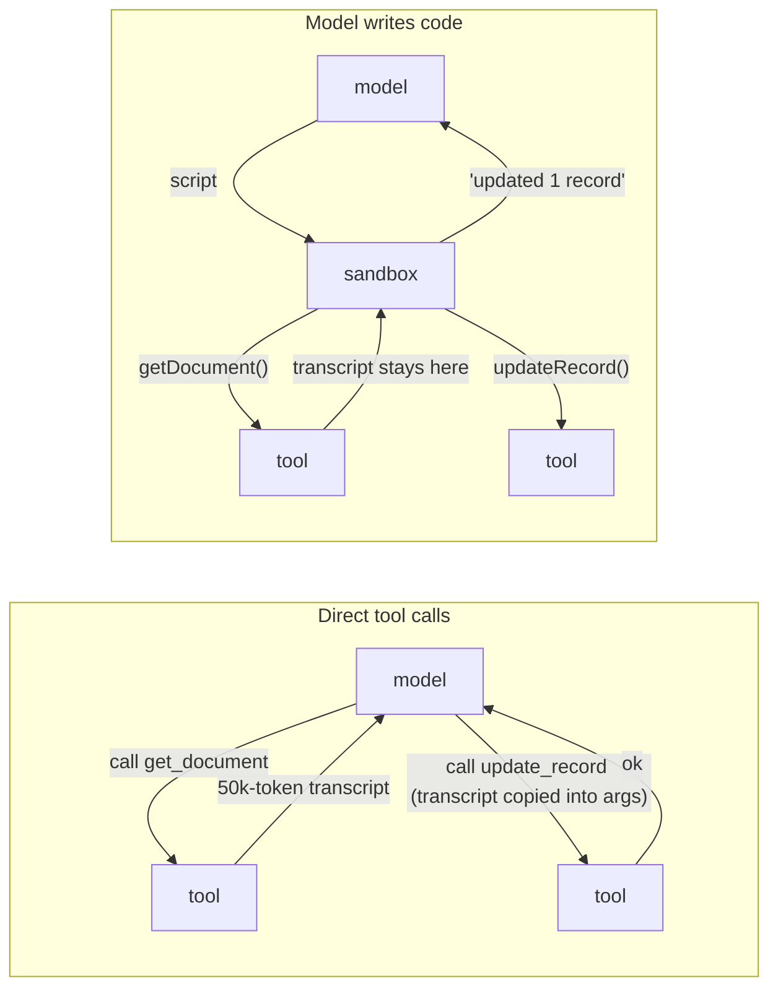

# Advanced tool use: tool search and code execution

## Why this matters

In [3.6](/part-03-agents/3.6-mcp-using) you connected one MCP server and measured what its tool definitions cost on every request. Connect four more and the arithmetic stops being a footnote: the definitions are sent before the user has said anything, on every turn, whether the model uses them or not. And once the agent does start working, every intermediate result (a 2,000-row query, a full transcript) passes through the model's context on its way to the next tool, even when the model only needed to copy it along.

Two ideas from 2025 attack those two costs, and both are now part of how harnesses work:

- **Tool search** (deferred loading): the model starts with a small index of tools and loads full definitions only for the tools it is about to use. Claude Code does this for MCP tools by default.
- **Code execution with tools**: instead of calling tools one at a time through the model, the model writes a short program that calls them, loops, filters, and returns only the result. Intermediate data never enters the context.

Both are context engineering ([3.4](/part-03-agents/3.4-context-engineering)) applied to the tool surface. Both trade tokens for a new moving part: a search step that can miss, or a code sandbox you have to secure and debug. This chapter is about when that trade is worth it, and the practice has you build the first one into `project/` and measure it.

**Learning goals**

- Explain tool search / deferred tool loading
- Explain programmatic tool calling and code execution with MCP
- Measure token savings

## Explanation

### What tool definitions cost

A tool definition is text: a name, a description, a JSON Schema. The provider renders it into the prompt. The Claude docs show the shape: when you pass `tools`, "the API constructs a special system prompt from the tool definitions", with the definitions in JSON Schema near the top ([Define tools](https://platform.claude.com/docs/en/agents-and-tools/tool-use/define-tools), "Tool use system prompt"). Local models do the same through their chat template ([0.2](/part-00-catch-up/0.2-the-stack)). So every tool you register is input tokens on every request, and in an agent loop it is input tokens on *every turn* of every request.

Anthropic's announcement of its advanced tool-use features gives a real-world size for this. A five-server setup (GitHub, Slack, Sentry, Grafana, Splunk) adds up to 58 tools and about 55K tokens "before the conversation even starts"; adding Jira (about 17K tokens) pushes the overhead past 100K, and the authors say they had seen definitions consume 134K tokens before optimization ([Introducing advanced tool use](https://www.anthropic.com/research/advanced-tool-use), published 2025-11-24). GitHub's 35 tools alone accounted for about 26K of those tokens in that example.

Tokens are the obvious cost. Three others matter as much:

1. **Selection accuracy.** More tools means more near-duplicates for the model to choose between. The Claude tool search docs put it directly: "Claude's ability to pick the right tool degrades once you exceed 30–50 available tools" ([Tool search tool](https://platform.claude.com/docs/en/agents-and-tools/tool-use/tool-search-tool)). Tool names from different servers (`search`, `search_issues`, `search_code`) compete, as you saw with prefixing in 3.6.
2. **Attention.** Definitions you don't use still sit in the context the model attends over. That is the "finite resource" framing from 3.4: every token you add draws down the budget for the tokens that matter.
3. **Latency.** More input tokens means more prefill time per turn, unless the prefix is cached ([2.7](/part-02-programming-with-llms/2.7-prompt-caching)).

To make it concrete, here is a **made-up** worked example sized like your project will be after the practice. The numbers are illustrative, not measured; your step 2 replaces them with real ones.

| | All tools loaded | With a search meta-tool |
|---|---|---|
| Tools registered | 36 | 36 |
| Tool definitions sent per request | 36 × ~350 = ~12,600 tokens | 4 core tools + `search_tools` ≈ 1,700 tokens |
| Definitions loaded on demand | 0 | 3 tools ≈ 1,050 tokens, from the turn they're found |
| Task of 8 turns: definition tokens over the run | ~100,800 | ~13,600 + the search turn's own cost |

The total looks dramatic, but notice what it doesn't say: whether the model still finds the right tool, how many extra turns the search costs, and how much of the "all tools" cost prompt caching would have absorbed anyway. Those are what you measure in the practice.

### Tool search: an index first, definitions on demand

The idea is the same one you met as *progressive disclosure* for skills in [3.8](/part-03-agents/3.8-agents-md-and-skills) and as *just-in-time retrieval* in 3.4: keep a lightweight pointer in context, load the heavy thing when it's needed. Applied to tools:

```mermaid
sequenceDiagram
  participant M as Model
  participant H as Harness
  participant R as Tool registry (all definitions)
  Note over M,H: Turn 1: model sees core tools + search_tools + a list of tool categories
  M->>H: search_tools("create github issue")
  H->>R: rank by name, description, parameter names
  R-->>H: github_create_issue, github_search_issues
  H-->>M: matches (names + one-line summaries); definitions now loaded
  Note over M,H: Turn 2: model sees the found definitions too
  M->>H: github_create_issue({ title, body, labels })
  H-->>M: result
```

The pieces a design has to decide:

- **What the model always sees.** The search tool itself, a handful of tools used in nearly every task, and a sentence saying which *categories* exist so the model knows that searching is worth trying. The Claude docs recommend exactly this: keep your "3–5 most frequently used tools non-deferred" and add a system-prompt line such as "You can search for tools to interact with Slack, GitHub, and Jira" ([Tool search tool](https://platform.claude.com/docs/en/agents-and-tools/tool-use/tool-search-tool), "Optimization tips").
- **What is searched.** Anthropic's built-in search matches tool names, descriptions, argument names and argument descriptions ([same page](https://platform.claude.com/docs/en/agents-and-tools/tool-use/tool-search-tool)). This puts new weight on 3.3's naming advice: a tool nobody can find by searching for the words a user would use is a tool that doesn't exist. Consistent prefixes (`github_`, `slack_`) let one query match a whole group.
- **How it ranks.** Anthropic offers two server-side variants: a regex variant where the model writes Python `re.search()` patterns, and a BM25 variant that takes natural-language queries ([same page](https://platform.claude.com/docs/en/agents-and-tools/tool-use/tool-search-tool), "Tool definition"). You can also run your own search (embeddings, as in [2.8](/part-02-programming-with-llms/2.8-embeddings-in-practice)) and return the matches. For a catalog of 30–100 tools, plain keyword scoring over names and descriptions is a reasonable first version; the embeddings recipe in the docs uses a catalog of only eight tools ([cookbook](https://platform.claude.com/cookbook/tool-use-tool-search-with-embeddings)).
- **How much a search returns.** The built-in search returns up to 5 tools by default and the model may raise the limit ([same page](https://platform.claude.com/docs/en/agents-and-tools/tool-use/tool-search-tool), "Limits"). Anthropic's code-execution article suggests a `search_tools` tool with a *detail level* parameter (name only, name and description, or full definition) so the model can browse cheaply before loading ([Code execution with MCP](https://www.anthropic.com/research/code-execution-with-mcp), "Progressive disclosure").
- **When it isn't worth it.** The docs list the cases where standard tool calling fits better: fewer than 10 tools, every tool used in every request, or very small definitions ([same page](https://platform.claude.com/docs/en/agents-and-tools/tool-use/tool-search-tool), "When to use tool search"). Search adds a turn, and the article names that latency cost explicitly ([Introducing advanced tool use](https://www.anthropic.com/research/advanced-tool-use)).

What Anthropic reported for it, from its own internal MCP evaluations: Opus 4 went from 49% to 74% and Opus 4.5 from 79.5% to 88.1% with tool search on, and the definition overhead in their example dropped from about 77K to about 8.7K tokens, an 85% reduction ([Introducing advanced tool use](https://www.anthropic.com/research/advanced-tool-use)). Read those as one vendor's internal numbers on its own models, not a law. The accuracy gain is the interesting part: fewer tools in view means fewer wrong choices.

::: info 📖 Read now
[Anthropic: Introducing advanced tool use on the Claude Developer Platform](https://www.anthropic.com/research/advanced-tool-use) · article · ~25 min · **essential**

The source for all three ideas in this chapter. Look for: the five-server token breakdown (which server costs the most, and why), the "when to use" and "less beneficial when" lists for each feature (they are the decision rules), the expense-report example for programmatic calling, and the trade-off sentences at the end of each section. The API identifiers in it (beta headers, `code_execution_20250825`) are from November 2025 and have since moved on; the docs pages below are current.
:::

#### How the Claude API does it, and how your harness can

On the Claude API, tool search is a built-in server tool. You still send *every* definition on every request, but mark most of them `defer_loading: true`; the docs stress that it "controls what enters the context window, not what you send in the request". The model searches, the API returns `tool_reference` blocks, and the API itself "automatically expands these references into full tool definitions" ([Tool search tool](https://platform.claude.com/docs/en/agents-and-tools/tool-use/tool-search-tool), "How tool search works" and "Deferred tool loading"). You can also run your own search as an ordinary client tool and return `tool_reference` blocks in its `tool_result`, which the API expands the same way ("Custom tool search implementation").

A detail that matters for cost: the API keeps deferred tools out of the cached prefix and appends discovered definitions inline in the conversation, so "adding tools dynamically through tool search does not break your cache" ([Tool use with prompt caching](https://platform.claude.com/docs/en/agents-and-tools/tool-use/tool-use-with-prompt-caching)). The same page lists "Modifying tool definitions" as invalidating the *entire* cache.

That last sentence is your design problem, because your agent also runs on local Qwen through Ollama and on OpenRouter models, where no `tool_reference` exists. You have three options, and none is free. The trade-offs below are my own analysis, not something a source states:

| Option | How it works | Gains | Costs |
|---|---|---|---|
| **A. Activate** | `search_tools` returns names and summaries; the harness adds the matched definitions to the `tools` array from the next turn on | The model calls found tools natively; the provider validates arguments against the schema | The `tools` array changes mid-run, so whatever prefix cache the provider (or Ollama) holds for it is lost from that point |
| **B. Proxy** | `search_tools` returns full definitions as text in the tool result; one generic `call_tool(name, arguments)` tool runs them | The `tools` array never changes, so the prefix stays stable | Arguments are a nested JSON blob the provider doesn't validate against the real schema; your dispatcher must, and smaller models may get it wrong more often |
| **C. Provider-native** | Claude API only: `defer_loading` plus the built-in search or your own search returning `tool_reference` | Cache preserved and native calls | Ties the feature to one provider's API |

Option A is the simplest to build and the one the practice asks for; B is a good comparison if you have time. Either way, apply the rest of your 3.6 rules unchanged: a call to a tool that hasn't been loaded gets an error result that says what to do ("Tool `github_create_issue` is not loaded. Call `search_tools` first."), not an exception.

Claude Code's version is worth knowing because you use it every day. Its MCP docs say "Only tool names and server instructions load at session start", tool search is on by default, and `ENABLE_TOOL_SEARCH` switches between always deferring, a threshold mode (`auto`, which defers only once definitions reach 10% of the context window) and loading everything up front ([Claude Code MCP docs](https://code.claude.com/docs/en/mcp), "Scale with MCP tool search"). The same section gives advice to server authors that also applies to your own catalog: with search on, a server's *instructions* tell the model when to search for its tools, so say what category of task the tools handle and put the words people would search for near the start of each description. [6.1](/part-06-claude-code/6.1-how-claude-code-works) shows how to see this in your own sessions with `/context`.

::: info 📖 Read now
[Claude API docs: Tool search tool](https://platform.claude.com/docs/en/agents-and-tools/tool-use/tool-search-tool) · docs · ~20 min · **essential**

Read "How tool search works", "Deferred tool loading", "Custom tool search implementation" and "Limits and best practices"; skim the multi-language code tabs. Look for: why you still send every definition, the rule that at least one tool must stay non-deferred, which fields the search matches on, the "Claude doesn't find expected tools" debugging steps, and the optimization tips (they become your step 6 checklist). Even if you never call the built-in tool, this is the clearest specification of what a tool-search feature has to do.
:::

### Code execution: the model writes code that calls tools

Tool search fixes the definitions side. The other cost is results. A normal tool loop routes every result through the model:



That diagram is the example from Anthropic's article: copying a meeting transcript from Google Drive into Salesforce through direct calls means the transcript enters the context when read and again when written, roughly 50,000 extra tokens for a two-hour meeting. Written as code, the script fetches the document and passes its content straight to the next call, and the article reports token use dropping from 150,000 to 2,000, "a time and cost saving of 98.7%" ([Code execution with MCP](https://www.anthropic.com/research/code-execution-with-mcp), published 2025-11-04). Keep in mind that this is the best case for the technique: a pure data shuttle where the model never needed to read the data.

The article's proposal is to present MCP servers as a *code API* instead of as tools. Each server becomes a folder (`servers/google-drive/`, `servers/salesforce/`) with one TypeScript file per tool, each a typed wrapper around the MCP call. The agent explores the folder like a codebase, reads only the files for the tools it needs, and writes a script. That one move gives you five properties the article lists ([same article](https://www.anthropic.com/research/code-execution-with-mcp)):

1. **Progressive disclosure for free.** The file system is the index; `ls` and `cat` are the search tool.
2. **Context-efficient results.** The script filters before anything reaches the model: "The agent sees five rows instead of 10,000."
3. **Real control flow.** Loops, conditionals, retries and polling run in the sandbox instead of as model turns.
4. **Privacy.** Intermediate data stays in the execution environment unless the script prints it, and the harness can go further by replacing personal data with placeholders (`[EMAIL_1]`) that only the MCP client resolves.
5. **State and skills.** The agent can write intermediate results to files, and save a working script as a reusable function, which with a `SKILL.md` becomes a skill (3.8).

The article credits Cloudflare with publishing similar findings under the name **Code Mode**. Cloudflare's post makes the argument from the other side: models have seen a great deal of real code in training and very few tool-call transcripts, so "LLMs are better at writing code to call MCP, than at calling MCP directly" ([Cloudflare: Code Mode](https://blog.cloudflare.com/code-mode/), 2025-09-26). Its design converts an MCP server's schema into a TypeScript API, gives the model a single tool that runs TypeScript, and runs that code in a V8 isolate with no general network access: the only way out is through *bindings* to the MCP servers, and the API keys live in the supervisor, never in the generated code. It reports no benchmark numbers, so treat the training-data argument as a plausible hypothesis, not a measurement.

::: info 📖 Read now
[Anthropic: Code execution with MCP](https://www.anthropic.com/research/code-execution-with-mcp) · article · ~15 min · **essential**

Short and concrete. Look for: the two problems it names (definitions and intermediate results), the `servers/` file tree and what a generated tool wrapper file looks like, the `search_tools` tool with a detail-level parameter (your practice borrows it), the PII tokenization example, and the closing paragraph on what code execution costs you to operate. Compare its TypeScript wrapper files with the tool definitions your 3.6 client produces: they hold the same information in a different form.
:::

::: info 📖 Read now
[Cloudflare: Code Mode: the better way to use MCP](https://blog.cloudflare.com/code-mode/) · article · ~15 min · optional

The same idea from a platform that sells the sandbox. Look for: the argument about training data, the generated TypeScript interface with doc comments, and how bindings keep credentials out of the model's code. Skip the product-specific setup.
:::

#### Programmatic tool calling: the provider-hosted version

Anthropic's API ships a hosted form of this, **programmatic tool calling**. You add the code execution tool to the request and mark your own tools with `allowed_callers` naming the code execution tool version. Claude writes Python that calls your tools as async functions inside Anthropic's sandbox; "When a tool function is called, code execution pauses and the API returns a `tool_use` block"; you run the tool and return the result, and the code resumes, with "intermediate results ... not loaded into Claude's context window". Only the script's final output reaches the model ([Programmatic tool calling](https://platform.claude.com/docs/en/agents-and-tools/tool-use/programmatic-tool-calling), "How programmatic tool calling works" and "Token efficiency"). Each such `tool_use` block carries a `caller` field so you can tell a call from code apart from a direct one.

Notice what moved and what didn't. *Your tools still run in your process*: the sandbox holds the script and the intermediate data, and the pause-and-resume protocol hands each call back to you. That is why it fits an existing harness without moving your secrets or your file system into someone else's container.

The numbers Anthropic reports: in the November 2025 article, average token use on complex research tasks fell from 43,588 to 27,297 (37%) ([Introducing advanced tool use](https://www.anthropic.com/research/advanced-tool-use)); the current docs cite an average 11% improvement with 24% fewer input tokens on agentic search benchmarks ([Programmatic tool calling](https://platform.claude.com/docs/en/agents-and-tools/tool-use/programmatic-tool-calling)). Far smaller than the 98.7% example above, because real tasks need the model to read some of the data.

The docs' own guidance on when it pays matches that: it helps with large results that can be filtered or aggregated, loops over many items, and dependent call chains; it does *not* help with "strictly sequential workflows where each call depends on Claude reasoning over the previous result", or with a few small calls "where container and script overhead can exceed the savings", and the docs suggest measuring billed input tokens with and without it before turning it on broadly ([same page](https://platform.claude.com/docs/en/agents-and-tools/tool-use/programmatic-tool-calling), "When to use programmatic calling").

::: info 📖 Read now
[Claude API docs: Programmatic tool calling](https://platform.claude.com/docs/en/agents-and-tools/tool-use/programmatic-tool-calling) · docs · ~25 min · optional

Read "How programmatic tool calling works", "Core concepts", "Constraints and limitations", "Token efficiency" and "When to use programmatic calling"; skip the language tabs. Look for: the `caller` field, why `allowed_callers` is explicitly "not a hard API-level block on direct calls" and must not be treated as a security boundary, the rule that a reply to a paused script may contain only `tool_result` blocks, which tools can't be called from code, and the warning to validate tool results that the code might interpret.
:::

### Tool-use examples: showing what a schema can't say

The third feature in Anthropic's announcement is the smallest. JSON Schema says what is *valid*; it doesn't say what is *usual*: which optional fields go together, what date format the backend wants, what an ID looks like, when a nested object is worth filling in. The fix is to attach a few example inputs to the definition. On the Claude API this is the `input_examples` field, an array of input objects; each must validate against the tool's `input_schema` (an invalid one is a 400), and they cost roughly "20–50 tokens for simple examples, ~100–200 tokens for complex nested objects" ([Define tools](https://platform.claude.com/docs/en/agents-and-tools/tool-use/define-tools), "Providing tool use examples"). The docs still say descriptions come first and examples are for "complex inputs, nested objects, or format-sensitive parameters".

Anthropic reports that in its internal testing, examples took accuracy on complex parameter handling from 72% to 90% ([Introducing advanced tool use](https://www.anthropic.com/research/advanced-tool-use)). The article's advice: use realistic data, show "minimal, partial, and full specification patterns", keep to "1-5 examples per tool", and add examples only where correct usage isn't obvious from the schema.

Two connections to the rest of the chapter. First, examples cost tokens in every request that loads the definition, so they combine well with tool search: the tool search docs note that when a deferred tool is found, "the API expands its `input_examples` along with its definition". Second, `input_examples` is a Claude API field. For Qwen through Ollama or an OpenRouter model, the equivalent is to put one or two examples at the end of the description, and the same validation discipline applies: check them against the schema in a unit test, or one schema change makes your examples lie.

### Trade-offs: what these techniques cost

Each technique moves work out of the model's context and into something you have to run. The table is my synthesis of the sources above; the "costs" column is where the sources are most explicit.

| | Tool search | Code execution / programmatic calling | Tool-use examples |
|---|---|---|---|
| Saves | Definition tokens; wrong-tool choices | Result tokens; model round trips | Malformed or unusual arguments |
| Costs | An extra search turn; a miss means the model doesn't know a tool exists | A sandbox to build, secure and pay for; failures are inside a script | Tokens per definition; examples that drift from the schema |
| Best when | Many tools, few used per task | Large data, loops, chains where the model needn't read intermediate results | Complex or format-sensitive inputs |
| Avoid when | Under ~10 tools, or all used every time | Each step needs the model's judgement on the last result | Simple tools the schema already constrains |

**Sandboxing.** Code execution means running code a model wrote, and a model's code is directed by text that may come from anywhere it read (a web page, an issue, a tool result). The code-execution article says so plainly: running agent-generated code "requires a secure execution environment" with sandboxing, resource limits and monitoring, overhead that direct tool calls avoid ([Code execution with MCP](https://www.anthropic.com/research/code-execution-with-mcp)). Provider-hosted execution (programmatic tool calling, Code Mode's isolates) gives you a sandbox someone else runs; your own `run_script` tool means you build that sandbox yourself, which is exactly what [8.3](/part-08-production/8.3-sandboxing) covers. Two specific traps: tool results can become code injection if a script evaluates them (the programmatic tool calling docs warn about this), and code execution combined with private data and an outbound channel completes the lethal trifecta ([8.1](/part-08-production/8.1-prompt-injection)) more powerfully than individual tools do, because a script can do in one turn what would take the model many visible calls.

**Debuggability.** This one is mostly my own experience-based judgement, so weigh it as such. With direct tool calls, your step log shows every call and every result, and the transcript explains itself. With code execution, the model's reasoning is in a script, the intermediate values never appear anywhere unless you log them, and a failure is a stack trace from line 17 of something nobody wrote. With tool search, the new failure is silent: the model searched with the wrong words, got nothing useful, and went on without the tool, and nothing errors. The countermeasures are ordinary engineering: log every search query with its results, log every tool call the sandbox makes (programmatic tool calling gives you these as `tool_use` blocks, so log them like any other), store the script itself in the step log, and when you trace runs in [4.7](/part-04-evals-observability/4.7-tracing), make those child spans.

**Model fit.** Everything above was measured on Anthropic's frontier models. A local 8–14B model may be worse at choosing to search, at writing good queries, and at writing correct code against an unfamiliar API. You'll find out for tool search in the practice; don't assume the vendor's percentages carry over.

## Practice

**Brief:** Give `project/` 30+ tools (e.g. from MCP servers) and add a `search_tools` meta-tool that loads definitions on demand. Compare tokens per task before and after.

**Where:** a step in the growing `project/` (see `project/ROADMAP.md`, step 8). It builds on step 5 from [3.6](/part-03-agents/3.6-mcp-using): your MCP client, config, prefixing and dispatch. It reuses the token tracking from 3.4. Notes go in `notes/advanced-tool-use.md`. You write all the code; none is provided.

**Steps:**

1. **Grow the catalog to 30+ tools.** Connect more servers through your 3.6 config (the reference servers list is a good source; pick ones you'd trust, by the 3.6 vetting rules) until native plus MCP tools reach at least 30, with no allowlist. In your notes, list the servers, the tool count per server, and the token size of each server's definitions (count them the way you did in 3.6 step 9). Note any tools from different servers that do similar things: those are your selection-accuracy test.
2. **Baseline.** Write 4–5 tasks that each need 1–3 specific tools, at least one of them from a server that is *not* obviously named in the task (the model has to work out which server holds the tool). Run each task with all tools loaded, on a local model (`qwen3:14b`) and one paid model from [Landscape](/landscape). Record per run: total input tokens across all turns, turns, tools called, whether it picked the right tools, and whether the task succeeded. Keep the paid runs to a handful and log the spend in `costs.md`.
3. **Predict.** Before building anything, write what you expect: the token change per task, whether turns go up, which model will search better, and which task is most likely to fail because the model doesn't search.
4. **Build the index and `search_tools`.** Keep every definition in a registry. Choose 3–5 always-loaded core tools (justify the choice from step 2's logs). Write `search_tools` with a query and an optional limit, scoring tools by name, description and parameter names; return names and one-line summaries. Add one line to the system prompt naming the tool categories that can be searched.
5. **Load on demand (option A).** When a search returns tools, add their full definitions to the `tools` array for the rest of the run. Make the edges explicit: a call to a tool that exists but isn't loaded returns an error result telling the model to search; an empty search returns a result that says so and suggests broader words; a cap on how many tools a run may load. Log each query, its results and which tools got loaded.
6. **Re-run and compare.** Same tasks, same models, same number of runs. Put both conditions in one table: input tokens per task, turns, right-tool rate, success. Then read the transcripts of every run that got worse and classify why (didn't search, bad query, found the tool but the ranking buried it, cache loss). Improve descriptions or the category line once, and re-run only the failing tasks.
7. **Account for caching.** For the paid model, check the cached-token fields in the usage you already log (2.7). Did loading tools mid-run lower your cache hits? Write one paragraph on whether option B (stable `tools` array, generic `call_tool`) would have been cheaper for your tasks, from your numbers rather than in general.
8. **Optional: an example.** Pick the one tool whose arguments the models got wrong most often and add one or two examples to its description (validated against its schema in a test). Re-run the task that uses it and record whether it helped and what it cost in tokens.
9. **Optional: the provider-native version.** Run two of your tasks on the Claude API with the same catalog sent as `defer_loading: true` plus the built-in BM25 search tool. Compare its searches and token use with yours. A few runs only; log the spend.
10. **Write down** in your notes when you'd turn tool search off for this agent, and what you'd need before you let it run model-written code that calls these tools (point at 8.3). Commit.

**Done when:**

- `project/` runs with 30+ registered tools, of which only the core set and `search_tools` are sent until a search loads more.
- A call to an unloaded tool and an empty search both produce error results the model can act on; neither throws into the loop.
- Every search query, its results and the loaded tools appear in the step log.
- `notes/advanced-tool-use.md` has the catalog sizes, your prediction, a before/after table (tokens per task, turns, right-tool rate, success) for both models, and the classified failures.
- You can state from your own numbers how much tool search saved per task on each model, and one case where it made things worse.

## Check questions

1. You have 40 tools, but most tasks use two or three of them. Name three costs of sending all 40 definitions on every request, beyond the token bill.

   <details><summary>Answer</summary>

   (1) Selection accuracy drops as the number of tools grows, especially with similar tools from different servers; Anthropic's docs say it degrades past 30–50 tools. (2) The unused definitions take up context the model attends over, drawing down the attention budget from 3.4 for the tokens that matter. (3) Latency: more input tokens means more prefill per turn unless the prefix is cached. And because the loop resends them, all of this repeats on every turn of every run, not once per task.

   </details>

2. Claude's tool search docs say `defer_loading` controls "what enters the context window, not what you send in the request". What does that mean, and why does the API need the full deferred definitions anyway?

   <details><summary>Answer</summary>

   You still send every tool's full definition in the `tools` array on every request, but deferred ones are not rendered into the model's context until a search finds them. The API needs the full definitions server-side to run the search over names, descriptions and parameters, and to expand the returned `tool_reference` blocks into real definitions. Leaving one out gives a 400 when a search references it.

   </details>

3. In your own harness you add found tools to the `tools` array for the rest of the run. Name one advantage of this over a generic `call_tool(name, arguments)` proxy and one disadvantage.

   <details><summary>Answer</summary>

   Advantage: the model calls the found tool natively with its real schema, so the provider (and the model's tool-call training) handle argument structure and validation. Disadvantage: the `tools` array changes mid-run, which invalidates any prompt-prefix cache from that point (Anthropic's caching docs list modifying tool definitions as invalidating the whole cache). The proxy keeps the prefix stable but makes the model pass arguments as a nested blob that your code has to validate against the real schema.

   </details>

4. Anthropic's code-execution article reports a 98.7% token reduction, while programmatic tool calling reported 37% on complex research tasks. Why the big difference, and what kind of task gets the least out of code execution?

   <details><summary>Answer</summary>

   The 98.7% example is a pure data shuttle: a transcript is copied from one tool to another and the model never needs to read it, so moving it out of the context removes almost everything. Real research tasks need the model to read and reason over some intermediate results, and those still have to enter the context. Code execution helps least on strictly sequential work where each call depends on the model's judgement about the previous result, and on a few small calls where container and script overhead exceed the savings.

   </details>

5. A teammate proposes adding a `run_script` tool so your agent can write TypeScript that calls all your MCP tools in one go. What two risks would you raise, and what would you ask for first?

   <details><summary>Answer</summary>

   Security: the script is model-written code, influenced by any untrusted text the agent read, so it needs a sandbox with resource limits, no general network access and no secrets in its environment (8.3); a script that can read private data and send it out completes the lethal trifecta in one turn. Debuggability: intermediate results and calls happen inside the script, so they vanish from the transcript unless logged; failures are stack traces in generated code. Ask first for a sandbox design (isolate or container, network policy, credentials held outside the code, as in Code Mode's bindings), logging of every tool call the script makes plus the script itself, and a measurement showing the tasks actually move enough data to pay for it.

   </details>

## My understanding

<!-- Written by the learner, in their own words. Agents never fill this in. -->
