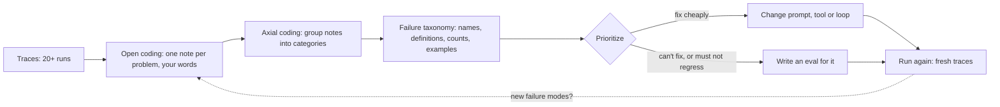

# Error analysis first

## Why this matters

The usual first move with a new LLM feature is to reach for an eval framework, switch on a few metrics (helpfulness, hallucination, toxicity) and watch a dashboard. It feels like engineering. It mostly measures things that aren't your problem. Your agent doesn't fail in generic ways: it fails in ways specific to your tools, your prompts, your data and your users, and you can't list those ways from your armchair.

So the order of work is the reverse of what feels natural: **look at what actually happened first, then decide what to measure.** This chapter is the look. You'll read real runs of the agent from [3.2](/part-03-agents/3.2-agent-loop), name what went wrong in your own words, group the names into a short list of failure categories, and rank them. That list is the input to everything else in Part 4: the eval set ([4.2](/part-04-evals-observability/4.2-eval-sets)), the graders ([4.3](/part-04-evals-observability/4.3-code-based-checks), [4.4](/part-04-evals-observability/4.4-llm-as-judge)) and the regression suite ([4.6](/part-04-evals-observability/4.6-regression-evals-ci)).

You already have the raw material. The step log you built in 3.2 was justified there as "the raw material for your eval set"; this is the chapter where it earns that.

**Learning goals**

- Do open and axial coding on real traces
- Build a failure taxonomy
- Prioritize what to fix or measure

## Explanation

### Why generic metrics mislead

A generic metric is one defined without looking at your system: "helpfulness", "hallucination", "toxicity", a similarity score against a reference answer. Vendors ship them as ready-made scorers, and they produce a number every time, which is the problem. The number looks like measurement.

Hamel Husain's answer to "Should I use ready-to-use evaluation metrics?" in the evals FAQ is a flat "No": generic evaluations "waste time and create false confidence when you use them as quality measures" ([Evals FAQ](https://hamel.dev/blog/posts/evals-faq/#q-should-i-use-ready-to-use-evaluation-metrics)). In his field guide he describes a team celebrating a 10% gain in a "helpfulness score" while users still struggled with basic tasks, and calls such top-down metrics "worse than useless" because they create a false sense of progress ([A Field Guide to Rapidly Improving AI Products](https://hamel.dev/blog/posts/field-guide/), March 2025).

Why does that happen? Three reasons, none exotic:

1. **They're not about your failures.** An agent that edits files may fail by editing the wrong file, by looping on one command, by declaring success without running the tests, or by misreading a tool error. "Helpfulness" is blind to all four, and each needs a different fix.
2. **They're averages.** A score moving from 0.81 to 0.84 tells you nothing about which behavior changed, and nothing to do next.
3. **They're not validated.** The score is itself produced by a model or a heuristic whose agreement with *your* judgment nobody checked. Shankar et al. found that people need criteria to grade outputs, but "grading outputs helps users define criteria": you often can't know what "good" means for your task until you've looked at outputs ([Who Validates the Validators?](https://arxiv.org/abs/2404.12272), 2024). Looking first is not laziness about metrics, it's how criteria get defined.

None of this says metrics are bad. It says a metric should be a *consequence* of a failure you observed. Part 4 builds that chain: observe (this chapter), turn into a test (4.2), automate the check (4.3, 4.4).

::: info 📖 Read now
[Hamel Husain: A Field Guide to Rapidly Improving AI Products](https://hamel.dev/blog/posts/field-guide/) · article · ~25 min · optional

Look for: the argument that looking at real examples beats dashboards of generic scores, and the story of the team whose "helpfulness" number rose while users were still stuck. It's opinionated and written from consulting experience, so read it as a practitioner's case, not as research. The warning about metric dashboards is the part to keep.
:::

### Collecting traces

A **trace** is the complete record of one run: the user's goal, every model call, every tool call with its arguments and result, and the final answer. For the agent from 3.2, one JSONL step log per run *is* a trace. (4.7 adds a standard format and tooling. You don't need either yet: a file you can read beats a platform you haven't set up.)

What makes a pile of traces useful for analysis:

- **Complete.** Every step, including the tool results the model saw. A trace missing the tool output can't tell you whether the model misread a good result or got a bad one.
- **Readable.** If you need a script to see what happened, you'll read fewer of them. A cheap fix is a tiny renderer that prints a run as a numbered transcript: goal, then each turn as "model said X", "called tool Y with Z", "got result W". Writing that renderer is part of the practice.
- **Realistic.** Where you can, use real inputs: your own past requests, the tasks you actually give Claude Code. If there is no production traffic (and for this study project there isn't), you write tasks yourself, and the risk is that they're all alike. The remedy is to vary them on purpose, covered below.
- **Identified.** A run id, the model, and the prompt or code version, so that "this failure appeared after I changed the system prompt" is answerable later.

**How many?** The evals FAQ recommends reviewing at least 100 traces, and at least 30 yourself before asking a model to suggest failures, continuing "until new traces stop revealing failure modes or changing existing ones" ([Evals FAQ](https://hamel.dev/blog/posts/evals-faq/#q-how-many-examples-do-i-need-for-an-eval)). That stopping rule is **theoretical saturation**, a term borrowed from qualitative social science: stop when another trace stops teaching you anything new. Anthropic's article on agent evals gives a smaller number for *starting an eval suite* ("20-50 simple tasks drawn from real failures") because early changes tend to have large effects that small samples can detect ([Demystifying evals for AI agents](https://www.anthropic.com/research/demystifying-evals-for-ai-agents), January 2026). These aren't in conflict: one is how much to read, the other how much to test. For this chapter you'll read 20 runs, which is below the FAQ's bar. Treat your result as a first draft of the taxonomy and expect it to grow when you run more.

**Vary the tasks.** Twenty near-duplicate tasks teach you about one failure. When writing your own, deliberately spread them across:

| Dimension | Examples for the 3.2 agent |
|---|---|
| Difficulty | one tool call; several dependent calls; needs a recovery from an error |
| Tool path | only reads; reads then shell; needs a command that fails first |
| Answer exists or not | the file is there; the file isn't (does it say so, or invent?) |
| Ambiguity | a precise request; a vague one where a good agent would ask or state an assumption |
| Size | a tiny file; a large output that tempts truncation |
| Model | at least one local model and one paid model, since they fail differently ([3.2](/part-03-agents/3.2-agent-loop#local-versus-paid-models-inside-the-loop)) |

Include a few tasks where you expect failure. You're not scoring the agent here, you're hunting for failure modes, and a run that goes well teaches little.

### Open coding

**Open coding** is the first pass, and the instruction is simple: read one trace at a time and write down, in your own words, what went wrong or looked off. No predefined categories. The term comes from qualitative research methods (grounded theory); the evals FAQ describes the notes as "akin to journaling" and presents it as the first step of error analysis, which it calls the most important activity in evals ([Evals FAQ](https://hamel.dev/blog/posts/evals-faq/#q-why-is-error-analysis-so-important-in-llm-evals-and-how-is-it-performed)).

How to do it well:

- **Read the whole trace, then note the first thing that went wrong.** Later errors are often downstream of the first one. If the agent read the wrong file in turn 2, its wrong answer in turn 5 is a symptom. Annotating the first upstream failure keeps your categories about causes.
- **Write observations, not diagnoses.** "Guessed the filename `beta.txt` without listing the directory" is an observation. "Hallucination" is a label you're not entitled to yet. The wording stays concrete so that two weeks later you still know what you meant.
- **One note per distinct problem, short.** A sentence. Quote the step number so you can find it again.
- **Note good surprises and unclear cases too.** A trace where you can't tell whether the answer is right is a finding: it means the task or the expected result is under-specified, which is a defect of your eval, not the agent.
- **Don't let a model do your first 30.** Models are fine at suggesting categories later, but reading is where you build the intuition for what matters in your product. If a model reads first, you're reviewing its taxonomy instead of forming yours.
- **Judge with one voice.** For a team the FAQ recommends a single domain expert as a "benevolent dictator" for most small and mid-size companies ([Evals FAQ](https://hamel.dev/blog/posts/evals-faq/#q-how-many-people-should-annotate-my-llm-outputs)). You're a team of one, which makes this easy.

A made-up example of what a few open codes look like for a file-reading agent (yours will come from real runs):

| Run | Step | Open code (your words) |
|---|---|---|
| 04 | 2 | Called `read_file("config.yml")` on a path it never listed; ENOENT |
| 04 | 3 | Told the user the config "contains no database settings" after reading nothing |
| 07 | 5 | Ran the same `grep` three times with identical arguments |
| 11 | 1 | Wrote "I will now check the file" and stopped, no tool call |
| 13 | 4 | Final answer correct, but quoted a value from turn 1 that the file no longer had |

### Axial coding

After a batch of open codes (say 15 to 20 traces' worth), you have a messy list of specific observations. **Axial coding** is the second pass: group similar notes under a common name, so the list collapses into a handful of categories. The evals FAQ puts it bluntly: "Axial coding is the most important step" ([Evals FAQ](https://hamel.dev/blog/posts/evals-faq/#q-why-is-error-analysis-so-important-in-llm-evals-and-how-is-it-performed)).

Working method:

1. Print or paste all open codes into one list.
2. Pick one and ask "what other notes are the same kind of mistake?" Move them together. Name the group.
3. Repeat until each note is in a group. Expect one-off oddities, and let them sit in "other" for now.
4. Look at the groups. Merge two that you'd fix the same way. Split a group that hides two different fixes. **The test for a good category is whether it suggests a specific action** (a tool change, a prompt change, a loop change, a new check), not whether the name sounds neat.
5. Re-read a few traces against the finished categories. If you can't decide where something goes, the boundary is wrong.

Applied to the made-up notes above, they land in categories you could name like this:

- *Acts on a guess instead of evidence* (read an unlisted path; claim about an unread file).
- *Loop control* (identical repeated call; stops after narrating).
- *Stale context* (uses an old value after the file changed).

Notice that each category points somewhere different: a prompt or tool-description change, a loop-level guard from 3.2 (repetition detection, "no tool call after announcing one"), and a context change ([3.4](/part-03-agents/3.4-context-engineering)). That is the value of grouping by cause: the taxonomy is a to-do list.

### Failure taxonomies

A **failure taxonomy** is the product of axial coding: a short list of the specific ways *your* application fails, each with a name, a definition, and examples. The evals FAQ describes it just so: "a list of the specific ways your application fails" ([Evals FAQ](https://hamel.dev/blog/posts/evals-faq/#q-how-many-examples-do-i-need-for-an-eval)).

A useful entry has four parts:

| Part | What goes in it | Why |
|---|---|---|
| Name | A short, concrete label (`unread-file claim`, not `bad reasoning`) | You'll use it in conversation, in evals and in code |
| Definition | One sentence a stranger could apply: "The final answer asserts something about a file whose content was never returned by a tool" | Lets you classify a new trace in seconds, and later lets a judge do it |
| Evidence | Run ids and step numbers of two or three clear examples | Keeps the category honest and makes it testable |
| Count | How many of your N traces show it | Feeds prioritization |

Two cautions about categories:

- **Beware of the grab-bag.** "Wrong answer" and "model error" are not categories, they are the thing you're trying to break down. If a category holds a third of your notes, split it.
- **Separate agent failures from harness and task failures.** In a sample of traces you'll find three different kinds of problem: the model did something wrong, *your code* did something wrong (a tool that truncates silently, a crash in the loop, a log that dropped a field), and the *task* was flawed (ambiguous, or impossible, or its expected answer was wrong). Anthropic makes the same point for evals: a 0% pass rate across many trials is "most often a signal of a broken task", and reading transcripts is how you check that failures are fair ([Demystifying evals for AI agents](https://www.anthropic.com/research/demystifying-evals-for-ai-agents)). Tag each category with its owner: model, harness, or task. The harness and task ones you simply fix, with no eval needed.

There's no universal taxonomy to copy. The 3.2 chapter listed things to watch for when running local models (malformed calls, premature stopping, not stopping, narrating instead of calling), and those are good *hypotheses* to carry into your reading. But treat them as lenses, not as a checklist: coding against a list you brought makes you see what you expected, and the point of open coding is to catch what you didn't.

::: info 📖 Read now
[Hamel Husain and Shreya Shankar: Evals FAQ](https://hamel.dev/blog/posts/evals-faq/) · article · ~30 min (the error analysis, number-of-examples and generic-metrics answers; the rest is a reference) · **essential**

Look for: the answer on why error analysis is so important and how it's performed, which is the method of this chapter in condensed form (open coding as journaling, axial coding as grouping into a taxonomy, repeat until theoretical saturation). Then "How many examples do I need", "Should I use ready-to-use evaluation metrics?", and the question on annotators. The FAQ is large and grows over time: don't read it end to end, and treat the numbers as the authors' rules of thumb from consulting work, not laws.
:::

### From failures to evals

A taxonomy is not yet a test. Turning it into measurement starts with **prioritizing**, because you can't (and shouldn't) write an eval for every category.

Rank each category on rough, honest dimensions:

| Question | If yes |
|---|---|
| How often does it occur (count out of N)? | Frequent ones first |
| How bad is it when it happens (wrong answer vs a wasted call)? | Silent wrong answers outrank visible waste |
| Is it fixable directly (tool description, a loop guard, a prompt line)? | **Fix first, then re-run**: no eval needed to justify a plain bug |
| Can a program check it? (e.g. "no call repeats three times", "the answer mentions a value that appears in a tool result") | Candidate for a **code-based check** ([4.3](/part-04-evals-observability/4.3-code-based-checks)), the cheapest and most reliable kind |
| Does it need judgment (is the summary faithful)? | Candidate for an LLM judge ([4.4](/part-04-evals-observability/4.4-llm-as-judge)), which you must validate against your own labels |
| Will it keep coming back as the system changes? | Worth a standing regression eval ([4.6](/part-04-evals-observability/4.6-regression-evals-ci)) |

Two outcomes are healthy and one is not. Healthy: you fix the cheap ones and re-run to see the category disappear, and you write evals for the few that are costly, recurring or hard to fix once. Not healthy: you write twenty evals, one per category, then never run them. The taxonomy tells you which two or three deserve to exist.

Your traces also give you the *cases*. A trace where the agent failed is a ready-made eval task: the goal is the input, and your note about what went wrong tells you what a pass looks like. Anthropic's advice for starting an agent eval fits: begin with what you already check manually and with real failures, since "converting user-reported failures into test cases ensures your suite reflects actual usage" ([Demystifying evals for AI agents](https://www.anthropic.com/research/demystifying-evals-for-ai-agents)). That's 4.2.

Finally, the loop closes. After fixing, you run again, on fresh tasks, not only the ones you fixed on, and open-code the new traces. New failure modes appear (fixes shift behavior), old ones drop, and your taxonomy gets edited. Error analysis is a habit you repeat when the system changes, not a one-time phase before "real" evals.

::: info 📖 Read now
[Anthropic: Demystifying evals for AI agents](https://www.anthropic.com/research/demystifying-evals-for-ai-agents) · article · ~25 min · **essential**

Look for: the vocabulary (tasks, trials, graders, transcripts) that the rest of Part 4 uses, why reading transcripts is how you verify that an eval measures what matters, the advice to start with 20 to 50 tasks drawn from real failures, and the warning about broken tasks. Notice that it doesn't call the process "error analysis" and is written for agents specifically, whereas the FAQ is more general: the two agree on the order of work (look at failures, then build the suite). We'll come back to the article's grader types in 4.3 and 4.4 and its trial metrics in 4.5.
:::

::: info 📖 Read now
[Shankar et al.: Who Validates the Validators?](https://arxiv.org/abs/2404.12272) · paper · ~15 min (abstract and introduction) · optional

Look for: "criteria drift", the finding that people need criteria to grade outputs but grading outputs is what lets them define the criteria. It's the research reason open coding precedes writing graders, and it previews the 4.4 point that a judge must be checked against human labels. Skim the abstract and intro; the tool they built isn't the point here.
:::

## Practice

**Brief:** Run `project/` on 20 varied tasks, read every transcript, and build a failure taxonomy in `project/evals/error-analysis.md`. You write all the code and the analysis; I haven't provided either.

**Where:** A step in the growing `project/` (see `project/ROADMAP.md`, step 11). It builds on the agent and tools from 3.2 and 3.3, and its output feeds 4.2.

**Steps**

1. **Write 20 tasks.** Put them in `project/evals/tasks.md` (a numbered list is enough). Spread them across the dimensions in the table above: easy and hard, answerable and unanswerable, precise and vague, small and large outputs. Include at least 3 you expect to fail. Base some on real things you'd ask a coding assistant to do in a small directory of your own files.
2. **Make runs reproducible enough to compare.** Decide the fixture directory the tasks run against and keep it fixed (or reset it between runs, since a tool that edits files changes the next run). Record the model, the system prompt version and the turn limit with every run.
3. **Run all 20 and keep every log.** Use the 3.2 step log: one JSONL file per run, named by run id. Run the set on at least one model, and on a second (local vs. paid) if you want the comparison. Note any spend in `costs.md`, and see [Landscape](/landscape) for what a run costs.
4. **Write a transcript renderer.** A small script that turns one JSONL log into a numbered, human-readable transcript (goal, each model turn, each tool call with its result, the final answer and exit status). Keep it short. If reading a run takes more than a minute of squinting, improve the renderer, not your patience.
5. **Open-code every transcript.** Read all 20 in full. Write observations in `project/evals/error-analysis.md` under an "Open codes" heading: run id, step, what went wrong in your own words. Mark the *first* upstream failure in each run, and note runs that went fine.
6. **Axial-code.** Group the notes into categories. Revise until each category implies a specific action. Write the taxonomy table: name, definition, owner (model, harness or task), count, two examples (run id and step).
7. **Check saturation.** Did the last 5 transcripts add new categories? Write one line on it. If they did, say how many more runs you'd need; run more if you like.
8. **Prioritize.** For each category, record frequency, severity, whether it's directly fixable, and whether a code check could detect it. End with a short list: what you'd fix now, and the 2 or 3 categories you'd turn into evals in 4.2.
9. **Fix one thing and re-run.** Pick one cheap, high-count category, change the agent, then re-run the relevant tasks and a few others. Record whether the category shrank and whether anything new appeared.

**Done when**

- `project/evals/tasks.md` has 20 tasks that vary on at least three of the dimensions above.
- You have 20 run logs and have read every one in full.
- `project/evals/error-analysis.md` contains open codes with run ids and step numbers, and a taxonomy with a name, a one-sentence definition, an owner, a count and evidence for each category.
- No category is a grab-bag: none holds more than roughly a third of your notes, and each one implies a concrete action.
- At least one category is a harness or task problem rather than a model problem, or the file says why you found none.
- The file ends with a prioritized list: what to fix now, and which 2 or 3 categories become evals in 4.2.
- You fixed one category and re-ran, and you wrote down what changed.

## Check questions

1. Your dashboard shows "helpfulness: 0.84", up from 0.81 after a prompt change. Why can't you conclude the agent got better, and what would you do instead?

   

Answer

   The score isn't tied to any failure you've observed, it's an average that hides which behavior changed, and nobody checked that it agrees with your judgment. A 3-point move could be noise or a style shift. Instead, read traces from before and after the change, note concrete failures, and count them by category. The change is good if specific categories shrank and no new ones grew. A metric is worth tracking only once it measures a failure you actually saw.

   

2. What is the difference between open coding and axial coding, and why is the order important?

   

Answer

   Open coding is reading traces one at a time and writing free-form notes about what went wrong, with no predefined categories. Axial coding then groups those notes into a small set of named categories, which become the failure taxonomy. The order matters because categories invented first make you see what you expected and miss what is really happening. The categories should come out of the data, then be refined against it.

   

3. A note in your open codes reads "model hallucinated". Why is that a poor code, and what would you write?

   

Answer

   It's a diagnosis-label, not an observation, and it would swallow many different problems that need different fixes (answering from priors without reading the file, misreading a tool result, quoting a stale value). Write what happened in concrete terms, with the step: for example "answered that `beta` is unspecified without having read `a.txt`, step 3". Group by cause later, in axial coding.

   

4. You find 8 of 20 runs failed because `read_file` silently truncated large files and the model never noticed. Is this a model failure? What do you do about it and do you need an eval?

   

Answer

   Mostly a harness failure: the tool hid information, so the model acted on incomplete input. Fix the tool (return an explicit truncation marker, see 3.3) and re-run. A plain bug like this doesn't need an eval to justify the fix. If it could regress, a cheap code-based check on tool output (does a truncated result carry the marker?) is a better guard than an LLM judge.

   

5. How do you decide when you've read enough traces, and how does your 20-run sample compare with the FAQ's guidance?

   

Answer

   Stop at theoretical saturation: when new traces stop revealing new failure modes or changing existing categories. The evals FAQ recommends at least 100 traces and at least 30 read by yourself before using a model to suggest failures. Twenty is below that, so the taxonomy from this chapter is a first draft that will grow. Anthropic's "20-50 tasks" figure is about how many tasks to start a test suite with, which is a different question from how many traces to read.

   

## My understanding

<!-- Written by the learner, in their own words. Agents never fill this in. -->
