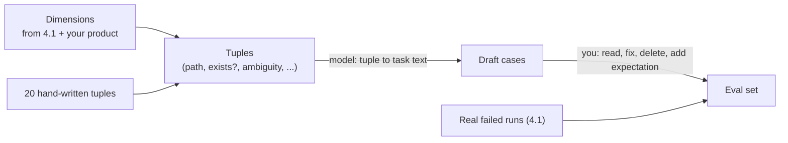

# Building an eval set

## Why this matters

An eval set is the fixed ruler you measure every change against. After [4.1](/part-04-evals-observability/4.1-error-analysis) you have a failure taxonomy: a list of the ways your agent breaks. A taxonomy is a description, though, and you can't run a description. To know whether a prompt edit, a new tool or a different model made things better or worse, you need the same set of tasks, run the same way, with a verdict for each.

Building a good set is mostly about *which* cases you pick, not how many. A small set where every case earns its place beats a big one padded with near-duplicates. A set that only contains tasks the agent already passes tells you nothing, and a set that drifts silently from your product measures a product you no longer have. This chapter covers what a good case looks like, how to cover your failure modes, how to generate extra cases without fooling yourself, how to write the expected result, and how to keep the set healthy over time.

**Learning goals**

- Turn the failure taxonomy into eval cases
- Generate synthetic cases carefully
- Version and maintain the set

## Explanation

### Vocabulary: task, case, grader

Anthropic's article on agent evals gives the vocabulary Part 4 uses: a **task** (or test case) is a single test with defined inputs and success criteria, a **grader** scores some aspect of what the agent did, and an **eval** is the whole thing, a set of tasks run with graders ([Anthropic: Demystifying evals for AI agents](https://www.anthropic.com/research/demystifying-evals-for-ai-agents)). This book says "case" for the input plus its expectation, and "eval set" for the collection. Graders come in 4.3 (code) and 4.4 (LLM judge). This chapter is about the *inputs and expectations*, and it deliberately stops before the runner.

### What makes a good eval case

A case that is easy to write is usually a bad case. These properties are what to aim for.

- **Unambiguous.** The same article's test is that a good task is one where two domain experts would independently reach the same pass or fail verdict. If you can't say what a pass looks like, the case measures your indecision. In 4.1 you met this as "task failures": runs you couldn't judge because the task was under-specified. Fix those tasks, don't keep them.
- **Solvable.** Anthropic recommends writing a reference solution for each task, a known working output that passes all graders; it proves the task can be solved and the grader is configured correctly (same article). For a coding agent this can be a patch you wrote by hand.
- **Realistic.** It looks like something you would actually ask. The Claude docs make the same point as their first design principle: mirror your real-world task distribution and "don't forget to factor in edge cases" ([Claude docs: Define success criteria and build evaluations](https://platform.claude.com/docs/en/test-and-evaluate/develop-tests)).
- **Discriminating.** A good case can fail. If every model and prompt version passes it, it contributes nothing. Include cases that fail today.
- **Cheap to run and to reset.** An agent case that edits files needs a fixture it can start from every time. If a case takes ten minutes or leaves state behind, you'll stop running it.
- **Traceable.** It points back to where it came from: a run id from 4.1, a taxonomy category, or a dimension combination. Later you'll want to ask "which category does this case guard?".

Where do cases come from? Anthropic's advice is to start with 20 to 50 simple tasks drawn from real failures, and not to wait until you have hundreds (same article). Your 4.1 error analysis already produced the best source: every failed run is a candidate, since the goal is the input and your note says what a pass looks like. Add the things you check by hand every time you change the agent, and tasks where the agent *should* succeed so you notice if it stops.

That last point matters more than it sounds. The same article warns that one-sided evals create one-sided optimization: if you only test cases where the agent should call a tool, you can end up with an agent that calls it far too often. For each "should do X" case, ask whether you need a "should not do X" case.

::: info 📖 Read now
[Anthropic: Demystifying evals for AI agents](https://www.anthropic.com/research/demystifying-evals-for-ai-agents) · article · ~20 min (re-read, focus on task design) · **essential**

You met this in 4.1 for the vocabulary. Read it again for the parts on building the task set: the "20 to 50 tasks from real failures" advice, unambiguous tasks with reference solutions, balanced problem sets, and eval saturation. Look for what it says to do when a model scores 0 across many trials: usually the task is broken, not the model.
:::

### Coverage of failure modes

"Coverage" for an eval set doesn't mean line coverage. It means: for each failure mode you care about, is there at least one case that would fail if the mode appeared? You can check this with a small matrix, taxonomy categories down the side, and your cases listed against them.

| Category (from 4.1) | Cases that would catch it | Check type later |
|---|---|---|
| Acts on a guess instead of evidence | 05, 06, 11 | code (was the path listed?) |
| Loop control (repeats, stops after narrating) | 08, 14 | code (call-repeat count) |
| Stale context | 17 | code (value compare) |
| *(no failures seen yet)* happy paths | 01, 02, 03 | code |

Three things the matrix tells you at a glance:

1. **A category with no case** is an unmeasured failure mode. Either write one or decide on purpose that it isn't worth measuring (4.1 said to prioritize: some categories are fixed once and never need an eval).
2. **A case in no category** is either a happy-path guard (fine, keep a few) or something you added because it was easy (suspicious).
3. **A category with fifteen cases** while another has one probably reflects what's easy to write, not what matters. Weight by how often and how badly it hurts, from your 4.1 counts.

Mix of case types in a first set:

- **Failure cases**: reproduced from real failed runs. These start low. Anthropic calls evals that start at a low pass rate "capability evals": a hill to climb ([same article](https://www.anthropic.com/research/demystifying-evals-for-ai-agents)).
- **Guard cases**: things that work today and must keep working. Anthropic's regression evals should sit near a 100% pass rate (same article). Tag them so 4.6 can run only these in CI.
- **Negative or boundary cases**: the file doesn't exist, the question is impossible, the right move is to ask or to say so.

Tag each case `capability` or `regression` in its metadata. A case moves from the first group to the second when you've fixed it and want it to stay fixed. When a capability case passes every time, the same article calls the set saturated for that purpose: it has stopped telling you anything, and it's time to add harder cases.

### Golden answers vs rubrics

Every case needs an expectation: what a pass looks like. There are two shapes, and which one you can write decides which grader you'll use.

**Golden (reference) answers.** The expected output or outcome is a specific thing: a string, a number, a file's contents, a state of the file system, tests that must pass. Checking is a comparison, so it's cheap, deterministic and easy to maintain. The evals FAQ says reference-based checks "compare outputs against known correct answers" and are cheap to build and maintain, in contrast with LLM judges, which need many labeled examples and ongoing upkeep ([Evals FAQ](https://hamel.dev/blog/posts/evals-faq/#q-should-i-build-automated-evaluators-for-every-failure-mode-i-find)). For an agent, prefer golden *outcomes* over golden transcripts. Anthropic found rigid step-sequence checks too brittle and says it's often better to grade what the agent produced, not the path it took, because agents find valid approaches you didn't anticipate ([Anthropic](https://www.anthropic.com/research/demystifying-evals-for-ai-agents)). "The final answer contains 42 and `config.yml` is unchanged" is a good golden. "Called `list_files` then `read_file`" is a fragile one.

**Rubrics.** When there is no single right output (a summary, an explanation, a tone), you write criteria instead: a short list of things a good answer must do. A rubric is what an LLM judge or a human applies. Two cautions from the evals FAQ: prefer binary pass or fail criteria over 1-to-5 ratings, because binary "force clearer thinking and more consistent labeling" and scales invite hedging to the middle ([Evals FAQ](https://hamel.dev/blog/posts/evals-faq/#q-why-do-you-recommend-binary-passfail-evaluations-instead-of-1-5-ratings-likert-scales)); and don't write the rubric before you've looked at examples, since an early rubric "can get in the way" and your initial expectations are a starting point you'll revise ([Evals FAQ](https://hamel.dev/blog/posts/evals-faq/#q-do-i-need-a-reference-answer-before-annotating-data)). For you that last point is already satisfied: 4.1 had you read the outputs first.

A practical rule: **try to turn every rubric into a golden outcome first.** "The agent says the file doesn't exist" can be checked by code (the final answer mentions absence, no invented content). Reserve rubrics for what truly needs judgment. That keeps most of your set on cheap graders.

A case can carry both: a golden check for the outcome plus a rubric line for something softer. A sketch of what a case record can hold (the exact shape is yours to design in the practice):

```ts
// Illustrative only: not the book's required schema.
type EvalCase = {
  id: string;                 // stable, never reused: "case-014"
  goal: string;               // the task given to the agent
  fixture: string;            // directory the agent starts from
  category: string;           // failure category from your 4.1 taxonomy
  kind: "capability" | "regression";
  source: string;             // "run-07 step 5", "synthetic", "by hand"
  expect: {
    answerIncludes?: string[];   // golden: strings that must appear
    filesUnchanged?: string[];   // golden: paths that must be untouched
    rubric?: string[];           // judgment criteria, binary each
  };
  notes?: string;
};
```

### Synthetic data with dimensions

A hand-written set of 25 cases will miss things, and there is no production traffic to mine. A model can help generate more cases, but the naive way fails: ask a model for "20 test tasks for a coding agent" and you get 20 variations of the same few tasks, polite and generic.

The evals FAQ's answer is to define **dimensions** first: the axes along which your inputs should vary. Its example is a recipe app with three dimensions, dietary restriction, cuisine type and query complexity; one *tuple* of values, such as (vegan, Italian, multi-step), becomes a query like "I need a dairy-free lasagna recipe that I can prep the day before" ([Evals FAQ](https://hamel.dev/blog/posts/evals-faq/#q-what-is-the-best-approach-for-generating-synthetic-data)). The FAQ's process has two steps, both of which matter:

1. **Generate tuples**, not queries. Have the model (or you) produce combinations of dimension values.
2. **Convert each tuple to a task in a separate step**, which the FAQ says avoids repetitive phrasing.

It also recommends writing about 20 tuples by hand before scaling up (same answer). For your agent, the dimensions from the 4.1 table are the natural starting point:

| Dimension | Values |
|---|---|
| Tool path | only reads; reads then shell; a command that fails first |
| Answer exists | yes; no |
| Ambiguity | precise; vague |
| Output size | small; large enough to tempt truncation |
| Failure category targeted | one per taxonomy entry |



The final step is the one that is easy to skip: **you review every generated case.** A model-written task can be impossible, ambiguous, or secretly identical to another one, and it can't write a trustworthy expectation for a file system it has never seen. Treat generation as a way to draft, and treat your own reading as the quality gate. Read a few, delete the duplicates, rewrite the vague ones, and build the fixture and the expectation yourself.

Know the limits. The FAQ is blunt: "Synthetic data cannot tell you how common a failure is in production", and it lists situations where synthetic data can mislead or mask issues, among them specialized domains and underrepresented users, where without real examples critical edge cases are missed ([Evals FAQ: when synthetic data is unreliable](https://hamel.dev/blog/posts/evals-faq/#q-are-there-scenarios-where-synthetic-data-may-not-be-reliable)). Concretely: synthetic cases are good for *breadth* (making sure each corner of your dimension space gets visited) and bad for *frequency* (they say nothing about how often a failure matters). Don't compute "pass rate on synthetic cases" and call it a production number. Real failed runs stay in the set as the anchors.

::: info 📖 Read now
[Hamel Husain and Shreya Shankar: Evals FAQ, synthetic data and number of examples](https://hamel.dev/blog/posts/evals-faq/#q-what-is-the-best-approach-for-generating-synthetic-data) · article · ~15 min (the synthetic-data answers, "how many examples", binary vs Likert, stale datasets) · **essential**

Look for: the dimensions-then-tuples-then-queries method, the warning that synthetic data can't give you failure frequency, and the guidance on how many examples different purposes need. Note that the FAQ's numbers (a purpose-built eval set often grows to 100 or more; 30 to 50 passes and 30 to 50 fails per split when you validate an LLM judge) are about later stages. For this chapter's first set, the 20 to 50 from Anthropic is the right scale.
:::

### How big, and how many trials

Twenty to thirty cases is a start, and it's enough to see large effects: a change that moves 8 of 25 cases from fail to pass is a signal. It's not enough to detect a 3-point difference, and a pass rate on 25 cases carries wide uncertainty, so don't over-read small movements. Two further consequences:

- **Agents are not deterministic.** One run of a case is one sample. 4.5 covers running several trials per case and metrics such as pass@k and pass^k. For now, record the model, prompt version and turn limit with every run, and expect some flicker.
- **Report per category, not only overall.** "21 of 25" hides that all four failures are the category you wanted to fix. The tags exist so that 4.3's runner can print a table by category.

### Versioning and maintenance

An eval set is a living artifact. Anthropic puts it this way: it "needs ongoing attention and clear ownership to remain useful" ([Anthropic](https://www.anthropic.com/research/demystifying-evals-for-ai-agents)). Because you compare scores across time, you need to know *which set* a score came from.

What to version, and how:

- **Cases in files, in git.** One file per case, or one JSONL file, in the repo (`project/evals/`). Diffs show what changed and why, and you get history for free.
- **Stable ids, never reused.** A case id means one thing forever. Retire a case by marking it `retired: true` (with the reason), not by deleting its row, so old results still make sense.
- **A set version.** A simple `EVAL_SET_VERSION` or a git tag. Record it with every result. When you add, fix or retire cases, bump it, and don't compare a score across versions without saying so.
- **Fixtures versioned with the cases.** If a case depends on a directory, that directory is part of the set. A changed fixture silently changes the case.
- **Record the reason for a change.** A changelog line: "case-009 fixed, expected answer was wrong (ran 3 times, agent was right)". It's the same honesty as 4.1: a failing case is sometimes a broken *case*.
- **Don't tune on your whole set.** If you iterate the prompt until every case passes, you've fitted the prompt to the set. The FAQ's split guidance (a small group for few-shot examples in the prompt, separate dev and test) is written for judge validation, but the habit applies here: keep a few cases you never look at while iterating, and check them at the end. Fresh failures from fresh tasks (4.1's re-run step) are the best antidote.

Over time the set goes stale. The FAQ says datasets "naturally get stale as your product and users change", suggests refreshing them via regular error analysis, and notes that if everything keeps passing, the eval is less useful and should be run less often or retired; it also accepts that scores stop being directly comparable after the set changes ([Evals FAQ: stale datasets](https://hamel.dev/blog/posts/evals-faq/#q-what-should-i-do-when-my-gold-eval-dataset-becomes-stale)). A maintenance routine that fits a solo project:

1. After a significant change to the agent, do a small 4.1 pass on fresh runs.
2. New failure mode: add 1 to 3 cases for it.
3. A capability case that has passed in every run for a while: move it to `regression` (or retire it if it's now trivial).
4. A case you keep disagreeing with: its expectation is probably wrong. Fix or retire.

::: info 📖 Read now
[Claude docs: Define success criteria and build evaluations](https://platform.claude.com/docs/en/test-and-evaluate/develop-tests) · docs · ~15 min · optional

Look for: the design principles (task-specific, edge cases, automate where possible) and the list of grading methods with examples: exact match, similarity measures, LLM-graded Likert and binary. It's a good map for 4.3 and 4.4. Note where it recommends many automatically graded questions over few hand-graded ones, and weigh that against the "start with 20 to 50" advice above: the first is about the scale you grow to, the second about where you begin.
:::

## Practice

**Brief:** Create `project/evals/` with 20 to 30 cases drawn from your 4.1 taxonomy. You write the cases, fixtures and expectations; I haven't provided them. The cases will be run by the runner you build in 4.3.

**Where:** A step in the growing `project/` (see `project/ROADMAP.md`, step 12). It builds on step 11: your `project/evals/error-analysis.md` and `tasks.md` from 4.1 are the input.

**Steps**

1. **Make the coverage matrix first.** In `project/evals/README.md`, list your taxonomy categories from 4.1 and the 2 or 3 you chose to turn into evals. Decide roughly how many cases each gets, weighted by your counts.
2. **Pick the format.** Decide how a case is stored (a JSONL line, or a folder per case) and write the fields down in the README: id, goal, fixture, category, kind, source, expectation. The TypeScript sketch above is one option. Add a TS type for it in `project/` so a malformed case fails loudly.
3. **Promote real failures.** Turn failed runs from 4.1 into cases. For each, write the goal and an expectation you can state concretely. Try the golden form first (strings, unchanged files, test results) and use a rubric line only where you can't.
4. **Add guard and negative cases.** A handful the agent handles today (so you notice regressions), and some where the right behavior is to say the file doesn't exist or the request can't be done.
5. **Generate synthetic cases with dimensions.** Write your dimensions and about 20 tuples by hand. Use a model (a local one is fine) to expand tuples, then to turn each tuple into a task, in two separate prompts. Keep only the ones you review and accept. Mark `source: synthetic` and keep the tuple.
6. **Build the fixtures.** Create the directory (or directories) the cases run against, small enough to reset with one command. Write a reference solution for at least five cases, by hand, to prove they are solvable.
7. **Sanity-run by hand.** Run the agent once on at least eight cases and read the transcripts. Fix any case where you couldn't tell whether the agent passed.
8. **Version it.** Add `EVAL_SET_VERSION` (or a git tag), stable ids, and a `CHANGELOG` section in the README. Commit the set.

**Done when**

- `project/evals/` holds 20 to 30 cases, each with a unique, stable id, a goal, a fixture, a category, a kind (`capability` or `regression`), a source and an expectation.
- Every category you chose in 4.1 has at least one case, and your README shows the coverage matrix.
- At least 5 cases come straight from failed 4.1 runs, at least 3 are negative or "should not" cases, and at least 5 are synthetic with their dimension tuple recorded.
- Most expectations are golden outcomes; any rubric lines are binary.
- Every case has been read by you, and at least 5 have a hand-written reference solution that passes the expectation.
- The set has a version and a short changelog, and the fixtures reset with one command.
- You ran 8 or more cases by hand, and adjusted any case whose verdict was unclear.

## Check questions

1. Your agent passes all 25 cases in your eval set, on every model you try. Is that good news? What do you do?

   <details><summary>Answer</summary>

   Probably not. A set where everything passes has saturated: it can't tell versions apart and can't show improvement. Either the cases are too easy, or the set no longer reflects where the agent fails. Do a fresh error-analysis pass on new tasks, add cases for what you find, and add harder ones. Keep the old cases as regression guards, since they still catch breakage. Anthropic describes this as eval saturation. The FAQ says an eval that always passes should be run less often or retired.

   </details>

2. Why does a model asked for "20 test tasks for my agent" produce a poor eval set, and what does the dimensions method change?

   <details><summary>Answer</summary>

   An unstructured request gives repetitive, generic tasks clustered around what is most typical. The dimensions method names the axes your inputs should vary on (for example tool path, whether the answer exists, ambiguity, output size), builds tuples of values, and converts each tuple to a task in a separate step. That forces coverage of the corners and reduces repetitive phrasing. You still have to review each case and write the expectation yourself, and the result tells you nothing about how frequent a failure is in real use.

   </details>

3. You have a case "summarize `report.md`". Another case is "what is the value of `timeout` in `config.yml`?" Which is easier to turn into a cheap, reliable check, and how would you make the first one more checkable?

   <details><summary>Answer</summary>

   The `timeout` question has a golden answer: the final answer must contain the value, and the file must be unchanged, so code can grade it. A summary has no single right output and needs a rubric and a judge. To make it more checkable, turn parts of the rubric into golden facts: "mentions the three section titles", "does not mention anything not in the file", "under 100 words". Reserve a judge for what remains. Rubric criteria should be binary.

   </details>

4. Two weeks later case-009 starts failing after a prompt change. You read the transcript and the agent's answer looks right. What happened, and how do you handle it in the set?

   <details><summary>Answer</summary>

   The case was probably wrong or ambiguous: its expectation was too narrow (for example an exact string), or the fixture changed. Fix the expectation or the fixture, and record it in the changelog with the reason, and bump the set version so scores before and after aren't compared blindly. Don't edit a case just to make a number go up: first make sure you can explain why the agent's answer is correct. If you can't, the agent did fail.

   </details>

5. Why do you grade the outcome of an agent run rather than the exact sequence of tool calls?

   <details><summary>Answer</summary>

   Agents often reach a correct result by routes you didn't anticipate, and a rigid check on the sequence marks those as failures. It is brittle: a harmless change in the order of calls breaks the case. Grading what the agent produced (the answer, the state of the files) measures the thing you care about. Check the path only for failures that are about the path itself, such as repeating the same call three times or running a forbidden command.

   </details>

## My understanding

<!-- Written by the learner, in their own words. Agents never fill this in. -->
