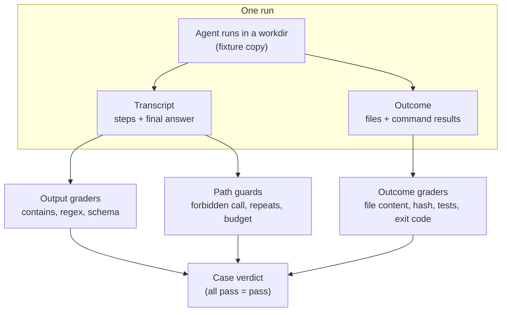
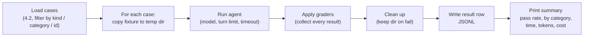

# Code-based checks

## Why this matters

Whenever correctness can be checked by code (the tests pass, the JSON parses, the file exists, the final answer contains 42), check it with code. A code check costs nothing per run, finishes in milliseconds, gives the same verdict every time, and when it fails you can open the check and see why. Anthropic lists exactly these strengths for code-based graders: fast, cheap, objective, reproducible, easy to debug ([Anthropic: Demystifying evals for AI agents](https://www.anthropic.com/research/demystifying-evals-for-ai-agents)). The Evals FAQ gives the same ordering of effort: first check whether you can test the condition with code assertions, and only build an expensive judge for what code can't see ([Evals FAQ](https://hamel.dev/blog/posts/evals-faq/#q-what-model-or-llm-should-i-use-to-build-automated-evals)).

In 4.2 you wrote cases: a goal, a fixture and an expectation. This chapter turns those expectations into running code. You build two things: **graders** (small functions that look at what an agent run produced and say pass or fail) and a **runner** (the loop that sets up each case, runs the agent, applies the graders, cleans up and prints a pass rate). With both in place you can change a prompt, a tool or a model and get a number in a minute, which is the point of the whole of Part 4.

**Learning goals**

- Write assertion-based graders
- Grade agent outcomes via environment state
- Build a small eval runner in TS

## Explanation

### What a code-based grader is

A grader takes the record of one run and returns a verdict. A code-based grader decides with ordinary code, not with a model. The article groups the usual methods: string match (exact, regex, fuzzy), binary tests (tests that must go from fail to pass, and tests that must keep passing), static analysis (lint, types, security scanners), outcome verification, tool call verification and transcript analysis (same article). The Claude docs show the simplest member of the family, exact match on a normalized string, for tasks with a clear categorical answer ([Claude docs: Define success criteria and build evaluations](https://platform.claude.com/docs/en/test-and-evaluate/develop-tests)).

The cost of all this determinism is brittleness. The article's own wording for the weakness is that code graders are brittle to valid variations that don't match the expected pattern exactly (same article). You meet this the first time a correct answer is rejected because the grader wanted `96.124991` and the agent wrote `96.12`. The article tells the story of an eval where, after the graders were fixed, a model's score went from 42% to 95%, because rigid grading had penalized correct answers (same article). The lesson: a failing code grader is evidence about the grader at least as often as about the agent. Part of writing graders is writing them loosely enough to accept every correct answer and tightly enough to reject wrong ones.

::: info 📖 Read now
[Anthropic: Demystifying evals for AI agents](https://www.anthropic.com/research/demystifying-evals-for-ai-agents) · article · ~25 min (third read: the sections on types of graders, coding agents, and the bugs-in-evals stories) · **essential**

You met the vocabulary in 4.1 and task design in 4.2. This time read it as a grader author. Look for: the list of code-based methods and their trade-offs, the passage on why outcomes beat transcripts, the note on isolating each trial from a clean environment, the partial-credit advice, and the stories where fixing the grader changed the score. Skim the YAML example of a coding task: it shows several grader types stacked on one task, which is the shape your runner will have.
:::

### The shape of a grader

Keep graders boring. A grader is a function from "what happened" to a result:

```ts
// Illustrative shape, not the required one: design your own in the practice.
type RunResult = {
  finalAnswer: string;        // what the agent said last
  exitStatus: "done" | "turn_limit" | "error";
  steps: StepRecord[];        // your 3.2 step log for this run
  workdir: string;            // the directory the agent worked in
};

type GradeResult = { name: string; pass: boolean; detail: string };

type Grader = (run: RunResult, caseSpec: EvalCase) => Promise<GradeResult>;
```

Three design points matter more than the types.

1. **Always return a reason.** `detail: "expected /42/ in final answer, got: 'The timeout is 30'"` is what lets you tell a bad agent from a bad grader. A grader that only returns a boolean forces you to reproduce the run by hand.
2. **One grader, one claim.** "Final answer mentions 30" and "config.yml unchanged" are two graders. When a case fails you read which claim failed, and you can later count how often each claim fails across the set.
3. **Graders don't call the model and don't change state.** They read. A grader that writes to the fixture can corrupt the next grader's view of it.

Combine graders per case. The article describes three ways to turn grader results into a task score: weighted (the combined score must reach a threshold), binary (all graders must pass) and hybrid (same article). For a first runner, use binary at the case level and keep the per-grader results in the output. Add partial credit when you see a case where "did half of it" is a meaningful result: the article's example is a support agent that identifies the problem and verifies the customer, which is better than one that fails immediately, and says the continuum of success should show up in results (same article).

### Assertion graders over the final answer

Start with what the agent said. These are unit-test-style assertions on text, and they cover more than you'd expect.

| Check | When it fits | Watch out for |
|---|---|---|
| Contains / not contains a string | The answer is a fact: `timeout = 30` | The agent writes "thirty", or quotes the file's comment instead. Normalize case and whitespace |
| Regex | A format: a path, an id, a number with optional decimals | Anchoring: `/42/` also matches 1420 |
| Parses as JSON and validates against a schema | The task asked for structured output | A schema check says nothing about whether the values are right: add value assertions |
| Number within tolerance | Numeric answers | Compare numbers, not strings: parse `96.12` and check the difference |
| Length or format limits | "Under 100 words", "one line" | Counting rules: decide how you split words, once |
| Negative: must not contain | The case where the right answer is "that file doesn't exist" | The agent says "I can't find `foo.txt`", which contains `foo.txt`. Assert on absence of *invented content*, not on the name |

The FAQ's phrase for this group is "simple assertions and reference-based checks (comparing against known correct answers)", cheap to build and maintain, in contrast to LLM judges that need many labeled examples and ongoing upkeep ([Evals FAQ](https://hamel.dev/blog/posts/evals-faq/#q-should-i-build-automated-evaluators-for-every-failure-mode-i-find)). Two habits make them hold up:

- **Test your graders.** A grader is code, so give it unit tests: a few strings it must accept (including the awkward correct ones) and a few it must reject. Node's built-in `node:test` is enough. A grader you never tested is the likeliest source of a mysterious score.
- **Check the grader with the reference solution.** In 4.2 you wrote reference solutions for some cases. Run the graders on them: every reference must pass. Anthropic recommends exactly this, since it shows both that the task is solvable and that the grader is configured correctly (see 4.2).

### Outcome versus output grading

Everything so far grades the **output**: the words the agent produced. Agents don't just talk; they act. The article draws the distinction with a flight-booking example: the agent can say "your flight is booked", but the outcome is whether a reservation exists in the database (same article). The **transcript** is the record of what the agent said and did; the **outcome** is the state of the environment when it stopped.

For a coding or file agent like yours, that gives three layers of checking:

| Layer | What you grade | Example for your agent | Reliability |
|---|---|---|---|
| Output | The final answer text | "Answer states the timeout is 30" | Medium: wording varies |
| Outcome | The environment after the run | `config.yml` has `timeout: 60`; `npm test` passes; `out.json` exists and parses; `README.md` is byte-identical to the fixture | High: it's what you actually wanted |
| Path | The steps in the transcript | "Never ran `rm`"; "fewer than 12 tool calls"; "no call repeated three times" | Fragile unless it's a safety or efficiency limit |

Prefer outcome checks. The article says it's often better to grade what the agent produced, not the path it took, and that rigid checks on the tool-call sequence have proven too brittle (same article). It also notes that coding tasks suit deterministic graders: SWE-bench Verified passes a solution only if it fixes the failing tests without breaking existing ones (same article). That is the pattern to copy: **fail-to-pass** tests (the thing you asked for now works) plus **pass-to-pass** tests (nothing that worked before broke).

Outcome checks that fit a small file-and-shell agent:

- **File content:** read a file after the run and assert on it (exact contents, contains, parses as YAML or JSON).
- **File untouched:** hash the file before and after. "The agent was asked a question and must not edit anything" is the most common negative case, and a hash comparison is exact.
- **File set:** list the directory and compare with the expected set, so that stray files are caught.
- **Command result:** run `node --test` or `npm run lint` in the workdir and check the exit code. This is the strongest check for any task that says "fix", "implement" or "make pass".
- **Static analysis:** a type check or linter exit code, for tasks where code quality can be mechanical.
- **No collateral damage:** compare the whole directory tree against the fixture except for the files the task allowed to change.

Path checks still have a job, but a narrow one. Use them for things where the path *is* the failure: a forbidden command, an infinite repeat, a blown turn or cost budget, a call to a tool that shouldn't have been needed. Count them as guards, not as the definition of success. Several of your 4.1 failure categories (repeated identical calls, giving up early) are naturally path checks.

One trap: **the agent can satisfy the grader without solving the task.** The article says tasks and graders should be built so that passing really requires solving the problem, not exploiting loopholes (same article). If the grader is "tests pass", an agent that deletes the failing test passes. Close the loophole with a check on the outcome that matters (the test file is unchanged, or the tests live outside the agent's workdir and are copied in at grading time). Whenever you design an outcome grader, ask: what is the cheapest way to pass this without doing the task?



### Environment: set up, run, check, tear down

Outcome grading works only if the environment is the same at the start of every run and is inspected before it is destroyed. This is where most eval bugs live, and the article is direct about it: each trial should be isolated by starting from a clean environment, because leftover files, cached data or exhausted resources cause correlated failures; in one internal eval, Claude gained an unfair advantage by examining git history left from earlier trials (same article).

The lifecycle of one case:

1. **Set up.** Create a fresh workdir and copy the fixture into it. A temporary directory per run (`fs.mkdtemp` under the OS temp dir) is the simplest isolation: a run can't see an earlier run's files. If the fixture needs a setup step (install dependencies, `git init` and commit so that you can diff later), run it here. Inspect AI, an open-source eval framework, uses the same shape: sample files are copied into the sandbox, then an optional setup script runs, and each sample gets its own sandbox instance ([Inspect AI: Sandboxing](https://inspect.aisi.org.uk/sandboxing.html)).
2. **Run the agent** with its working directory set to the workdir, a turn limit and a timeout. Record the transcript.
3. **Grade** while the workdir still exists. Graders read the files and run commands there. Inspect's scorers work this way too: they can use the same exec and file-read operations as the agent's tools, in the same sandbox (same page).
4. **Tear down.** Delete the workdir, even when the run threw, using `try`/`finally`. On a failed case, keep the directory (or copy it next to the log) so you can inspect what the agent left behind; Inspect has a flag for the same reason, to keep environments alive for inspection (same page).

Practical rules that save debugging time:

- **Reset by copying, not by undoing.** Never try to revert the fixture in place. Copy a pristine fixture into a new directory each time.
- **Keep graders and secrets out of the agent's reach.** If hidden tests live in the workdir, the agent can read them. Copy them in after the run, just before grading.
- **Bound everything.** A turn limit, a wall-clock timeout per case, and a timeout on every command a grader runs. A hung `npm test` must fail one case, not stall the eval.
- **Don't share state between cases.** If case 7 passes only when case 6 ran first, it's not a case, it's a pipeline. The article says shared limitations make trials non-independent (same article).
- **Make the harness match production.** The article says the eval agent should behave roughly like the agent you ship (same article). Use the same loop, tools and prompt in the eval and in `npm start`, and vary only the model and the input. Import your agent as a function instead of copying its code into the runner.
- **Watch for non-determinism in graders.** Timestamps, absolute paths and ordering of directory listings all differ between runs. Normalize them, or don't assert on them.

Whatever the environment holds that is *outside the workdir* (a network call, a database) needs the same lifecycle, but the first-pass advice is to avoid it: use fixtures on disk, and mock or stub the network. Real services make evals slow, flaky and sometimes expensive.

### An eval runner

A runner is a loop and a table. The article's definition of an evaluation harness is the infrastructure that runs evals end to end: it provides instructions and tools, runs tasks (possibly concurrently), records the steps, grades the outputs and aggregates the results (same article). Yours needs the same duties on a smaller scale:



Design decisions, with the usual answers:

- **Inputs.** Case files from `project/evals/`, plus options: `--model`, `--case <id>` (run one while debugging), `--kind regression`, `--category`, `--limit`. A runner you can point at one case is a runner you'll use.
- **Run, grade, record are separate steps.** Save the raw run (transcript, final answer, exit status) before grading, then grade. When you fix a grader, you can re-grade saved runs without paying for the agent again. A cheap way to get this: write each run to `results/<set-version>/<model>/<case-id>.json` and have the runner skip the agent step when `--regrade` is given.
- **Never let one case crash the run.** Wrap each case in `try`/`catch`. An agent that throws, times out or hits its turn limit is a *failed result with a reason*, not a dead process. Distinguish "the agent failed" from "the harness broke" (a missing fixture, a grader that threw): the second kind should be loud and shown separately, not counted as a model failure.
- **Sequential first.** Run cases one after another. Concurrency saves time but adds rate limits, shared-state risk and noisy timing, and with a local model that has one GPU there's nothing to gain. Add a small concurrency option later if the paid-model run is slow.
- **Exit code.** Exit non-zero when the pass rate is below a threshold you give (`--min-pass-rate`). 4.6 will use that to fail a CI job.
- **Record everything you'll want in a comparison.** For each case: id, model, set version, pass or fail, each grader's name and detail, number of turns, wall-clock time, token counts from the API's usage field, and the exit status. Keep results as JSONL so you can aggregate with `jq` or a few lines of TS.

The printed summary is the product. A usable one looks like this (invented numbers, only to show the layout):

```text
set v3 · model qwen3:14b · 24 cases · 31 min
pass 15/24 (62.5%)

category        pass  total
wrong-path        4     6
repeat-calls      3     5
invented-answer   5     8
no-regression     3     5

FAIL case-009  [answer-contains] expected /30/, got "The timeout is thirty seconds"
FAIL case-014  [file-unchanged] config.yml changed
...
```

The per-category table is why the tags exist (4.2). A per-grader failure list is how you find a bad grader: when `case-009` fails because the agent wrote "thirty", you fix the grader, not the model, and re-grade.

Two cautions about the number itself. First, a pass rate on 24 cases is coarse: a 1-case difference is 4 points and probably noise. Read it as a signal for big changes and use the per-case diff between two runs to see *what* moved. Second, one run of a case is one sample from a non-deterministic system. Run a model twice on the same set and you will see some cases flip. 4.5 handles repeated trials properly (pass@k and pass^k). For now, run twice before believing a small change.

### What code can't judge

Code graders have a ceiling. They can't tell whether a summary is faithful, whether an explanation is clear, or whether a refactor is idiomatic. They also reject valid variations. Two ways out, in order:

1. **Turn judgment into facts.** "The summary is good" becomes "mentions all three section titles, is under 100 words, and doesn't contain a number that isn't in the source". Each of these is code. This pushes the ceiling up a long way.
2. **Judge what remains** with a model (4.4), validated against your own labels. Run code checks first and a judge only on runs that pass them: there's no point paying a judge for a run whose JSON doesn't even parse. The FAQ is explicit that judges bring real maintenance overhead (labels, ongoing upkeep) and should be reserved for problems you'll iterate on repeatedly ([Evals FAQ](https://hamel.dev/blog/posts/evals-faq/#q-should-i-build-automated-evaluators-for-every-failure-mode-i-find)).

Finally, read transcripts. The article's advice is that you won't know whether graders work unless you read the transcripts and grades from many trials, and that failures should seem fair: it should be clear what the agent got wrong (same article). After your first run, read every failing case and a few passing ones. You are checking the graders as much as the agent.

::: info 📖 Read now
[Evals FAQ: should I build automated evaluators for every failure mode?](https://hamel.dev/blog/posts/evals-faq/#q-should-i-build-automated-evaluators-for-every-failure-mode-i-find) · article · ~5 min (this answer, then the one on which model to use for automated evals) · **essential**

Look for: the argument for cheap code-based checks first (regex, structural validation, execution tests), and the cost of LLM judges that makes them a last resort. It's short and sets up the choice you make in 4.4.
:::

::: info 📖 Read now
[Inspect AI: Scorers](https://inspect.aisi.org.uk/scorers.html) · docs · ~10 min (overview of the built-in text-matching scorers) · optional

Inspect is an open-source framework for LLM evals. You aren't going to use it in this book, but its built-in scorers (`includes`, `match`, `exact`, `pattern`) are a good checklist of the text graders you will write yourself. Look for how it names failure reasons: your `detail` field plays the same role.
:::

::: info 📖 Read now
[Inspect AI: Sandboxing](https://inspect.aisi.org.uk/sandboxing.html) · docs · ~10 min (per-sample setup, environment cleanup, the environment interface) · optional

Look for how a mature framework handles the lifecycle above: files copied per sample, a setup script, one sandbox instance per sample, automatic cleanup, a flag to keep environments for inspection, and scorers that read the same sandbox. It's a good sanity check for your runner's design, and it shows why isolation is a built-in feature rather than an afterthought. Note the warning about output limits when reading large command output in a grader.
:::

## Practice

**Brief:** Write `npm run eval` in `project/`: it runs each case from `project/evals/`, applies code-based graders, and prints a pass rate. Run it with local Qwen and a paid model, and record pass or fail, time and cost. You write the runner and the graders; I haven't provided them.

**Where:** A step in the growing `project/` (see `project/ROADMAP.md`, step 13). It builds on step 12: your 20 to 30 cases and fixtures in `project/evals/`. Note the paid-model spend in `costs.md`, and see [Landscape](/landscape) for what a run costs.

**Steps**

1. **Decide what a run returns.** Make your agent callable as a function that takes a goal, a workdir, a model and limits, and returns the final answer, the exit status and the step log. If it only works as a CLI right now, extract the function first. The eval and the CLI must use the same loop.
2. **Write the grader type and a first set of graders.** At least: answer contains / matches, answer must not contain, file contents match, file unchanged (hash), command exit code (for example `node --test` in the workdir), and one path guard (a forbidden command or a repeated identical call). Each returns `{ name, pass, detail }`.
3. **Unit-test the graders.** Use `node:test`. For each grader write a few inputs it must accept, including an awkward correct one (different case, extra words), and a few it must reject.
4. **Attach graders to cases.** Extend your 4.2 case format so each case lists its graders and their arguments (for example `{ type: "file-unchanged", path: "config.yml" }`), and load them with a small registry. Convert your existing expectations; for any rubric-only case, write down which parts you can turn into code and leave the rest ungraded for 4.4.
5. **Build the runner.** For each case: copy the fixture to a fresh temp dir, run the agent, grade, clean up in `finally` (keep the directory on failure), write a result row. Wrap each case so a crash becomes a failed result with a reason. Add `--model`, `--case` and `--kind`.
6. **Separate running from grading.** Save each run's raw result to a file. Add `--regrade` to re-apply graders to saved runs without calling the model.
7. **Print the summary.** Overall pass rate, a table by category, and a list of failing cases with each failed grader's `detail`. Exit non-zero below `--min-pass-rate`.
8. **Check the graders with your references.** Run the graders on the reference solutions from 4.2: every one must pass. Break one deliberately (change the expected value) and confirm the case fails with a clear reason.
9. **Run twice on local Qwen.** Use the same model and set. Compare the two results case by case and note which cases flipped.
10. **Run once on a paid model.** Compare pass rate, wall-clock time and cost (tokens times the price on [Landscape](/landscape)) with Qwen. Put the numbers and the spend in a short table in `project/evals/README.md` and in `costs.md`.
11. **Read the failures.** Open every failing case's transcript. For each, decide whether the agent or the grader was wrong, fix the graders that were, re-grade with `--regrade`, and record what you changed.
12. **Commit.** Add `npm run eval` to `project/package.json`.

**Done when**

- `npm run eval` runs every case from `project/evals/` in a fresh temp directory per case, applies each case's graders, and prints the overall pass rate, a table by category and each failure's reason.
- At least three kinds of grader are used across cases: text assertions on the answer, an outcome check on the file system (content or hash), and a command exit code. At least one path guard exists.
- The graders have unit tests that pass, and every reference solution passes its case.
- A crashing, timed-out or turn-limited run shows up as a failed result and the run continues; a harness error is reported separately.
- `--regrade` re-scores saved runs without calling a model.
- You have results for Qwen (two runs, with the flipped cases listed) and one paid model, each with pass rate, time and cost, recorded in `project/evals/README.md`, and the spend is in `costs.md`.
- You read all failing transcripts and fixed at least one grader whose verdict was wrong, or wrote down that none were.

## Check questions

1. Your agent is asked to fix a bug, and the grader is "`npm test` exits 0". The agent deletes the failing test and scores a pass. What went wrong and how do you fix the eval?

   <details><summary>Answer</summary>

   The grader can be satisfied without solving the task: a reward-hacking loophole. Make passing require the real work: keep the tests outside the agent's workdir and copy them in just before grading, or add an outcome check that the test files are unchanged (hash them). Also keep the fail-to-pass and pass-to-pass idea: the specific failing test must now pass and the others must still pass. Whenever you write an outcome grader, ask what the cheapest way to pass it is.

   </details>

2. A case fails: the agent answered "The timeout is thirty seconds" and the grader expected `/30/`. Is this the agent's failure? What do you change?

   <details><summary>Answer</summary>

   Probably the grader's. The answer is correct, and the grader rejected a valid variation, the known weakness of code graders. Loosen it (accept the number or its word form, normalize case and whitespace), add that string to the grader's unit tests as an input it must accept, and re-grade the saved runs without calling the model again. Reading the failure's `detail` and the transcript is how you notice. Only a fair failure, where it's clear what the agent got wrong, should count against the agent.

   </details>

3. For a "what is the value of `timeout`?" question the agent answered correctly, but it also edited `config.yml` while exploring. Which grading layers catch this, and which don't?

   <details><summary>Answer</summary>

   An output grader (the answer contains the value) passes it. An outcome grader that hashes `config.yml` before and after, or compares the whole directory to the fixture, catches it. A path check would only catch it if you listed the edit tool as forbidden for this case. This is why outcome checks, not just answer checks, belong on every case where the agent has write access: the state of the environment is what you care about.

   </details>

4. Why does the runner copy the fixture into a fresh temp directory for each case instead of resetting the same directory afterwards?

   <details><summary>Answer</summary>

   Isolation. Starting each run from a clean copy means leftover files, cached data or git history from an earlier case can't influence the next one, which otherwise causes correlated failures and, in one of Anthropic's internal evals, let the agent gain an unfair advantage. Undoing changes in place is error-prone (you miss a stray file) and the cleanup may not run if a case crashes. A fresh copy plus deletion in `finally` is simple, and keeping the directory for failed cases lets you inspect what the agent left behind.

   </details>

5. Why separate "run the agent" from "grade the run" in the runner, and what do you gain?

   <details><summary>Answer</summary>

   Running the agent is the slow and expensive part, and grading is fast and free. If the raw result (transcript, final answer, final workdir state or the outcome facts you need) is saved, you can fix a buggy grader, add a new grader or change a threshold and re-score all the saved runs with no extra model calls. It also separates "the agent failed" from "the grader was wrong", which is the main thing you debug in the first weeks of an eval. Note that outcome graders that need the live workdir must either run before cleanup or you must save the facts they need.

   </details>

## My understanding

<!-- Written by the learner, in their own words. Agents never fill this in. -->
