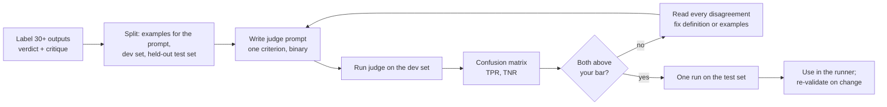

# LLM-as-judge vs. human labels

## Why this matters

Some qualities can't be checked by code. "The summary doesn't claim anything the source doesn't say", "the agent's explanation of the bug is correct", "the answer admits it couldn't find the file instead of inventing one" are judgments about meaning, and a regex can't make them. A model can make them, cheaply and at any volume. That is an LLM judge: a model prompted to grade another model's output against a criterion ([Anthropic: Demystifying evals for AI agents](https://www.anthropic.com/research/demystifying-evals-for-ai-agents) lists it among the grader types next to code-based and human graders).

The catch is that a judge is a classifier you wrote in English, and nobody has measured it. It will happily return a confident verdict on every input, right or wrong. If you use it unmeasured, you replace "I can't tell if the agent got better" with "a number says the agent got better, and I don't know what the number means". The same article is explicit that LLM graders need calibration against human graders. The Evals FAQ gives the rule in one line: whichever model you use, validate it against human labels before trusting its decisions ([Evals FAQ](https://hamel.dev/blog/posts/evals-faq/#q-what-model-or-llm-should-i-use-to-build-automated-evals)).

This chapter is that validation loop. You label a sample of outputs yourself, write a judge for one criterion, measure how often it agrees with you in the two directions that matter (catching failures, passing good outputs), read the disagreements, and revise until you'd trust it. Only then does it go into the runner from 4.3.

**Learning goals**

- Write a binary, criteria-specific judge prompt
- Measure judge agreement with your own labels (TPR/TNR)
- Iterate the judge until it's trustworthy

## Explanation

### When to use a judge, and when not to

A judge is the most expensive kind of check you have, and the cost isn't the tokens. It's the labels, the prompt maintenance, and the discipline of re-validating whenever something changes. The Evals FAQ says this directly: an LLM judge needs 100+ labeled examples and ongoing maintenance, so it should be reserved for failure modes that persist and that you'll iterate on repeatedly, while cheap code checks cover the rest ([Evals FAQ](https://hamel.dev/blog/posts/evals-faq/#q-should-i-build-automated-evaluators-for-every-failure-mode-i-find)). That is the same ordering 4.3 gave you. Use this as a gate:

1. **Can code check it?** Contains a value, file unchanged, tests pass, JSON validates. Then write the grader. Stop.
2. **Can you turn part of it into code?** "Mentions all three section titles and stays under 100 words" is code; "is faithful to the source" is what's left. Keep the code part in code.
3. **Does the remainder come up often enough to matter?** A failure mode from your 4.1 taxonomy that you see in 1 run in 20 and that you'll keep working on deserves a judge. One you saw once doesn't: fix it, add a regression case, move on.
4. **Is a human cheaper?** For a handful of cases you rerun twice a month, reading them yourself is fine. A judge pays off when the same check runs hundreds of times (every model, every prompt version, every CI run).

If you pass the gate, run the judge only on outputs that already passed the code checks. A run whose JSON doesn't parse doesn't need a model to tell you it failed.

### Binary pass/fail, one criterion per judge

The tempting design is "rate this answer 1 to 5 for quality". Don't. The Evals FAQ's argument is that binary labels force a clear decision and produce more consistent labeling, while on a scale the gap between adjacent points (is this a 3 or a 4?) is subjective, annotators disagree about it and drift to the middle to avoid a hard call. If you want to track gradual progress, it suggests measuring specific sub-components, each with its own binary check, instead of a scale ([Evals FAQ: binary pass/fail](https://hamel.dev/blog/posts/evals-faq/#q-why-do-you-recommend-binary-passfail-evaluations-instead-of-1-5-ratings-likert-scales)). Hamel Husain's judge guide puts the same point as "People don't know what to do with a 3 or 4" ([Husain: LLM-as-a-Judge guide](https://hamel.dev/blog/posts/llm-judge/#dont-stray-from-binary-passfail-judgments-when-starting-out)).

There's an engineering reason too. A binary verdict is a classification, so you can measure it with a confusion matrix (below). A 1-to-5 score has no such ground truth: what would "the right 4" be?

The second design rule is **one judge, one criterion**. The FAQ calls directing a judge to catch too many different kinds of errors at once the most common mistake in getting a judge to agree with humans ([Evals FAQ: when the judge won't agree](https://hamel.dev/blog/posts/evals-faq/#q-what-should-i-do-when-i-cant-get-my-llm-judge-to-agree-with-human-reviewers)). Anthropic's article makes the same recommendation: grade each dimension with an isolated judge rather than one judge for all dimensions ([Anthropic: Demystifying evals](https://www.anthropic.com/research/demystifying-evals-for-ai-agents)). The criterion should come from your failure taxonomy (4.1) or a rubric line from 4.2, and it should be sharp enough that two careful people would label the same way. Compare:

| Vague | Sharp |
|---|---|
| "The answer is good" | "The final answer states a value for `timeout` that matches the value in `config.yml`" |
| "The answer isn't hallucinated" | "Every file path mentioned in the final answer appears in a tool result in the transcript" |
| "The agent was helpful" | not a criterion: split it, or drop it (a generic metric, see 4.1) |

A criterion that's hard to state sharply is a hint that you haven't looked at enough data yet. That isn't a failure of the judge, as the next section shows.

### Label a sample yourself first

You can't validate a judge without ground truth, and the only ground truth available is your own judgment. So before you write any judge prompt, you label outputs: for each, read the transcript and the final result and write **Pass** or **Fail** for your one criterion, plus a short reason.

Why before the prompt? Husain's guide says "You cannot write a good judge prompt until you've seen the data" ([Husain: LLM-as-a-Judge guide](https://hamel.dev/blog/posts/llm-judge/)). The paper *Who Validates the Validators?* found the underlying reason: users need criteria to grade outputs, but grading outputs is how they discover what their criteria are, a circularity the authors call "criteria drift" ([Shankar et al.](https://arxiv.org/abs/2404.12272)). Expect your definition of the criterion to move while you label. That's a feature: when you hit an output you can't decide on, write the decision rule down ("a path the agent computed from a tool result counts as supported"). Those rules become the judge's definitions.

Practical labeling rules:

- **Label with the same information the judge will get.** If the judge sees the final answer and the tool results, you label from those, not from your memory of the run. Husain's guide lists "not providing external context" as a common mistake in judge prompts: the examples should carry the same information you use to decide ([guide](https://hamel.dev/blog/posts/llm-judge/#mistakes-ive-noticed-in-llm-judge-prompts)).
- **Write the critique as well as the verdict.** The guide says the critique "should be detailed enough so that you can use it in a few-shot prompt for a LLM judge" ([guide](https://hamel.dev/blog/posts/llm-judge/)). "Fail: says timeout is 60, config.yml says 30, the agent read the wrong file" is useful. "Fail: wrong" isn't.
- **Get both classes.** Labels that are all Pass tell you nothing about whether the judge catches failures. If your agent mostly succeeds, select outputs on purpose (runs that failed other checks, or that you flagged in 4.1) so that the Fail class has enough examples. The FAQ asks for about 30 to 50 Pass and 30 to 50 Fail examples in each of the dev and test sets where possible ([Evals FAQ: how many examples](https://hamel.dev/blog/posts/evals-faq/#q-how-many-examples-do-i-need-for-an-eval)). The practice below starts smaller, and the section on noise explains the price of that.
- **Be the one labeler.** For a personal project, you are the domain expert. The FAQ's advice for ownership is a single domain expert as the "benevolent dictator" ([Evals FAQ: how many annotators](https://hamel.dev/blog/posts/evals-faq/#q-how-many-people-should-annotate-my-llm-outputs)). It also notes that when several people do label, you measure how well they agree with Cohen's kappa (the same page), a chance-corrected agreement score. Relabel a few outputs a day later: if you disagree with yourself, the criterion isn't sharp yet.

### Writing the judge prompt

A judge prompt is a classifier spec. A structure that works for a first version:

1. **The task and the one criterion**, with the definition of Pass and of Fail written out, including the decision rules you made up while labeling.
2. **The inputs, clearly delimited**: what the agent was asked, and the evidence it should be judged against (tool results, the source document). Give each judge only what it needs for its criterion; the FAQ warns that extra context can degrade a judge and suggests ablations: remove one piece of context at a time and check agreement with your labels ([Evals FAQ: how much of a trace](https://hamel.dev/blog/posts/evals-faq/#q-how-much-of-a-trace-should-i-give-an-llm-judge)).
3. **A few labeled examples with critiques**, taken from your labels, covering both verdicts and some borderline cases. The guide's list of common prompt mistakes is about examples: none given, terse critiques, missing external context, no diversity ([guide](https://hamel.dev/blog/posts/llm-judge/#mistakes-ive-noticed-in-llm-judge-prompts)).
4. **Reason first, verdict last, in a format you can parse.** Ask for a short written reason, then `{"verdict": "pass" | "fail"}`. The reason lets you read *why* a disagreement happened, which is how you improve the prompt. Use structured output (2.5) so that parsing never fails silently.
5. **A way out**, if the evidence can be insufficient. Anthropic suggests giving the judge an instruction to return "Unknown" when it lacks information, to reduce hallucinated verdicts ([Anthropic: Demystifying evals](https://www.anthropic.com/research/demystifying-evals-for-ai-agents)). In your runner, treat `unknown` as a separate count, not as a pass, and look at those cases by hand.

The judge is a normal model call, so the 2.x tools apply: structured output, retries, and prompt caching for the long fixed prefix (definitions and examples) that every call repeats.

### Measuring agreement: the confusion matrix, TPR and TNR

Treat your labels as the truth and the judge as the thing under test. Every labeled output lands in one of four cells. Decide up front which class is the "positive" one, and say so wherever you report numbers. This chapter follows the FAQ, where the thing you're hunting is the failure: a true positive is a failure the judge caught.

| | Judge says Fail | Judge says Pass |
|---|---|---|
| **You said Fail** | TP: caught | FN: missed a failure |
| **You said Pass** | FP: false alarm | TN: correctly passed |

- **TPR** (true positive rate, recall) = TP / (TP + FN). Of the real failures, what share did the judge catch? The FAQ's wording: how many actual failures the evaluator catches ([Evals FAQ: can I trust my eval](https://hamel.dev/blog/posts/evals-faq/#q-how-do-i-know-if-i-can-trust-my-automated-eval)).
- **TNR** (true negative rate) = TN / (TN + FP). Of the good outputs, what share did the judge pass? A low TNR means false alarms that waste your time (same FAQ answer).

Why two numbers instead of one accuracy figure? Husain's guide shows the failure mode: if errors occur in 5% of cases, a judge that always says Pass has 95% agreement and detects none of the errors ([guide](https://hamel.dev/blog/posts/llm-judge/)). TPR for that judge is 0%, which is what reveals it. The FAQ also warns that improving one rate can cost the other, so you track both and pick acceptable levels from the consequences for your application ([Evals FAQ](https://hamel.dev/blog/posts/evals-faq/#q-how-do-i-know-if-i-can-trust-my-automated-eval)). Which one matters more is your call:

- A judge that gates a release or a regression check should have a high **TPR**: a missed failure ships.
- A judge that flags outputs for you to review by hand can tolerate a lower TPR but needs a decent **TNR**, or you drown in false alarms.

A worked example. You labeled 30 outputs: 12 Fail and 18 Pass. The judge returns:

| | Judge Fail | Judge Pass |
|---|---|---|
| You: Fail (12) | 10 | 2 |
| You: Pass (18) | 2 | 16 |

TPR = 10/12 = 83%, TNR = 16/18 = 89%, plain accuracy = 26/30 = 87%. Here accuracy looks like an average of the two, but with a skewed mix (say 28 Pass, 2 Fail) accuracy would be dominated by the Pass class and hide the TPR.

**Noise.** Thirty labels is small. With 12 failures, a single missed one moves TPR by about 8 points, so "83%" really means "somewhere in the high 60s to the low 90s". That is enough to catch a bad judge (a 50% TPR is visible at n=12) and not enough to rank two good ones. If your Fail class is small, label more Fail examples before you trust a number, or treat a result near your bar as "not yet".

**Dev and test.** Every time you adjust the prompt after seeing the dev results, the dev numbers get a little less honest, because you're tuning to those exact examples. The FAQ describes three splits: a training set (it may appear in the prompt), a dev set to guide refinement, and a test set used for a final check on examples that never influenced a change. If test scores fall well below dev scores, suspect overfitting ([Evals FAQ](https://hamel.dev/blog/posts/evals-faq/#q-how-do-i-know-if-i-can-trust-my-automated-eval)). The FAQ's suggested proportions for 100 to 200 labels are 10 to 20% training, 40 to 45% dev and 40 to 45% test ([Evals FAQ: how many examples](https://hamel.dev/blog/posts/evals-faq/#q-how-many-examples-do-i-need-for-an-eval)). With only 30 labels you can't afford all three: use some as in-prompt examples, the rest as dev, and label 10 to 15 fresh outputs later as your test set.

### Iterating the judge

Iteration is a loop on disagreements, not on the score:

1. Run the judge on the dev set. Compute TPR and TNR.
2. **Open every disagreement.** For each one, read your critique and the judge's reason. Decide whose fault it is. The FAQ's advice is to inspect a few disagreements manually before trying automated prompt tuning ([Evals FAQ: when the judge won't agree](https://hamel.dev/blog/posts/evals-faq/#q-what-should-i-do-when-i-cant-get-my-llm-judge-to-agree-with-human-reviewers)).
3. Classify the disagreement, because the fix differs:
   - **The judge misread the criterion** (FP or FN where your label is clearly right): sharpen the definition, add a decision rule, or add that case as a few-shot example.
   - **Your label was wrong or inconsistent**: fix the label. This happens more than you'd think, and it's criteria drift at work.
   - **The criterion is ambiguous** (you can argue both sides): rewrite the criterion, or split it into two. Don't try to fix this by piling on examples.
   - **The judge lacks the evidence** (the answer is only checkable against something it wasn't shown): change what it receives.
4. Change **one thing** per iteration, rerun, and keep a log of the prompt version and the numbers. Husain's example tracked agreement across iterations and reached above 90% agreement in three iterations on a roughly balanced set, with the caveat that the number varies by task ([guide](https://hamel.dev/blog/posts/llm-judge/#keep-iterating-on-the-prompt-until-convergence-with-domain-expert)).
5. Stop when both TPR and TNR clear the bar you set **before** you started (write it in the log first, so you aren't choosing the bar to match the result), then run once on the held-out test set. If the test result is much lower, you overfit the prompt to the dev examples: add diverse examples or loosen the definitions.

How high is "good enough"? There's no universal number. Choose from the cost of each error type, as above. A judge that gates CI might need TPR of 90% or more; a judge that sorts runs for human review may be fine at 75%. Write the reason for your bar next to it.

Also check **stability**. Run the judge twice on the same dev set. If the verdicts flip on cases you consider clear, the prompt is leaving too much to chance, and your TPR/TNR from one run is itself a sample. Anthropic lists non-determinism among the weaknesses of model-based graders ([Anthropic: Demystifying evals](https://www.anthropic.com/research/demystifying-evals-for-ai-agents)).

### Judge biases

An LLM judge isn't a neutral measuring instrument. The paper that popularized the approach, *Judging LLM-as-a-Judge with MT-Bench and Chatbot Arena*, reports that strong judges like GPT-4 reach over 80% agreement with human preferences, matching the agreement between humans, and it also names three biases ([Zheng et al., 2023](https://arxiv.org/abs/2306.05685)):

| Bias | What it is | Where it bites in your setup | Check |
|---|---|---|---|
| Position bias | In pairwise comparison, the judge favors an answer because of its slot (first or second) | Only if you compare two outputs, say model A vs. model B | Run both orders; count a win only if it holds in both |
| Verbosity bias | Longer answers get favored | A criterion like "is the explanation correct" can be answered "pass" for a long confident explanation | Label some long-but-wrong and short-but-right outputs on purpose and look at the judge's verdicts on them |
| Self-enhancement bias | A model favors outputs that look like its own | You judge Qwen's output with Qwen | Judge with a different model than the one under test, or measure the effect against your labels |

Binary, single-criterion grading against evidence sidesteps position bias entirely, because there is no pair, which is another reason to prefer it. For the third, the picture is nuanced. The Evals FAQ says using the same model for the task and the judge is usually fine for scoped binary tasks, notes that models can be biased when evaluating their own outputs, and says the real test is agreement with human judgment on a held-out set ([Evals FAQ: same model](https://hamel.dev/blog/posts/evals-faq/#q-can-i-use-the-same-model-for-both-the-main-task-and-evaluation)). The Claude docs' evaluation examples carry the comment that it is generally best practice to grade with a different model from the one that produced the output ([Claude docs: develop tests](https://platform.claude.com/docs/en/test-and-evaluate/develop-tests)). Both statements fit together: prefer a different model, and trust only the measured TPR/TNR.

Two practical consequences for model choice. First, start with a capable model as the judge and only try cheaper ones once you have a validated baseline, so you can measure what the saving costs: the FAQ advises exactly this ([Evals FAQ: which model](https://hamel.dev/blog/posts/evals-faq/#q-what-model-or-llm-should-i-use-to-build-automated-evals)), and Husain says he uses the most powerful model he can afford within his cost and latency budget ([guide](https://hamel.dev/blog/posts/llm-judge/#what-model-do-you-use-for-the-llm-judge)). Current options and prices live on [Landscape](/landscape), not here. Second, a local Qwen judge costs nothing per call but has to pass the same test: validate it exactly as you would a paid one, and compare.

A last warning about validation itself: **the validation expires.** TPR and TNR describe this judge prompt, this judge model, on outputs that look like your labeled sample. Change the judge model, change the criterion, or change the agent so that its outputs shift (new failure modes appear), and you need to re-check against labels. Keep the labeled set in the repo next to the judge, so that re-validation is one command.

### Using a validated judge

A judge with known TPR and TNR is a measuring instrument with a known error. Two ways to respect that error:

- **Read pass rates with the error in mind.** If the judge's TNR is 90%, about 1 in 10 good outputs gets flagged, so a measured failure rate overstates the true one. Suppose the true failure rate is 10%, TPR is 90% and TNR is 90%. Of 1000 outputs, 100 truly fail and the judge flags 90 of them, and it also flags 90 of the 900 good ones: 180 flagged, an observed failure rate of 18%. The algebra inverts this: with observed failure rate q, the true rate is p = (q - (1 - TNR)) / (TPR + TNR - 1), here (0.18 - 0.10) / 0.8 = 10%. This is my arithmetic, not a method from the sources above, and it only holds when the judge's error rates are the same across the outputs being judged. Its practical lesson is simpler: **compare runs judged by the same judge, and treat small differences as noise.**
- **Keep a human slice.** Spot-read a sample of judged outputs regularly, especially the ones the judge failed. Anthropic's article says human review can become occasional once the system is robust, not that it goes away ([Anthropic: Demystifying evals](https://www.anthropic.com/research/demystifying-evals-for-ai-agents)).

In the runner from 4.3 the judge is just one more grader: `(run, case) => Promise<{ name, pass, detail }>`, where `detail` is the judge's reason, so a failing case still tells you why. Two design points follow from 4.3. Run judge graders **after** the code graders and skip them when a code check has already failed. Keep judge calls separate from agent calls and **save the verdicts**: with `--regrade` you can rescore saved runs, and with a saved judge cache you won't pay for the same verdict twice while you edit unrelated graders. Note the judge model in each result row.

::: info 📖 Read now
[Hamel Husain: Using LLM-as-a-Judge for evaluation: a complete guide](https://hamel.dev/blog/posts/llm-judge/) · article · ~40 min (read steps 3 to 5 closely, skim the rest) · **essential**

Look for: why the critique matters as much as the verdict, how he runs the loop between the judge and the domain expert, the warning about raw agreement on imbalanced data, and the list of common mistakes in judge prompts. Then compare his seven-step process with the loop above: where do they differ?
:::

::: info 📖 Read now
[Evals FAQ: how do I know if I can trust my automated eval?](https://hamel.dev/blog/posts/evals-faq/#q-how-do-i-know-if-i-can-trust-my-automated-eval) · article · ~10 min (this answer, plus the one on a judge that won't agree with human reviewers) · **essential**

Look for: the train, dev and test split, what TPR and TNR measure, the advice to track both because improving one can hurt the other, and the step of inspecting disagreements before tuning the prompt automatically.
:::

::: info 📖 Read now
[Zheng et al.: Judging LLM-as-a-Judge with MT-Bench and Chatbot Arena](https://arxiv.org/abs/2306.05685) · paper · ~15 min (abstract and introduction) · optional

Look for: the three named biases (position, verbosity, self-enhancement) and the headline agreement figure with human preferences. Note that the study is about chat answers compared in pairs, which is a different setting from your binary criterion, so ask which biases still apply.
:::

::: info 📖 Read now
[Shankar et al.: Who Validates the Validators?](https://arxiv.org/abs/2404.12272) · paper · ~15 min (abstract and introduction, second reading) · optional

Look for: "criteria drift", the finding that your criteria change as you grade outputs. Connect it to the rule above: label first, write the prompt second.
:::

::: info 📖 Read now
[Anthropic: Demystifying evals for AI agents](https://www.anthropic.com/research/demystifying-evals-for-ai-agents) · article · ~10 min (fourth read: the model-based graders section only) · optional

Look for: the listed strengths and weaknesses of model-based graders, the "Unknown" escape hatch, and the advice on isolated judges per dimension.
:::

## Practice

**Brief:** Label 30 outputs yourself for one criterion, write a judge, and measure TPR/TNR. Iterate until both exceed a bar you choose. Add it to the eval runner. You write the judge, the labels and the metric code; I haven't provided them.

**Where:** A step in the growing `project/` (see `project/ROADMAP.md`, step 14). It builds on step 13: the runner and saved runs from 4.3. Paid-model calls for the judge go in `costs.md`; see [Landscape](/landscape) for current options and prices. A local Qwen judge is free per call.

**Steps**

1. **Pick one criterion.** Choose a failure mode from your 4.1 taxonomy or a rubric line from 4.2 that code can't check (the rubric-only cases you left ungraded in 4.3 are the natural source). Write it as one sentence with an observable test, like the sharp examples above. Write down, before anything else, what a Pass and a Fail look like.
2. **Collect 30 outputs.** Use saved runs from 4.3 across models and prompt versions so that there's variety. Aim for both classes: if Fail is rare, pick on purpose (runs that failed other checks, outputs you flagged in 4.1) until you have at least 10 of them. Keep the same fields the judge will see: the goal, the final answer and the relevant tool results.
3. **Label them yourself, before looking at any judge output.** For each, write `pass` or `fail` and a one-to-two-sentence critique into `project/evals/labels/<criterion>.jsonl`. Whenever you make a borderline decision, append the rule to a `decisions.md` next to it. Take a break, then relabel five without looking at the first labels. Note any you flip.
4. **Split the labels.** Choose 6 to 8 as in-prompt examples (both classes, including a borderline one) and keep the rest as your dev set. Don't put a label in both places.
5. **Write the judge.** A function that takes the inputs and returns `{ verdict, reason }` using structured output, with the structure from the "Writing the judge prompt" section. Decide whether it gets an `unknown` option and how the runner counts it.
6. **Write the metric code, and test it.** Compute the confusion matrix, TPR and TNR from a list of (human, judge) pairs, treating Fail as the positive class (or the other way round if you prefer, but state it). Unit-test it with `node:test` on small hand-made lists, including the always-Pass judge on a skewed set: its TPR must come out as 0.
7. **Choose your bar before you run.** Write TPR and TNR targets, with the reason, in `project/evals/labels/README.md`. Then run the judge on the dev set and record the first numbers.
8. **Iterate.** Open every disagreement. Classify each (judge misread, your label, ambiguous criterion, missing evidence), change one thing, rerun, and log the prompt version with both numbers. Do at least two iterations unless the first run clears the bar.
9. **Check stability and a bias.** Run the final judge twice on the dev set and list verdicts that flipped. Then check one bias from the table that applies to you: for example, add three long-but-wrong and three short-but-right outputs and see how the judge does, or judge the same outputs with a second model and compare TPR and TNR.
10. **Test on fresh data.** Label 10 to 15 outputs you haven't used. Run the final judge once and report TPR and TNR. Compare with the dev numbers.
11. **Plug it into the runner.** Add a judge grader type to the 4.3 runner: skipped when a code check has failed, returning `{ name, pass, detail }` with the judge's reason as `detail`, with verdicts saved so `--regrade` doesn't call the judge again. Record the judge model in each result row.
12. **Run the whole set.** Run `npm run eval` on one model with the judge on, read the judge's failing verdicts that you haven't labeled, and spot-check five by hand. Note your disagreements.
13. **Commit** the labels, the decision log, the judge, the metric code and the run log.

**Done when**

- 30 or more labeled outputs exist in `project/evals/labels/`, with a critique for each and a log of your decision rules, in both classes (at least 10 Fail).
- The judge is binary, covers one criterion, and returns a parseable verdict with a reason.
- The metric code has passing unit tests, and the always-Pass judge scores a TPR of 0 in a test.
- Your bar was written down before the first run, and the log shows at least the starting and final TPR and TNR, with what you changed between them.
- The final judge meets your bar on dev, and you have reported its TPR and TNR on at least 10 fresh outputs, noting any drop.
- You've checked the judge for stability across two runs and for at least one bias.
- The judge runs as a grader in `npm run eval` with the reason in the output, and runs only after the code checks pass.
- You wrote down in a sentence when you would not trust this judge (a different model, new failure modes, other criteria).

## Check questions

1. Your judge agrees with your labels on 95% of outputs. Why isn't that enough to trust it, and what do you compute instead?

   

Answer

   Raw agreement hides class imbalance. If only 5% of outputs fail, a judge that always says Pass is right 95% of the time and catches no failure at all (Husain's example). Compute TPR (the share of real failures the judge catches) and TNR (the share of good outputs it passes) separately, from a confusion matrix against your labels, and compare each with a bar you set in advance.

   

2. You're tempted to ask the judge to rate each answer 1 to 5 on "overall quality". Give two reasons to use a binary, single-criterion judge instead.

   

Answer

   Binary labels force a clear decision and give more consistent labeling, while adjacent scale points (3 vs. 4) are subjective and people default to the middle; and a single-criterion binary verdict is a classification you can score against your labels with TPR/TNR, whereas "overall quality" has no ground truth to check against. A judge asked to catch many different things at once is also the most common cause of poor agreement. Gradual progress is better tracked as several separate binary checks.

   

3. After five prompt edits, your judge has TPR 92% and TNR 90% on the dev set. On a fresh set it gets TPR 70%. What happened and what do you do?

   

Answer

   The prompt was tuned to the dev examples (overfitting), so the dev numbers were optimistic. The fresh set is the honest estimate. Look at the missed failures on the new set: they show which kinds of cases the prompt doesn't cover. Add diverse examples or sharpen the definitions, and then validate again on another untouched set. Also check that the sample was large enough for the number to mean much: with few failures, one or two misses moves TPR by many points.

   

4. You use Qwen to run the agent and the same Qwen to judge the outputs. What risk does that add and how do you check for it?

   

Answer

   Self-enhancement bias: a model can favor outputs that resemble its own, so the judge may pass things it should fail. The check is empirical: measure TPR and TNR against your human labels, ideally also with a different judge model, and compare. If the same-model judge meets your bar on a held-out test set, it can still be fine for a scoped binary criterion. Without that measurement you don't know.

   

5. A judge you validated last month now scores a run's failure rate at 3%, down from 12%. You changed the agent's prompt and the judge model's version was updated. Can you trust the drop?

   

Answer

   Not yet. The measured TPR and TNR apply to the judge prompt and model you validated, on outputs like your labeled sample. A new judge model version or a new kind of output can shift both rates. Re-run the labeled dev set through the current judge to see whether TPR/TNR still clear the bar, and spot-read some of the outputs the judge now passes. Only then compare the two runs.

   

## My understanding

<!-- Written by the learner, in their own words. Agents never fill this in. -->
