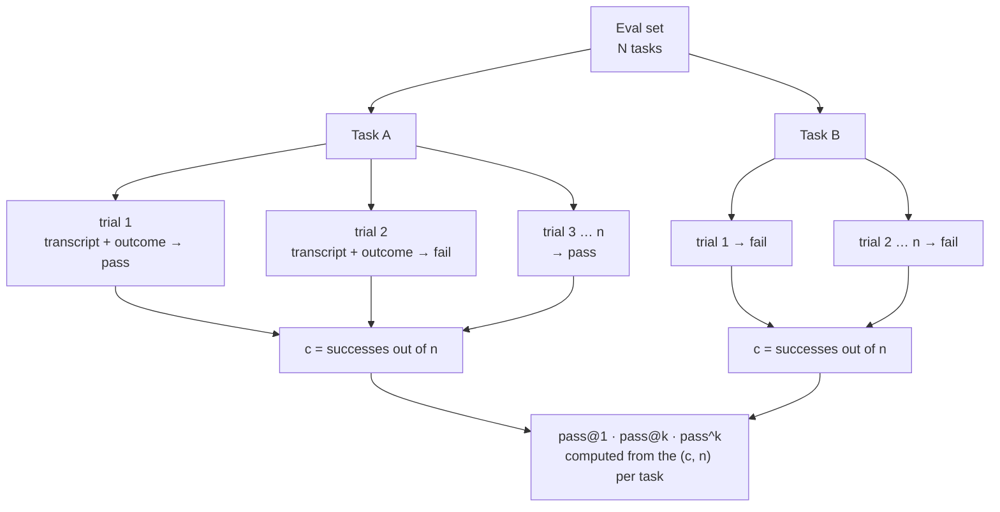

# Evaluating agents

## Why this matters

In 4.3 you ran your eval set and got a pass rate, and the chapter ended with a caution: one run of a case is one sample from a non-deterministic system, so run it twice before believing a small change. This chapter replaces that caution with a method. An agent is a loop of model calls and tool calls, and every step has a chance to go a different way. A case that passed once may fail on the next run, and a case that failed once may be fine. A single trial tells you what *can* happen, not what *usually* happens.

Anthropic's article on agent evals starts from this: each task has its own success rate, and a task that passes one run may fail the next ([Anthropic: Demystifying evals for AI agents](https://www.anthropic.com/research/demystifying-evals-for-ai-agents)). Two further problems sit on top. First, how you read "success" changes what the number means (did the agent get it right *once*, or *every time*?). Second, the machine running the eval is part of the experiment: a different memory limit or a busy API can move the score. Anthropic measured a 6 percentage point gap on one coding benchmark from resource settings alone ([Anthropic: Quantifying infrastructure noise in agentic coding evals](https://www.anthropic.com/research/infrastructure-noise)).

You'll learn the vocabulary (task, trial, transcript, outcome), the two ways to aggregate repeated trials (pass@k and pass^k), when to grade the path and when only the result, where the noise comes from, and how to tell capability evals from regression evals. Then you extend your runner to run every case five times and compare two models.

**Learning goals**

- Explain pass@k vs pass^k
- Grade trajectories and outcomes
- Account for noise from infrastructure and nondeterminism

## Explanation

### Tasks, trials, transcripts, outcomes

The article gives names to the parts of an eval. They map onto what you already built in 4.2 and 4.3:

| Term | Meaning | Your project |
|---|---|---|
| **Task** | One test with defined inputs and success criteria (also called a problem or test case) | An eval case from 4.2 |
| **Trial** | One attempt at a task. Outputs vary, so you run several | One run of the agent on a case |
| **Grader** | Logic that scores some aspect of a trial; a task can have several | The functions from 4.3 |
| **Transcript** | The full record of a trial: outputs, tool calls, reasoning, intermediate results (also called trace or trajectory) | Your step log from 3.2 |
| **Outcome** | The final state of the environment, which can differ from what the agent said it did | The files and exit codes your graders read |
| **Evaluation harness** | The infrastructure that runs the eval end to end: tasks, concurrency, recording, grading, aggregation | Your `npm run eval` runner |
| **Agent harness** | The system that lets a model act as an agent | Your agent loop and tools |

(All definitions from the same article.) Two consequences. First, the article's example for outcome: a flight-booking agent may say "your flight is booked", but the outcome is whether a reservation row exists in the database. You met this as outcome vs output grading in 4.3. Second, when you evaluate "an agent" you evaluate the model and its harness together, so a change to a tool description, a prompt or the loop is a change to the thing under test, just like swapping the model.

The eval is now a three-level structure: a *set* of tasks, each run as several trials, each trial producing one transcript and one outcome that the graders turn into a result. The one number you printed in 4.3 was a flattening of the middle level (one trial per task). This chapter keeps the middle level.

### pass@k and pass^k

Run a task n times and count the c trials that passed. Every useful aggregate is a function of those two numbers per task. The article defines the two you need:

- **pass@k** is the likelihood of at least one correct solution in k attempts. A 50% pass@1 means the agent solves half the tasks on its first try.
- **pass^k** is the probability that *all* k trials succeed. The article's example: a 75% per-trial success rate over three trials gives (0.75)³, about 42%.

At k = 1 they are the same number. As k grows they pull apart: by k = 10, the article notes, pass@k approaches 100% while pass^k falls toward 0% (same article).

The two answer different product questions. pass@k is the right reading when one success is enough and a human or a verifier picks the winner: generating candidate patches and running the tests on each, say. pass^k is the right reading when *every* run has to work, which is the case for an agent that acts on its own, and the article's own example is a customer-facing agent where consistency is essential (same article). pass@k comes from code-generation evaluation, where it's defined as the fraction of problems solved when a model gets k attempts ([Chen et al., Evaluating Large Language Models Trained on Code](https://arxiv.org/abs/2107.03374)). pass^k was introduced for agents in τ-bench, whose authors define it as the chance that all k i.i.d. trials of a task succeed, averaged across tasks, and report that a state-of-the-art function-calling agent with a task success rate above 60% had pass^8 below 25% in the retail domain ([Yao et al., τ-bench](https://arxiv.org/abs/2406.12045)). Read that sentence twice: an agent that is "60% good" is below one-in-four reliable when you ask it to do the same task eight times.

#### Worked example

Say one task has a per-trial success rate of p. If trials are independent, pass@k = 1 − (1 − p)^k and pass^k = p^k. Here are those numbers for k = 5:

| per-trial p | pass@1 | pass@5 | pass^5 |
|---|---|---|---|
| 0.9 | 0.90 | 1.00 (0.99999) | 0.59 |
| 0.8 | 0.80 | 1.00 (0.9997) | 0.33 |
| 0.5 | 0.50 | 0.97 | 0.03 |
| 0.2 | 0.20 | 0.67 | 0.0003 |

(Plain arithmetic from the two formulas.) A task the agent solves 80% of the time looks almost perfect under pass@5 and fails one time in three under pass^5. Same data, two stories. Neither is "the right number": you pick by asking what the agent will be used for.

Now the practical version, with the estimator you'll compute. Say you ran 10 tasks with n = 5 trials each, and the success counts c per task were:

`5, 5, 5, 5, 4, 3, 2, 1, 0, 0`

- **pass@1** is the average per-task success rate: (5+5+5+5+4+3+2+1+0+0) / 50 = 30/50 = **0.60**.
- **pass@5** (with n = k = 5): a task counts if c ≥ 1, so 8 of 10 = **0.80**.
- **pass^5** (n = k = 5): a task counts only if c = 5, so 4 of 10 = **0.40**.

Notice that 0.60⁵ is 0.08, nowhere near 0.40. The "p^k" formula above assumes every task has the same p. Real task sets mix easy tasks the agent always solves with hard ones it never does, and only the middle (the flaky tasks with c of 1 to 4) changes with k. Always compute pass^k per task and then average, as τ-bench does, instead of raising the overall pass rate to the k-th power.

When n is larger than k, use all the data with the unbiased estimators. The code-generation paper's estimator for pass@k is 1 − C(n−c, k) / C(n, k) per task (the paper runs n = 200 samples to estimate k ≤ 100 and warns that the shortcut 1 − (1 − p̂)^k is biased). The τ-bench estimator for pass^k is C(c, k) / C(n, k) per task. For c = 4 and n = 5, pass^2 is C(4,2)/C(5,2) = 6/10 = 0.6. With 10 tasks and these counts, pass^2 is (4×1 + 0.6 + 0.3 + 0.1) / 10 = 0.50. Both estimators are two-line functions: write them with unit tests, because off-by-one errors here are easy to make and hard to see.

::: warning Five trials is a small sample
c = 5 out of n = 5 does not mean p = 1. A task with p = 0.8 produces five straight passes a third of the time (0.8⁵ = 0.33). So "pass^5 = 0.40" is the share of tasks that passed all five, not proof that those tasks are reliable. Treat the numbers as a ranking tool and use the per-task counts to decide where to look, not as a certificate. If a decision rides on a small gap, run more trials on the tasks that moved.
:::

::: info 📖 Read now
[Anthropic: Demystifying evals for AI agents](https://www.anthropic.com/research/demystifying-evals-for-ai-agents) · article · ~25 min (fourth read: the definitions, the pass@k and pass^k section, capability vs regression, and the non-determinism and trial-isolation passages) · **essential**

You have read this for its vocabulary (4.1), task design (4.2) and graders (4.3). Now read it for the statistics and the structure of the eval. Look for: the pass@k and pass^k definitions and the example with the 75% success rate, what the article says about starting a capability eval at a low pass rate, the note that failures from one shared resource limit are not independent trials, and the Claude-reading-git-history story, which shows how leftover state between trials corrupts the result.
:::

::: info 📖 Read now
[τ-bench: A Benchmark for Tool-Agent-User Interaction in Real-World Domains](https://arxiv.org/abs/2406.12045) · paper · ~15 min (abstract, the pass^k section, the retail results) · optional

The paper that introduced pass^k. Look for the definition and its unbiased estimator, the plot of how fast pass^k falls as k grows, and how success is decided: by comparing the final database to a ground-truth state, which is outcome grading applied to a multi-turn agent.
:::

::: info 📖 Read now
[Evaluating Large Language Models Trained on Code](https://arxiv.org/abs/2107.03374) · paper · ~10 min (section 2.1 only) · optional

Where pass@k comes from. Look for why the authors generate more samples than k and use an unbiased estimator, and the warning that the shortcut 1 − (1 − p̂)^k is biased.
:::

### Trajectory vs outcome grading

A grader can look at two different things. It can check the **outcome** (the final state: the file contents, the database row, the tests that now pass), or it can check the **trajectory** (the transcript: which tools were called, in which order, how many turns and tokens it took).

The article's advice is to prefer the first: it's often better to grade what the agent produced, not the path it took. Rigid checks on the sequence of steps make the eval brittle, because agents find valid approaches the designer didn't anticipate (same article). The article's example is a flight problem in τ2-bench where Opus 4.5 found a loophole in the stated policy. The agent "failed" the task as written and found a better solution for the user. If your grader had demanded "call tool A, then tool B", the better solution would have been marked wrong.

That is the default, not the whole rule. There are four jobs for trajectory grading that don't have the brittleness problem, because they ask about *properties* of the path, not a required sequence:

| Trajectory check | Why you want it | Example |
|---|---|---|
| **Forbidden actions** | The outcome can look fine while the agent did something unacceptable on the way | Ran `rm -rf`, called the delete tool, edited a file it was only supposed to read |
| **Budgets** | Cost and latency are part of quality (see 4.8) | At most 15 turns, at most 50k tokens, under 2 minutes |
| **Loops and repeats** | A pass reached through thrashing is a warning | Same tool call with identical arguments 4 times in a row |
| **Required evidence** | For answer-only tasks, the answer must come from somewhere | The agent called `read_file` on the file whose value it quotes (otherwise it may have guessed) |

These are the path guards from 4.3, and they need to be used sparingly. Ask of each one: would a correct, different solution trip this check? If yes, it's an outcome-or-nothing situation. The article also warns about the other direction: graders should be built so that passing requires real problem-solving, not exploiting a loophole (same article). That is the reward-hacking case from the 4.3 check questions, and the fix is the same: grade the thing you care about in a way that can't be satisfied by shortcuts.

Two more points from the article apply directly to multi-step tasks:

- **Give partial credit.** If a task has several components, a trial that identifies the problem and verifies the customer but fails to issue the refund is meaningfully better than one that fails at the start (same article). With several graders per task you already have the raw material: store each grader's result and report both "all graders passed" (the strict verdict you use for pass@k and pass^k) and "share of graders passed" (a finer signal for comparing two versions that both fail).
- **Read transcripts.** You won't know whether graders work unless you read the transcripts and grades from many trials, and failures should seem fair (same article). With repeated trials this gets cheaper to do well: for a flaky task, open one passing and one failing transcript side by side and find the step where they diverge.

### Where the noise comes from

When the same task passes in one trial and fails in the next, the cause is one of four layers. Sorting failures by layer is the main skill in this chapter, because each needs a different fix.

1. **The model.** Sampling makes the same prompt produce different tokens, and a different early token can send the whole trajectory somewhere else. Agents amplify this: an early wrong turn changes every later observation. This is the "real" variance, the one pass^k is built to measure.
2. **The task and the grader.** A vague task gives different valid interpretations; a brittle grader rejects some of them; a stochastic task (one whose correct answer changes with each run) can't be graded with a fixed expectation. The article reports all three in one story: Opus 4.5 first scored 42% on CORE-Bench, and after an Anthropic researcher fixed rigid grading (penalizing "96.12" when "96.124991…" was expected), ambiguous task specs and tasks that couldn't be reproduced, and used a less constrained scaffold, the score rose to 95% (same article). Not a flaky agent: a flaky eval.
3. **The environment.** Tools return different things on different runs: the time, a web page, a process that is slow to start, state left over from the last trial. Leftover state is the sneaky one. The article says each trial should start from a clean environment, because leftover files, cached data or exhausted resources produce correlated failures, and in one of Anthropic's internal evals Claude gained an unfair advantage by reading git history left by earlier trials (same article). This is the fresh-temp-directory rule from 4.3, and it matters more once you run five trials of the same task in a row.
4. **The infrastructure.** The machine, container or API that runs the agent: memory limits, timeouts, rate limits, network failures, latency.

Layers 3 and 4 are where agent evals differ most from ordinary model evals, so the next section takes layer 4 on its own.

### Infrastructure noise

Anthropic's engineering team ran Terminal-Bench 2.0 on their own Kubernetes cluster and got scores that didn't match the public leaderboard. Up to 6% of tasks failed from pod errors unrelated to the agent. The cause was enforcement: their setup treated each task's resource spec as both a guaranteed floor and a hard ceiling, so a container that briefly exceeded the limit was killed. The leaderboard's sandbox provider was more lenient and allowed temporary overallocation ([Anthropic: Quantifying infrastructure noise in agentic coding evals](https://www.anthropic.com/research/infrastructure-noise), published 2026-02-05).

They then held the model, harness and tasks constant and varied only the resource configuration, from strict enforcement of the specs (1×) to uncapped, over six settings. The results, from the same article:

| Setting | Infrastructure error rate | What changed |
|---|---|---|
| 1× (strict) | 5.8% | baseline |
| 3× headroom | 2.1% | infra errors fell; the success score stayed within noise (p = 0.40) |
| Uncapped | 0.5% | success rose by almost 4 more points; total lift over 1× was 6 points (p < 0.01) |

The article's interpretation: up to 3× the extra room mostly removes spurious crashes, while beyond that it changes what the agent *can do* (install large dependencies, run memory-hungry test suites), so the eval stops measuring the same thing. In their words, two agents with different resource budgets and time limits aren't taking the same test. A smaller replication on SWE-bench (227 problems, 10 samples each) found only a 1.54-point lift at 5× RAM, because those tasks need fewer resources, so the size of the effect depends on the benchmark. The article also reports, anecdotally and unquantified, that pass rates varied with time of day, likely because of API latency.

What to take from it for your own setup:

- **Separate "harness broke" from "agent failed".** An OOM kill, a timeout of your own runner, a 429 or a connection error is an infrastructure failure. Record it with its own status, exclude it from pass@k and pass^k (or at least show it separately), and rerun those trials. This extends the harness-error rule from 4.3 to repeated trials: if 2 of your 5 trials died on a rate limit, "3 out of 5" is not a statement about the agent.
- **Treat resource limits as part of the experiment.** Your equivalents: the per-case timeout, the turn limit, `num_ctx` for local models, how much unified memory the model leaves for the rest of the machine, and how many cases run at once. The article recommends specifying a guaranteed allocation and a separate hard limit instead of one pinned value, picking the band so the scores at the floor and ceiling are within noise, and reporting the setting you used (same article). Write your settings next to every result.
- **Keep trials independent.** Trials that fail because they share a limit, a cache or a directory are not independent trials, and pass^k assumes they are.
- **Be skeptical of small gaps.** The article's own rule of thumb: leaderboard differences under 3 points deserve suspicion until the setup is documented and matched, and a few-point lead may be a bigger VM rather than a better model (same article). Your set is much smaller, so your threshold for "real" should be much higher.

On a Mac mini with 24 GB, the most likely infrastructure noise for you is local: a larger model that swaps under memory pressure and times out some trials, the model being unloaded between trials, or two processes sharing the GPU. Watch for failures that cluster in time (a run of timeouts in a row), which suggests the machine, not the agent.

::: info 📖 Read now
[Anthropic: Quantifying infrastructure noise in agentic coding evals](https://www.anthropic.com/research/infrastructure-noise) · article · ~15 min · **essential**

Look for: the difference between a resource guaranteed as a floor and enforced as a ceiling, the table of error rates across the six configurations and where the score starts to move beyond noise, the `bn-fit-modify` example of how a tight limit changes the strategy that works, and the list of recommendations at the end. As you read, write down which of those settings exist in your own runner.
:::

### Capability vs regression evals

Two evals with different jobs, and the trial statistics read differently for each. The article's definitions:

- A **capability** (quality) eval asks what the agent can do well. It should start at a low pass rate, "a hill to climb".
- A **regression** eval asks whether the agent still handles what it used to handle. It should sit near 100%.
- Tasks **graduate**: a capability task with a high pass rate moves into the regression suite and runs continuously to catch drift (same article).

You met these labels as the `kind` tag in 4.2. With trials, they become different instruments. This part is my own synthesis rather than the article's wording, so treat it as a starting rule:

| | Capability set | Regression set |
|---|---|---|
| Question | Can the agent ever do this? | Does it still do this, every time? |
| Natural metric | pass@1 trend; pass@k shows headroom | pass^k, or "no task dropped from all-pass" |
| What a flaky task means | The edge of what works: this is where improvements happen | A defect to investigate before it spreads |
| A task with c = 0 | Possibly too hard, possibly broken: read a transcript before deciding | Impossible if it graduated; if it happens, a regression |
| What the number is for | Pick the next thing to improve | Block a change that makes things worse |

A task with zero passes needs care. The article says that with frontier models, 0% pass at a large k more often signals a broken task than an incapable agent, so read the transcripts before blaming the model (same article). With only five trials you can't reach the same certainty, but the same suspicion applies: an all-zero task is the first one to open and check for an impossible spec or a grader bug.

The same article covers the end of the story: **saturation**. When the agent passes every solvable task, the set can only track regressions and gives no signal on improvement, and large capability gains look like small score increases (same article). For your 20 to 30 cases this will happen faster than you expect with a strong model, so plan to add harder cases as pass rates climb. 4.6 turns the regression half into a CI job.

## Practice

**Brief:** Run each eval case 5× and report pass@1, pass@5 and pass^5 for two models. Note which cases are flaky and why. You extend your own runner; I haven't provided code.

**Where:** A step in the growing `project/` (see `project/ROADMAP.md`, step 15). It builds on step 13: your `npm run eval` runner, graders and cases. The two models are local Qwen (pick one of the models you used in 4.3) and one paid model. Estimate the cost first and note the spend in `costs.md`; see [Landscape](/landscape) for prices. A 5× run multiplies your 4.3 run time and cost by five.

**Steps**

1. **Plan the budget.** From your 4.3 paid-model run (tokens and cost per set), multiply by five and by your case count. If it doesn't fit, choose which cases get 5 trials on the paid model (for example the capability cases and a sample of the regression ones), and write down the choice and why.
2. **Add trials to the runner.** A `--trials <n>` option (default 1) runs each case n times, each in a fresh temp directory, and writes one result row per trial with the case id, trial index, model, grader results, status, time and tokens. Keep running and grading separate, as in 4.3, so `--regrade` still works.
3. **Add a trial status for infrastructure failures.** Distinguish `agent-failed`, `passed` and `infra-error` (timeout from your runner, connection error, rate limit, out-of-memory). Decide how each is handled and write it down. A good starting policy: retry an infra-error trial once, and if it's still an infra-error, exclude it and print the count.
4. **Write the estimators.** Functions `passAtK(n, c, k)` and `passPowK(n, c, k)` for one task, and an aggregator that averages across tasks. Unit-test them with `node:test`: at least c = 0, c = n, a mixed case worked out by hand, and k = 1 (both must equal c / n).
5. **Print a trial summary.** For each model: pass@1, pass@5 and pass^5, plus a per-case table with c out of n. Sort flaky cases (0 < c < n) to the top. Report infra-error counts and the settings used (timeout, turn limit, `num_ctx`, concurrency) alongside.
6. **Run both models.** Five trials of the whole set on local Qwen, and on one paid model within the budget from step 1. Record time and cost per model in `project/evals/README.md` and in `costs.md`.
7. **Hunt the flaky cases.** For every case with 0 < c < n on either model, open one passing and one failing transcript, find where they diverge and label the cause with one of the four layers above (model, task or grader, environment, infrastructure). Record it in the README.
8. **Fix what is not the model.** For each flaky case you labelled grader, task or environment, make the fix (loosen the grader, tighten the task text, reset the state) and rerun that case's five trials. Note the change in c.
9. **Look at the all-zero and all-pass cases too.** Open the transcript of one case with c = 0 on both models (is the task or grader broken?), and of one case with c = n on both (is it too easy to say anything?). Write one sentence each.
10. **Compare the two readings.** Write three or four sentences in the README: how pass@1, pass@5 and pass^5 differ for each model, and which you would use to choose a model for an unattended agent, and why. Commit.

**Done when**

- `npm run eval -- --trials 5 --model <m>` runs every case five times in a fresh directory per trial, with results saved per trial and `--regrade` still working.
- Infrastructure errors are a separate status, retried or excluded by a written policy, and the summary prints their count and the run settings.
- The estimators have unit tests that pass, including c = 0, c = n, a hand-computed mixed case and k = 1.
- You have pass@1, pass@5 and pass^5 for two models, with time and cost, in `project/evals/README.md`, and the spend is in `costs.md`.
- Every flaky case has a cause label and a one-line reason from a pair of transcripts, and at least one non-model cause was fixed and re-measured, or you wrote down that none were found.
- You compared the three metrics for your two models and said which one fits an unattended agent.

## Check questions

1. An agent passes 8 of your 10 tasks at least once in five trials, but only 4 of 10 in all five. What are pass@5 and pass^5, and why are they so different?

   

Answer

   pass@5 = 0.8 (a task counts if any trial passed) and pass^5 = 0.4 (a task counts only if all five passed). The four tasks in between are flaky: the agent can solve them but doesn't do so reliably. pass@5 measures what the agent can do at best, pass^5 what it does every time. For an agent that runs unattended, the second matters more. The gap between them is itself a useful number: it's the amount of flakiness in the set.

   

2. Your overall pass@1 is 0.6. A colleague says "so pass^5 is about 0.6⁵ = 0.08". Is that right for your set?

   

Answer

   Not in general. p^k assumes every task has the same success probability and that trials are independent. Real sets mix tasks the agent always solves, tasks it never solves and a few flaky ones, so the all-five-pass share can be much higher (in the chapter's example, 0.40 against 0.08). Compute pass^k per task from its own (c, n) and average, as τ-bench does. The p^k formula is only a rough picture of how fast reliability decays for a task that is genuinely flaky.

   

3. A task asks the agent to fix a bug. You add a trajectory grader that requires calling `read_file` on `src/parse.ts` first and then `edit_file`. Why is that risky, and which trajectory checks are safer?

   

Answer

   It encodes one valid path. An agent that searches first, reads a different file or fixes the bug through a different tool would fail, although the outcome (the tests pass) is right. Anthropic's advice is to grade what the agent produced rather than the path it took, because agents find valid approaches the designer didn't anticipate. Safer trajectory checks describe properties of the path rather than a sequence: forbidden actions (never edit the test files), budgets (turns, tokens, time), repeated identical calls, or required evidence for a claimed value. Before adding any, ask whether a correct but different solution would trip it.

   

4. Of five trials on one case with a local model, three pass and two fail, and both failures are timeouts that happened while the machine was also running a paid-model batch. What do you report as c, and what do you do?

   

Answer

   Don't count them as agent failures. They are infrastructure errors: the harness, not the agent, decided the outcome. Record them as `infra-error`, rerun those trials under clean conditions (nothing else competing for the machine, a timeout set from the observed run time), and compute c from the rerun. If you reported 3 of 5, you'd be measuring your scheduling. The point of Anthropic's infrastructure-noise article is that resource settings and load can shift scores as much as the differences you are trying to measure, so record the settings with the result and keep trials independent.

   

5. Which tasks belong in the regression set, how do you read them with trials, and what do you do with a capability task that now passes 5 out of 5 on every run?

   

Answer

   The regression set holds tasks the agent already handles, and the number to watch is whether any task stops passing: pass^k near 1, or no task dropping out of all-pass, because a regression suite should sit near 100%. A capability task that always passes has done its job: it graduates into the regression set, and you replace it in the capability set with something harder so it doesn't saturate. A task at 0 out of 5 stays in the capability set, after you read a transcript to check that the task and grader are sound rather than the agent being incapable.

   

## My understanding

<!-- Written by the learner, in their own words. Agents never fill this in. -->
