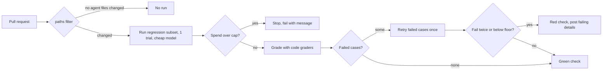

# Regression evals in CI

## Why this matters

Prompts, models and tools change all the time, and each change can quietly break something that used to work. You edit a tool description to fix one case and three others get worse. A provider updates a model behind the same name. Nobody notices until a user does. A regression eval is the automated answer: a small set of cases the agent already handles, run on every change, with a verdict before the change merges. It is the unit-test suite of an agent.

The hard parts are not the YAML. They are three decisions: **which** cases run on every change (fast, cheap, near 100%) and which stay out (slow, expensive, exploratory), **what it costs** to run them hundreds of times, and **when a lower score counts as a failure** when the agent is non-deterministic and a perfect run can fail by chance. This chapter covers all three and ends with you adding a workflow to `project/`.

**Learning goals**

- Separate fast regression evals from slow capability evals
- Run evals in GitHub Actions within budget
- Set thresholds that account for noise

## Explanation

### Two suites with two jobs

4.5 introduced the labels. A **capability** eval asks what the agent can do and should start at a low pass rate. A **regression** eval asks whether it still handles what it used to and should sit near 100% ([Anthropic: Demystifying evals for AI agents](https://www.anthropic.com/research/demystifying-evals-for-ai-agents)). The same article says tasks graduate: a capability task the agent now passes reliably moves into the regression suite. For CI the labels become operating rules, which are my own synthesis rather than a quote:

| | Regression suite (CI) | Capability suite (on demand) |
|---|---|---|
| Runs | Every pull request that touches agent behaviour | When you decide: before a model switch, weekly, after a big change |
| Size | Small, curated (a subset of your 4.2 set) | As large as it needs to be, with trials from 4.5 |
| Graders | Code-based (4.3), deterministic | Code plus judges (4.4) |
| Expected pass rate | Near 100% | Low to middle; the number is a compass |
| A failure means | "This change broke something": block or investigate | "Here is something to improve" |
| Cost target | Cents per run | A budget you choose per experiment |

The Evals FAQ gives the same split from the CI side. Its answer to how evals differ in CI/CD and in production monitoring says CI evals protect against known regressions before deployment, that CI datasets are small and purpose-built (small there still means "in many cases 100+ examples"), covering core features, regression tests for past bugs and known edge cases, and that because CI runs frequently the cost of each test must be considered: it recommends assertions and other deterministic checks over LLM judges ([Evals FAQ: CI/CD vs. monitoring production](https://hamel.dev/blog/posts/evals-faq/#q-how-are-evaluations-used-differently-in-cicd-vs-monitoring-production)). The same answer says that when error analysis reveals new failure patterns you should add representative examples to your CI dataset. That is the loop: a failure found in production or in 4.1's error analysis becomes a regression case, so the same bug can't return unnoticed.

::: info 📖 Read now
[Evals FAQ: How are evaluations used differently in CI/CD vs. monitoring production?](https://hamel.dev/blog/posts/evals-faq/#q-how-are-evaluations-used-differently-in-cicd-vs-monitoring-production) · article · ~5 min · **essential**

Look for what goes into a CI dataset (core features, past bugs, edge cases), why it stays small, and the advice about which grader type to use there. Then read the neighbouring answer, [How often should I run my evals?](https://hamel.dev/blog/posts/evals-faq/#q-how-often-should-i-run-my-evals), and note its three dimensions: cost, saturation and business value of catching the error. Both feed the decision about which of your cases earn a place in CI.
:::

### Choosing the CI subset

Pick the subset with the three dimensions from the FAQ's schedule answer: how cheap the case is to run, how saturated it is (a case that always passes tells you nothing new, but in a regression suite that is the point, so keep it if it guards something that matters), and the business value of catching its failure.

A workable recipe for your `project/evals/` set:

1. Start from cases tagged `kind: regression` in 4.2, or graduate any capability case with a clean record over several 4.5 trials.
2. Keep cases that are **cheap**: few turns, short fixtures, small outputs. Compute the token cost per case from your runs and drop the expensive tail first.
3. Keep **one case per behaviour**, not ten near-duplicates: a tool call with the right arguments, a refusal to edit a protected file, the turn limit being respected, a recovered tool error.
4. Prefer cases whose graders are code (4.3). A judge in CI means a second model call per case, more noise from the judge itself and a cost that scales with the suite.
5. Add a case every time you fix a real bug. Its first run proves it fails on the broken version.

Fifteen to twenty cases is plenty to start with for a study project (my judgement, smaller than the FAQ's typical CI set). The point is a signal you trust on every pull request, not coverage.

### Running evals in GitHub Actions

The mechanics are an ordinary CI job: check out, install, run `npm run eval` with a case filter and a minimum pass rate, and let the exit code decide. Your 4.3 runner already exits non-zero below `--min-pass-rate`, which is all the workflow needs. The parts specific to evals:

**Trigger only when behaviour can change.** The workflow syntax has a `paths` filter for `pull_request` events: it runs the workflow based on which file paths changed ([GitHub Docs: Workflow syntax](https://docs.github.com/en/actions/reference/workflows-and-actions/workflow-syntax)). List the prompt, the tools, the loop and the eval files. A docs-only pull request then costs nothing. Be careful with the converse: if the agent's behaviour depends on a file you forgot to list, the filter silently skips the check.

**Cancel superseded runs.** With a `concurrency` group and `cancel-in-progress: true`, a new push cancels the older run for the same pull request, so you pay for the latest commit only. The docs say there can be at most one running job or workflow in a concurrency group at any time ([GitHub Docs: Control the concurrency of workflows and jobs](https://docs.github.com/en/actions/how-tos/write-workflows/choose-when-workflows-run/control-workflow-concurrency)).

**Bound every run.** Set `timeout-minutes` on the job and a per-case timeout and turn limit in the runner (4.3 already treats a timeout as a failed result and keeps going). A looping agent in CI is a billing incident.

**Minimum permissions.** Declare `permissions: contents: read` for the job. The workflow syntax docs describe the `permissions` key as a way to allow only the minimum required access, and note that once you specify any permission, all unspecified ones are set to none (same page). An eval job that only reads code needs nothing more.

**Keep the key safe.** Store the OpenRouter key as a repository secret and read it from `secrets` in the workflow. Secrets are not passed to the runner when a workflow is triggered from a forked repository, with the exception of `GITHUB_TOKEN` ([GitHub Docs: Using secrets in GitHub Actions](https://docs.github.com/en/actions/how-tos/write-workflows/choose-what-workflows-do/use-secrets)). In a private study repo that only you push to, this does not bite. It matters when you copy the workflow to a project with outside contributors: your eval job then fails for forks with no key. The tempting fix, switching the trigger to `pull_request_target` and checking out the pull request's code, is the pattern GitHub Security Lab calls a pwn request: it combines a privileged trigger with untrusted code and can leak secrets or grant write access ([GitHub Security Lab: Preventing pwn requests](https://securitylab.github.com/resources/github-actions-preventing-pwn-requests/)). Don't do it. For a public project, run evals on a maintainer-triggered event instead.

::: info 📖 Read now
[GitHub Docs: Workflow syntax for GitHub Actions](https://docs.github.com/en/actions/reference/workflows-and-actions/workflow-syntax) · docs · ~15 min (the sections on `on.<push|pull_request>.paths`, `permissions`, `concurrency` and `jobs.<job_id>.timeout-minutes`) · **essential**

It's a long reference page: don't read it top to bottom. Look for the four keys above and write the smallest workflow that uses all of them. Check the `paths` rule when both `branches` and `paths` are set (both filters must match).
:::

::: info 📖 Read now
[GitHub Docs: Using secrets in GitHub Actions](https://docs.github.com/en/actions/how-tos/write-workflows/choose-what-workflows-do/use-secrets) · docs · ~10 min (creating a repository secret and using it in a workflow, and the note about forks) · **essential**

Look for where the secret is created, how a workflow reads it through the `secrets` context and why it isn't available for pull requests from forks. Decide what your workflow should do when the key is missing: skip with a clear message, or fail.
:::

### Cost control

An eval in CI is a bill that grows with three multipliers: cases, trials and pull requests. The cost of one run is the tokens in and out times the model's price. Prices and model choices change fast, so they live on [Landscape](/landscape), never here. Your levers, from most to least effective:

1. **A small subset.** Fifteen cases at a few thousand tokens each is a very different bill from a full 30-case set with five trials. Run the full set with trials on demand, not per push.
2. **Code graders only.** No judge calls.
3. **One trial in CI, a retry rule for failures.** See the next section: re-run only the cases that failed once, not the whole suite.
4. **A cheap model for CI.** Use a cheap OpenRouter model as the CI default (see [Landscape](/landscape) for options). A regression suite asks whether a change broke the agent, and that question is answered by a stable model, not the most capable one. The trade-off is that you test the agent on the CI model, so a regression specific to your production model can slip through: run the production model in a nightly or manual job.
5. **Path filters and cancel-in-progress**, as above.
6. **Local models for the inner loop.** Run the same `npm run eval` on Ollama on your own machine while you edit, so most of your iterations cost nothing, and let CI be the final gate. A hosted runner has no GPU and no pulled models, so running your 14B model there is a poor fit by default (my reasoning, not a measured result). A self-hosted runner on your Mac mini is possible but then you own the security of the machine, which is one more reason to keep fork pull requests out.
7. **A hard cap.** Everything above lowers the expected cost; none of it bounds the worst case. A runaway loop, a retry storm or a mistake in the filter can still spend money. Put the bound in two places: in the runner (a maximum total token or dollar budget per run that stops starting new cases and fails the job with a clear message), and at the provider. OpenRouter documents per-key credit limits as an optional spending cap on an individual API key ([OpenRouter: Limits](https://openrouter.ai/docs/api-reference/limits)). Creating a key with a cap goes through the Management API: a `POST` to `/api/v1/keys` with a `limit` field, and a `limit_reset` field to make the cap reset daily, weekly or monthly ([OpenRouter: Management API keys](https://openrouter.ai/docs/guides/overview/auth/management-api-keys.md)). Management keys can't be used for completions, so you use one only to create the capped key, and store the capped one as the secret. With this, the worst case of a CI mistake is the cap, not your budget.

The runner-side cap deserves a note: you can only enforce it if your runner records token usage per case (your 3.2 step log does). Estimate before you start each case from the running total, and stop when the total passes the cap. Report cost in the job summary so you see drift over time.

### Thresholds and flakiness

Here is the problem. Your regression set has N cases, each passes with probability p per run, and CI fails the build if any case fails. Even an agent that hasn't changed at all fails some runs. If each case has an independent 4% chance of failing by luck, a 25-case suite has a 1 − 0.96²⁵ ≈ 64% chance of at least one failure per run. A suite that is red most of the time teaches the team to ignore it, which is worse than no suite.

Noise has four sources, which 4.5 covered: the model's sampling, a flaky grader or fixture, the environment, and infrastructure errors such as 429s and timeouts. Treat them differently:

- **Infrastructure errors are not failures.** A 429, a connection error or a timeout caused by the machine should be reported as `infra-error` and retried, not counted against the agent (4.5's glossary term). If most of the run is infra errors, fail the job as "inconclusive", not as a regression.
- **Reduce sampling noise at the source.** Use temperature 0 or the lowest the provider allows, a fixed model version where the provider offers one, and graders that accept every correct variation (4.3). These shrink noise but don't remove it: even at temperature 0, LLM APIs are still not deterministic in practice ([Thinking Machines: Defeating Nondeterminism in LLM Inference](https://thinkingmachines.ai/blog/defeating-nondeterminism-in-llm-inference/)), and I haven't verified how much for any particular provider.
- **Fix flaky cases, don't tolerate them.** A case that flips without a code change is either too hard (a capability case in the wrong suite), has a loose grader or has shared state between runs. 4.5's per-task counts tell you which.

After that, some noise is left, and the pass criterion has to account for it. The options, from strictest:

| Rule | Good for | Weak spot |
|---|---|---|
| Every case must pass | A tiny suite of deterministic cases (code graders on tool-argument checks) | Fails on every flaky case |
| **No case that passed on the base branch may fail**, after one retry of failures | Most agent suites; flaky cases get a second chance but a real break fails twice | A retry can hide a case that dropped from reliable to 50% |
| Pass rate ≥ baseline − margin | A larger suite, where one failure is expected now and then | Hides one important case failing; use alongside a "must-pass" list |
| Pass rate on k trials per case (pass^k from 4.5) | Cases you can afford to run several times | Costs k times as much |

All of these are my own framing. A sensible default for your project: run each case once, retry failed cases once more, and fail the job if any case fails both times or if the pass rate is below a fixed floor. Keep a short **must-pass** list of critical cases (the protected-file case, the turn limit) that never gets the benefit of the margin.

A retry changes the math in your favour: if a flaky case fails with probability f, failing twice in a row is f² (when attempts are independent, which for shared state or a rate limit they are not). With f = 0.2, that is 0.04. With a 25-case suite of cases at f = 0.04, a fail-twice rule gives roughly a 25 × 0.0016 = 4% chance of a false alarm per run. A real regression that drops a case to a 0% pass rate fails both attempts and is caught. A regression that only makes a case worse (from 100% to 70%) fails twice 9% of the time, so it can sneak through. That is the cost of the retry rule. Use trials on the capability suite to find those.

Choose a margin from data, not from feeling: run the suite on an unchanged commit ten or twenty times, record the pass rate each time, and set the floor below the lowest result, or at about two standard deviations below the mean. For a suite where the true pass rate is 0.9 and N = 25, the standard deviation of the pass count is √(25 × 0.9 × 0.1) ≈ 1.5 cases, so an observed drop of one case is well within noise and a drop of five is not. If you can't afford twenty runs in CI, run them on the local model once and record the spread there.

Finally, keep **the baseline** explicit. Store the last green result of the main branch as an artifact or a committed file (for example `project/evals/baseline.json`) so the comparison is "same cases, same model, compared to main" and not "compared to what I remember".

### Wiring it together

On the capability side, the full set with trials runs on a schedule or by hand (`workflow_dispatch`), writes its results to a file, and is never a required check. The two jobs share the runner and the case format, so graduating a case is a one-line change to its `kind`.

## Practice

**Brief:** Add a GitHub Actions workflow to the repo that runs a small regression subset of `project/` evals on PRs, using a cheap OpenRouter model, with a cost cap. You write the workflow and any runner changes; I haven't provided them.

**Where:** A step in the growing `project/` (see `project/ROADMAP.md`, step 16). It builds on step 13: `npm run eval` and your cases in `project/evals/`. The workflow file lives at `.github/workflows/` in the repo root. See [Landscape](/landscape) for models and prices, and note any real spend in `costs.md`.

**Steps**

1. **Choose the subset.** Pick 10 to 20 cases from `project/evals/` using the recipe above. Mark them (for example `kind: regression` plus a `ci: true` tag) and write one line per case saying what behaviour it guards. Estimate the tokens per case from your earlier runs.
2. **Choose the CI model.** From [Landscape](/landscape), pick a cheap OpenRouter model that handles your tool-calling cases. Run the subset on it locally first, three times, and record pass rate and cost per run. If a case is flaky there, fix or drop it before it goes into CI.
3. **Add the cap to the runner.** Add a `--max-cost` (or `--max-tokens`) option: track usage from your step log, stop starting new cases past the cap, and exit non-zero with a clear message. Make sure the cost comes out in the summary.
4. **Add the retry and threshold rules.** Retry failed cases once, mark infra errors separately and exclude them from the pass rate, and fail when any case fails twice or the pass rate is under `--min-pass-rate`. Add a must-pass list if you have critical cases.
5. **Set the baseline.** Run the subset ten times on the unchanged commit (locally, on the CI model) and record the pass rates. Choose your floor from that spread and write down why.
6. **Create the capped key.** Create an OpenRouter key with a credit limit and a reset period (see the Management API link above). Store it as a repository secret. Don't put it in the repo or in a log.
7. **Write the workflow.** Trigger on `pull_request` with a `paths` filter, add a `concurrency` group with `cancel-in-progress`, set `timeout-minutes`, set `permissions` to read-only, install, and run the eval with your flags. Write the pass rate, cost and failing cases to the job summary. Decide what happens if the secret is missing.
8. **Prove it catches a break.** Open a pull request that breaks something on purpose (for example, remove the "do not edit protected files" line from the system prompt, or weaken a tool description). The check must go red and name the failing case. Then fix it and confirm green.
9. **Prove it stays quiet.** Open a docs-only pull request: no eval run. Push twice in a row to the same pull request: the first run is cancelled.
10. **Prove the cap.** Run once with the cap set artificially low and confirm the job stops with the cap message and a non-zero exit. Check the OpenRouter dashboard to see that the spend matches what your summary reported.
11. **Document.** In `project/evals/README.md` add a section "CI": the subset, the model, the thresholds with their reasoning, and the cost per run.

**Done when**

- A workflow under `.github/workflows/` runs a marked regression subset of 10 to 20 cases on pull requests that touch agent files, on a cheap OpenRouter model, using a repository secret.
- It has a `paths` filter, a `concurrency` group that cancels superseded runs, `timeout-minutes` and read-only permissions.
- The runner enforces a cost or token cap and fails with a clear message when it is passed; the key itself has a credit limit set on OpenRouter.
- Failed cases are retried once, infra errors are reported separately, and the job fails on a double failure or a pass rate under a floor that you chose from ten baseline runs.
- A deliberately broken pull request turns the check red and names the failing case; a docs-only pull request runs no eval.
- `project/evals/README.md` records the subset, the model, the thresholds with reasons and the measured cost per run, and any spend is in `costs.md`.

## Check questions

1. Why is a regression suite expected to sit near 100% while a capability suite is expected to start low, and what happens to a capability task over time?

   

Answer

   They answer different questions. A regression suite asks whether the agent still does what it used to, so a drop is a signal that a change broke something. A capability suite asks what the agent can do and is useful because it has headroom: failures show where to improve. Capability tasks the agent comes to pass reliably graduate into the regression suite, so the regression set grows from the capability set.

   

2. Your 25-case CI suite fails about two runs out of three on unchanged code. The cases are all code-graded. What are the likely causes, and what do you change?

   

Answer

   Noise is multiplying: if each case has even a few percent chance of failing by luck, the chance that at least one of 25 fails is large (about 64% at 4% each). Check for infrastructure errors counted as failures (rate limits, timeouts), find the cases that flip using repeated runs on one commit and fix or move them out (too hard for the regression suite, loose graders, shared state), then change the rule from "every case must pass" to a retry of failed cases plus a floor chosen from baseline runs, with a must-pass list for critical cases.

   

3. Name three ways to cut the cost of CI evals and one thing none of them guarantees.

   

Answer

   Any three of: a small curated subset, code graders instead of judges, a single trial with a retry only for failures, a cheap model, path filters, cancelling superseded runs, running on a local model while developing. None of them bounds the worst case: a runaway loop or a retry storm can still spend. That takes a cap in the runner and a credit limit on the API key, so the worst case is the cap.

   

4. A teammate proposes switching the eval workflow to `pull_request_target` so that pull requests from forks can use the API key. What is the risk, and what do you do instead?

   

Answer

   `pull_request_target` runs with a privileged context. If the workflow then checks out and runs the pull request's code, untrusted code runs with access to secrets and write permissions (a pwn request). Secrets aren't passed to forked pull request workflows for good reason. Instead keep `pull_request` with no secrets for cheap checks, and run the paid evals on a trigger a maintainer controls (for example `workflow_dispatch`, or after a label or review by a maintainer), with the key capped.

   

5. You use "fail only if a case fails twice" and a case's true failure probability per attempt is 0.3 after a change (it was 0 before). How often does CI catch it on a single run, and what does this tell you about the rule?

   

Answer

   Failing twice has probability 0.3² = 0.09 (assuming independent attempts), so the run is red only about 9% of the time and the regression mostly slips through. The rule is good at suppressing noise from rare flakes and catches hard breaks (a case that now always fails), but a change that makes a case unreliable needs more trials to see. Use the capability suite with several trials (4.5) or a scheduled run for those, and decide per case whether it belongs on the must-pass list.

   

## My understanding

<!-- Written by the learner, in their own words. Agents never fill this in. -->
